# API Integration Layer

<cite>
**Referenced Files in This Document**
- [src/api/api.js](file://src/api/api.js)
- [src/api/accommodation.js](file://src/api/accommodation.js)
- [src/api/profile.js](file://src/api/profile.js)
- [src/api/reviews.js](file://src/api/reviews.js)
- [axx-spaces-mobile/src/services/api.js](file://axx-spaces-mobile/src/services/api.js)
- [axx-spaces-mobile/src/services/cacheService.js](file://axx-spaces-mobile/src/services/cacheService.js)
- [axx-spaces-mobile/src/config.js](file://axx-spaces-mobile/src/config.js)
- [axxspace-admin/src/api/api.js](file://axxspace-admin/src/api/api.js)
- [src/context/AuthContext.jsx](file://src/context/AuthContext.jsx)
</cite>

## Table of Contents
1. [Introduction](#introduction)
2. [Project Structure](#project-structure)
3. [Core Components](#core-components)
4. [Architecture Overview](#architecture-overview)
5. [Detailed Component Analysis](#detailed-component-analysis)
6. [Dependency Analysis](#dependency-analysis)
7. [Performance Considerations](#performance-considerations)
8. [Troubleshooting Guide](#troubleshooting-guide)
9. [Conclusion](#conclusion)
10. [Appendices](#appendices)

## Introduction
This document describes the frontend integration layer across three applications:
- Web app (Vite-based): uses Axios with interceptors for authentication and logging, plus feature-specific API modules that wrap fetch calls with normalization and error handling.
- Mobile app (Expo/React Native): uses a custom fetch wrapper with secure token storage, organized service modules per domain, and an AsyncStorage-backed cache service.
- Admin app (Create React App): uses Axios with interceptors for authentication and logging.

The documentation covers Axios instance configuration, request/response interceptors, authentication flows, error handling patterns, request/response transformations, service organization, endpoint abstractions, caching strategies, retry mechanisms, and logging approaches. It also provides examples for adding new endpoints, implementing custom interceptors, and optimizing network requests.

## Project Structure
The integration layer is split by application and responsibility:
- Web app API layer:
  - Central Axios client with interceptors
  - Feature modules for accommodation, profile, and reviews
- Mobile app API layer:
  - Fetch wrapper with auth token injection
  - Domain services (auth, property, tourism, business, materials, movers, user, notifications, wallet)
  - Cache service using AsyncStorage
- Admin app API layer:
  - Central Axios client with interceptors

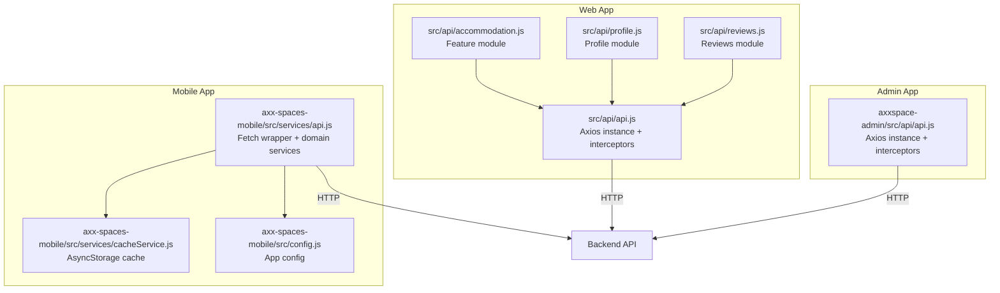

**Diagram sources**
- [src/api/api.js:1-47](file://src/api/api.js#L1-L47)
- [src/api/accommodation.js:1-191](file://src/api/accommodation.js#L1-L191)
- [src/api/profile.js:1-60](file://src/api/profile.js#L1-L60)
- [src/api/reviews.js:1-127](file://src/api/reviews.js#L1-L127)
- [axx-spaces-mobile/src/services/api.js:1-194](file://axx-spaces-mobile/src/services/api.js#L1-L194)
- [axx-spaces-mobile/src/services/cacheService.js:1-198](file://axx-spaces-mobile/src/services/cacheService.js#L1-L198)
- [axx-spaces-mobile/src/config.js:1-44](file://axx-spaces-mobile/src/config.js#L1-L44)
- [axxspace-admin/src/api/api.js:1-22](file://axxspace-admin/src/api/api.js#L1-L22)

**Section sources**
- [src/api/api.js:1-47](file://src/api/api.js#L1-L47)
- [axx-spaces-mobile/src/services/api.js:1-194](file://axx-spaces-mobile/src/services/api.js#L1-L194)
- [axxspace-admin/src/api/api.js:1-22](file://axxspace-admin/src/api/api.js#L1-L22)

## Core Components
- Web Axios client:
  - Base URL from environment variable or fallback
  - Timeout set to prevent hanging
  - Request interceptor attaches Bearer token from localStorage and logs requests
  - Response interceptor logs responses and errors, categorizes error types
- Mobile fetch wrapper:
  - Central apiCall function adds Authorization header when enabled
  - Token retrieved securely via SecureStore
  - Domain services encapsulate endpoints for auth, properties, tourism, business, materials, movers, user, notifications, wallet
- Admin Axios client:
  - Base URL from environment variable or fallback
  - Request interceptor attaches Bearer token from localStorage and logs requests
  - Response interceptor logs responses and errors

Key responsibilities:
- Authentication: tokens are attached to requests; mobile uses SecureStore, web/admin use localStorage
- Error handling: centralized logging and error propagation
- Caching: mobile app includes a robust cache service with TTL management
- Logging: console-based request/response logging in all clients

**Section sources**
- [src/api/api.js:1-47](file://src/api/api.js#L1-L47)
- [axx-spaces-mobile/src/services/api.js:1-194](file://axx-spaces-mobile/src/services/api.js#L1-L194)
- [axx-spaces-mobile/src/services/cacheService.js:1-198](file://axx-spaces-mobile/src/services/cacheService.js#L1-L198)
- [axx-spaces-mobile/src/config.js:1-44](file://axx-spaces-mobile/src/config.js#L1-L44)
- [axxspace-admin/src/api/api.js:1-22](file://axxspace-admin/src/api/api.js#L1-L22)

## Architecture Overview
The integration architecture follows a layered approach:
- Presentation layers (pages/screens) call feature-specific API modules or domain services
- API modules/services handle HTTP transport, headers, and basic error handling
- Interceptors (web/admin) centralize auth and logging
- Cache service (mobile) sits alongside API calls to optimize performance and offline support

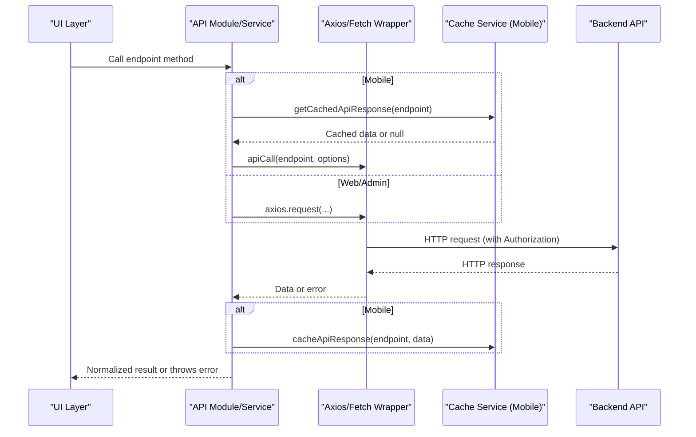

**Diagram sources**
- [src/api/api.js:1-47](file://src/api/api.js#L1-L47)
- [axx-spaces-mobile/src/services/api.js:1-194](file://axx-spaces-mobile/src/services/api.js#L1-L194)
- [axx-spaces-mobile/src/services/cacheService.js:1-198](file://axx-spaces-mobile/src/services/cacheService.js#L1-L198)
- [axxspace-admin/src/api/api.js:1-22](file://axxspace-admin/src/api/api.js#L1-L22)

## Detailed Component Analysis

### Web Axios Instance Configuration and Interceptors
- Axios instance creation:
  - Base URL configured via environment variable with fallback
  - Timeout prevents long-running requests
- Request interceptor:
  - Reads token from localStorage and sets Authorization header
  - Logs method, URL, and payload for debugging
- Response interceptor:
  - Logs successful responses
  - Categorizes and logs errors based on presence of response/request/message
  - Rejects promise with error for upstream handling

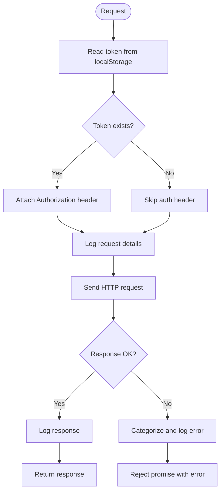

**Diagram sources**
- [src/api/api.js:1-47](file://src/api/api.js#L1-L47)

**Section sources**
- [src/api/api.js:1-47](file://src/api/api.js#L1-L47)

### Mobile API Wrapper and Domain Services
- Central apiCall function:
  - Accepts endpoint and options
  - Adds Content-Type and optional Authorization header
  - Retrieves token from SecureStore when useAuth is true
  - Throws error if response.ok is false
- Domain services:
  - authAPI: login, register, logout
  - propertyAPI: CRUD operations for properties
  - tourismAPI: listing queries and creation
  - businessAPI: business queries and creation
  - materialsAPI: material queries
  - moversAPI: mover queries
  - userAPI: profile and favorites management
  - notificationAPI: notifications list and read marking
  - walletAPI: balance and transactions

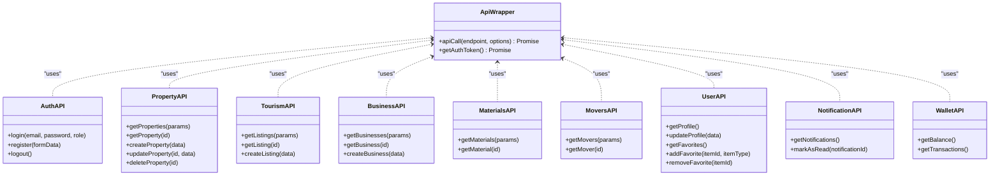

**Diagram sources**
- [axx-spaces-mobile/src/services/api.js:1-194](file://axx-spaces-mobile/src/services/api.js#L1-L194)

**Section sources**
- [axx-spaces-mobile/src/services/api.js:1-194](file://axx-spaces-mobile/src/services/api.js#L1-L194)

### Web Feature Modules: Accommodation, Profile, Reviews
- Accommodation module:
  - Uses fetch with a base URL from environment variable
  - Provides functions for browsing listings, featured items, stats, detail retrieval, view recording
  - Includes normalization helper to standardize backend payloads into consistent shapes
  - Provider endpoints for registration, owner profile, listing updates, and review submission
- Profile module:
  - Fetch-based utilities for reading/updating user profiles
  - Helper to build FormData for file uploads
- Reviews module:
  - Functions for listing, creating, updating, deleting reviews
  - Endpoints for helpful votes, replies, user’s own reviews, and admin approval

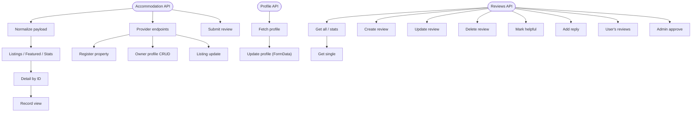

**Diagram sources**
- [src/api/accommodation.js:1-191](file://src/api/accommodation.js#L1-L191)
- [src/api/profile.js:1-60](file://src/api/profile.js#L1-L60)
- [src/api/reviews.js:1-127](file://src/api/reviews.js#L1-L127)

**Section sources**
- [src/api/accommodation.js:1-191](file://src/api/accommodation.js#L1-L191)
- [src/api/profile.js:1-60](file://src/api/profile.js#L1-L60)
- [src/api/reviews.js:1-127](file://src/api/reviews.js#L1-L127)

### Admin Axios Instance Configuration and Interceptors
- Axios instance creation:
  - Base URL from environment variable or fallback
- Request interceptor:
  - Attaches Authorization header from localStorage
  - Logs request details
- Response interceptor:
  - Logs successful responses
  - Logs errors and rejects promises

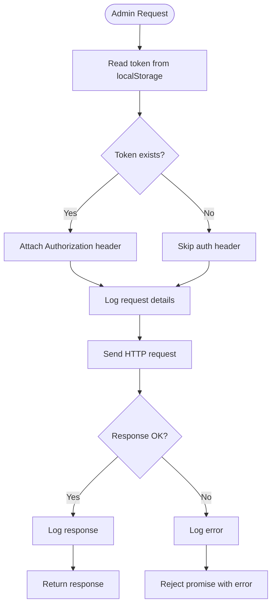

**Diagram sources**
- [axxspace-admin/src/api/api.js:1-22](file://axxspace-admin/src/api/api.js#L1-L22)

**Section sources**
- [axxspace-admin/src/api/api.js:1-22](file://axxspace-admin/src/api/api.js#L1-L22)

### Authentication Flow
- Web app:
  - Auth context initializes session by restoring token/user from localStorage
  - If no saved credentials, performs guest sign-in to obtain token and user
  - Stores token and user in localStorage
- Mobile app:
  - apiCall retrieves token from SecureStore when useAuth is true
  - Adds Authorization header to protected requests
- Admin app:
  - Interceptor reads token from localStorage and attaches it to requests

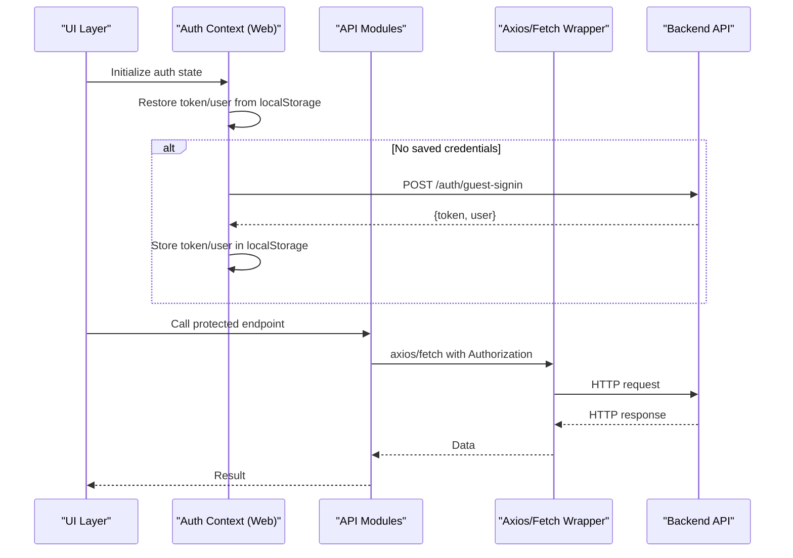

**Diagram sources**
- [src/context/AuthContext.jsx:1-157](file://src/context/AuthContext.jsx#L1-L157)
- [src/api/api.js:1-47](file://src/api/api.js#L1-L47)
- [axx-spaces-mobile/src/services/api.js:1-194](file://axx-spaces-mobile/src/services/api.js#L1-L194)
- [axxspace-admin/src/api/api.js:1-22](file://axxspace-admin/src/api/api.js#L1-L22)

**Section sources**
- [src/context/AuthContext.jsx:1-157](file://src/context/AuthContext.jsx#L1-L157)
- [axx-spaces-mobile/src/services/api.js:1-194](file://axx-spaces-mobile/src/services/api.js#L1-L194)

### Caching Strategies
- Mobile cache service:
  - Stores data with timestamp and TTL
  - Expiration checks on read; removes expired entries
  - Methods for get/set/remove/clear/getSize/clearExpired
  - API response caching helpers keyed by endpoint
  - Prefetch utility to pre-populate cache for multiple endpoints
  - Pattern invalidation and statistics reporting

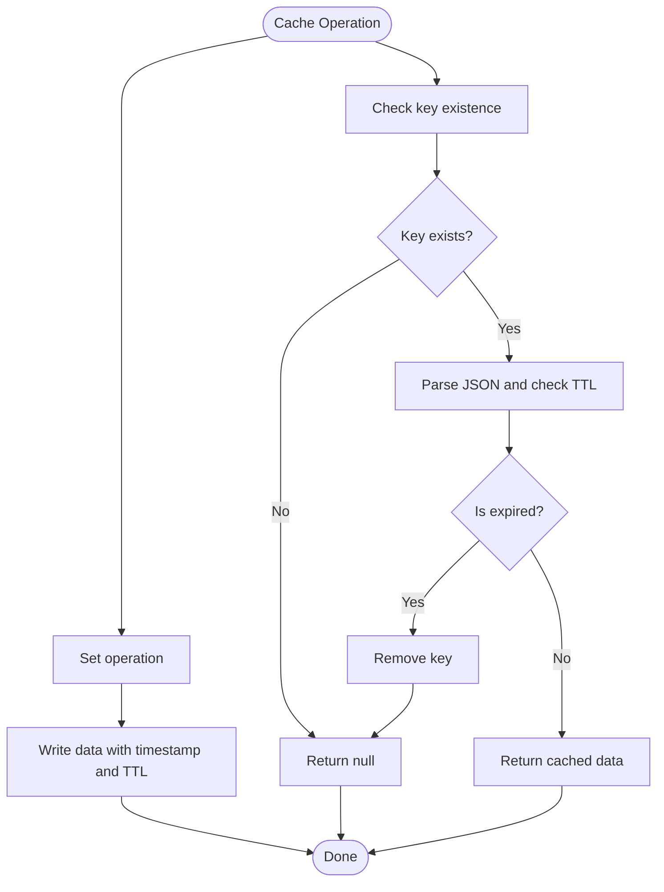

**Diagram sources**
- [axx-spaces-mobile/src/services/cacheService.js:1-198](file://axx-spaces-mobile/src/services/cacheService.js#L1-L198)

**Section sources**
- [axx-spaces-mobile/src/services/cacheService.js:1-198](file://axx-spaces-mobile/src/services/cacheService.js#L1-L198)
- [axx-spaces-mobile/src/config.js:1-44](file://axx-spaces-mobile/src/config.js#L1-L44)

### Error Handling Patterns
- Web Axios:
  - Response interceptor categorizes errors (response present, request present, message only)
  - Logs detailed information including status and payload
- Mobile apiCall:
  - Throws error when response.ok is false, using server-provided error message or generic message
- Web feature modules:
  - parseResponse helper throws errors with server messages or status codes
  - Accommodation module catches JSON parsing failures and returns empty objects before throwing
- Admin Axios:
  - Response interceptor logs errors and rejects promises

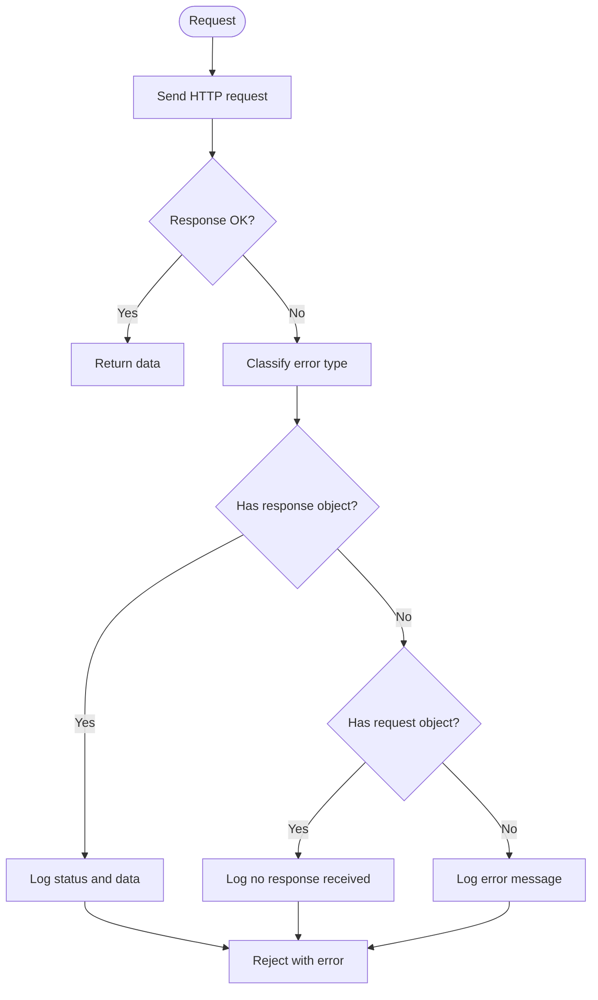

**Diagram sources**
- [src/api/api.js:1-47](file://src/api/api.js#L1-L47)
- [axx-spaces-mobile/src/services/api.js:1-194](file://axx-spaces-mobile/src/services/api.js#L1-L194)
- [src/api/profile.js:1-60](file://src/api/profile.js#L1-L60)
- [axxspace-admin/src/api/api.js:1-22](file://axxspace-admin/src/api/api.js#L1-L22)

**Section sources**
- [src/api/api.js:1-47](file://src/api/api.js#L1-L47)
- [axx-spaces-mobile/src/services/api.js:1-194](file://axx-spaces-mobile/src/services/api.js#L1-L194)
- [src/api/profile.js:1-60](file://src/api/profile.js#L1-L60)
- [axxspace-admin/src/api/api.js:1-22](file://axxspace-admin/src/api/api.js#L1-L22)

### Retry Mechanisms
- Current implementation does not include automatic retry logic at the Axios or fetch wrapper level.
- Recommendations:
  - Add exponential backoff and retry for transient network errors (e.g., 5xx, timeouts)
  - Use a configurable retry policy per endpoint category (read vs write)
  - Integrate with a global error boundary to surface retry prompts to users

[No sources needed since this section provides general guidance]

### Logging Approaches
- Web Axios:
  - Request interceptor logs method, URL, and payload
  - Response interceptor logs response data and error details
- Mobile apiCall:
  - Logs API call errors
- Admin Axios:
  - Request and response interceptors log request/response details and errors

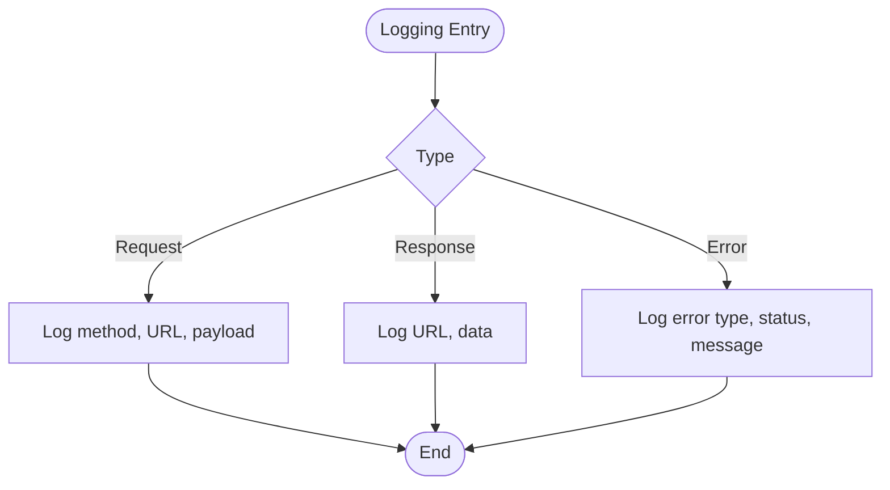

**Diagram sources**
- [src/api/api.js:1-47](file://src/api/api.js#L1-L47)
- [axx-spaces-mobile/src/services/api.js:1-194](file://axx-spaces-mobile/src/services/api.js#L1-L194)
- [axxspace-admin/src/api/api.js:1-22](file://axxspace-admin/src/api/api.js#L1-L22)

**Section sources**
- [src/api/api.js:1-47](file://src/api/api.js#L1-L47)
- [axx-spaces-mobile/src/services/api.js:1-194](file://axx-spaces-mobile/src/services/api.js#L1-L194)
- [axxspace-admin/src/api/api.js:1-22](file://axxspace-admin/src/api/api.js#L1-L22)

## Dependency Analysis
- Web app:
  - Feature modules depend on fetch and environment variables for base URLs
  - Central Axios client is used for authenticated requests with interceptors
- Mobile app:
  - Domain services depend on the central apiCall wrapper
  - Cache service depends on AsyncStorage and CONFIG for TTL
- Admin app:
  - Axios client depends on environment variables and localStorage for token

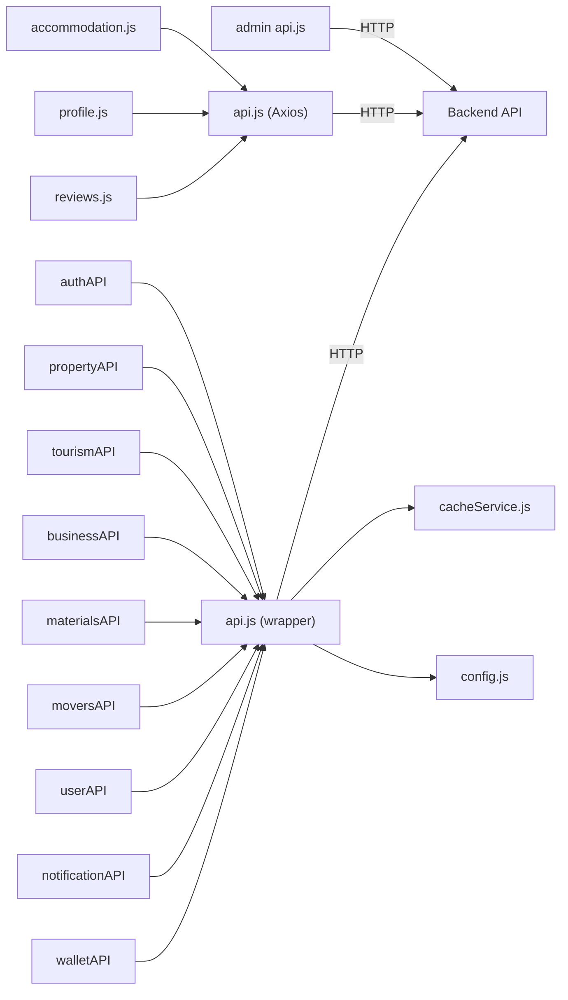

**Diagram sources**
- [src/api/api.js:1-47](file://src/api/api.js#L1-L47)
- [src/api/accommodation.js:1-191](file://src/api/accommodation.js#L1-L191)
- [src/api/profile.js:1-60](file://src/api/profile.js#L1-L60)
- [src/api/reviews.js:1-127](file://src/api/reviews.js#L1-L127)
- [axx-spaces-mobile/src/services/api.js:1-194](file://axx-spaces-mobile/src/services/api.js#L1-L194)
- [axx-spaces-mobile/src/services/cacheService.js:1-198](file://axx-spaces-mobile/src/services/cacheService.js#L1-L198)
- [axx-spaces-mobile/src/config.js:1-44](file://axx-spaces-mobile/src/config.js#L1-L44)
- [axxspace-admin/src/api/api.js:1-22](file://axxspace-admin/src/api/api.js#L1-L22)

**Section sources**
- [src/api/api.js:1-47](file://src/api/api.js#L1-L47)
- [axx-spaces-mobile/src/services/api.js:1-194](file://axx-spaces-mobile/src/services/api.js#L1-L194)
- [axx-spaces-mobile/src/services/cacheService.js:1-198](file://axx-spaces-mobile/src/services/cacheService.js#L1-L198)
- [axx-spaces-mobile/src/config.js:1-44](file://axx-spaces-mobile/src/config.js#L1-L44)
- [axxspace-admin/src/api/api.js:1-22](file://axxspace-admin/src/api/api.js#L1-L22)

## Performance Considerations
- Timeouts:
  - Web Axios client sets a timeout to avoid hanging requests
- Caching:
  - Mobile cache service reduces network calls and supports offline scenarios
  - TTL-based expiration ensures stale data is purged automatically
- Payload normalization:
  - Accommodation module normalizes varied backend structures to consistent shapes, reducing processing overhead in UI layers
- Image/video handling:
  - Accommodation module includes video URL normalization to ensure compatibility
- Pagination:
  - Mobile config defines default and max page sizes to control payload size

Recommendations:
- Implement request deduplication for concurrent identical requests
- Add retry with exponential backoff for transient errors
- Use pagination consistently to limit payload sizes
- Consider lazy loading and virtualization for large lists

[No sources needed since this section provides general guidance]

## Troubleshooting Guide
Common issues and resolutions:
- Missing Authorization header:
  - Ensure token is stored in localStorage (web/admin) or SecureStore (mobile)
  - Verify interceptors/wrapper are attaching headers correctly
- Network errors:
  - Check baseURL configuration and environment variables
  - Inspect console logs from interceptors for detailed error info
- Stale cache data:
  - Clear expired cache entries or invalidate specific keys
  - Adjust TTL values in CONFIG.CACHE.DEFAULT_TTL
- Upload failures:
  - Validate FormData construction and content-type headers
  - Confirm server accepts multipart/form-data where applicable

**Section sources**
- [src/api/api.js:1-47](file://src/api/api.js#L1-L47)
- [axx-spaces-mobile/src/services/api.js:1-194](file://axx-spaces-mobile/src/services/api.js#L1-L194)
- [axx-spaces-mobile/src/services/cacheService.js:1-198](file://axx-spaces-mobile/src/services/cacheService.js#L1-L198)
- [axx-spaces-mobile/src/config.js:1-44](file://axx-spaces-mobile/src/config.js#L1-L44)
- [axxspace-admin/src/api/api.js:1-22](file://axxspace-admin/src/api/api.js#L1-L22)

## Conclusion
The frontend integration layer provides consistent authentication, logging, and error handling across web, mobile, and admin applications. The web app leverages Axios interceptors, while the mobile app uses a fetch wrapper with secure token storage and a robust cache service. Feature modules abstract backend endpoints and normalize payloads for UI consumption. To further improve reliability and performance, consider adding retry mechanisms, request deduplication, and more granular caching strategies.

[No sources needed since this section summarizes without analyzing specific files]

## Appendices

### Adding a New API Endpoint (Web)
Steps:
- Define a function in the appropriate feature module (e.g., accommodation.js, profile.js, reviews.js)
- Use fetch with the base URL from environment variables
- Handle JSON parsing and error cases
- Normalize response data if necessary

Example reference paths:
- [src/api/accommodation.js:81-110](file://src/api/accommodation.js#L81-L110)
- [src/api/profile.js:16-32](file://src/api/profile.js#L16-L32)
- [src/api/reviews.js:4-24](file://src/api/reviews.js#L4-L24)

**Section sources**
- [src/api/accommodation.js:1-191](file://src/api/accommodation.js#L1-L191)
- [src/api/profile.js:1-60](file://src/api/profile.js#L1-L60)
- [src/api/reviews.js:1-127](file://src/api/reviews.js#L1-L127)

### Adding a New API Endpoint (Mobile)
Steps:
- Extend the relevant domain service in axx-spaces-mobile/src/services/api.js
- Use apiCall with method, body, and headers as needed
- Optionally integrate with cacheService for GET endpoints

Example reference paths:
- [axx-spaces-mobile/src/services/api.js:79-102](file://axx-spaces-mobile/src/services/api.js#L79-L102)
- [axx-spaces-mobile/src/services/api.js:156-177](file://axx-spaces-mobile/src/services/api.js#L156-L177)

**Section sources**
- [axx-spaces-mobile/src/services/api.js:1-194](file://axx-spaces-mobile/src/services/api.js#L1-L194)

### Implementing Custom Interceptors (Web/Admin)
Steps:
- Modify the Axios instance in src/api/api.js or axxspace-admin/src/api/api.js
- Add request/response interceptors for additional headers, logging, or transformations
- Ensure error handling rejects promises appropriately

Example reference paths:
- [src/api/api.js:10-44](file://src/api/api.js#L10-L44)
- [axxspace-admin/src/api/api.js:7-20](file://axxspace-admin/src/api/api.js#L7-L20)

**Section sources**
- [src/api/api.js:1-47](file://src/api/api.js#L1-L47)
- [axxspace-admin/src/api/api.js:1-22](file://axxspace-admin/src/api/api.js#L1-L22)

### Optimizing Network Requests
Recommendations:
- Enable caching for read-heavy endpoints in mobile using cacheService
- Normalize payloads early to reduce UI processing
- Use pagination and limit parameters to minimize payload sizes
- Add retry with exponential backoff for transient errors
- Deduplicate concurrent identical requests

[No sources needed since this section provides general guidance]