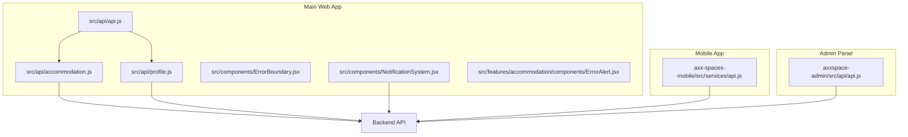
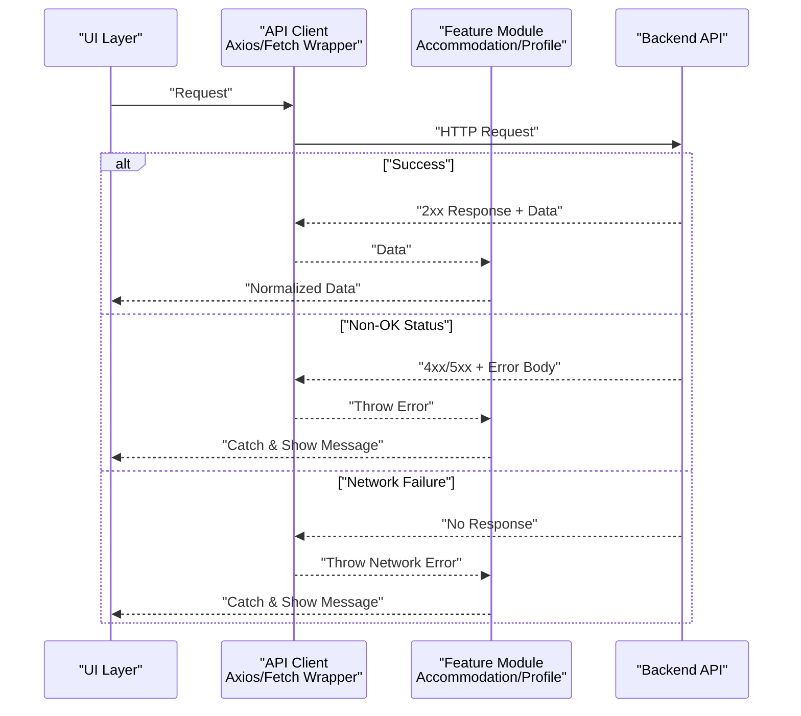
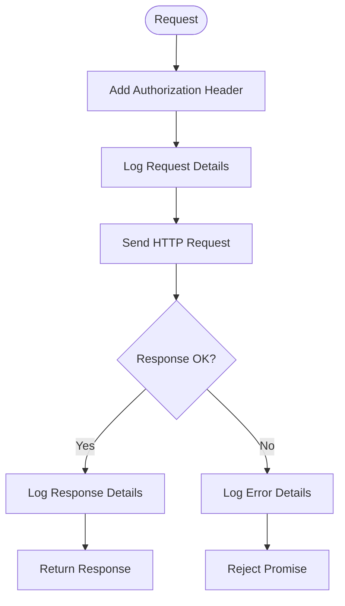
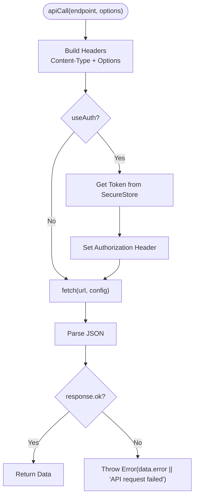
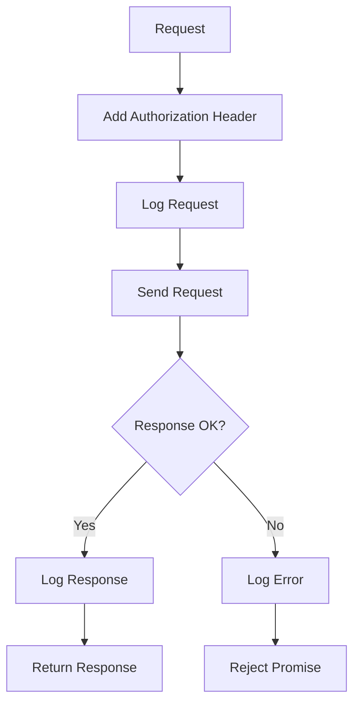
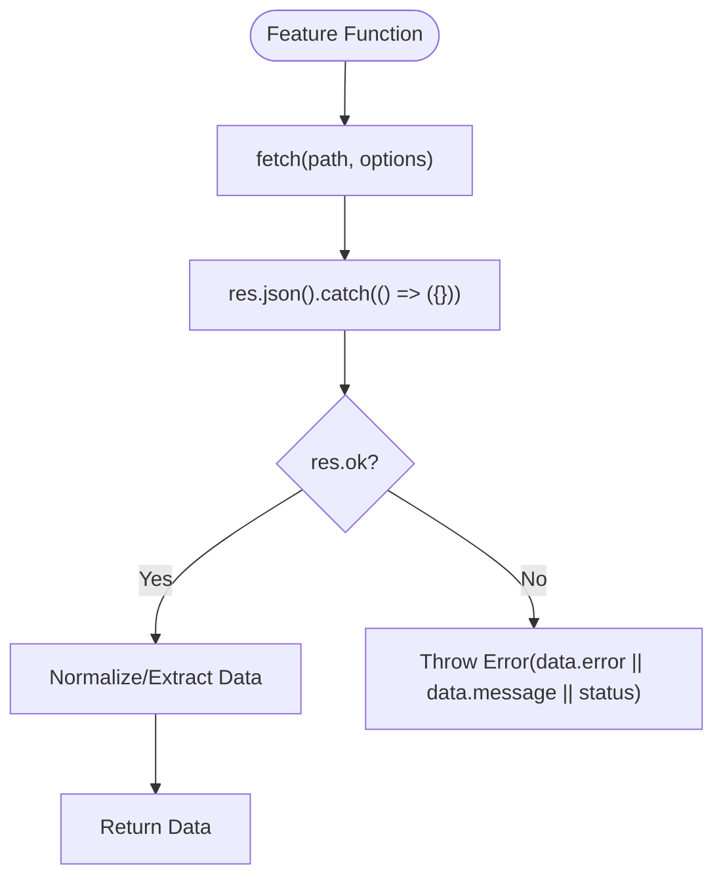
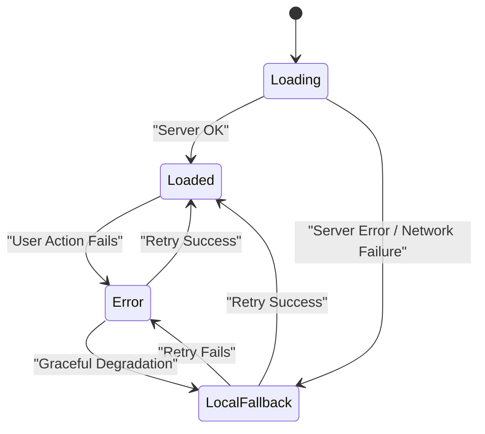
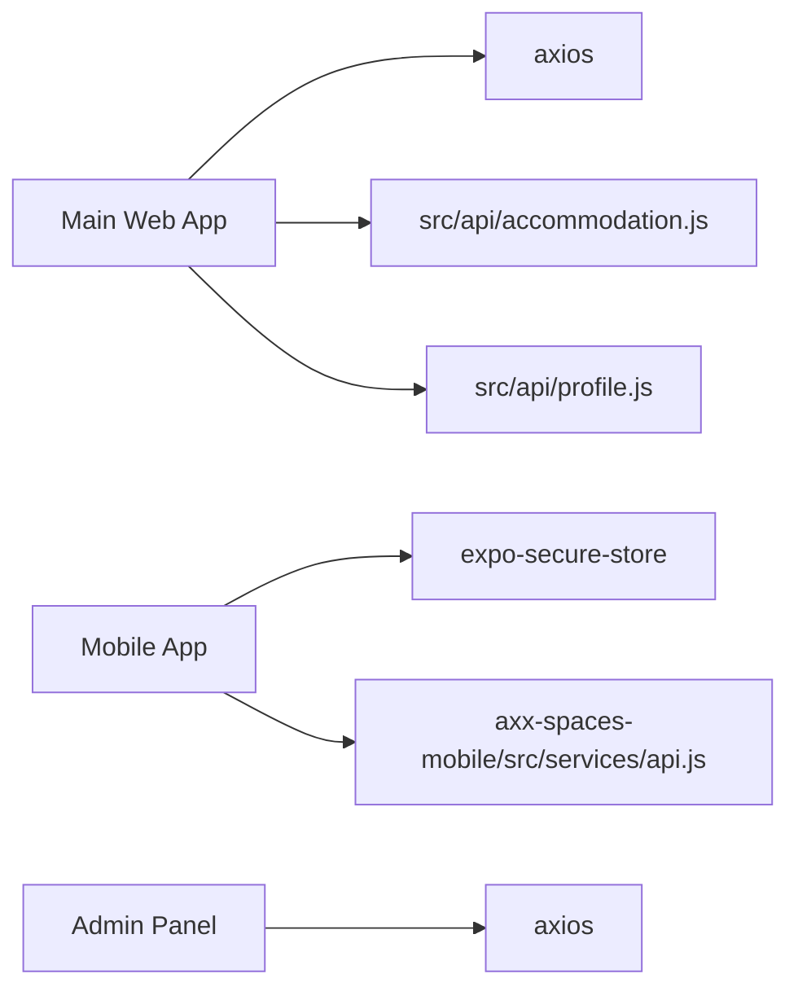

# Error Handling Strategies

<cite>
**Referenced Files in This Document**
- [src/api/api.js](file://src/api/api.js)
- [axx-spaces-mobile/src/services/api.js](file://axx-spaces-mobile/src/services/api.js)
- [axxspace-admin/src/api/api.js](file://axxspace-admin/src/api/api.js)
- [src/api/accommodation.js](file://src/api/accommodation.js)
- [src/api/profile.js](file://src/api/profile.js)
- [src/components/ErrorBoundary.jsx](file://src/components/ErrorBoundary.jsx)
- [src/components/NotificationSystem.jsx](file://src/components/NotificationSystem.jsx)
- [src/features/accommodation/components/ErrorAlert.jsx](file://src/features/accommodation/components/ErrorAlert.jsx)
</cite>

## Table of Contents
1. [Introduction](#introduction)
2. [Project Structure](#project-structure)
3. [Core Components](#core-components)
4. [Architecture Overview](#architecture-overview)
5. [Detailed Component Analysis](#detailed-component-analysis)
6. [Dependency Analysis](#dependency-analysis)
7. [Performance Considerations](#performance-considerations)
8. [Troubleshooting Guide](#troubleshooting-guide)
9. [Conclusion](#conclusion)

## Introduction
This document explains error handling strategies across the API integration layer for the frontend applications (main web app, mobile app, and admin panel). It covers network errors, HTTP status code processing, validation errors, business logic exceptions, user-facing messages, logging mechanisms, retry patterns, graceful degradation, debugging techniques, monitoring integration, and performance considerations.

## Project Structure
The repository contains three application entry points that integrate with a shared backend:
- Main web app: uses an Axios client with interceptors for request/response logging and auth token injection.
- Mobile app: uses a fetch-based wrapper with optional authentication and centralized error throwing.
- Admin panel: uses an Axios client with minimal logging and auth token injection.

**Diagram sources**
- [src/api/api.js:1-47](file://src/api/api.js#L1-L47)
- [src/api/accommodation.js:1-191](file://src/api/accommodation.js#L1-L191)
- [src/api/profile.js:1-60](file://src/api/profile.js#L1-L60)
- [axx-spaces-mobile/src/services/api.js:1-194](file://axx-spaces-mobile/src/services/api.js#L1-L194)
- [axxspace-admin/src/api/api.js:1-22](file://axxspace-admin/src/api/api.js#L1-L22)
- [src/components/ErrorBoundary.jsx:1-78](file://src/components/ErrorBoundary.jsx#L1-L78)
- [src/components/NotificationSystem.jsx:1-472](file://src/components/NotificationSystem.jsx#L1-L472)
- [src/features/accommodation/components/ErrorAlert.jsx:1-40](file://src/features/accommodation/components/ErrorAlert.jsx#L1-L40)

**Section sources**
- [src/api/api.js:1-47](file://src/api/api.js#L1-L47)
- [axx-spaces-mobile/src/services/api.js:1-194](file://axx-spaces-mobile/src/services/api.js#L1-L194)
- [axxspace-admin/src/api/api.js:1-22](file://axxspace-admin/src/api/api.js#L1-L22)

## Core Components
- Axios client with interceptors (main web): centralizes auth header injection and request/response logging; rejects on errors after logging details.
- Fetch wrapper (mobile): standardized apiCall function throws typed errors for non-OK responses; handles token retrieval from secure storage.
- Feature-specific modules (accommodation, profile): encapsulate domain endpoints, normalize data, and throw consistent errors.
- UI-level error handling: ErrorBoundary catches render-time errors; NotificationSystem demonstrates graceful degradation to local state when server is unavailable; ErrorAlert provides user-friendly messaging and retry actions.

Key responsibilities:
- Network error handling: detect missing response or transport failures and log them.
- HTTP status processing: treat non-OK responses as errors and surface message fields.
- Validation/business errors: propagate server-provided error messages to callers.
- User experience: provide friendly messages and retry options where appropriate.
- Logging: console-based logs at request/response boundaries.

**Section sources**
- [src/api/api.js:10-44](file://src/api/api.js#L10-L44)
- [axx-spaces-mobile/src/services/api.js:7-45](file://axx-spaces-mobile/src/services/api.js#L7-L45)
- [src/api/accommodation.js:7-14](file://src/api/accommodation.js#L7-L14)
- [src/api/profile.js:10-14](file://src/api/profile.js#L10-L14)
- [src/components/ErrorBoundary.jsx:9-15](file://src/components/ErrorBoundary.jsx#L9-L15)
- [src/components/NotificationSystem.jsx:25-55](file://src/components/NotificationSystem.jsx#L25-L55)
- [src/features/accommodation/components/ErrorAlert.jsx:1-40](file://src/features/accommodation/components/ErrorAlert.jsx#L1-L40)

## Architecture Overview
Error handling flows through layered components:
- Transport layer (Axios/fetch) performs requests and returns responses or throws network errors.
- API modules parse responses, validate status codes, and convert server errors into JavaScript errors with user-friendly messages.
- UI layers catch errors, display user feedback, and optionally retry operations.

**Diagram sources**
- [src/api/api.js:27-44](file://src/api/api.js#L27-L44)
- [axx-spaces-mobile/src/services/api.js:32-44](file://axx-spaces-mobile/src/services/api.js#L32-L44)
- [src/api/accommodation.js:7-14](file://src/api/accommodation.js#L7-L14)
- [src/api/profile.js:10-14](file://src/api/profile.js#L10-L14)

## Detailed Component Analysis

### Main Web App: Axios Client Interceptors
- Adds Authorization header if token exists.
- Logs request and response details for debugging.
- On response error, logs status/data/request/message and rethrows.

**Diagram sources**
- [src/api/api.js:10-24](file://src/api/api.js#L10-L24)
- [src/api/api.js:27-44](file://src/api/api.js#L27-L44)

**Section sources**
- [src/api/api.js:1-47](file://src/api/api.js#L1-L47)

### Mobile App: Fetch Wrapper and Auth Token Handling
- Centralized apiCall builds headers, injects token via SecureStore, and throws errors for non-OK responses.
- Provides feature-scoped APIs (auth, property, tourism, etc.) that reuse apiCall.

**Diagram sources**
- [axx-spaces-mobile/src/services/api.js:7-45](file://axx-spaces-mobile/src/services/api.js#L7-L45)
- [axx-spaces-mobile/src/services/api.js:47-56](file://axx-spaces-mobile/src/services/api.js#L47-L56)

**Section sources**
- [axx-spaces-mobile/src/services/api.js:1-194](file://axx-spaces-mobile/src/services/api.js#L1-L194)

### Admin Panel: Minimal Axios Client
- Injects Authorization header and logs request/response/error for quick debugging.

**Diagram sources**
- [axxspace-admin/src/api/api.js:7-20](file://axxspace-admin/src/api/api.js#L7-L20)

**Section sources**
- [axxspace-admin/src/api/api.js:1-22](file://axxspace-admin/src/api/api.js#L1-L22)

### Feature Modules: Accommodation and Profile
- Accommodation module defines a request helper that parses JSON safely, throws errors for non-OK responses, and normalizes data.
- Profile module defines a parseResponse helper that converts non-OK responses into errors and extracts user data.

**Diagram sources**
- [src/api/accommodation.js:7-14](file://src/api/accommodation.js#L7-L14)
- [src/api/profile.js:10-14](file://src/api/profile.js#L10-L14)

**Section sources**
- [src/api/accommodation.js:1-191](file://src/api/accommodation.js#L1-L191)
- [src/api/profile.js:1-60](file://src/api/profile.js#L1-L60)

### UI-Level Error Handling and Graceful Degradation
- ErrorBoundary catches rendering errors and shows a user-friendly fallback with refresh and navigation actions.
- NotificationSystem attempts server calls; on failure, it falls back to local storage to keep the UI functional.
- ErrorAlert renders user-facing error messages and offers a retry action.

**Diagram sources**
- [src/components/ErrorBoundary.jsx:9-15](file://src/components/ErrorBoundary.jsx#L9-L15)
- [src/components/NotificationSystem.jsx:25-55](file://src/components/NotificationSystem.jsx#L25-L55)
- [src/features/accommodation/components/ErrorAlert.jsx:1-40](file://src/features/accommodation/components/ErrorAlert.jsx#L1-L40)

**Section sources**
- [src/components/ErrorBoundary.jsx:1-78](file://src/components/ErrorBoundary.jsx#L1-L78)
- [src/components/NotificationSystem.jsx:1-472](file://src/components/NotificationSystem.jsx#L1-L472)
- [src/features/accommodation/components/ErrorAlert.jsx:1-40](file://src/features/accommodation/components/ErrorAlert.jsx#L1-L40)

## Dependency Analysis
- Main web app depends on axios; feature modules depend on the base client or use fetch directly.
- Mobile app depends on expo-secure-store for token persistence.
- Admin panel depends on axios and environment variables for base URL.

**Diagram sources**
- [src/api/api.js:1-8](file://src/api/api.js#L1-L8)
- [axx-spaces-mobile/src/services/api.js:47-56](file://axx-spaces-mobile/src/services/api.js#L47-L56)
- [axxspace-admin/src/api/api.js:1-5](file://axxspace-admin/src/api/api.js#L1-L5)

**Section sources**
- [src/api/api.js:1-8](file://src/api/api.js#L1-L8)
- [axx-spaces-mobile/src/services/api.js:47-56](file://axx-spaces-mobile/src/services/api.js#L47-L56)
- [axxspace-admin/src/api/api.js:1-5](file://axxspace-admin/src/api/api.js#L1-L5)

## Performance Considerations
- Timeouts: The main web Axios client sets a timeout to avoid hanging requests.
- Logging overhead: Console logs on every request/response can impact performance in production; consider gating logs by environment or using a structured logger.
- Parsing safety: Using .json().catch(...) prevents crashes on malformed responses but may hide issues; ensure proper error classification.
- Token retrieval: Mobile SecureStore access adds latency; cache tokens in memory during a session to reduce repeated reads.
- Retry strategy: Avoid aggressive retries for idempotent GETs; limit retries for mutations to prevent duplicate side effects.

[No sources needed since this section provides general guidance]

## Troubleshooting Guide
Common issues and remedies:
- Missing Authorization header: Ensure tokens are present in localStorage (web/admin) or SecureStore (mobile).
- Non-OK HTTP responses: Inspect error.response.data for server-provided messages; map status codes to user-friendly messages.
- Network failures: Differentiate between no response and invalid response; show offline-friendly states and allow retries.
- UI crashes: Wrap critical routes with ErrorBoundary to prevent white screens and offer recovery actions.
- Notifications not loading: If server fails, verify fallback to local storage; check CORS and network policies.

Recommended debugging steps:
- Enable detailed request/response logs in development only.
- Validate environment variables (VITE_API_URL, REACT_APP_API_URL).
- Use browser dev tools to inspect network payloads and headers.
- For mobile, verify SecureStore availability and permissions.

**Section sources**
- [src/api/api.js:10-44](file://src/api/api.js#L10-L44)
- [axx-spaces-mobile/src/services/api.js:7-45](file://axx-spaces-mobile/src/services/api.js#L7-L45)
- [axxspace-admin/src/api/api.js:7-20](file://axxspace-admin/src/api/api.js#L7-L20)
- [src/components/ErrorBoundary.jsx:9-15](file://src/components/ErrorBoundary.jsx#L9-L15)
- [src/components/NotificationSystem.jsx:25-55](file://src/components/NotificationSystem.jsx#L25-L55)

## Conclusion
The API integration layer employs consistent error handling across platforms:
- Centralized clients handle auth and logging.
- Feature modules normalize data and throw uniform errors.
- UI components provide user-friendly feedback and graceful degradation.
To improve further, introduce structured error types, centralized error reporting, controlled retry logic, and environment-aware logging.

[No sources needed since this section summarizes without analyzing specific files]