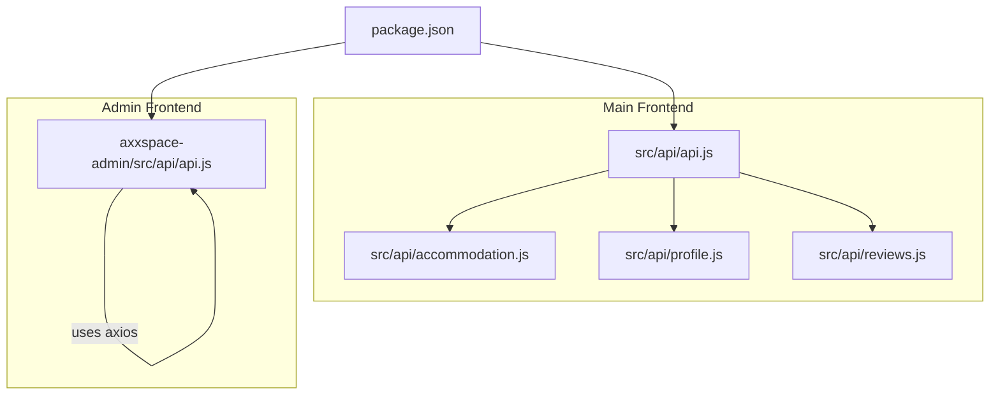
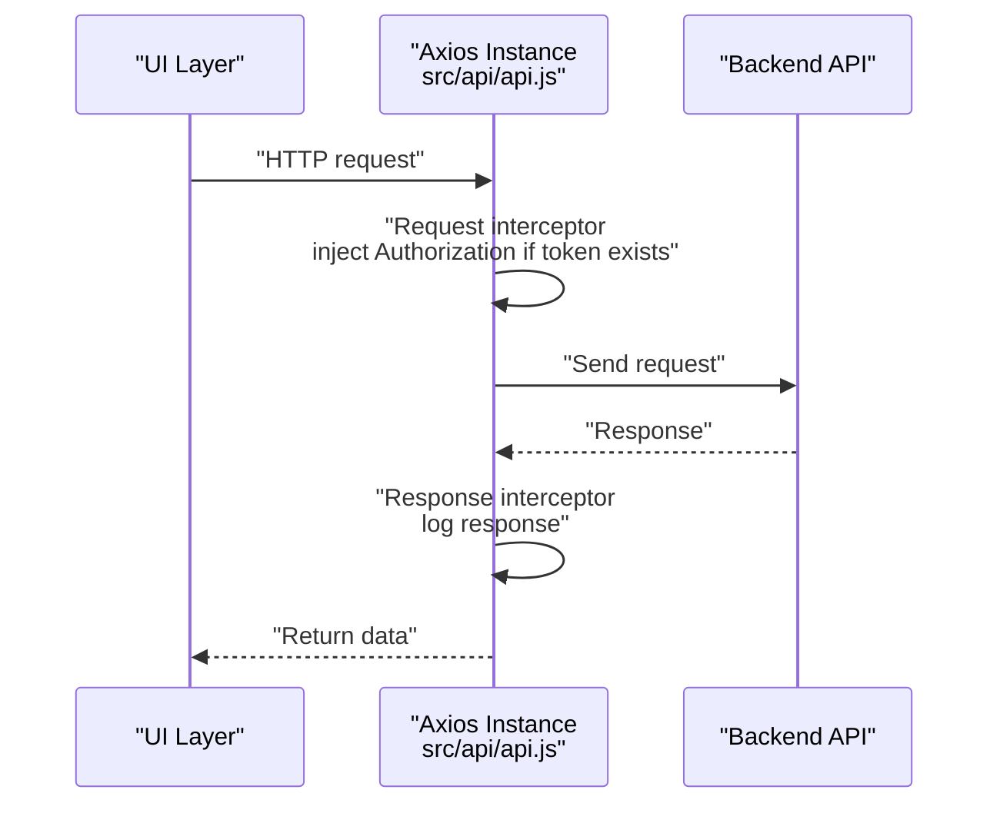
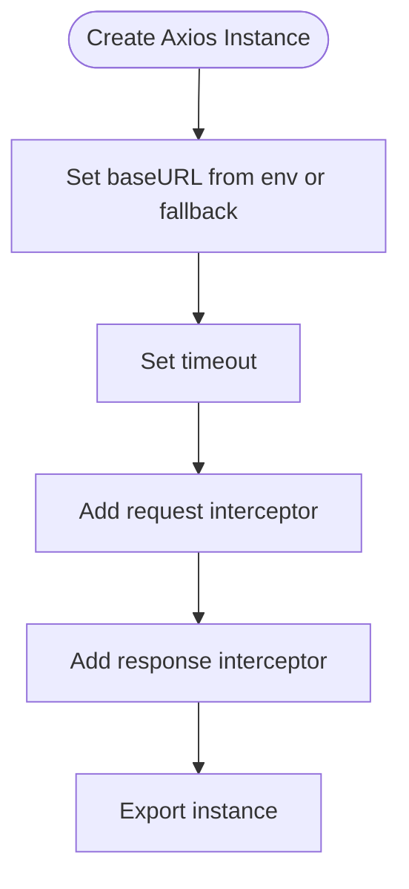
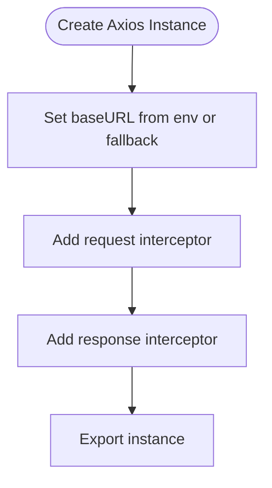
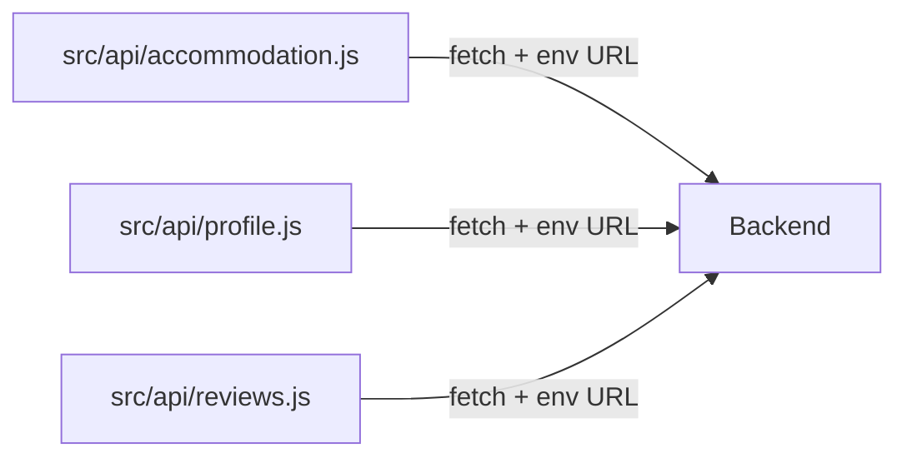
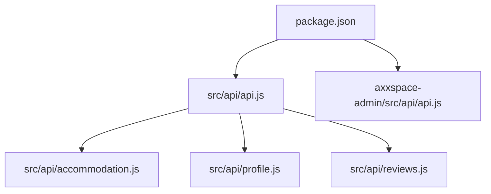

# HTTP Client Configuration

<cite>
**Referenced Files in This Document**
- [package.json](file://package.json)
- [src/api/api.js](file://src/api/api.js)
- [axxspace-admin/src/api/api.js](file://axxspace-admin/src/api/api.js)
- [src/api/accommodation.js](file://src/api/accommodation.js)
- [src/api/profile.js](file://src/api/profile.js)
- [src/api/reviews.js](file://src/api/reviews.js)
</cite>

## Table of Contents
1. [Introduction](#introduction)
2. [Project Structure](#project-structure)
3. [Core Components](#core-components)
4. [Architecture Overview](#architecture-overview)
5. [Detailed Component Analysis](#detailed-component-analysis)
6. [Dependency Analysis](#dependency-analysis)
7. [Performance Considerations](#performance-considerations)
8. [Troubleshooting Guide](#troubleshooting-guide)
9. [Conclusion](#conclusion)

## Introduction
This document explains how the frontend configures and uses HTTP clients to communicate with the backend. It focuses on Axios-based configuration (base URL, default headers, timeouts, instance creation), interceptor patterns for token injection and error handling, and environment-specific setup. It also provides guidance for customizing the client, adding interceptors, and troubleshooting common network and authentication issues.

## Project Structure
The project contains two frontends:
- Main frontend under src/ using Vite and Axios for API calls.
- Admin frontend under axxspace-admin/ using Create React App conventions and Axios for API calls.

**Diagram sources**
- [src/api/api.js:1-47](file://src/api/api.js#L1-L47)
- [axxspace-admin/src/api/api.js:1-22](file://axxspace-admin/src/api/api.js#L1-L22)
- [package.json:12-16](file://package.json#L12-L16)

**Section sources**
- [package.json:12-16](file://package.json#L12-L16)

## Core Components
- Axios is used as the primary HTTP client in both frontends.
- The main frontend creates an Axios instance with a base URL from environment variables, sets a timeout, and attaches request/response interceptors for logging and automatic Authorization header injection.
- The admin frontend similarly creates an Axios instance with its own base URL and interceptors.

Key responsibilities:
- Centralized configuration via Axios instances.
- Automatic token injection into requests.
- Centralized logging and error handling through interceptors.
- Environment-driven base URLs.

**Section sources**
- [src/api/api.js:1-47](file://src/api/api.js#L1-L47)
- [axxspace-admin/src/api/api.js:1-22](file://axxspace-admin/src/api/api.js#L1-L22)

## Architecture Overview
The HTTP layer consists of:
- Axios instances configured per application (main and admin).
- Interceptors that inject tokens and log requests/responses.
- Feature modules that call endpoints directly or via fetch when needed.

**Diagram sources**
- [src/api/api.js:11-24](file://src/api/api.js#L11-L24)
- [src/api/api.js:27-44](file://src/api/api.js#L27-L44)

## Detailed Component Analysis

### Axios Instance: Main Frontend
- Base URL: Resolved from environment variable; falls back to a local development URL.
- Timeout: Configured to prevent hanging requests.
- Request Interceptor: Reads a token from storage and adds it to the Authorization header when present; logs outgoing requests.
- Response Interceptor: Logs successful responses and detailed error information for failed responses.

**Diagram sources**
- [src/api/api.js:3-8](file://src/api/api.js#L3-L8)
- [src/api/api.js:11-24](file://src/api/api.js#L11-L24)
- [src/api/api.js:27-44](file://src/api/api.js#L27-L44)

**Section sources**
- [src/api/api.js:1-47](file://src/api/api.js#L1-L47)

### Axios Instance: Admin Frontend
- Base URL: Resolved from environment variable; falls back to a production-like URL.
- Request Interceptor: Injects Authorization header when token exists; logs outgoing requests.
- Response Interceptor: Logs responses and errors.

**Diagram sources**
- [axxspace-admin/src/api/api.js:3-5](file://axxspace-admin/src/api/api.js#L3-L5)
- [axxspace-admin/src/api/api.js:7-12](file://axxspace-admin/src/api/api.js#L7-L12)
- [axxspace-admin/src/api/api.js:14-20](file://axxspace-admin/src/api/api.js#L14-L20)

**Section sources**
- [axxspace-admin/src/api/api.js:1-22](file://axxspace-admin/src/api/api.js#L1-L22)

### Non-Axios Fetch Modules
Some feature modules use the native fetch API instead of Axios:
- Accommodation module: Uses fetch with a base URL from environment variables and manual Authorization header injection.
- Profile module: Uses fetch with a base URL from environment variables and manual Authorization header injection.
- Reviews module: Uses fetch with a base URL from environment variables and manual Authorization header injection.

These modules demonstrate alternative patterns where Axios is not used. They still follow consistent practices:
- Centralized base URL via environment variables.
- Manual Authorization header construction.
- Error handling at the module level.

**Diagram sources**
- [src/api/accommodation.js:1-18](file://src/api/accommodation.js#L1-L18)
- [src/api/profile.js:1-14](file://src/api/profile.js#L1-L14)
- [src/api/reviews.js:1-8](file://src/api/reviews.js#L1-L8)

**Section sources**
- [src/api/accommodation.js:1-191](file://src/api/accommodation.js#L1-L191)
- [src/api/profile.js:1-60](file://src/api/profile.js#L1-L60)
- [src/api/reviews.js:1-127](file://src/api/reviews.js#L1-L127)

## Dependency Analysis
- package.json declares axios as a dependency.
- Both frontends import axios and create their own instances.
- Feature modules either use the shared Axios instance or implement fetch-based helpers.

**Diagram sources**
- [package.json:12-16](file://package.json#L12-L16)
- [src/api/api.js:1-47](file://src/api/api.js#L1-L47)
- [axxspace-admin/src/api/api.js:1-22](file://axxspace-admin/src/api/api.js#L1-L22)

**Section sources**
- [package.json:12-16](file://package.json#L12-L16)

## Performance Considerations
- Timeouts: The main Axios instance sets a timeout to avoid long-running requests. Ensure this aligns with expected backend latency.
- Logging: Interceptors log requests and responses. In production, consider reducing verbose logs to minimize overhead.
- Token retrieval: Reading from storage on every request is lightweight but can be optimized by caching the token in memory during a session if needed.

[No sources needed since this section provides general guidance]

## Troubleshooting Guide

Common issues and resolutions:
- Missing or incorrect base URL:
  - Verify environment variables are set correctly for each environment.
  - Confirm the fallback URLs match your intended deployment targets.
- Authentication failures:
  - Ensure the token exists in storage before making authenticated requests.
  - Check that the Authorization header is being injected by the request interceptor.
- Network errors:
  - Inspect response interceptors for detailed error messages and status codes.
  - Validate CORS settings on the backend if requests fail due to cross-origin restrictions.
- Mixed HTTP/HTTPS:
  - Ensure the base URL scheme matches the deployment environment (http vs https).

Operational checks:
- Confirm axios is installed and imported.
- Verify interceptors are attached to the correct Axios instance.
- Review console logs produced by interceptors for request/response details.

**Section sources**
- [src/api/api.js:11-44](file://src/api/api.js#L11-L44)
- [axxspace-admin/src/api/api.js:7-20](file://axxspace-admin/src/api/api.js#L7-L20)

## Conclusion
The frontend uses Axios instances to centralize HTTP configuration, including base URLs, timeouts, and interceptors for token injection and logging. While some modules use fetch, they follow similar patterns for environment configuration and authorization. To extend or customize behavior, add interceptors to the appropriate Axios instance and ensure environment variables are properly configured for each deployment target.

[No sources needed since this section summarizes without analyzing specific files]