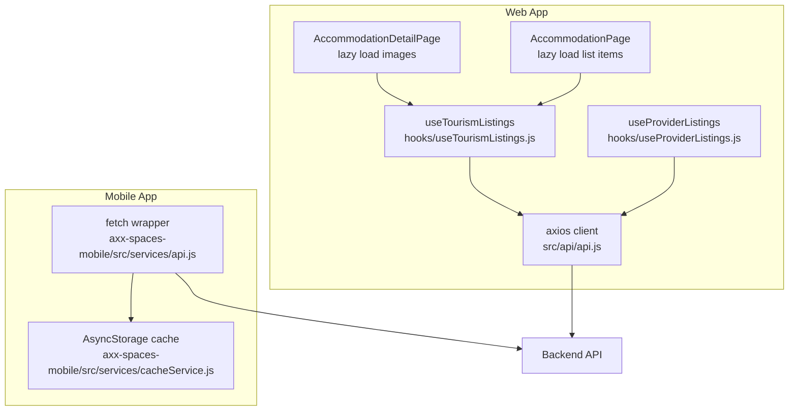
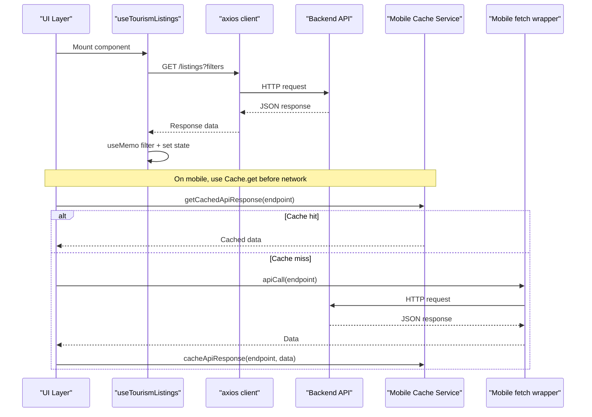
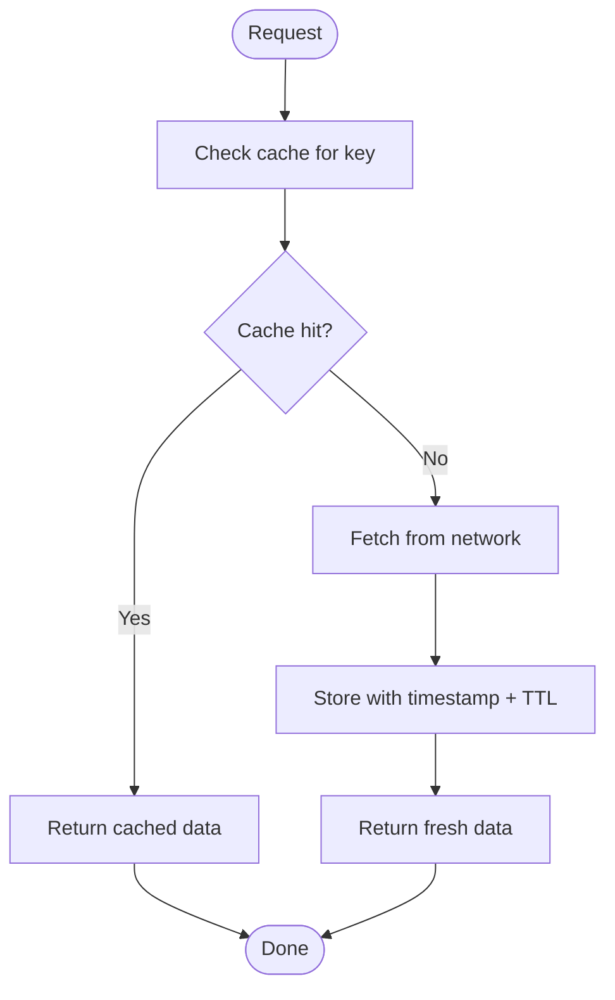
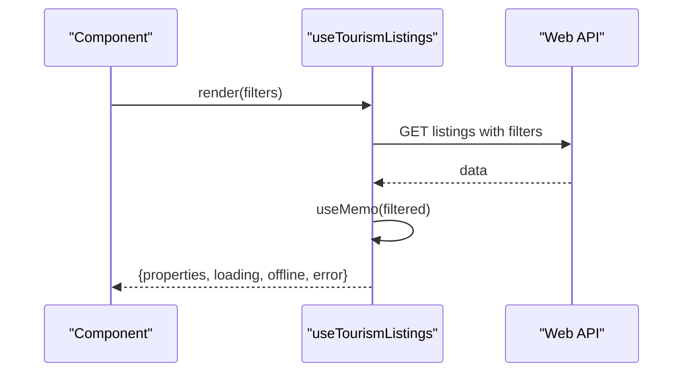
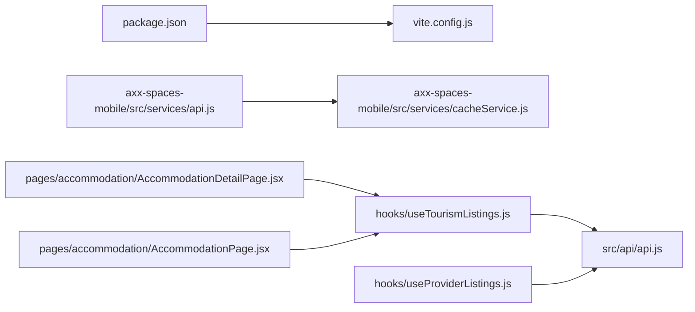

# Performance Optimization

<cite>
**Referenced Files in This Document**
- [api.js](file://src/api/api.js)
- [api.js](file://axx-spaces-mobile/src/services/api.js)
- [cacheService.js](file://axx-spaces-mobile/src/services/cacheService.js)
- [useTourismListings.js](file://src/features/accommodation/hooks/useTourismListings.js)
- [useProviderListings.js](file://src/features/accommodation/hooks/useProviderListings.js)
- [AccommodationDetailPage.jsx](file://src/pages/accommodation/AccommodationDetailPage.jsx)
- [AccommodationPage.jsx](file://src/pages/accommodation/AccommodationPage.jsx)
- [vite.config.js](file://vite.config.js)
- [package.json](file://package.json)
</cite>

## Table of Contents
1. Introduction
2. Project Structure
3. Core Components
4. Architecture Overview
5. Detailed Component Analysis
6. Dependency Analysis
7. Performance Considerations
8. Troubleshooting Guide
9. Conclusion

## Introduction
This document provides comprehensive performance optimization techniques for API interactions and frontend rendering, grounded in the current codebase. It covers request caching, response deduplication, lazy loading, connection pooling via axios, request batching, parallel requests, optimistic updates, pagination handling, large dataset management, bundle size optimization with Vite, tree shaking benefits, memory management for long-running apps, and monitoring/profiling strategies.

## Project Structure
The frontend is a Vite + React application with:
- A shared web API client using axios interceptors for auth and logging.
- A mobile API client using fetch with token retrieval from secure storage.
- A cache service for AsyncStorage-based TTL-managed caching on mobile.
- Feature hooks that orchestrate data fetching and local filtering.
- Lazy loading patterns using IntersectionObserver in listing pages.
- Build configuration optimized for production bundles.

**Diagram sources**
- [api.js:1-47](file://src/api/api.js#L1-L47)
- [api.js:1-194](file://axx-spaces-mobile/src/services/api.js#L1-L194)
- [cacheService.js:1-198](file://axx-spaces-mobile/src/services/cacheService.js#L1-L198)
- [useTourismListings.js:1-51](file://src/features/accommodation/hooks/useTourismListings.js#L1-L51)
- [useProviderListings.js:1-40](file://src/features/accommodation/hooks/useProviderListings.js#L1-L40)
- [AccommodationDetailPage.jsx:221-230](file://src/pages/accommodation/AccommodationDetailPage.jsx#L221-L230)
- [AccommodationPage.jsx:228-236](file://src/pages/accommodation/AccommodationPage.jsx#L228-L236)

**Section sources**
- [api.js:1-47](file://src/api/api.js#L1-L47)
- [api.js:1-194](file://axx-spaces-mobile/src/services/api.js#L1-L194)
- [cacheService.js:1-198](file://axx-spaces-mobile/src/services/cacheService.js#L1-L198)
- [useTourismListings.js:1-51](file://src/features/accommodation/hooks/useTourismListings.js#L1-L51)
- [useProviderListings.js:1-40](file://src/features/accommodation/hooks/useProviderListings.js#L1-L40)
- [AccommodationDetailPage.jsx:221-230](file://src/pages/accommodation/AccommodationDetailPage.jsx#L221-L230)
- [AccommodationPage.jsx:228-236](file://src/pages/accommodation/AccommodationPage.jsx#L228-L236)

## Core Components
- Web API client (axios): Centralizes base URL, timeout, request/response interceptors for authentication and debugging. Provides connection pooling through axios’s default HTTP agent behavior.
- Mobile API client (fetch): Wraps fetch with optional auth header injection and typed endpoints for properties, tourism, business, materials, movers, user, notifications, and wallet.
- Cache service (mobile): TTL-based AsyncStorage cache with helpers to get/set/remove/clear entries, invalidate by pattern, prefetch multiple endpoints concurrently, and report cache stats.
- Data hooks: Encapsulate fetching logic, error/offline states, and local filtering/memoization to reduce re-renders.
- Lazy loading: Uses IntersectionObserver to defer image or item loading until visible.

Key responsibilities:
- Request interception and auth injection
- Error handling and logging
- Caching strategy and TTL management
- Parallel request execution
- Local filtering and memoization
- Lazy rendering for heavy assets

**Section sources**
- [api.js:1-47](file://src/api/api.js#L1-L47)
- [api.js:1-194](file://axx-spaces-mobile/src/services/api.js#L1-L194)
- [cacheService.js:1-198](file://axx-spaces-mobile/src/services/cacheService.js#L1-L198)
- [useTourismListings.js:1-51](file://src/features/accommodation/hooks/useTourismListings.js#L1-L51)
- [useProviderListings.js:1-40](file://src/features/accommodation/hooks/useProviderListings.js#L1-L40)

## Architecture Overview
The system uses layered clients and hooks to manage API performance:
- Axios client handles auth headers and logs requests/responses.
- Mobile client adds secure token retrieval and structured endpoint methods.
- Cache service stores responses with TTL and supports concurrent prefetching.
- Hooks coordinate data fetching, state, and local processing.
- Pages implement lazy loading for media and lists.

**Diagram sources**
- [useTourismListings.js:12-42](file://src/features/accommodation/hooks/useTourismListings.js#L12-L42)
- [api.js:11-24](file://src/api/api.js#L11-L24)
- [api.js:27-44](file://src/api/api.js#L27-L44)
- [api.js:7-45](file://axx-spaces-mobile/src/services/api.js#L7-L45)
- [cacheService.js:112-122](file://axx-spaces-mobile/src/services/cacheService.js#L112-L122)

## Detailed Component Analysis

### Web API Client (Axios Interceptors)
- Adds Authorization header from localStorage when present.
- Logs request and response details for debugging.
- Centralizes timeout and baseURL configuration.
- Connection pooling: axios maintains persistent connections by default, reducing handshake overhead.

Optimization notes:
- Use timeouts to prevent hanging requests.
- Avoid excessive console logs in production builds.
- Consider enabling keep-alive at proxy/CDN level for repeated calls.

**Section sources**
- [api.js:1-47](file://src/api/api.js#L1-L47)

### Mobile API Client (Fetch Wrapper)
- Injects Bearer token from secure storage when enabled.
- Exposes typed modules for domains (properties, tourism, business, etc.).
- Handles JSON parsing and throws errors for non-ok responses.

Optimization notes:
- Batch related reads/writes where possible.
- Reuse headers and avoid redundant token fetches within short intervals.

**Section sources**
- [api.js:1-194](file://axx-spaces-mobile/src/services/api.js#L1-L194)

### Cache Service (TTL-Based AsyncStorage)
- Stores data with timestamps and TTL; auto-expiration on read.
- Supports clearing expired entries, invalidating by pattern, and retrieving cache stats.
- Prefetch utility executes multiple endpoints in parallel and caches results.

Optimization notes:
- Use consistent cache keys per endpoint/query.
- Implement cache invalidation on mutations.
- Monitor cache size and clear periodically to control memory usage.

**Diagram sources**
- [cacheService.js:6-24](file://axx-spaces-mobile/src/services/cacheService.js#L6-L24)
- [cacheService.js:27-40](file://axx-spaces-mobile/src/services/cacheService.js#L27-L40)
- [cacheService.js:112-122](file://axx-spaces-mobile/src/services/cacheService.js#L112-L122)

**Section sources**
- [cacheService.js:1-198](file://axx-spaces-mobile/src/services/cacheService.js#L1-L198)

### Data Hooks (Fetching and Filtering)
- useTourismListings: Manages loading/error/offline states, performs filtered queries, and applies local filtering with useMemo to minimize recomputation.
- useProviderListings: Handles authenticated data loads, error propagation, and exposes reload capability.

Optimization notes:
- Memoize derived data with useMemo.
- Debounce search inputs if needed.
- Cancel in-flight requests on unmount to avoid state updates after cleanup.

**Diagram sources**
- [useTourismListings.js:12-47](file://src/features/accommodation/hooks/useTourismListings.js#L12-L47)

**Section sources**
- [useTourismListings.js:1-51](file://src/features/accommodation/hooks/useTourismListings.js#L1-L51)
- [useProviderListings.js:1-40](file://src/features/accommodation/hooks/useProviderListings.js#L1-L40)

### Lazy Loading Patterns
- Images and list items are loaded lazily using IntersectionObserver to reduce initial payload and improve perceived performance.

Implementation references:
- Image lazy loading in detail page.
- List item lazy loading in listings page.

**Section sources**
- [AccommodationDetailPage.jsx:221-230](file://src/pages/accommodation/AccommodationDetailPage.jsx#L221-L230)
- [AccommodationPage.jsx:228-236](file://src/pages/accommodation/AccommodationPage.jsx#L228-L236)

## Dependency Analysis
- Web API depends on axios for HTTP transport and interceptors.
- Mobile API depends on fetch and secure storage for tokens.
- Cache service depends on AsyncStorage for persistence.
- Hooks depend on API clients and local constants/utilities.
- Pages depend on hooks and lazy-loading utilities.

**Diagram sources**
- [package.json:12-33](file://package.json#L12-L33)
- [vite.config.js:19-30](file://vite.config.js#L19-L30)
- [api.js:1-47](file://src/api/api.js#L1-L47)
- [api.js:1-194](file://axx-spaces-mobile/src/services/api.js#L1-L194)
- [cacheService.js:1-198](file://axx-spaces-mobile/src/services/cacheService.js#L1-L198)
- [useTourismListings.js:1-51](file://src/features/accommodation/hooks/useTourismListings.js#L1-L51)
- [useProviderListings.js:1-40](file://src/features/accommodation/hooks/useProviderListings.js#L1-L40)
- [AccommodationDetailPage.jsx:221-230](file://src/pages/accommodation/AccommodationDetailPage.jsx#L221-L230)
- [AccommodationPage.jsx:228-236](file://src/pages/accommodation/AccommodationPage.jsx#L228-L236)

**Section sources**
- [package.json:12-33](file://package.json#L12-L33)
- [vite.config.js:19-30](file://vite.config.js#L19-L30)

## Performance Considerations

### Request Caching Strategies
- Mobile: Use TTL-based cache with automatic expiration and pattern invalidation.
- Web: Consider adding an in-memory cache layer or leveraging service workers for HTTP caching.

References:
- [cacheService.js:6-24](file://axx-spaces-mobile/src/services/cacheService.js#L6-L24)
- [cacheService.js:112-122](file://axx-spaces-mobile/src/services/cacheService.js#L112-L122)

### Response Deduplication
- Defer duplicate requests while one is in flight by tracking pending promises keyed by endpoint+params.
- Combine with cache: return cached data immediately if available; otherwise start a single network request and share its promise across subscribers.

### Lazy Loading Patterns
- Defer offscreen images and list items using IntersectionObserver to reduce initial render cost.

References:
- [AccommodationDetailPage.jsx:221-230](file://src/pages/accommodation/AccommodationDetailPage.jsx#L221-L230)
- [AccommodationPage.jsx:228-236](file://src/pages/accommodation/AccommodationPage.jsx#L228-L236)

### Connection Pooling
- Axios maintains pooled connections by default, improving throughput for repeated requests.

Reference:
- [api.js:1-8](file://src/api/api.js#L1-L8)

### Request Batching
- Group multiple writes into a single mutation endpoint where supported by the backend.
- For reads, batch parameters into a single query when feasible.

### Parallel Request Handling
- Use Promise.all to execute independent requests concurrently and aggregate results.

Reference:
- [cacheService.js:142-162](file://axx-spaces-mobile/src/services/cacheService.js#L142-L162)

### Optimistic Updates
- Update UI state immediately upon user action, then reconcile with server on success; revert on failure.
- Apply this pattern to favorites, profile edits, and similar write operations.

### Pagination Handling
- Implement cursor/page-based pagination to limit payload sizes.
- Append new pages to existing lists without full re-renders.

### Large Dataset Management
- Virtualize lists to render only visible rows.
- Stream or chunk data on the backend; paginate and merge incrementally on the frontend.

### Bundle Size Optimization and Tree Shaking
- Vite build config enables hashed chunks and disables sourcemaps in production.
- Ensure unused imports are eliminated; prefer dynamic imports for heavy features.

References:
- [vite.config.js:19-30](file://vite.config.js#L19-L30)
- [package.json:12-33](file://package.json#L12-L33)

### Memory Management for Long-Running Applications
- Clear timers, observers, and event listeners on unmount.
- Evict stale cache entries and monitor cache size.
- Avoid retaining large objects in global state; prefer normalized structures.

References:
- [cacheService.js:67-85](file://axx-spaces-mobile/src/services/cacheService.js#L67-L85)
- [cacheService.js:87-110](file://axx-spaces-mobile/src/services/cacheService.js#L87-L110)

## Troubleshooting Guide

Common issues and resolutions:
- Stale cache data: Invalidate cache patterns after mutations or refresh on app resume.
- Network errors: Inspect interceptor logs and status codes; handle offline states gracefully.
- Token missing: Verify secure storage retrieval and ensure Authorization header is attached.
- Memory growth: Periodically clear expired cache entries and monitor cache size metrics.

Relevant implementation points:
- Interceptor logging for requests and responses.
- Error handling paths in API wrappers.
- Cache statistics and cleanup utilities.

**Section sources**
- [api.js:11-24](file://src/api/api.js#L11-L24)
- [api.js:27-44](file://src/api/api.js#L27-L44)
- [api.js:7-45](file://axx-spaces-mobile/src/services/api.js#L7-L45)
- [cacheService.js:175-194](file://axx-spaces-mobile/src/services/cacheService.js#L175-L194)

## Conclusion
By combining axios-based connection pooling, TTL-aware caching, lazy loading, parallel request execution, and careful bundle configuration, the application achieves responsive API interactions and efficient rendering. Extending these patterns with request deduplication, optimistic updates, pagination, and virtualization will further improve performance and scalability for large datasets and long-running sessions. Monitoring and profiling should be integrated to continuously validate performance gains and identify regressions.