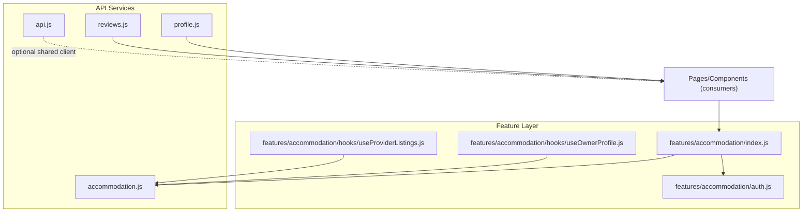
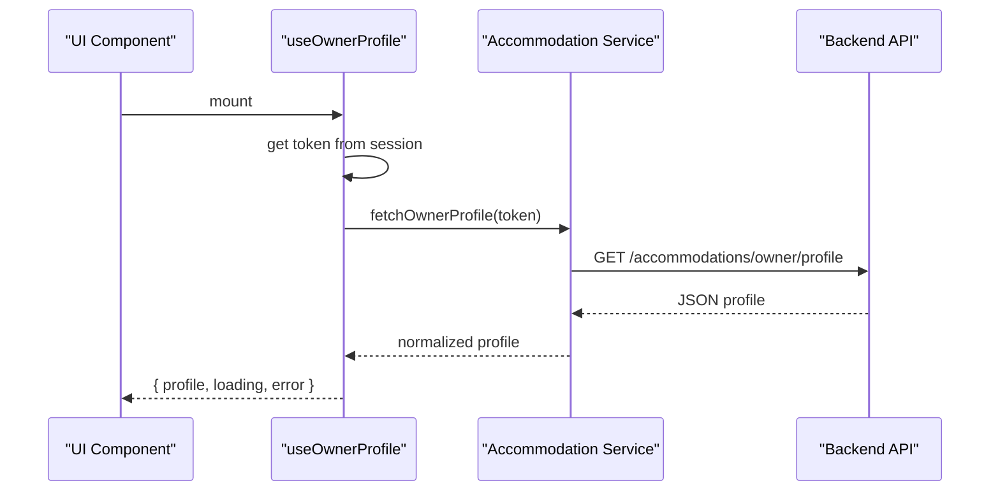
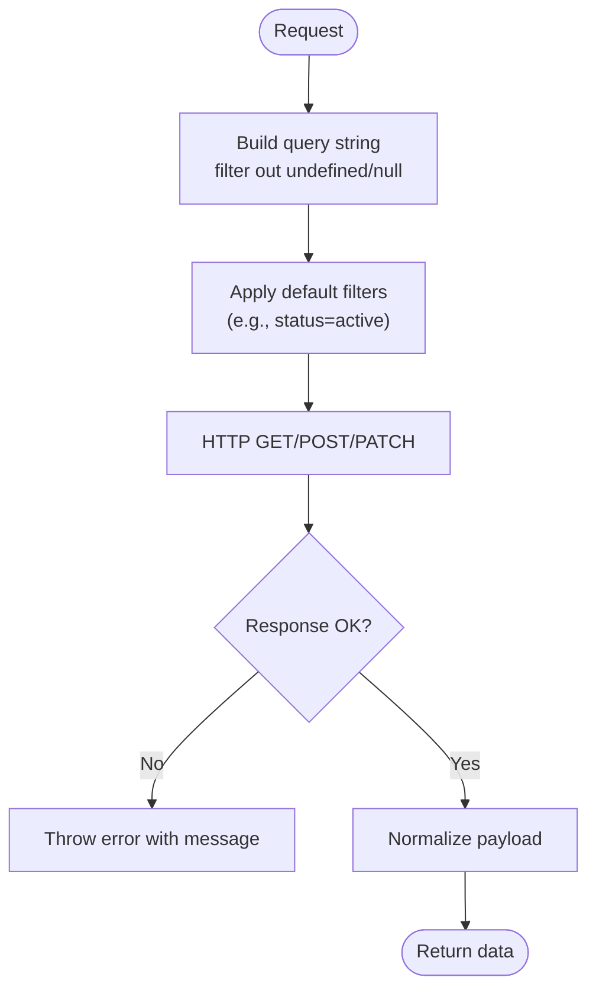
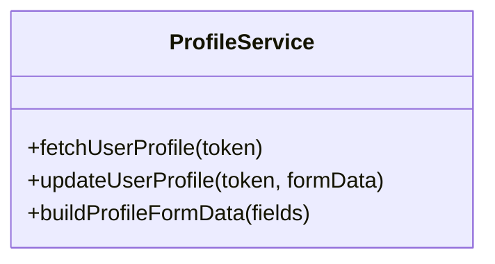
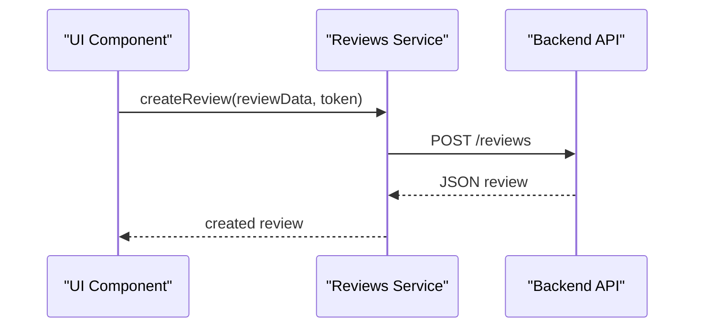
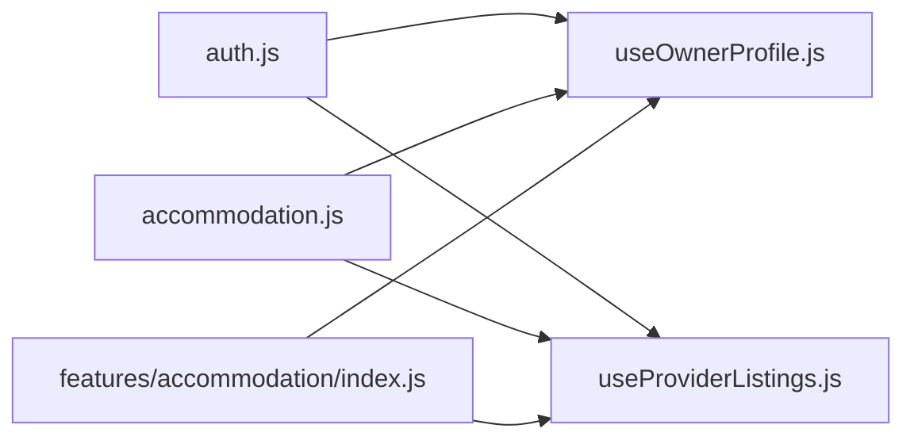
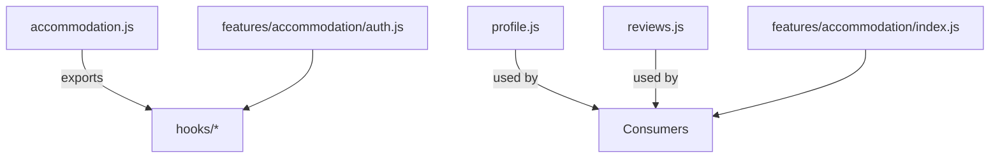

# Service Layer Organization

<cite>
**Referenced Files in This Document**
- [src/api/accommodation.js](file://src/api/accommodation.js)
- [src/api/profile.js](file://src/api/profile.js)
- [src/api/reviews.js](file://src/api/reviews.js)
- [src/api/api.js](file://src/api/api.js)
- [src/features/accommodation/index.js](file://src/features/accommodation/index.js)
- [src/features/accommodation/auth.js](file://src/features/accommodation/auth.js)
- [src/features/accommodation/hooks/useOwnerProfile.js](file://src/features/accommodation/hooks/useOwnerProfile.js)
- [src/features/accommodation/hooks/useProviderListings.js](file://src/features/accommodation/hooks/useProviderListings.js)
</cite>

## Table of Contents
1. [Introduction](#introduction)
2. [Project Structure](#project-structure)
3. [Core Components](#core-components)
4. [Architecture Overview](#architecture-overview)
5. [Detailed Component Analysis](#detailed-component-analysis)
6. [Dependency Analysis](#dependency-analysis)
7. [Performance Considerations](#performance-considerations)
8. [Troubleshooting Guide](#troubleshooting-guide)
9. [Conclusion](#conclusion)

## Introduction
This document explains the service layer organization pattern used across the application, focusing on how API endpoints are abstracted into dedicated service modules, method naming conventions, and parameter validation patterns. It covers:
- Accommodation service for property-related operations
- Profile service for user management
- Reviews service for rating functionality
- Examples for creating new service modules, implementing CRUD operations, and handling complex business logic
- Service composition patterns and dependency management between services

The goal is to make the architecture clear and actionable for both technical and non-technical readers.

## Project Structure
At a high level, the frontend organizes service concerns by feature:
- Dedicated API modules under src/api encapsulate HTTP calls and basic normalization
- Feature-level hooks and utilities compose these APIs with state and domain logic
- Shared configuration and interceptors live in a central API client module

**Diagram sources**
- [src/api/accommodation.js:1-191](file://src/api/accommodation.js#L1-L191)
- [src/api/profile.js:1-60](file://src/api/profile.js#L1-L60)
- [src/api/reviews.js:1-127](file://src/api/reviews.js#L1-L127)
- [src/api/api.js:1-47](file://src/api/api.js#L1-L47)
- [src/features/accommodation/index.js:1-19](file://src/features/accommodation/index.js#L1-L19)
- [src/features/accommodation/auth.js:1-53](file://src/features/accommodation/auth.js#L1-L53)
- [src/features/accommodation/hooks/useOwnerProfile.js:1-33](file://src/features/accommodation/hooks/useOwnerProfile.js#L1-L33)
- [src/features/accommodation/hooks/useProviderListings.js:1-40](file://src/features/accommodation/hooks/useProviderListings.js#L1-L40)

**Section sources**
- [src/api/accommodation.js:1-191](file://src/api/accommodation.js#L1-L191)
- [src/api/profile.js:1-60](file://src/api/profile.js#L1-L60)
- [src/api/reviews.js:1-127](file://src/api/reviews.js#L1-L127)
- [src/api/api.js:1-47](file://src/api/api.js#L1-L47)
- [src/features/accommodation/index.js:1-19](file://src/features/accommodation/index.js#L1-L19)
- [src/features/accommodation/auth.js:1-53](file://src/features/accommodation/auth.js#L1-L53)
- [src/features/accommodation/hooks/useOwnerProfile.js:1-33](file://src/features/accommodation/hooks/useOwnerProfile.js#L1-L33)
- [src/features/accommodation/hooks/useProviderListings.js:1-40](file://src/features/accommodation/hooks/useProviderListings.js#L1-L40)

## Core Components
- Accommodation service: Centralizes all accommodation-related backend calls, normalizes data, and exposes methods for browsing, owner profile, listing management, and reviews submission.
- Profile service: Provides user profile retrieval and updates with FormData helpers.
- Reviews service: Implements full CRUD over reviews plus helper actions like marking helpful and replying.
- Shared API client: Optional centralized Axios instance with interceptors for auth and debugging.

Key responsibilities:
- Encapsulate HTTP requests and error handling
- Normalize heterogeneous backend responses
- Provide typed, predictable interfaces for consumers
- Keep authentication headers consistent

**Section sources**
- [src/api/accommodation.js:1-191](file://src/api/accommodation.js#L1-L191)
- [src/api/profile.js:1-60](file://src/api/profile.js#L1-L60)
- [src/api/reviews.js:1-127](file://src/api/reviews.js#L1-L127)
- [src/api/api.js:1-47](file://src/api/api.js#L1-L47)

## Architecture Overview
The service layer follows a clean separation:
- API modules handle transport and minimal transformation
- Hooks and feature modules add state, caching, and domain logic
- Consumers (pages/components) call hooks or service functions without knowing HTTP details

**Diagram sources**
- [src/features/accommodation/hooks/useOwnerProfile.js:1-33](file://src/features/accommodation/hooks/useOwnerProfile.js#L1-L33)
- [src/api/accommodation.js:147-152](file://src/api/accommodation.js#L147-L152)

## Detailed Component Analysis

### Accommodation Service
Responsibilities:
- Base URL configuration and request wrapper
- Authentication header helper
- Data normalization for accommodations
- Browse endpoints (listings, featured, stats)
- Owner profile and listing management
- Review submission for accommodations

Method naming conventions:
- Action-oriented verbs: fetch*, register*, update*, submit*
- Clear scope: accommodation-specific prefixes where needed

Parameter validation patterns:
- Query parameters built via URLSearchParams with null/undefined filtering
- Status filters applied consistently (e.g., only active listings)
- Error propagation through thrown errors with contextual messages

Normalization strategy:
- Unified shape for id fields, price, category, location, images/videos, ratings, and tags
- Defensive checks for missing or malformed fields

Complex business logic:
- Video URL formatting for specific providers
- Consistent status enforcement for public vs. owner endpoints

**Diagram sources**
- [src/api/accommodation.js:7-14](file://src/api/accommodation.js#L7-L14)
- [src/api/accommodation.js:81-90](file://src/api/accommodation.js#L81-L90)
- [src/api/accommodation.js:34-77](file://src/api/accommodation.js#L34-L77)

**Section sources**
- [src/api/accommodation.js:1-191](file://src/api/accommodation.js#L1-L191)

### Profile Service
Responsibilities:
- Fetch current user profile
- Update user profile with FormData
- Helper to build FormData safely

Method naming conventions:
- fetchUserProfile, updateUserProfile
- buildProfileFormData for safe field appending

Parameter validation patterns:
- Conditional append based on presence of values
- Avoids sending empty or null fields

**Diagram sources**
- [src/api/profile.js:16-32](file://src/api/profile.js#L16-L32)
- [src/api/profile.js:35-59](file://src/api/profile.js#L35-L59)

**Section sources**
- [src/api/profile.js:1-60](file://src/api/profile.js#L1-L60)

### Reviews Service
Responsibilities:
- Full CRUD over reviews
- Stats aggregation endpoint
- User-specific review listing
- Admin actions (approve)
- Engagement actions (mark helpful, reply)

Method naming conventions:
- getAllReviews, getReviewById, createReview, updateReview, deleteReview
- markHelpful, addReply, getUserReviews, approveReview

Parameter validation patterns:
- Query params passed via URLSearchParams
- Auth tokens attached via Authorization header

**Diagram sources**
- [src/api/reviews.js:27-38](file://src/api/reviews.js#L27-L38)

**Section sources**
- [src/api/reviews.js:1-127](file://src/api/reviews.js#L1-L127)

### Shared API Client (Optional)
A centralized Axios instance provides:
- Base URL configuration
- Request/response interceptors for auth and logging
- Timeout configuration

Usage:
- Can be used by features that prefer axios over fetch
- Demonstrates a reusable pattern for global behavior

**Section sources**
- [src/api/api.js:1-47](file://src/api/api.js#L1-L47)

### Service Composition Patterns
- Hooks wrap service calls to manage local state (loading, error, data)
- Feature index files re-export hooks and components for cleaner imports
- Session/auth utilities provide tokens and user context to services

Examples:
- useOwnerProfile composes token retrieval and profile fetching
- useProviderListings composes token retrieval, listing fetch, and derived stats

**Diagram sources**
- [src/features/accommodation/auth.js:1-53](file://src/features/accommodation/auth.js#L1-L53)
- [src/features/accommodation/hooks/useOwnerProfile.js:1-33](file://src/features/accommodation/hooks/useOwnerProfile.js#L1-L33)
- [src/features/accommodation/hooks/useProviderListings.js:1-40](file://src/features/accommodation/hooks/useProviderListings.js#L1-L40)
- [src/features/accommodation/index.js:1-19](file://src/features/accommodation/index.js#L1-L19)
- [src/api/accommodation.js:1-191](file://src/api/accommodation.js#L1-L191)

**Section sources**
- [src/features/accommodation/hooks/useOwnerProfile.js:1-33](file://src/features/accommodation/hooks/useOwnerProfile.js#L1-L33)
- [src/features/accommodation/hooks/useProviderListings.js:1-40](file://src/features/accommodation/hooks/useProviderListings.js#L1-L40)
- [src/features/accommodation/index.js:1-19](file://src/features/accommodation/index.js#L1-L19)
- [src/features/accommodation/auth.js:1-53](file://src/features/accommodation/auth.js#L1-L53)

## Dependency Analysis
- API modules depend on environment variables for base URLs and do not import feature code
- Hooks depend on API modules and local auth/session utilities
- Feature index files aggregate exports for consumers
- No circular dependencies observed among these modules

**Diagram sources**
- [src/api/accommodation.js:1-191](file://src/api/accommodation.js#L1-L191)
- [src/api/profile.js:1-60](file://src/api/profile.js#L1-L60)
- [src/api/reviews.js:1-127](file://src/api/reviews.js#L1-L127)
- [src/features/accommodation/auth.js:1-53](file://src/features/accommodation/auth.js#L1-L53)
- [src/features/accommodation/index.js:1-19](file://src/features/accommodation/index.js#L1-L19)

**Section sources**
- [src/api/accommodation.js:1-191](file://src/api/accommodation.js#L1-L191)
- [src/api/profile.js:1-60](file://src/api/profile.js#L1-L60)
- [src/api/reviews.js:1-127](file://src/api/reviews.js#L1-L127)
- [src/features/accommodation/auth.js:1-53](file://src/features/accommodation/auth.js#L1-L53)
- [src/features/accommodation/index.js:1-19](file://src/features/accommodation/index.js#L1-L19)

## Performance Considerations
- Use URLSearchParams to avoid unnecessary query parameters
- Normalize data once at the service boundary to reduce repeated transformations
- Prefer conditional FormData appends to minimize payload size
- Leverage interceptors for centralized auth and logging to avoid per-call overhead

[No sources needed since this section provides general guidance]

## Troubleshooting Guide
Common issues and resolutions:
- Network errors: Ensure VITE_API_URL is set correctly; check response.ok and thrown error messages
- Authentication failures: Verify token presence and Authorization header format
- Invalid payloads: Validate inputs before building FormData or JSON bodies
- Inconsistent data shapes: Rely on normalization helpers to standardize responses

Operational tips:
- Inspect logs from interceptors when using the shared API client
- For feature-specific flows, check hook states (loading, error) and ensure proper error propagation

**Section sources**
- [src/api/api.js:10-44](file://src/api/api.js#L10-L44)
- [src/api/accommodation.js:7-14](file://src/api/accommodation.js#L7-L14)
- [src/api/profile.js:10-14](file://src/api/profile.js#L10-L14)

## Conclusion
The service layer organization separates concerns cleanly:
- API modules encapsulate transport and normalization
- Hooks compose services with state and domain logic
- Feature indexes simplify consumption
This pattern improves maintainability, testability, and clarity while supporting robust CRUD operations and complex business logic.

[No sources needed since this section summarizes without analyzing specific files]