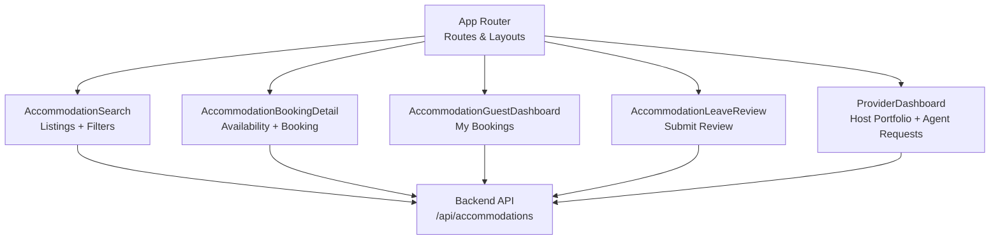
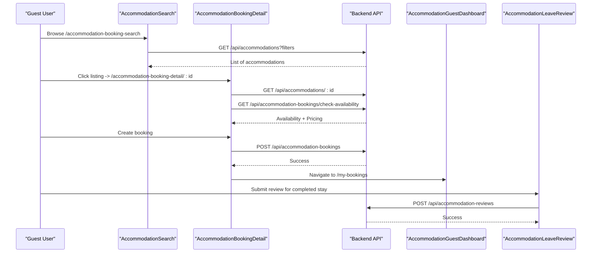
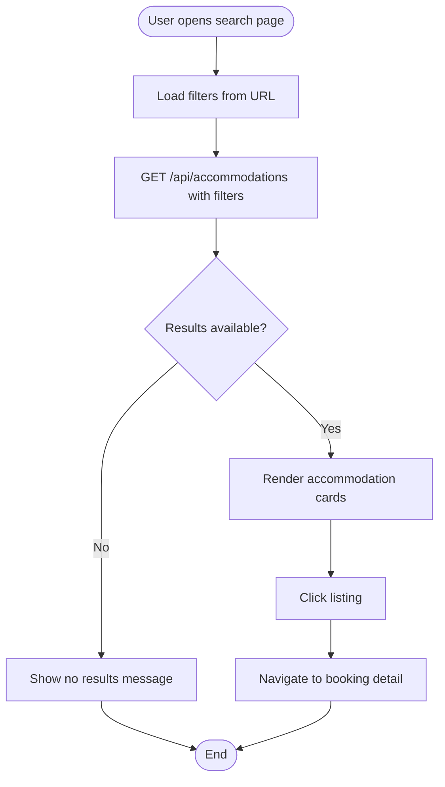
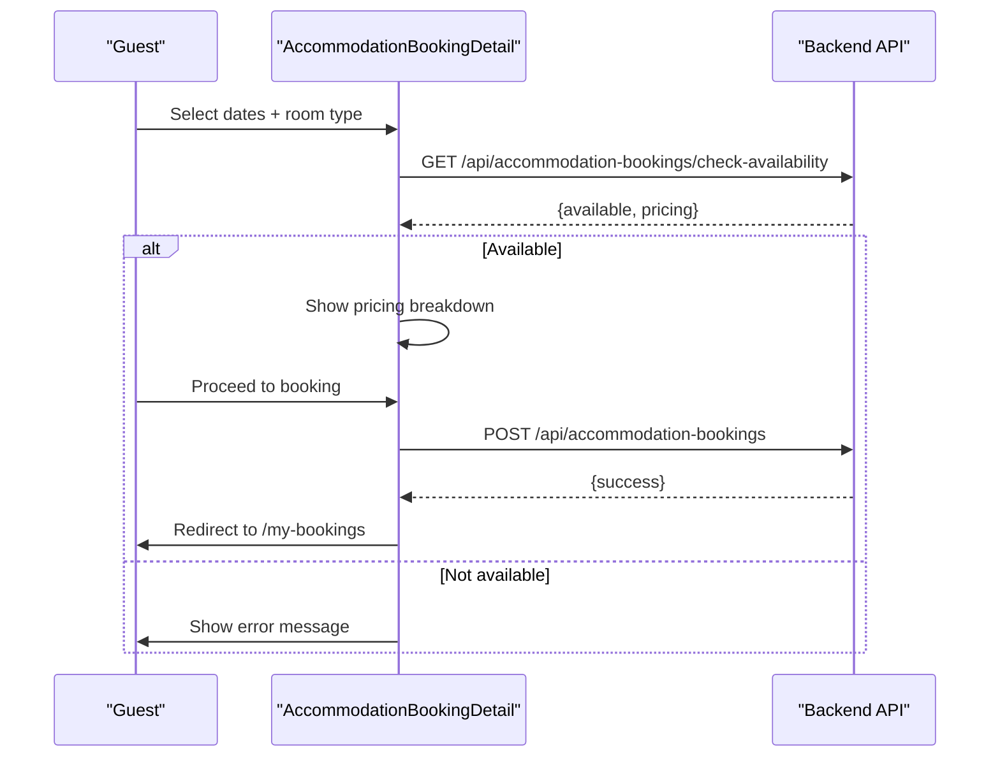
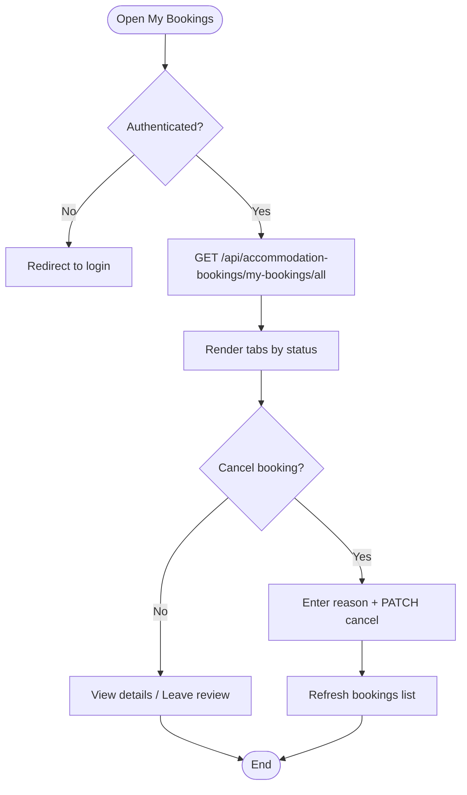
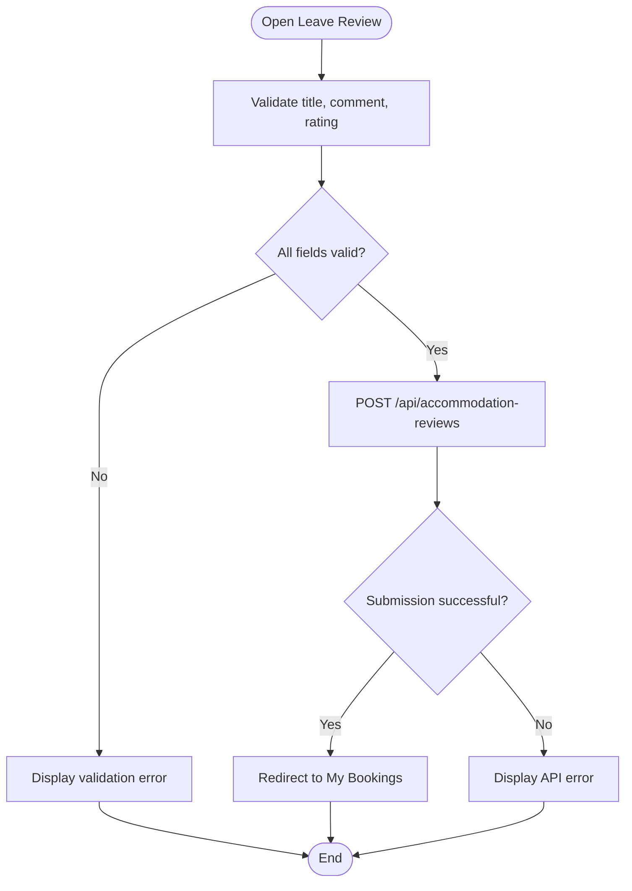
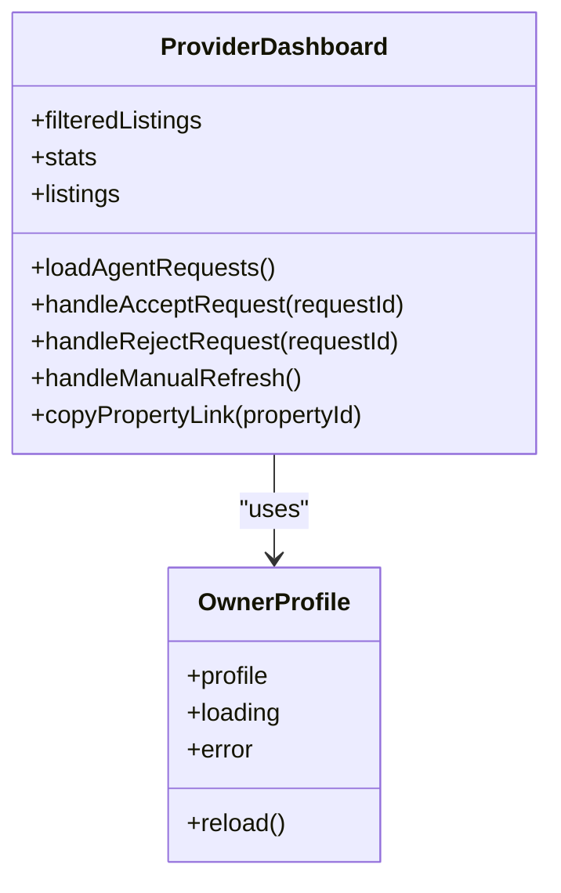
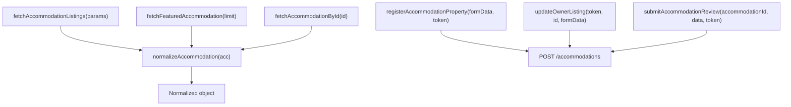
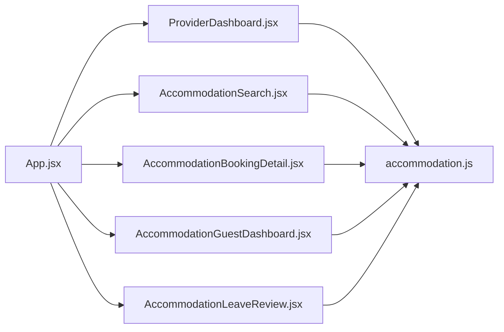

# Accommodation Booking Platform

<cite>
**Referenced Files in This Document**
- [App.jsx](file://src/App.jsx)
- [AccommodationSearch.jsx](file://src/pages/AccommodationSearch.jsx)
- [AccommodationBookingDetail.jsx](file://src/pages/AccommodationBookingDetail.jsx)
- [AccommodationGuestDashboard.jsx](file://src/pages/AccommodationGuestDashboard.jsx)
- [AccommodationLeaveReview.jsx](file://src/pages/AccommodationLeaveReview.jsx)
- [ProviderDashboard.jsx](file://src/pages/accommodation/ProviderDashboard.jsx)
- [ListingFilters.jsx](file://src/features/accommodation/components/ListingFilters.jsx)
- [accommodation.js](file://src/api/accommodation.js)
</cite>

## Table of Contents
1. [Introduction](#introduction)
2. [Project Structure](#project-structure)
3. [Core Components](#core-components)
4. [Architecture Overview](#architecture-overview)
5. [Detailed Component Analysis](#detailed-component-analysis)
6. [Dependency Analysis](#dependency-analysis)
7. [Performance Considerations](#performance-considerations)
8. [Troubleshooting Guide](#troubleshooting-guide)
9. [Conclusion](#conclusion)
10. [Appendices](#appendices)

## Introduction
This document explains the accommodation booking platform’s frontend implementation, focusing on:
- Search with filters and availability checking
- The end-to-end booking workflow
- Host dashboard for managing accommodations, agent collaboration, and listing performance
- Guest dashboard for reservations, cancellations, and reviews
- Review and rating system
- Payment status handling and integration points
- Notification mechanisms and extension patterns

The documentation is based on the React + Vite frontend codebase and maps user flows to specific components and API endpoints.

## Project Structure
The accommodation booking feature is implemented across several pages and shared utilities:
- Routing and layout orchestration are centralized in the application router.
- Guest-facing search and booking detail pages handle discovery, availability checks, and reservation creation.
- A guest dashboard manages bookings and review submission.
- A host dashboard provides portfolio management, analytics, and agent collaboration workflows.
- Shared API helpers normalize data and encapsulate backend calls.

**Diagram sources**
- [App.jsx:167-228](file://src/App.jsx#L167-L228)
- [AccommodationSearch.jsx:1-329](file://src/pages/AccommodationSearch.jsx#L1-L329)
- [AccommodationBookingDetail.jsx:1-558](file://src/pages/AccommodationBookingDetail.jsx#L1-L558)
- [AccommodationGuestDashboard.jsx:1-346](file://src/pages/AccommodationGuestDashboard.jsx#L1-L346)
- [AccommodationLeaveReview.jsx:1-363](file://src/pages/AccommodationLeaveReview.jsx#L1-L363)
- [ProviderDashboard.jsx:1-800](file://src/pages/accommodation/ProviderDashboard.jsx#L1-L800)

**Section sources**
- [App.jsx:167-228](file://src/App.jsx#L167-L228)

## Core Components
- AccommodationSearch: Public search page with URL-synced filters (type, search text, price range, max guests, featured). It fetches listings from the backend and navigates to a booking detail page.
- AccommodationBookingDetail: Property detail with image gallery, room types, house rules, amenities, reviews, availability check, pricing breakdown, and booking creation.
- AccommodationGuestDashboard: Protected guest dashboard showing all bookings with tabs by status, cancellation flow, and navigation to leave a review after completion.
- AccommodationLeaveReview: Protected review submission page with star rating, title, comment, validation, and success redirect.
- ProviderDashboard: Host dashboard with owner profile, stats, property grid/list views, filtering/sorting, agent collaboration requests, and actions like adding/editing properties.
- ListingFilters: Reusable filter UI for category, area, availability windows, price slider, minimum rating, and sort options.
- accommodation.js: Centralized API client with normalization, listing fetchers, owner profile operations, and review submission helper.

Key responsibilities:
- Data fetching and error handling are performed per component or via the API module.
- Authentication is enforced through protected routes and context where required.
- State-driven UI updates reflect loading, errors, and success states.

**Section sources**
- [AccommodationSearch.jsx:1-329](file://src/pages/AccommodationSearch.jsx#L1-L329)
- [AccommodationBookingDetail.jsx:1-558](file://src/pages/AccommodationBookingDetail.jsx#L1-L558)
- [AccommodationGuestDashboard.jsx:1-346](file://src/pages/AccommodationGuestDashboard.jsx#L1-L346)
- [AccommodationLeaveReview.jsx:1-363](file://src/pages/AccommodationLeaveReview.jsx#L1-L363)
- [ProviderDashboard.jsx:1-800](file://src/pages/accommodation/ProviderDashboard.jsx#L1-L800)
- [ListingFilters.jsx:1-92](file://src/features/accommodation/components/ListingFilters.jsx#L1-L92)
- [accommodation.js:1-191](file://src/api/accommodation.js#L1-L191)

## Architecture Overview
The platform follows a clear separation between routing, pages, shared features, and API utilities:
- Routes define public and protected pages for guests and hosts.
- Pages manage local state, call APIs, and render UI.
- Shared components and hooks provide reusable UI and logic.
- API module centralizes request logic and data normalization.

**Diagram sources**
- [AccommodationSearch.jsx:29-50](file://src/pages/AccommodationSearch.jsx#L29-L50)
- [AccommodationBookingDetail.jsx:32-50](file://src/pages/AccommodationBookingDetail.jsx#L32-L50)
- [AccommodationBookingDetail.jsx:52-86](file://src/pages/AccommodationBookingDetail.jsx#L52-L86)
- [AccommodationBookingDetail.jsx:88-118](file://src/pages/AccommodationBookingDetail.jsx#L88-L118)
- [AccommodationGuestDashboard.jsx:30-45](file://src/pages/AccommodationGuestDashboard.jsx#L30-L45)
- [AccommodationLeaveReview.jsx:60-103](file://src/pages/AccommodationLeaveReview.jsx#L60-L103)

## Detailed Component Analysis

### Search Functionality with Filters
AccommodationSearch implements:
- Filter state synced with URL parameters for shareable queries.
- Query construction and GET request to the backend.
- Error handling and empty-state messaging.
- Navigation to the booking detail page upon selecting a listing.

Filter capabilities include:
- Type selection (hotel, bnb, guesthouse, apartment)
- Text search
- Price range (min/max)
- Max guests
- Featured toggle

**Diagram sources**
- [AccommodationSearch.jsx:15-27](file://src/pages/AccommodationSearch.jsx#L15-L27)
- [AccommodationSearch.jsx:29-50](file://src/pages/AccommodationSearch.jsx#L29-L50)
- [AccommodationSearch.jsx:237-320](file://src/pages/AccommodationSearch.jsx#L237-L320)

**Section sources**
- [AccommodationSearch.jsx:1-329](file://src/pages/AccommodationSearch.jsx#L1-L329)

### Availability Checking and Booking Workflow
AccommodationBookingDetail handles:
- Loading accommodation details and default room type selection.
- Image gallery navigation.
- Availability check endpoint with date range and guest count.
- Pricing breakdown display when available.
- Booking creation requiring authentication; redirects to guest dashboard on success.

**Diagram sources**
- [AccommodationBookingDetail.jsx:32-50](file://src/pages/AccommodationBookingDetail.jsx#L32-L50)
- [AccommodationBookingDetail.jsx:52-86](file://src/pages/AccommodationBookingDetail.jsx#L52-L86)
- [AccommodationBookingDetail.jsx:88-118](file://src/pages/AccommodationBookingDetail.jsx#L88-L118)

**Section sources**
- [AccommodationBookingDetail.jsx:1-558](file://src/pages/AccommodationBookingDetail.jsx#L1-L558)

### Guest Dashboard: Reservations, Cancellations, Reviews
AccommodationGuestDashboard provides:
- Protected access requiring login.
- Fetching all bookings for the current user.
- Tabbed view by booking status (all, pending, confirmed, completed, cancelled).
- Cancellation flow with reason input and PATCH request to cancel.
- Navigation to leave a review for completed stays.

**Diagram sources**
- [AccommodationGuestDashboard.jsx:22-28](file://src/pages/AccommodationGuestDashboard.jsx#L22-L28)
- [AccommodationGuestDashboard.jsx:30-45](file://src/pages/AccommodationGuestDashboard.jsx#L30-L45)
- [AccommodationGuestDashboard.jsx:47-76](file://src/pages/AccommodationGuestDashboard.jsx#L47-L76)
- [AccommodationGuestDashboard.jsx:108-126](file://src/pages/AccommodationGuestDashboard.jsx#L108-L126)
- [AccommodationGuestDashboard.jsx:264-283](file://src/pages/AccommodationGuestDashboard.jsx#L264-L283)

**Section sources**
- [AccommodationGuestDashboard.jsx:1-346](file://src/pages/AccommodationGuestDashboard.jsx#L1-L346)

### Review and Rating System
AccommodationLeaveReview enables:
- Validation of required fields (title, comment, rating).
- Star rating selection.
- Submission via POST to the reviews endpoint.
- Success state and redirect to My Bookings.

**Diagram sources**
- [AccommodationLeaveReview.jsx:27-40](file://src/pages/AccommodationLeaveReview.jsx#L27-L40)
- [AccommodationLeaveReview.jsx:60-103](file://src/pages/AccommodationLeaveReview.jsx#L60-L103)

**Section sources**
- [AccommodationLeaveReview.jsx:1-363](file://src/pages/AccommodationLeaveReview.jsx#L1-L363)

### Host Dashboard: Managing Accommodations, Bookings, and Communications
ProviderDashboard offers:
- Owner profile and statistics (total properties, live, under review, needs action, views).
- Property portfolio with grid/list views, search, status/category filters, and sorting.
- Agent collaboration requests panel with accept/reject actions and optional response notes.
- Actions to add new properties and edit existing ones.

**Diagram sources**
- [ProviderDashboard.jsx:16-46](file://src/pages/accommodation/ProviderDashboard.jsx#L16-L46)
- [ProviderDashboard.jsx:53-121](file://src/pages/accommodation/ProviderDashboard.jsx#L53-L121)
- [ProviderDashboard.jsx:140-204](file://src/pages/accommodation/ProviderDashboard.jsx#L140-L204)

**Section sources**
- [ProviderDashboard.jsx:1-800](file://src/pages/accommodation/ProviderDashboard.jsx#L1-L800)

### Reusable Filters and Sorting
ListingFilters provides:
- Category chips
- Area/location input
- Availability window buttons
- Price slider
- Minimum rating selector
- Sort dropdown
- Clear all filters button

This component can be integrated into other listing experiences to standardize filtering behavior.

**Section sources**
- [ListingFilters.jsx:1-92](file://src/features/accommodation/components/ListingFilters.jsx#L1-L92)

### API Layer and Data Normalization
accommodation.js centralizes:
- Request wrapper with error handling
- Video URL formatting
- Data normalization for consistent UI consumption
- Functions for browsing, featured listings, stats, detail retrieval, view recording
- Provider operations: register/update listings, fetch owner profile and listings
- Review submission helper

**Diagram sources**
- [accommodation.js:20-30](file://src/api/accommodation.js#L20-L30)
- [accommodation.js:34-77](file://src/api/accommodation.js#L34-L77)
- [accommodation.js:81-114](file://src/api/accommodation.js#L81-L114)
- [accommodation.js:129-179](file://src/api/accommodation.js#L129-L179)
- [accommodation.js:181-190](file://src/api/accommodation.js#L181-L190)

**Section sources**
- [accommodation.js:1-191](file://src/api/accommodation.js#L1-L191)

## Dependency Analysis
Component relationships and dependencies:
- App.jsx defines routes that mount key pages and layouts.
- Pages depend on axios/fetch to call backend endpoints.
- ProviderDashboard uses the owner profile hook and API functions for portfolio management.
- ListingFilters is a standalone UI component used by listing experiences.
- accommodation.js is imported by provider-related pages and review flows.

**Diagram sources**
- [App.jsx:167-228](file://src/App.jsx#L167-L228)
- [ProviderDashboard.jsx:1-46](file://src/pages/accommodation/ProviderDashboard.jsx#L1-L46)
- [accommodation.js:1-191](file://src/api/accommodation.js#L1-L191)

**Section sources**
- [App.jsx:167-228](file://src/App.jsx#L167-L228)
- [ProviderDashboard.jsx:1-46](file://src/pages/accommodation/ProviderDashboard.jsx#L1-L46)
- [accommodation.js:1-191](file://src/api/accommodation.js#L1-L191)

## Performance Considerations
- Avoid unnecessary re-renders by memoizing derived data (e.g., filtered listings) using useMemo where appropriate.
- Debounce search inputs to reduce frequent API calls.
- Use pagination or virtualization for large listing sets.
- Lazy-load images and defer heavy components until needed.
- Cache static configuration and theme data locally.
- Minimize network requests by batching or consolidating data loads.

[No sources needed since this section provides general guidance]

## Troubleshooting Guide
Common issues and resolutions:
- Network errors during listing fetch: Check environment variable VITE_API_URL and ensure backend is reachable.
- Authentication failures: Ensure token is present in headers for protected endpoints.
- Availability check failures: Verify selected dates and room type are valid and within capacity constraints.
- Booking creation errors: Confirm user is authenticated and required fields are provided.
- Review submission errors: Validate title, comment, and rating before submitting.

Operational tips:
- Inspect console logs for detailed error messages.
- Use browser dev tools to inspect network requests and responses.
- For host dashboard, refresh manually if data appears stale.

**Section sources**
- [AccommodationSearch.jsx:29-50](file://src/pages/AccommodationSearch.jsx#L29-L50)
- [AccommodationBookingDetail.jsx:52-86](file://src/pages/AccommodationBookingDetail.jsx#L52-L86)
- [AccommodationBookingDetail.jsx:88-118](file://src/pages/AccommodationBookingDetail.jsx#L88-L118)
- [AccommodationGuestDashboard.jsx:30-45](file://src/pages/AccommodationGuestDashboard.jsx#L30-L45)
- [AccommodationLeaveReview.jsx:60-103](file://src/pages/AccommodationLeaveReview.jsx#L60-L103)

## Conclusion
The accommodation booking platform provides a robust guest experience for searching, checking availability, and booking stays, alongside a comprehensive host dashboard for managing properties and collaborating with agents. The review system ensures quality feedback, while payment statuses are surfaced to users. The modular architecture and centralized API layer make it straightforward to extend features such as advanced filters, dynamic pricing, and enhanced notifications.

[No sources needed since this section summarizes without analyzing specific files]

## Appendices

### Extending Booking Features
- Add dynamic pricing rules: Extend the availability check endpoint to incorporate seasonal multipliers and return updated pricing.
- Implement waitlists: When unavailable, allow guests to join a waitlist and notify them upon availability.
- Introduce package deals: Bundle rooms with services (airport transfer, tours) and calculate combined totals.

### Customizing Host/Guest Experience
- Customize filters: Integrate ListingFilters into custom listing pages to tailor category, area, availability, and sorting options.
- Enhance dashboards: Add charts for revenue, occupancy rates, and guest demographics in the host dashboard.
- Improve notifications: Integrate email/SMS triggers for booking confirmations, cancellations, and review reminders.

### Payment Processing Integration Notes
- The guest dashboard displays payment status labels (pending, paid, failed, refunded), indicating integration points with a payment provider.
- To integrate a payment gateway:
  - Capture payment details securely on the checkout step.
  - Call the backend to create a payment intent and store transaction records.
  - Handle webhooks for payment confirmation and update booking/payment status accordingly.
  - Surface status changes in the guest dashboard and send notifications.

[No sources needed since this section provides general guidance]