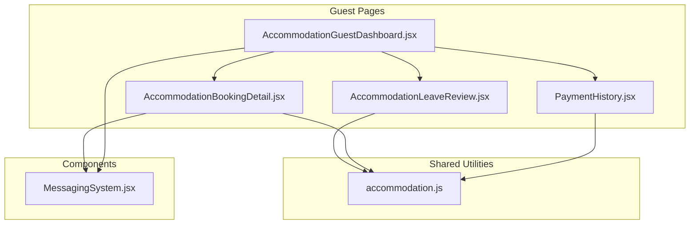
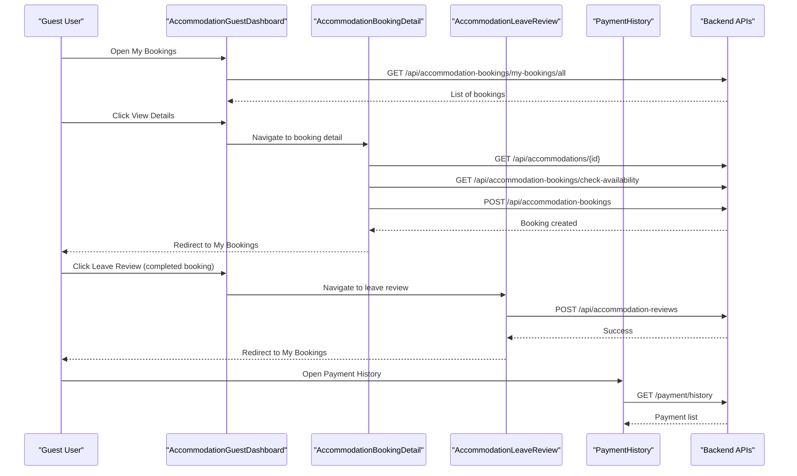
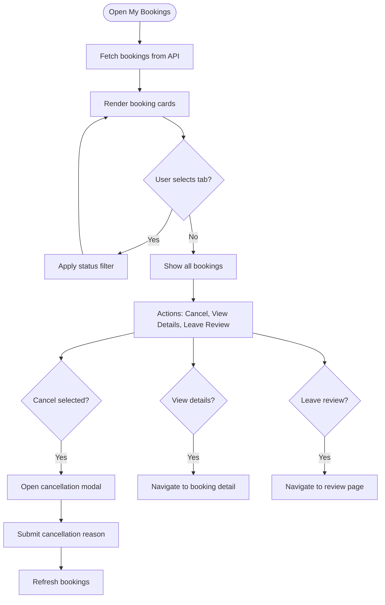
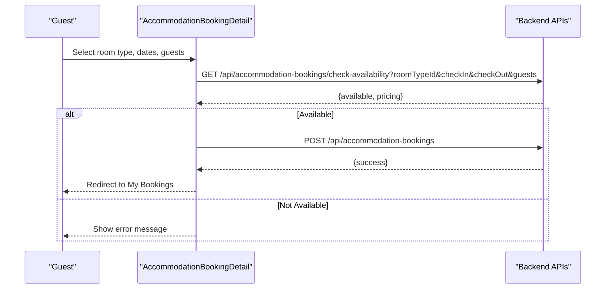
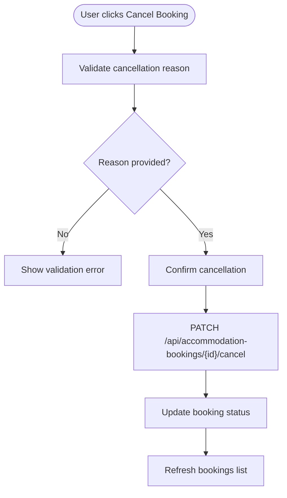
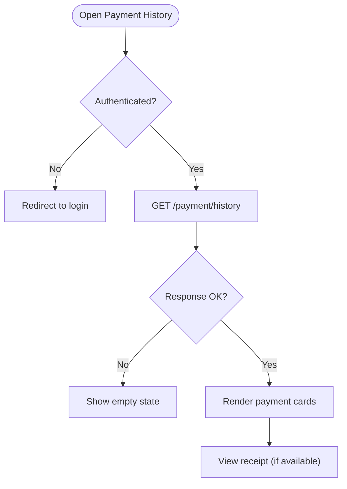
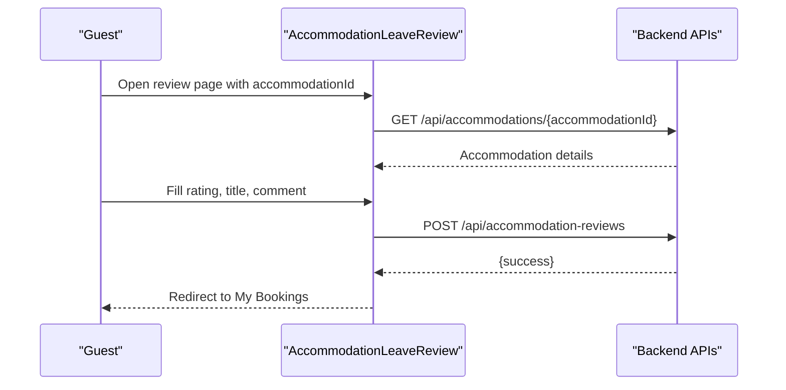
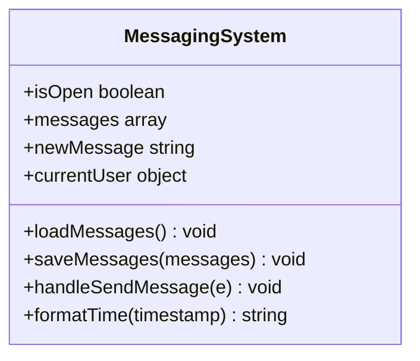
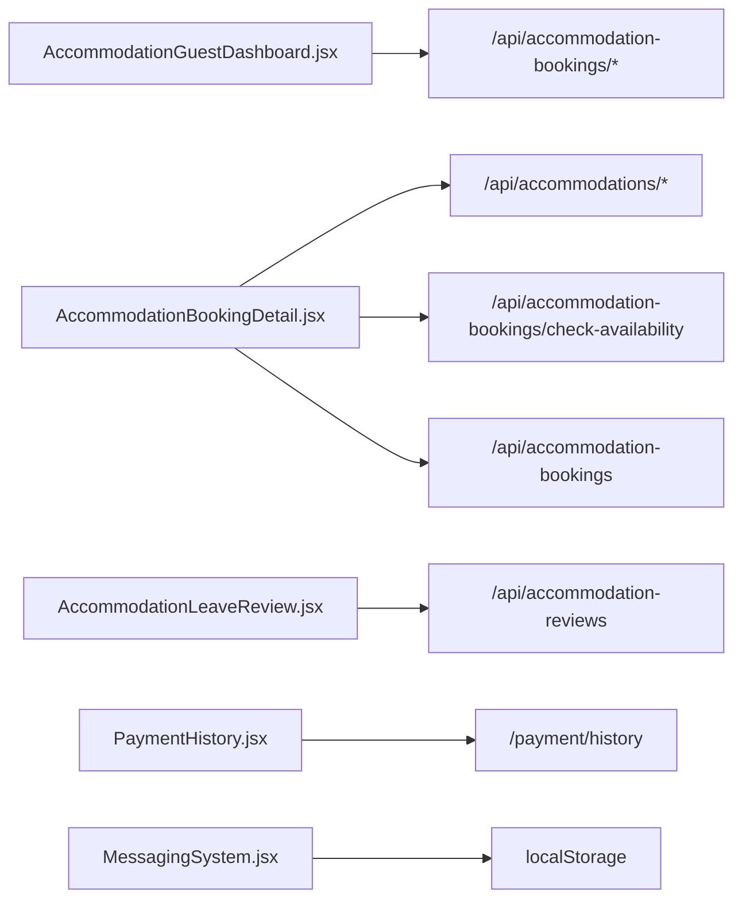

# Guest Dashboard

<cite>
**Referenced Files in This Document**
- [AccommodationGuestDashboard.jsx](file://src/pages/AccommodationGuestDashboard.jsx)
- [AccommodationBookingDetail.jsx](file://src/pages/AccommodationBookingDetail.jsx)
- [AccommodationLeaveReview.jsx](file://src/pages/AccommodationLeaveReview.jsx)
- [accommodation.js](file://src/api/accommodation.js)
- [PaymentHistory.jsx](file://src/pages/PaymentHistory.jsx)
- [MessagingSystem.jsx](file://src/components/MessagingSystem.jsx)
</cite>

## Table of Contents
1. [Introduction](#introduction)
2. [Project Structure](#project-structure)
3. [Core Components](#core-components)
4. [Architecture Overview](#architecture-overview)
5. [Detailed Component Analysis](#detailed-component-analysis)
6. [Dependency Analysis](#dependency-analysis)
7. [Performance Considerations](#performance-considerations)
8. [Troubleshooting Guide](#troubleshooting-guide)
9. [Conclusion](#conclusion)
10. [Appendices](#appendices)

## Introduction
This document explains the guest dashboard system for accommodation bookings. It covers reservation management, booking history, payment tracking, review submission, cancellation workflows, and guest communication features. It also provides guidance on extending booking workflows, adding payment methods, and customizing the guest experience.

The implementation is a React-based frontend that interacts with backend endpoints for accommodations, bookings, reviews, payments, and messaging. The guest dashboard centers around:
- Viewing and filtering bookings
- Booking details and availability checks
- Cancellation flows
- Review submission after completed stays
- Payment history viewing
- Messaging with property owners or staff

## Project Structure
The guest-facing features are implemented as standalone pages and components under the src directory:
- Pages:
  - AccommodationGuestDashboard.jsx: Central hub for listing and managing bookings
  - AccommodationBookingDetail.jsx: Property detail view with booking form and availability check
  - AccommodationLeaveReview.jsx: Post-stay review submission
  - PaymentHistory.jsx: Transaction history viewer
- API utilities:
  - accommodation.js: Shared API client for accommodations and reviews
- Components:
  - MessagingSystem.jsx: Lightweight chat UI for guest communication

**Diagram sources**
- [AccommodationGuestDashboard.jsx:1-346](file://src/pages/AccommodationGuestDashboard.jsx#L1-L346)
- [AccommodationBookingDetail.jsx:1-558](file://src/pages/AccommodationBookingDetail.jsx#L1-L558)
- [AccommodationLeaveReview.jsx:1-363](file://src/pages/AccommodationLeaveReview.jsx#L1-L363)
- [accommodation.js:1-191](file://src/api/accommodation.js#L1-L191)
- [PaymentHistory.jsx:1-336](file://src/pages/PaymentHistory.jsx#L1-L336)
- [MessagingSystem.jsx:1-337](file://src/components/MessagingSystem.jsx#L1-L337)

**Section sources**
- [AccommodationGuestDashboard.jsx:1-346](file://src/pages/AccommodationGuestDashboard.jsx#L1-L346)
- [AccommodationBookingDetail.jsx:1-558](file://src/pages/AccommodationBookingDetail.jsx#L1-L558)
- [AccommodationLeaveReview.jsx:1-363](file://src/pages/AccommodationLeaveReview.jsx#L1-L363)
- [accommodation.js:1-191](file://src/api/accommodation.js#L1-L191)
- [PaymentHistory.jsx:1-336](file://src/pages/PaymentHistory.jsx#L1-L336)
- [MessagingSystem.jsx:1-337](file://src/components/MessagingSystem.jsx#L1-L337)

## Core Components
- AccommodationGuestDashboard.jsx
  - Displays all user bookings with filters (all, pending, confirmed, completed, cancelled).
  - Supports cancellation with a reason prompt and confirmation modal.
  - Shows booking status, payment status labels, total price, and quick actions (View Details, Leave Review).
  - Navigates to booking detail and review pages.
- AccommodationBookingDetail.jsx
  - Loads accommodation details and images.
  - Allows selecting room type, dates, and number of guests.
  - Checks availability and shows pricing breakdown before booking creation.
  - Creates a booking via authenticated request and redirects to My Bookings.
- AccommodationLeaveReview.jsx
  - Requires authentication and valid accommodationId.
  - Validates rating, title, and comment.
  - Submits review via API and navigates back to My Bookings after success.
- PaymentHistory.jsx
  - Fetches and displays payment records with status badges and receipt links.
  - Handles missing endpoint gracefully by showing empty state.
- accommodation.js
  - Normalizes accommodation data and exposes helper functions for listings, featured items, and reviews.
- MessagingSystem.jsx
  - Provides a floating chat UI to send messages to recipients (e.g., landlords), persisted locally per conversation.

**Section sources**
- [AccommodationGuestDashboard.jsx:1-346](file://src/pages/AccommodationGuestDashboard.jsx#L1-L346)
- [AccommodationBookingDetail.jsx:1-558](file://src/pages/AccommodationBookingDetail.jsx#L1-L558)
- [AccommodationLeaveReview.jsx:1-363](file://src/pages/AccommodationLeaveReview.jsx#L1-L363)
- [accommodation.js:1-191](file://src/api/accommodation.js#L1-L191)
- [PaymentHistory.jsx:1-336](file://src/pages/PaymentHistory.jsx#L1-L336)
- [MessagingSystem.jsx:1-337](file://src/components/MessagingSystem.jsx#L1-L337)

## Architecture Overview
The guest dashboard follows a page-driven architecture where each feature is a React component/page. Data fetching uses axios/fetch against backend endpoints configured via environment variables. Authentication is handled through tokens stored in localStorage and passed in Authorization headers.

**Diagram sources**
- [AccommodationGuestDashboard.jsx:30-76](file://src/pages/AccommodationGuestDashboard.jsx#L30-L76)
- [AccommodationBookingDetail.jsx:32-118](file://src/pages/AccommodationBookingDetail.jsx#L32-L118)
- [AccommodationLeaveReview.jsx:42-103](file://src/pages/AccommodationLeaveReview.jsx#L42-L103)
- [PaymentHistory.jsx:22-49](file://src/pages/PaymentHistory.jsx#L22-L49)

## Detailed Component Analysis

### Reservation Management and Booking History
- Listing and Filtering
  - The dashboard fetches all bookings for the current user and renders them in a grid.
  - Tabs filter by status: all, pending, confirmed, completed, cancelled.
  - Each card shows accommodation image, name, check-in/out dates, room type, guests, nights, total price, payment status label, and booking status badge.
- Actions
  - Cancel Booking: Opens a modal requiring a cancellation reason; sends PATCH to cancel endpoint and refreshes the list.
  - View Details: Navigates to the booking detail page.
  - Leave Review: For completed bookings, opens the review submission page.

**Diagram sources**
- [AccommodationGuestDashboard.jsx:30-76](file://src/pages/AccommodationGuestDashboard.jsx#L30-L76)
- [AccommodationGuestDashboard.jsx:108-126](file://src/pages/AccommodationGuestDashboard.jsx#L108-L126)
- [AccommodationGuestDashboard.jsx:264-290](file://src/pages/AccommodationGuestDashboard.jsx#L264-L290)

**Section sources**
- [AccommodationGuestDashboard.jsx:30-76](file://src/pages/AccommodationGuestDashboard.jsx#L30-L76)
- [AccommodationGuestDashboard.jsx:108-126](file://src/pages/AccommodationGuestDashboard.jsx#L108-L126)
- [AccommodationGuestDashboard.jsx:157-179](file://src/pages/AccommodationGuestDashboard.jsx#L157-L179)
- [AccommodationGuestDashboard.jsx:204-293](file://src/pages/AccommodationGuestDashboard.jsx#L204-L293)
- [AccommodationGuestDashboard.jsx:298-342](file://src/pages/AccommodationGuestDashboard.jsx#L298-L342)

### Booking Detail View and Availability Check
- Property Information
  - Displays images gallery, property type, address, check-in/out times, max guests, description, amenities, house rules, and reviews.
- Room Selection and Pricing
  - Users select a room type, check-in/check-out dates, and number of guests.
  - Availability check calls backend to confirm availability and returns pricing breakdown (base price, cleaning fee, service fee, total).
- Booking Creation
  - If available, users proceed to create a booking; upon success, they are redirected to My Bookings.

**Diagram sources**
- [AccommodationBookingDetail.jsx:52-86](file://src/pages/AccommodationBookingDetail.jsx#L52-L86)
- [AccommodationBookingDetail.jsx:88-118](file://src/pages/AccommodationBookingDetail.jsx#L88-L118)

**Section sources**
- [AccommodationBookingDetail.jsx:32-50](file://src/pages/AccommodationBookingDetail.jsx#L32-L50)
- [AccommodationBookingDetail.jsx:52-86](file://src/pages/AccommodationBookingDetail.jsx#L52-L86)
- [AccommodationBookingDetail.jsx:88-118](file://src/pages/AccommodationBookingDetail.jsx#L88-L118)
- [AccommodationBookingDetail.jsx:175-177](file://src/pages/AccommodationBookingDetail.jsx#L175-L177)
- [AccommodationBookingDetail.jsx:309-363](file://src/pages/AccommodationBookingDetail.jsx#L309-L363)
- [AccommodationBookingDetail.jsx:400-552](file://src/pages/AccommodationBookingDetail.jsx#L400-L552)

### Cancellation Policies and Workflow
- Policy Enforcement
  - Cancellation is allowed when booking status is pending or confirmed.
  - Requires a cancellation reason; validation prevents submission without text.
- Flow
  - User clicks Cancel Booking, enters reason, confirms cancellation.
  - Backend updates booking status; frontend refreshes the list.

**Diagram sources**
- [AccommodationGuestDashboard.jsx:47-76](file://src/pages/AccommodationGuestDashboard.jsx#L47-L76)
- [AccommodationGuestDashboard.jsx:264-290](file://src/pages/AccommodationGuestDashboard.jsx#L264-L290)
- [AccommodationGuestDashboard.jsx:298-342](file://src/pages/AccommodationGuestDashboard.jsx#L298-L342)

**Section sources**
- [AccommodationGuestDashboard.jsx:47-76](file://src/pages/AccommodationGuestDashboard.jsx#L47-L76)
- [AccommodationGuestDashboard.jsx:264-290](file://src/pages/AccommodationGuestDashboard.jsx#L264-L290)
- [AccommodationGuestDashboard.jsx:298-342](file://src/pages/AccommodationGuestDashboard.jsx#L298-L342)

### Payment Tracking
- Payment History Page
  - Fetches transactions from /payment/history using bearer token.
  - Displays amount, transaction reference, property title, payment method, and receipt link if available.
  - Status badges indicate completed, pending, failed, or other statuses.
  - Gracefully handles missing endpoint by showing an empty state.

**Diagram sources**
- [PaymentHistory.jsx:14-49](file://src/pages/PaymentHistory.jsx#L14-L49)
- [PaymentHistory.jsx:51-63](file://src/pages/PaymentHistory.jsx#L51-L63)
- [PaymentHistory.jsx:102-154](file://src/pages/PaymentHistory.jsx#L102-L154)

**Section sources**
- [PaymentHistory.jsx:14-49](file://src/pages/PaymentHistory.jsx#L14-L49)
- [PaymentHistory.jsx:51-63](file://src/pages/PaymentHistory.jsx#L51-L63)
- [PaymentHistory.jsx:102-154](file://src/pages/PaymentHistory.jsx#L102-L154)

### Review Submission
- Pre-conditions
  - Requires authentication and a valid accommodationId parameter.
  - Validates rating (1–5), title, and comment fields.
- Submission Flow
  - Posts review to /api/accommodation-reviews with bearer token.
  - On success, shows confirmation and redirects to My Bookings.

**Diagram sources**
- [AccommodationLeaveReview.jsx:27-54](file://src/pages/AccommodationLeaveReview.jsx#L27-L54)
- [AccommodationLeaveReview.jsx:60-103](file://src/pages/AccommodationLeaveReview.jsx#L60-L103)

**Section sources**
- [AccommodationLeaveReview.jsx:27-54](file://src/pages/AccommodationLeaveReview.jsx#L27-L54)
- [AccommodationLeaveReview.jsx:60-103](file://src/pages/AccommodationLeaveReview.jsx#L60-L103)
- [AccommodationLeaveReview.jsx:160-358](file://src/pages/AccommodationLeaveReview.jsx#L160-L358)

### Guest Communication Features
- Messaging System
  - Floating chat UI to send messages to recipients (e.g., landlord).
  - Persists messages per recipient in localStorage.
  - Displays timestamps and distinguishes own vs. other messages.
  - Can include property context (propertyId, propertyTitle).

**Diagram sources**
- [MessagingSystem.jsx:5-18](file://src/components/MessagingSystem.jsx#L5-L18)
- [MessagingSystem.jsx:20-32](file://src/components/MessagingSystem.jsx#L20-L32)
- [MessagingSystem.jsx:34-53](file://src/components/MessagingSystem.jsx#L34-L53)
- [MessagingSystem.jsx:55-68](file://src/components/MessagingSystem.jsx#L55-L68)

**Section sources**
- [MessagingSystem.jsx:5-18](file://src/components/MessagingSystem.jsx#L5-L18)
- [MessagingSystem.jsx:20-32](file://src/components/MessagingSystem.jsx#L20-L32)
- [MessagingSystem.jsx:34-53](file://src/components/MessagingSystem.jsx#L34-L53)
- [MessagingSystem.jsx:55-68](file://src/components/MessagingSystem.jsx#L55-L68)
- [MessagingSystem.jsx:82-158](file://src/components/MessagingSystem.jsx#L82-L158)

## Dependency Analysis
- Component Coupling
  - AccommodationGuestDashboard depends on backend booking endpoints and navigation to detail/review pages.
  - AccommodationBookingDetail depends on accommodation details, availability checks, and booking creation endpoints.
  - AccommodationLeaveReview depends on accommodation details and review submission endpoint.
  - PaymentHistory depends on payment history endpoint.
  - MessagingSystem is self-contained but can be embedded into property-related pages.
- External Dependencies
  - axios used for HTTP requests in pages.
  - accommodation.js provides shared normalization and API helpers.

**Diagram sources**
- [AccommodationGuestDashboard.jsx:30-76](file://src/pages/AccommodationGuestDashboard.jsx#L30-L76)
- [AccommodationBookingDetail.jsx:32-118](file://src/pages/AccommodationBookingDetail.jsx#L32-L118)
- [AccommodationLeaveReview.jsx:42-103](file://src/pages/AccommodationLeaveReview.jsx#L42-L103)
- [PaymentHistory.jsx:22-49](file://src/pages/PaymentHistory.jsx#L22-L49)
- [MessagingSystem.jsx:20-32](file://src/components/MessagingSystem.jsx#L20-L32)

**Section sources**
- [AccommodationGuestDashboard.jsx:30-76](file://src/pages/AccommodationGuestDashboard.jsx#L30-L76)
- [AccommodationBookingDetail.jsx:32-118](file://src/pages/AccommodationBookingDetail.jsx#L32-L118)
- [AccommodationLeaveReview.jsx:42-103](file://src/pages/AccommodationLeaveReview.jsx#L42-L103)
- [PaymentHistory.jsx:22-49](file://src/pages/PaymentHistory.jsx#L22-L49)
- [MessagingSystem.jsx:20-32](file://src/components/MessagingSystem.jsx#L20-L32)

## Performance Considerations
- Minimize redundant network calls:
  - Cache accommodation details locally during a session to avoid repeated fetches when navigating between related pages.
- Debounce availability checks:
  - Avoid triggering availability checks on every keystroke; debounce date inputs to reduce API load.
- Optimize image rendering:
  - Use lazy loading for images and consider responsive image sizes to improve perceived performance.
- Pagination for large datasets:
  - For booking lists and payment histories, implement pagination to reduce payload size and improve rendering speed.
- Error boundaries:
  - Wrap critical sections with error boundaries to prevent UI crashes and provide graceful fallbacks.

[No sources needed since this section provides general guidance]

## Troubleshooting Guide
- Authentication Issues
  - Ensure token is present in localStorage and passed in Authorization headers for protected endpoints.
  - Redirect to login if user context is missing.
- Network Errors
  - Handle non-OK responses and display user-friendly errors.
  - For missing endpoints (e.g., payment history), show empty states instead of breaking the UI.
- Validation Errors
  - Enforce required fields (cancellation reason, review title/comment, rating range).
  - Provide clear inline feedback and disable submit buttons until valid.
- State Consistency
  - After mutations (cancel, create booking, submit review), refresh relevant data to keep UI consistent.

**Section sources**
- [AccommodationGuestDashboard.jsx:30-76](file://src/pages/AccommodationGuestDashboard.jsx#L30-L76)
- [AccommodationLeaveReview.jsx:60-103](file://src/pages/AccommodationLeaveReview.jsx#L60-L103)
- [PaymentHistory.jsx:22-49](file://src/pages/PaymentHistory.jsx#L22-L49)

## Conclusion
The guest dashboard provides a cohesive experience for managing reservations, reviewing properties, tracking payments, and communicating with property stakeholders. The modular design allows easy extension for additional payment methods, enhanced cancellation policies, and richer communication channels. By following the patterns outlined here, teams can customize the guest experience while maintaining consistency and reliability.

[No sources needed since this section summarizes without analyzing specific files]

## Appendices

### Extending Booking Workflows
- Add pre-booking steps:
  - Introduce identity verification or deposit requirements before creating a booking.
- Implement dynamic pricing:
  - Extend availability response to include promotional discounts or seasonal rates.
- Add booking modifications:
  - Allow guests to modify dates or room types before confirmation, with re-pricing and approval workflows.

[No sources needed since this section provides general guidance]

### Adding Payment Methods
- Integrate new providers:
  - Extend PaymentHistory to support multiple provider-specific fields (e.g., provider, account mask).
- Receipt handling:
  - Standardize receipt URL generation and storage across providers.
- Refund workflows:
  - Add refund status tracking and notifications for cancellations.

[No sources needed since this section provides general guidance]

### Customizing the Guest Experience
- Theming and branding:
  - Centralize color tokens and typography to allow theme switching.
- Localization:
  - Extract strings for multi-language support.
- Accessibility:
  - Ensure keyboard navigation, screen reader labels, and contrast compliance across all pages.

[No sources needed since this section provides general guidance]