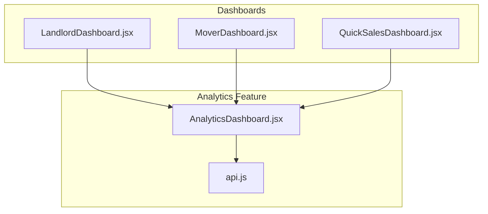
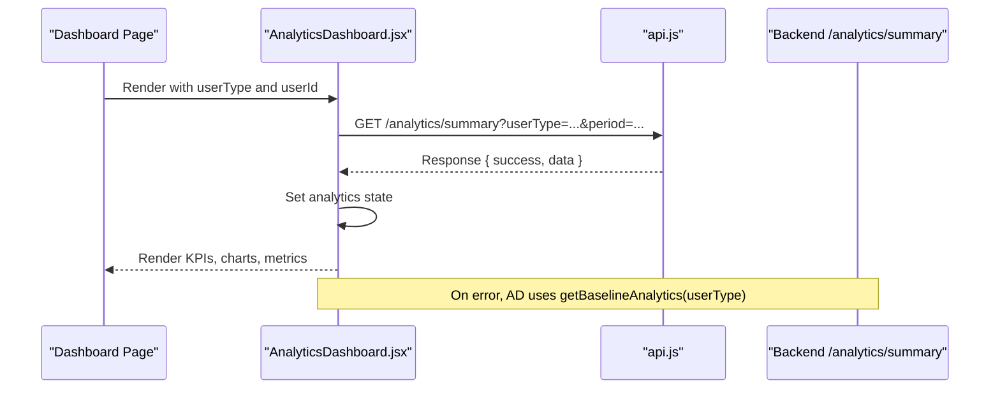
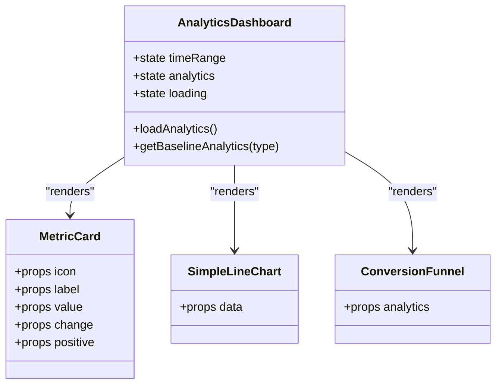
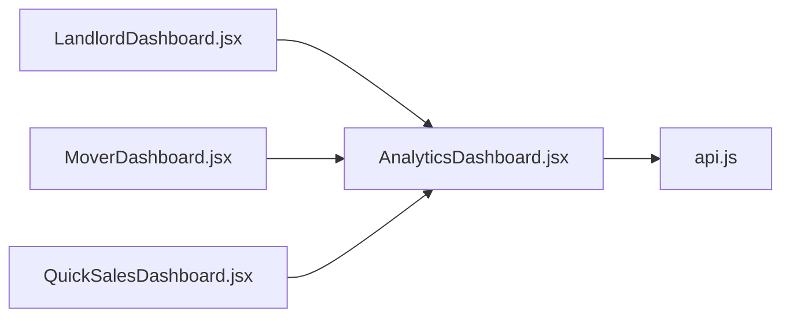

# Analytics & Reporting

<cite>
**Referenced Files in This Document**
- [AnalyticsDashboard.jsx](file://src/components/AnalyticsDashboard.jsx)
- [api.js](file://src/api/api.js)
- [LandlordDashboard.jsx](file://src/pages/LandlordDashboard.jsx)
- [MoverDashboard.jsx](file://src/pages/MoverDashboard.jsx)
- [QuickSalesDashboard.jsx](file://src/pages/QuickSalesDashboard.jsx)
</cite>

## Table of Contents
1. [Introduction](#introduction)
2. [Project Structure](#project-structure)
3. [Core Components](#core-components)
4. [Architecture Overview](#architecture-overview)
5. [Detailed Component Analysis](#detailed-component-analysis)
6. [Dependency Analysis](#dependency-analysis)
7. [Performance Considerations](#performance-considerations)
8. [Troubleshooting Guide](#troubleshooting-guide)
9. [Conclusion](#conclusion)
10. [Appendices](#appendices)

## Introduction
This document explains the analytics and reporting features available in the host dashboards for landlords, movers, and sellers. It covers performance metrics tracking, booking statistics, revenue reports, and guest engagement analytics. You will learn how to access your profile analytics, interpret key performance indicators (KPIs), and use insights to optimize your hosting strategy. Examples include generating custom time-range reports and understanding conversion funnels.

## Project Structure
The analytics feature is implemented as a reusable React component that integrates into multiple dashboards:
- The Analytics Dashboard component fetches summary data from a backend endpoint and renders KPIs, charts, and role-specific metrics.
- Dashboards for Landlords, Movers, and Sellers embed this component with their respective user types and IDs.
- API calls are centralized through an Axios client configured with base URL and interceptors.

**Diagram sources**
- [AnalyticsDashboard.jsx:1-28](file://src/components/AnalyticsDashboard.jsx#L1-L28)
- [api.js:1-47](file://src/api/api.js#L1-L47)
- [LandlordDashboard.jsx:842-842](file://src/pages/LandlordDashboard.jsx#L842-L842)
- [MoverDashboard.jsx:402-402](file://src/pages/MoverDashboard.jsx#L402-L402)
- [QuickSalesDashboard.jsx:260-260](file://src/pages/QuickSalesDashboard.jsx#L260-L260)

**Section sources**
- [AnalyticsDashboard.jsx:1-28](file://src/components/AnalyticsDashboard.jsx#L1-L28)
- [api.js:1-47](file://src/api/api.js#L1-L47)
- [LandlordDashboard.jsx:842-842](file://src/pages/LandlordDashboard.jsx#L842-L842)
- [MoverDashboard.jsx:402-402](file://src/pages/MoverDashboard.jsx#L402-L402)
- [QuickSalesDashboard.jsx:260-260](file://src/pages/QuickSalesDashboard.jsx#L260-L260)

## Core Components
- AnalyticsDashboard: Displays KPIs, charts, and role-specific metrics; supports time range selection (7 days, 30 days, 90 days).
- MetricCard: Reusable card for displaying a single metric with change indicator.
- SimpleLineChart: Bar chart visualization for performance over time.
- ConversionFunnel: Visualizes views → inquiries → bookings funnel with drop-off percentages.
- generateChartData: Generates deterministic chart data based on total views and selected time range.

Key responsibilities:
- Fetching analytics via API.get("/analytics/summary") with userType and period parameters.
- Rendering baseline data when API fails or returns unexpected structure.
- Providing interactive time range controls and tooltips for chart bars.

**Section sources**
- [AnalyticsDashboard.jsx:4-28](file://src/components/AnalyticsDashboard.jsx#L4-L28)
- [AnalyticsDashboard.jsx:103-132](file://src/components/AnalyticsDashboard.jsx#L103-L132)
- [AnalyticsDashboard.jsx:233-277](file://src/components/AnalyticsDashboard.jsx#L233-L277)
- [AnalyticsDashboard.jsx:279-316](file://src/components/AnalyticsDashboard.jsx#L279-L316)
- [AnalyticsDashboard.jsx:318-369](file://src/components/AnalyticsDashboard.jsx#L318-L369)

## Architecture Overview
The analytics flow starts from the dashboard pages, which render the AnalyticsDashboard component. The component requests summary data from the backend and displays it. If the request fails, it falls back to baseline data tailored to the user type.

**Diagram sources**
- [AnalyticsDashboard.jsx:9-28](file://src/components/AnalyticsDashboard.jsx#L9-L28)
- [api.js:1-47](file://src/api/api.js#L1-L47)

## Detailed Component Analysis

### AnalyticsDashboard
Responsibilities:
- Manage time range state and trigger data reload on changes.
- Fetch analytics summary and handle errors gracefully.
- Render KPI cards (views, inquiries, bookings/jobs, revenue).
- Show additional metrics per user type (landlord, mover, seller).
- Provide a line chart for performance over time and a conversion funnel.

Data model expectations:
- views, inquiries, bookings or jobsCompleted, revenue, conversionRate
- Landlord: propertiesListed, averageResponseTime, qrScans, qrInquiries
- Mover: averageRating, repeatCustomers
- Seller: itemsSold, averageOrderValue

User experience:
- Loading spinner while fetching data.
- Time range selector buttons for 7d, 30d, 90d.
- Tooltips on chart bars showing daily values.

Error handling:
- Catches network or parsing errors and sets baseline analytics for the given userType.

Optimization opportunities:
- Debounce time range changes to avoid excessive re-renders.
- Memoize generated chart data to prevent unnecessary recalculations.

**Section sources**
- [AnalyticsDashboard.jsx:4-28](file://src/components/AnalyticsDashboard.jsx#L4-L28)
- [AnalyticsDashboard.jsx:30-65](file://src/components/AnalyticsDashboard.jsx#L30-L65)
- [AnalyticsDashboard.jsx:67-77](file://src/components/AnalyticsDashboard.jsx#L67-L77)
- [AnalyticsDashboard.jsx:103-215](file://src/components/AnalyticsDashboard.jsx#L103-L215)
- [AnalyticsDashboard.jsx:233-369](file://src/components/AnalyticsDashboard.jsx#L233-L369)

#### Class Diagram

**Diagram sources**
- [AnalyticsDashboard.jsx:4-28](file://src/components/AnalyticsDashboard.jsx#L4-L28)
- [AnalyticsDashboard.jsx:220-231](file://src/components/AnalyticsDashboard.jsx#L220-L231)
- [AnalyticsDashboard.jsx:233-277](file://src/components/AnalyticsDashboard.jsx#L233-L277)
- [AnalyticsDashboard.jsx:279-316](file://src/components/AnalyticsDashboard.jsx#L279-L316)

### Integration Points in Dashboards
- LandlordDashboard: Embeds AnalyticsDashboard with userType="landlord".
- MoverDashboard: Embeds AnalyticsDashboard with userType="mover".
- QuickSalesDashboard: Embeds AnalyticsDashboard with userType="seller".

These dashboards pass the current user’s ID to enable deterministic chart generation and personalized analytics.

**Section sources**
- [LandlordDashboard.jsx:842-842](file://src/pages/LandlordDashboard.jsx#L842-L842)
- [MoverDashboard.jsx:402-402](file://src/pages/MoverDashboard.jsx#L402-L402)
- [QuickSalesDashboard.jsx:260-260](file://src/pages/QuickSalesDashboard.jsx#L260-L260)

### Performance Metrics Tracking
- Views: Total number of listing/profile views within the selected period.
- Inquiries: Number of inbound messages or contact requests.
- Bookings/Jobs Completed: Count of confirmed reservations or completed services.
- Revenue: Monetary earnings in KES.

Interpretation:
- Use these KPIs to assess overall demand and conversion effectiveness.
- Compare across time ranges to identify trends and seasonality.

**Section sources**
- [AnalyticsDashboard.jsx:103-132](file://src/components/AnalyticsDashboard.jsx#L103-L132)

### Booking Statistics
- For landlords: Bookings reflect confirmed rental reservations.
- For movers: Jobs Completed reflects finished service engagements.

Insights:
- Track booking volume alongside revenue to understand pricing impact.
- Correlate spikes in bookings with marketing activities or promotions.

**Section sources**
- [AnalyticsDashboard.jsx:118-124](file://src/components/AnalyticsDashboard.jsx#L118-L124)

### Revenue Reports
- Revenue is displayed in KES and can be used to calculate average order value or revenue per booking.
- Combine with conversion rate to evaluate monetization efficiency.

Actionable tips:
- Adjust pricing or promotions if revenue growth lags behind view growth.
- Monitor repeat customers (for movers) to improve retention strategies.

**Section sources**
- [AnalyticsDashboard.jsx:125-131](file://src/components/AnalyticsDashboard.jsx#L125-L131)
- [AnalyticsDashboard.jsx:186-199](file://src/components/AnalyticsDashboard.jsx#L186-L199)

### Guest Engagement Analytics
- Conversion Rate: Percentage of views that convert to inquiries/bookings.
- QR Scans and QR Inquiries (landlords): Physical poster traffic and leads generated via QR codes.
- Average Rating and Repeat Customers (movers): Quality and loyalty signals.
- Items Sold and Average Order Value (sellers): Sales volume and transaction size.

How to use:
- Improve listings or response times to boost conversion rates.
- Promote QR posters strategically to increase physical-to-digital conversions.
- Encourage reviews and maintain high ratings to build trust.

**Section sources**
- [AnalyticsDashboard.jsx:147-215](file://src/components/AnalyticsDashboard.jsx#L147-L215)

### Generating Custom Reports
- Select a time range using the 7 Days / 30 Days / 90 Days buttons to filter analytics by period.
- Observe changes in KPIs and charts to compare performance across intervals.
- Export or screenshot the dashboard for periodic reporting.

Note: The UI provides filtering but does not implement export functionality.

**Section sources**
- [AnalyticsDashboard.jsx:86-99](file://src/components/AnalyticsDashboard.jsx#L86-L99)

### Understanding Key Performance Indicators
- Views: Top-of-funnel awareness metric.
- Inquiries: Mid-funnel interest signal.
- Bookings/Jobs Completed: Bottom-funnel conversion outcome.
- Revenue: Financial performance indicator.
- Conversion Rate: Efficiency of turning views into outcomes.
- QR Scans/QR Inquiries: Offline-to-online engagement bridge.
- Average Rating/Repeat Customers: Service quality and loyalty.
- Items Sold/Average Order Value: E-commerce sales health.

Guidance:
- Focus on improving weak conversion points (e.g., low inquiry-to-booking ratio).
- Use QR analytics to measure offline campaign effectiveness.
- Leverage rating and repeat customer data to refine service offerings.

**Section sources**
- [AnalyticsDashboard.jsx:147-215](file://src/components/AnalyticsDashboard.jsx#L147-L215)

## Dependency Analysis
The AnalyticsDashboard depends on:
- API client for HTTP requests.
- Dashboard pages for rendering context and user identification.

**Diagram sources**
- [AnalyticsDashboard.jsx:1-2](file://src/components/AnalyticsDashboard.jsx#L1-L2)
- [api.js:1-47](file://src/api/api.js#L1-L47)
- [LandlordDashboard.jsx:842-842](file://src/pages/LandlordDashboard.jsx#L842-L842)
- [MoverDashboard.jsx:402-402](file://src/pages/MoverDashboard.jsx#L402-L402)
- [QuickSalesDashboard.jsx:260-260](file://src/pages/QuickSalesDashboard.jsx#L260-L260)

**Section sources**
- [AnalyticsDashboard.jsx:1-2](file://src/components/AnalyticsDashboard.jsx#L1-L2)
- [api.js:1-47](file://src/api/api.js#L1-L47)
- [LandlordDashboard.jsx:842-842](file://src/pages/LandlordDashboard.jsx#L842-L842)
- [MoverDashboard.jsx:402-402](file://src/pages/MoverDashboard.jsx#L402-L402)
- [QuickSalesDashboard.jsx:260-260](file://src/pages/QuickSalesDashboard.jsx#L260-L260)

## Performance Considerations
- Network latency: The API client includes a timeout to prevent hanging requests.
- Data fallback: Baseline analytics ensure the UI remains usable even when the backend is unavailable.
- Chart generation: Deterministic seeded randomization avoids heavy computations and ensures consistent visuals.

Recommendations:
- Cache analytics responses to reduce repeated network calls.
- Debounce time range changes to minimize re-renders.
- Optimize chart rendering for large datasets by limiting visible points.

[No sources needed since this section provides general guidance]

## Troubleshooting Guide
Common issues and resolutions:
- No analytics data displayed:
  - Verify the backend endpoint `/analytics/summary` is reachable and returns expected fields.
  - Check browser console for API errors logged by the interceptor.
- Incorrect metrics for user type:
  - Ensure the correct `userType` prop is passed from the dashboard page.
- Charts not updating:
  - Confirm time range state changes trigger re-fetching of analytics.
- Authentication failures:
  - Validate that the Authorization header is set correctly by the API interceptor.

Diagnostic steps:
- Inspect network requests to `/analytics/summary`.
- Review console logs for request/response details and error stacks.
- Temporarily switch to baseline analytics to isolate backend issues.

**Section sources**
- [AnalyticsDashboard.jsx:9-28](file://src/components/AnalyticsDashboard.jsx#L9-L28)
- [api.js:10-44](file://src/api/api.js#L10-L44)

## Conclusion
The analytics and reporting system provides a unified view of performance across landlord, mover, and seller dashboards. By leveraging KPIs such as views, inquiries, bookings, revenue, conversion rate, and engagement metrics, hosts can make informed decisions to optimize their strategies. The modular design allows easy extension for additional metrics and reporting capabilities.

[No sources needed since this section summarizes without analyzing specific files]

## Appendices

### How to Access Your Profile Analytics
- Landlords: Open the Landlord Dashboard and navigate to the analytics section where the component is embedded.
- Movers: Open the Mover Dashboard and select the analytics tab or profile section.
- Sellers: Open the Quick Sales Dashboard and go to the listings or profile view to see analytics.

**Section sources**
- [LandlordDashboard.jsx:842-842](file://src/pages/LandlordDashboard.jsx#L842-L842)
- [MoverDashboard.jsx:402-402](file://src/pages/MoverDashboard.jsx#L402-L402)
- [QuickSalesDashboard.jsx:260-260](file://src/pages/QuickSalesDashboard.jsx#L260-L260)

### Example: Interpreting Conversion Funnel
- Views represent initial exposure.
- Inquiries indicate interest after viewing.
- Bookings show successful conversions.
- A steep drop between stages suggests opportunities to improve messaging, pricing, or responsiveness.

**Section sources**
- [AnalyticsDashboard.jsx:279-316](file://src/components/AnalyticsDashboard.jsx#L279-L316)

### Example: Using Time Range Filters
- Click “7 Days” to analyze short-term trends.
- Click “30 Days” for monthly patterns.
- Click “90 Days” to observe seasonal effects.

**Section sources**
- [AnalyticsDashboard.jsx:86-99](file://src/components/AnalyticsDashboard.jsx#L86-L99)