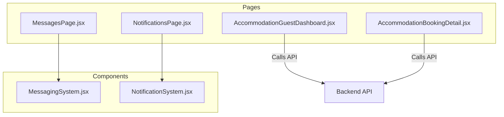
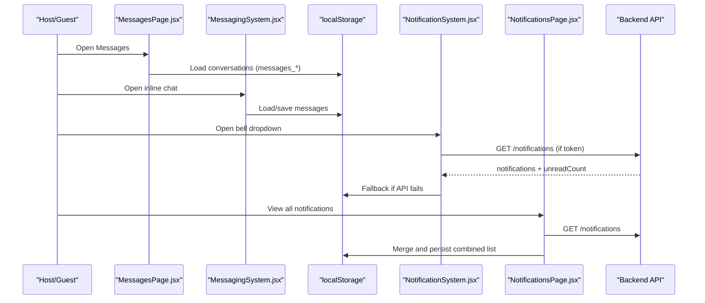
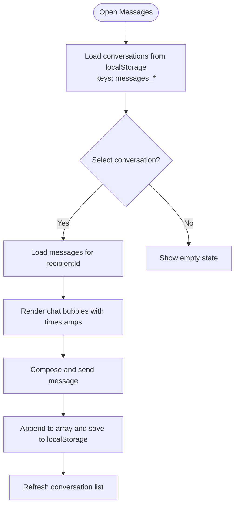
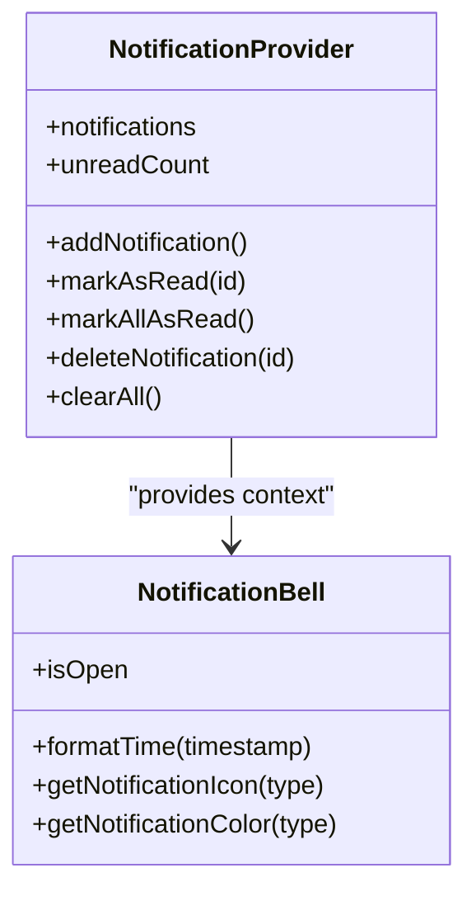
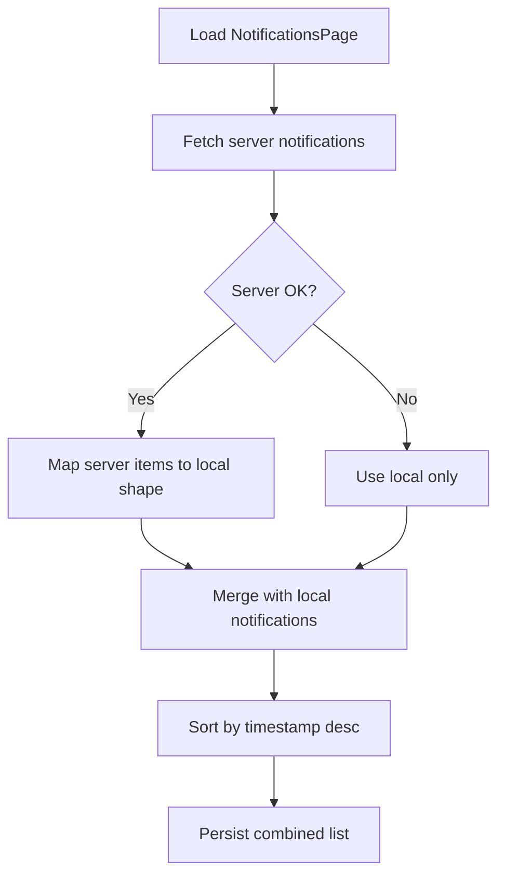
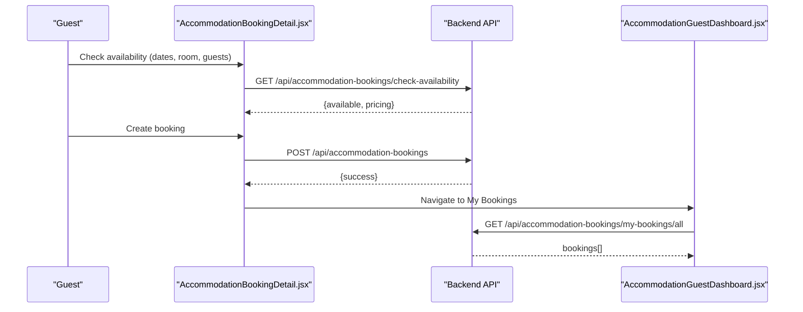
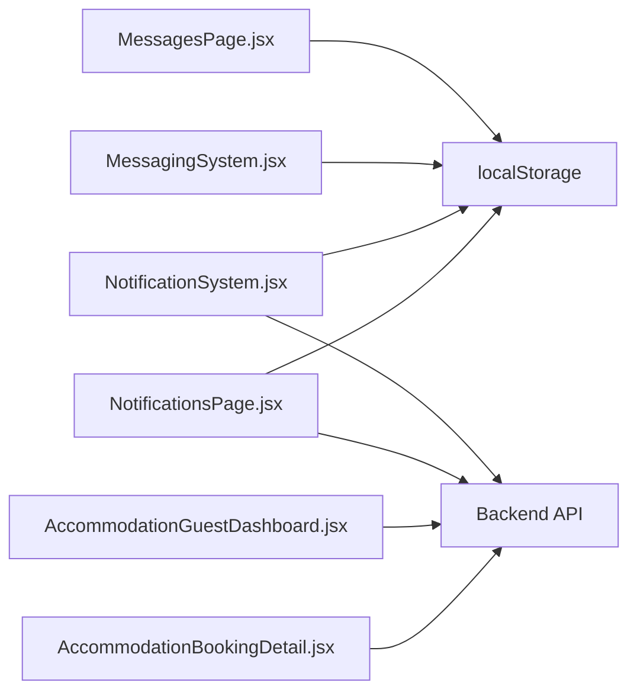

# Guest Communication

<cite>
**Referenced Files in This Document**
- [MessagesPage.jsx](file://src/pages/MessagesPage.jsx)
- [MessagingSystem.jsx](file://src/components/MessagingSystem.jsx)
- [NotificationSystem.jsx](file://src/components/NotificationSystem.jsx)
- [NotificationsPage.jsx](file://src/pages/NotificationsPage.jsx)
- [AccommodationGuestDashboard.jsx](file://src/pages/AccommodationGuestDashboard.jsx)
- [AccommodationBookingDetail.jsx](file://src/pages/AccommodationBookingDetail.jsx)
</cite>

## Table of Contents
1. [Introduction](#introduction)
2. [Project Structure](#project-structure)
3. [Core Components](#core-components)
4. [Architecture Overview](#architecture-overview)
5. [Detailed Component Analysis](#detailed-component-analysis)
6. [Dependency Analysis](#dependency-analysis)
7. [Performance Considerations](#performance-considerations)
8. [Troubleshooting Guide](#troubleshooting-guide)
9. [Conclusion](#conclusion)

## Introduction
This document explains the guest communication tools available in the host dashboard and related pages. It covers:
- Direct messaging with guests via a local chat interface
- Automated notification workflows for booking, payment, message, review, and property events
- Booking-related alerts and how to manage inquiries and confirmations

The implementation uses React components that persist data locally (localStorage) and optionally integrate with backend endpoints when authenticated.

## Project Structure
The guest communication features are implemented across dedicated pages and reusable components:
- Messaging: a full-page inbox and an inline chat widget
- Notifications: a context-driven bell UI and a notifications page
- Booking flows: guest-facing booking detail and my bookings dashboard

**Diagram sources**
- [MessagesPage.jsx:1-312](file://src/pages/MessagesPage.jsx#L1-L312)
- [MessagingSystem.jsx:1-337](file://src/components/MessagingSystem.jsx#L1-L337)
- [NotificationSystem.jsx:1-472](file://src/components/NotificationSystem.jsx#L1-L472)
- [NotificationsPage.jsx:1-326](file://src/pages/NotificationsPage.jsx#L1-L326)
- [AccommodationGuestDashboard.jsx:1-346](file://src/pages/AccommodationGuestDashboard.jsx#L1-L346)
- [AccommodationBookingDetail.jsx:1-558](file://src/pages/AccommodationBookingDetail.jsx#L1-L558)

**Section sources**
- [MessagesPage.jsx:1-312](file://src/pages/MessagesPage.jsx#L1-L312)
- [MessagingSystem.jsx:1-337](file://src/components/MessagingSystem.jsx#L1-L337)
- [NotificationSystem.jsx:1-472](file://src/components/NotificationSystem.jsx#L1-L472)
- [NotificationsPage.jsx:1-326](file://src/pages/NotificationsPage.jsx#L1-L326)
- [AccommodationGuestDashboard.jsx:1-346](file://src/pages/AccommodationGuestDashboard.jsx#L1-L346)
- [AccommodationBookingDetail.jsx:1-558](file://src/pages/AccommodationBookingDetail.jsx#L1-L558)

## Core Components
- MessagesPage: Full-page conversation list and chat view. Stores messages per recipient under localStorage keys like `messages_<recipientId>`. Supports search, delete, and relative timestamps.
- MessagingSystem: Inline floating chat widget. Accepts recipient details and optional property context. Persists messages locally.
- NotificationSystem: Context provider for notifications with a bell dropdown UI. Loads from server when authenticated; falls back to localStorage otherwise. Provides mark-as-read, mark-all-as-read, delete, and clear operations.
- NotificationsPage: Dedicated notifications page with filters (all, unread, type-based), merge logic for local and server notifications, and read/delete actions.
- AccommodationGuestDashboard: Guest “My Bookings” page with status tabs, cancellation flow, and navigation to reviews or details.
- AccommodationBookingDetail: Property detail and booking flow with availability check, pricing breakdown, and booking creation.

**Section sources**
- [MessagesPage.jsx:14-74](file://src/pages/MessagesPage.jsx#L14-L74)
- [MessagingSystem.jsx:20-53](file://src/components/MessagingSystem.jsx#L20-L53)
- [NotificationSystem.jsx:19-159](file://src/components/NotificationSystem.jsx#L19-L159)
- [NotificationsPage.jsx:28-41](file://src/pages/NotificationsPage.jsx#L28-L41)
- [AccommodationGuestDashboard.jsx:30-76](file://src/pages/AccommodationGuestDashboard.jsx#L30-L76)
- [AccommodationBookingDetail.jsx:52-118](file://src/pages/AccommodationBookingDetail.jsx#L52-L118)

## Architecture Overview
The system combines local-first storage with optional server synchronization:
- Messaging is local-only at this layer. Each conversation is keyed by recipient ID.
- Notifications prefer server data when a token exists, falling back to localStorage.
- Booking flows call backend endpoints for availability checks and booking creation.

**Diagram sources**
- [MessagesPage.jsx:14-30](file://src/pages/MessagesPage.jsx#L14-L30)
- [MessagingSystem.jsx:20-32](file://src/components/MessagingSystem.jsx#L20-L32)
- [NotificationSystem.jsx:25-55](file://src/components/NotificationSystem.jsx#L25-L55)
- [NotificationsPage.jsx:50-83](file://src/pages/NotificationsPage.jsx#L50-L83)

## Detailed Component Analysis

### Messaging System
Responsibilities:
- Display a list of conversations sorted by last activity
- Show message history per recipient
- Persist messages locally
- Provide search and delete capabilities

Data model (per conversation):
- recipientId, recipientName, lastMessage, lastTimestamp, messageCount, propertyTitle
- Message fields include id, text, senderId, senderName, recipientId, recipientName, timestamp, propertyId, propertyTitle

**Diagram sources**
- [MessagesPage.jsx:14-30](file://src/pages/MessagesPage.jsx#L14-L30)
- [MessagesPage.jsx:46-64](file://src/pages/MessagesPage.jsx#L46-L64)
- [MessagingSystem.jsx:34-53](file://src/components/MessagingSystem.jsx#L34-L53)

Operational notes:
- Conversations are stored under keys `messages_<recipientId>`
- Relative time formatting supports “Just now”, minutes, hours, days, and date strings
- Deletion removes the key and resets active conversation

**Section sources**
- [MessagesPage.jsx:14-74](file://src/pages/MessagesPage.jsx#L14-L74)
- [MessagingSystem.jsx:20-53](file://src/components/MessagingSystem.jsx#L20-L53)

### Notification System
Responsibilities:
- Provide a global notification context with add/mark/clear operations
- Render a bell icon with unread badge and dropdown
- Integrate with backend when authenticated; fallback to localStorage
- Support marking individual or all notifications as read

Server integration:
- GET `/notifications` with Authorization header
- PATCH `/notifications/{id}/read`
- PATCH `/notifications/read-all`
- DELETE `/notifications/{id}`

Local fallback:
- Key: `axxspace_notifications`
- Tracks read/unread and timestamps

**Diagram sources**
- [NotificationSystem.jsx:19-159](file://src/components/NotificationSystem.jsx#L19-L159)
- [NotificationSystem.jsx:161-291](file://src/components/NotificationSystem.jsx#L161-L291)

Usage patterns:
- Wrap app with NotificationProvider to expose hooks
- Use NotificationBell in headers/navbars
- NotificationsPage merges local and server notifications and persists combined list

**Section sources**
- [NotificationSystem.jsx:25-159](file://src/components/NotificationSystem.jsx#L25-L159)
- [NotificationSystem.jsx:161-291](file://src/components/NotificationSystem.jsx#L161-L291)
- [NotificationsPage.jsx:28-41](file://src/pages/NotificationsPage.jsx#L28-L41)

### Notifications Page
Responsibilities:
- Fetch and merge notifications from server and localStorage
- Filter by category (all, unread, type)
- Mark items as read, delete, or clear all

Merge strategy:
- Server notifications are mapped to local shape
- Local notifications are preserved
- Combined list is sorted by timestamp descending

**Diagram sources**
- [NotificationsPage.jsx:50-83](file://src/pages/NotificationsPage.jsx#L50-L83)
- [NotificationsPage.jsx:28-41](file://src/pages/NotificationsPage.jsx#L28-L41)

**Section sources**
- [NotificationsPage.jsx:50-83](file://src/pages/NotificationsPage.jsx#L50-L83)
- [NotificationsPage.jsx:114-136](file://src/pages/NotificationsPage.jsx#L114-L136)

### Booking Flows and Alerts
Guest-facing booking flows:
- Availability check endpoint returns availability and pricing
- Booking creation endpoint creates a pending booking
- My Bookings dashboard shows statuses and allows cancellation

Alerting and templates:
- Notifications support types such as booking, payment, message, review, and property
- Titles and messages are derived from notification payloads
- Templates can be applied by mapping notification types to titles/messages

**Diagram sources**
- [AccommodationBookingDetail.jsx:52-118](file://src/pages/AccommodationBookingDetail.jsx#L52-L118)
- [AccommodationGuestDashboard.jsx:30-45](file://src/pages/AccommodationGuestDashboard.jsx#L30-L45)

**Section sources**
- [AccommodationBookingDetail.jsx:52-118](file://src/pages/AccommodationBookingDetail.jsx#L52-L118)
- [AccommodationGuestDashboard.jsx:30-76](file://src/pages/AccommodationGuestDashboard.jsx#L30-L76)

## Dependency Analysis
- Pages depend on components for UI primitives (chat, notifications)
- Components may call backend endpoints conditionally based on authentication
- Data persistence is primarily local, with optional server sync for notifications

**Diagram sources**
- [MessagesPage.jsx:14-30](file://src/pages/MessagesPage.jsx#L14-L30)
- [MessagingSystem.jsx:20-32](file://src/components/MessagingSystem.jsx#L20-L32)
- [NotificationSystem.jsx:25-55](file://src/components/NotificationSystem.jsx#L25-L55)
- [NotificationsPage.jsx:50-83](file://src/pages/NotificationsPage.jsx#L50-L83)
- [AccommodationGuestDashboard.jsx:30-45](file://src/pages/AccommodationGuestDashboard.jsx#L30-L45)
- [AccommodationBookingDetail.jsx:52-118](file://src/pages/AccommodationBookingDetail.jsx#L52-L118)

**Section sources**
- [MessagesPage.jsx:14-30](file://src/pages/MessagesPage.jsx#L14-L30)
- [MessagingSystem.jsx:20-32](file://src/components/MessagingSystem.jsx#L20-L32)
- [NotificationSystem.jsx:25-55](file://src/components/NotificationSystem.jsx#L25-L55)
- [NotificationsPage.jsx:50-83](file://src/pages/NotificationsPage.jsx#L50-L83)
- [AccommodationGuestDashboard.jsx:30-45](file://src/pages/AccommodationGuestDashboard.jsx#L30-L45)
- [AccommodationBookingDetail.jsx:52-118](file://src/pages/AccommodationBookingDetail.jsx#L52-L118)

## Performance Considerations
- Local storage reads/writes are synchronous; batch updates where possible to avoid excessive re-renders.
- Conversation lists are filtered and sorted client-side; consider pagination if conversation count grows significantly.
- Notification merging occurs on load; cache results and debounce repeated fetches.
- Avoid unnecessary re-fetching of notifications; rely on context state and mark operations before reloading.

[No sources needed since this section provides general guidance]

## Troubleshooting Guide
Common issues and resolutions:
- No conversations appear: Ensure messages have been sent and localStorage contains keys starting with `messages_`. Clear stale entries if needed.
- Inline chat not loading: Verify recipientId is passed correctly and localStorage has the corresponding key.
- Notifications not updating: Confirm authentication token is present; server endpoints require Authorization header. If API fails, local fallback should still display notifications.
- Booking availability errors: Validate selected dates and room capacity; ensure parameters match backend expectations.

**Section sources**
- [MessagesPage.jsx:14-30](file://src/pages/MessagesPage.jsx#L14-L30)
- [MessagingSystem.jsx:20-32](file://src/components/MessagingSystem.jsx#L20-L32)
- [NotificationSystem.jsx:25-55](file://src/components/NotificationSystem.jsx#L25-L55)
- [AccommodationBookingDetail.jsx:52-86](file://src/pages/AccommodationBookingDetail.jsx#L52-L86)

## Conclusion
The guest communication toolkit provides:
- A robust local-first messaging experience for direct guest-host conversations
- A flexible notification system that integrates with backend services while remaining resilient offline
- Clear booking flows with availability checks, pricing transparency, and status management

For production readiness, consider:
- Migrating messaging to a real-time backend (e.g., WebSocket)
- Centralizing notification templates and automations on the server
- Adding analytics and audit trails for communication and booking events

[No sources needed since this section summarizes without analyzing specific files]