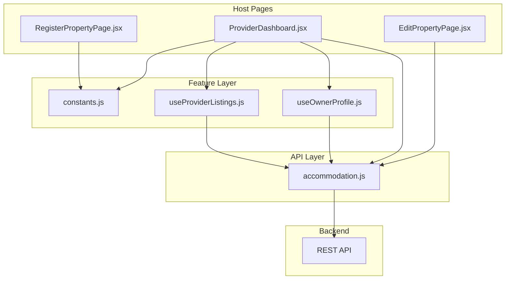
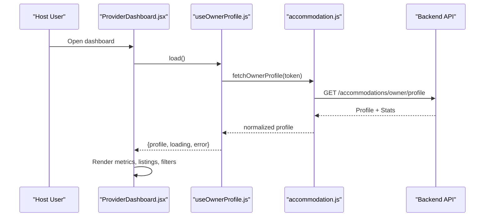
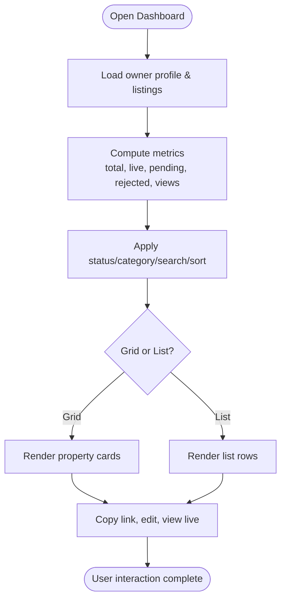
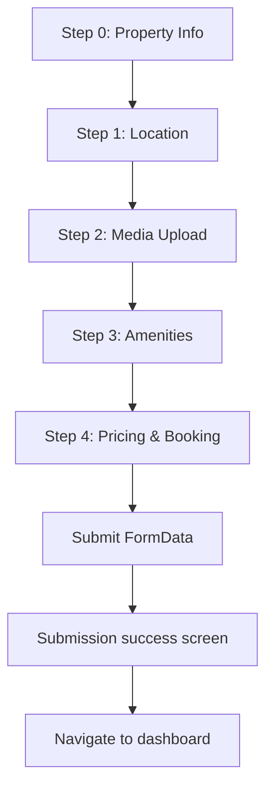
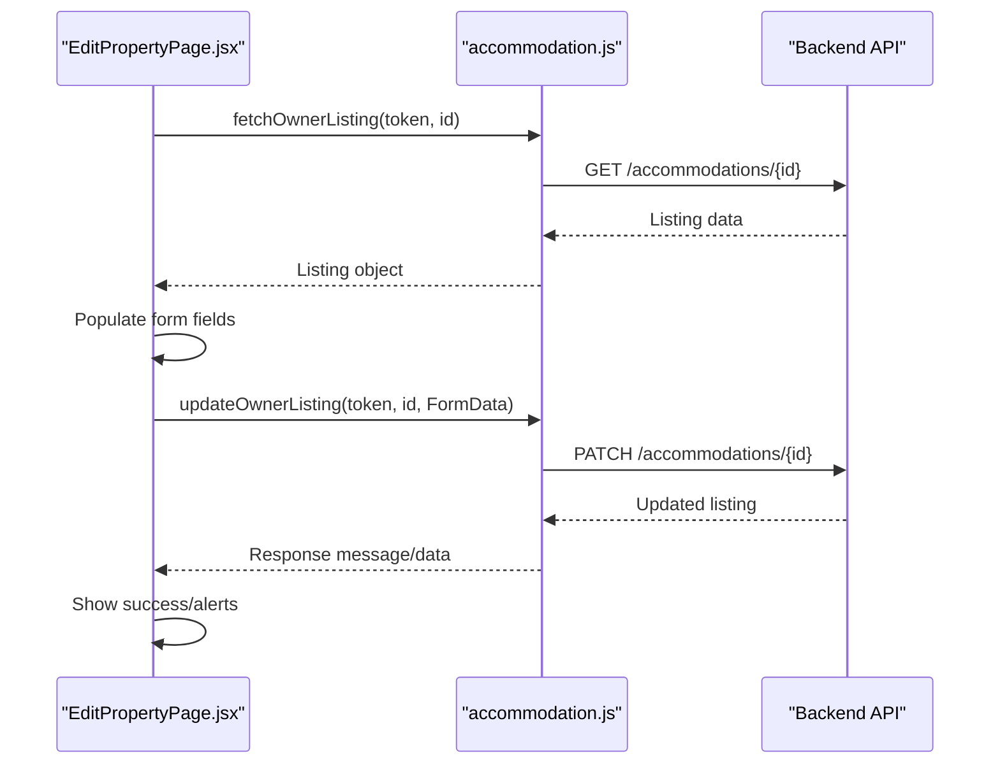
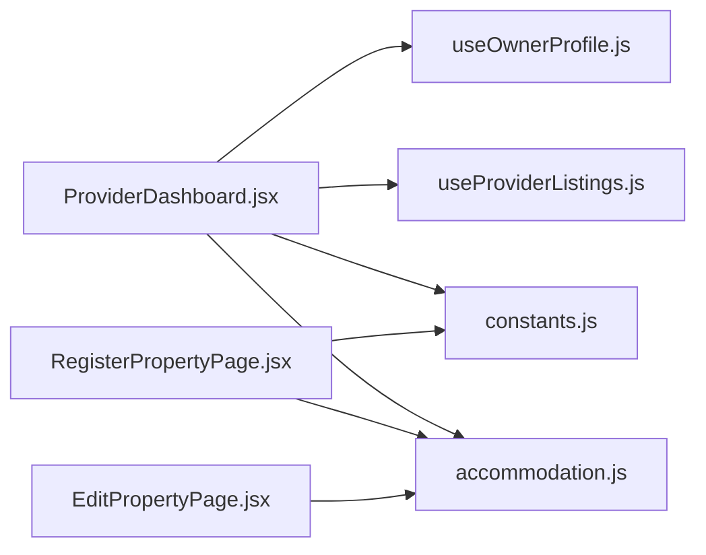

# Host Dashboard

<cite>
**Referenced Files in This Document**
- [ProviderDashboard.jsx](file://src/pages/accommodation/ProviderDashboard.jsx)
- [RegisterPropertyPage.jsx](file://src/pages/accommodation/RegisterPropertyPage.jsx)
- [EditPropertyPage.jsx](file://src/pages/accommodation/EditPropertyPage.jsx)
- [accommodation.js](file://src/api/accommodation.js)
- [constants.js](file://src/features/accommodation/constants.js)
- [useOwnerProfile.js](file://src/features/accommodation/hooks/useOwnerProfile.js)
- [useProviderListings.js](file://src/features/accommodation/hooks/useProviderListings.js)
</cite>

## Table of Contents
1. [Introduction](#introduction)
2. [Project Structure](#project-structure)
3. [Core Components](#core-components)
4. [Architecture Overview](#architecture-overview)
5. [Detailed Component Analysis](#detailed-component-analysis)
6. [Dependency Analysis](#dependency-analysis)
7. [Performance Considerations](#performance-considerations)
8. [Troubleshooting Guide](#troubleshooting-guide)
9. [Conclusion](#conclusion)
10. [Appendices](#appendices)

## Introduction
This document explains the host dashboard system for accommodation providers. It covers property listing creation, editing, status management, owner profile updates, performance analytics, and communication-related features visible to hosts. It also provides practical examples for adding new property types, customizing dashboards, and integrating additional host tools.

The implementation is a React + Vite frontend that communicates with a backend through REST endpoints. The main host experience lives under the accommodation feature area, with dedicated pages for the dashboard, registration, and editing flows.

## Project Structure
The host dashboard is implemented primarily in the accommodation feature:

- Pages:
  - Provider dashboard overview and portfolio management
  - Property registration wizard
  - Property editing form
- API layer:
  - Centralized accommodation API functions
- Feature constants:
  - Property categories, amenities, registration steps, and shared labels
- Hooks:
  - Owner profile loading
  - Provider listings loading

**Diagram sources**
- [ProviderDashboard.jsx:1-46](file://src/pages/accommodation/ProviderDashboard.jsx#L1-L46)
- [RegisterPropertyPage.jsx:1-21](file://src/pages/accommodation/RegisterPropertyPage.jsx#L1-L21)
- [EditPropertyPage.jsx:1-10](file://src/pages/accommodation/EditPropertyPage.jsx#L1-L10)
- [constants.js:55-164](file://src/features/accommodation/constants.js#L55-L164)
- [useOwnerProfile.js:1-32](file://src/features/accommodation/hooks/useOwnerProfile.js#L1-L32)
- [useProviderListings.js:1-39](file://src/features/accommodation/hooks/useProviderListings.js#L1-L39)
- [accommodation.js:129-179](file://src/api/accommodation.js#L129-L179)

**Section sources**
- [ProviderDashboard.jsx:1-46](file://src/pages/accommodation/ProviderDashboard.jsx#L1-L46)
- [RegisterPropertyPage.jsx:1-21](file://src/pages/accommodation/RegisterPropertyPage.jsx#L1-L21)
- [EditPropertyPage.jsx:1-10](file://src/pages/accommodation/EditPropertyPage.jsx#L1-L10)
- [constants.js:55-164](file://src/features/accommodation/constants.js#L55-L164)
- [useOwnerProfile.js:1-32](file://src/features/accommodation/hooks/useOwnerProfile.js#L1-L32)
- [useProviderListings.js:1-39](file://src/features/accommodation/hooks/useProviderListings.js#L1-L39)
- [accommodation.js:129-179](file://src/api/accommodation.js#L129-L179)

## Core Components
- Provider dashboard:
  - Displays owner greeting, agent collaboration requests, performance metrics, and filtered/sorted property cards.
  - Supports manual refresh, search, status/category filters, sorting, and grid/list views.
- Property registration:
  - Multi-step wizard covering property info, location, media upload, amenities, pricing, room types, and booking URL.
  - Validates required fields and maps UI category values to backend type values.
- Property editing:
  - Loads existing listing data, supports updating text fields, toggling amenities, and uploading/removing images/videos.
  - Shows listing status, submission timestamps, and view counts.
- Data hooks:
  - useOwnerProfile loads owner profile and stats from the backend.
  - useProviderListings loads provider listings and computes basic stats.
- API module:
  - Normalizes accommodation data, registers properties, fetches listings and owner profile, and updates listings.

**Section sources**
- [ProviderDashboard.jsx:16-204](file://src/pages/accommodation/ProviderDashboard.jsx#L16-L204)
- [RegisterPropertyPage.jsx:169-330](file://src/pages/accommodation/RegisterPropertyPage.jsx#L169-L330)
- [EditPropertyPage.jsx:12-103](file://src/pages/accommodation/EditPropertyPage.jsx#L12-L103)
- [useOwnerProfile.js:5-32](file://src/features/accommodation/hooks/useOwnerProfile.js#L5-L32)
- [useProviderListings.js:5-39](file://src/features/accommodation/hooks/useProviderListings.js#L5-L39)
- [accommodation.js:34-77](file://src/api/accommodation.js#L34-L77)
- [accommodation.js:129-179](file://src/api/accommodation.js#L129-L179)

## Architecture Overview
The host dashboard follows a layered architecture:

- Presentation layer (React pages):
  - ProviderDashboard orchestrates state, user interactions, and displays metrics and listings.
  - RegisterPropertyPage implements a step-by-step registration flow.
  - EditPropertyPage manages editing lifecycle and media handling.
- Feature layer (hooks and constants):
  - Hooks encapsulate data fetching and error/loading states.
  - Constants define categories, amenities, and registration defaults.
- API layer:
  - Centralized functions handle HTTP calls, headers, normalization, and error propagation.
- Backend:
  - REST endpoints serve owner profiles, listings, and update operations.

**Diagram sources**
- [ProviderDashboard.jsx:16-46](file://src/pages/accommodation/ProviderDashboard.jsx#L16-L46)
- [useOwnerProfile.js:5-32](file://src/features/accommodation/hooks/useOwnerProfile.js#L5-L32)
- [accommodation.js:147-152](file://src/api/accommodation.js#L147-L152)

## Detailed Component Analysis

### Provider Dashboard
Responsibilities:
- Load owner profile and listings via hooks.
- Display performance metrics: total properties, active/live count, pending review count, needs action count, and guest views.
- Provide filtering by status, category, and search query; sorting by newest, views, price, or name.
- Support grid/list view modes.
- Manage agent collaboration requests: accept or reject with optional notes.
- Manual sync button to refresh data.

Key behaviors:
- Status mapping:
  - Approved/active → Live
  - Pending/pending_review → Under Review
  - Rejected/inactive → Needs Action
- Derived stats combine backend-provided stats and local calculations.
- Toast notifications confirm actions like syncing and copying listing links.

**Diagram sources**
- [ProviderDashboard.jsx:140-204](file://src/pages/accommodation/ProviderDashboard.jsx#L140-L204)
- [ProviderDashboard.jsx:438-552](file://src/pages/accommodation/ProviderDashboard.jsx#L438-L552)

**Section sources**
- [ProviderDashboard.jsx:16-204](file://src/pages/accommodation/ProviderDashboard.jsx#L16-L204)
- [ProviderDashboard.jsx:438-552](file://src/pages/accommodation/ProviderDashboard.jsx#L438-L552)

### Property Registration Wizard
Responsibilities:
- Collect property information, location details, media, amenities, pricing, room types, and optional booking site URL.
- Validate required fields per step.
- Map UI category names to backend enum values.
- Build FormData for image/video uploads and submit to backend.

Steps:
- Step 0: Property info (name, category, description).
- Step 1: Location (county, town, address, map link, GPS coordinates).
- Step 2: Media upload (photos up to 20, videos up to 10 with size limits).
- Step 3: Amenities selection.
- Step 4: Pricing, rooms, and booking URL.
- Final: Submission confirmation and navigation back to dashboard.

**Diagram sources**
- [RegisterPropertyPage.jsx:169-330](file://src/pages/accommodation/RegisterPropertyPage.jsx#L169-L330)
- [RegisterPropertyPage.jsx:403-760](file://src/pages/accommodation/RegisterPropertyPage.jsx#L403-L760)

**Section sources**
- [RegisterPropertyPage.jsx:169-330](file://src/pages/accommodation/RegisterPropertyPage.jsx#L169-L330)
- [RegisterPropertyPage.jsx:403-760](file://src/pages/accommodation/RegisterPropertyPage.jsx#L403-L760)

### Property Editing Page
Responsibilities:
- Fetch existing listing data and populate editable fields.
- Allow toggling amenities, updating text fields, and uploading/removing images/videos.
- Show listing status, submission date, last updated timestamp, and view count.
- Save changes via PATCH request with FormData.

Editing workflow:
- Load listing by ID.
- Populate form with normalized fields.
- Handle remove lists for images/videos and new file arrays.
- Submit FormData to backend and display success/error messages.

**Diagram sources**
- [EditPropertyPage.jsx:29-61](file://src/pages/accommodation/EditPropertyPage.jsx#L29-L61)
- [EditPropertyPage.jsx:73-103](file://src/pages/accommodation/EditPropertyPage.jsx#L73-L103)
- [accommodation.js:163-179](file://src/api/accommodation.js#L163-L179)

**Section sources**
- [EditPropertyPage.jsx:12-103](file://src/pages/accommodation/EditPropertyPage.jsx#L12-L103)
- [EditPropertyPage.jsx:136-555](file://src/pages/accommodation/EditPropertyPage.jsx#L136-L555)

### Owner Profile Management
Responsibilities:
- Load owner profile including user info, stats, and listings.
- Provide reload capability for manual refresh.
- Surface errors and loading states to UI components.

Integration points:
- ProviderDashboard uses the hook to render profile-based greetings, stats, and listings.
- API function fetches the owner profile endpoint and returns normalized data.

**Section sources**
- [useOwnerProfile.js:5-32](file://src/features/accommodation/hooks/useOwnerProfile.js#L5-L32)
- [ProviderDashboard.jsx:16-24](file://src/pages/accommodation/ProviderDashboard.jsx#L16-L24)
- [accommodation.js:147-152](file://src/api/accommodation.js#L147-L152)

### Listing Performance Analytics
Capabilities:
- Total properties, active/live count, under-review count, needs-action count, and guest views.
- Filtering and sorting to analyze subsets of listings.
- Manual sync to ensure latest metrics are displayed.

Notes:
- Some metrics may be provided by the backend via the owner profile; others are computed locally from listings.

**Section sources**
- [ProviderDashboard.jsx:198-204](file://src/pages/accommodation/ProviderDashboard.jsx#L198-L204)
- [ProviderDashboard.jsx:438-552](file://src/pages/accommodation/ProviderDashboard.jsx#L438-L552)

### Booking Calendar
Current status:
- No dedicated booking calendar component is present in the analyzed files.
- Hosts can provide an external booking site URL during registration, which redirects guests to their own booking platform.

Recommendation:
- If a native calendar is needed, integrate a calendar library into the dashboard and connect it to backend availability endpoints.

[No sources needed since this section does not analyze specific files]

### Guest Communication Tools
Current status:
- The dashboard includes agent collaboration requests where hosts can accept or decline partnership inquiries.
- There is no built-in messaging inbox in the analyzed files.

Recommendation:
- Add a messaging interface using a real-time service or polling backend chat endpoints.
- Integrate WhatsApp click-to-chat using contact details collected during registration.

**Section sources**
- [ProviderDashboard.jsx:53-110](file://src/pages/accommodation/ProviderDashboard.jsx#L53-L110)
- [RegisterPropertyPage.jsx:724-744](file://src/pages/accommodation/RegisterPropertyPage.jsx#L724-L744)

## Dependency Analysis
Component relationships:

- ProviderDashboard depends on:
  - useOwnerProfile for profile and stats
  - useProviderListings for listings and derived stats
  - constants for PROPERTY_CATEGORIES and status labels
  - API functions for agent requests and listing operations
- RegisterPropertyPage depends on:
  - constants for categories, counties, amenities, steps, and initial form
  - API function registerAccommodationProperty
- EditPropertyPage depends on:
  - API functions fetchOwnerListing and updateOwnerListing
  - constants for amenities

**Diagram sources**
- [ProviderDashboard.jsx:1-12](file://src/pages/accommodation/ProviderDashboard.jsx#L1-L12)
- [RegisterPropertyPage.jsx:1-21](file://src/pages/accommodation/RegisterPropertyPage.jsx#L1-L21)
- [EditPropertyPage.jsx:1-10](file://src/pages/accommodation/EditPropertyPage.jsx#L1-L10)
- [constants.js:55-164](file://src/features/accommodation/constants.js#L55-L164)
- [accommodation.js:129-179](file://src/api/accommodation.js#L129-L179)

**Section sources**
- [ProviderDashboard.jsx:1-12](file://src/pages/accommodation/ProviderDashboard.jsx#L1-L12)
- [RegisterPropertyPage.jsx:1-21](file://src/pages/accommodation/RegisterPropertyPage.jsx#L1-L21)
- [EditPropertyPage.jsx:1-10](file://src/pages/accommodation/EditPropertyPage.jsx#L1-L10)
- [constants.js:55-164](file://src/features/accommodation/constants.js#L55-L164)
- [accommodation.js:129-179](file://src/api/accommodation.js#L129-L179)

## Performance Considerations
- Use memoization for filtered/sorted listings to avoid unnecessary re-renders.
- Lazy-load images and videos; consider thumbnails and progressive loading.
- Debounce search input to reduce filter computations.
- Cache owner profile and listings briefly to minimize network calls.
- Normalize data once at the API layer to prevent repeated transformations.

[No sources needed since this section provides general guidance]

## Troubleshooting Guide
Common issues and resolutions:

- Authentication failures:
  - Ensure token is present when calling owner profile or listing endpoints.
  - Verify environment variable for API base URL.
- Missing required fields:
  - Registration requires name, category, description, county, town, address, and GPS coordinates.
  - Amenities must include at least one selection before proceeding.
- File upload limits:
  - Images limited to 20; videos limited to 10 with max 100MB each.
  - Oversized videos are skipped with warnings.
- Network errors:
  - API wrapper throws errors with message or error field from backend response.
  - Retry via reload function or manual sync button.

**Section sources**
- [RegisterPropertyPage.jsx:242-330](file://src/pages/accommodation/RegisterPropertyPage.jsx#L242-L330)
- [accommodation.js:7-14](file://src/api/accommodation.js#L7-L14)
- [accommodation.js:129-179](file://src/api/accommodation.js#L129-L179)

## Conclusion
The host dashboard provides a comprehensive suite for managing accommodation listings, viewing performance metrics, and collaborating with agents. While there is no native booking calendar or messaging inbox yet, the system supports external booking URLs and offers a foundation for extending communication features. The modular structure with clear separation between pages, hooks, constants, and API functions makes it straightforward to customize dashboards, add new property types, and integrate additional host tools.

[No sources needed since this section summarizes without analyzing specific files]

## Appendices

### Adding New Property Types
- Extend PROPERTY_CATEGORIES in constants.js to include new categories.
- Update the category-to-backend-type mapping in RegisterPropertyPage if the backend expects different enum values.
- Optionally add icons or colors in constants or components to reflect new categories visually.

**Section sources**
- [constants.js:55-121](file://src/features/accommodation/constants.js#L55-L121)
- [RegisterPropertyPage.jsx:265-301](file://src/pages/accommodation/RegisterPropertyPage.jsx#L265-L301)

### Customizing Dashboards
- Adjust status filters, sort options, and category filters in ProviderDashboard.
- Modify metric cards and layout styles to highlight key KPIs.
- Add new sections such as revenue summaries or occupancy rates by connecting to backend analytics endpoints.

**Section sources**
- [ProviderDashboard.jsx:140-204](file://src/pages/accommodation/ProviderDashboard.jsx#L140-L204)
- [ProviderDashboard.jsx:438-552](file://src/pages/accommodation/ProviderDashboard.jsx#L438-L552)

### Integrating Additional Host Tools
- Messaging:
  - Implement a chat interface and connect to backend chat endpoints.
  - Use WebSocket or polling for real-time updates.
- Availability calendar:
  - Integrate a calendar library and sync with backend availability endpoints.
  - Block dates based on bookings and maintenance schedules.
- Reporting:
  - Add export functionality for listing performance and financial reports.
  - Connect to backend reporting endpoints for aggregated metrics.

[No sources needed since this section provides general guidance]