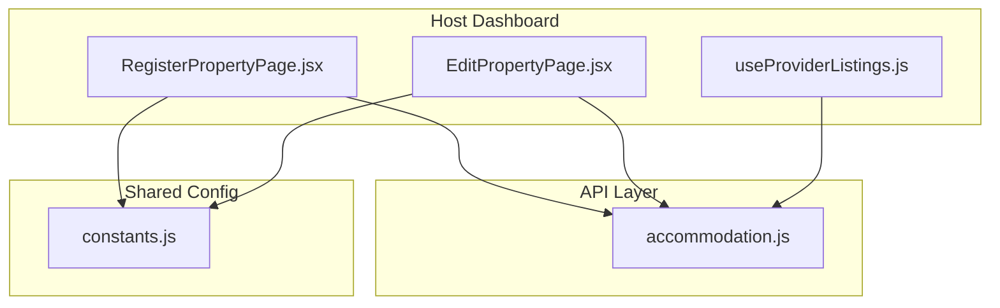
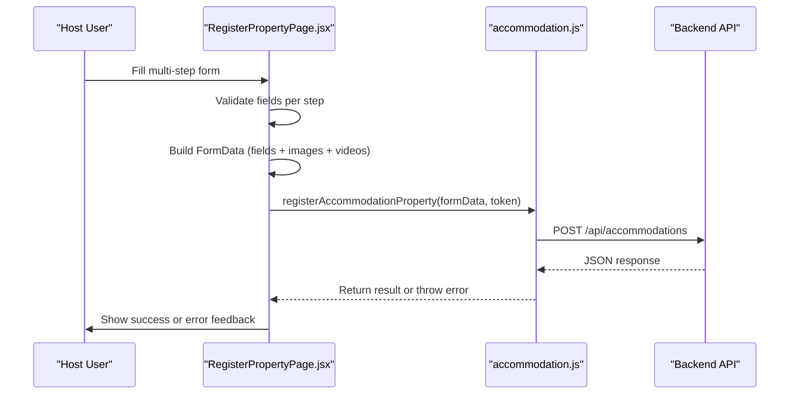
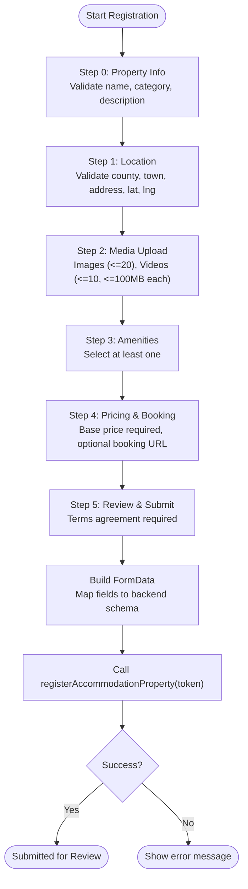
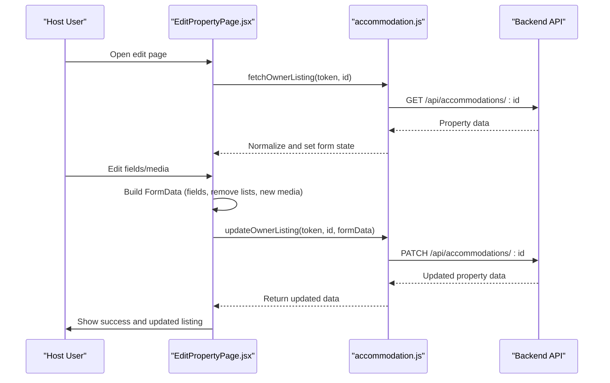
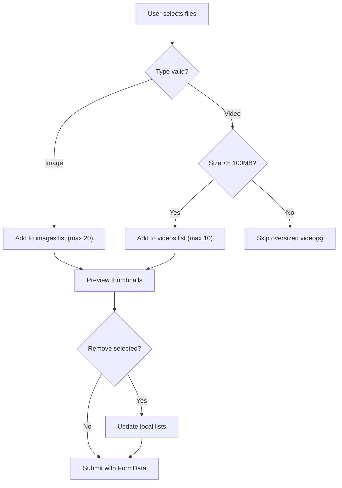
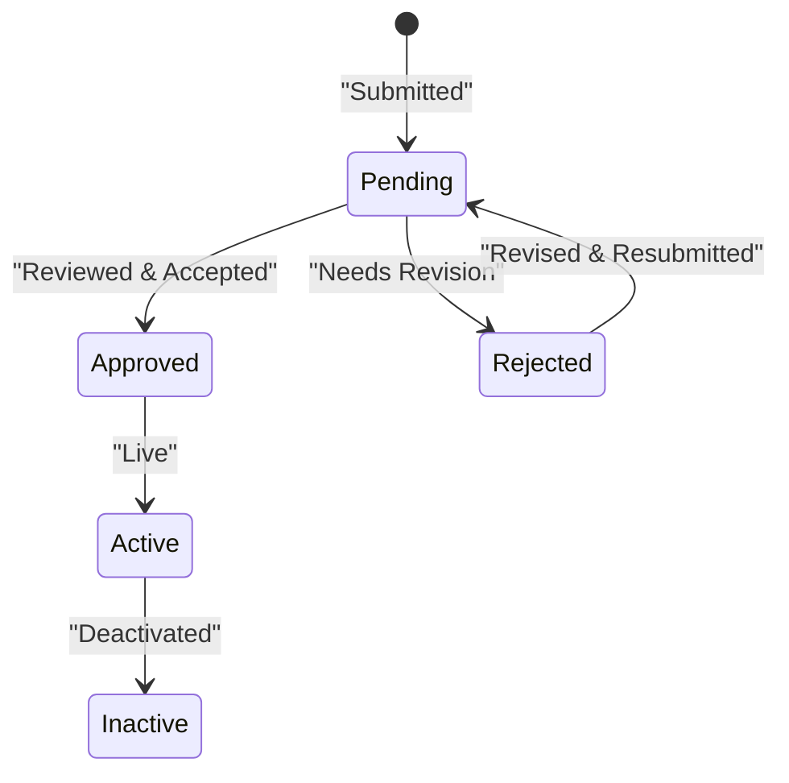
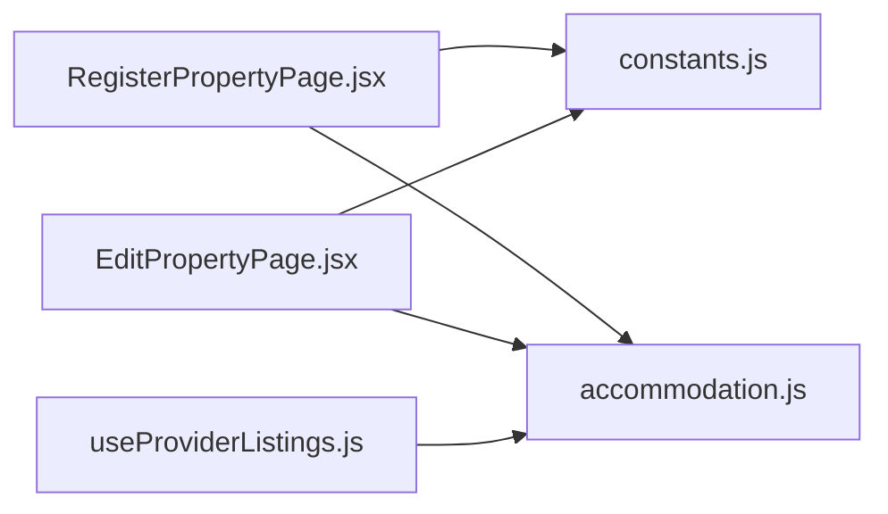

# Property Management

<cite>
**Referenced Files in This Document**
- [RegisterPropertyPage.jsx](file://src/pages/accommodation/RegisterPropertyPage.jsx)
- [EditPropertyPage.jsx](file://src/pages/accommodation/EditPropertyPage.jsx)
- [accommodation.js](file://src/api/accommodation.js)
- [useProviderListings.js](file://src/features/accommodation/hooks/useProviderListings.js)
- [constants.js](file://src/features/accommodation/constants.js)
</cite>

## Table of Contents
1. [Introduction](#introduction)
2. [Project Structure](#project-structure)
3. [Core Components](#core-components)
4. [Architecture Overview](#architecture-overview)
5. [Detailed Component Analysis](#detailed-component-analysis)
6. [Dependency Analysis](#dependency-analysis)
7. [Performance Considerations](#performance-considerations)
8. [Troubleshooting Guide](#troubleshooting-guide)
9. [Conclusion](#conclusion)

## Introduction
This document explains the property management system for the host dashboard within the accommodation feature. It covers:
- Creating new property listings through a multi-step form
- Editing existing properties and managing images/videos
- Handling property status changes and visibility
- Form validation, image upload processes, and listing optimization tips
- Data flow between UI components and the backend API

The implementation is built with React, uses local state for forms, FormData for media uploads, and an API layer that wraps HTTP requests to the backend.

## Project Structure
The property management functionality lives under the accommodation feature:
- Pages:
  - Registration page for creating new properties
  - Edit page for updating existing properties
- API layer:
  - Centralized functions for listing creation, updates, and fetching
- Feature constants:
  - Shared configuration such as categories, amenities, steps, and initial form values
- Hooks:
  - Provider listings hook used by dashboards to load owner listings and compute stats

**Diagram sources**
- [RegisterPropertyPage.jsx:1-20](file://src/pages/accommodation/RegisterPropertyPage.jsx#L1-L20)
- [EditPropertyPage.jsx:1-10](file://src/pages/accommodation/EditPropertyPage.jsx#L1-L10)
- [accommodation.js:1-30](file://src/api/accommodation.js#L1-L30)
- [useProviderListings.js:1-10](file://src/features/accommodation/hooks/useProviderListings.js#L1-L10)
- [constants.js:1-20](file://src/features/accommodation/constants.js#L1-L20)

**Section sources**
- [RegisterPropertyPage.jsx:1-20](file://src/pages/accommodation/RegisterPropertyPage.jsx#L1-L20)
- [EditPropertyPage.jsx:1-10](file://src/pages/accommodation/EditPropertyPage.jsx#L1-L10)
- [accommodation.js:1-30](file://src/api/accommodation.js#L1-L30)
- [useProviderListings.js:1-10](file://src/features/accommodation/hooks/useProviderListings.js#L1-L10)
- [constants.js:1-20](file://src/features/accommodation/constants.js#L1-L20)

## Core Components
- RegisterPropertyPage.jsx
  - Multi-step wizard for creating a new property listing
  - Handles property info, location, media upload (images and videos), amenities, pricing, booking URL, and review/submit
  - Validates required fields per step and enforces terms acceptance before submission
  - Builds FormData and calls registerAccommodationProperty with authentication token
- EditPropertyPage.jsx
  - Loads existing property details via fetchOwnerListing
  - Allows editing core fields, amenities, media, and policies
  - Supports adding/removing images and videos; sends remove lists to backend
  - Calls updateOwnerListing to persist changes
- accommodation.js
  - Centralizes all backend calls for accommodations
  - Normalizes listing data for consistent consumption across UI
  - Provides create, read, update endpoints and video URL normalization
- useProviderListings.js
  - Hook to fetch owner’s listings and compute summary stats
- constants.js
  - Shared configuration: categories, counties, amenities, registration steps, initial form values, status labels

**Section sources**
- [RegisterPropertyPage.jsx:169-330](file://src/pages/accommodation/RegisterPropertyPage.jsx#L169-L330)
- [EditPropertyPage.jsx:12-103](file://src/pages/accommodation/EditPropertyPage.jsx#L12-L103)
- [accommodation.js:32-77](file://src/api/accommodation.js#L32-L77)
- [accommodation.js:129-179](file://src/api/accommodation.js#L129-L179)
- [useProviderListings.js:5-39](file://src/features/accommodation/hooks/useProviderListings.js#L5-L39)
- [constants.js:55-164](file://src/features/accommodation/constants.js#L55-L164)

## Architecture Overview
The host dashboard property management follows a clear separation of concerns:
- UI pages manage user interactions, local state, and validation
- The API layer handles HTTP requests, headers, error handling, and response normalization
- Shared constants provide reusable configuration for forms and UI behavior
- A hook provides a clean interface for loading owner listings and computing statistics

**Diagram sources**
- [RegisterPropertyPage.jsx:251-330](file://src/pages/accommodation/RegisterPropertyPage.jsx#L251-L330)
- [accommodation.js:129-138](file://src/api/accommodation.js#L129-L138)

**Section sources**
- [RegisterPropertyPage.jsx:242-330](file://src/pages/accommodation/RegisterPropertyPage.jsx#L242-L330)
- [accommodation.js:7-18](file://src/api/accommodation.js#L7-L18)

## Detailed Component Analysis

### Creating New Properties: RegisterPropertyPage
Key responsibilities:
- Step-based navigation with validation rules
- Media upload with preview and size/type checks
- Mapping frontend category labels to backend enum values
- Building FormData and submitting with authentication
- Displaying success state and next steps

Validation highlights:
- Step 0 requires name, category, description
- Step 1 requires county, town, address, lat, lng
- Step 3 requires at least one amenity
- Step 4 requires base price
- Final submit requires terms agreement and valid token

Media handling:
- Images: accept image/*, limit up to 20 files
- Videos: accept video/*, enforce 100MB per file, limit up to 10 files
- Preview cards for both images and videos with removal controls

Data mapping:
- Category mapping converts display names to kebab-case backend enums
- Check-in/check-out mapped to checkInTime/checkOutTime
- Numeric fields parsed appropriately (basePrice, maxGuests, totalRooms)

Submission:
- Constructs FormData with fields, amenities array (JSON string), images, videos
- Calls registerAccommodationProperty with token
- Shows success screen with next steps and optional booking URL confirmation

**Diagram sources**
- [RegisterPropertyPage.jsx:242-330](file://src/pages/accommodation/RegisterPropertyPage.jsx#L242-L330)
- [RegisterPropertyPage.jsx:194-224](file://src/pages/accommodation/RegisterPropertyPage.jsx#L194-L224)
- [RegisterPropertyPage.jsx:265-318](file://src/pages/accommodation/RegisterPropertyPage.jsx#L265-L318)

**Section sources**
- [RegisterPropertyPage.jsx:242-330](file://src/pages/accommodation/RegisterPropertyPage.jsx#L242-L330)
- [RegisterPropertyPage.jsx:194-224](file://src/pages/accommodation/RegisterPropertyPage.jsx#L194-L224)
- [RegisterPropertyPage.jsx:265-318](file://src/pages/accommodation/RegisterPropertyPage.jsx#L265-L318)
- [constants.js:55-164](file://src/features/accommodation/constants.js#L55-L164)

### Editing Existing Properties: EditPropertyPage
Key responsibilities:
- Load existing property details using fetchOwnerListing
- Populate form with current values
- Allow editing core fields, amenities, policies, and media
- Support removing existing images/videos and adding new ones
- Persist changes via updateOwnerListing

Data flow:
- On mount, fetches property data and sets form state
- On save, builds FormData including:
  - Text fields and arrays (amenities serialized as JSON)
  - Remove lists for images and videos
  - New images and videos
- Calls updateOwnerListing with token and listing ID
- Updates local state with returned data and shows success feedback

Status handling:
- Displays status badge and metadata (submittedAt, lastUpdated, views)
- Conditionally shows “View Live Listing” link when approved/active

**Diagram sources**
- [EditPropertyPage.jsx:29-61](file://src/pages/accommodation/EditPropertyPage.jsx#L29-L61)
- [EditPropertyPage.jsx:73-103](file://src/pages/accommodation/EditPropertyPage.jsx#L73-L103)
- [accommodation.js:163-179](file://src/api/accommodation.js#L163-L179)

**Section sources**
- [EditPropertyPage.jsx:29-61](file://src/pages/accommodation/EditPropertyPage.jsx#L29-L61)
- [EditPropertyPage.jsx:73-103](file://src/pages/accommodation/EditPropertyPage.jsx#L73-L103)
- [EditPropertyPage.jsx:132-135](file://src/pages/accommodation/EditPropertyPage.jsx#L132-L135)
- [accommodation.js:163-179](file://src/api/accommodation.js#L163-L179)

### Managing Property Images and Videos
Registration page:
- Image upload: accepts multiple images, previews them, allows removal, limits to 20 files
- Video upload: accepts multiple videos, enforces 100MB per file, previews playback, allows removal, limits to 10 files
- Drag-and-drop support for both images and videos

Edit page:
- Displays existing images and videos with remove buttons
- Adds new images/videos via hidden file inputs
- Tracks pending uploads and removes via separate arrays sent to backend

Normalization:
- Video URLs are normalized to ensure compatibility (e.g., Cloudinary format adjustments)

**Diagram sources**
- [RegisterPropertyPage.jsx:194-224](file://src/pages/accommodation/RegisterPropertyPage.jsx#L194-L224)
- [RegisterPropertyPage.jsx:498-684](file://src/pages/accommodation/RegisterPropertyPage.jsx#L498-L684)
- [EditPropertyPage.jsx:224-306](file://src/pages/accommodation/EditPropertyPage.jsx#L224-L306)
- [accommodation.js:20-30](file://src/api/accommodation.js#L20-L30)

**Section sources**
- [RegisterPropertyPage.jsx:194-224](file://src/pages/accommodation/RegisterPropertyPage.jsx#L194-L224)
- [RegisterPropertyPage.jsx:498-684](file://src/pages/accommodation/RegisterPropertyPage.jsx#L498-L684)
- [EditPropertyPage.jsx:224-306](file://src/pages/accommodation/EditPropertyPage.jsx#L224-L306)
- [accommodation.js:20-30](file://src/api/accommodation.js#L20-L30)

### Property Status Changes and Visibility
- Status labels include pending, pending_review, approved, active, rejected, inactive
- Edit page displays status badge and contextual messages
- Public listing queries filter to only show active/approved accommodations
- Provider listings hook computes stats based on statuses

**Diagram sources**
- [constants.js:166-173](file://src/features/accommodation/constants.js#L166-L173)
- [accommodation.js:81-100](file://src/api/accommodation.js#L81-L100)
- [useProviderListings.js:31-36](file://src/features/accommodation/hooks/useProviderListings.js#L31-L36)

**Section sources**
- [constants.js:166-173](file://src/features/accommodation/constants.js#L166-L173)
- [accommodation.js:81-100](file://src/api/accommodation.js#L81-L100)
- [useProviderListings.js:31-36](file://src/features/accommodation/hooks/useProviderListings.js#L31-L36)

### Form Validation Examples
- Required fields enforced per step in registration
- Terms checkbox must be checked before final submission
- Numeric fields validated and parsed appropriately
- Amenities require at least one selection

Examples:
- Step validation logic ensures progression only when required fields are present
- Submission guard prevents sending without token or terms agreement

**Section sources**
- [RegisterPropertyPage.jsx:242-249](file://src/pages/accommodation/RegisterPropertyPage.jsx#L242-L249)
- [RegisterPropertyPage.jsx:251-260](file://src/pages/accommodation/RegisterPropertyPage.jsx#L251-L260)
- [RegisterPropertyPage.jsx:303-318](file://src/pages/accommodation/RegisterPropertyPage.jsx#L303-L318)

### Listing Optimization Techniques
- Encourage high-resolution photos and video walkthroughs
- Provide guidance on optimal descriptions and amenities
- Suggest setting competitive base prices and weekend/peak pricing
- Recommend linking external booking sites to avoid commission while increasing visibility

These recommendations are embedded in the UI copy and help hosts improve listing quality and conversion rates.

**Section sources**
- [RegisterPropertyPage.jsx:501-504](file://src/pages/accommodation/RegisterPropertyPage.jsx#L501-L504)
- [RegisterPropertyPage.jsx:687-690](file://src/pages/accommodation/RegisterPropertyPage.jsx#L687-L690)
- [EditPropertyPage.jsx:216-222](file://src/pages/accommodation/EditPropertyPage.jsx#L216-L222)

## Dependency Analysis
The following diagram illustrates how components depend on shared configuration and the API layer:

**Diagram sources**
- [RegisterPropertyPage.jsx:1-14](file://src/pages/accommodation/RegisterPropertyPage.jsx#L1-L14)
- [EditPropertyPage.jsx:1-10](file://src/pages/accommodation/EditPropertyPage.jsx#L1-L10)
- [useProviderListings.js:1-4](file://src/features/accommodation/hooks/useProviderListings.js#L1-L4)
- [accommodation.js:1-30](file://src/api/accommodation.js#L1-L30)
- [constants.js:1-20](file://src/features/accommodation/constants.js#L1-L20)

**Section sources**
- [RegisterPropertyPage.jsx:1-14](file://src/pages/accommodation/RegisterPropertyPage.jsx#L1-L14)
- [EditPropertyPage.jsx:1-10](file://src/pages/accommodation/EditPropertyPage.jsx#L1-L10)
- [useProviderListings.js:1-4](file://src/features/accommodation/hooks/useProviderListings.js#L1-L4)
- [accommodation.js:1-30](file://src/api/accommodation.js#L1-L30)
- [constants.js:1-20](file://src/features/accommodation/constants.js#L1-L20)

## Performance Considerations
- Limit number of uploaded images and videos to prevent large payloads
- Enforce per-file size constraints (videos up to 100MB)
- Use lazy loading for media previews where possible
- Normalize video URLs to reduce playback issues
- Avoid unnecessary re-renders by minimizing state updates and using memoization hooks if needed

[No sources needed since this section provides general guidance]

## Troubleshooting Guide
Common issues and resolutions:
- Missing authentication token: Ensure the user is logged in before submitting or editing
- Oversized videos: Compress videos to meet the 100MB limit
- Invalid category mapping: Verify category selection maps correctly to backend enum values
- Network errors: Check API base URL configuration and network connectivity
- Failed updates: Inspect error messages from the API layer and validate FormData structure

Error handling patterns:
- API wrapper throws errors with meaningful messages
- UI surfaces errors via alerts or inline messages
- Loading states prevent duplicate submissions

**Section sources**
- [RegisterPropertyPage.jsx:251-330](file://src/pages/accommodation/RegisterPropertyPage.jsx#L251-L330)
- [EditPropertyPage.jsx:73-103](file://src/pages/accommodation/EditPropertyPage.jsx#L73-L103)
- [accommodation.js:7-18](file://src/api/accommodation.js#L7-L18)

## Conclusion
The property management system provides a robust workflow for hosts to create, edit, and optimize their listings. It combines structured forms, comprehensive validation, media handling, and clear API integration. By following the outlined best practices and troubleshooting steps, hosts can effectively manage their properties and improve guest engagement.

[No sources needed since this section summarizes without analyzing specific files]