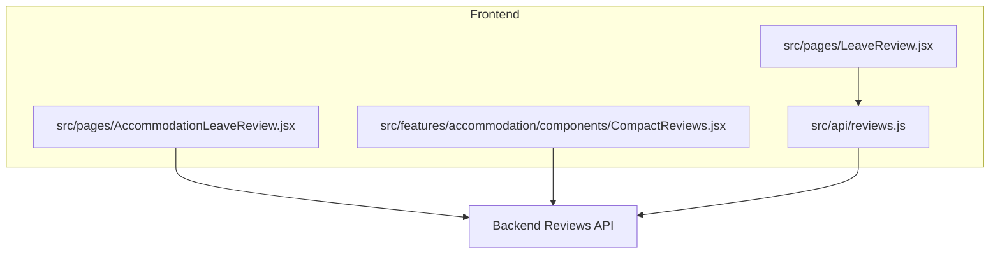
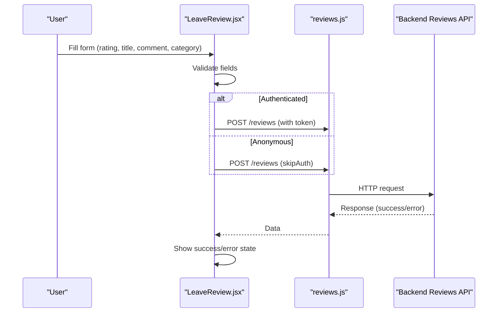
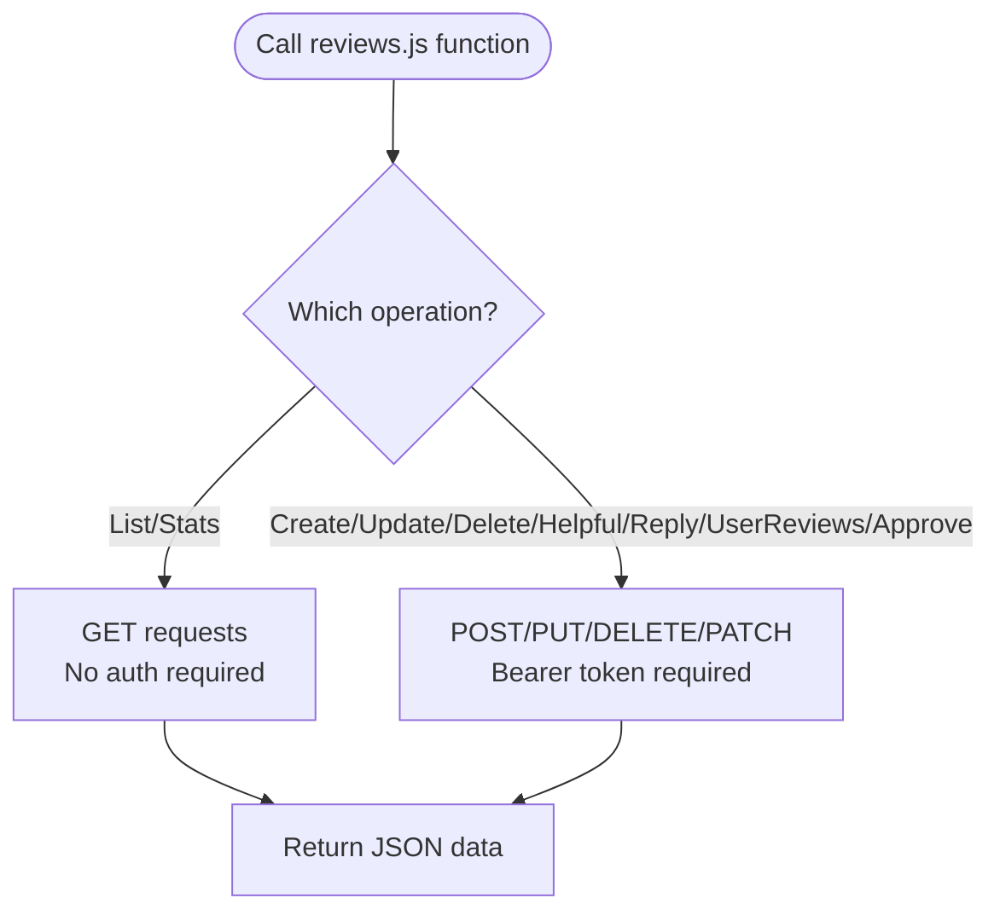
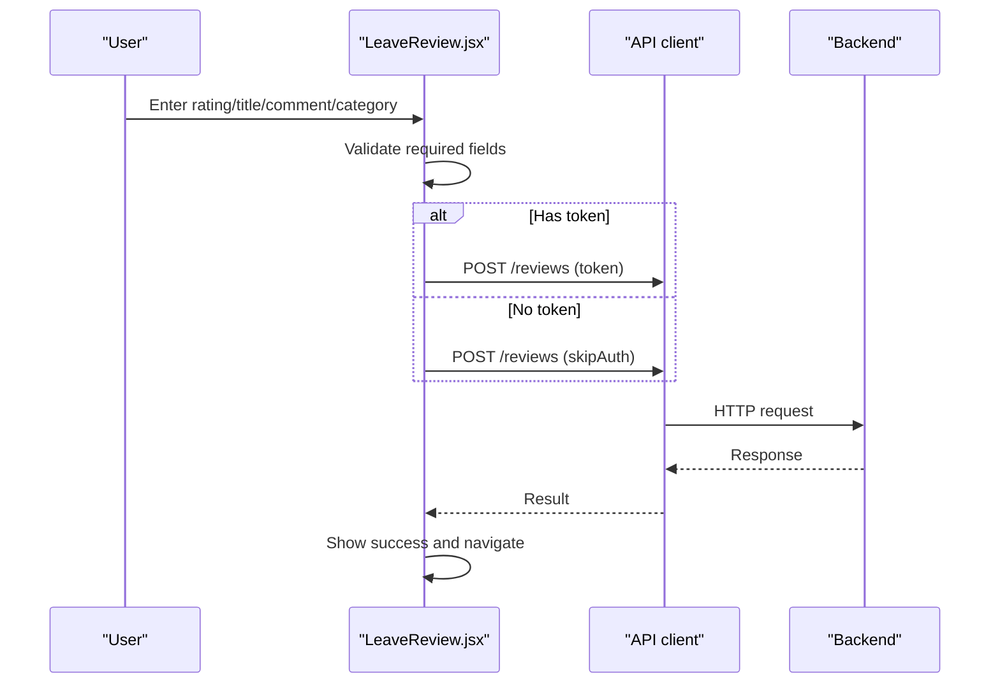
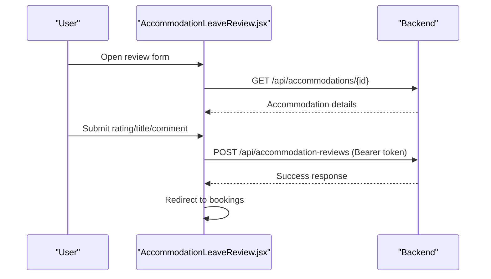
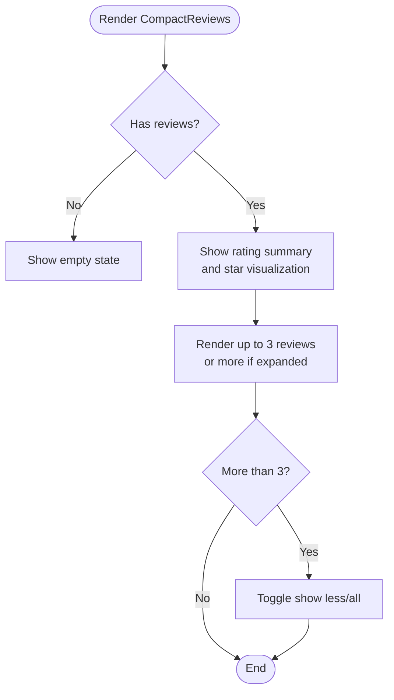
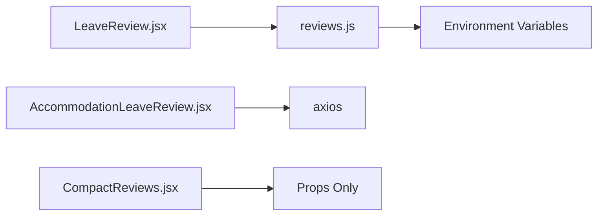

# Review & Rating System

<cite>
**Referenced Files in This Document**
- [reviews.js](file://src/api/reviews.js)
- [LeaveReview.jsx](file://src/pages/LeaveReview.jsx)
- [AccommodationLeaveReview.jsx](file://src/pages/AccommodationLeaveReview.jsx)
- [CompactReviews.jsx](file://src/features/accommodation/components/CompactReviews.jsx)
</cite>

## Table of Contents
1. [Introduction](#introduction)
2. [Project Structure](#project-structure)
3. [Core Components](#core-components)
4. [Architecture Overview](#architecture-overview)
5. [Detailed Component Analysis](#detailed-component-analysis)
6. [Dependency Analysis](#dependency-analysis)
7. [Performance Considerations](#performance-considerations)
8. [Troubleshooting Guide](#troubleshooting-guide)
9. [Conclusion](#conclusion)

## Introduction
This document explains the review and rating system implemented in the frontend application. It covers how users submit reviews, how ratings are displayed and summarized, how moderation actions are exposed via API, and how to customize forms and extend functionality. The focus is on the client-side implementation and its integration with backend endpoints.

## Project Structure
The review and rating features are primarily implemented across:
- API client for reviews
- General review submission page
- Accommodation-specific review submission page
- Compact display component for reviews and ratings

**Diagram sources**
- [reviews.js:1-127](file://src/api/reviews.js#L1-L127)
- [LeaveReview.jsx:1-316](file://src/pages/LeaveReview.jsx#L1-L316)
- [AccommodationLeaveReview.jsx:1-363](file://src/pages/AccommodationLeaveReview.jsx#L1-L363)
- [CompactReviews.jsx:1-164](file://src/features/accommodation/components/CompactReviews.jsx#L1-L164)

**Section sources**
- [reviews.js:1-127](file://src/api/reviews.js#L1-L127)
- [LeaveReview.jsx:1-316](file://src/pages/LeaveReview.jsx#L1-L316)
- [AccommodationLeaveReview.jsx:1-363](file://src/pages/AccommodationLeaveReview.jsx#L1-L363)
- [CompactReviews.jsx:1-164](file://src/features/accommodation/components/CompactReviews.jsx#L1-L164)

## Core Components
- Reviews API client: Provides functions to list reviews, fetch stats, create/update/delete reviews, mark helpful, reply, retrieve user’s own reviews, and approve reviews (admin).
- LeaveReview page: A general-purpose form to submit a review with rating, title, comment, and category. Supports both authenticated and anonymous submissions depending on token presence.
- AccommodationLeaveReview page: An accommodation-focused review form that requires authentication and validates inputs before posting to the accommodation-specific endpoint.
- CompactReviews component: Displays a summary rating, star visualization, total count, and a compact list of reviews with expand/collapse behavior.

Key responsibilities:
- Data fetching and mutation through REST endpoints
- Client-side validation and UX feedback
- Displaying aggregated ratings and individual reviews

**Section sources**
- [reviews.js:1-127](file://src/api/reviews.js#L1-L127)
- [LeaveReview.jsx:1-316](file://src/pages/LeaveReview.jsx#L1-L316)
- [AccommodationLeaveReview.jsx:1-363](file://src/pages/AccommodationLeaveReview.jsx#L1-L363)
- [CompactReviews.jsx:1-164](file://src/features/accommodation/components/CompactReviews.jsx#L1-L164)

## Architecture Overview
The review system follows a standard client-server pattern:
- UI components collect user input and validate it locally.
- API client modules call backend endpoints with appropriate headers (including bearer tokens when required).
- Backend processes requests, enforces business rules (e.g., moderation), and returns data or errors.
- Frontend renders summaries and lists based on returned data.

**Diagram sources**
- [LeaveReview.jsx:30-64](file://src/pages/LeaveReview.jsx#L30-L64)
- [reviews.js:27-38](file://src/api/reviews.js#L27-L38)

## Detailed Component Analysis

### Reviews API Client
Responsibilities:
- Fetch all reviews and single review by ID
- Fetch review statistics summary
- Create, update, delete reviews
- Mark reviews as helpful
- Add replies to reviews
- Retrieve current user’s reviews
- Approve/unapprove reviews (admin)

Important behaviors:
- Uses environment variable for base URL
- Attaches Authorization header for protected endpoints
- Returns parsed JSON responses

**Diagram sources**
- [reviews.js:1-127](file://src/api/reviews.js#L1-L127)

Validation and error handling:
- No explicit client-side validation in this module; relies on backend validation and response status.
- Errors should be handled at the caller level.

Customization points:
- Base URL configuration via environment variable
- Adding new endpoints by following existing patterns

**Section sources**
- [reviews.js:1-127](file://src/api/reviews.js#L1-L127)

### LeaveReview Page (General)
Responsibilities:
- Collects rating, title, comment, and category
- Validates required fields
- Submits review using API client or direct API call
- Handles loading, success, and error states
- Navigates back after successful submission

Submission flow:
- If token exists, uses authenticated route
- Otherwise, attempts anonymous submission via skipAuth flag

**Diagram sources**
- [LeaveReview.jsx:30-64](file://src/pages/LeaveReview.jsx#L30-L64)

Validation rules:
- Title and comment are required
- Rating defaults to 5 but can be changed
- Category selection available

Accessibility and UX:
- Clear labels and placeholders
- Loading indicator during submission
- Success and error messages

Customization examples:
- Adjust field lengths and validation messages
- Extend categories or add additional fields
- Integrate third-party spam protection (see Troubleshooting)

**Section sources**
- [LeaveReview.jsx:1-316](file://src/pages/LeaveReview.jsx#L1-L316)

### AccommodationLeaveReview Page (Accommodation-Specific)
Responsibilities:
- Requires authentication and valid accommodationId
- Fetches accommodation details
- Validates rating range and text fields
- Posts to accommodation-specific review endpoint
- Shows success state and redirects

**Diagram sources**
- [AccommodationLeaveReview.jsx:42-103](file://src/pages/AccommodationLeaveReview.jsx#L42-L103)

Validation rules:
- Authentication required
- Valid accommodationId required
- Rating must be between 1 and 5
- Title and comment required

Error handling:
- Displays server-provided error messages
- Graceful fallbacks for missing data

Customization examples:
- Modify guidelines text
- Add image preview or additional fields
- Integrate with booking verification logic

**Section sources**
- [AccommodationLeaveReview.jsx:1-363](file://src/pages/AccommodationLeaveReview.jsx#L1-L363)

### CompactReviews Component
Responsibilities:
- Displays overall rating and star visualization
- Shows total number of reviews
- Renders a compact list of reviews with optional expansion
- Handles empty state gracefully

Display logic:
- Uses provided rating and totalReviews props
- Falls back to default values if not provided
- Clamps stars to 1–5 range
- Truncates long comments unless expanded

**Diagram sources**
- [CompactReviews.jsx:1-164](file://src/features/accommodation/components/CompactReviews.jsx#L1-L164)

Customization examples:
- Change truncation length
- Add “helpful” counts or timestamps
- Integrate with external analytics

**Section sources**
- [CompactReviews.jsx:1-164](file://src/features/accommodation/components/CompactReviews.jsx#L1-L164)

## Dependency Analysis
- LeaveReview.jsx depends on API client and routing context
- AccommodationLeaveReview.jsx depends on axios and local storage for token
- CompactReviews.jsx is presentational and depends only on props
- reviews.js depends on environment variables for base URL

**Diagram sources**
- [LeaveReview.jsx:1-316](file://src/pages/LeaveReview.jsx#L1-L316)
- [AccommodationLeaveReview.jsx:1-363](file://src/pages/AccommodationLeaveReview.jsx#L1-L363)
- [CompactReviews.jsx:1-164](file://src/features/accommodation/components/CompactReviews.jsx#L1-L164)
- [reviews.js:1-127](file://src/api/reviews.js#L1-L127)

**Section sources**
- [LeaveReview.jsx:1-316](file://src/pages/LeaveReview.jsx#L1-L316)
- [AccommodationLeaveReview.jsx:1-363](file://src/pages/AccommodationLeaveReview.jsx#L1-L363)
- [CompactReviews.jsx:1-164](file://src/features/accommodation/components/CompactReviews.jsx#L1-L164)
- [reviews.js:1-127](file://src/api/reviews.js#L1-L127)

## Performance Considerations
- Prefer fetching review stats via the dedicated stats endpoint to avoid loading full review lists when only aggregates are needed.
- Use pagination or limit parameters on list endpoints where supported by the backend to reduce payload size.
- Debounce search/filter operations if adding client-side filtering over large datasets.
- Avoid re-rendering heavy components by memoizing expensive computations and splitting large components into smaller ones.

[No sources needed since this section provides general guidance]

## Troubleshooting Guide
Common issues and resolutions:
- Missing or invalid token: Ensure Authorization header includes a valid bearer token for protected endpoints.
- Network errors: Verify VITE_API_BASE or VITE_API_URL environment variables point to the correct backend.
- Validation failures: Confirm required fields are filled and within allowed ranges (e.g., rating 1–5).
- Anonymous submissions: When no token is present, ensure the backend supports anonymous review creation via the skipAuth path.

Spam prevention mechanisms:
- Client-side validation reduces obvious abuse but does not replace server-side checks.
- Implement rate limiting, CAPTCHA, or content filters on the backend to prevent spam.
- Use moderation workflows (approve/unapprove) to control visibility of reviews until verified.

Moderation workflow:
- Admins can approve or unapprove reviews via the approve endpoint.
- Integrate admin UI to toggle approval status and notify relevant parties.

**Section sources**
- [reviews.js:103-113](file://src/api/reviews.js#L103-L113)
- [LeaveReview.jsx:30-64](file://src/pages/LeaveReview.jsx#L30-L64)
- [AccommodationLeaveReview.jsx:60-103](file://src/pages/AccommodationLeaveReview.jsx#L60-L103)

## Conclusion
The review and rating system provides a robust foundation for collecting, displaying, and moderating user feedback. The API client abstracts backend interactions, while the pages handle user input and validation. The compact display component offers an efficient way to present ratings and reviews. Extending the system involves adding new endpoints, enhancing validation, integrating spam prevention, and building moderation interfaces.

[No sources needed since this section summarizes without analyzing specific files]