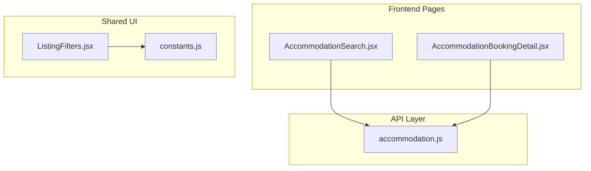
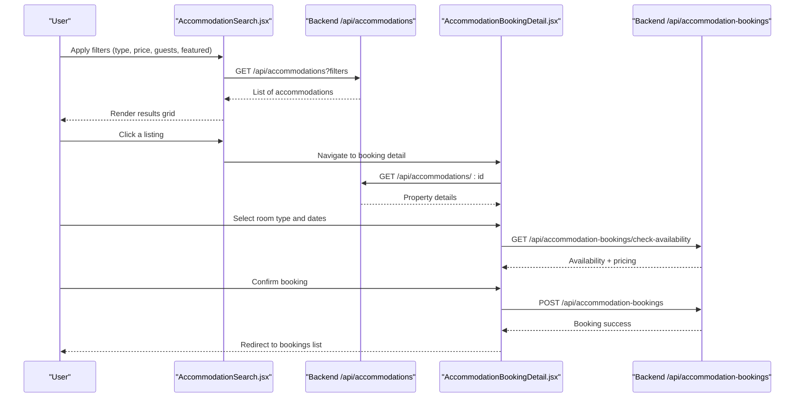
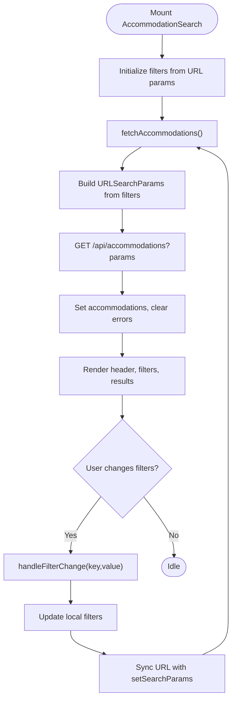
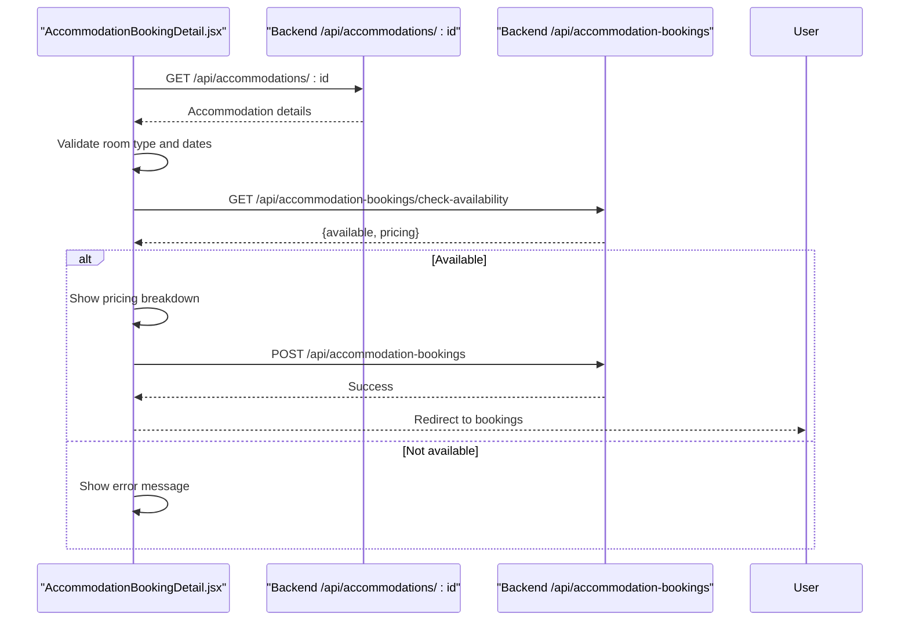
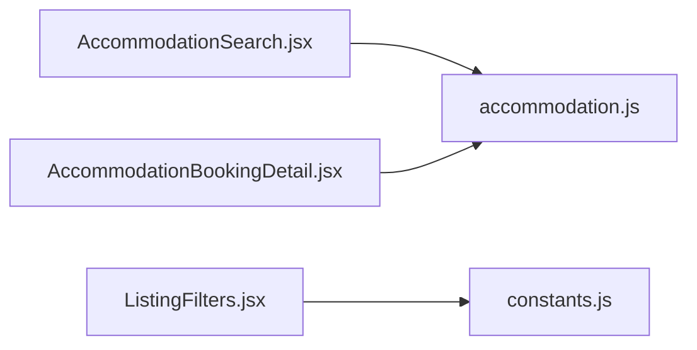

# Search & Booking System

<cite>
**Referenced Files in This Document**
- [AccommodationSearch.jsx](file://src/pages/AccommodationSearch.jsx)
- [AccommodationBookingDetail.jsx](file://src/pages/AccommodationBookingDetail.jsx)
- [accommodation.js](file://src/api/accommodation.js)
- [ListingFilters.jsx](file://src/features/accommodation/components/ListingFilters.jsx)
- [constants.js](file://src/features/accommodation/constants.js)
</cite>

## Table of Contents
1. [Introduction](#introduction)
2. [Project Structure](#project-structure)
3. [Core Components](#core-components)
4. [Architecture Overview](#architecture-overview)
5. [Detailed Component Analysis](#detailed-component-analysis)
6. [Dependency Analysis](#dependency-analysis)
7. [Performance Considerations](#performance-considerations)
8. [Troubleshooting Guide](#troubleshooting-guide)
9. [Conclusion](#conclusion)
10. [Appendices](#appendices)

## Introduction
This document explains the accommodation search and booking system implemented in the frontend. It covers:
- How users search accommodations with filters (type, price range, guests, featured).
- How availability is checked before booking.
- The end-to-end booking workflow from search to reservation creation.
- Implementation details for the search component, filter state management, URL parameter synchronization, and API integration.
- Practical examples for extending filters, customizing result displays, and implementing real-time availability updates.

## Project Structure
The search and booking features are primarily implemented across a few key files:
- Search page: renders filters, fetches results, and navigates to detail pages.
- Booking detail page: shows property details, checks availability, and creates bookings.
- API layer: centralizes backend calls and normalizes data.
- Shared UI components and constants: reusable filters and configuration.

**Diagram sources**
- [AccommodationSearch.jsx:1-329](file://src/pages/AccommodationSearch.jsx#L1-L329)
- [AccommodationBookingDetail.jsx:1-558](file://src/pages/AccommodationBookingDetail.jsx#L1-L558)
- [accommodation.js:1-191](file://src/api/accommodation.js#L1-L191)
- [ListingFilters.jsx:1-92](file://src/features/accommodation/components/ListingFilters.jsx#L1-L92)
- [constants.js:1-211](file://src/features/accommodation/constants.js#L1-L211)

**Section sources**
- [AccommodationSearch.jsx:1-329](file://src/pages/AccommodationSearch.jsx#L1-L329)
- [AccommodationBookingDetail.jsx:1-558](file://src/pages/AccommodationBookingDetail.jsx#L1-L558)
- [accommodation.js:1-191](file://src/api/accommodation.js#L1-L191)
- [ListingFilters.jsx:1-92](file://src/features/accommodation/components/ListingFilters.jsx#L1-L92)
- [constants.js:1-211](file://src/features/accommodation/constants.js#L1-L211)

## Core Components
- AccommodationSearch: Implements search UI, manages filter state, syncs filters to URL parameters, and fetches listings via the API.
- AccommodationBookingDetail: Displays property details, validates dates and room selection, checks availability, and creates bookings.
- API accommodation module: Provides functions to list, fetch by ID, normalize data, and perform authenticated operations.
- ListingFilters: Reusable filter UI used elsewhere; demonstrates category, area, availability, price, rating, and sorting controls.
- Constants: Centralized options for categories, sorting, amenities, and local filtering utilities.

Key responsibilities:
- Filter state and URL sync: AccommodationSearch maintains a filters object and synchronizes it with the URL query string.
- Data fetching: Uses axios to call the backend endpoints and sets loading/error states.
- Availability checking: AccommodationBookingDetail calls a dedicated endpoint to validate date ranges and guest counts.
- Booking creation: Creates a booking after successful availability check and user authentication.

**Section sources**
- [AccommodationSearch.jsx:15-64](file://src/pages/AccommodationSearch.jsx#L15-L64)
- [AccommodationSearch.jsx:29-50](file://src/pages/AccommodationSearch.jsx#L29-L50)
- [AccommodationBookingDetail.jsx:52-86](file://src/pages/AccommodationBookingDetail.jsx#L52-L86)
- [AccommodationBookingDetail.jsx:88-118](file://src/pages/AccommodationBookingDetail.jsx#L88-L118)
- [accommodation.js:81-110](file://src/api/accommodation.js#L81-L110)
- [ListingFilters.jsx:1-92](file://src/features/accommodation/components/ListingFilters.jsx#L1-L92)
- [constants.js:1-211](file://src/features/accommodation/constants.js#L1-L211)

## Architecture Overview
The search and booking flow integrates React components with backend APIs:

**Diagram sources**
- [AccommodationSearch.jsx:29-50](file://src/pages/AccommodationSearch.jsx#L29-L50)
- [AccommodationSearch.jsx:237-320](file://src/pages/AccommodationSearch.jsx#L237-L320)
- [AccommodationBookingDetail.jsx:32-50](file://src/pages/AccommodationBookingDetail.jsx#L32-L50)
- [AccommodationBookingDetail.jsx:52-86](file://src/pages/AccommodationBookingDetail.jsx#L52-L86)
- [AccommodationBookingDetail.jsx:88-118](file://src/pages/AccommodationBookingDetail.jsx#L88-L118)

## Detailed Component Analysis

### AccommodationSearch Component
Responsibilities:
- Manages filter state for type, search text, min/max price, max guests, and featured toggle.
- Synchronizes filter state with URL query parameters using React Router’s useSearchParams.
- Fetches accommodations based on current filters and updates UI accordingly.
- Renders a header, search bar, sidebar filters, and a responsive results grid.

Filter state and URL synchronization:
- Filters are initialized from URL parameters when present.
- On any change, handleFilterChange updates both local state and URL params.
- Only non-empty and truthy values are persisted to the URL.

Data fetching:
- Builds a URLSearchParams object from active filters.
- Calls GET /api/accommodations with query parameters.
- Sets loading and error states appropriately.

Result display:
- Maps over accommodations to render cards with primary image, type label, name, address, amenities, capacity, and rooms count.
- Navigates to the booking detail page when a card is clicked.

Extending filters:
- Add new fields to the filters object and corresponding inputs.
- Update handleFilterChange to persist new fields to URL.
- Extend fetchAccommodations to include new query parameters.

Customizing result displays:
- Modify the mapping logic to show additional fields or badges.
- Adjust styling and layout within the results grid.

**Diagram sources**
- [AccommodationSearch.jsx:15-27](file://src/pages/AccommodationSearch.jsx#L15-L27)
- [AccommodationSearch.jsx:29-64](file://src/pages/AccommodationSearch.jsx#L29-L64)
- [AccommodationSearch.jsx:237-320](file://src/pages/AccommodationSearch.jsx#L237-L320)

**Section sources**
- [AccommodationSearch.jsx:15-64](file://src/pages/AccommodationSearch.jsx#L15-L64)
- [AccommodationSearch.jsx:29-50](file://src/pages/AccommodationSearch.jsx#L29-L50)
- [AccommodationSearch.jsx:237-320](file://src/pages/AccommodationSearch.jsx#L237-L320)

### AccommodationBookingDetail Component
Responsibilities:
- Loads accommodation details by ID.
- Presents property information, images, amenities, house rules, room types, and reviews.
- Validates selected room type and dates.
- Checks availability and computes pricing.
- Creates a booking if available and user is authenticated.

Availability checking:
- Requires a selected room type, check-in, and check-out dates.
- Calls GET /api/accommodation-bookings/check-availability with roomTypeId, checkIn, checkOut, and guests.
- If available, shows pricing breakdown and enables booking confirmation.

Booking workflow:
- Ensures user is authenticated; otherwise redirects to login.
- Sends POST /api/accommodation-bookings with required payload and Authorization header.
- On success, navigates to the user’s bookings list.

Real-time availability updates:
- Currently uses explicit “Check Availability” action.
- To implement real-time updates, consider debounced watchers on date/guest inputs that trigger checkAvailability automatically.

**Diagram sources**
- [AccommodationBookingDetail.jsx:32-50](file://src/pages/AccommodationBookingDetail.jsx#L32-L50)
- [AccommodationBookingDetail.jsx:52-86](file://src/pages/AccommodationBookingDetail.jsx#L52-L86)
- [AccommodationBookingDetail.jsx:88-118](file://src/pages/AccommodationBookingDetail.jsx#L88-L118)

**Section sources**
- [AccommodationBookingDetail.jsx:32-50](file://src/pages/AccommodationBookingDetail.jsx#L32-L50)
- [AccommodationBookingDetail.jsx:52-86](file://src/pages/AccommodationBookingDetail.jsx#L52-L86)
- [AccommodationBookingDetail.jsx:88-118](file://src/pages/AccommodationBookingDetail.jsx#L88-L118)

### API Integration (accommodation.js)
Responsibilities:
- Centralizes HTTP requests using fetch with a base URL from environment variables.
- Normalizes accommodation objects to a consistent shape for UI consumption.
- Exposes functions for browsing listings, fetching by ID, recording views, provider operations, and reviews.

Normalization:
- Handles variations in field names (e.g., id vs _id, price vs basePrice).
- Converts images and videos into standardized arrays.
- Derives category labels and colors based on type.

Listing retrieval:
- fetchAccommodationListings builds query parameters and enforces status=active.
- Returns normalized array of accommodations.

Usage patterns:
- Other pages can import these functions to avoid duplicating request logic.
- Authenticated endpoints pass Authorization headers via authHeaders helper.

**Section sources**
- [accommodation.js:7-14](file://src/api/accommodation.js#L7-L14)
- [accommodation.js:34-77](file://src/api/accommodation.js#L34-L77)
- [accommodation.js:81-110](file://src/api/accommodation.js#L81-L110)

### Shared Filters and Constants
ListingFilters:
- Provides a reusable filter UI for category, area/location, availability windows, max price slider, minimum rating, and sort order.
- Controlled via props; suitable for embedding in other pages.

Constants:
- Defines category options, sort mappings, amenities, registration steps, and local filtering utility.
- Useful for aligning UI choices with backend expectations.

Extensibility:
- Add new categories or sorts to constants and reflect them in ListingFilters.
- Use filterPropertiesLocal for client-side filtering when needed.

**Section sources**
- [ListingFilters.jsx:1-92](file://src/features/accommodation/components/ListingFilters.jsx#L1-L92)
- [constants.js:1-211](file://src/features/accommodation/constants.js#L1-L211)

## Dependency Analysis
Component relationships and dependencies:

Observations:
- Both pages depend on the API layer for data operations.
- ListingFilters depends on shared constants for options and icons.
- No circular dependencies detected among these modules.

**Diagram sources**
- [AccommodationSearch.jsx:1-329](file://src/pages/AccommodationSearch.jsx#L1-L329)
- [AccommodationBookingDetail.jsx:1-558](file://src/pages/AccommodationBookingDetail.jsx#L1-L558)
- [accommodation.js:1-191](file://src/api/accommodation.js#L1-L191)
- [ListingFilters.jsx:1-92](file://src/features/accommodation/components/ListingFilters.jsx#L1-L92)
- [constants.js:1-211](file://src/features/accommodation/constants.js#L1-L211)

**Section sources**
- [AccommodationSearch.jsx:1-329](file://src/pages/AccommodationSearch.jsx#L1-L329)
- [AccommodationBookingDetail.jsx:1-558](file://src/pages/AccommodationBookingDetail.jsx#L1-L558)
- [accommodation.js:1-191](file://src/api/accommodation.js#L1-L191)
- [ListingFilters.jsx:1-92](file://src/features/accommodation/components/ListingFilters.jsx#L1-L92)
- [constants.js:1-211](file://src/features/accommodation/constants.js#L1-L211)

## Performance Considerations
- Debounce filter changes: In AccommodationSearch, debounce handleFilterChange to reduce unnecessary network requests while typing.
- Pagination: Implement server-side pagination for large result sets to improve initial load time.
- Image optimization: Lazy-load images and use optimized formats to speed up rendering.
- Memoization: Use React.memo or useMemo for expensive computations like primary image selection and type labeling.
- Error boundaries: Wrap critical sections with error boundaries to prevent full-page crashes.
- Caching: Cache frequent queries (e.g., featured listings) using in-memory caches or service workers.

[No sources needed since this section provides general guidance]

## Troubleshooting Guide
Common issues and resolutions:
- Empty results: Verify filters and ensure backend returns active listings. Check URL parameters for unexpected values.
- Availability failures: Ensure room type, check-in, and check-out are valid and not overlapping. Confirm backend availability endpoint responds correctly.
- Authentication errors: For booking creation, confirm the Authorization header includes a valid token and the user is logged in.
- Network errors: Inspect API_URL configuration and CORS settings. Log response status and error messages.

Validation tips:
- Confirm that filters are properly serialized to URL parameters.
- Validate date constraints (check-out must be after check-in).
- Ensure normalization handles varied backend payloads gracefully.

**Section sources**
- [AccommodationSearch.jsx:29-50](file://src/pages/AccommodationSearch.jsx#L29-L50)
- [AccommodationBookingDetail.jsx:52-86](file://src/pages/AccommodationBookingDetail.jsx#L52-L86)
- [AccommodationBookingDetail.jsx:88-118](file://src/pages/AccommodationBookingDetail.jsx#L88-L118)

## Conclusion
The accommodation search and booking system provides a cohesive user experience:
- Users can filter accommodations by type, price range, guests, and featured status.
- Results are fetched from the backend and displayed in a responsive grid.
- The booking detail page validates availability and guides users through creating a reservation.
- The API layer centralizes requests and normalizes data for consistent UI consumption.
- Extensibility points exist for adding new filters, customizing displays, and enabling real-time availability updates.

[No sources needed since this section summarizes without analyzing specific files]

## Appendices

### Examples: Extending Search Filters
- Add a new filter field (e.g., “Pet Friendly”) to the filters object.
- Create an input control bound to the new field.
- Update handleFilterChange to persist the new field to URL parameters.
- Extend fetchAccommodations to include the new query parameter.
- Optionally add backend support to filter by the new field.

**Section sources**
- [AccommodationSearch.jsx:15-64](file://src/pages/AccommodationSearch.jsx#L15-L64)
- [AccommodationSearch.jsx:29-50](file://src/pages/AccommodationSearch.jsx#L29-L50)

### Examples: Customizing Result Displays
- Modify the mapping function to render additional fields such as distance, ratings, or special offers.
- Integrate a map view or highlight nearby properties.
- Add sorting controls to reorder results by relevance, price, or rating.

**Section sources**
- [AccommodationSearch.jsx:237-320](file://src/pages/AccommodationSearch.jsx#L237-L320)

### Examples: Real-Time Availability Updates
- Replace manual “Check Availability” with automatic checks triggered by date or guest changes.
- Debounce the watcher to avoid excessive requests.
- Show inline indicators for unavailable dates and suggest alternative ranges.

**Section sources**
- [AccommodationBookingDetail.jsx:52-86](file://src/pages/AccommodationBookingDetail.jsx#L52-L86)