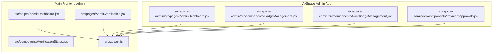
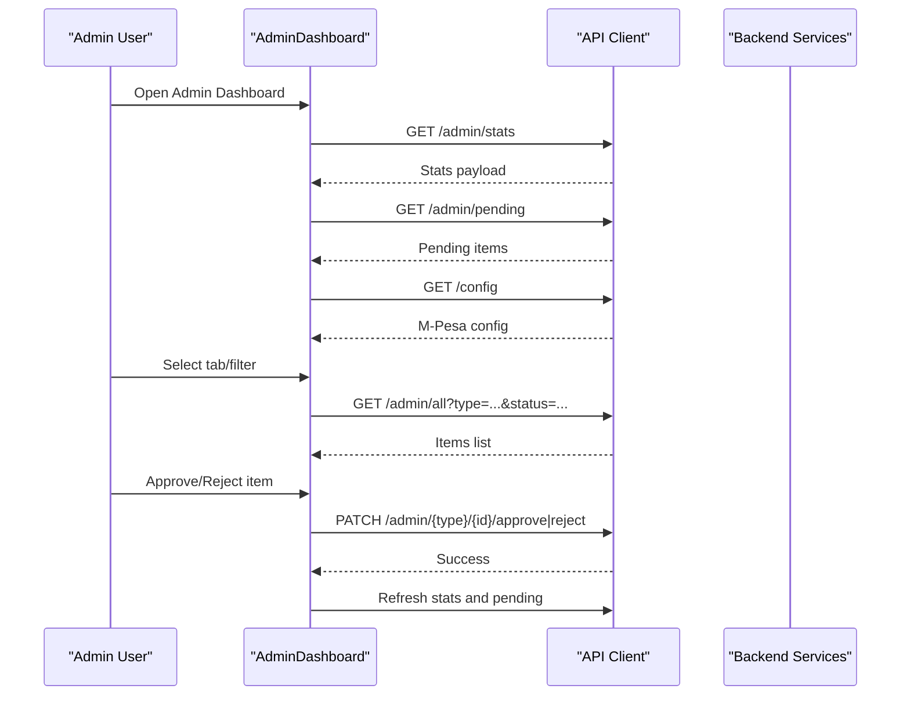
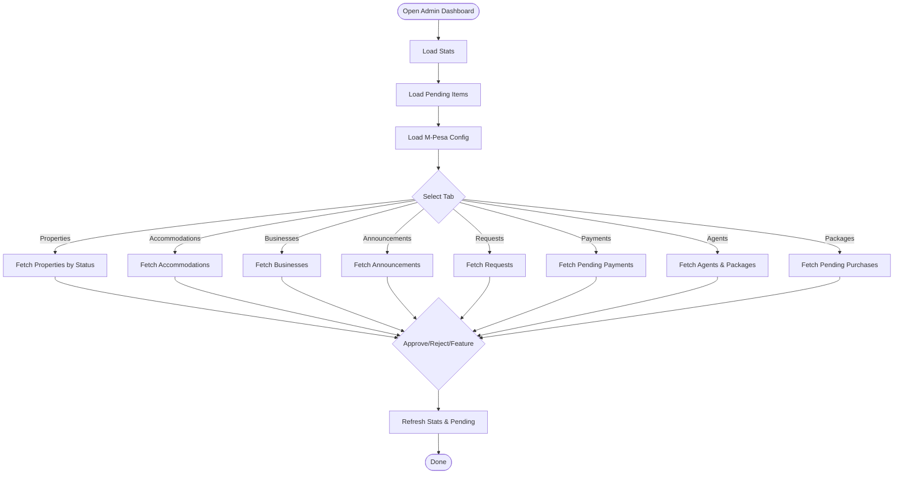
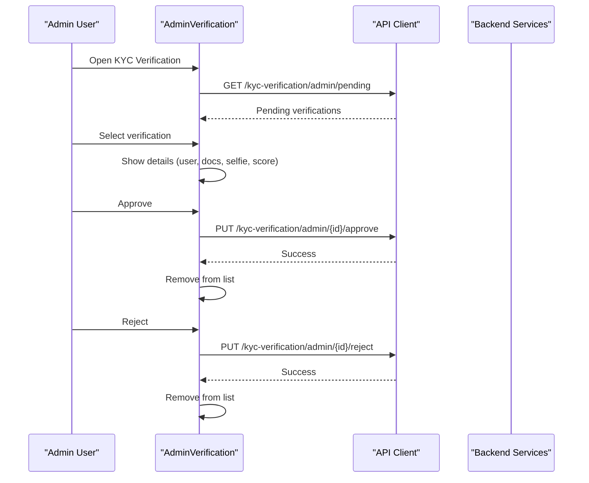
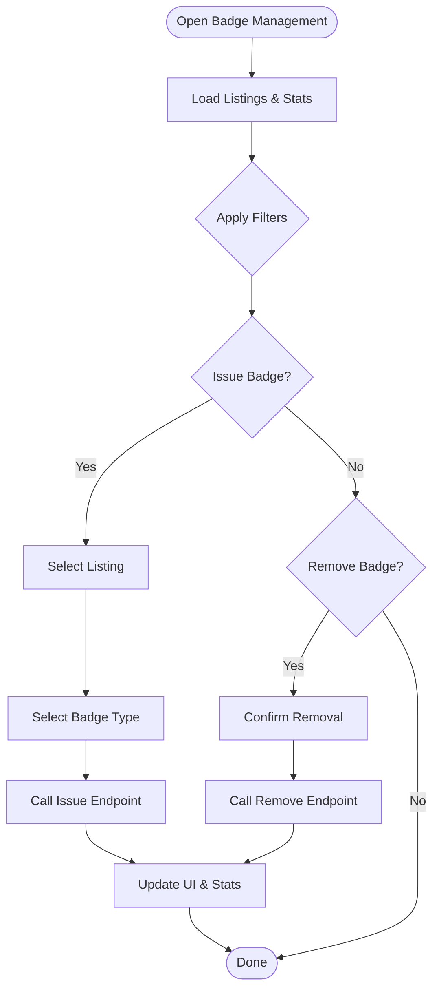
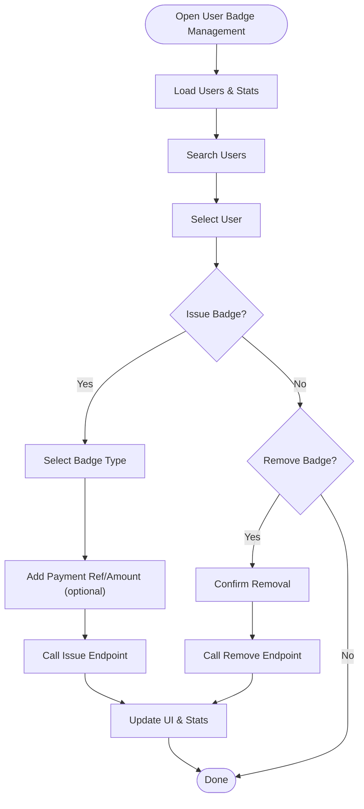
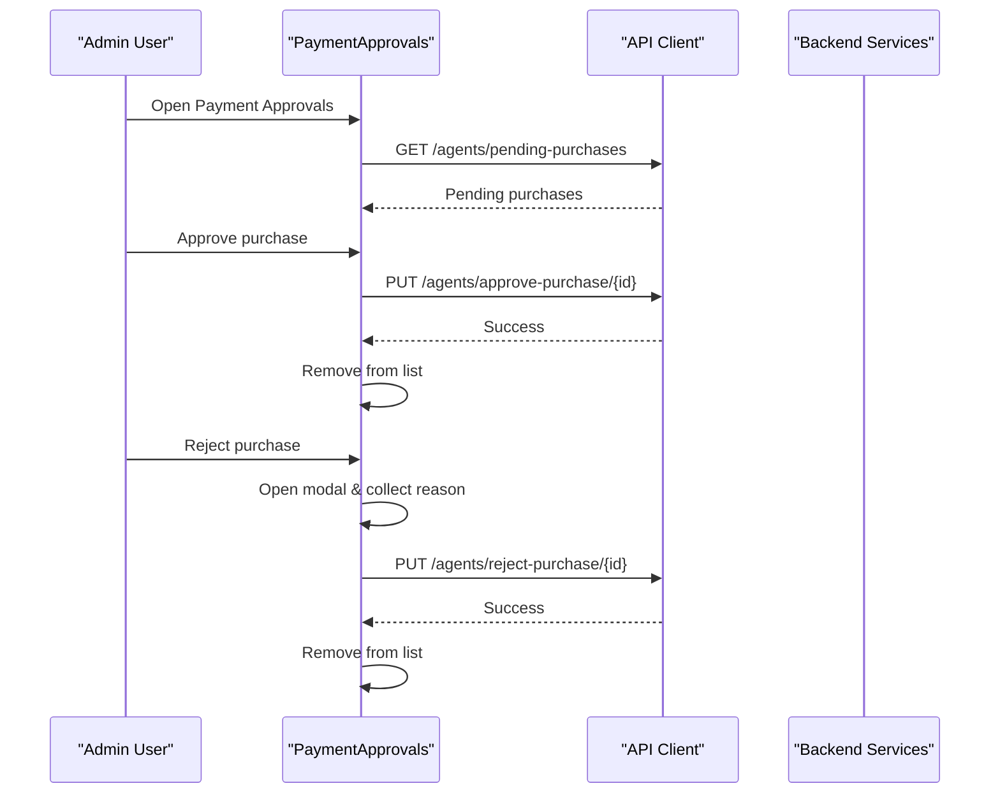
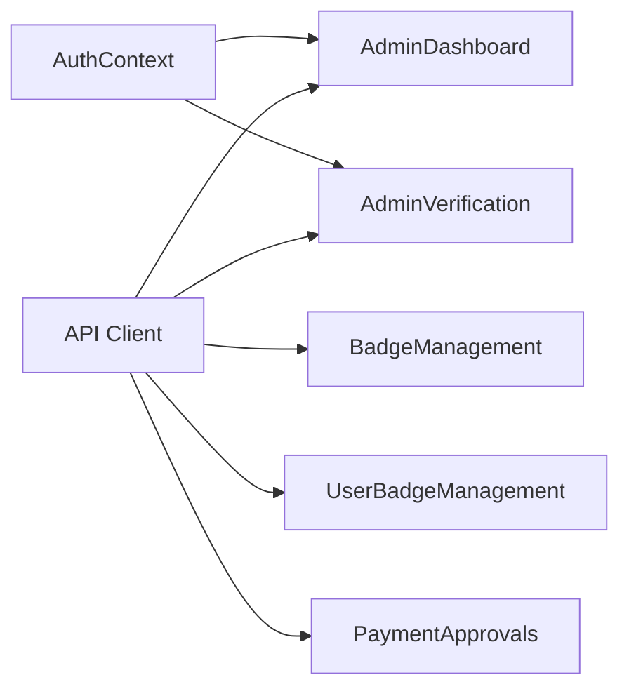

# Administrative Dashboard

<cite>
**Referenced Files in This Document**
- [AdminDashboard.jsx](file://src/pages/AdminDashboard.jsx)
- [AdminVerification.jsx](file://src/pages/AdminVerification.jsx)
- [api.js](file://src/api/api.js)
- [VerificationStatus.jsx](file://src/components/VerificationStatus.jsx)
- [AdminDashboard.jsx](file://axxspace-admin/src/pages/AdminDashboard.jsx)
- [BadgeManagement.jsx](file://axxspace-admin/src/components/BadgeManagement.jsx)
- [UserBadgeManagement.jsx](file://axxspace-admin/src/components/UserBadgeManagement.jsx)
- [PaymentApprovals.jsx](file://axxspace-admin/src/components/PaymentApprovals.jsx)
</cite>

## Table of Contents
1. [Introduction](#introduction)
2. [Project Structure](#project-structure)
3. [Core Components](#core-components)
4. [Architecture Overview](#architecture-overview)
5. [Detailed Component Analysis](#detailed-component-analysis)
6. [Dependency Analysis](#dependency-analysis)
7. [Performance Considerations](#performance-considerations)
8. [Troubleshooting Guide](#troubleshooting-guide)
9. [Conclusion](#conclusion)
10. [Appendices](#appendices)

## Introduction
This document explains the administrative dashboard system for AxxSpaces. It covers user verification management, content moderation tools, analytics and reporting features, and system configuration options. It also documents admin-specific interfaces, bulk operations, monitoring capabilities, verification workflows, approval processes, audit trails, and examples for extending admin functionality with custom tools.

The system includes:
- A main frontend admin dashboard for reviewing properties, materials, accommodations, businesses, announcements, requests, payments, agents, and packages.
- A dedicated KYC verification workflow for approving or rejecting user verification submissions.
- Badge management for listings and users.
- Payment approvals for agent package purchases.
- Configuration management for M-Pesa integration.

## Project Structure
The administrative features are implemented across two React applications:
- Main frontend admin pages under src/pages and src/components.
- A separate axxspace-admin application with its own dashboard, components, and utilities.

**Diagram sources**
- [AdminDashboard.jsx:1-120](file://src/pages/AdminDashboard.jsx#L1-L120)
- [AdminVerification.jsx:1-40](file://src/pages/AdminVerification.jsx#L1-L40)
- [api.js:1-47](file://src/api/api.js#L1-L47)
- [AdminDashboard.jsx:1-120](file://axxspace-admin/src/pages/AdminDashboard.jsx#L1-L120)
- [BadgeManagement.jsx:1-60](file://axxspace-admin/src/components/BadgeManagement.jsx#L1-L60)
- [UserBadgeManagement.jsx:1-65](file://axxspace-admin/src/components/UserBadgeManagement.jsx#L1-L65)
- [PaymentApprovals.jsx:1-30](file://axxspace-admin/src/components/PaymentApprovals.jsx#L1-L30)

**Section sources**
- [AdminDashboard.jsx:1-120](file://src/pages/AdminDashboard.jsx#L1-L120)
- [AdminVerification.jsx:1-40](file://src/pages/AdminVerification.jsx#L1-L40)
- [api.js:1-47](file://src/api/api.js#L1-L47)
- [AdminDashboard.jsx:1-120](file://axxspace-admin/src/pages/AdminDashboard.jsx#L1-L120)
- [BadgeManagement.jsx:1-60](file://axxspace-admin/src/components/BadgeManagement.jsx#L1-L60)
- [UserBadgeManagement.jsx:1-65](file://axxspace-admin/src/components/UserBadgeManagement.jsx#L1-L65)
- [PaymentApprovals.jsx:1-30](file://axxspace-admin/src/components/PaymentApprovals.jsx#L1-L30)

## Core Components
- Main Admin Dashboard (main frontend): Central hub for moderation, analytics, configuration, and operational tasks.
- KYC Verification Workflow: Dedicated interface to review and approve/reject user verification submissions.
- Badge Management: Issue and remove badges for listings and users.
- Payment Approvals: Review and approve agent package purchases.
- Analytics and Reporting: View stats, top viewed items, and export data.
- System Configuration: Manage M-Pesa settings.

Key responsibilities:
- Data loading and filtering by status and type.
- Approval and rejection actions with API calls.
- Real-time notifications and polling.
- Exporting filtered data to CSV.
- Managing featured status and promotions.

**Section sources**
- [AdminDashboard.jsx:1-120](file://src/pages/AdminDashboard.jsx#L1-L120)
- [AdminVerification.jsx:1-40](file://src/pages/AdminVerification.jsx#L1-L40)
- [BadgeManagement.jsx:1-60](file://axxspace-admin/src/components/BadgeManagement.jsx#L1-L60)
- [UserBadgeManagement.jsx:1-65](file://axxspace-admin/src/components/UserBadgeManagement.jsx#L1-L65)
- [PaymentApprovals.jsx:1-30](file://axxspace-admin/src/components/PaymentApprovals.jsx#L1-L30)

## Architecture Overview
The admin system is a client-side React application that communicates with backend APIs via an Axios instance. Authentication tokens are injected into requests automatically. The dashboard uses state-driven UIs with tabbed navigation and conditional rendering based on active tabs and filters.

**Diagram sources**
- [AdminDashboard.jsx:176-213](file://src/pages/AdminDashboard.jsx#L176-L213)
- [AdminDashboard.jsx:516-535](file://src/pages/AdminDashboard.jsx#L516-L535)
- [AdminDashboard.jsx:537-555](file://src/pages/AdminDashboard.jsx#L537-L555)
- [api.js:10-24](file://src/api/api.js#L10-L24)

**Section sources**
- [AdminDashboard.jsx:176-213](file://src/pages/AdminDashboard.jsx#L176-L213)
- [AdminDashboard.jsx:516-555](file://src/pages/AdminDashboard.jsx#L516-L555)
- [api.js:10-24](file://src/api/api.js#L10-L24)

## Detailed Component Analysis

### Main Admin Dashboard (Main Frontend)
Responsibilities:
- Load and display statistics, pending items, and all items by type/status.
- Manage M-Pesa configuration.
- Handle property, accommodation, business, announcement, request, payment, agent, and package operations.
- Provide search, filter, and export capabilities.
- Toggle featured status and manage promotions.

Key flows:
- Initial load: stats, pending, config, requests.
- Tab-based data loading with filters.
- Approval/rejection endpoints for various entities.
- Feature toggling for accommodations and unified feature endpoint for other types.

**Diagram sources**
- [AdminDashboard.jsx:85-112](file://src/pages/AdminDashboard.jsx#L85-L112)
- [AdminDashboard.jsx:174-178](file://src/pages/AdminDashboard.jsx#L174-L178)
- [AdminDashboard.jsx:201-246](file://src/pages/AdminDashboard.jsx#L201-L246)
- [AdminDashboard.jsx:344-376](file://src/pages/AdminDashboard.jsx#L344-L376)
- [AdminDashboard.jsx:378-445](file://src/pages/AdminDashboard.jsx#L378-L445)
- [AdminDashboard.jsx:448-500](file://src/pages/AdminDashboard.jsx#L448-L500)
- [AdminDashboard.jsx:502-555](file://src/pages/AdminDashboard.jsx#L502-L555)

**Section sources**
- [AdminDashboard.jsx:85-112](file://src/pages/AdminDashboard.jsx#L85-L112)
- [AdminDashboard.jsx:174-178](file://src/pages/AdminDashboard.jsx#L174-L178)
- [AdminDashboard.jsx:201-246](file://src/pages/AdminDashboard.jsx#L201-L246)
- [AdminDashboard.jsx:344-376](file://src/pages/AdminDashboard.jsx#L344-L376)
- [AdminDashboard.jsx:378-445](file://src/pages/AdminDashboard.jsx#L378-L445)
- [AdminDashboard.jsx:448-500](file://src/pages/AdminDashboard.jsx#L448-L500)
- [AdminDashboard.jsx:502-555](file://src/pages/AdminDashboard.jsx#L502-L555)

### KYC Verification Workflow
Responsibilities:
- Fetch pending verification requests.
- Display user details, submitted documents, selfie, and face match score.
- Approve or reject verifications with optional notes/reasons.

Workflow:
- Load pending verifications on mount.
- Select a verification to view details.
- Approve: call approve endpoint; remove from list.
- Reject: require reason; call reject endpoint; remove from list.

**Diagram sources**
- [AdminVerification.jsx:13-37](file://src/pages/AdminVerification.jsx#L13-L37)
- [AdminVerification.jsx:39-99](file://src/pages/AdminVerification.jsx#L39-L99)

**Section sources**
- [AdminVerification.jsx:13-37](file://src/pages/AdminVerification.jsx#L13-L37)
- [AdminVerification.jsx:39-99](file://src/pages/AdminVerification.jsx#L39-L99)

### Badge Management (Listings)
Responsibilities:
- List listings with badges.
- Filter by listing type and badge type.
- Issue new badges to listings.
- Remove existing badges.
- Display badge statistics.

Operations:
- Load listings and stats.
- Issue badge: select listing and badge type; call issue endpoint.
- Remove badge: confirm removal; call remove endpoint.

**Diagram sources**
- [BadgeManagement.jsx:24-60](file://axxspace-admin/src/components/BadgeManagement.jsx#L24-L60)
- [BadgeManagement.jsx:62-116](file://axxspace-admin/src/components/BadgeManagement.jsx#L62-L116)

**Section sources**
- [BadgeManagement.jsx:24-60](file://axxspace-admin/src/components/BadgeManagement.jsx#L24-L60)
- [BadgeManagement.jsx:62-116](file://axxspace-admin/src/components/BadgeManagement.jsx#L62-L116)

### User Badge Management
Responsibilities:
- Search users by name, email, or phone.
- Filter by role and badge type.
- Issue badges to users with optional payment reference and amount.
- Remove badges from users.
- Display badge statistics and details.

Operations:
- Load users and stats.
- Search users; select one.
- Issue badge: select badge type; optionally add payment info; call issue endpoint.
- Remove badge: confirm removal; call remove endpoint.

**Diagram sources**
- [UserBadgeManagement.jsx:29-65](file://axxspace-admin/src/components/UserBadgeManagement.jsx#L29-L65)
- [UserBadgeManagement.jsx:67-118](file://axxspace-admin/src/components/UserBadgeManagement.jsx#L67-L118)
- [UserBadgeManagement.jsx:120-144](file://axxspace-admin/src/components/UserBadgeManagement.jsx#L120-L144)

**Section sources**
- [UserBadgeManagement.jsx:29-65](file://axxspace-admin/src/components/UserBadgeManagement.jsx#L29-L65)
- [UserBadgeManagement.jsx:67-118](file://axxspace-admin/src/components/UserBadgeManagement.jsx#L67-L118)
- [UserBadgeManagement.jsx:120-144](file://axxspace-admin/src/components/UserBadgeManagement.jsx#L120-L144)

### Payment Approvals
Responsibilities:
- Load pending agent package purchases.
- Approve or reject purchases with optional reasons.
- Display message feedback and refresh lists.

Operations:
- Load pending purchases on mount.
- Approve: call approve endpoint; remove from list.
- Reject: open modal; enter reason; call reject endpoint; remove from list.

**Diagram sources**
- [PaymentApprovals.jsx:14-29](file://axxspace-admin/src/components/PaymentApprovals.jsx#L14-L29)
- [PaymentApprovals.jsx:31-76](file://axxspace-admin/src/components/PaymentApprovals.jsx#L31-L76)

**Section sources**
- [PaymentApprovals.jsx:14-29](file://axxspace-admin/src/components/PaymentApprovals.jsx#L14-L29)
- [PaymentApprovals.jsx:31-76](file://axxspace-admin/src/components/PaymentApprovals.jsx#L31-L76)

### Analytics and Reporting
Features:
- Statistics overview: counts for properties, accommodations, materials, sellers, etc.
- Top viewed items and view statistics per type.
- Export filtered data to CSV.

Data flow:
- Load stats and view stats on mount or tab change.
- Load top viewed items with limit.
- Export current filtered items to CSV.

**Section sources**
- [AdminDashboard.jsx:176-195](file://axxspace-admin/src/pages/AdminDashboard.jsx#L176-L195)
- [AdminDashboard.jsx:344-361](file://axxspace-admin/src/pages/AdminDashboard.jsx#L344-L361)

### System Configuration Options
M-Pesa configuration:
- Load current configuration values.
- Save multiple config keys concurrently.
- Show success/error messages.

**Section sources**
- [AdminDashboard.jsx:502-555](file://src/pages/AdminDashboard.jsx#L502-L555)
- [AdminDashboard.jsx:596-609](file://axxspace-admin/src/pages/AdminDashboard.jsx#L596-L609)

## Dependency Analysis
The admin components depend on:
- AuthContext for token and user role checks.
- API client for HTTP requests with interceptors for auth and debugging.
- Navigation hooks for routing between admin sections.

**Diagram sources**
- [AdminDashboard.jsx:1-12](file://src/pages/AdminDashboard.jsx#L1-L12)
- [AdminVerification.jsx:1-12](file://src/pages/AdminVerification.jsx#L1-L12)
- [api.js:1-47](file://src/api/api.js#L1-L47)
- [BadgeManagement.jsx:1-6](file://axxspace-admin/src/components/BadgeManagement.jsx#L1-L6)
- [UserBadgeManagement.jsx:1-6](file://axxspace-admin/src/components/UserBadgeManagement.jsx#L1-L6)
- [PaymentApprovals.jsx:1-3](file://axxspace-admin/src/components/PaymentApprovals.jsx#L1-L3)

**Section sources**
- [AdminDashboard.jsx:1-12](file://src/pages/AdminDashboard.jsx#L1-L12)
- [AdminVerification.jsx:1-12](file://src/pages/AdminVerification.jsx#L1-L12)
- [api.js:1-47](file://src/api/api.js#L1-L47)
- [BadgeManagement.jsx:1-6](file://axxspace-admin/src/components/BadgeManagement.jsx#L1-L6)
- [UserBadgeManagement.jsx:1-6](file://axxspace-admin/src/components/UserBadgeManagement.jsx#L1-L6)
- [PaymentApprovals.jsx:1-3](file://axxspace-admin/src/components/PaymentApprovals.jsx#L1-L3)

## Performance Considerations
- Use tab-based lazy loading to avoid fetching all data at once.
- Debounce search inputs where applicable.
- Batch configuration saves using Promise.all to reduce round trips.
- Poll notifications at intervals but throttle updates to prevent excessive re-renders.
- Implement pagination for large datasets if needed.

[No sources needed since this section provides general guidance]

## Troubleshooting Guide
Common issues and resolutions:
- Authentication failures: Ensure token is present in localStorage and Authorization header is set by API interceptor.
- Network errors: Check API base URL and environment variables.
- Permission denied: Verify user role is admin before accessing admin routes.
- Configuration save failures: Validate M-Pesa fields and handle error messages.

**Section sources**
- [api.js:10-24](file://src/api/api.js#L10-L24)
- [api.js:27-44](file://src/api/api.js#L27-L44)
- [AdminDashboard.jsx:85-95](file://src/pages/AdminDashboard.jsx#L85-L95)

## Conclusion
The administrative dashboard provides comprehensive tools for managing user verifications, content moderation, analytics, and system configuration. It supports bulk operations, real-time monitoring, and extensibility through modular components. Administrators can efficiently approve/reject requests, manage badges, handle payments, and configure integrations like M-Pesa.

[No sources needed since this section summarizes without analyzing specific files]

## Appendices

### Extending Admin Functionality
Examples:
- Add a new tab to the dashboard:
  - Define a new tab constant and update tab navigation.
  - Create a loader function to fetch data for the new tab.
  - Render the tab content with appropriate controls and actions.
- Create a custom administrative tool:
  - Build a new component similar to BadgeManagement or PaymentApprovals.
  - Integrate with existing API client and AuthContext.
  - Add navigation entry points and permissions checks.

**Section sources**
- [AdminDashboard.jsx:19-20](file://axxspace-admin/src/pages/AdminDashboard.jsx#L19-L20)
- [BadgeManagement.jsx:24-60](file://axxspace-admin/src/components/BadgeManagement.jsx#L24-L60)
- [PaymentApprovals.jsx:14-29](file://axxspace-admin/src/components/PaymentApprovals.jsx#L14-L29)