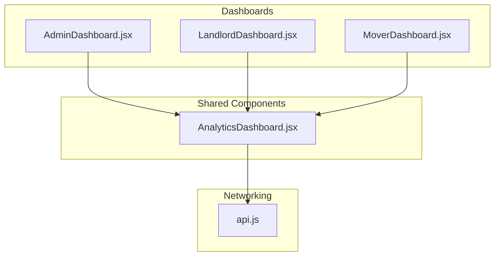
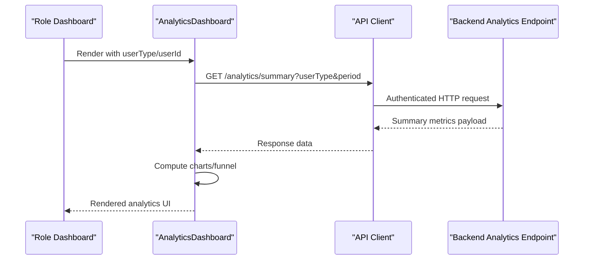
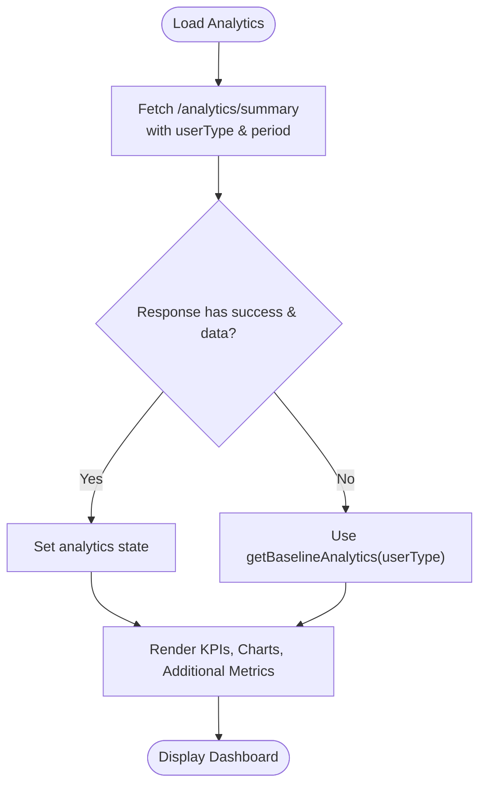
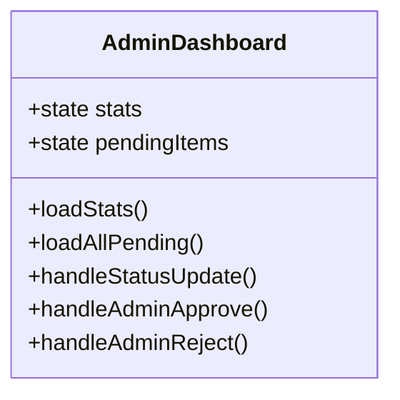
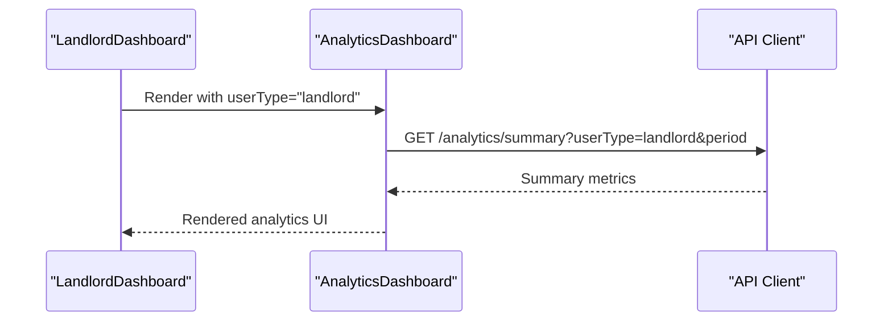
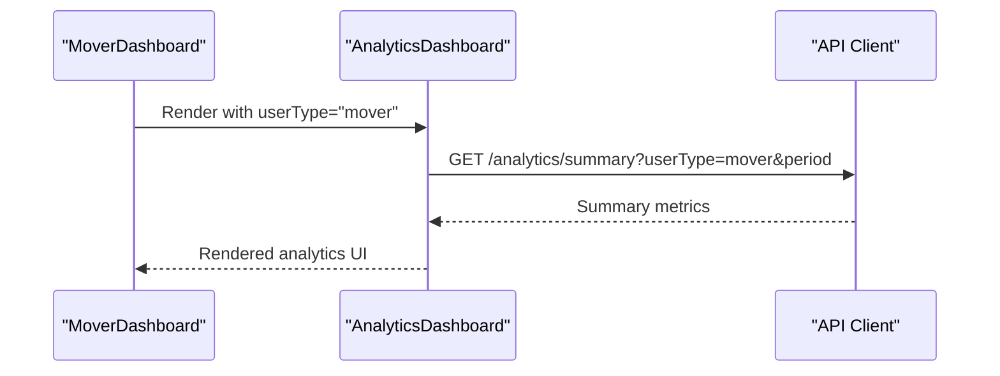
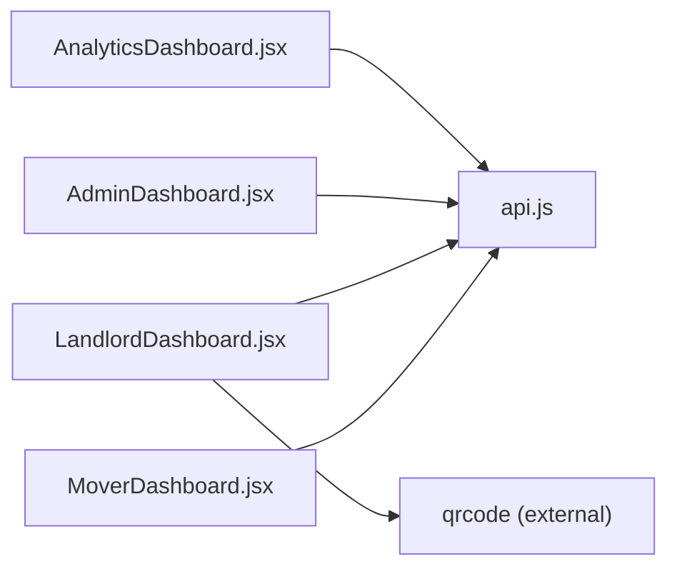

# Analytics & Reporting

<cite>
**Referenced Files in This Document**   
- [AnalyticsDashboard.jsx](file://src/components/AnalyticsDashboard.jsx)
- [AdminDashboard.jsx](file://src/pages/AdminDashboard.jsx)
- [LandlordDashboard.jsx](file://src/pages/LandlordDashboard.jsx)
- [MoverDashboard.jsx](file://src/pages/MoverDashboard.jsx)
- [api.js](file://src/api/api.js)
</cite>

## Table of Contents
1. [Introduction](#introduction)
2. [Project Structure](#project-structure)
3. [Core Components](#core-components)
4. [Architecture Overview](#architecture-overview)
5. [Detailed Component Analysis](#detailed-component-analysis)
6. [Dependency Analysis](#dependency-analysis)
7. [Performance Considerations](#performance-considerations)
8. [Troubleshooting Guide](#troubleshooting-guide)
9. [Conclusion](#conclusion)
10. [Appendices](#appendices)

## Introduction
This document explains the analytics and reporting dashboard capabilities across the platform, focusing on:
- KPI metrics display for landlords, movers, and administrators
- Statistical data visualization including performance trends and conversion funnels
- Performance tracking for listings, jobs, and user engagement
- Reporting workflows available to administrators for monitoring platform health and generating insights

The documentation is designed for both technical and non-technical readers, with progressive complexity layers, diagrams, and practical guidance for interpreting analytics, customizing dashboards, and exporting reports.

## Project Structure
The analytics and reporting features are primarily implemented in:
- A shared analytics component used by role-specific dashboards
- Role-specific dashboards that integrate analytics and domain operations
- A centralized API client for authenticated requests

**Diagram sources**
- [AdminDashboard.jsx:1-120](file://src/pages/AdminDashboard.jsx#L1-L120)
- [LandlordDashboard.jsx:1-120](file://src/pages/LandlordDashboard.jsx#L1-L120)
- [MoverDashboard.jsx:1-120](file://src/pages/MoverDashboard.jsx#L1-L120)
- [AnalyticsDashboard.jsx:1-30](file://src/components/AnalyticsDashboard.jsx#L1-L30)
- [api.js:1-47](file://src/api/api.js#L1-L47)

**Section sources**
- [AnalyticsDashboard.jsx:1-30](file://src/components/AnalyticsDashboard.jsx#L1-L30)
- [AdminDashboard.jsx:1-120](file://src/pages/AdminDashboard.jsx#L1-L120)
- [LandlordDashboard.jsx:1-120](file://src/pages/LandlordDashboard.jsx#L1-L120)
- [MoverDashboard.jsx:1-120](file://src/pages/MoverDashboard.jsx#L1-L120)
- [api.js:1-47](file://src/api/api.js#L1-L47)

## Core Components
- AnalyticsDashboard: Shared analytics UI that loads summary metrics, renders KPIs, charts, and additional metrics tailored by user type.
- AdminDashboard: Administrative portal with executive KPI overview, moderation tabs, and system-wide statistics.
- LandlordDashboard: Property-focused dashboard integrating analytics, QR promotion, waitlist management, and property operations.
- MoverDashboard: Service provider dashboard integrating analytics, job management, earnings, and profile configuration.
- api.js: Centralized Axios client with request/response interceptors for authentication and debugging.

Key responsibilities:
- Fetching analytics summaries via a backend endpoint
- Rendering KPI cards (views, inquiries, bookings/jobs, revenue)
- Visualizing performance over time and conversion funnel
- Providing user-type specific metrics (landlord QR scans/inquiries, mover ratings/repeat customers, seller items sold/order value)
- Enabling admin oversight of platform health through aggregated stats and moderation workflows

**Section sources**
- [AnalyticsDashboard.jsx:1-218](file://src/components/AnalyticsDashboard.jsx#L1-L218)
- [AdminDashboard.jsx:1-120](file://src/pages/AdminDashboard.jsx#L1-L120)
- [LandlordDashboard.jsx:1-120](file://src/pages/LandlordDashboard.jsx#L1-L120)
- [MoverDashboard.jsx:1-120](file://src/pages/MoverDashboard.jsx#L1-L120)
- [api.js:1-47](file://src/api/api.js#L1-L47)

## Architecture Overview
The analytics architecture follows a clear separation between UI components and data fetching:
- Dashboards compose AnalyticsDashboard with user context (userType, userId).
- AnalyticsDashboard calls the backend via the centralized API client.
- The API client injects authentication tokens and logs requests/responses for debugging.

**Diagram sources**
- [AnalyticsDashboard.jsx:9-28](file://src/components/AnalyticsDashboard.jsx#L9-L28)
- [api.js:10-24](file://src/api/api.js#L10-L24)

**Section sources**
- [AnalyticsDashboard.jsx:9-28](file://src/components/AnalyticsDashboard.jsx#L9-L28)
- [api.js:10-24](file://src/api/api.js#L10-L24)

## Detailed Component Analysis

### AnalyticsDashboard
Responsibilities:
- Load analytics summary based on user type and selected time range
- Provide baseline fallback data when backend returns no data or errors
- Display KPI cards: Total Views, Inquiries, Bookings/Jobs, Revenue
- Render two visualizations:
  - Performance Over Time chart (bar chart with hover tooltips)
  - Conversion Funnel (Views → Inquiries → Bookings)
- Show additional metrics tailored to user type:
  - Landlord: Properties Listed, Avg Response Time, Physical QR Scans, QR Inquiries
  - Mover: Average Rating, Repeat Customers
  - Seller: Items Sold, Avg Order Value

Data flow:
- On mount or change of timeRange/userType/userId, fetch summary from backend
- If response lacks success/data, use getBaselineAnalytics(userType)
- Generate chart data using generateChartData(timeRange, userId, totalViews)

Interpretation guidance:
- Views indicate exposure; Inquiries reflect interest; Bookings/Jobs show conversions
- Revenue tracks monetization outcomes
- Conversion Rate helps evaluate effectiveness of listing quality and marketing
- For landlords, QR Scans and QR Inquiries measure offline-to-online conversion
- For movers, Average Rating and Repeat Customers indicate service quality and loyalty

Customization options:
- Time range selector: 7 Days, 30 Days, 90 Days
- User type determines which additional metrics are shown

Exporting reports:
- The current implementation does not include built-in export functionality
- Administrators can capture screenshots or integrate external reporting tools to export charts and KPIs

**Diagram sources**
- [AnalyticsDashboard.jsx:9-28](file://src/components/AnalyticsDashboard.jsx#L9-L28)
- [AnalyticsDashboard.jsx:30-65](file://src/components/AnalyticsDashboard.jsx#L30-L65)
- [AnalyticsDashboard.jsx:318-369](file://src/components/AnalyticsDashboard.jsx#L318-L369)

**Section sources**
- [AnalyticsDashboard.jsx:1-218](file://src/components/AnalyticsDashboard.jsx#L1-L218)
- [AnalyticsDashboard.jsx:219-317](file://src/components/AnalyticsDashboard.jsx#L219-L317)
- [AnalyticsDashboard.jsx:318-369](file://src/components/AnalyticsDashboard.jsx#L318-L369)

### AdminDashboard
Responsibilities:
- Executive KPI overview showing counts and pending reviews for properties, accommodations, QuickSales, sellers, and other entities
- Moderation workflows: approve/reject properties, accommodations, businesses, announcements, users, agents, payments
- System configuration: M-Pesa settings management
- Aggregated stats loading via /admin/stats

Administrator monitoring:
- Use the top KPI strip to quickly assess platform health and identify bottlenecks (e.g., pending reviews)
- Navigate tabs to drill into specific domains (properties, accommodations, materials, sellers, etc.)
- Refresh all data to synchronize records and update stats

Reporting capabilities:
- While there is no direct export button, the admin panel provides comprehensive views for manual reporting
- Combine KPI snapshots with moderation actions to produce operational reports

**Diagram sources**
- [AdminDashboard.jsx:516-535](file://src/pages/AdminDashboard.jsx#L516-L535)
- [AdminDashboard.jsx:579-621](file://src/pages/AdminDashboard.jsx#L579-L621)

**Section sources**
- [AdminDashboard.jsx:1-120](file://src/pages/AdminDashboard.jsx#L1-L120)
- [AdminDashboard.jsx:516-535](file://src/pages/AdminDashboard.jsx#L516-L535)
- [AdminDashboard.jsx:579-621](file://src/pages/AdminDashboard.jsx#L579-L621)

### LandlordDashboard
Responsibilities:
- Manage properties, assign agents, handle agent requests, manage waitlist, and promote properties via QR codes
- Integrate AnalyticsDashboard to visualize landlord-specific metrics
- Fetch per-property QR stats to inform enquiries and conversion analysis

User engagement tracking:
- Per-property QR scans and inquiries help understand offline-to-online traffic
- Waitlist notifications enable proactive communication with interested tenants

Customization:
- Promote Property tab allows selecting placement channels and downloading QR images
- AnalyticsDashboard shows landlord-specific metrics like QR Scans and QR Inquiries

**Diagram sources**
- [LandlordDashboard.jsx:1-120](file://src/pages/LandlordDashboard.jsx#L1-L120)
- [AnalyticsDashboard.jsx:1-30](file://src/components/AnalyticsDashboard.jsx#L1-L30)

**Section sources**
- [LandlordDashboard.jsx:1-120](file://src/pages/LandlordDashboard.jsx#L1-L120)
- [LandlordDashboard.jsx:275-306](file://src/pages/LandlordDashboard.jsx#L275-L306)

### MoverDashboard
Responsibilities:
- Manage jobs (accept/complete), view earnings, configure profile details (pricing, insurance, team info, specialties, service areas)
- Integrate AnalyticsDashboard to visualize mover-specific metrics such as average rating and repeat customers

Performance tracking:
- Job status transitions (pending → accepted → completed) drive earnings and completion metrics
- Profile completeness and portfolio images enhance trust and conversion potential

**Diagram sources**
- [MoverDashboard.jsx:1-120](file://src/pages/MoverDashboard.jsx#L1-L120)
- [AnalyticsDashboard.jsx:1-30](file://src/components/AnalyticsDashboard.jsx#L1-L30)

**Section sources**
- [MoverDashboard.jsx:1-120](file://src/pages/MoverDashboard.jsx#L1-L120)
- [MoverDashboard.jsx:111-121](file://src/pages/MoverDashboard.jsx#L111-L121)

## Dependency Analysis
- AnalyticsDashboard depends on:
  - React hooks (useState, useEffect)
  - API client for fetching analytics summary
  - Internal helpers for baseline data and chart generation
- Dashboards depend on:
  - Authentication context for user identity and token
  - Navigation utilities for routing
  - Domain-specific APIs for their respective operations (properties, jobs, waitlist, etc.)
- API client depends on:
  - Axios for HTTP requests
  - Environment variables for base URL
  - Local storage for token retrieval

Potential coupling:
- AnalyticsDashboard tightly couples to the backend endpoint contract (/analytics/summary)
- Dashboards embed AnalyticsDashboard with hardcoded user types, limiting reuse without modification

External dependencies:
- Axios for networking
- React Router for navigation
- qrcode library in LandlordDashboard for QR code generation

**Diagram sources**
- [AnalyticsDashboard.jsx:1-30](file://src/components/AnalyticsDashboard.jsx#L1-L30)
- [api.js:1-47](file://src/api/api.js#L1-L47)
- [LandlordDashboard.jsx:1-120](file://src/pages/LandlordDashboard.jsx#L1-L120)

**Section sources**
- [AnalyticsDashboard.jsx:1-30](file://src/components/AnalyticsDashboard.jsx#L1-L30)
- [api.js:1-47](file://src/api/api.js#L1-L47)
- [LandlordDashboard.jsx:1-120](file://src/pages/LandlordDashboard.jsx#L1-L120)

## Performance Considerations
- Data fetching:
  - AnalyticsDashboard triggers network requests on mount and when timeRange/userType/userId changes
  - AdminDashboard refreshes multiple datasets on demand; consider debouncing or batching where appropriate
- Chart rendering:
  - SimpleLineChart computes heights and styles per bar; ensure large datasets are capped or paginated
  - ConversionFunnel uses simple calculations; keep steps minimal for performance
- State management:
  - Avoid unnecessary re-renders by memoizing derived values if dashboards grow complex
- Network reliability:
  - API client includes timeouts and error logging; implement retry logic or fallback UI for failed requests

[No sources needed since this section provides general guidance]

## Troubleshooting Guide
Common issues and resolutions:
- Analytics not loading:
  - Verify backend endpoint availability and correct query parameters (userType, period)
  - Check browser console for API request/response logs emitted by the API client
- Incorrect metrics:
  - Ensure user context (role/userId) is correctly passed to AnalyticsDashboard
  - Validate baseline data structure matches expected fields
- Exporting reports:
  - No built-in export exists; use screenshot tools or integrate third-party reporting libraries
- Admin operations failing:
  - Confirm authentication token presence and permissions
  - Review error messages from API responses and adjust payloads accordingly

**Section sources**
- [api.js:10-24](file://src/api/api.js#L10-L24)
- [api.js:26-44](file://src/api/api.js#L26-L44)
- [AnalyticsDashboard.jsx:9-28](file://src/components/AnalyticsDashboard.jsx#L9-L28)

## Conclusion
The analytics and reporting dashboard provides a robust foundation for monitoring platform health, tracking user engagement, and visualizing performance across roles:
- Landlords gain insights into listing exposure, QR-driven traffic, and conversion rates
- Movers track job performance, earnings, and customer satisfaction indicators
- Administrators oversee system-wide metrics and moderation workflows

To extend capabilities:
- Add export functionality for charts and KPIs
- Implement caching strategies for analytics data
- Enhance chart libraries for richer visualizations
- Standardize analytics data contracts across roles for consistent reporting

[No sources needed since this section summarizes without analyzing specific files]

## Appendices

### Interpreting Analytics Data
- Views vs Inquiries: High views with low inquiries may indicate weak call-to-action or poor listing quality
- Inquiries vs Bookings/Jobs: Low conversion suggests pricing, availability, or communication issues
- Revenue trends: Correlate with marketing efforts and seasonal patterns
- QR Scans/Inquiries (Landlord): Measure effectiveness of physical posters and placement channels
- Average Rating/Repeat Customers (Mover): Indicators of service quality and customer loyalty

### Customizing Dashboards
- Adjust time ranges to focus on short-term or long-term trends
- Tailor additional metrics to specific business needs (e.g., add lead source breakdowns)
- Integrate branding and layout preferences within AnalyticsDashboard

### Exporting Reports
- Manual approach: Capture screenshots of KPIs and charts for periodic reports
- Automated approach: Integrate reporting libraries (e.g., PDF generation) to export dashboards programmatically

[No sources needed since this section provides general guidance]