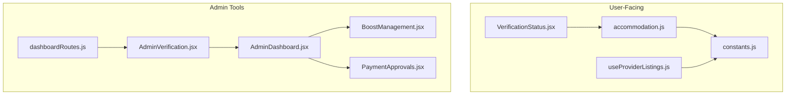
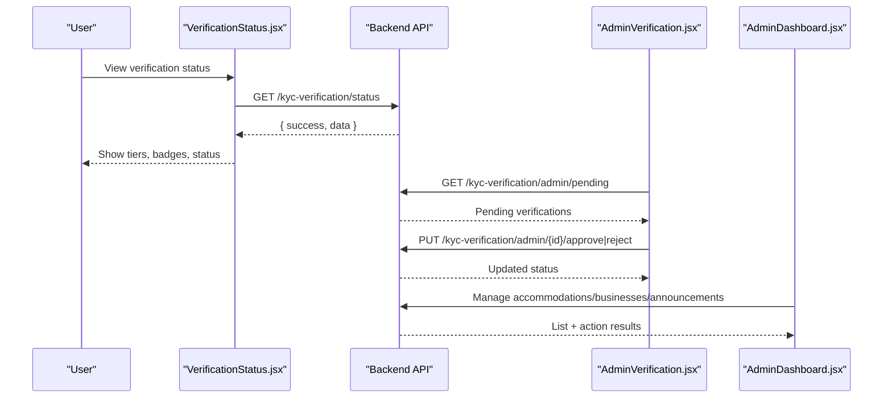
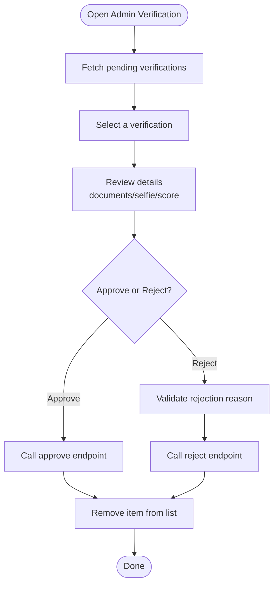
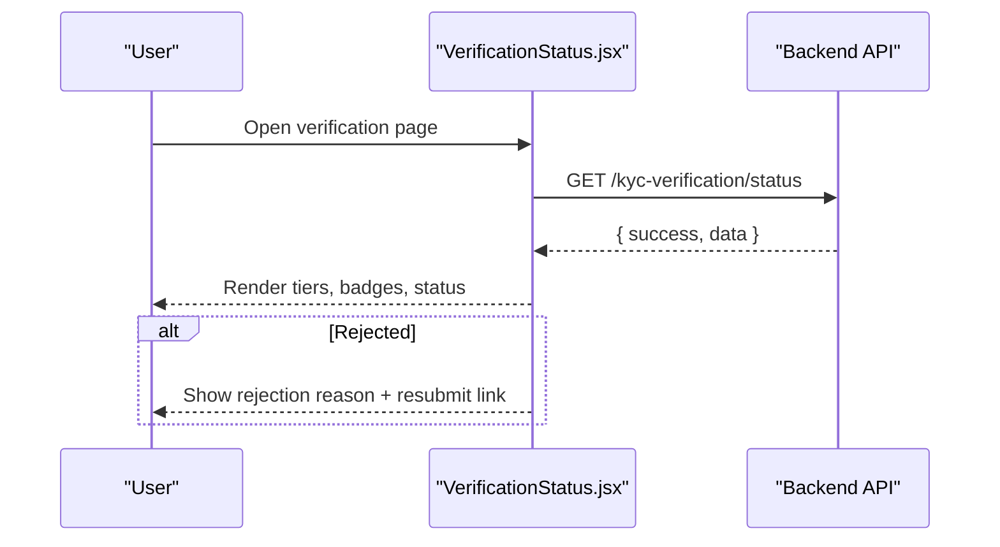
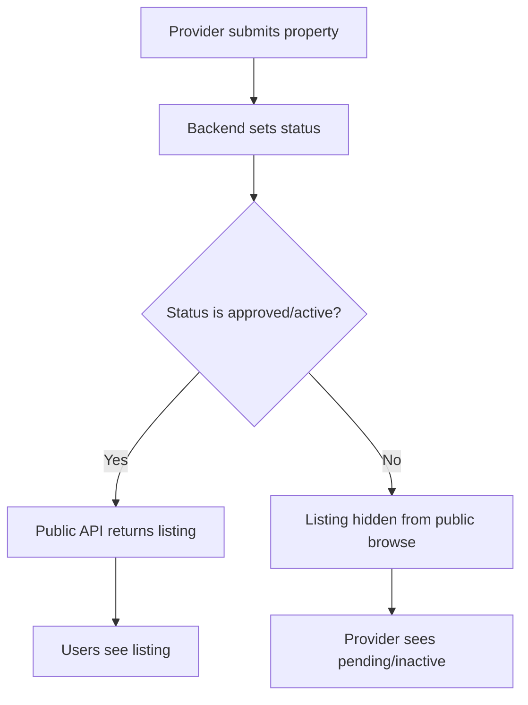
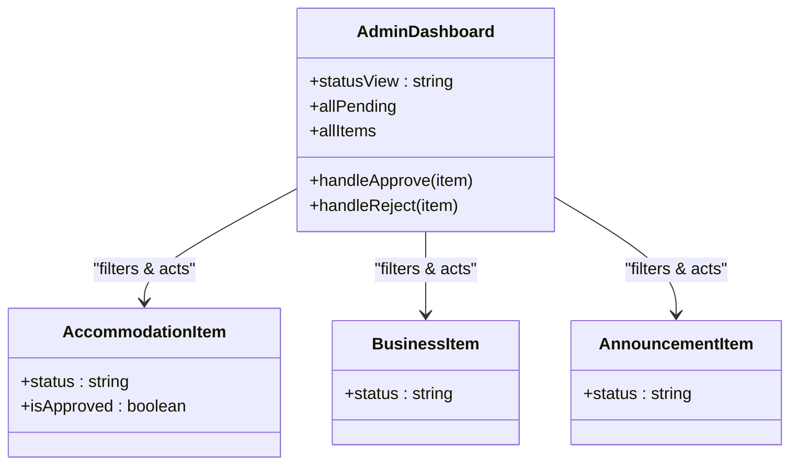
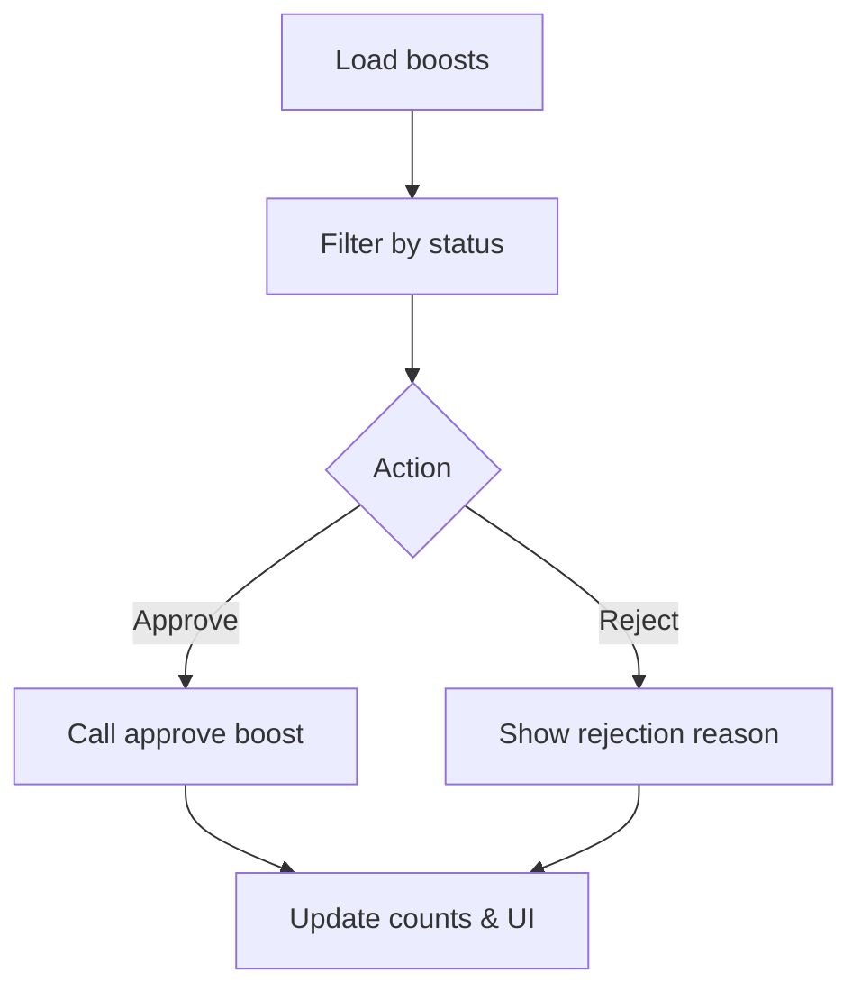
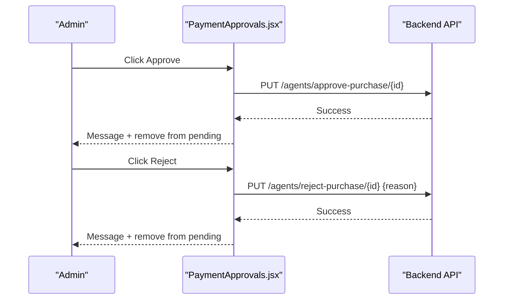
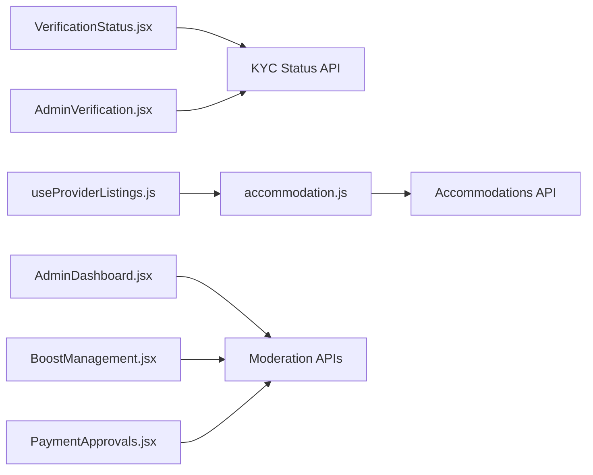

# Content Moderation

<cite>
**Referenced Files in This Document**
- [AdminVerification.jsx](file://src/pages/AdminVerification.jsx)
- [VerificationStatus.jsx](file://src/components/VerificationStatus.jsx)
- [accommodation.js](file://src/api/accommodation.js)
- [constants.js](file://src/features/accommodation/constants.js)
- [useProviderListings.js](file://src/features/accommodation/hooks/useProviderListings.js)
- [AdminDashboard.jsx](file://axxspace-admin/src/pages/AdminDashboard.jsx)
- [BoostManagement.jsx](file://axxspace-admin/src/components/BoostManagement.jsx)
- [PaymentApprovals.jsx](file://axxspace-admin/src/components/PaymentApprovals.jsx)
- [dashboardRoutes.js](file://src/utils/dashboardRoutes.js)
</cite>

## Table of Contents
1. [Introduction](#introduction)
2. [Project Structure](#project-structure)
3. [Core Components](#core-components)
4. [Architecture Overview](#architecture-overview)
5. [Detailed Component Analysis](#detailed-component-analysis)
6. [Dependency Analysis](#dependency-analysis)
7. [Performance Considerations](#performance-considerations)
8. [Troubleshooting Guide](#troubleshooting-guide)
9. [Conclusion](#conclusion)

## Introduction
This document explains the content moderation system implemented in the frontend for:
- Property listing approval workflows (accommodations and marketplace items)
- Accommodation verification processes
- Business profile moderation
- Announcement review systems
It also documents approval/rejection mechanisms, status management, and how users can appeal or resubmit after rejection. Bulk operations are supported via admin dashboards that filter and act on multiple items by status.

## Project Structure
The moderation features span user-facing components and admin tools:
- User-facing verification status and submission flows
- Admin moderation panels for KYC verifications, accommodations, boosts, payments, and announcements
- Shared constants and API helpers for listing statuses and normalization

**Diagram sources**
- [VerificationStatus.jsx:11-35](file://src/components/VerificationStatus.jsx#L11-L35)
- [accommodation.js:81-100](file://src/api/accommodation.js#L81-L100)
- [constants.js:166-173](file://src/features/accommodation/constants.js#L166-L173)
- [useProviderListings.js:33-34](file://src/features/accommodation/hooks/useProviderListings.js#L33-L34)
- [AdminVerification.jsx:17-37](file://src/pages/AdminVerification.jsx#L17-L37)
- [AdminDashboard.jsx:45-45](file://axxspace-admin/src/pages/AdminDashboard.jsx#L45-L45)
- [BoostManagement.jsx:124-145](file://axxspace-admin/src/components/BoostManagement.jsx#L124-L145)
- [PaymentApprovals.jsx:35-64](file://axxspace-admin/src/components/PaymentApprovals.jsx#L35-L64)
- [dashboardRoutes.js:13-13](file://src/utils/dashboardRoutes.js#L13-L13)

**Section sources**
- [AdminVerification.jsx:1-37](file://src/pages/AdminVerification.jsx#L1-L37)
- [VerificationStatus.jsx:1-35](file://src/components/VerificationStatus.jsx#L1-L35)
- [accommodation.js:81-100](file://src/api/accommodation.js#L81-L100)
- [constants.js:166-173](file://src/features/accommodation/constants.js#L166-L173)
- [useProviderListings.js:33-34](file://src/features/accommodation/hooks/useProviderListings.js#L33-L34)
- [AdminDashboard.jsx:45-45](file://axxspace-admin/src/pages/AdminDashboard.jsx#L45-L45)
- [BoostManagement.jsx:124-145](file://axxspace-admin/src/components/BoostManagement.jsx#L124-L145)
- [PaymentApprovals.jsx:35-64](file://axxspace-admin/src/components/PaymentApprovals.jsx#L35-L64)
- [dashboardRoutes.js:13-13](file://src/utils/dashboardRoutes.js#L13-L13)

## Core Components
- Admin KYC Verification Workflow: Loads pending verifications, displays details, supports approve/reject with reasons, and updates UI state.
- User Verification Status Dashboard: Shows tiered verification levels, current status, benefits, and resubmission links when rejected.
- Accommodation Listing Moderation: Public endpoints only show approved listings; provider dashboards track counts by status.
- Admin Dashboard Moderation: Central hub to manage accommodations, businesses, announcements, and other entities with status filters and bulk actions.
- Boost and Payment Approvals: Admin components to approve or reject promotional boosts and agent purchases with optional rejection reasons.

**Section sources**
- [AdminVerification.jsx:39-99](file://src/pages/AdminVerification.jsx#L39-L99)
- [VerificationStatus.jsx:106-129](file://src/components/VerificationStatus.jsx#L106-L129)
- [accommodation.js:81-100](file://src/api/accommodation.js#L81-L100)
- [useProviderListings.js:33-34](file://src/features/accommodation/hooks/useProviderListings.js#L33-L34)
- [AdminDashboard.jsx:45-45](file://axxspace-admin/src/pages/AdminDashboard.jsx#L45-L45)
- [BoostManagement.jsx:124-145](file://axxspace-admin/src/components/BoostManagement.jsx#L124-L145)
- [PaymentApprovals.jsx:35-64](file://axxspace-admin/src/components/PaymentApprovals.jsx#L35-L64)

## Architecture Overview
The moderation architecture separates user-facing status views from admin moderation tools. Users submit verification requests and view their status; admins review and act on pending items across different domains.

**Diagram sources**
- [VerificationStatus.jsx:11-35](file://src/components/VerificationStatus.jsx#L11-L35)
- [AdminVerification.jsx:17-37](file://src/pages/AdminVerification.jsx#L17-L37)
- [AdminVerification.jsx:39-99](file://src/pages/AdminVerification.jsx#L39-L99)
- [AdminDashboard.jsx:45-45](file://axxspace-admin/src/pages/AdminDashboard.jsx#L45-L45)

## Detailed Component Analysis

### KYC Verification Workflows (Admin)
- Loads pending verifications and renders a list with level indicators.
- Displays detailed submission info including user data, documents, selfie, and face match score.
- Supports approve and reject actions with required rejection reason validation.
- Updates local state upon successful actions.

**Diagram sources**
- [AdminVerification.jsx:17-37](file://src/pages/AdminVerification.jsx#L17-L37)
- [AdminVerification.jsx:39-99](file://src/pages/AdminVerification.jsx#L39-L99)

**Section sources**
- [AdminVerification.jsx:17-37](file://src/pages/AdminVerification.jsx#L17-L37)
- [AdminVerification.jsx:39-99](file://src/pages/AdminVerification.jsx#L39-L99)

### User Verification Status and Appeals
- Retrieves current verification status and badge set.
- Maps backend statuses to friendly labels and styles.
- When rejected, shows rejection reason and a link to modify and resubmit.
- Provides pricing and subscription options for trust badges.

**Diagram sources**
- [VerificationStatus.jsx:11-35](file://src/components/VerificationStatus.jsx#L11-L35)
- [VerificationStatus.jsx:106-129](file://src/components/VerificationStatus.jsx#L106-L129)
- [VerificationStatus.jsx:205-213](file://src/components/VerificationStatus.jsx#L205-L213)

**Section sources**
- [VerificationStatus.jsx:11-35](file://src/components/VerificationStatus.jsx#L11-L35)
- [VerificationStatus.jsx:106-129](file://src/components/VerificationStatus.jsx#L106-L129)
- [VerificationStatus.jsx:205-213](file://src/components/VerificationStatus.jsx#L205-L213)

### Accommodation Listing Approval and Visibility
- Public listing endpoints enforce visibility by filtering to active/approved accommodations.
- Provider dashboards compute live and pending counts based on listing status.
- Status labels map backend states to user-friendly labels and colors.

**Diagram sources**
- [accommodation.js:81-100](file://src/api/accommodation.js#L81-L100)
- [useProviderListings.js:33-34](file://src/features/accommodation/hooks/useProviderListings.js#L33-L34)
- [constants.js:166-173](file://src/features/accommodation/constants.js#L166-L173)

**Section sources**
- [accommodation.js:81-100](file://src/api/accommodation.js#L81-L100)
- [useProviderListings.js:33-34](file://src/features/accommodation/hooks/useProviderListings.js#L33-L34)
- [constants.js:166-173](file://src/features/accommodation/constants.js#L166-L173)

### Admin Dashboard Moderation (Accommodations, Businesses, Announcements)
- Central dashboard provides tabs and status filters to view pending vs approved items.
- Renders status dots and labels per entity type (businesses, announcements).
- Supports approving/rejecting accommodations and other items through dedicated actions.

**Diagram sources**
- [AdminDashboard.jsx:45-45](file://axxspace-admin/src/pages/AdminDashboard.jsx#L45-L45)
- [AdminDashboard.jsx:1070-1078](file://axxspace-admin/src/pages/AdminDashboard.jsx#L1070-L1078)
- [AdminDashboard.jsx:1148-1153](file://axxspace-admin/src/pages/AdminDashboard.jsx#L1148-L1153)
- [AdminDashboard.jsx:1591-1601](file://axxspace-admin/src/pages/AdminDashboard.jsx#L1591-L1601)

**Section sources**
- [AdminDashboard.jsx:45-45](file://axxspace-admin/src/pages/AdminDashboard.jsx#L45-L45)
- [AdminDashboard.jsx:1070-1078](file://axxspace-admin/src/pages/AdminDashboard.jsx#L1070-L1078)
- [AdminDashboard.jsx:1148-1153](file://axxspace-admin/src/pages/AdminDashboard.jsx#L1148-L1153)
- [AdminDashboard.jsx:1591-1601](file://axxspace-admin/src/pages/AdminDashboard.jsx#L1591-L1601)

### Boost Management (Promotional Listings)
- Tracks boosts by status: pending, approved, rejected.
- Allows approving boosts to feature listings and displaying rejection reasons when applicable.

**Diagram sources**
- [BoostManagement.jsx:124-145](file://axxspace-admin/src/components/BoostManagement.jsx#L124-L145)
- [BoostManagement.jsx:209-234](file://axxspace-admin/src/components/BoostManagement.jsx#L209-L234)

**Section sources**
- [BoostManagement.jsx:124-145](file://axxspace-admin/src/components/BoostManagement.jsx#L124-L145)
- [BoostManagement.jsx:209-234](file://axxspace-admin/src/components/BoostManagement.jsx#L209-L234)

### Payment Approvals (Agent Purchases)
- Approves or rejects agent purchase packages.
- Requires optional rejection reason and updates pending list accordingly.

**Diagram sources**
- [PaymentApprovals.jsx:35-64](file://axxspace-admin/src/components/PaymentApprovals.jsx#L35-L64)

**Section sources**
- [PaymentApprovals.jsx:35-64](file://axxspace-admin/src/components/PaymentApprovals.jsx#L35-L64)

### Navigation to Moderation Panels
- The dashboard routes include a direct path to the verification panel for quick access.

**Section sources**
- [dashboardRoutes.js:13-13](file://src/utils/dashboardRoutes.js#L13-L13)

## Dependency Analysis
- User verification status depends on the KYC status API and renders tiered information and badges.
- Accommodation browsing depends on the accommodation API which enforces approved-only visibility.
- Provider listing metrics depend on listing statuses computed locally.
- Admin moderation relies on multiple endpoints for approvals/rejections across domains.

**Diagram sources**
- [VerificationStatus.jsx:11-35](file://src/components/VerificationStatus.jsx#L11-L35)
- [accommodation.js:81-100](file://src/api/accommodation.js#L81-L100)
- [useProviderListings.js:33-34](file://src/features/accommodation/hooks/useProviderListings.js#L33-L34)
- [AdminDashboard.jsx:45-45](file://axxspace-admin/src/pages/AdminDashboard.jsx#L45-L45)
- [AdminVerification.jsx:17-37](file://src/pages/AdminVerification.jsx#L17-L37)
- [BoostManagement.jsx:124-145](file://axxspace-admin/src/components/BoostManagement.jsx#L124-L145)
- [PaymentApprovals.jsx:35-64](file://axxspace-admin/src/components/PaymentApprovals.jsx#L35-L64)

**Section sources**
- [VerificationStatus.jsx:11-35](file://src/components/VerificationStatus.jsx#L11-L35)
- [accommodation.js:81-100](file://src/api/accommodation.js#L81-L100)
- [useProviderListings.js:33-34](file://src/features/accommodation/hooks/useProviderListings.js#L33-L34)
- [AdminDashboard.jsx:45-45](file://axxspace-admin/src/pages/AdminDashboard.jsx#L45-L45)
- [AdminVerification.jsx:17-37](file://src/pages/AdminVerification.jsx#L17-L37)
- [BoostManagement.jsx:124-145](file://axxspace-admin/src/components/BoostManagement.jsx#L124-L145)
- [PaymentApprovals.jsx:35-64](file://axxspace-admin/src/components/PaymentApprovals.jsx#L35-L64)

## Performance Considerations
- Avoid unnecessary re-renders by minimizing state updates after approve/reject actions.
- Use pagination or server-side filtering for large lists of pending items in admin dashboards.
- Cache verification status where appropriate to reduce repeated API calls.
- Normalize and precompute derived fields (e.g., status labels) to avoid redundant computations.

[No sources needed since this section provides general guidance]

## Troubleshooting Guide
- If verification status fails to load, check token presence and network connectivity to the KYC status endpoint.
- For KYC approval/rejection failures, ensure rejection reasons are provided when rejecting and verify authorization headers.
- If accommodations do not appear publicly, confirm backend status is approved/active; public endpoints filter out non-approved items.
- In admin dashboards, verify status filters and ensure correct mapping between backend statuses and UI labels.

**Section sources**
- [VerificationStatus.jsx:11-35](file://src/components/VerificationStatus.jsx#L11-L35)
- [AdminVerification.jsx:39-99](file://src/pages/AdminVerification.jsx#L39-L99)
- [accommodation.js:81-100](file://src/api/accommodation.js#L81-L100)
- [constants.js:166-173](file://src/features/accommodation/constants.js#L166-L173)

## Conclusion
The moderation system integrates user-facing verification status with robust admin tools for reviewing and acting on pending content. It enforces quality standards through structured approval workflows, clear status management, and mechanisms for appeals and resubmissions. Admin dashboards provide centralized control over accommodations, businesses, announcements, boosts, and payments, enabling efficient bulk operations and consistent enforcement of platform policies.

[No sources needed since this section summarizes without analyzing specific files]