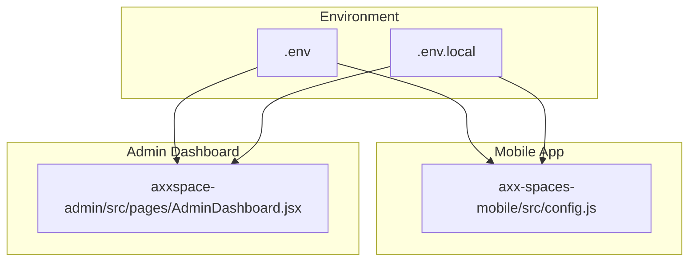
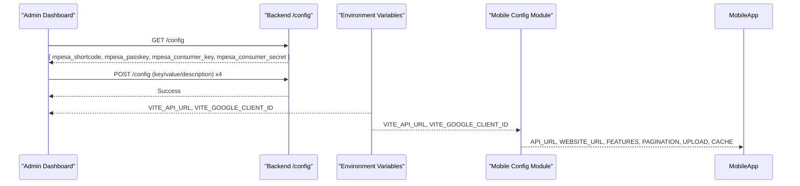
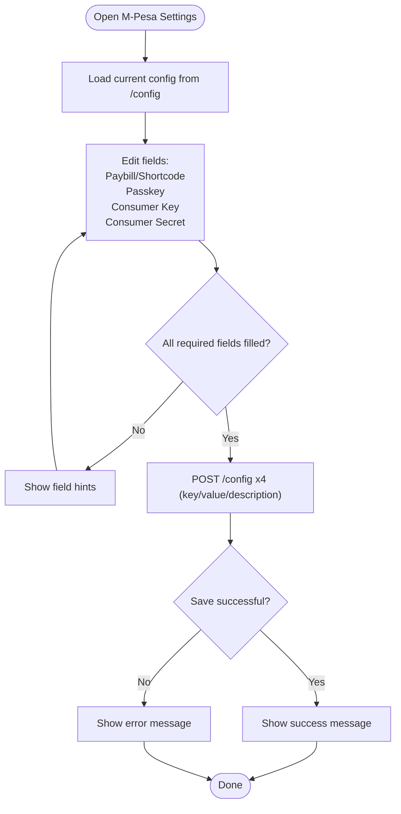
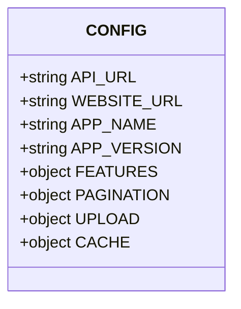
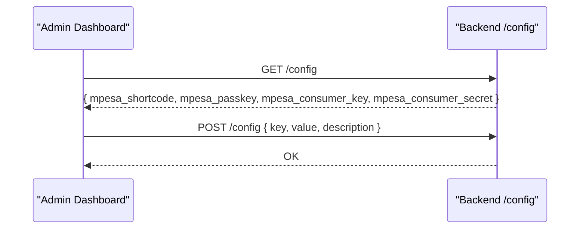
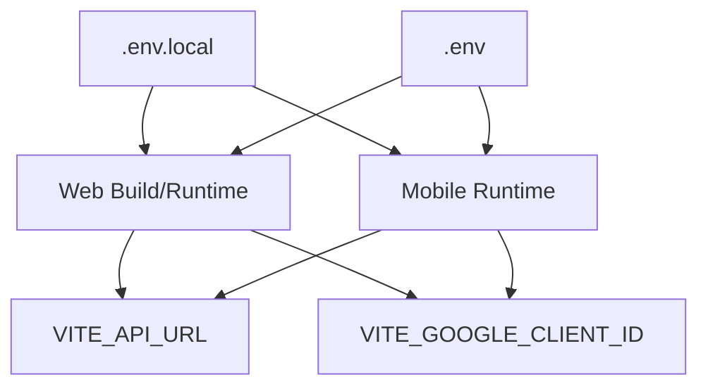
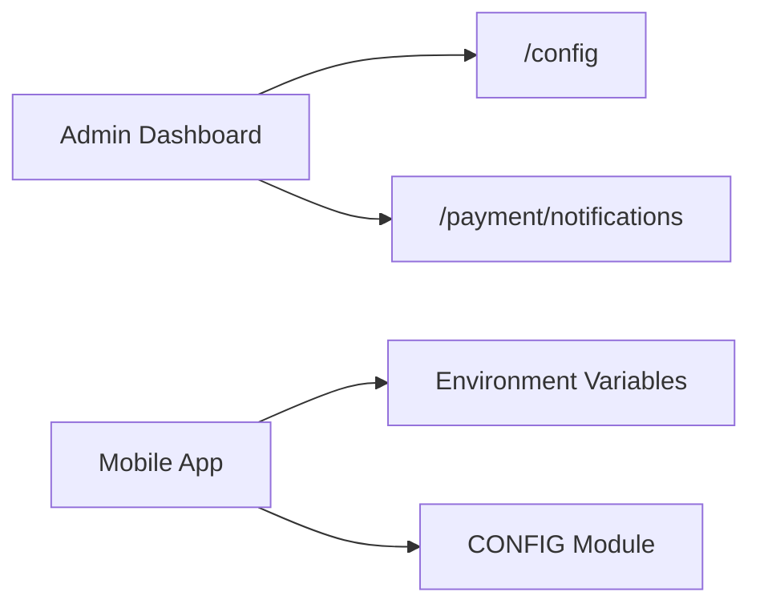

# System Configuration

<cite>
**Referenced Files in This Document**
- [.env](file://.env)
- [.env.local](file://.env.local)
- [axx-spaces-mobile/src/config.js](file://axx-spaces-mobile/src/config.js)
- [axxspace-admin/src/pages/AdminDashboard.jsx](file://axxspace-admin/src/pages/AdminDashboard.jsx)
</cite>

## Table of Contents
1. [Introduction](#introduction)
2. [Project Structure](#project-structure)
3. [Core Components](#core-components)
4. [Architecture Overview](#architecture-overview)
5. [Detailed Component Analysis](#detailed-component-analysis)
6. [Dependency Analysis](#dependency-analysis)
7. [Performance Considerations](#performance-considerations)
8. [Troubleshooting Guide](#troubleshooting-guide)
9. [Conclusion](#conclusion)

## Introduction
This document explains how system configuration is managed across the frontend and admin applications, with a focus on:
- M-Pesa payment integration settings
- Platform-wide configuration options
- Environment-specific settings
- How administrators configure payment gateways and update system parameters

The goal is to help both technical and non-technical users understand where configurations live, how they are loaded, and how to safely update them.

## Project Structure
Configuration is primarily defined in three places:
- Environment variables for build-time and runtime API endpoints and client IDs
- Mobile app configuration module for feature flags, pagination, upload limits, and cache settings
- Admin dashboard UI for managing platform-level configuration values (including M-Pesa credentials)

**Diagram sources**
- [.env:1-2](file://.env#L1-L2)
- [.env.local:1-5](file://.env.local#L1-L5)
- [axx-spaces-mobile/src/config.js:1-44](file://axx-spaces-mobile/src/config.js#L1-L44)
- [axxspace-admin/src/pages/AdminDashboard.jsx:70-118](file://axxspace-admin/src/pages/AdminDashboard.jsx#L70-L118)

**Section sources**
- [.env:1-2](file://.env#L1-L2)
- [.env.local:1-5](file://.env.local#L1-L5)
- [axx-spaces-mobile/src/config.js:1-44](file://axx-spaces-mobile/src/config.js#L1-L44)
- [axxspace-admin/src/pages/AdminDashboard.jsx:70-118](file://axxspace-admin/src/pages/AdminDashboard.jsx#L70-L118)

## Core Components
- Environment variables (.env, .env.local): Define API base URLs and Google client ID per environment.
- Mobile configuration module: Centralizes app-level settings such as API URL, website URL, feature flags, pagination, image upload constraints, and cache TTL/size.
- Admin dashboard configuration management: Loads and persists platform configuration via API calls, including M-Pesa credentials.

Key responsibilities:
- Environment variables control runtime behavior and external integrations.
- Mobile config controls client-side features and performance tuning.
- Admin dashboard provides an interface to manage backend configuration keys/values.

**Section sources**
- [.env:1-2](file://.env#L1-L2)
- [.env.local:1-5](file://.env.local#L1-L5)
- [axx-spaces-mobile/src/config.js:1-44](file://axx-spaces-mobile/src/config.js#L1-L44)
- [axxspace-admin/src/pages/AdminDashboard.jsx:215-225](file://axxspace-admin/src/pages/AdminDashboard.jsx#L215-L225)

## Architecture Overview
The configuration architecture spans environment variables, mobile app settings, and admin-managed platform settings. The admin dashboard interacts with a backend configuration endpoint to load and save key-value pairs.

**Diagram sources**
- [axxspace-admin/src/pages/AdminDashboard.jsx:215-225](file://axxspace-admin/src/pages/AdminDashboard.jsx#L215-L225)
- [axxspace-admin/src/pages/AdminDashboard.jsx:596-609](file://axxspace-admin/src/pages/AdminDashboard.jsx#L596-L609)
- [.env:1-2](file://.env#L1-L2)
- [.env.local:1-5](file://.env.local#L1-L5)
- [axx-spaces-mobile/src/config.js:1-44](file://axx-spaces-mobile/src/config.js#L1-L44)

## Detailed Component Analysis

### M-Pesa Payment Integration Settings
Administrators can configure M-Pesa credentials through the admin dashboard. The UI collects four fields and saves them by posting individual configuration entries to the backend.

- Fields:
  - Paybill/Shortcode
  - Passkey
  - Consumer Key
  - Consumer Secret

- Save flow:
  - On save, the dashboard posts four separate configuration entries with descriptive labels.
  - A success or error message is shown to the user.

**Diagram sources**
- [axxspace-admin/src/pages/AdminDashboard.jsx:2350-2372](file://axxspace-admin/src/pages/AdminDashboard.jsx#L2350-L2372)
- [axxspace-admin/src/pages/AdminDashboard.jsx:596-609](file://axxspace-admin/src/pages/AdminDashboard.jsx#L596-L609)
- [axxspace-admin/src/pages/AdminDashboard.jsx:215-225](file://axxspace-admin/src/pages/AdminDashboard.jsx#L215-L225)

**Section sources**
- [axxspace-admin/src/pages/AdminDashboard.jsx:2350-2372](file://axxspace-admin/src/pages/AdminDashboard.jsx#L2350-L2372)
- [axxspace-admin/src/pages/AdminDashboard.jsx:596-609](file://axxspace-admin/src/pages/AdminDashboard.jsx#L596-L609)
- [axxspace-admin/src/pages/AdminDashboard.jsx:215-225](file://axxspace-admin/src/pages/AdminDashboard.jsx#L215-L225)

### Platform-Wide Configuration Options
The mobile application centralizes platform-wide settings in a single configuration module. These include:
- API URL and website URL
- Feature flags (push notifications, location services, camera, offline mode)
- Pagination defaults and maximums
- Image upload constraints (size, types, count)
- Cache TTL and size limits

These settings are consumed by the mobile app to control runtime behavior and performance characteristics.

**Diagram sources**
- [axx-spaces-mobile/src/config.js:1-44](file://axx-spaces-mobile/src/config.js#L1-L44)

**Section sources**
- [axx-spaces-mobile/src/config.js:1-44](file://axx-spaces-mobile/src/config.js#L1-L44)

### System Parameter Management
System parameters are managed via the admin dashboard’s configuration interface. The dashboard:
- Loads all configuration entries from the backend
- Displays editable fields for M-Pesa credentials
- Saves each parameter individually with a descriptive label

**Diagram sources**
- [axxspace-admin/src/pages/AdminDashboard.jsx:215-225](file://axxspace-admin/src/pages/AdminDashboard.jsx#L215-L225)
- [axxspace-admin/src/pages/AdminDashboard.jsx:596-609](file://axxspace-admin/src/pages/AdminDashboard.jsx#L596-L609)

**Section sources**
- [axxspace-admin/src/pages/AdminDashboard.jsx:215-225](file://axxspace-admin/src/pages/AdminDashboard.jsx#L215-L225)
- [axxspace-admin/src/pages/AdminDashboard.jsx:596-609](file://axxspace-admin/src/pages/AdminDashboard.jsx#L596-L609)

### Environment-Specific Settings
Environment variables define runtime behavior for both web and mobile clients:
- API base URL
- Google client ID
- Local development overrides

These variables are used at build time or runtime to configure network endpoints and third-party integrations.

**Diagram sources**
- [.env:1-2](file://.env#L1-L2)
- [.env.local:1-5](file://.env.local#L1-L5)

**Section sources**
- [.env:1-2](file://.env#L1-L2)
- [.env.local:1-5](file://.env.local#L1-L5)

## Dependency Analysis
- Admin dashboard depends on:
  - Backend configuration endpoints (/config)
  - Payment notification endpoints (/payment/notifications)
- Mobile app depends on:
  - Environment variables for API URL and Google client ID
  - Internal configuration module for feature toggles and performance tuning

**Diagram sources**
- [axxspace-admin/src/pages/AdminDashboard.jsx:215-225](file://axxspace-admin/src/pages/AdminDashboard.jsx#L215-L225)
- [axxspace-admin/src/pages/AdminDashboard.jsx:227-243](file://axxspace-admin/src/pages/AdminDashboard.jsx#L227-L243)
- [.env:1-2](file://.env#L1-L2)
- [.env.local:1-5](file://.env.local#L1-L5)
- [axx-spaces-mobile/src/config.js:1-44](file://axx-spaces-mobile/src/config.js#L1-L44)

**Section sources**
- [axxspace-admin/src/pages/AdminDashboard.jsx:215-225](file://axxspace-admin/src/pages/AdminDashboard.jsx#L215-L225)
- [axxspace-admin/src/pages/AdminDashboard.jsx:227-243](file://axxspace-admin/src/pages/AdminDashboard.jsx#L227-L243)
- [.env:1-2](file://.env#L1-L2)
- [.env.local:1-5](file://.env.local#L1-L5)
- [axx-spaces-mobile/src/config.js:1-44](file://axx-spaces-mobile/src/config.js#L1-L44)

## Performance Considerations
- Use environment variables to avoid hardcoding endpoints; this reduces rebuilds and improves deployment flexibility.
- Tune mobile cache TTL and image cache size based on expected usage patterns to balance memory usage and responsiveness.
- Limit image upload sizes and counts to reduce bandwidth and server load.
- Keep feature flags minimal and review periodically to disable unused capabilities.

[No sources needed since this section provides general guidance]

## Troubleshooting Guide
Common issues and resolutions:
- M-Pesa configuration not saving:
  - Verify that all four fields are provided and valid.
  - Check network requests to POST /config and ensure descriptions are included.
  - Confirm backend availability and permissions for configuration writes.
- API URL mismatch:
  - Ensure VITE_API_URL points to the correct environment (development vs production).
  - For mobile, confirm API_URL resolves to the intended backend host.
- Google authentication failures:
  - Validate VITE_GOOGLE_CLIENT_ID matches the configured OAuth client.
  - Ensure the client ID is allowed for the domain or platform being tested.

Operational references:
- Loading and saving M-Pesa configuration:
  - Load: GET /config
  - Save: POST /config (four entries)

**Section sources**
- [axxspace-admin/src/pages/AdminDashboard.jsx:215-225](file://axxspace-admin/src/pages/AdminDashboard.jsx#L215-L225)
- [axxspace-admin/src/pages/AdminDashboard.jsx:596-609](file://axxspace-admin/src/pages/AdminDashboard.jsx#L596-L609)
- [.env:1-2](file://.env#L1-L2)
- [.env.local:1-5](file://.env.local#L1-L5)

## Conclusion
System configuration in this project is split across environment variables, a centralized mobile configuration module, and an admin-managed configuration interface. Administrators can securely set M-Pesa credentials and other platform parameters via the admin dashboard, while developers and operators adjust environment-specific settings using .env files. Following the guidelines here ensures consistent, safe, and maintainable configuration management across environments.

[No sources needed since this section summarizes without analyzing specific files]