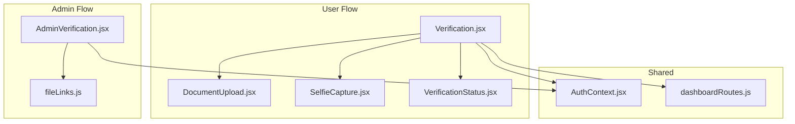
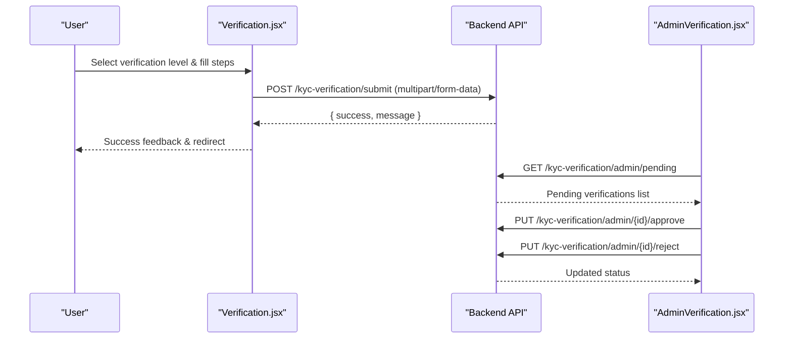
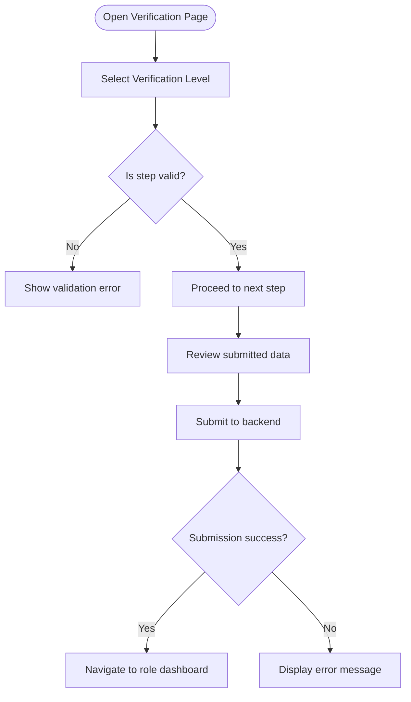
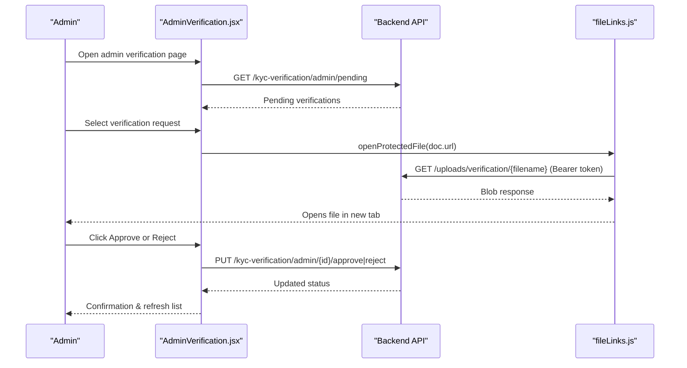
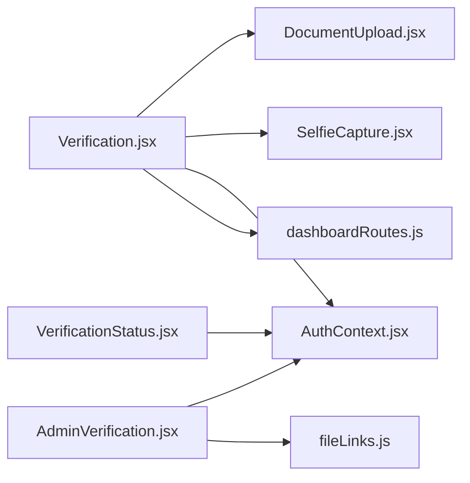

# User Verification Management

<cite>
**Referenced Files in This Document**
- [Verification.jsx](file://src/pages/Verification.jsx)
- [AdminVerification.jsx](file://src/pages/AdminVerification.jsx)
- [DocumentUpload.jsx](file://src/components/DocumentUpload.jsx)
- [SelfieCapture.jsx](file://src/components/SelfieCapture.jsx)
- [VerificationStatus.jsx](file://src/components/VerificationStatus.jsx)
- [AuthContext.jsx](file://src/context/AuthContext.jsx)
- [dashboardRoutes.js](file://src/utils/dashboardRoutes.js)
- [fileLinks.js](file://src/utils/fileLinks.js)
</cite>

## Table of Contents
1. [Introduction](#introduction)
2. [Project Structure](#project-structure)
3. [Core Components](#core-components)
4. [Architecture Overview](#architecture-overview)
5. [Detailed Component Analysis](#detailed-component-analysis)
6. [Dependency Analysis](#dependency-analysis)
7. [Performance Considerations](#performance-considerations)
8. [Troubleshooting Guide](#troubleshooting-guide)
9. [Conclusion](#conclusion)

## Introduction
This document explains the user verification management system implemented in the frontend. It covers:
- KYC workflow and tiered verification levels (Student, Standard, Premium)
- Document upload and selfie capture flows
- Admin review, approval, and rejection mechanisms
- Integration with user profiles and role-based access control
- Examples of verification workflows, document handling, and audit trails

The system is a React-based frontend that interacts with backend endpoints for submission, status retrieval, and admin actions.

## Project Structure
The verification feature spans several pages and components:
- User-facing verification wizard and submission
- Admin panel for reviewing submissions
- Reusable components for document upload and selfie capture
- Utilities for file access and routing by role

**Diagram sources**
- [Verification.jsx:1-769](file://src/pages/Verification.jsx#L1-L769)
- [AdminVerification.jsx:1-683](file://src/pages/AdminVerification.jsx#L1-L683)
- [DocumentUpload.jsx:1-280](file://src/components/DocumentUpload.jsx#L1-L280)
- [SelfieCapture.jsx:1-339](file://src/components/SelfieCapture.jsx#L1-L339)
- [VerificationStatus.jsx:1-791](file://src/components/VerificationStatus.jsx#L1-L791)
- [AuthContext.jsx:1-157](file://src/context/AuthContext.jsx#L1-L157)
- [dashboardRoutes.js:1-183](file://src/utils/dashboardRoutes.js#L1-L183)
- [fileLinks.js:1-42](file://src/utils/fileLinks.js#L1-L42)

**Section sources**
- [Verification.jsx:1-769](file://src/pages/Verification.jsx#L1-L769)
- [AdminVerification.jsx:1-683](file://src/pages/AdminVerification.jsx#L1-L683)
- [DocumentUpload.jsx:1-280](file://src/components/DocumentUpload.jsx#L1-L280)
- [SelfieCapture.jsx:1-339](file://src/components/SelfieCapture.jsx#L1-L339)
- [VerificationStatus.jsx:1-791](file://src/components/VerificationStatus.jsx#L1-L791)
- [AuthContext.jsx:1-157](file://src/context/AuthContext.jsx#L1-L157)
- [dashboardRoutes.js:1-183](file://src/utils/dashboardRoutes.js#L1-L183)
- [fileLinks.js:1-42](file://src/utils/fileLinks.js#L1-L42)

## Core Components
- Verification page: Multi-step wizard to select verification level, collect documents/selfie, and submit.
- AdminVerification page: Lists pending verifications, shows details, and allows approve/reject with notes.
- DocumentUpload component: Drag-and-drop or click-to-upload with validation and preview.
- SelfieCapture component: Camera-based selfie capture with face guide overlay.
- VerificationStatus component: Displays current verification levels, statuses, badges, and pricing plans.
- AuthContext: Provides token and user context used across verification flows.
- dashboardRoutes: Role-based navigation mapping including admin/team routes to verification.
- fileLinks: Securely resolves and opens protected files using bearer tokens.

**Section sources**
- [Verification.jsx:1-769](file://src/pages/Verification.jsx#L1-L769)
- [AdminVerification.jsx:1-683](file://src/pages/AdminVerification.jsx#L1-L683)
- [DocumentUpload.jsx:1-280](file://src/components/DocumentUpload.jsx#L1-L280)
- [SelfieCapture.jsx:1-339](file://src/components/SelfieCapture.jsx#L1-L339)
- [VerificationStatus.jsx:1-791](file://src/components/VerificationStatus.jsx#L1-L791)
- [AuthContext.jsx:1-157](file://src/context/AuthContext.jsx#L1-L157)
- [dashboardRoutes.js:1-183](file://src/utils/dashboardRoutes.js#L1-L183)
- [fileLinks.js:1-42](file://src/utils/fileLinks.js#L1-L42)

## Architecture Overview
The verification system follows a clear separation between user submission and admin review:
- Users submit verification requests via a multi-step form.
- The frontend calls backend endpoints to submit data and retrieve status.
- Admins review pending submissions, view uploaded documents and selfies, and approve or reject with reasons.
- Roles determine access to verification-related features and dashboards.

**Diagram sources**
- [Verification.jsx:145-207](file://src/pages/Verification.jsx#L145-L207)
- [AdminVerification.jsx:17-99](file://src/pages/AdminVerification.jsx#L17-L99)

## Detailed Component Analysis

### User Verification Wizard (Verification.jsx)
Responsibilities:
- Presents three verification tiers: Student, Standard, Premium.
- Guides users through required fields per tier.
- Validates inputs before allowing next step.
- Submits multipart/form-data to the backend.
- Redirects based on user role after successful submission.

Key behaviors:
- Step generation depends on selected level.
- File handling uses DocumentUpload; selfie captured via SelfieCapture.
- Submission endpoint: POST /kyc-verification/submit.
- Post-submission navigation uses getDashboardPath(userRole).

**Diagram sources**
- [Verification.jsx:88-112](file://src/pages/Verification.jsx#L88-L112)
- [Verification.jsx:145-207](file://src/pages/Verification.jsx#L145-L207)
- [Verification.jsx:209-235](file://src/pages/Verification.jsx#L209-L235)

**Section sources**
- [Verification.jsx:1-769](file://src/pages/Verification.jsx#L1-L769)

### Admin Verification Panel (AdminVerification.jsx)
Responsibilities:
- Fetches pending verifications from backend.
- Displays user info, verification level, documents, selfie, and AI face match score if available.
- Allows approve or reject with optional notes/reason.
- Uses secure file opening utilities for protected documents.

Key behaviors:
- Endpoint: GET /kyc-verification/admin/pending.
- Approve: PUT /kyc-verification/admin/{id}/approve with adminNotes.
- Reject: PUT /kyc-verification/admin/{id}/reject with rejectionReason and adminNotes.
- File access: openProtectedFile(doc.url) for viewing/downloading.

**Diagram sources**
- [AdminVerification.jsx:17-99](file://src/pages/AdminVerification.jsx#L17-L99)
- [fileLinks.js:19-41](file://src/utils/fileLinks.js#L19-L41)

**Section sources**
- [AdminVerification.jsx:1-683](file://src/pages/AdminVerification.jsx#L1-L683)
- [fileLinks.js:1-42](file://src/utils/fileLinks.js#L1-L42)

### Document Upload (DocumentUpload.jsx)
Responsibilities:
- Accepts image/PDF uploads with drag-and-drop support.
- Validates file type and size (default max 15MB).
- Generates previews for images; displays PDF icon/name otherwise.
- Emits file and preview URL to parent component.

Validation rules:
- Size limit enforced.
- Allowed types include images and PDFs.
- Errors displayed inline.

**Section sources**
- [DocumentUpload.jsx:1-280](file://src/components/DocumentUpload.jsx#L1-L280)

### Selfie Capture (SelfieCapture.jsx)
Responsibilities:
- Requests camera permission and streams video.
- Captures photo to canvas and converts to base64 JPEG.
- Shows face guide overlay for alignment.
- Supports retake and cancellation.

Integration:
- Parent component receives base64 selfie data and converts to blob for upload.

**Section sources**
- [SelfieCapture.jsx:1-339](file://src/components/SelfieCapture.jsx#L1-L339)

### Verification Status (VerificationStatus.jsx)
Responsibilities:
- Retrieves current verification status and badges.
- Displays per-level status labels and styling.
- Shows rejection reasons and resubmit links when applicable.
- Includes badge subscription pricing UI.

API usage:
- GET /kyc-verification/status with Authorization header.

**Section sources**
- [VerificationStatus.jsx:1-791](file://src/components/VerificationStatus.jsx#L1-L791)

### Authentication and Role-Based Access Control
- AuthContext provides token and user object used across verification flows.
- dashboardRoutes maps roles to dashboards and login paths.
- Team/admin roles have direct navigation to verification management.

Key mappings:
- team -> "/admin/verification"
- admin -> "/admin/dashboard" and includes "Verification" nav item

**Section sources**
- [AuthContext.jsx:1-157](file://src/context/AuthContext.jsx#L1-L157)
- [dashboardRoutes.js:1-183](file://src/utils/dashboardRoutes.js#L1-L183)

## Dependency Analysis

**Diagram sources**
- [Verification.jsx:1-769](file://src/pages/Verification.jsx#L1-L769)
- [AdminVerification.jsx:1-683](file://src/pages/AdminVerification.jsx#L1-L683)
- [VerificationStatus.jsx:1-791](file://src/components/VerificationStatus.jsx#L1-L791)
- [DocumentUpload.jsx:1-280](file://src/components/DocumentUpload.jsx#L1-L280)
- [SelfieCapture.jsx:1-339](file://src/components/SelfieCapture.jsx#L1-L339)
- [AuthContext.jsx:1-157](file://src/context/AuthContext.jsx#L1-L157)
- [dashboardRoutes.js:1-183](file://src/utils/dashboardRoutes.js#L1-L183)
- [fileLinks.js:1-42](file://src/utils/fileLinks.js#L1-L42)

**Section sources**
- [Verification.jsx:1-769](file://src/pages/Verification.jsx#L1-L769)
- [AdminVerification.jsx:1-683](file://src/pages/AdminVerification.jsx#L1-L683)
- [VerificationStatus.jsx:1-791](file://src/components/VerificationStatus.jsx#L1-L791)
- [AuthContext.jsx:1-157](file://src/context/AuthContext.jsx#L1-L157)
- [dashboardRoutes.js:1-183](file://src/utils/dashboardRoutes.js#L1-L183)
- [fileLinks.js:1-42](file://src/utils/fileLinks.js#L1-L42)

## Performance Considerations
- Image and PDF validation occurs client-side to avoid unnecessary uploads.
- Selfie capture converts to base64 then to blob before sending; ensure adequate memory on devices.
- Admin panel lists only pending verifications to reduce payload size.
- Protected file downloads use short-lived object URLs to prevent memory leaks.

[No sources needed since this section provides general guidance]

## Troubleshooting Guide
Common issues and resolutions:
- Camera permission denied: SelfieCapture shows an error message; instruct users to allow camera access.
- Invalid file type or oversized file: DocumentUpload displays inline errors; adjust file format/size.
- Submission fails: Check network connectivity and verify Authorization header presence; inspect backend error messages.
- Admin cannot open documents: Ensure token exists and file path matches protected route; confirm server returns 200 OK.

Operational tips:
- For rejections, always provide a reason to inform users how to resubmit.
- Use the verification status page to monitor progress and display rejection reasons to users.

**Section sources**
- [SelfieCapture.jsx:24-38](file://src/components/SelfieCapture.jsx#L24-L38)
- [DocumentUpload.jsx:17-45](file://src/components/DocumentUpload.jsx#L17-L45)
- [Verification.jsx:193-206](file://src/pages/Verification.jsx#L193-L206)
- [AdminVerification.jsx:68-99](file://src/pages/AdminVerification.jsx#L68-L99)
- [fileLinks.js:19-41](file://src/utils/fileLinks.js#L19-L41)

## Conclusion
The user verification management system provides a robust, tiered KYC workflow with clear user and admin interfaces. Users can submit documents and selfies through guided steps, while admins can review, approve, or reject submissions with audit notes. Role-based access ensures appropriate permissions, and secure file handling protects sensitive documents. The integration points are well-defined, enabling reliable operation and extensibility for future enhancements such as automated checks or additional verification tiers.

[No sources needed since this section summarizes without analyzing specific files]