# Agency Administration

<cite>
**Referenced Files in This Document**
- [App.jsx](file://src/App.jsx)
- [RegisterAgencyPage.jsx](file://src/pages/RegisterAgencyPage.jsx)
- [AgencyDashboard.jsx](file://src/pages/AgencyDashboard.jsx)
- [AgentDashboard.jsx](file://src/pages/AgentDashboard.jsx)
- [AgentRegister.jsx](file://src/pages/AgentRegister.jsx)
- [AgentCard.jsx](file://src/components/AgentCard.jsx)
- [AuthContext.js](file://axx-spaces-mobile/src/context/AuthContext.js)
- [PaymentApprovals.jsx](file://axxspace-admin/src/components/PaymentApprovals.jsx)
</cite>

## Table of Contents
1. [Introduction](#introduction)
2. [Project Structure](#project-structure)
3. [Core Components](#core-components)
4. [Architecture Overview](#architecture-overview)
5. [Detailed Component Analysis](#detailed-component-analysis)
6. [Dependency Analysis](#dependency-analysis)
7. [Performance Considerations](#performance-considerations)
8. [Troubleshooting Guide](#troubleshooting-guide)
9. [Conclusion](#conclusion)

## Introduction
This document explains the agency administration tools and management capabilities implemented in the frontend. It covers:
- Agency registration workflow
- Multi-agent coordination (invite, list, remove)
- Resource allocation via agent packages and commission-related settings
- Team management functions for agency admins
- Performance monitoring across agents
- Extensibility patterns and integration points with external systems
- Permission structures and access control mechanisms

The focus is on how the React application orchestrates these features through pages, components, routing, and API calls.

## Project Structure
The relevant parts of the project are organized by feature areas:
- Routing and protected routes define entry points for agency and agent dashboards
- Registration pages handle new agencies and agents
- Dashboards provide operational interfaces for agency admins and agents
- Shared components present agent profiles and actions

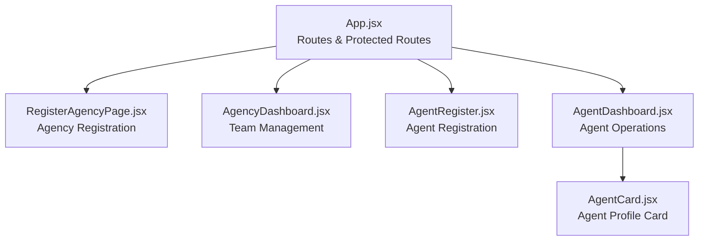

**Diagram sources**
- [App.jsx:220-260](file://src/App.jsx#L220-L260)
- [RegisterAgencyPage.jsx:119-219](file://src/pages/RegisterAgencyPage.jsx#L119-L219)
- [AgencyDashboard.jsx:174-212](file://src/pages/AgencyDashboard.jsx#L174-L212)
- [AgentRegister.jsx:92-145](file://src/pages/AgentRegister.jsx#L92-L145)
- [AgentDashboard.jsx:488-703](file://src/pages/AgentDashboard.jsx#L488-L703)
- [AgentCard.jsx:5-37](file://src/components/AgentCard.jsx#L5-L37)

**Section sources**
- [App.jsx:220-260](file://src/App.jsx#L220-L260)

## Core Components
- Agency Registration Page: Collects agency details and admin account info, validates inputs, and submits to backend.
- Agency Dashboard: Lists agents under an agency, invites agents by email, removes agents, and shows verification stats.
- Agent Registration: Supports standard registration and Google sign-in; sets role to agent.
- Agent Dashboard: Manages properties, packages, fees, and provides QR tools; includes polling for package approvals.
- Agent Card: Displays agent profile, verification status, WhatsApp contact, and reporting flow.

Key responsibilities:
- Data validation and error handling at UI layer
- Role-based navigation and protection
- API interactions for CRUD operations and queries
- User feedback via alerts/toasts

**Section sources**
- [RegisterAgencyPage.jsx:119-219](file://src/pages/RegisterAgencyPage.jsx#L119-L219)
- [AgencyDashboard.jsx:174-277](file://src/pages/AgencyDashboard.jsx#L174-L277)
- [AgentRegister.jsx:92-145](file://src/pages/AgentRegister.jsx#L92-L145)
- [AgentDashboard.jsx:488-703](file://src/pages/AgentDashboard.jsx#L488-L703)
- [AgentCard.jsx:5-75](file://src/components/AgentCard.jsx#L5-L75)

## Architecture Overview
The system uses a client-side React app that:
- Defines routes and guards for different roles
- Calls backend APIs for authentication, registration, and resource management
- Presents dashboards tailored to agency admins and agents

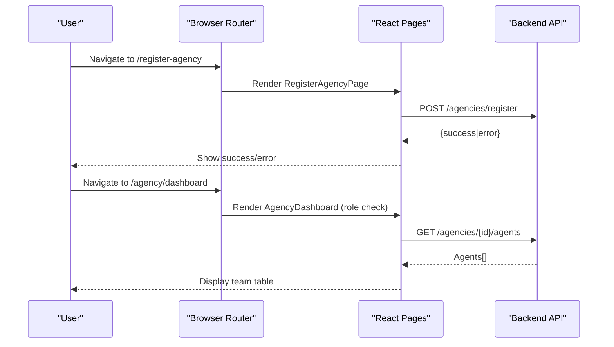

**Diagram sources**
- [App.jsx:220-260](file://src/App.jsx#L220-L260)
- [RegisterAgencyPage.jsx:144-219](file://src/pages/RegisterAgencyPage.jsx#L144-L219)
- [AgencyDashboard.jsx:185-212](file://src/pages/AgencyDashboard.jsx#L185-L212)

## Detailed Component Analysis

### Agency Registration Workflow
- Inputs: Agency name, registration number, phone, email, address, county, website, description, logo; plus admin name, email, phone, password.
- Validation: Required fields enforced; user must be logged in.
- Submission: Sends JSON payload to backend with Authorization header.
- Feedback: Success or error messages displayed inline.

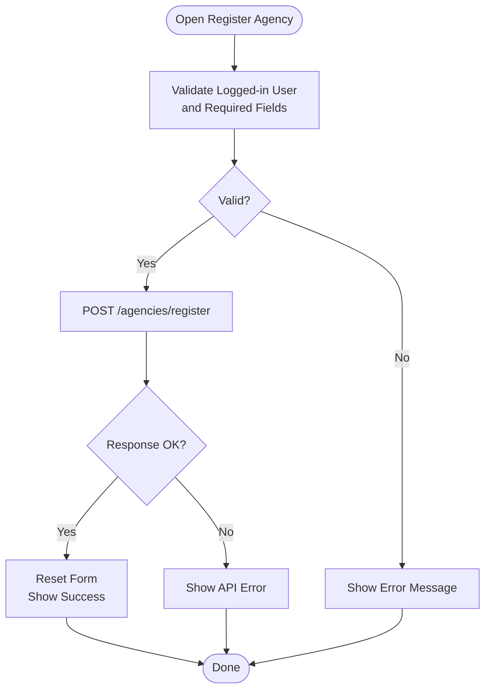

**Diagram sources**
- [RegisterAgencyPage.jsx:144-219](file://src/pages/RegisterAgencyPage.jsx#L144-L219)

**Section sources**
- [RegisterAgencyPage.jsx:119-219](file://src/pages/RegisterAgencyPage.jsx#L119-L219)

### Multi-Agent Coordination (Invite, List, Remove)
- Load agents for the current agency using the agencyId from the authenticated user’s profile.
- Invite agents by email:
  - Lookup user by email
  - Ensure role is agent
  - Post invite to associate agent with agency
- Remove agents by ID.

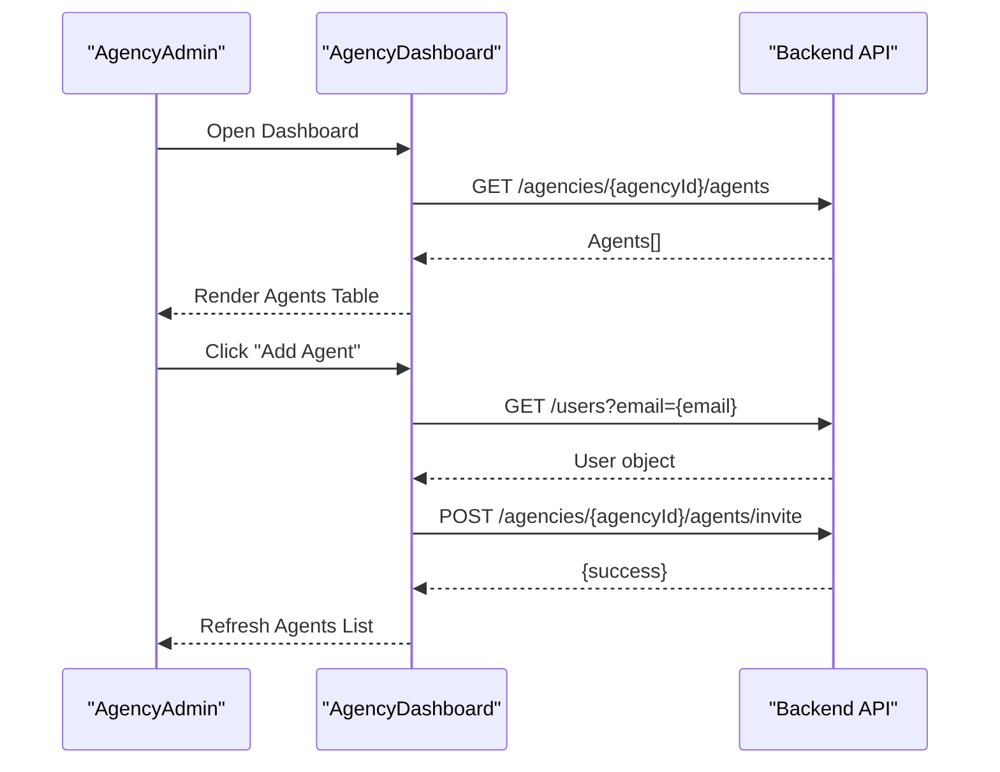

**Diagram sources**
- [AgencyDashboard.jsx:193-258](file://src/pages/AgencyDashboard.jsx#L193-L258)

**Section sources**
- [AgencyDashboard.jsx:174-277](file://src/pages/AgencyDashboard.jsx#L174-L277)

### Resource Allocation Tools (Packages and Fees)
- Packages:
  - Fetch available packages
  - Fetch current package and pending purchase
  - Poll periodically to detect approval and update UI state
- House Hunting Fee:
  - Configure fee amount, terms, and whether the agent offers house hunting
  - Persist changes via PUT endpoint

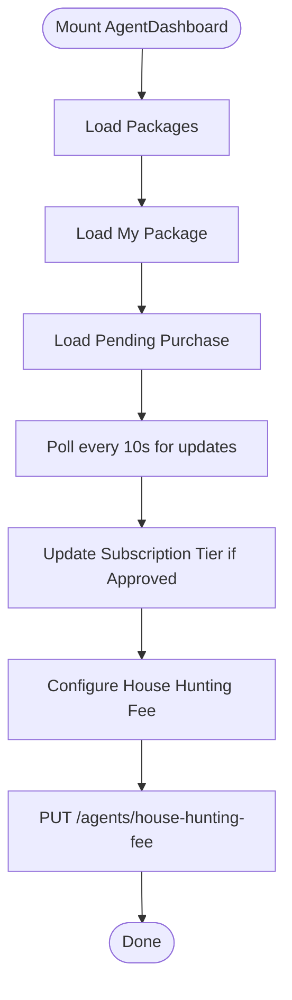

**Diagram sources**
- [AgentDashboard.jsx:746-800](file://src/pages/AgentDashboard.jsx#L746-L800)
- [AgentDashboard.jsx:558-594](file://src/pages/AgentDashboard.jsx#L558-L594)

**Section sources**
- [AgentDashboard.jsx:746-800](file://src/pages/AgentDashboard.jsx#L746-L800)
- [AgentDashboard.jsx:558-594](file://src/pages/AgentDashboard.jsx#L558-L594)

### Team Management Functions
- Stats overview: total agents, verified, pending verification
- Actions: add agent via email, remove agent by ID
- Status badges: verification status per agent

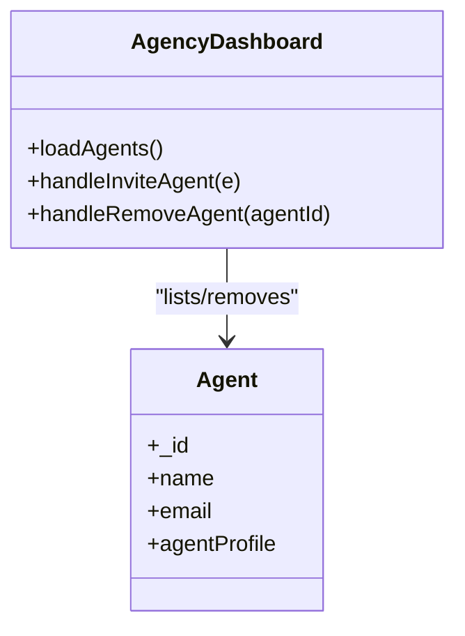

**Diagram sources**
- [AgencyDashboard.jsx:174-277](file://src/pages/AgencyDashboard.jsx#L174-L277)

**Section sources**
- [AgencyDashboard.jsx:174-277](file://src/pages/AgencyDashboard.jsx#L174-L277)

### Commission Distribution Settings
- The agent dashboard exposes configurable house hunting fee and terms, enabling agents to set their service pricing structure.
- Payment approvals for agent packages are managed in the admin panel, which can influence commission eligibility based on subscription tiers.

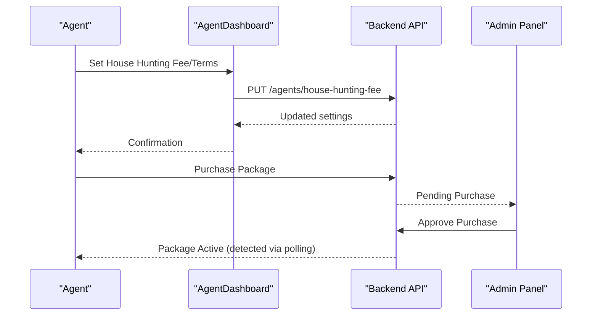

**Diagram sources**
- [AgentDashboard.jsx:558-594](file://src/pages/AgentDashboard.jsx#L558-L594)
- [PaymentApprovals.jsx:21-60](file://axxspace-admin/src/components/PaymentApprovals.jsx#L21-L60)

**Section sources**
- [AgentDashboard.jsx:558-594](file://src/pages/AgentDashboard.jsx#L558-L594)
- [PaymentApprovals.jsx:21-60](file://axxspace-admin/src/components/PaymentApprovals.jsx#L21-L60)

### Performance Monitoring Across Agents
- Verification status tracking per agent
- Stats aggregation (verified vs pending)
- Agent profile completeness metrics (in agent dashboard)

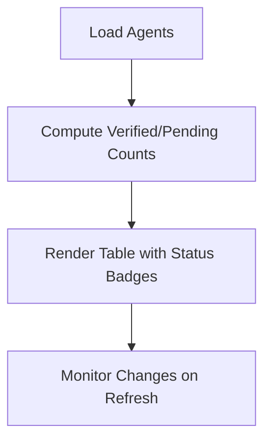

**Diagram sources**
- [AgencyDashboard.jsx:279-314](file://src/pages/AgencyDashboard.jsx#L279-L314)

**Section sources**
- [AgencyDashboard.jsx:279-314](file://src/pages/AgencyDashboard.jsx#L279-L314)

### Extending Agency Features and Integrating with External Systems
- Adding new fields to agency registration: extend form state and submission payload.
- Integrating third-party services:
  - WhatsApp: Agent card constructs WhatsApp URLs for verified agents and logs inquiries.
  - Google Sign-In: Agent registration supports Google OAuth flow.
- Admin integrations:
  - Payment approvals interface interacts with backend endpoints to approve/reject purchases.

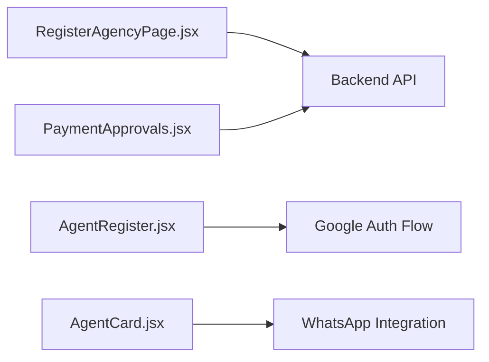

**Diagram sources**
- [RegisterAgencyPage.jsx:144-219](file://src/pages/RegisterAgencyPage.jsx#L144-L219)
- [AgentRegister.jsx:29-64](file://src/pages/AgentRegister.jsx#L29-L64)
- [AgentCard.jsx:18-37](file://src/components/AgentCard.jsx#L18-L37)
- [PaymentApprovals.jsx:21-60](file://axxspace-admin/src/components/PaymentApprovals.jsx#L21-L60)

**Section sources**
- [AgentCard.jsx:18-37](file://src/components/AgentCard.jsx#L18-L37)
- [AgentRegister.jsx:29-64](file://src/pages/AgentRegister.jsx#L29-L64)
- [PaymentApprovals.jsx:21-60](file://axxspace-admin/src/components/PaymentApprovals.jsx#L21-L60)

### Permission Structures and Access Control Mechanisms
- Route-level protection:
  - Agency dashboard requires role agency_admin
  - Agent dashboard requires role agent
- Context-based checks:
  - Redirect unauthorized users to appropriate login or home
- Token usage:
  - Authorization headers included in API requests

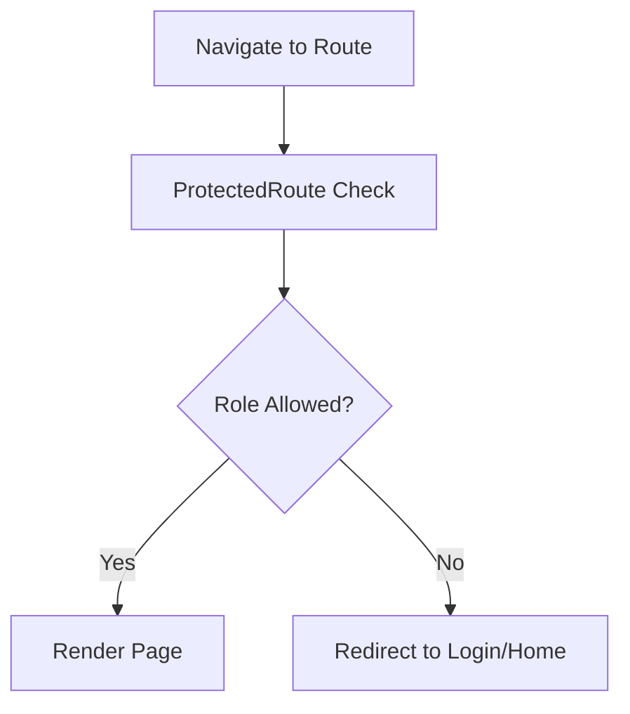

**Diagram sources**
- [App.jsx:233-252](file://src/App.jsx#L233-L252)
- [AgencyDashboard.jsx:185-191](file://src/pages/AgencyDashboard.jsx#L185-L191)
- [AgentDashboard.jsx:692-703](file://src/pages/AgentDashboard.jsx#L692-L703)

**Section sources**
- [App.jsx:233-252](file://src/App.jsx#L233-L252)
- [AgencyDashboard.jsx:185-191](file://src/pages/AgencyDashboard.jsx#L185-L191)
- [AgentDashboard.jsx:692-703](file://src/pages/AgentDashboard.jsx#L692-L703)

## Dependency Analysis
- Routing depends on React Router and defines protected routes for roles.
- Pages depend on:
  - Authentication context for user and token
  - API utilities or direct fetch calls
- Components depend on shared utilities for media links and messaging.

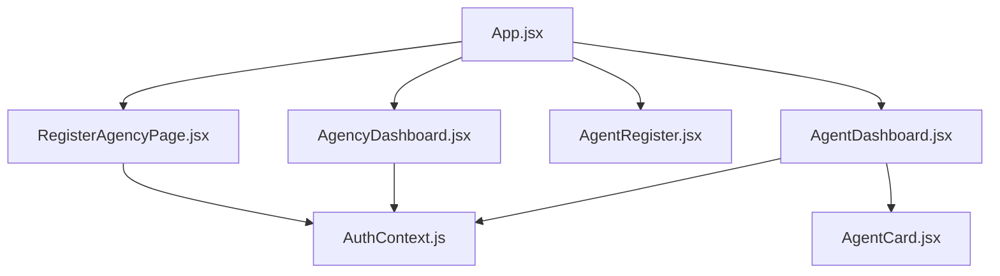

**Diagram sources**
- [App.jsx:220-260](file://src/App.jsx#L220-L260)
- [RegisterAgencyPage.jsx:1-5](file://src/pages/RegisterAgencyPage.jsx#L1-L5)
- [AgencyDashboard.jsx:1-5](file://src/pages/AgencyDashboard.jsx#L1-L5)
- [AgentRegister.jsx:1-7](file://src/pages/AgentRegister.jsx#L1-L7)
- [AgentDashboard.jsx:1-6](file://src/pages/AgentDashboard.jsx#L1-L6)
- [AgentCard.jsx:1-3](file://src/components/AgentCard.jsx#L1-L3)
- [AuthContext.js:1-20](file://axx-spaces-mobile/src/context/AuthContext.js#L1-L20)

**Section sources**
- [App.jsx:220-260](file://src/App.jsx#L220-L260)

## Performance Considerations
- Minimize unnecessary re-renders by memoizing derived data (e.g., filtered/sorted houses).
- Debounce search inputs and filters to reduce API calls.
- Use pagination for large agent lists and property grids.
- Limit polling frequency for package approvals; consider WebSocket or server-sent events for real-time updates.
- Cache static data like counties and packages where appropriate.

[No sources needed since this section provides general guidance]

## Troubleshooting Guide
- Agency registration fails:
  - Verify required fields are filled and user is logged in
  - Check network connectivity and API base URL configuration
- Cannot invite agents:
  - Ensure the target user exists and has role agent
  - Confirm agencyId is present in the authenticated user’s profile
- Package not updating after approval:
  - Verify polling interval and token validity
  - Check admin approval endpoint responses
- Unauthorized access:
  - Confirm user role matches route requirements
  - Ensure token is attached to requests

**Section sources**
- [RegisterAgencyPage.jsx:144-219](file://src/pages/RegisterAgencyPage.jsx#L144-L219)
- [AgencyDashboard.jsx:214-258](file://src/pages/AgencyDashboard.jsx#L214-L258)
- [AgentDashboard.jsx:705-721](file://src/pages/AgentDashboard.jsx#L705-L721)
- [PaymentApprovals.jsx:21-60](file://axxspace-admin/src/components/PaymentApprovals.jsx#L21-L60)

## Conclusion
The frontend implements a comprehensive agency administration experience:
- Streamlined agency registration with admin account creation
- Robust multi-agent coordination including invitation and removal
- Configurable resource allocation via packages and fees
- Clear permission controls and role-based routing
- Extensible architecture supporting integrations like WhatsApp and Google Sign-In

These capabilities provide a solid foundation for scaling agency operations and integrating additional services as needed.