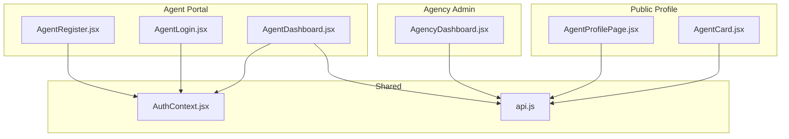
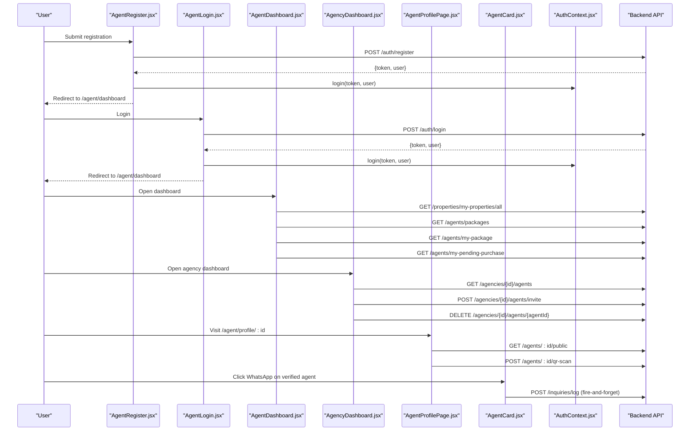
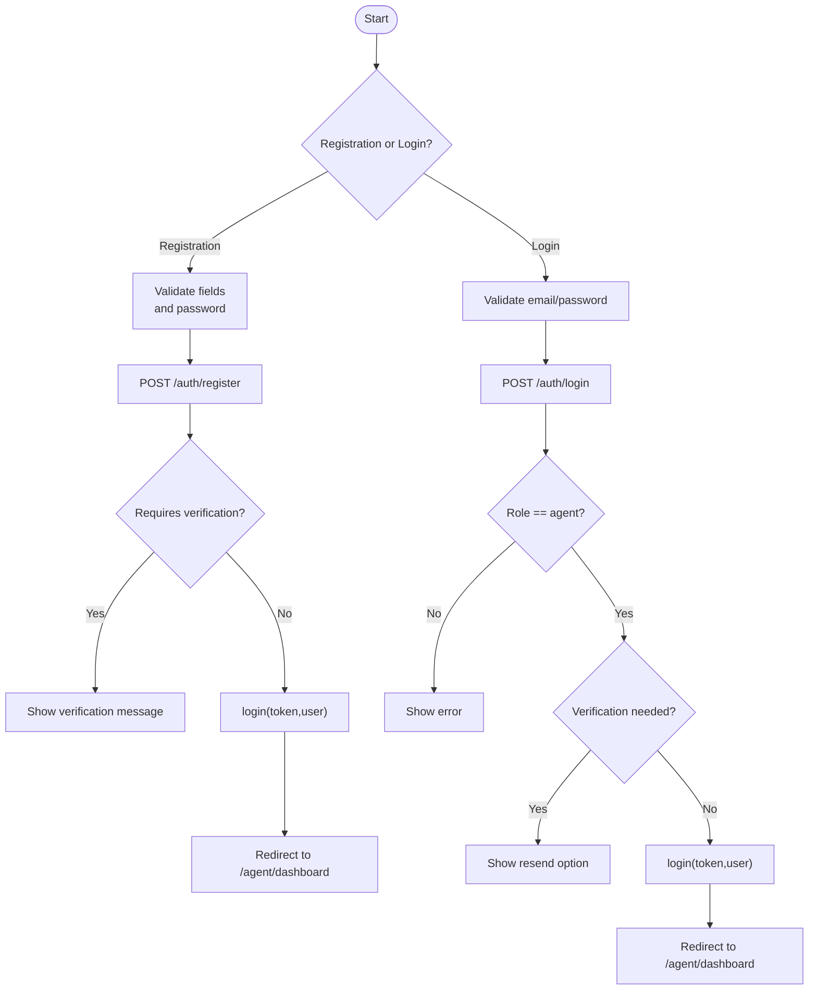
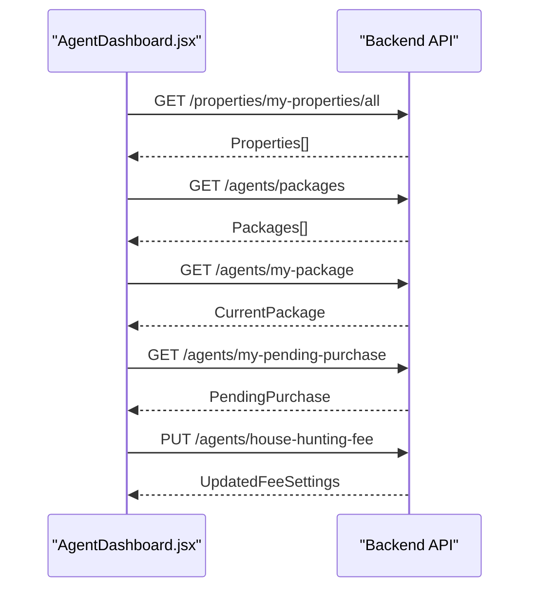
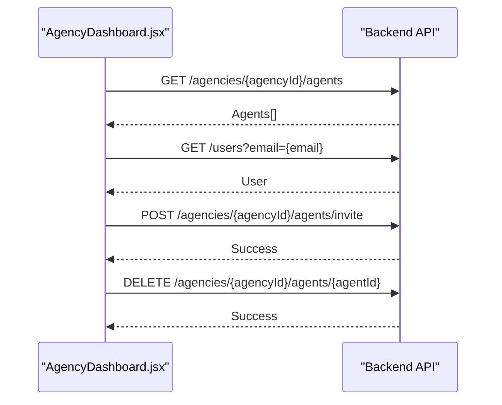
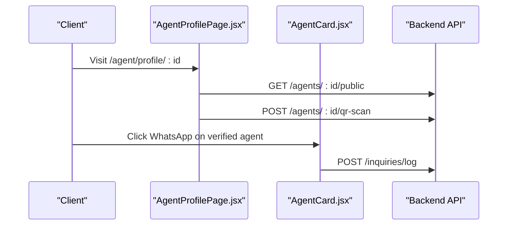
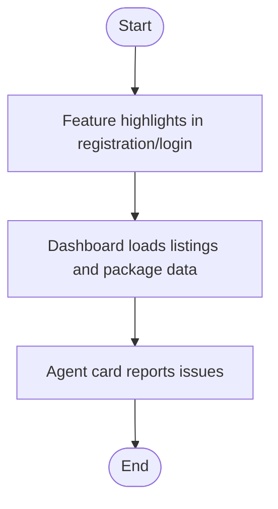
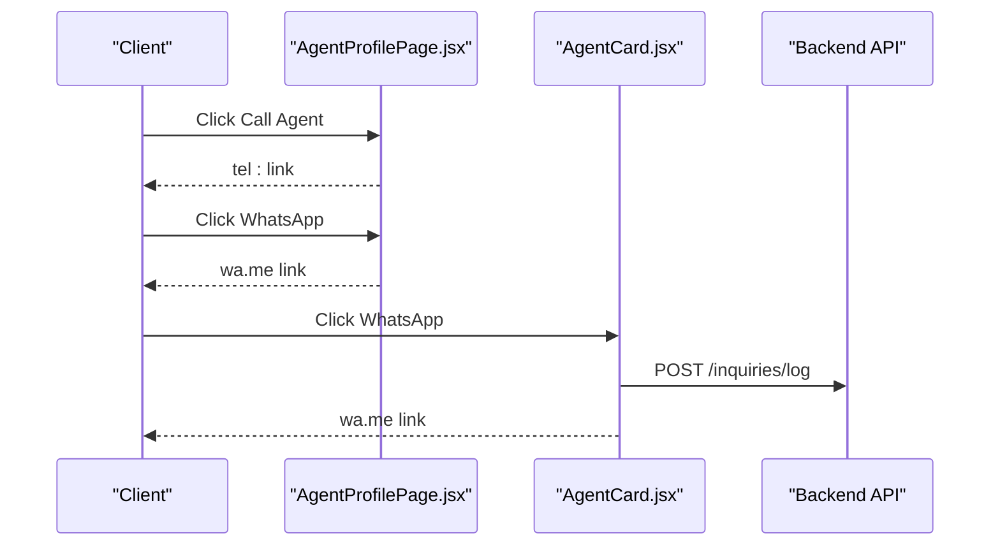
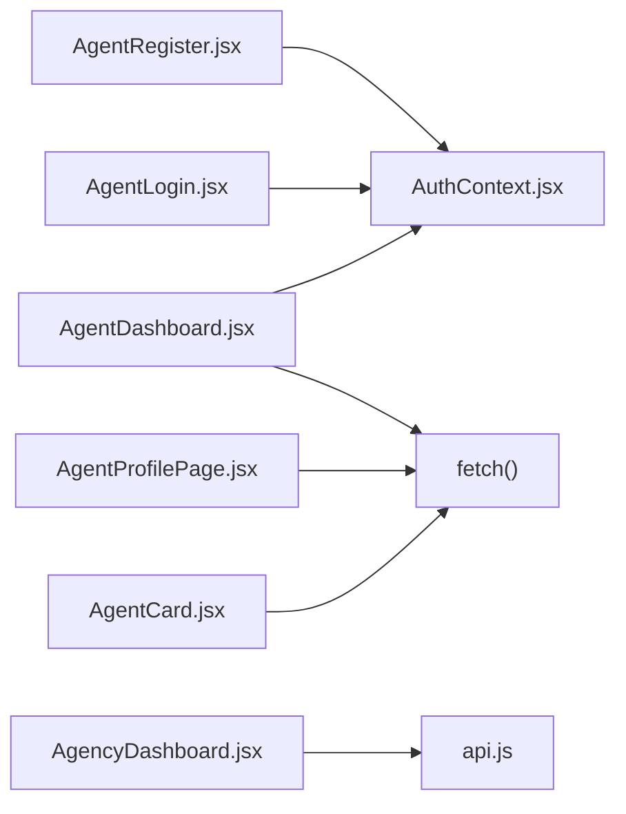

# Agent & Agency Management

<cite>
**Referenced Files in This Document**   
- [AgentRegister.jsx](file://src/pages/AgentRegister.jsx)
- [AgentLogin.jsx](file://src/pages/AgentLogin.jsx)
- [AgentDashboard.jsx](file://src/pages/AgentDashboard.jsx)
- [AgencyDashboard.jsx](file://src/pages/AgencyDashboard.jsx)
- [AgentProfilePage.jsx](file://src/pages/AgentProfilePage.jsx)
- [AgentCard.jsx](file://src/components/AgentCard.jsx)
- [AuthContext.jsx](file://src/context/AuthContext.jsx)
- [api.js](file://src/api/api.js)
</cite>

## Table of Contents
1. [Introduction](#introduction)
2. [Project Structure](#project-structure)
3. [Core Components](#core-components)
4. [Architecture Overview](#architecture-overview)
5. [Detailed Component Analysis](#detailed-component-analysis)
6. [Dependency Analysis](#dependency-analysis)
7. [Performance Considerations](#performance-considerations)
8. [Troubleshooting Guide](#troubleshooting-guide)
9. [Conclusion](#conclusion)
10. [Appendices](#appendices)

## Introduction
This document explains the agent and agency management features implemented in the frontend application. It covers:
- Agent registration, login, and profile management
- Agency administration tools for managing agents
- Client-facing agent profiles and communication channels
- Commission tracking signals and performance metrics exposed to agents
- Reporting and inquiry logging around agent interactions
- Examples of extending agent features and customizing the agency dashboard

The goal is to help both technical and non-technical users understand how these flows work end-to-end and where to extend or customize them.

## Project Structure
The agent and agency features are primarily implemented as React pages and components that call backend APIs. The key files are:
- Agent registration and login pages
- Agent dashboard with listings, packages, and house hunting fee settings
- Public agent profile page (QR-driven)
- Agency dashboard for admin-level agent management
- Reusable agent card component used across listing views

**Diagram sources**
- [AgentRegister.jsx:1-10](file://src/pages/AgentRegister.jsx#L1-L10)
- [AgentLogin.jsx:1-10](file://src/pages/AgentLogin.jsx#L1-L10)
- [AgentDashboard.jsx:1-10](file://src/pages/AgentDashboard.jsx#L1-L10)
- [AgencyDashboard.jsx:1-10](file://src/pages/AgencyDashboard.jsx#L1-L10)
- [AgentProfilePage.jsx:1-10](file://src/pages/AgentProfilePage.jsx#L1-L10)
- [AgentCard.jsx:1-10](file://src/components/AgentCard.jsx#L1-L10)
- [AuthContext.jsx](file://src/context/AuthContext.jsx)
- [api.js](file://src/api/api.js)

**Section sources**
- [AgentRegister.jsx:1-10](file://src/pages/AgentRegister.jsx#L1-L10)
- [AgentLogin.jsx:1-10](file://src/pages/AgentLogin.jsx#L1-L10)
- [AgentDashboard.jsx:1-10](file://src/pages/AgentDashboard.jsx#L1-L10)
- [AgencyDashboard.jsx:1-10](file://src/pages/AgencyDashboard.jsx#L1-L10)
- [AgentProfilePage.jsx:1-10](file://src/pages/AgentProfilePage.jsx#L1-L10)
- [AgentCard.jsx:1-10](file://src/components/AgentCard.jsx#L1-L10)

## Core Components
- Agent registration form collects name, email, phone, county, bio, and password; supports Google sign-up and redirects to the agent dashboard upon success.
- Agent login supports email/password, Google sign-in, verification resend, and forgot password flows.
- Agent dashboard provides:
  - Property listing management
  - Package subscription management
  - House hunting fee configuration
  - QR poster generation for public profile discovery
- Agency dashboard allows an agency admin to list, invite, and remove agents under their agency.
- Public agent profile page displays verified status, contact options, and active listings.
- Agent card shows agent details, WhatsApp contact (for verified agents), and a reporting flow.

**Section sources**
- [AgentRegister.jsx:15-145](file://src/pages/AgentRegister.jsx#L15-L145)
- [AgentLogin.jsx:13-173](file://src/pages/AgentLogin.jsx#L13-L173)
- [AgentDashboard.jsx:488-800](file://src/pages/AgentDashboard.jsx#L488-L800)
- [AgencyDashboard.jsx:174-278](file://src/pages/AgencyDashboard.jsx#L174-L278)
- [AgentProfilePage.jsx:13-59](file://src/pages/AgentProfilePage.jsx#L13-L59)
- [AgentCard.jsx:5-75](file://src/components/AgentCard.jsx#L5-L75)

## Architecture Overview
The system follows a client-side React architecture communicating with a REST backend. Authentication state is centralized via AuthContext. Pages use either direct fetch calls or a shared API client.

**Diagram sources**
- [AgentRegister.jsx:36-56](file://src/pages/AgentRegister.jsx#L36-L56)
- [AgentLogin.jsx:37-55](file://src/pages/AgentLogin.jsx#L37-L55)
- [AgentDashboard.jsx:723-800](file://src/pages/AgentDashboard.jsx#L723-L800)
- [AgencyDashboard.jsx:193-278](file://src/pages/AgencyDashboard.jsx#L193-L278)
- [AgentProfilePage.jsx:20-32](file://src/pages/AgentProfilePage.jsx#L20-L32)
- [AgentCard.jsx:23-37](file://src/components/AgentCard.jsx#L23-L37)
- [AuthContext.jsx](file://src/context/AuthContext.jsx)

## Detailed Component Analysis

### Agent Registration and Login
- Registration:
  - Collects required fields and validates password strength.
  - Supports Google sign-up by posting credentials with role "agent".
  - Handles verification-required responses and auto-login when not required.
- Login:
  - Validates inputs, handles verification resend, and forgot password.
  - Enforces role check to ensure only agents access the agent portal.
  - Integrates Google sign-in and redirects to the agent dashboard.

**Diagram sources**
- [AgentRegister.jsx:75-145](file://src/pages/AgentRegister.jsx#L75-L145)
- [AgentLogin.jsx:74-173](file://src/pages/AgentLogin.jsx#L74-L173)

**Section sources**
- [AgentRegister.jsx:75-145](file://src/pages/AgentRegister.jsx#L75-L145)
- [AgentLogin.jsx:74-173](file://src/pages/AgentLogin.jsx#L74-L173)

### Agent Dashboard
Key responsibilities:
- Load and manage properties owned by the agent
- Manage package subscriptions and pending purchases
- Configure house hunting fees and terms
- Generate QR posters for public profile discovery
- Provide search, filter, sort, and delete actions for listings

Important flows:
- Data loading:
  - Fetches all properties for the agent
  - Loads available packages, current package, and pending purchase status
- Package polling:
  - Periodically checks for package upgrades and updates context accordingly
- House hunting fee update:
  - Submits updated fee, terms, and availability flag

**Diagram sources**
- [AgentDashboard.jsx:723-800](file://src/pages/AgentDashboard.jsx#L723-L800)
- [AgentDashboard.jsx:558-594](file://src/pages/AgentDashboard.jsx#L558-L594)

**Section sources**
- [AgentDashboard.jsx:488-800](file://src/pages/AgentDashboard.jsx#L488-L800)

### Agency Administration Tools
Responsibilities:
- Restrict access to agency admins
- List agents under the agency
- Invite existing registered agents to join the agency
- Remove agents from the agency

**Diagram sources**
- [AgencyDashboard.jsx:193-278](file://src/pages/AgencyDashboard.jsx#L193-L278)

**Section sources**
- [AgencyDashboard.jsx:174-278](file://src/pages/AgencyDashboard.jsx#L174-L278)

### Client Portfolio and Agent-Client Relationship Management
- Public agent profile:
  - Displays agent identity, verification status, bio, and active listings
  - Provides call and WhatsApp contact buttons
  - Tracks QR scans for analytics
- Agent card:
  - Shows agent details and verification status
  - Enables WhatsApp contact for verified agents
  - Logs inquiries when a user clicks WhatsApp from a listing

**Diagram sources**
- [AgentProfilePage.jsx:20-32](file://src/pages/AgentProfilePage.jsx#L20-L32)
- [AgentCard.jsx:23-37](file://src/components/AgentCard.jsx#L23-L37)

**Section sources**
- [AgentProfilePage.jsx:13-59](file://src/pages/AgentProfilePage.jsx#L13-L59)
- [AgentCard.jsx:5-75](file://src/components/AgentCard.jsx#L5-L75)

### Commission Tracking, Performance Metrics, and Reporting
- Commission tracking:
  - The agent registration page highlights automated commission tracking as a feature.
  - The agent login page emphasizes fast commission tracking and digital record keeping.
  - Actual transactional endpoints are not present in the analyzed frontend files; integration likely occurs via backend services.
- Performance metrics:
  - The agent dashboard exposes package tiers and pending purchase status, which can be used to infer service levels and capabilities.
  - Listing counts and view counts are part of property data loaded by the dashboard.
- Reporting:
  - The agent card includes a report submission flow for issues like fake listings or payment requests before viewing.

**Diagram sources**
- [AgentRegister.jsx:147-186](file://src/pages/AgentRegister.jsx#L147-L186)
- [AgentLogin.jsx:175-214](file://src/pages/AgentLogin.jsx#L175-L214)
- [AgentDashboard.jsx:723-800](file://src/pages/AgentDashboard.jsx#L723-L800)
- [AgentCard.jsx:39-75](file://src/components/AgentCard.jsx#L39-L75)

**Section sources**
- [AgentRegister.jsx:147-186](file://src/pages/AgentRegister.jsx#L147-L186)
- [AgentLogin.jsx:175-214](file://src/pages/AgentLogin.jsx#L175-L214)
- [AgentDashboard.jsx:723-800](file://src/pages/AgentDashboard.jsx#L723-L800)
- [AgentCard.jsx:39-75](file://src/components/AgentCard.jsx#L39-L75)

### Communication Tools
- WhatsApp integration:
  - Verified agents expose WhatsApp links from both the public profile and agent card.
  - Inquiry logging is performed when users initiate WhatsApp contact from a listing.
- Call integration:
  - Public profile offers a direct call button using the agent’s phone number.

**Diagram sources**
- [AgentProfilePage.jsx:155-200](file://src/pages/AgentProfilePage.jsx#L155-L200)
- [AgentCard.jsx:18-37](file://src/components/AgentCard.jsx#L18-L37)

**Section sources**
- [AgentProfilePage.jsx:155-200](file://src/pages/AgentProfilePage.jsx#L155-L200)
- [AgentCard.jsx:18-37](file://src/components/AgentCard.jsx#L18-L37)

### Extending Agent Features and Customizing the Agency Dashboard
Examples of extension points:
- Add new tabs or sections to the agent dashboard:
  - Integrate additional endpoints for analytics, messages, or transactions.
  - Use existing toast notifications and modal patterns for consistent UX.
- Customize the agency dashboard:
  - Extend the agents table with more columns (e.g., performance metrics).
  - Add bulk operations (invite multiple agents, export lists).
  - Implement approval workflows for agent verification.

Implementation guidance:
- Follow the existing patterns for fetching data and handling errors.
- Use AuthContext to enforce role-based access.
- Leverage the shared styles and layout conventions already defined in each file.

[No sources needed since this section provides general guidance]

## Dependency Analysis
- Authentication:
  - Both registration and login rely on AuthContext to store token and user.
- API usage:
  - Some pages use direct fetch calls; the agency dashboard uses a shared API client.
- External integrations:
  - Google sign-in hook is used in registration and login.
  - WhatsApp utility functions generate contact links.

**Diagram sources**
- [AgentRegister.jsx:1-10](file://src/pages/AgentRegister.jsx#L1-L10)
- [AgentLogin.jsx:1-10](file://src/pages/AgentLogin.jsx#L1-L10)
- [AgentDashboard.jsx:1-10](file://src/pages/AgentDashboard.jsx#L1-L10)
- [AgencyDashboard.jsx:1-10](file://src/pages/AgencyDashboard.jsx#L1-L10)
- [AgentProfilePage.jsx:1-10](file://src/pages/AgentProfilePage.jsx#L1-L10)
- [AgentCard.jsx:1-10](file://src/components/AgentCard.jsx#L1-L10)

**Section sources**
- [AgentRegister.jsx:1-10](file://src/pages/AgentRegister.jsx#L1-L10)
- [AgentLogin.jsx:1-10](file://src/pages/AgentLogin.jsx#L1-L10)
- [AgentDashboard.jsx:1-10](file://src/pages/AgentDashboard.jsx#L1-L10)
- [AgencyDashboard.jsx:1-10](file://src/pages/AgencyDashboard.jsx#L1-L10)
- [AgentProfilePage.jsx:1-10](file://src/pages/AgentProfilePage.jsx#L1-L10)
- [AgentCard.jsx:1-10](file://src/components/AgentCard.jsx#L1-L10)

## Performance Considerations
- Avoid excessive polling:
  - The agent dashboard polls package status at intervals; ensure intervals are reasonable to reduce server load.
- Optimize image loading:
  - Use lazy loading and fallbacks for agent photos and listing images.
- Minimize network calls:
  - Batch data retrieval where possible and cache static data like counties and packages.
- Debounce user inputs:
  - For search and filters in dashboards, debounce to prevent unnecessary re-renders.

[No sources needed since this section provides general guidance]

## Troubleshooting Guide
Common issues and resolutions:
- Registration fails:
  - Check password requirements and required fields.
  - Handle verification-required responses and guide users to verify email.
- Login fails:
  - Ensure correct credentials and role.
  - Use resend verification if prompted.
- Agency dashboard shows no agents:
  - Confirm the logged-in user has an associated agency ID.
  - Verify API permissions and endpoint availability.
- WhatsApp contact not visible:
  - Ensure the agent is verified and has a phone number set.
- Report submission errors:
  - Validate reason and reporter contact fields before submitting.

**Section sources**
- [AgentRegister.jsx:75-145](file://src/pages/AgentRegister.jsx#L75-L145)
- [AgentLogin.jsx:74-173](file://src/pages/AgentLogin.jsx#L74-L173)
- [AgencyDashboard.jsx:193-278](file://src/pages/AgencyDashboard.jsx#L193-L278)
- [AgentCard.jsx:39-75](file://src/components/AgentCard.jsx#L39-L75)

## Conclusion
The agent and agency management features provide a comprehensive foundation for onboarding agents, managing their profiles and listings, enabling client communication, and offering agency-level administration. While commission tracking and transaction history are highlighted as platform features, the frontend implementation focuses on UI flows and integration points. Extensions can build upon existing patterns to add advanced analytics, messaging, and financial modules.

[No sources needed since this section summarizes without analyzing specific files]

## Appendices
- Example extension ideas:
  - Add a dedicated transactions tab in the agent dashboard to display commissions and payouts.
  - Introduce an internal messaging system between agents and clients.
  - Enhance the agency dashboard with performance charts and agent leaderboards.

[No sources needed since this section provides general guidance]