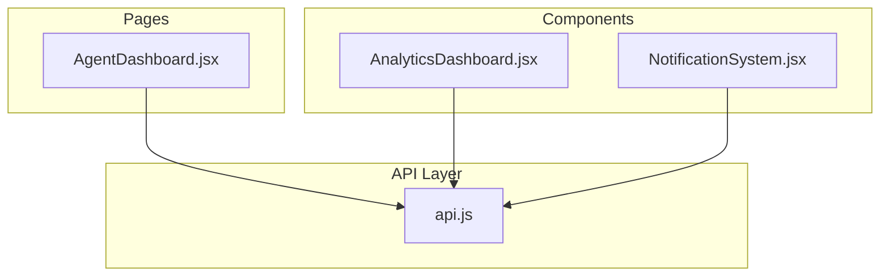
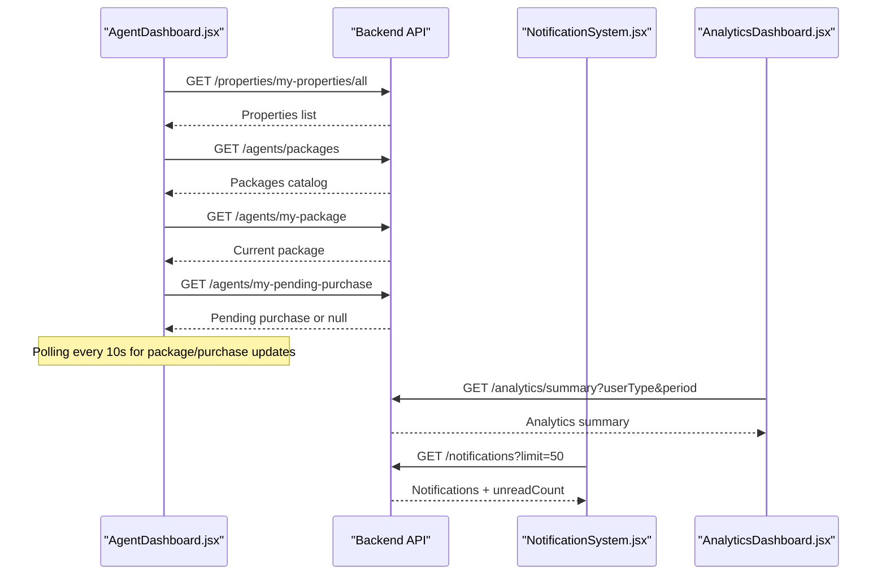
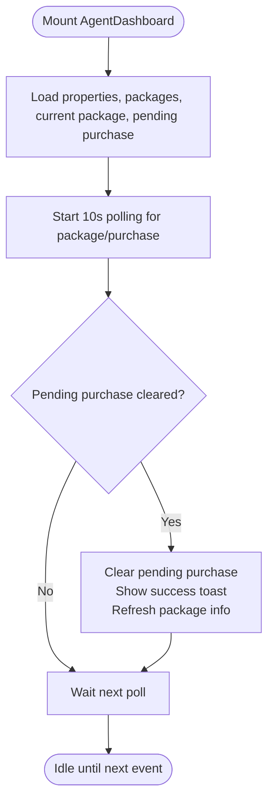
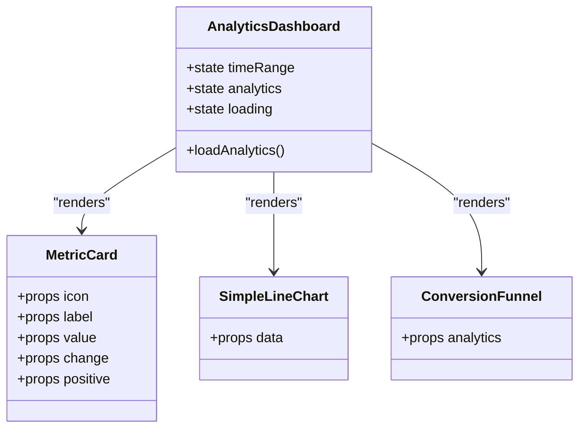
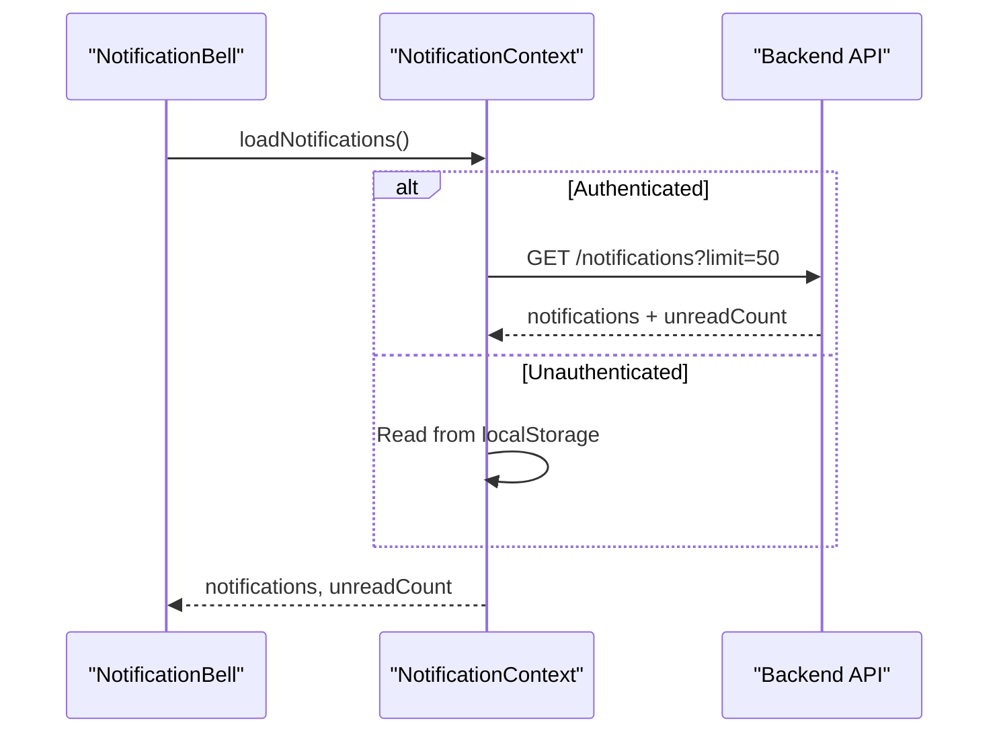
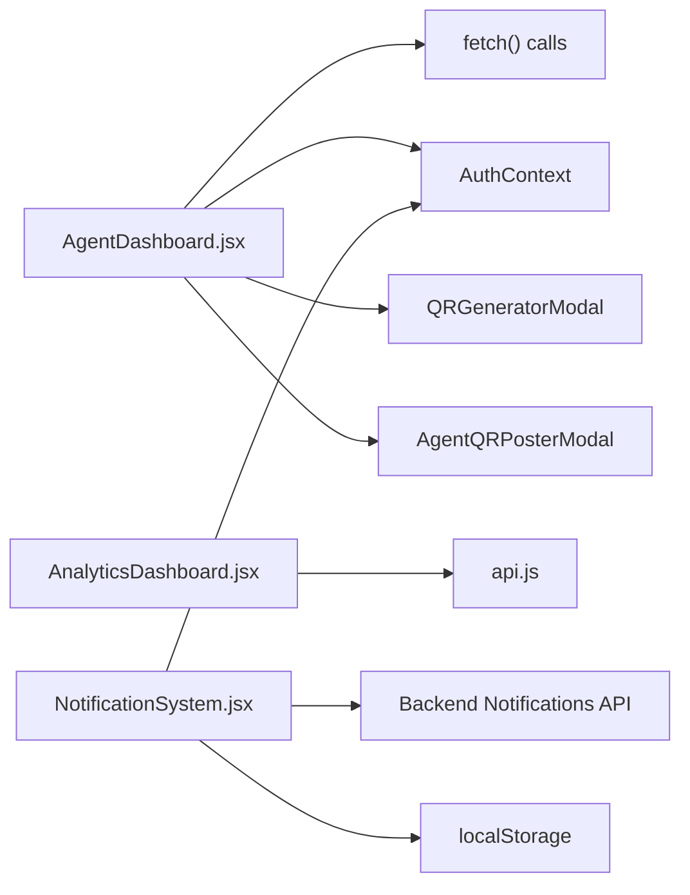

# Agent Dashboard & Analytics

<cite>
**Referenced Files in This Document**   
- [AgentDashboard.jsx](file://src/pages/AgentDashboard.jsx)
- [AnalyticsDashboard.jsx](file://src/components/AnalyticsDashboard.jsx)
- [NotificationSystem.jsx](file://src/components/NotificationSystem.jsx)
- [api.js](file://src/api/api.js)
</cite>

## Table of Contents
1. [Introduction](#introduction)
2. [Project Structure](#project-structure)
3. [Core Components](#core-components)
4. [Architecture Overview](#architecture-overview)
5. [Detailed Component Analysis](#detailed-component-analysis)
6. [Dependency Analysis](#dependency-analysis)
7. [Performance Considerations](#performance-considerations)
8. [Troubleshooting Guide](#troubleshooting-guide)
9. [Conclusion](#conclusion)
10. [Appendices](#appendices)

## Introduction
This document explains the agent dashboard interface and analytics features, focusing on:
- Performance metrics display
- Property listing statistics
- Client interaction tracking
- Chart visualizations
- Data filtering options
- Export capabilities (current state and recommendations)
- Adding new analytics widgets
- Customizing dashboard layouts
- Real-time data updates and notifications
- Performance optimization for large datasets

The documentation is grounded in the frontend codebase and provides actionable guidance for developers and product owners.

## Project Structure
Key files involved in the agent dashboard and analytics:
- Agent dashboard page with property management, stats, and package flows
- Analytics dashboard component with time-range selection, charts, and KPIs
- Notification system with server-backed and local fallback
- Central API client configuration

**Diagram sources**
- [AgentDashboard.jsx:1-10](file://src/pages/AgentDashboard.jsx#L1-L10)
- [AnalyticsDashboard.jsx:1-10](file://src/components/AnalyticsDashboard.jsx#L1-L10)
- [NotificationSystem.jsx:1-10](file://src/components/NotificationSystem.jsx#L1-L10)
- [api.js:1-10](file://src/api/api.js#L1-L10)

**Section sources**
- [AgentDashboard.jsx:1-10](file://src/pages/AgentDashboard.jsx#L1-L10)
- [AnalyticsDashboard.jsx:1-10](file://src/components/AnalyticsDashboard.jsx#L1-L10)
- [NotificationSystem.jsx:1-10](file://src/components/NotificationSystem.jsx#L1-L10)
- [api.js:1-10](file://src/api/api.js#L1-L10)

## Core Components
- AgentDashboard.jsx: Main agent-facing dashboard with profile overview, property listings, search/filter/sort, QR poster generation, house hunting fee configuration, and package purchase flow. It also includes a toast notification system and periodic polling for package status.
- AnalyticsDashboard.jsx: Reusable analytics widget showing key metrics, performance over time chart, conversion funnel, and additional metrics per user type. Supports time range selection (7d, 30d, 90d).
- NotificationSystem.jsx: Context-based notification UI with server synchronization and local fallback, including read/unread states and bulk actions.
- api.js: Axios instance with base URL, timeout, and request/response interceptors for authentication and debugging.

**Section sources**
- [AgentDashboard.jsx:488-703](file://src/pages/AgentDashboard.jsx#L488-L703)
- [AnalyticsDashboard.jsx:4-28](file://src/components/AnalyticsDashboard.jsx#L4-L28)
- [NotificationSystem.jsx:19-59](file://src/components/NotificationSystem.jsx#L19-L59)
- [api.js:1-47](file://src/api/api.js#L1-L47)

## Architecture Overview
High-level interactions:
- The agent dashboard fetches properties and package data from backend endpoints using direct fetch calls.
- The analytics dashboard uses the centralized API client to load summary analytics by user type and period.
- Notifications are loaded via REST endpoints when authenticated; otherwise, they fall back to localStorage.
- Package upgrades use polling to detect admin approval and update UI without reload.

**Diagram sources**
- [AgentDashboard.jsx:723-831](file://src/pages/AgentDashboard.jsx#L723-L831)
- [AnalyticsDashboard.jsx:13-28](file://src/components/AnalyticsDashboard.jsx#L13-L28)
- [NotificationSystem.jsx:25-55](file://src/components/NotificationSystem.jsx#L25-L55)

## Detailed Component Analysis

### AgentDashboard.jsx
Responsibilities:
- Profile section with completeness indicator and avatar upload
- Stats overview: total listings, views, QR scans, and house hunting fee status
- Property listing grid with search, filter, sort, and delete
- QR poster generation per property and agent-wide QR poster modal
- House hunting fee configuration with live preview
- Package selection, payment instructions, pending purchase handling, and upgrade detection

Key behaviors:
- Data loading:
  - Fetches my properties and packages on mount
  - Periodically polls package and pending purchase status
- Filtering and sorting:
  - Search by title/location/county
  - Filter by status (all/approved/pending/rejected)
  - Sort by newest, price high/low, views
- Toast notifications:
  - Success/error/info toasts with auto-dismiss
- Profile picture upload:
  - Validates file type and size, uploads via PATCH /profile, updates context

Real-time updates:
- Polling interval checks for package approval and clears pending purchase state when approved, updating UI and refreshing package info.

**Diagram sources**
- [AgentDashboard.jsx:705-831](file://src/pages/AgentDashboard.jsx#L705-L831)

Property listing statistics:
- Displays per-property views and QR scans
- Aggregates totals across all properties in the stats bar

Client interaction tracking:
- Views and QR scans are surfaced per property card and in aggregate stats

Filtering and sorting:
- Implemented in-memory on the fetched dataset

Export capabilities:
- No built-in export functionality found in this component

Adding analytics widgets:
- Integrate AnalyticsDashboard.jsx into the agent dashboard layout and pass userType="agent" if supported by the backend endpoint

Customizing dashboard layouts:
- Modify the tab structure and sections within AgentDashboard.jsx to add new tabs or reorder existing ones

Performance considerations:
- In-memory filtering/sorting can be optimized with pagination or virtualization for large datasets
- Debounce search input to reduce re-renders
- Consider server-side filtering/sorting for scalability

**Section sources**
- [AgentDashboard.jsx:488-703](file://src/pages/AgentDashboard.jsx#L488-L703)
- [AgentDashboard.jsx:723-831](file://src/pages/AgentDashboard.jsx#L723-L831)
- [AgentDashboard.jsx:1470-1710](file://src/pages/AgentDashboard.jsx#L1470-L1710)
- [AgentDashboard.jsx:1713-1968](file://src/pages/AgentDashboard.jsx#L1713-L1968)
- [AgentDashboard.jsx:2205-2399](file://src/pages/AgentDashboard.jsx#L2205-L2399)

### AnalyticsDashboard.jsx
Responsibilities:
- Fetch analytics summary by user type and time range
- Display KPI cards (views, inquiries, bookings/jobs, revenue)
- Render a simple line chart for performance over time
- Show a conversion funnel (views → inquiries → bookings)
- Additional metrics based on user type (landlord/mover/seller)

Time range selection:
- Buttons for 7 days, 30 days, 90 days trigger refetch

Charts:
- SimpleLineChart renders bars with hover tooltips
- ConversionFunnel shows step-wise drop-offs

Baseline data:
- If API fails or returns no data, baseline analytics are used per user type

**Diagram sources**
- [AnalyticsDashboard.jsx:4-28](file://src/components/AnalyticsDashboard.jsx#L4-L28)
- [AnalyticsDashboard.jsx:220-316](file://src/components/AnalyticsDashboard.jsx#L220-L316)

**Section sources**
- [AnalyticsDashboard.jsx:4-28](file://src/components/AnalyticsDashboard.jsx#L4-L28)
- [AnalyticsDashboard.jsx:30-65](file://src/components/AnalyticsDashboard.jsx#L30-L65)
- [AnalyticsDashboard.jsx:102-218](file://src/components/AnalyticsDashboard.jsx#L102-L218)
- [AnalyticsDashboard.jsx:233-369](file://src/components/AnalyticsDashboard.jsx#L233-L369)

### NotificationSystem.jsx
Responsibilities:
- Provide global notification state via React context
- Load notifications from server when authenticated; fallback to localStorage
- Support mark-as-read, mark-all-as-read, delete, and clear operations
- Render a bell icon with unread badge and dropdown list

Real-time behavior:
- Uses REST polling via useEffect to refresh notifications on mount
- Local storage persistence for offline or unauthenticated scenarios

**Diagram sources**
- [NotificationSystem.jsx:19-59](file://src/components/NotificationSystem.jsx#L19-L59)
- [NotificationSystem.jsx:161-291](file://src/components/NotificationSystem.jsx#L161-L291)

**Section sources**
- [NotificationSystem.jsx:19-59](file://src/components/NotificationSystem.jsx#L19-L59)
- [NotificationSystem.jsx:61-159](file://src/components/NotificationSystem.jsx#L61-L159)
- [NotificationSystem.jsx:161-291](file://src/components/NotificationSystem.jsx#L161-L291)

### API Configuration (api.js)
- Axios instance with configurable base URL and timeout
- Request interceptor attaches Authorization header from localStorage
- Response interceptor logs requests/responses and errors for debugging

**Section sources**
- [api.js:1-47](file://src/api/api.js#L1-L47)

## Dependency Analysis
- AgentDashboard.jsx depends on:
  - Direct fetch calls to backend endpoints for properties, packages, and pending purchases
  - AuthContext for user/token and updateUser
  - Utility functions for media URLs
  - Modal components for QR generation and agent QR poster
- AnalyticsDashboard.jsx depends on:
  - Centralized API client for analytics summary
- NotificationSystem.jsx depends on:
  - AuthContext for token presence
  - Backend notifications endpoints
  - LocalStorage for fallback

**Diagram sources**
- [AgentDashboard.jsx:1-10](file://src/pages/AgentDashboard.jsx#L1-L10)
- [AnalyticsDashboard.jsx:1-5](file://src/components/AnalyticsDashboard.jsx#L1-L5)
- [NotificationSystem.jsx:1-5](file://src/components/NotificationSystem.jsx#L1-L5)
- [api.js:1-10](file://src/api/api.js#L1-L10)

**Section sources**
- [AgentDashboard.jsx:1-10](file://src/pages/AgentDashboard.jsx#L1-L10)
- [AnalyticsDashboard.jsx:1-5](file://src/components/AnalyticsDashboard.jsx#L1-L5)
- [NotificationSystem.jsx:1-5](file://src/components/NotificationSystem.jsx#L1-L5)
- [api.js:1-10](file://src/api/api.js#L1-L10)

## Performance Considerations
- Large datasets:
  - Implement server-side pagination and filtering for properties and analytics
  - Use virtualization for long lists of properties
- Rendering:
  - Debounce search input to avoid excessive re-renders
  - Memoize computed values like filteredAndSortedHouses where appropriate
- Network:
  - Cache analytics summaries with stale-while-revalidate strategy
  - Reduce polling frequency if needed; consider WebSocket for real-time updates
- Charts:
  - Use canvas-based chart libraries for large datasets
  - Limit data points per time range and aggregate as needed

[No sources needed since this section provides general guidance]

## Troubleshooting Guide
Common issues and resolutions:
- Analytics not loading:
  - Verify API endpoint availability and response shape
  - Check network errors in console; ensure baseURL is correct
- Notifications not updating:
  - Confirm authentication token presence
  - Validate server endpoints for notifications
- Package approval not reflected:
  - Ensure polling is active and flags are correctly managed
  - Check that loadMyPackage and loadPendingPurchase are called after approval

**Section sources**
- [AnalyticsDashboard.jsx:13-28](file://src/components/AnalyticsDashboard.jsx#L13-L28)
- [NotificationSystem.jsx:25-55](file://src/components/NotificationSystem.jsx#L25-L55)
- [AgentDashboard.jsx:705-831](file://src/pages/AgentDashboard.jsx#L705-L831)

## Conclusion
The agent dashboard provides a comprehensive interface for managing property listings, viewing performance metrics, configuring services, and handling package upgrades. The analytics dashboard offers flexible time-range analysis and visualization. Notifications integrate with both server and local storage for resilience. For production-scale usage, prioritize server-side filtering/pagination, virtualization, caching, and consider real-time channels for instant updates.

[No sources needed since this section summarizes without analyzing specific files]

## Appendices

### Examples: Adding New Analytics Widgets
- Create a new widget component under src/components
- Integrate it into AnalyticsDashboard.jsx by adding a new metric card or chart section
- Extend getBaselineAnalytics to include default values for the new metric
- Ensure the backend analytics summary endpoint supports the new fields

**Section sources**
- [AnalyticsDashboard.jsx:30-65](file://src/components/AnalyticsDashboard.jsx#L30-L65)
- [AnalyticsDashboard.jsx:102-218](file://src/components/AnalyticsDashboard.jsx#L102-L218)

### Examples: Customizing Dashboard Layouts
- Add new tabs in AgentDashboard.jsx to group related features
- Reorder sections within the main container to prioritize important metrics
- Integrate AnalyticsDashboard.jsx into the agent dashboard for unified analytics view

**Section sources**
- [AgentDashboard.jsx:1455-1468](file://src/pages/AgentDashboard.jsx#L1455-L1468)
- [AgentDashboard.jsx:1192-1337](file://src/pages/AgentDashboard.jsx#L1192-L1337)

### Real-Time Data Updates and Notifications
- Replace polling with WebSocket for package approvals and analytics updates
- Integrate NotificationBell into the agent dashboard header for consistent UX
- Persist unread counts and timestamps server-side for reliability

**Section sources**
- [AgentDashboard.jsx:705-831](file://src/pages/AgentDashboard.jsx#L705-L831)
- [NotificationSystem.jsx:161-291](file://src/components/NotificationSystem.jsx#L161-L291)