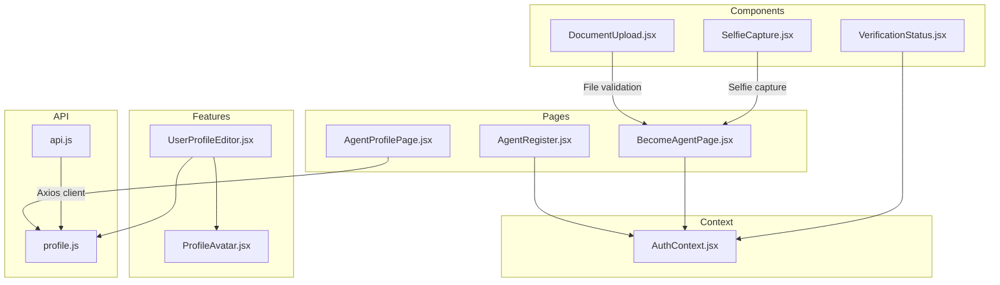
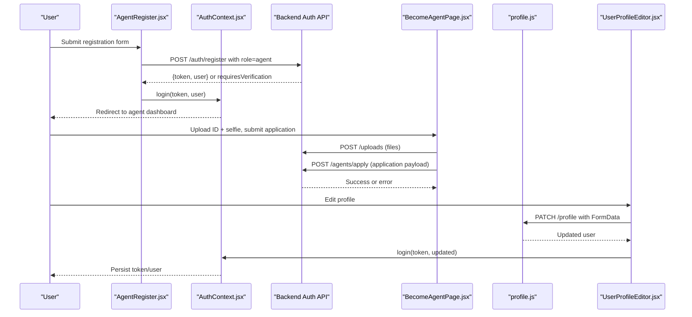
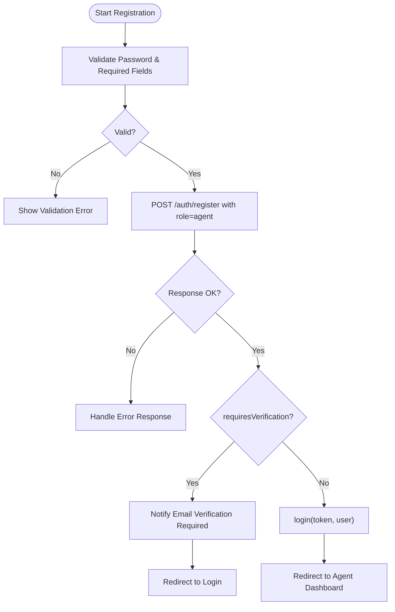
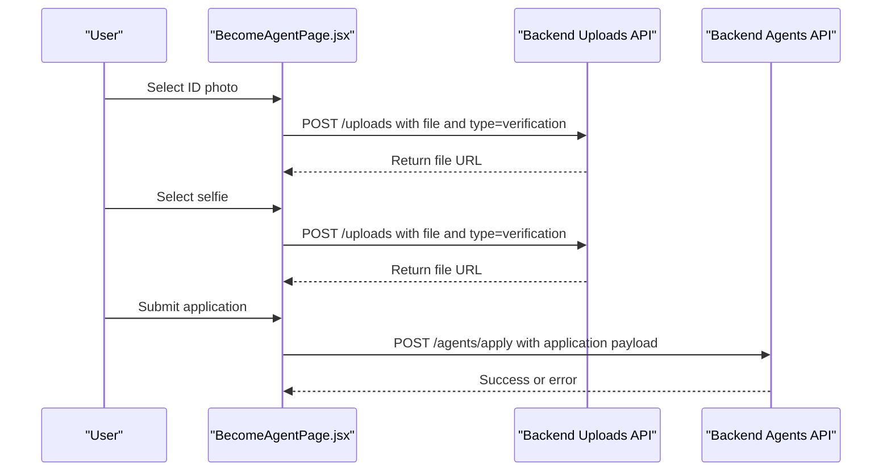
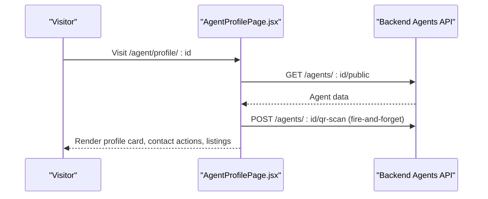
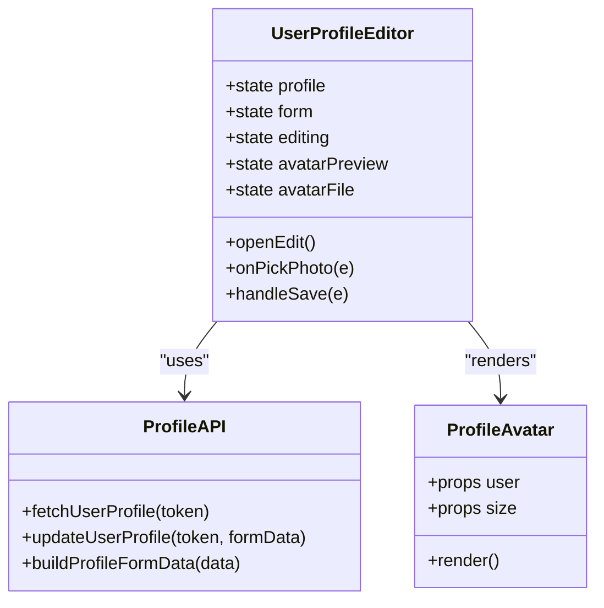
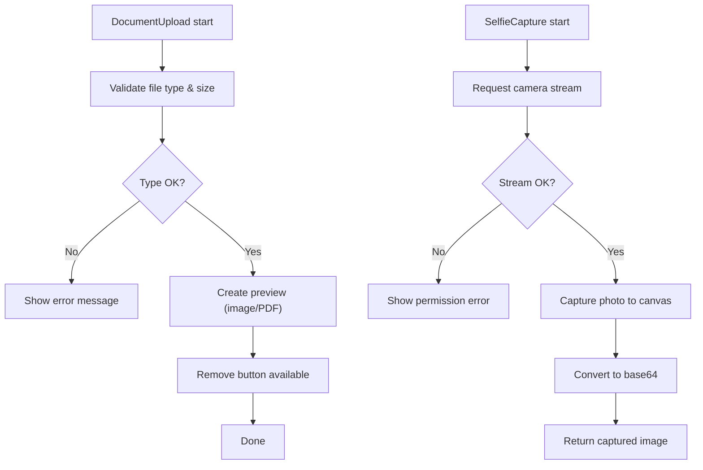
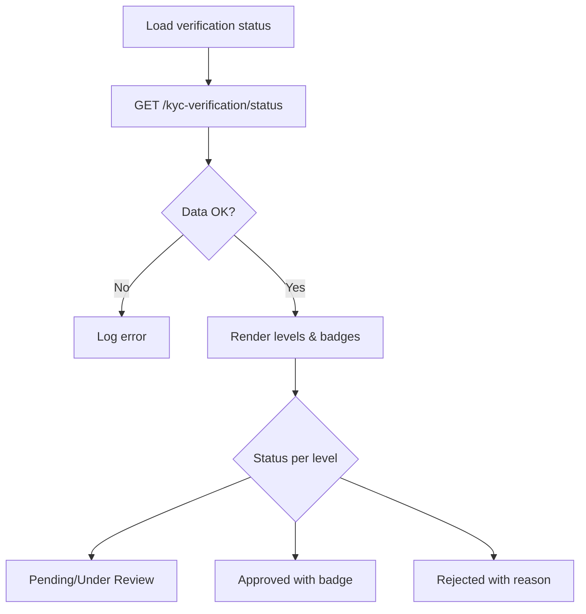
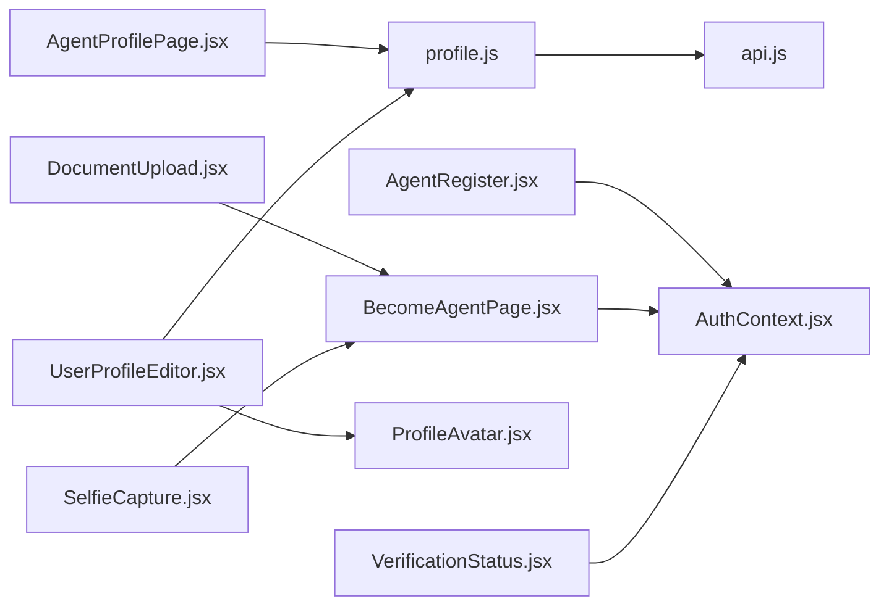

# Agent Registration & Profile Management

<cite>
**Referenced Files in This Document**
- [AgentRegister.jsx](file://src/pages/AgentRegister.jsx)
- [BecomeAgentPage.jsx](file://src/pages/BecomeAgentPage.jsx)
- [AgentProfilePage.jsx](file://src/pages/AgentProfilePage.jsx)
- [UserProfileEditor.jsx](file://src/features/profile/UserProfileEditor.jsx)
- [ProfileAvatar.jsx](file://src/features/profile/ProfileAvatar.jsx)
- [profile.js](file://src/api/profile.js)
- [AuthContext.jsx](file://src/context/AuthContext.jsx)
- [api.js](file://src/api/api.js)
- [DocumentUpload.jsx](file://src/components/DocumentUpload.jsx)
- [SelfieCapture.jsx](file://src/components/SelfieCapture.jsx)
- [VerificationStatus.jsx](file://src/components/VerificationStatus.jsx)
</cite>

## Table of Contents
1. [Introduction](#introduction)
2. [Project Structure](#project-structure)
3. [Core Components](#core-components)
4. [Architecture Overview](#architecture-overview)
5. [Detailed Component Analysis](#detailed-component-analysis)
6. [Dependency Analysis](#dependency-analysis)
7. [Performance Considerations](#performance-considerations)
8. [Troubleshooting Guide](#troubleshooting-guide)
9. [Conclusion](#conclusion)
10. [Appendices](#appendices)

## Introduction
This document explains the agent registration and profile management functionality in the frontend application. It covers:
- Agent onboarding workflow for new agents and existing users applying to become agents
- Form validation processes, including password rules and required fields
- Document verification requirements such as ID photos and selfie capture
- Profile creation, editing capabilities, and avatar management
- Extending registration forms and customizing profile fields
- Integration with authentication and role assignment
- Common issues like file upload errors and validation failures

The goal is to help developers understand how these features work end-to-end and how to extend or customize them safely.

## Project Structure
The agent registration and profile management features are implemented across pages, reusable components, API utilities, and context providers. The main entry points are:
- Agent registration page for new accounts
- Become agent application page for existing users
- Public agent profile display page
- Reusable profile editor and avatar component
- Verification status dashboard and supporting document/selfie components

**Diagram sources**
- [AgentRegister.jsx:1-518](file://src/pages/AgentRegister.jsx#L1-L518)
- [BecomeAgentPage.jsx:1-388](file://src/pages/BecomeAgentPage.jsx#L1-L388)
- [AgentProfilePage.jsx:1-667](file://src/pages/AgentProfilePage.jsx#L1-L667)
- [UserProfileEditor.jsx:1-342](file://src/features/profile/UserProfileEditor.jsx#L1-L342)
- [ProfileAvatar.jsx:1-35](file://src/features/profile/ProfileAvatar.jsx#L1-L35)
- [profile.js:1-60](file://src/api/profile.js#L1-L60)
- [AuthContext.jsx:1-157](file://src/context/AuthContext.jsx#L1-L157)
- [api.js:1-47](file://src/api/api.js#L1-L47)
- [DocumentUpload.jsx:1-280](file://src/components/DocumentUpload.jsx#L1-L280)
- [SelfieCapture.jsx:1-339](file://src/components/SelfieCapture.jsx#L1-L339)
- [VerificationStatus.jsx:1-791](file://src/components/VerificationStatus.jsx#L1-L791)

**Section sources**
- [AgentRegister.jsx:1-518](file://src/pages/AgentRegister.jsx#L1-L518)
- [BecomeAgentPage.jsx:1-388](file://src/pages/BecomeAgentPage.jsx#L1-L388)
- [AgentProfilePage.jsx:1-667](file://src/pages/AgentProfilePage.jsx#L1-L667)
- [UserProfileEditor.jsx:1-342](file://src/features/profile/UserProfileEditor.jsx#L1-L342)
- [ProfileAvatar.jsx:1-35](file://src/features/profile/ProfileAvatar.jsx#L1-L35)
- [profile.js:1-60](file://src/api/profile.js#L1-L60)
- [AuthContext.jsx:1-157](file://src/context/AuthContext.jsx#L1-L157)
- [api.js:1-47](file://src/api/api.js#L1-L47)
- [DocumentUpload.jsx:1-280](file://src/components/DocumentUpload.jsx#L1-L280)
- [SelfieCapture.jsx:1-339](file://src/components/SelfieCapture.jsx#L1-L339)
- [VerificationStatus.jsx:1-791](file://src/components/VerificationStatus.jsx#L1-L791)

## Core Components
- Agent registration form collects name, email, phone, county, bio, and password. It validates password strength and required fields before submitting to the backend. It supports Google sign-in registration with automatic role assignment to agent.
- Become agent application allows logged-in users to submit additional verification data (phone, county, bio, national ID number, ID photo front, selfie). It uploads files to a dedicated endpoint and then submits the application payload.
- Public agent profile page fetches agent details and listings, displays verification badge, contact options, and house hunting fee information.
- Reusable profile editor provides view/edit modes, avatar upload/remove, and field updates for name, phone, county, vehicle type, experience years, services, and description. It uses FormData to update the profile via API.
- Profile avatar renders either an image or initials fallback.
- Document upload component validates file types and sizes, supports drag-and-drop, previews images, and removes uploaded files.
- Selfie capture component accesses the camera, captures a selfie, and returns a base64 image.
- Verification status component shows multi-level verification progress, badges, and pricing plans.

**Section sources**
- [AgentRegister.jsx:15-145](file://src/pages/AgentRegister.jsx#L15-L145)
- [BecomeAgentPage.jsx:109-217](file://src/pages/BecomeAgentPage.jsx#L109-L217)
- [AgentProfilePage.jsx:13-32](file://src/pages/AgentProfilePage.jsx#L13-L32)
- [UserProfileEditor.jsx:16-153](file://src/features/profile/UserProfileEditor.jsx#L16-L153)
- [ProfileAvatar.jsx:1-35](file://src/features/profile/ProfileAvatar.jsx#L1-L35)
- [DocumentUpload.jsx:17-63](file://src/components/DocumentUpload.jsx#L17-L63)
- [SelfieCapture.jsx:24-64](file://src/components/SelfieCapture.jsx#L24-L64)
- [VerificationStatus.jsx:11-35](file://src/components/VerificationStatus.jsx#L11-L35)

## Architecture Overview
The system integrates user registration, authentication, profile management, and verification workflows. Authentication state is managed centrally, while pages handle specific flows and components provide reusable UI logic.

**Diagram sources**
- [AgentRegister.jsx:92-145](file://src/pages/AgentRegister.jsx#L92-L145)
- [AuthContext.jsx:99-109](file://src/context/AuthContext.jsx#L99-L109)
- [BecomeAgentPage.jsx:125-217](file://src/pages/BecomeAgentPage.jsx#L125-L217)
- [profile.js:23-32](file://src/api/profile.js#L23-L32)
- [UserProfileEditor.jsx:107-153](file://src/features/profile/UserProfileEditor.jsx#L107-L153)

## Detailed Component Analysis

### Agent Registration Workflow
The agent registration flow includes:
- Client-side validation for password strength and required fields
- Submission to backend registration endpoint with role set to agent
- Optional Google sign-in registration that sets role to agent automatically
- Handling verification requirement responses and redirecting appropriately

**Diagram sources**
- [AgentRegister.jsx:80-145](file://src/pages/AgentRegister.jsx#L80-L145)

**Section sources**
- [AgentRegister.jsx:80-145](file://src/pages/AgentRegister.jsx#L80-L145)

### Become Agent Application Workflow
Existing users can apply to become agents by providing:
- Phone number, county, bio, national ID number
- ID photo front and selfie
- File uploads to a dedicated endpoint, followed by application submission

**Diagram sources**
- [BecomeAgentPage.jsx:125-217](file://src/pages/BecomeAgentPage.jsx#L125-L217)

**Section sources**
- [BecomeAgentPage.jsx:125-217](file://src/pages/BecomeAgentPage.jsx#L125-L217)

### Public Agent Profile Display
The public agent profile page:
- Fetches agent data from a public endpoint
- Tracks QR scans
- Displays verified badge, contact buttons, house hunting fee, and active listings

**Diagram sources**
- [AgentProfilePage.jsx:20-32](file://src/pages/AgentProfilePage.jsx#L20-L32)

**Section sources**
- [AgentProfilePage.jsx:20-32](file://src/pages/AgentProfilePage.jsx#L20-L32)

### Profile Editor and Avatar Management
The profile editor:
- Loads current profile using API utility
- Supports edit mode with avatar upload/remove
- Builds FormData for profile updates
- Updates local auth context and storage after successful save

**Diagram sources**
- [UserProfileEditor.jsx:16-153](file://src/features/profile/UserProfileEditor.jsx#L16-L153)
- [ProfileAvatar.jsx:1-35](file://src/features/profile/ProfileAvatar.jsx#L1-L35)
- [profile.js:16-32](file://src/api/profile.js#L16-L32)

**Section sources**
- [UserProfileEditor.jsx:16-153](file://src/features/profile/UserProfileEditor.jsx#L16-L153)
- [ProfileAvatar.jsx:1-35](file://src/features/profile/ProfileAvatar.jsx#L1-L35)
- [profile.js:16-32](file://src/api/profile.js#L16-L32)

### Document Upload and Selfie Capture
Document upload component:
- Validates file type and size
- Supports drag-and-drop and click-to-upload
- Provides preview for images and PDF placeholders
- Allows removal of uploaded files

Selfie capture component:
- Requests camera access
- Captures a selfie and returns base64 image
- Handles permission errors gracefully

**Diagram sources**
- [DocumentUpload.jsx:17-63](file://src/components/DocumentUpload.jsx#L17-L63)
- [SelfieCapture.jsx:24-64](file://src/components/SelfieCapture.jsx#L24-L64)

**Section sources**
- [DocumentUpload.jsx:17-63](file://src/components/DocumentUpload.jsx#L17-L63)
- [SelfieCapture.jsx:24-64](file://src/components/SelfieCapture.jsx#L24-L64)

### Verification Status and Badges
Verification status component:
- Fetches verification levels and badges
- Displays status labels and styling based on approval state
- Shows rejection reasons and resubmit links
- Presents pricing plans for trust badges

**Diagram sources**
- [VerificationStatus.jsx:11-35](file://src/components/VerificationStatus.jsx#L11-L35)

**Section sources**
- [VerificationStatus.jsx:11-35](file://src/components/VerificationStatus.jsx#L11-L35)

## Dependency Analysis
Key dependencies and relationships:
- Pages depend on AuthContext for authentication state and token persistence
- Profile editor depends on profile API utilities for fetching and updating profiles
- Become agent page depends on upload endpoints and agents application endpoint
- Public agent profile page depends on agents public endpoint and QR scan tracking
- Document upload and selfie capture are reusable components used within application flows
- Axios API client is configured globally but profile API uses native fetch

**Diagram sources**
- [AgentRegister.jsx:1-518](file://src/pages/AgentRegister.jsx#L1-L518)
- [BecomeAgentPage.jsx:1-388](file://src/pages/BecomeAgentPage.jsx#L1-L388)
- [AgentProfilePage.jsx:1-667](file://src/pages/AgentProfilePage.jsx#L1-L667)
- [UserProfileEditor.jsx:1-342](file://src/features/profile/UserProfileEditor.jsx#L1-L342)
- [ProfileAvatar.jsx:1-35](file://src/features/profile/ProfileAvatar.jsx#L1-L35)
- [profile.js:1-60](file://src/api/profile.js#L1-L60)
- [AuthContext.jsx:1-157](file://src/context/AuthContext.jsx#L1-L157)
- [api.js:1-47](file://src/api/api.js#L1-L47)
- [DocumentUpload.jsx:1-280](file://src/components/DocumentUpload.jsx#L1-L280)
- [SelfieCapture.jsx:1-339](file://src/components/SelfieCapture.jsx#L1-L339)
- [VerificationStatus.jsx:1-791](file://src/components/VerificationStatus.jsx#L1-L791)

**Section sources**
- [AgentRegister.jsx:1-518](file://src/pages/AgentRegister.jsx#L1-L518)
- [BecomeAgentPage.jsx:1-388](file://src/pages/BecomeAgentPage.jsx#L1-L388)
- [AgentProfilePage.jsx:1-667](file://src/pages/AgentProfilePage.jsx#L1-L667)
- [UserProfileEditor.jsx:1-342](file://src/features/profile/UserProfileEditor.jsx#L1-L342)
- [ProfileAvatar.jsx:1-35](file://src/features/profile/ProfileAvatar.jsx#L1-L35)
- [profile.js:1-60](file://src/api/profile.js#L1-L60)
- [AuthContext.jsx:1-157](file://src/context/AuthContext.jsx#L1-L157)
- [api.js:1-47](file://src/api/api.js#L1-L47)
- [DocumentUpload.jsx:1-280](file://src/components/DocumentUpload.jsx#L1-L280)
- [SelfieCapture.jsx:1-339](file://src/components/SelfieCapture.jsx#L1-L339)
- [VerificationStatus.jsx:1-791](file://src/components/VerificationStatus.jsx#L1-L791)

## Performance Considerations
- Avoid unnecessary re-renders in profile editor by syncing form state only when needed
- Use lazy loading for large images and list items in public agent profile
- Debounce file input changes if multiple documents are uploaded
- Prefer server-side image optimization and caching for profile avatars and listing images
- Minimize network calls by batching profile updates where possible
- Use efficient string operations for generating initials in avatar fallback

[No sources needed since this section provides general guidance]

## Troubleshooting Guide
Common issues and resolutions:
- File upload errors: Ensure accepted file types match backend expectations; check size limits; verify CORS and authentication headers
- Validation failures: Confirm all required fields are filled; validate password format; ensure phone input returns expected value
- Camera permission denied: Prompt user to allow camera access; handle errors gracefully and provide alternative upload option
- Profile update failures: Verify token validity; check FormData construction; confirm server response structure
- Verification status not loading: Check network connectivity; ensure Authorization header is present; inspect API response for errors

**Section sources**
- [DocumentUpload.jsx:17-63](file://src/components/DocumentUpload.jsx#L17-L63)
- [SelfieCapture.jsx:24-64](file://src/components/SelfieCapture.jsx#L24-L64)
- [UserProfileEditor.jsx:107-153](file://src/features/profile/UserProfileEditor.jsx#L107-L153)
- [VerificationStatus.jsx:11-35](file://src/components/VerificationStatus.jsx#L11-L35)

## Conclusion
The agent registration and profile management system provides a comprehensive onboarding experience with robust validation, secure authentication integration, and flexible profile editing. The modular design enables easy extension of forms and fields, while reusable components simplify document handling and avatar management. Proper error handling and clear user feedback improve usability and reduce support overhead.

[No sources needed since this section summarizes without analyzing specific files]

## Appendices

### Extending Registration Forms
To extend the agent registration form:
- Add new fields to the form state and corresponding inputs
- Update validation logic to include new fields
- Modify the submission payload to include new data
- Ensure backend accepts and stores new fields

Example reference paths:
- Form state and handlers: [AgentRegister.jsx:15-28](file://src/pages/AgentRegister.jsx#L15-L28), [AgentRegister.jsx:75-106](file://src/pages/AgentRegister.jsx#L75-L106)
- Submission payload: [AgentRegister.jsx:110-118](file://src/pages/AgentRegister.jsx#L110-L118)

**Section sources**
- [AgentRegister.jsx:15-28](file://src/pages/AgentRegister.jsx#L15-L28)
- [AgentRegister.jsx:75-106](file://src/pages/AgentRegister.jsx#L75-L106)
- [AgentRegister.jsx:110-118](file://src/pages/AgentRegister.jsx#L110-L118)

### Customizing Profile Fields
To customize profile fields:
- Extend the form state in profile editor
- Add new inputs and validation rules
- Update FormData builder to include new fields
- Adjust backend API to accept and persist new fields

Example reference paths:
- Form state sync: [UserProfileEditor.jsx:72-85](file://src/features/profile/UserProfileEditor.jsx#L72-L85)
- Save handler and FormData builder: [UserProfileEditor.jsx:107-153](file://src/features/profile/UserProfileEditor.jsx#L107-L153), [profile.js:35-59](file://src/api/profile.js#L35-L59)

**Section sources**
- [UserProfileEditor.jsx:72-85](file://src/features/profile/UserProfileEditor.jsx#L72-L85)
- [UserProfileEditor.jsx:107-153](file://src/features/profile/UserProfileEditor.jsx#L107-L153)
- [profile.js:35-59](file://src/api/profile.js#L35-L59)

### Integration with Authentication and Role Assignment
Authentication context manages tokens and user data:
- Login persists token and user to localStorage
- Guest auto-login initializes anonymous sessions
- Role assignment occurs during registration or Google sign-in

Example reference paths:
- Auth context login and persistence: [AuthContext.jsx:99-109](file://src/context/AuthContext.jsx#L99-L109)
- Guest auto-login initialization: [AuthContext.jsx:52-97](file://src/context/AuthContext.jsx#L52-L97)
- Role assignment in registration: [AgentRegister.jsx:110-118](file://src/pages/AgentRegister.jsx#L110-L118)
- Role assignment in Google sign-in: [AgentRegister.jsx:36-46](file://src/pages/AgentRegister.jsx#L36-L46)

**Section sources**
- [AuthContext.jsx:99-109](file://src/context/AuthContext.jsx#L99-L109)
- [AuthContext.jsx:52-97](file://src/context/AuthContext.jsx#L52-L97)
- [AgentRegister.jsx:110-118](file://src/pages/AgentRegister.jsx#L110-L118)
- [AgentRegister.jsx:36-46](file://src/pages/AgentRegister.jsx#L36-L46)