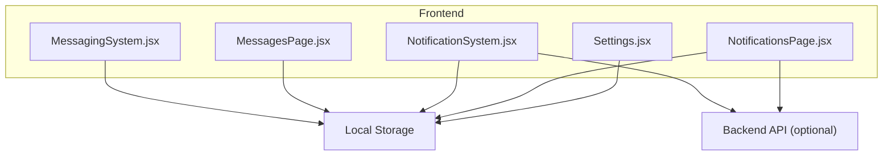
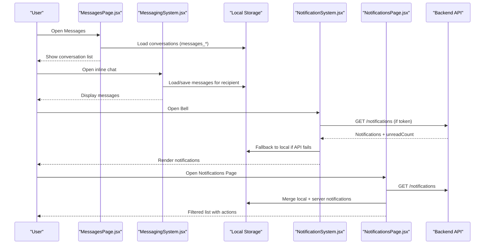
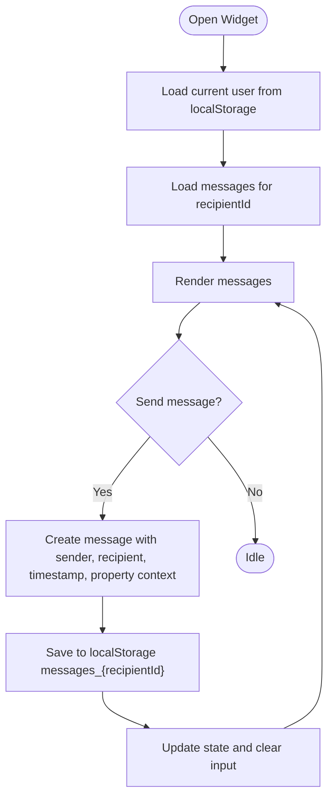
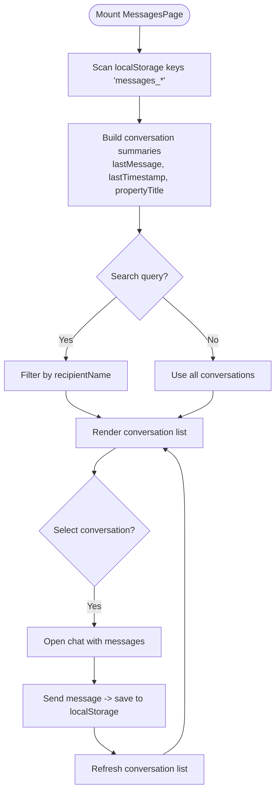
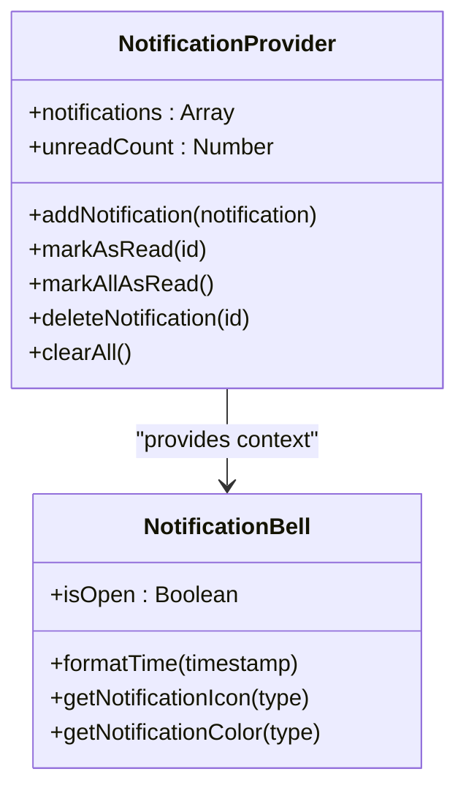
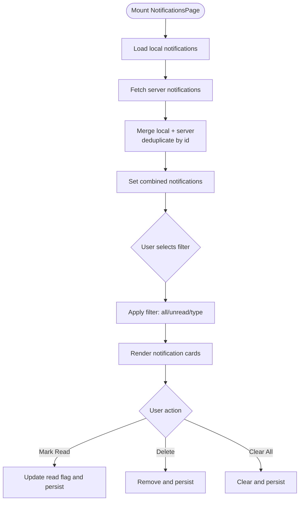
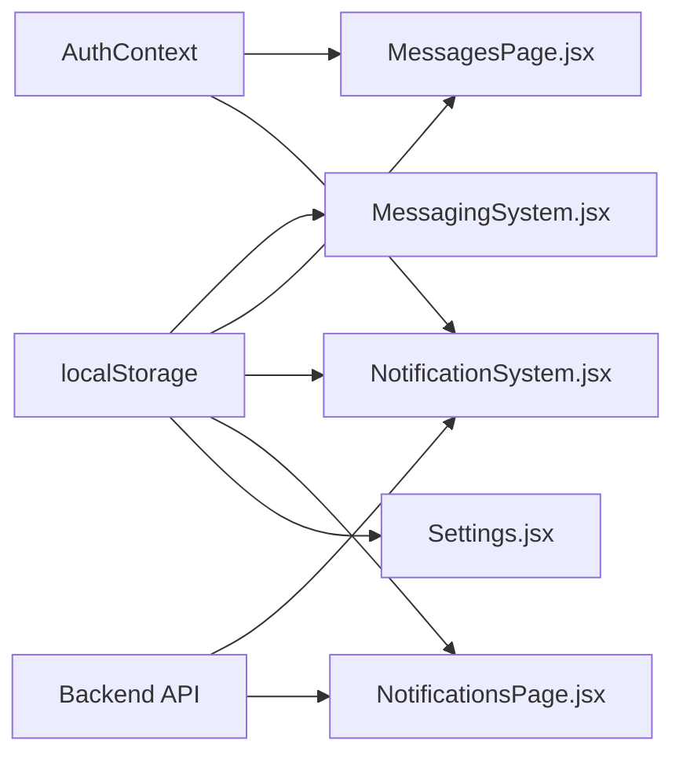

# Client Portfolio Management

<cite>
**Referenced Files in This Document**
- [MessagingSystem.jsx](file://src/components/MessagingSystem.jsx)
- [MessagesPage.jsx](file://src/pages/MessagesPage.jsx)
- [NotificationSystem.jsx](file://src/components/NotificationSystem.jsx)
- [NotificationsPage.jsx](file://src/pages/NotificationsPage.jsx)
- [Settings.jsx](file://src/pages/Settings.jsx)
</cite>

## Table of Contents
1. [Introduction](#introduction)
2. [Project Structure](#project-structure)
3. [Core Components](#core-components)
4. [Architecture Overview](#architecture-overview)
5. [Detailed Component Analysis](#detailed-component-analysis)
6. [Dependency Analysis](#dependency-analysis)
7. [Performance Considerations](#performance-considerations)
8. [Troubleshooting Guide](#troubleshooting-guide)
9. [Conclusion](#conclusion)

## Introduction
This document explains how the frontend implements client portfolio management and relationship tracking, focusing on:
- Client database organization via local storage keys for conversations and notifications
- Contact information management through user context and message metadata
- Communication history tracking with per-conversation message stores
- Notification preferences and automated follow-up cues
- Messaging integration patterns and notification flows
- Examples of search functionality, bulk operations, and reporting-style views

Where backend APIs are used, they are referenced as integration points; where not available, local storage is used as a fallback.

## Project Structure
The relevant features are implemented across React components and pages:
- MessagingSystem: inline chat widget attached to specific recipients and optional property context
- MessagesPage: full-page conversation list and chat view with search and delete
- NotificationSystem: global notification provider with bell UI and CRUD operations
- NotificationsPage: dedicated page for viewing, filtering, and managing notifications
- Settings: user preference persistence including notification preferences

**Diagram sources**
- [MessagingSystem.jsx:1-337](file://src/components/MessagingSystem.jsx#L1-L337)
- [MessagesPage.jsx:1-312](file://src/pages/MessagesPage.jsx#L1-L312)
- [NotificationSystem.jsx:1-472](file://src/components/NotificationSystem.jsx#L1-L472)
- [NotificationsPage.jsx:1-326](file://src/pages/NotificationsPage.jsx#L1-L326)
- [Settings.jsx:1-200](file://src/pages/Settings.jsx#L1-L200)

**Section sources**
- [MessagingSystem.jsx:1-337](file://src/components/MessagingSystem.jsx#L1-L337)
- [MessagesPage.jsx:1-312](file://src/pages/MessagesPage.jsx#L1-L312)
- [NotificationSystem.jsx:1-472](file://src/components/NotificationSystem.jsx#L1-L472)
- [NotificationsPage.jsx:1-326](file://src/pages/NotificationsPage.jsx#L1-L326)
- [Settings.jsx:1-200](file://src/pages/Settings.jsx#L1-L200)

## Core Components
- MessagingSystem: Provides an embedded chat widget that persists messages per recipient using localStorage. It supports property context and timestamps.
- MessagesPage: Offers a full messaging interface with conversation list, search by recipient name, delete conversation, and last-message previews.
- NotificationSystem: A React Context provider that manages notifications, supporting server sync when authenticated and local fallback otherwise. Includes mark-as-read, mark-all-as-read, delete, and clear all.
- NotificationsPage: A dedicated page to view, filter, and manage notifications with merge logic between local and server data.
- Settings: Stores and retrieves user preferences such as notification settings in localStorage.

Key responsibilities:
- Conversation storage model: keys like messages_{recipientId}
- Notification model: array of objects with id, type, title, message, read, timestamp
- Preference storage: key axx_notification_preferences

**Section sources**
- [MessagingSystem.jsx:1-337](file://src/components/MessagingSystem.jsx#L1-L337)
- [MessagesPage.jsx:1-312](file://src/pages/MessagesPage.jsx#L1-L312)
- [NotificationSystem.jsx:1-472](file://src/components/NotificationSystem.jsx#L1-L472)
- [NotificationsPage.jsx:1-326](file://src/pages/NotificationsPage.jsx#L1-L326)
- [Settings.jsx:1-200](file://src/pages/Settings.jsx#L1-L200)

## Architecture Overview
The system combines in-browser persistence with optional backend synchronization:
- Local-first messaging and notifications ensure availability offline or without backend
- When authenticated, NotificationSystem and NotificationsPage attempt to sync with the backend
- User identity and tokens come from AuthContext to gate protected operations

**Diagram sources**
- [MessagesPage.jsx:14-30](file://src/pages/MessagesPage.jsx#L14-L30)
- [MessagingSystem.jsx:20-32](file://src/components/MessagingSystem.jsx#L20-L32)
- [NotificationSystem.jsx:25-55](file://src/components/NotificationSystem.jsx#L25-L55)
- [NotificationsPage.jsx:50-83](file://src/pages/NotificationsPage.jsx#L50-L83)

## Detailed Component Analysis

### MessagingSystem (Inline Chat Widget)
Responsibilities:
- Persist per-recipient messages under localStorage keys messages_{recipientId}
- Attach property context (propertyId, propertyTitle) to messages
- Format relative timestamps and render own vs other messages

Data flow:
- On mount, load current user from localStorage and existing messages
- On send, create message object with sender info, recipient, timestamp, and optional property context
- Save updated messages back to localStorage and update state

**Diagram sources**
- [MessagingSystem.jsx:11-18](file://src/components/MessagingSystem.jsx#L11-L18)
- [MessagingSystem.jsx:20-32](file://src/components/MessagingSystem.jsx#L20-L32)
- [MessagingSystem.jsx:34-53](file://src/components/MessagingSystem.jsx#L34-L53)

**Section sources**
- [MessagingSystem.jsx:1-337](file://src/components/MessagingSystem.jsx#L1-L337)

### MessagesPage (Full Messaging Interface)
Responsibilities:
- Enumerate all conversations by scanning localStorage keys starting with messages_
- Build conversation summaries with last message preview and timestamp
- Provide search by recipient name and delete conversation
- Render selected conversation with message bubbles and time formatting

Search and bulk operations:
- Search: filters conversations by recipientName substring match
- Bulk: delete individual conversations; no explicit bulk delete is implemented

**Diagram sources**
- [MessagesPage.jsx:14-30](file://src/pages/MessagesPage.jsx#L14-L30)
- [MessagesPage.jsx:91-93](file://src/pages/MessagesPage.jsx#L91-L93)
- [MessagesPage.jsx:46-64](file://src/pages/MessagesPage.jsx#L46-L64)

**Section sources**
- [MessagesPage.jsx:1-312](file://src/pages/MessagesPage.jsx#L1-L312)

### NotificationSystem (Provider and Bell UI)
Responsibilities:
- Provide notifications state and actions via React Context
- Sync with backend when authenticated; fallback to localStorage otherwise
- Support add, markAsRead, markAllAsRead, delete, and clearAll

Integration points:
- GET /notifications with Authorization header
- PATCH /notifications/{id}/read
- PATCH /notifications/read-all
- DELETE /notifications/{id}

**Diagram sources**
- [NotificationSystem.jsx:19-157](file://src/components/NotificationSystem.jsx#L19-L157)
- [NotificationSystem.jsx:161-291](file://src/components/NotificationSystem.jsx#L161-L291)

**Section sources**
- [NotificationSystem.jsx:1-472](file://src/components/NotificationSystem.jsx#L1-L472)

### NotificationsPage (Dedicated Notifications View)
Responsibilities:
- Load local notifications and attempt to fetch server notifications
- Merge local and server notifications, preferring server IDs
- Provide filters: all, unread, and typed categories
- Allow mark-as-read, delete, and clear all

Merge strategy:
- Collect local notification IDs into a set
- Filter server notifications not present locally
- Map server fields to common shape (id, type, title, message, read, timestamp)
- Combine and sort by timestamp descending

**Diagram sources**
- [NotificationsPage.jsx:50-83](file://src/pages/NotificationsPage.jsx#L50-L83)
- [NotificationsPage.jsx:28-41](file://src/pages/NotificationsPage.jsx#L28-L41)
- [NotificationsPage.jsx:114-136](file://src/pages/NotificationsPage.jsx#L114-L136)

**Section sources**
- [NotificationsPage.jsx:1-326](file://src/pages/NotificationsPage.jsx#L1-L326)

### Settings (Preferences)
Responsibilities:
- Persist notification preferences under key axx_notification_preferences
- Provide UI guidance for profile, security, and workspace preferences

Preference model:
- Stored as JSON string in localStorage
- Read on component mount and written on changes

**Section sources**
- [Settings.jsx:1-200](file://src/pages/Settings.jsx#L1-L200)

## Dependency Analysis
- MessagingSystem depends on:
  - localStorage for message persistence
  - Optional property context passed via props
- MessagesPage depends on:
  - localStorage enumeration and parsing
  - AuthContext for user identity
- NotificationSystem depends on:
  - AuthContext for token presence
  - Backend API endpoints for notifications
  - localStorage as fallback
- NotificationsPage depends on:
  - Backend API for notifications
  - localStorage for merging and persistence
- Settings depends on:
  - localStorage for preferences

**Diagram sources**
- [MessagingSystem.jsx:1-337](file://src/components/MessagingSystem.jsx#L1-L337)
- [MessagesPage.jsx:1-312](file://src/pages/MessagesPage.jsx#L1-L312)
- [NotificationSystem.jsx:1-472](file://src/components/NotificationSystem.jsx#L1-L472)
- [NotificationsPage.jsx:1-326](file://src/pages/NotificationsPage.jsx#L1-L326)
- [Settings.jsx:1-200](file://src/pages/Settings.jsx#L1-L200)

**Section sources**
- [MessagingSystem.jsx:1-337](file://src/components/MessagingSystem.jsx#L1-L337)
- [MessagesPage.jsx:1-312](file://src/pages/MessagesPage.jsx#L1-L312)
- [NotificationSystem.jsx:1-472](file://src/components/NotificationSystem.jsx#L1-L472)
- [NotificationsPage.jsx:1-326](file://src/pages/NotificationsPage.jsx#L1-L326)
- [Settings.jsx:1-200](file://src/pages/Settings.jsx#L1-L200)

## Performance Considerations
- LocalStorage usage:
  - Scanning all keys and parsing JSON arrays can be costly at scale; consider pagination or indexed storage for large datasets
  - Frequent writes on every message send may cause UI jank; debounce or batch updates where possible
- API calls:
  - Notification loading should be cached and debounced; avoid redundant requests on re-renders
  - Error handling should prevent repeated failed retries; implement exponential backoff if needed
- Rendering:
  - Virtualize long lists of messages and notifications to improve scroll performance
  - Avoid unnecessary re-renders by memoizing derived data and stable references

[No sources needed since this section provides general guidance]

## Troubleshooting Guide
Common issues and resolutions:
- Missing conversations:
  - Verify localStorage keys start with messages_ and contain valid JSON arrays
  - Ensure recipientId matches between sender and receiver contexts
- Notifications not appearing:
  - Check authentication token presence; NotificationSystem prefers server data when token exists
  - Validate backend endpoints /notifications, /notifications/{id}/read, /notifications/read-all, /notifications/{id}
- Preferences not saving:
  - Confirm localStorage write access and that key axx_notification_preferences is used consistently
- Message timestamps:
  - Ensure ISO strings are stored and parsed correctly; format functions assume valid Date inputs

**Section sources**
- [MessagesPage.jsx:14-30](file://src/pages/MessagesPage.jsx#L14-L30)
- [NotificationSystem.jsx:25-55](file://src/components/NotificationSystem.jsx#L25-L55)
- [NotificationsPage.jsx:50-83](file://src/pages/NotificationsPage.jsx#L50-L83)
- [Settings.jsx:1-200](file://src/pages/Settings.jsx#L1-L200)

## Conclusion
The frontend implements a robust, local-first client portfolio and communication layer with optional backend synchronization. Messaging and notifications are persisted in localStorage for reliability, while authenticated sessions enable server-backed features. The design supports contact-centric conversations, searchable conversation lists, filtered notification views, and preference management. For production scaling, consider migrating to IndexedDB for larger datasets, adding real-time channels for live updates, and implementing server-side aggregation for reporting and analytics.

[No sources needed since this section summarizes without analyzing specific files]