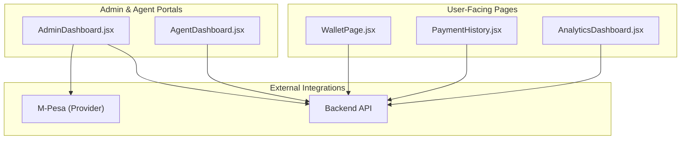
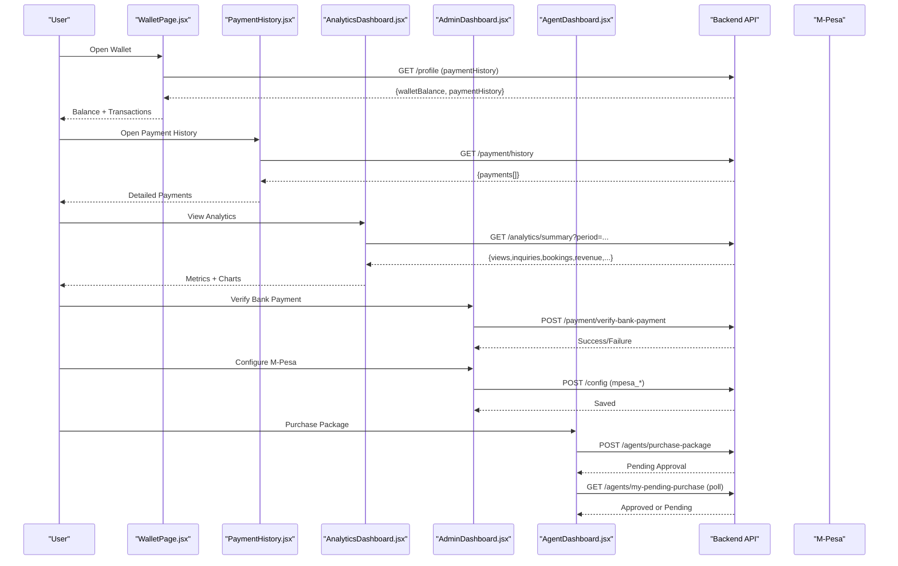
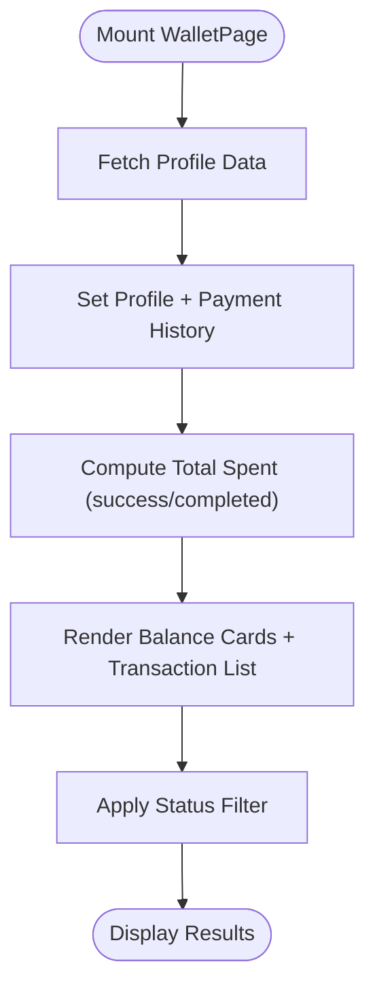
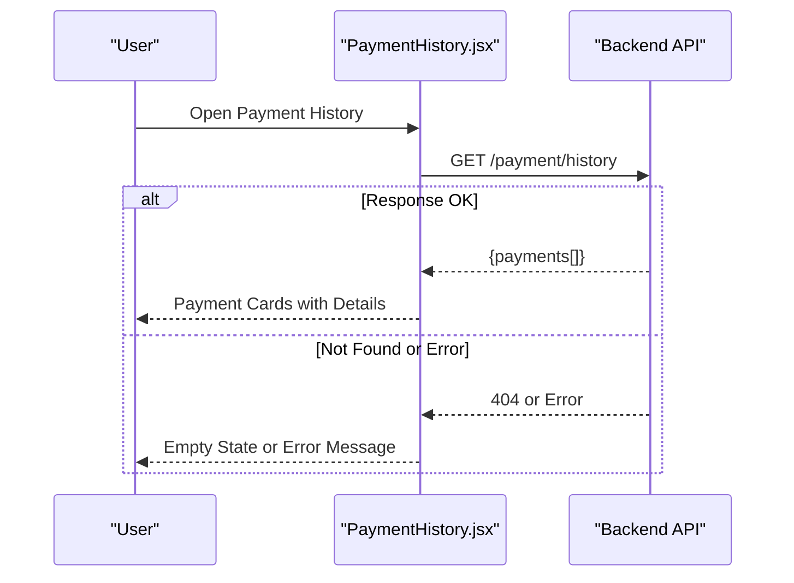
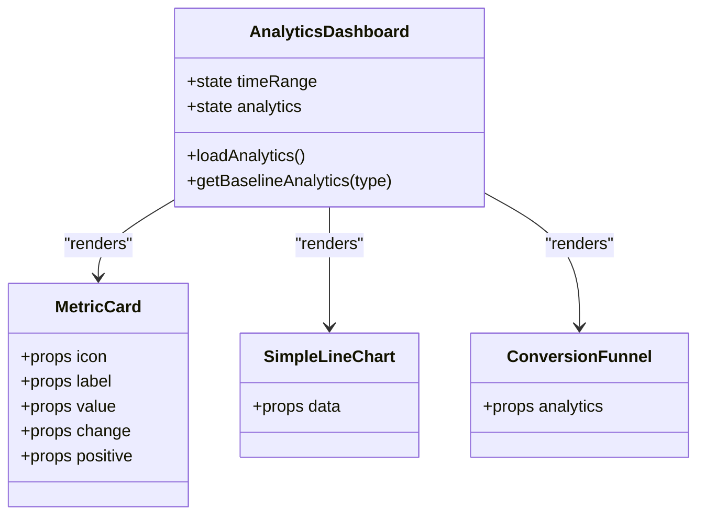
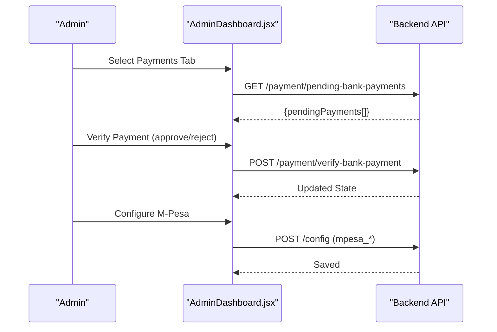
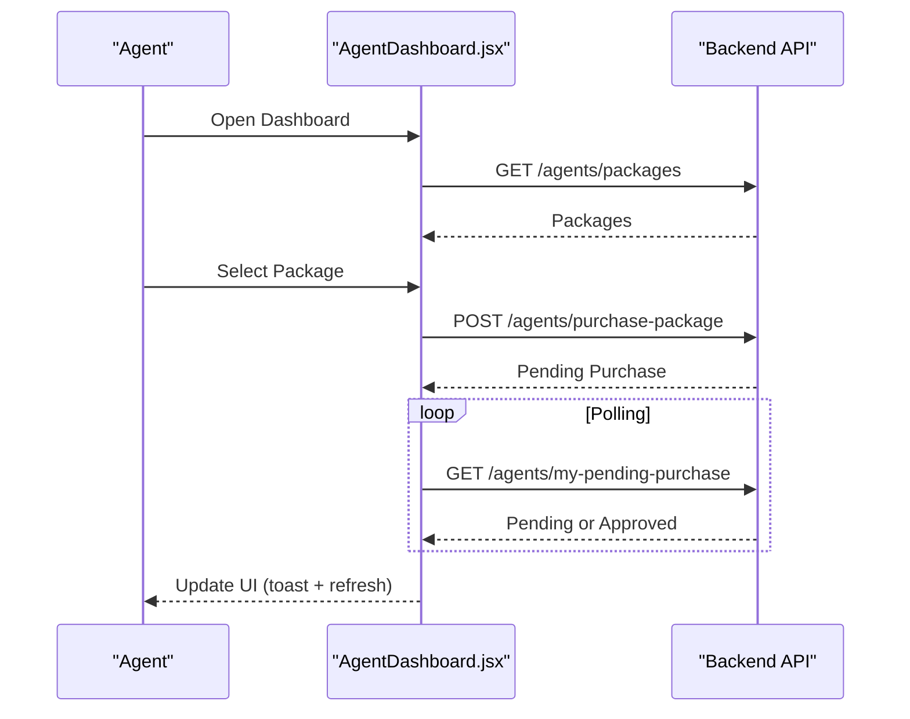
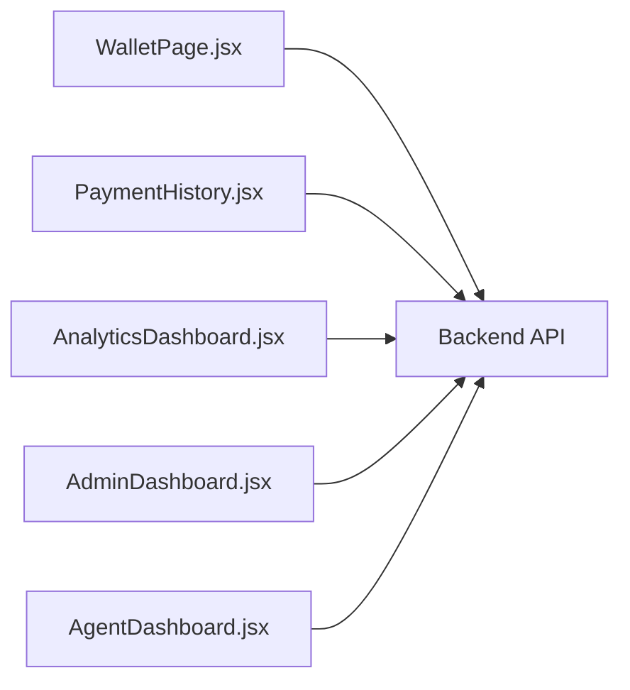

# Commission Tracking & Reporting

<cite>
**Referenced Files in This Document**
- [WalletPage.jsx](file://src/pages/WalletPage.jsx)
- [PaymentHistory.jsx](file://src/pages/PaymentHistory.jsx)
- [AnalyticsDashboard.jsx](file://src/components/AnalyticsDashboard.jsx)
- [AdminDashboard.jsx](file://src/pages/AdminDashboard.jsx)
- [AgentDashboard.jsx](file://src/pages/AgentDashboard.jsx)
</cite>

## Table of Contents
1. [Introduction](#introduction)
2. [Project Structure](#project-structure)
3. [Core Components](#core-components)
4. [Architecture Overview](#architecture-overview)
5. [Detailed Component Analysis](#detailed-component-analysis)
6. [Dependency Analysis](#dependency-analysis)
7. [Performance Considerations](#performance-considerations)
8. [Troubleshooting Guide](#troubleshooting-guide)
9. [Conclusion](#conclusion)
10. [Appendices](#appendices)

## Introduction
This document explains the commission tracking and financial reporting features as implemented in the frontend codebase. It focuses on how payments are tracked, how dashboards present financial analytics, and how administrative workflows support payment verification and configuration for payment providers. While backend calculation logic is not included here, this guide maps the user-facing flows, data models visible to the UI, and integration points with external services such as M-Pesa.

## Project Structure
The relevant financial and reporting functionality spans several React components:
- Wallet and Payment History pages display transactional data and balances.
- Analytics Dashboard provides performance metrics and revenue summaries.
- Admin Dashboard includes payment verification workflows and provider configuration.
- Agent Dashboard supports package purchases and related payment states.

**Diagram sources**
- [WalletPage.jsx:1-232](file://src/pages/WalletPage.jsx#L1-L232)
- [PaymentHistory.jsx:1-336](file://src/pages/PaymentHistory.jsx#L1-L336)
- [AnalyticsDashboard.jsx:1-606](file://src/components/AnalyticsDashboard.jsx#L1-L606)
- [AdminDashboard.jsx:1-800](file://src/pages/AdminDashboard.jsx#L1-L800)
- [AgentDashboard.jsx:1-1200](file://src/pages/AgentDashboard.jsx#L1-L1200)

**Section sources**
- [WalletPage.jsx:1-232](file://src/pages/WalletPage.jsx#L1-L232)
- [PaymentHistory.jsx:1-336](file://src/pages/PaymentHistory.jsx#L1-L336)
- [AnalyticsDashboard.jsx:1-606](file://src/components/AnalyticsDashboard.jsx#L1-L606)
- [AdminDashboard.jsx:1-800](file://src/pages/AdminDashboard.jsx#L1-L800)
- [AgentDashboard.jsx:1-1200](file://src/pages/AgentDashboard.jsx#L1-L1200)

## Core Components
- Wallet Page: Displays wallet balance, total spent, and a filtered list of transactions sourced from the user profile’s payment history.
- Payment History Page: Fetches and renders detailed payment records including status, amount, date, method, and receipt links.
- Analytics Dashboard: Aggregates views, inquiries, bookings, revenue, and conversion rate; supports time range selection and visual charts.
- Admin Dashboard: Provides payment verification workflows for bank payments and configuration management for M-Pesa credentials.
- Agent Dashboard: Manages agent packages, pending purchase states, and interactions with payment-related endpoints.

**Section sources**
- [WalletPage.jsx:1-232](file://src/pages/WalletPage.jsx#L1-L232)
- [PaymentHistory.jsx:1-336](file://src/pages/PaymentHistory.jsx#L1-L336)
- [AnalyticsDashboard.jsx:1-606](file://src/components/AnalyticsDashboard.jsx#L1-L606)
- [AdminDashboard.jsx:1-800](file://src/pages/AdminDashboard.jsx#L1-L800)
- [AgentDashboard.jsx:1-1200](file://src/pages/AgentDashboard.jsx#L1-L1200)

## Architecture Overview
The system follows a client-side architecture where React components call backend APIs to retrieve financial data and trigger administrative actions. External payment providers (e.g., M-Pesa) are configured via admin settings and referenced by payment flows.

**Diagram sources**
- [WalletPage.jsx:1-232](file://src/pages/WalletPage.jsx#L1-L232)
- [PaymentHistory.jsx:1-336](file://src/pages/PaymentHistory.jsx#L1-L336)
- [AnalyticsDashboard.jsx:1-606](file://src/components/AnalyticsDashboard.jsx#L1-L606)
- [AdminDashboard.jsx:1-800](file://src/pages/AdminDashboard.jsx#L1-L800)
- [AgentDashboard.jsx:1-1200](file://src/pages/AgentDashboard.jsx#L1-L1200)

## Detailed Component Analysis

### Wallet Page
- Loads user profile data and extracts payment history to compute totals and render transaction cards.
- Supports filtering by status and displays formatted amounts and dates.
- Uses local state for loading, filter selection, and derived totals.

**Diagram sources**
- [WalletPage.jsx:1-232](file://src/pages/WalletPage.jsx#L1-L232)

**Section sources**
- [WalletPage.jsx:1-232](file://src/pages/WalletPage.jsx#L1-L232)

### Payment History Page
- Calls a dedicated endpoint to fetch payment records.
- Handles empty states and error conditions gracefully.
- Renders details such as amount, transaction reference, property association, payment method, and receipt URL.

**Diagram sources**
- [PaymentHistory.jsx:1-336](file://src/pages/PaymentHistory.jsx#L1-L336)

**Section sources**
- [PaymentHistory.jsx:1-336](file://src/pages/PaymentHistory.jsx#L1-L336)

### Analytics Dashboard
- Retrieves summary analytics with a selectable time range.
- Presents key metrics (views, inquiries, bookings, revenue) and conversion rate.
- Includes simple charting components for performance over time and conversion funnel visualization.

**Diagram sources**
- [AnalyticsDashboard.jsx:1-606](file://src/components/AnalyticsDashboard.jsx#L1-L606)

**Section sources**
- [AnalyticsDashboard.jsx:1-606](file://src/components/AnalyticsDashboard.jsx#L1-L606)

### Admin Dashboard
- Provides tabs for various administrative tasks, including payments and business approvals.
- Implements payment verification workflow for bank payments and M-Pesa configuration management.
- Loads stats and pending items across multiple domains.

**Diagram sources**
- [AdminDashboard.jsx:1-800](file://src/pages/AdminDashboard.jsx#L1-L800)

**Section sources**
- [AdminDashboard.jsx:1-800](file://src/pages/AdminDashboard.jsx#L1-L800)

### Agent Dashboard
- Manages agent profiles, house listings, and package subscriptions.
- Handles package purchase flow, pending purchase polling, and approval detection.
- Integrates with payment-related endpoints for package upgrades and status checks.

**Diagram sources**
- [AgentDashboard.jsx:1-1200](file://src/pages/AgentDashboard.jsx#L1-L1200)

**Section sources**
- [AgentDashboard.jsx:1-1200](file://src/pages/AgentDashboard.jsx#L1-L1200)

## Dependency Analysis
- WalletPage depends on profile data containing payment history; it computes totals locally.
- PaymentHistory directly consumes a payment-specific endpoint.
- AnalyticsDashboard relies on an analytics summary endpoint and renders internal chart components.
- AdminDashboard coordinates multiple administrative endpoints, including payment verification and configuration storage.
- AgentDashboard interacts with agent-specific endpoints for packages and purchase states.

**Diagram sources**
- [WalletPage.jsx:1-232](file://src/pages/WalletPage.jsx#L1-L232)
- [PaymentHistory.jsx:1-336](file://src/pages/PaymentHistory.jsx#L1-L336)
- [AnalyticsDashboard.jsx:1-606](file://src/components/AnalyticsDashboard.jsx#L1-L606)
- [AdminDashboard.jsx:1-800](file://src/pages/AdminDashboard.jsx#L1-L800)
- [AgentDashboard.jsx:1-1200](file://src/pages/AgentDashboard.jsx#L1-L1200)

**Section sources**
- [WalletPage.jsx:1-232](file://src/pages/WalletPage.jsx#L1-L232)
- [PaymentHistory.jsx:1-336](file://src/pages/PaymentHistory.jsx#L1-L336)
- [AnalyticsDashboard.jsx:1-606](file://src/components/AnalyticsDashboard.jsx#L1-L606)
- [AdminDashboard.jsx:1-800](file://src/pages/AdminDashboard.jsx#L1-L800)
- [AgentDashboard.jsx:1-1200](file://src/pages/AgentDashboard.jsx#L1-L1200)

## Performance Considerations
- Minimize unnecessary re-renders by memoizing derived values (e.g., computed totals).
- Use pagination or virtualization for large transaction lists if needed.
- Debounce search/filter inputs in dashboards to reduce frequent re-renders.
- Avoid excessive polling intervals; ensure backend supports efficient queries for pending states.

[No sources needed since this section provides general guidance]

## Troubleshooting Guide
- Payment History returns empty when endpoint is unavailable: The component handles 404 by showing an empty state without errors.
- Wallet page shows no transactions: Ensure profile data includes paymentHistory; verify network requests and token validity.
- Admin payment verification fails: Check request payload (transactionRef, userId) and confirm backend availability.
- M-Pesa configuration not saving: Validate required fields and server response; review config save calls.

**Section sources**
- [PaymentHistory.jsx:1-336](file://src/pages/PaymentHistory.jsx#L1-L336)
- [WalletPage.jsx:1-232](file://src/pages/WalletPage.jsx#L1-L232)
- [AdminDashboard.jsx:1-800](file://src/pages/AdminDashboard.jsx#L1-L800)

## Conclusion
The frontend implements robust financial reporting and payment tracking through dedicated pages and dashboards. Users can view balances and transaction histories, while admins manage payment verifications and provider configurations. Agents can purchase and track package upgrades with real-time status updates. Although backend calculation algorithms are not included here, the UI clearly exposes the data models and integration points necessary for comprehensive commission tracking and financial reporting.

[No sources needed since this section summarizes without analyzing specific files]

## Appendices

### Example Workflows

#### Customize Commission Structures (Frontend Integration Points)
- Define commission tiers in backend configuration and expose them via API endpoints.
- Frontend components can consume these tiers to calculate commissions based on transaction data.
- Admin dashboard can provide interfaces to update tier rules and publish changes.

[No sources needed since this section describes conceptual integration]

#### Generate Financial Reports
- Use analytics endpoints to aggregate revenue and conversion metrics.
- Export summarized data for accounting systems or generate PDFs using backend services.
- Present reports within dashboards with filters for time ranges and user types.

[No sources needed since this section describes conceptual integration]

#### Integrate with Payment Processing Systems
- Configure M-Pesa credentials via admin settings.
- Trigger payment initiation from agent package purchases.
- Handle callbacks and verify transactions through admin verification workflows.

**Section sources**
- [AdminDashboard.jsx:1-800](file://src/pages/AdminDashboard.jsx#L1-L800)
- [AgentDashboard.jsx:1-1200](file://src/pages/AgentDashboard.jsx#L1-L1200)