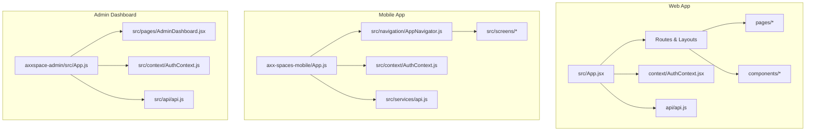
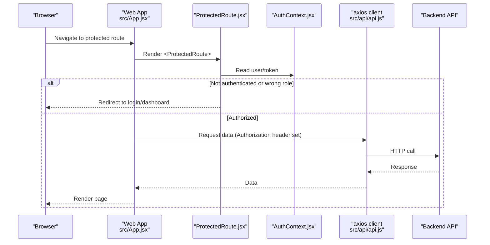
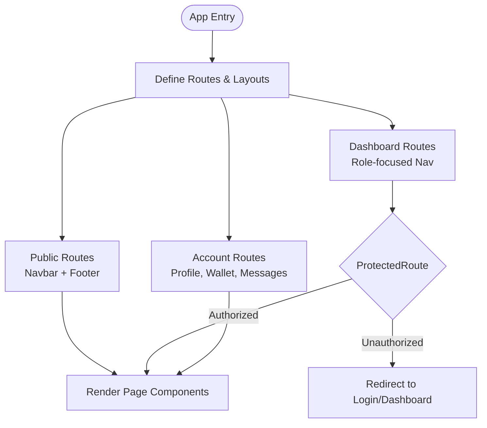
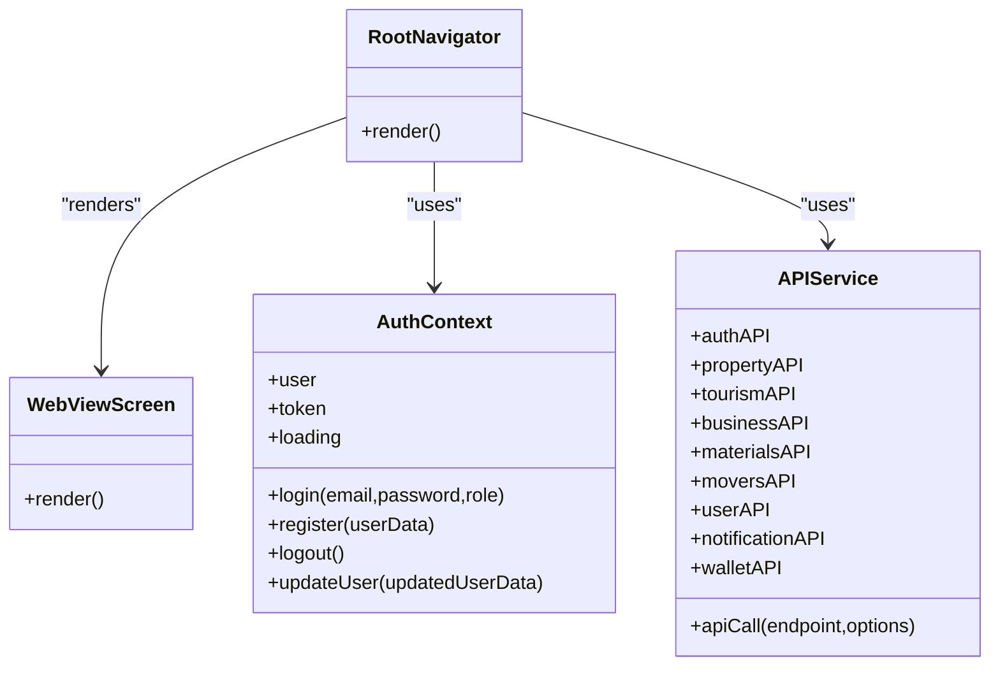
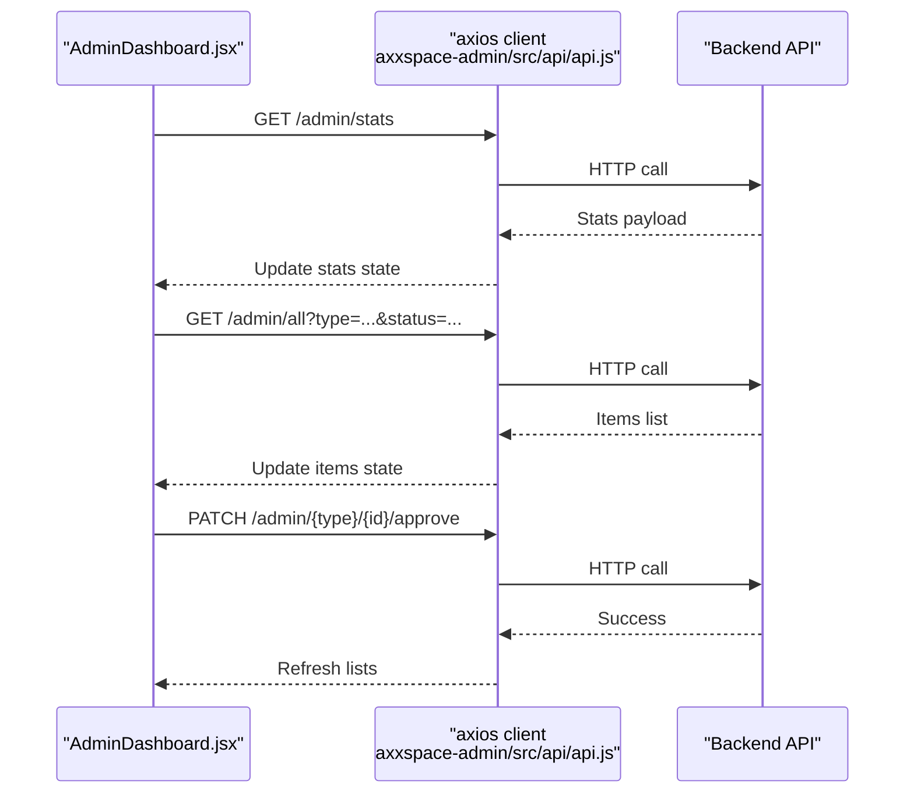
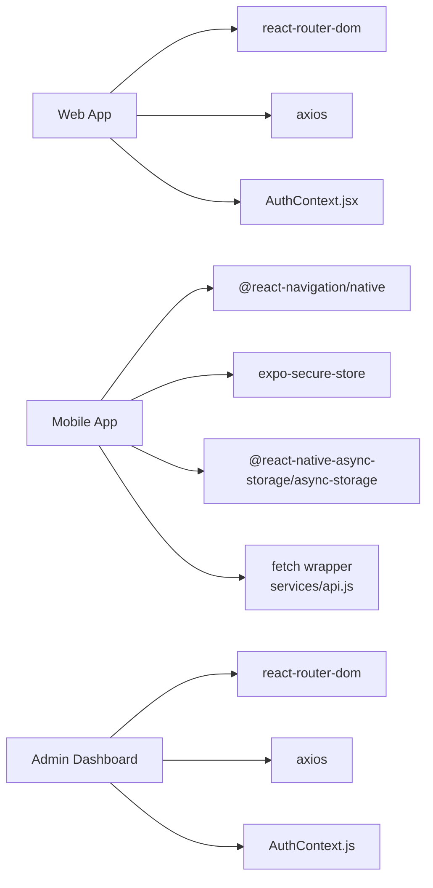

# Application Structure

<cite>
**Referenced Files in This Document**
- [App.jsx](file://src/App.jsx)
- [ProtectedRoute.jsx](file://src/components/ProtectedRoute.jsx)
- [AuthContext.jsx](file://src/context/AuthContext.jsx)
- [api.js](file://src/api/api.js)
- [App.js](file://axx-spaces-mobile/App.js)
- [AppNavigator.js](file://axx-spaces-mobile/src/navigation/AppNavigator.js)
- [AuthContext.js](file://axx-spaces-mobile/src/context/AuthContext.js)
- [api.js](file://axx-spaces-mobile/src/services/api.js)
- [App.js](file://axxspace-admin/src/App.js)
- [AdminDashboard.jsx](file://axxspace-admin/src/pages/AdminDashboard.jsx)
- [AuthContext.js](file://axxspace-admin/src/context/AuthContext.js)
- [api.js](file://axxspace-admin/src/api/api.js)
</cite>

## Table of Contents
1. Introduction
2. Project Structure
3. Core Components
4. Architecture Overview
5. Detailed Component Analysis
6. Dependency Analysis
7. Performance Considerations
8. Troubleshooting Guide
9. Conclusion

## Introduction
This document explains the organization and architecture of three distinct applications within the monorepo:
- Web application (React Router, Vite-based)
- Mobile application (Expo + React Navigation)
- Admin dashboard (React Router SPA)

It covers routing strategies, page composition patterns, code organization, shared utilities, common components, cross-platform abstractions, and how business logic is shared while maintaining platform-specific implementations.

## Project Structure
The repository contains three top-level applications plus shared web assets under src/:
- axx-spaces-mobile: Expo-based mobile app with React Navigation
- axxspace-admin: Admin dashboard SPA using React Router
- src: Main web application entrypoint and shared UI/business modules used by the web app

**Diagram sources**
- [App.jsx:1-495](file://src/App.jsx#L1-L495)
- [App.js:1-110](file://axx-spaces-mobile/App.js#L1-L110)
- [AppNavigator.js:1-30](file://axx-spaces-mobile/src/navigation/AppNavigator.js#L1-L30)
- [App.js:1-27](file://axxspace-admin/src/App.js#L1-L27)

**Section sources**
- [App.jsx:1-495](file://src/App.jsx#L1-L495)
- [App.js:1-110](file://axx-spaces-mobile/App.js#L1-L110)
- [AppNavigator.js:1-30](file://axx-spaces-mobile/src/navigation/AppNavigator.js#L1-L30)
- [App.js:1-27](file://axxspace-admin/src/App.js#L1-L27)

## Core Components
- Web App
  - Routing: Centralized routes and layout wrappers in the main app file.
  - Auth: Global authentication context with token persistence and guest auto-login.
  - API: Axios client with interceptors for auth headers and logging.
- Mobile App
  - Navigation: Root navigator wrapping a stack that currently hosts a WebView screen.
  - Auth: Context managing secure token storage and user profile persistence.
  - API: Fetch-based wrapper with optional auth injection and typed helpers per domain.
- Admin Dashboard
  - Routing: Minimal React Router setup with protected pages.
  - Auth: LocalStorage-backed auth context.
  - API: Axios client with request/response logging.

**Section sources**
- [App.jsx:1-495](file://src/App.jsx#L1-L495)
- [AuthContext.jsx:1-157](file://src/context/AuthContext.jsx#L1-L157)
- [api.js:1-47](file://src/api/api.js#L1-L47)
- [App.js:1-110](file://axx-spaces-mobile/App.js#L1-L110)
- [AppNavigator.js:1-30](file://axx-spaces-mobile/src/navigation/AppNavigator.js#L1-L30)
- [AuthContext.js:1-136](file://axx-spaces-mobile/src/context/AuthContext.js#L1-L136)
- [api.js:1-194](file://axx-spaces-mobile/src/services/api.js#L1-L194)
- [App.js:1-27](file://axxspace-admin/src/App.js#L1-L27)
- [AuthContext.js:1-84](file://axxspace-admin/src/context/AuthContext.js#L1-L84)
- [api.js:1-22](file://axxspace-admin/src/api/api.js#L1-L22)

## Architecture Overview
High-level flow from browser to backend across all apps:
- Web app uses React Router to render layouts and pages; ProtectedRoute enforces role-based access; AuthContext provides session state; axios client injects Authorization header.
- Mobile app uses React Navigation to manage screens; AuthContext persists credentials securely; api.js wraps fetch calls and attaches tokens when needed.
- Admin dashboard uses React Router for navigation; AuthContext manages admin sessions; API client logs requests/responses for debugging.

**Diagram sources**
- [App.jsx:1-495](file://src/App.jsx#L1-L495)
- [ProtectedRoute.jsx:1-57](file://src/components/ProtectedRoute.jsx#L1-L57)
- [AuthContext.jsx:1-157](file://src/context/AuthContext.jsx#L1-L157)
- [api.js:1-47](file://src/api/api.js#L1-L47)

## Detailed Component Analysis

### Web Application (React Router)
- Routing strategy
  - Centralized Routes definition with public, dashboard, and account sections.
  - Layout wrappers: PublicLayout (with Navbar, WhatsApp, update notifier), DashboardLayout (role-focused nav), BareLayout (no shell).
  - Legacy redirects for backward compatibility.
- Page composition
  - Pages are organized under src/pages with feature folders (e.g., accommodation).
  - Shared components live under src/components (layouts, modals, UI primitives).
- Authentication and authorization
  - AuthContext initializes session, supports guest auto-login, and persists token/user in localStorage.
  - ProtectedRoute checks roles and redirects appropriately.
- API integration
  - Axios client sets base URL from environment and injects Authorization header via interceptor.

**Diagram sources**
- [App.jsx:1-495](file://src/App.jsx#L1-L495)
- [ProtectedRoute.jsx:1-57](file://src/components/ProtectedRoute.jsx#L1-L57)

**Section sources**
- [App.jsx:1-495](file://src/App.jsx#L1-L495)
- [ProtectedRoute.jsx:1-57](file://src/components/ProtectedRoute.jsx#L1-L57)
- [AuthContext.jsx:1-157](file://src/context/AuthContext.jsx#L1-L157)
- [api.js:1-47](file://src/api/api.js#L1-L47)

### Mobile Application (React Navigation)
- Navigation system
  - Root component wraps app with GestureHandlerRootView and ErrorBoundary.
  - RootNavigator uses NavigationContainer and Stack Navigator; currently renders a WebView screen.
- Authentication
  - AuthContext loads token from SecureStore and user from AsyncStorage on startup.
  - Provides login/register/logout/updateUser methods and persists credentials securely.
- API layer
  - api.js provides a fetch-based wrapper that optionally attaches Bearer token.
  - Domain-specific helpers for properties, tourism, business, materials, movers, user, notifications, wallet.

**Diagram sources**
- [AppNavigator.js:1-30](file://axx-spaces-mobile/src/navigation/AppNavigator.js#L1-L30)
- [AuthContext.js:1-136](file://axx-spaces-mobile/src/context/AuthContext.js#L1-L136)
- [api.js:1-194](file://axx-spaces-mobile/src/services/api.js#L1-L194)

**Section sources**
- [App.js:1-110](file://axx-spaces-mobile/App.js#L1-L110)
- [AppNavigator.js:1-30](file://axx-spaces-mobile/src/navigation/AppNavigator.js#L1-L30)
- [AuthContext.js:1-136](file://axx-spaces-mobile/src/context/AuthContext.js#L1-L136)
- [api.js:1-194](file://axx-spaces-mobile/src/services/api.js#L1-L194)

### Admin Dashboard (React Router SPA)
- Routing
  - Minimal routes for dashboard, login, reset password, business detail, and boost management.
- Dashboard layout
  - AdminDashboard.jsx implements tabbed interface with multiple management features (overview, properties, materials, accommodations, payments, boosts, businesses, announcements, requests, badges).
  - Uses internal state for active tab, status filters, search, and selection.
- Authentication
  - Simple AuthContext backed by localStorage; guards admin-only routes.
- API integration
  - Axios client with request/response logging for admin operations.

**Diagram sources**
- [AdminDashboard.jsx:1-800](file://axxspace-admin/src/pages/AdminDashboard.jsx#L1-L800)
- [api.js:1-22](file://axxspace-admin/src/api/api.js#L1-L22)

**Section sources**
- [App.js:1-27](file://axxspace-admin/src/App.js#L1-L27)
- [AdminDashboard.jsx:1-800](file://axxspace-admin/src/pages/AdminDashboard.jsx#L1-L800)
- [AuthContext.js:1-84](file://axxspace-admin/src/context/AuthContext.js#L1-L84)
- [api.js:1-22](file://axxspace-admin/src/api/api.js#L1-L22)

## Dependency Analysis
- Web app dependencies
  - React Router for routing and navigation.
  - Axios for HTTP with interceptors.
  - Custom AuthContext for session management.
- Mobile app dependencies
  - React Navigation for screen management.
  - SecureStore and AsyncStorage for credential persistence.
  - Fetch-based API wrapper with domain helpers.
- Admin dashboard dependencies
  - React Router for routing.
  - Axios for HTTP with logging.
  - LocalStorage-backed AuthContext.

**Diagram sources**
- [App.jsx:1-495](file://src/App.jsx#L1-L495)
- [api.js:1-47](file://src/api/api.js#L1-L47)
- [AppNavigator.js:1-30](file://axx-spaces-mobile/src/navigation/AppNavigator.js#L1-L30)
- [AuthContext.js:1-136](file://axx-spaces-mobile/src/context/AuthContext.js#L1-L136)
- [api.js:1-194](file://axx-spaces-mobile/src/services/api.js#L1-L194)
- [App.js:1-27](file://axxspace-admin/src/App.js#L1-L27)
- [api.js:1-22](file://axxspace-admin/src/api/api.js#L1-L22)

**Section sources**
- [App.jsx:1-495](file://src/App.jsx#L1-L495)
- [api.js:1-47](file://src/api/api.js#L1-L47)
- [AppNavigator.js:1-30](file://axx-spaces-mobile/src/navigation/AppNavigator.js#L1-L30)
- [AuthContext.js:1-136](file://axx-spaces-mobile/src/context/AuthContext.js#L1-L136)
- [api.js:1-194](file://axx-spaces-mobile/src/services/api.js#L1-L194)
- [App.js:1-27](file://axxspace-admin/src/App.js#L1-L27)
- [api.js:1-22](file://axxspace-admin/src/api/api.js#L1-L22)

## Performance Considerations
- Web app
  - Use lazy loading for heavy pages if needed.
  - Debounce search/filter operations in dashboards.
  - Keep API responses minimal; leverage pagination where applicable.
- Mobile app
  - Avoid unnecessary re-renders by memoizing components and selectors.
  - Cache frequently accessed data locally when appropriate.
  - Ensure network requests handle timeouts and retries gracefully.
- Admin dashboard
  - Paginate large lists and avoid full reloads on filter changes.
  - Debounce input handlers for search and filters.
  - Batch updates to reduce re-renders.

[No sources needed since this section provides general guidance]

## Troubleshooting Guide
- Authentication issues
  - Verify token presence and format in local storage or secure store.
  - Check guest auto-login behavior and error handling in AuthContext.
- Routing problems
  - Confirm route order and parameter parsing.
  - Ensure ProtectedRoute redirects correctly based on roles.
- API errors
  - Inspect request/response logs from axios interceptors.
  - Validate environment variables for API base URLs.
  - For mobile, ensure SecureStore token retrieval succeeds before attaching headers.

**Section sources**
- [AuthContext.jsx:1-157](file://src/context/AuthContext.jsx#L1-L157)
- [ProtectedRoute.jsx:1-57](file://src/components/ProtectedRoute.jsx#L1-L57)
- [api.js:1-47](file://src/api/api.js#L1-L47)
- [AuthContext.js:1-136](file://axx-spaces-mobile/src/context/AuthContext.js#L1-L136)
- [api.js:1-194](file://axx-spaces-mobile/src/services/api.js#L1-L194)
- [AuthContext.js:1-84](file://axxspace-admin/src/context/AuthContext.js#L1-L84)
- [api.js:1-22](file://axxspace-admin/src/api/api.js#L1-L22)

## Conclusion
The monorepo organizes three applications with clear separation of concerns:
- The web app leverages React Router, centralized layouts, and a robust auth/API layer.
- The mobile app uses React Navigation with secure credential storage and a typed API wrapper.
- The admin dashboard provides a focused SPA for operational tasks with logging-enabled API access.

Shared business logic is primarily expressed through reusable components and services within each app, while platform-specific implementations remain isolated. This structure enables maintainability, scalability, and consistent user experiences across platforms.

[No sources needed since this section summarizes without analyzing specific files]