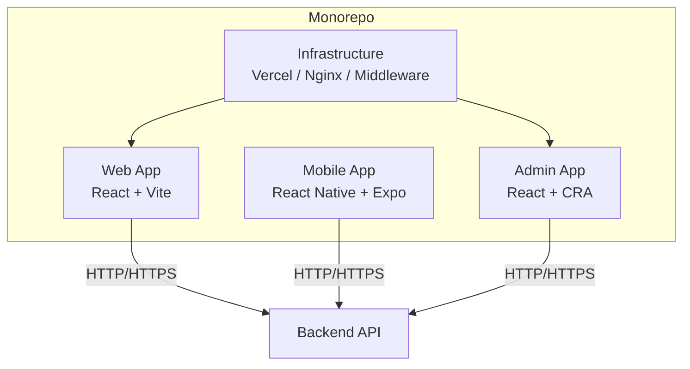
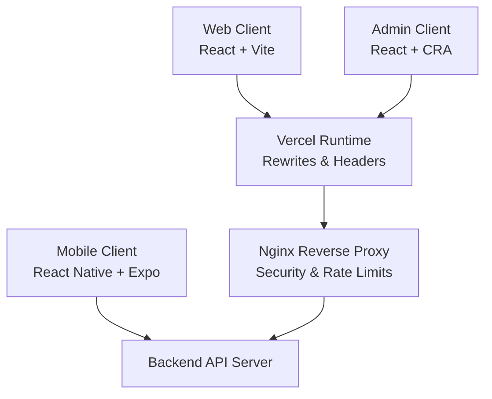
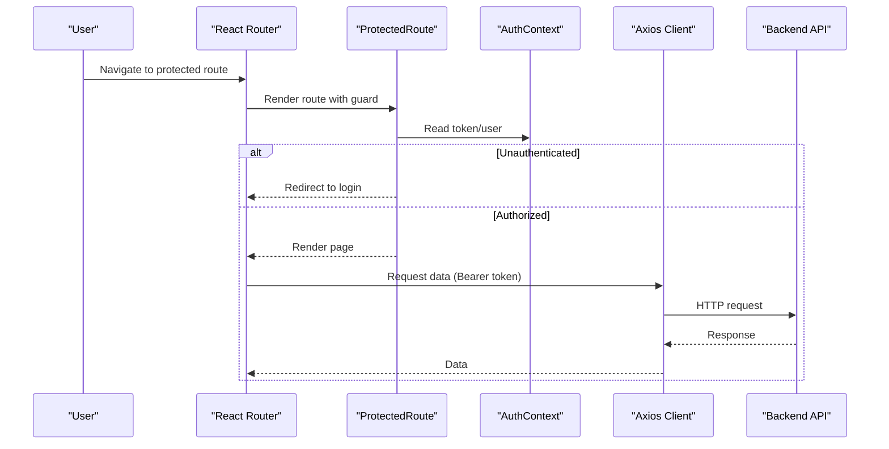
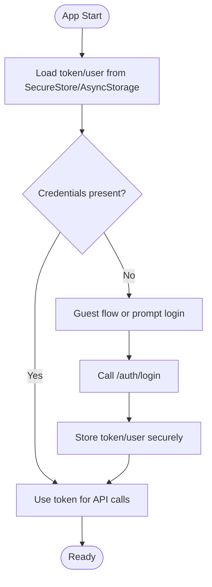
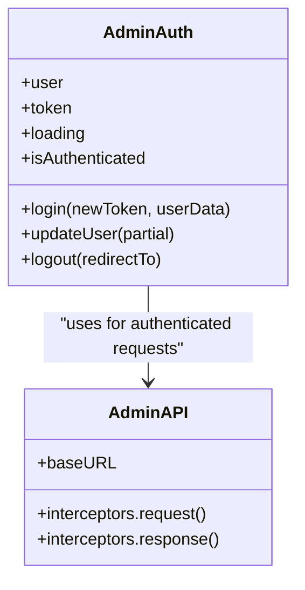
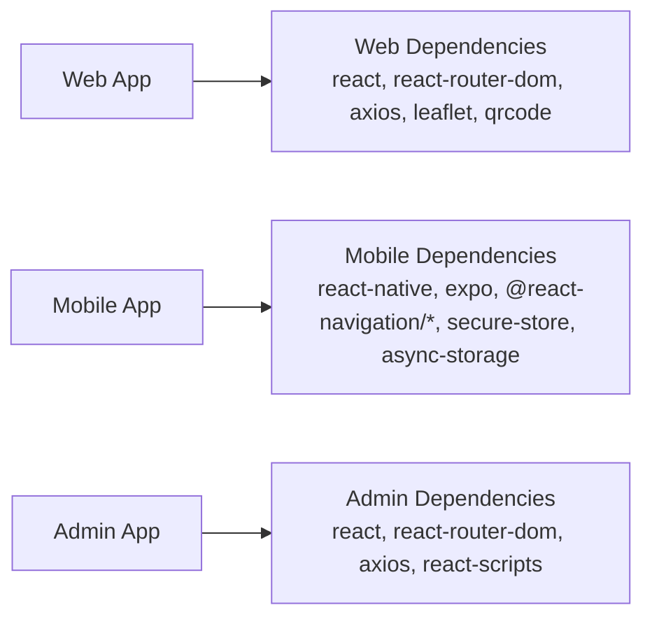

# Architecture Overview

<cite>
**Referenced Files in This Document**
- [package.json](file://package.json)
- [vite.config.js](file://vite.config.js)
- [src/App.jsx](file://src/App.jsx)
- [src/context/AuthContext.jsx](file://src/context/AuthContext.jsx)
- [src/components/ProtectedRoute.jsx](file://src/components/ProtectedRoute.jsx)
- [src/api/api.js](file://src/api/api.js)
- [axx-spaces-mobile/package.json](file://axx-spaces-mobile/package.json)
- [axx-spaces-mobile/app.json](file://axx-spaces-mobile/app.json)
- [axx-spaces-mobile/src/navigation/AppNavigator.js](file://axx-spaces-mobile/src/navigation/AppNavigator.js)
- [axx-spaces-mobile/src/services/api.js](file://axx-spaces-mobile/src/services/api.js)
- [axx-spaces-mobile/src/context/AuthContext.js](file://axx-spaces-mobile/src/context/AuthContext.js)
- [axxspace-admin/package.json](file://axxspace-admin/package.json)
- [axxspace-admin/src/context/AuthContext.js](file://axxspace-admin/src/context/AuthContext.js)
- [axxspace-admin/src/api/api.js](file://axxspace-admin/src/api/api.js)
- [vercel.json](file://vercel.json)
- [nginx-security.conf](file://nginx-security.conf)
- [middleware/security.js](file://middleware/security.js)
</cite>

## Table of Contents
1. [Introduction](#introduction)
2. [Project Structure](#project-structure)
3. [Core Components](#core-components)
4. [Architecture Overview](#architecture-overview)
5. [Detailed Component Analysis](#detailed-component-analysis)
6. [Dependency Analysis](#dependency-analysis)
7. [Performance Considerations](#performance-considerations)
8. [Troubleshooting Guide](#troubleshooting-guide)
9. [Conclusion](#conclusion)

## Introduction
This document describes the architecture of the AxxSpaces frontend monorepo, which hosts three distinct applications:
- Web application (React + Vite)
- Mobile application (React Native + Expo)
- Admin application (React + Create React App)

The system is designed to share a common backend API and security posture while providing platform-specific user experiences. The web app uses React Router for client-side routing, context-based authentication, and role-based access control. The mobile app uses React Navigation with a WebView-first approach and secure storage for tokens. The admin app provides an administrative interface with its own auth context and API client.

## Project Structure
The repository is organized as a monorepo with three top-level applications and shared infrastructure configuration:
- Root web app under src/ built with Vite
- Mobile app under axx-spaces-mobile/ using Expo and React Native
- Admin app under axxspace-admin/ using react-scripts
- Infrastructure and deployment configs at the root (Vercel, Nginx, middleware)

**Diagram sources**
- [package.json:1-10](file://package.json#L1-L10)
- [axx-spaces-mobile/package.json:1-13](file://axx-spaces-mobile/package.json#L1-L13)
- [axxspace-admin/package.json:1-24](file://axxspace-admin/package.json#L1-L24)
- [vercel.json:1-11](file://vercel.json#L1-L11)
- [nginx-security.conf:17-64](file://nginx-security.conf#L17-L64)

**Section sources**
- [package.json:1-10](file://package.json#L1-L10)
- [axx-spaces-mobile/package.json:1-13](file://axx-spaces-mobile/package.json#L1-L13)
- [axxspace-admin/package.json:1-24](file://axxspace-admin/package.json#L1-L24)

## Core Components
- Web Application
  - Routing: React Router with layout wrappers and protected routes
  - Authentication: Context-based state with token persistence and guest auto-login
  - API Client: Axios instance with interceptors for auth headers and logging
- Mobile Application
  - Navigation: React Navigation stack wrapping a WebView screen
  - Authentication: SecureStore + AsyncStorage for tokens and user data
  - API Client: Fetch wrapper with optional auth header injection
- Admin Application
  - Authentication: Context-based state persisted in localStorage
  - API Client: Axios instance with request/response interceptors

Key responsibilities:
- Role-based access control via ProtectedRoute
- Centralized API clients per app
- Platform-appropriate secure storage for credentials

**Section sources**
- [src/App.jsx:140-491](file://src/App.jsx#L140-L491)
- [src/context/AuthContext.jsx:17-153](file://src/context/AuthContext.jsx#L17-L153)
- [src/components/ProtectedRoute.jsx:15-55](file://src/components/ProtectedRoute.jsx#L15-L55)
- [src/api/api.js:1-46](file://src/api/api.js#L1-L46)
- [axx-spaces-mobile/src/navigation/AppNavigator.js:1-29](file://axx-spaces-mobile/src/navigation/AppNavigator.js#L1-L29)
- [axx-spaces-mobile/src/context/AuthContext.js:8-132](file://axx-spaces-mobile/src/context/AuthContext.js#L8-L132)
- [axx-spaces-mobile/src/services/api.js:1-77](file://axx-spaces-mobile/src/services/api.js#L1-L77)
- [axxspace-admin/src/context/AuthContext.js:5-83](file://axxspace-admin/src/context/AuthContext.js#L5-L83)
- [axxspace-admin/src/api/api.js:1-22](file://axxspace-admin/src/api/api.js#L1-L22)

## Architecture Overview
High-level system design shows three frontends communicating with a single backend API. Security headers and rate limiting are enforced at both the CDN/platform layer (Vercel) and reverse proxy (Nginx). The web app’s build output is optimized for production, and the mobile app bundles native modules through Expo/EAS.

**Diagram sources**
- [vercel.json:1-11](file://vercel.json#L1-L11)
- [nginx-security.conf:17-64](file://nginx-security.conf#L17-L64)
- [package.json:6-10](file://package.json#L6-L10)
- [axx-spaces-mobile/package.json:5-12](file://axx-spaces-mobile/package.json#L5-L12)

## Detailed Component Analysis

### Web Application (React + Vite)
- Routing and Layouts
  - Centralized routes define public pages, dashboards, and protected areas
  - Layout wrappers provide consistent chrome (navbar, floating widgets)
  - Legacy route redirects maintain backward compatibility
- Authentication Flow
  - On app start, restore token/user from localStorage or perform guest sign-in
  - Splash screen controls initial UX; session flag prevents repeated splash
  - Login updates context and persists credentials
- Route Protection
  - ProtectedRoute checks auth state and role permissions
  - Redirects to appropriate login or dashboard based on role
- API Client
  - Axios instance injects Authorization header from localStorage
  - Interceptors log requests/responses and surface errors

**Diagram sources**
- [src/App.jsx:140-491](file://src/App.jsx#L140-L491)
- [src/components/ProtectedRoute.jsx:15-55](file://src/components/ProtectedRoute.jsx#L15-L55)
- [src/context/AuthContext.jsx:17-153](file://src/context/AuthContext.jsx#L17-L153)
- [src/api/api.js:1-46](file://src/api/api.js#L1-L46)

**Section sources**
- [src/App.jsx:140-491](file://src/App.jsx#L140-L491)
- [src/context/AuthContext.jsx:17-153](file://src/context/AuthContext.jsx#L17-L153)
- [src/components/ProtectedRoute.jsx:15-55](file://src/components/ProtectedRoute.jsx#L15-L55)
- [src/api/api.js:1-46](file://src/api/api.js#L1-L46)

### Mobile Application (React Native + Expo)
- Navigation
  - Uses React Navigation Stack with a single WebView screen as the primary entry point
- Authentication Flow
  - Loads token from SecureStore and user from AsyncStorage on startup
  - Login calls backend and stores credentials securely
  - Logout clears stored credentials
- API Client
  - Fetch wrapper adds Bearer token when available
  - Organized API modules for auth, properties, tourism, business, materials, movers, profile, notifications, wallet

**Diagram sources**
- [axx-spaces-mobile/src/navigation/AppNavigator.js:1-29](file://axx-spaces-mobile/src/navigation/AppNavigator.js#L1-L29)
- [axx-spaces-mobile/src/context/AuthContext.js:8-132](file://axx-spaces-mobile/src/context/AuthContext.js#L8-L132)
- [axx-spaces-mobile/src/services/api.js:1-77](file://axx-spaces-mobile/src/services/api.js#L1-L77)

**Section sources**
- [axx-spaces-mobile/src/navigation/AppNavigator.js:1-29](file://axx-spaces-mobile/src/navigation/AppNavigator.js#L1-L29)
- [axx-spaces-mobile/src/context/AuthContext.js:8-132](file://axx-spaces-mobile/src/context/AuthContext.js#L8-L132)
- [axx-spaces-mobile/src/services/api.js:1-77](file://axx-spaces-mobile/src/services/api.js#L1-L77)
- [axx-spaces-mobile/app.json:1-49](file://axx-spaces-mobile/app.json#L1-L49)

### Admin Application (React + CRA)
- Authentication
  - Restores token/user from localStorage on load
  - Provides login/update/logout functions that persist credentials
- API Client
  - Axios instance with base URL configured via environment variable
  - Interceptors attach Authorization header and log requests/responses

**Diagram sources**
- [axxspace-admin/src/context/AuthContext.js:5-83](file://axxspace-admin/src/context/AuthContext.js#L5-L83)
- [axxspace-admin/src/api/api.js:1-22](file://axxspace-admin/src/api/api.js#L1-L22)

**Section sources**
- [axxspace-admin/src/context/AuthContext.js:5-83](file://axxspace-admin/src/context/AuthContext.js#L5-L83)
- [axxspace-admin/src/api/api.js:1-22](file://axxspace-admin/src/api/api.js#L1-L22)

## Dependency Analysis
- Web App Dependencies
  - React, React Router, Axios, Leaflet, QRCode, Google OAuth helper, analytics
  - Build tooling: Vite, ESLint, TailwindCSS
- Mobile App Dependencies
  - React Native, Expo SDK, React Navigation, SecureStore, Async Storage
  - Camera, image picker, location, notifications, status bar
- Admin App Dependencies
  - React, React Router, Axios, testing libraries, react-scripts

**Diagram sources**
- [package.json:12-47](file://package.json#L12-L47)
- [axx-spaces-mobile/package.json:14-39](file://axx-spaces-mobile/package.json#L14-L39)
- [axxspace-admin/package.json:5-23](file://axxspace-admin/package.json#L5-L23)

**Section sources**
- [package.json:12-47](file://package.json#L12-L47)
- [axx-spaces-mobile/package.json:14-39](file://axx-spaces-mobile/package.json#L14-L39)
- [axxspace-admin/package.json:5-23](file://axxspace-admin/package.json#L5-L23)

## Performance Considerations
- Web Build Optimization
  - Vite config disables source maps in production and sets hashed asset names for cache busting
  - Development server includes security headers
- Caching and Chunking
  - Output filenames include hashes to improve caching efficiency
- Network Efficiency
  - API clients use timeouts and structured error handling to avoid hanging requests
- Mobile Bundle
  - Expo manages native module bundling; EAS builds produce platform-specific artifacts

[No sources needed since this section provides general guidance]

## Troubleshooting Guide
- Authentication Issues
  - Verify token presence in localStorage (web/admin) or SecureStore (mobile)
  - Check guest auto-sign-in behavior if no credentials are found
  - Ensure CORS allows the frontend origin(s)
- Routing Problems
  - Confirm route definitions and order (specific routes before dynamic ones)
  - Validate ProtectedRole guards and redirect paths
- API Errors
  - Inspect interceptor logs for request/response details
  - Validate base URLs and environment variables
- Deployment Headers
  - Review Vercel rewrites and CSP headers
  - Ensure Nginx forwards correctly and applies security headers

**Section sources**
- [src/context/AuthContext.jsx:52-97](file://src/context/AuthContext.jsx#L52-L97)
- [src/components/ProtectedRoute.jsx:41-55](file://src/components/ProtectedRoute.jsx#L41-L55)
- [src/api/api.js:11-44](file://src/api/api.js#L11-L44)
- [axx-spaces-mobile/src/services/api.js:7-45](file://axx-spaces-mobile/src/services/api.js#L7-L45)
- [vercel.json:12-47](file://vercel.json#L12-L47)
- [nginx-security.conf:29-64](file://nginx-security.conf#L29-L64)
- [middleware/security.js:13-54](file://middleware/security.js#L13-L54)

## Conclusion
The AxxSpaces frontend monorepo delivers three cohesive applications sharing a unified backend and security model. The web app emphasizes robust routing and role-based protection, the mobile app leverages Expo and secure storage for a native experience, and the admin app provides focused administrative capabilities. Deployment configurations at Vercel and Nginx enforce security headers and rate limits, ensuring a safe and performant user experience across platforms.