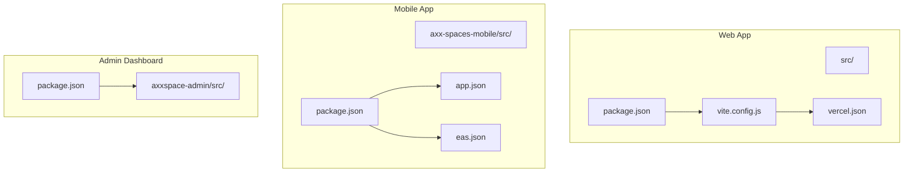
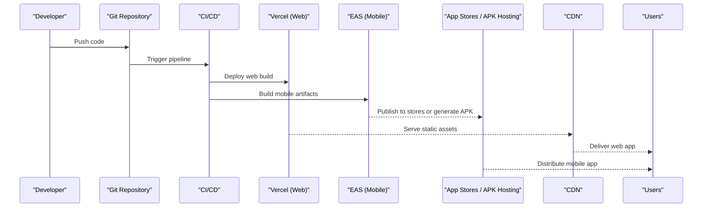
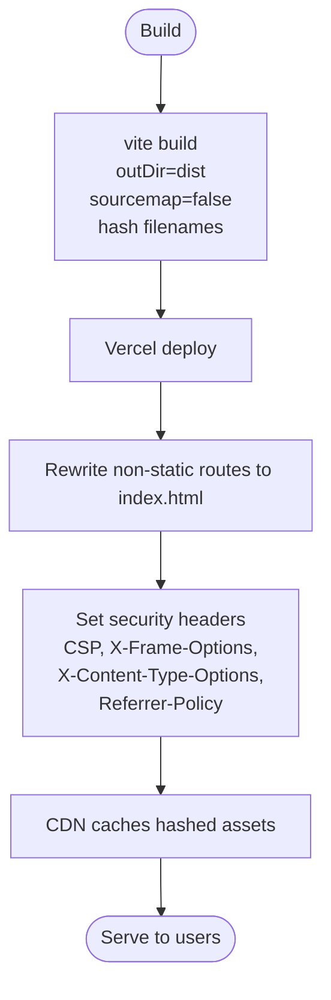
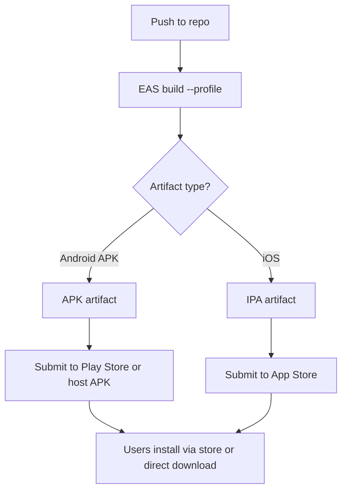
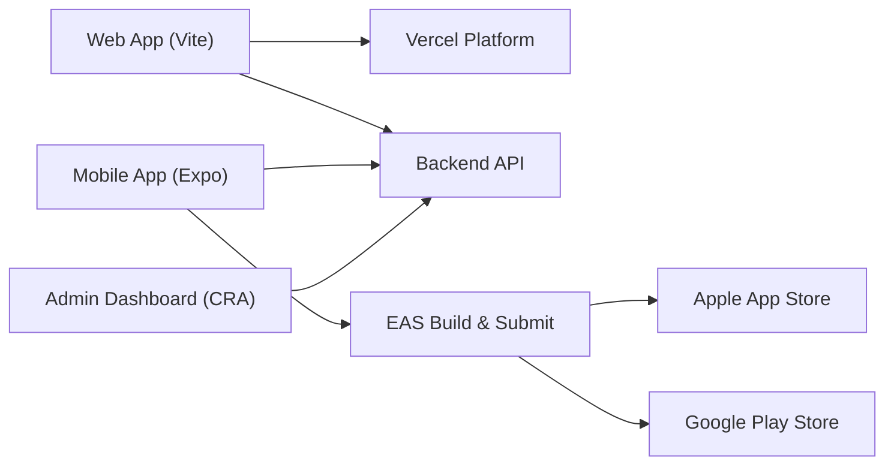

# Deployment Architecture

<cite>
**Referenced Files in This Document**
- [package.json](file://package.json)
- [vercel.json](file://vercel.json)
- [vite.config.js](file://vite.config.js)
- [axx-spaces-mobile/package.json](file://axx-spaces-mobile/package.json)
- [axx-spaces-mobile/app.json](file://axx-spaces-mobile/app.json)
- [axx-spaces-mobile/eas.json](file://axx-spaces-mobile/eas.json)
- [axx-spaces-mobile/DEPLOYMENT.md](file://axx-spaces-mobile/DEPLOYMENT.md)
- [axx-spaces-mobile/BUILD_GUIDE.md](file://axx-spaces-mobile/BUILD_GUIDE.md)
- [axx-spaces-mobile/src/config.js](file://axx-spaces-mobile/src/config.js)
- [axxspace-admin/package.json](file://axxspace-admin/package.json)
- [nginx-security.conf](file://nginx-security.conf)
- [src/api/api.js](file://src/api/api.js)
</cite>

## Table of Contents
1. [Introduction](#introduction)
2. [Project Structure](#project-structure)
3. [Core Components](#core-components)
4. [Architecture Overview](#architecture-overview)
5. [Detailed Component Analysis](#detailed-component-analysis)
6. [Dependency Analysis](#dependency-analysis)
7. [Performance Considerations](#performance-considerations)
8. [Troubleshooting Guide](#troubleshooting-guide)
9. [Conclusion](#conclusion)

## Introduction
This document describes the deployment architecture for the AxxSpaces frontend applications:
- Web application (Vite + React)
- Mobile application (Expo + EAS)
- Admin dashboard (Create React App)

It covers build processes, deployment targets, hosting infrastructure, CI/CD integration points, automated testing hooks, security configurations, environment variable management, production optimizations, CDN and caching strategies, performance monitoring, mobile distribution via Expo/EAS, web deployment on Vercel, admin hosting options, rollback procedures, environment management, and deployment troubleshooting.

## Project Structure
The repository contains three distinct frontend applications with shared tooling and configuration patterns:
- Root web app built with Vite and deployed to Vercel
- Mobile app built with Expo and distributed via EAS
- Admin dashboard built with Create React App

**Diagram sources**
- [package.json:1-50](file://package.json#L1-L50)
- [vite.config.js:1-36](file://vite.config.js#L1-L36)
- [vercel.json:1-48](file://vercel.json#L1-L48)
- [axx-spaces-mobile/package.json:1-41](file://axx-spaces-mobile/package.json#L1-L41)
- [axx-spaces-mobile/app.json:1-49](file://axx-spaces-mobile/app.json#L1-L49)
- [axx-spaces-mobile/eas.json:1-28](file://axx-spaces-mobile/eas.json#L1-L28)
- [axxspace-admin/package.json:1-44](file://axxspace-admin/package.json#L1-L44)

**Section sources**
- [package.json:1-50](file://package.json#L1-L50)
- [axx-spaces-mobile/package.json:1-41](file://axx-spaces-mobile/package.json#L1-L41)
- [axxspace-admin/package.json:1-44](file://axxspace-admin/package.json#L1-L44)

## Core Components
- Web application (Vite):
  - Build output directory and asset hashing configured for cache-friendly deployments
  - Security headers set in development server
  - Vercel rewrites and headers configured for SPA routing and security
- Mobile application (Expo/EAS):
  - Profiles for development, preview, and production builds
  - Android permissions and cleartext traffic settings
  - Environment configuration for API URLs and feature flags
- Admin dashboard (React Scripts):
  - Standard CRA scripts for start, build, test, and debug builds

Key responsibilities:
- Web: Fast builds, optimized assets, secure headers, SPA routing
- Mobile: Cross-platform builds, store distribution, runtime config
- Admin: Internal tooling, standard CRA lifecycle

**Section sources**
- [vite.config.js:19-30](file://vite.config.js#L19-L30)
- [vercel.json:1-48](file://vercel.json#L1-L48)
- [axx-spaces-mobile/eas.json:5-27](file://axx-spaces-mobile/eas.json#L5-L27)
- [axx-spaces-mobile/app.json:21-37](file://axx-spaces-mobile/app.json#L21-L37)
- [axx-spaces-mobile/src/config.js:1-44](file://axx-spaces-mobile/src/config.js#L1-L44)
- [axxspace-admin/package.json:18-24](file://axxspace-admin/package.json#L18-L24)

## Architecture Overview
High-level deployment flow across environments:

[No sources needed since this diagram shows conceptual workflow, not actual code structure]

## Detailed Component Analysis

### Web Application (Vite + React)
Build process:
- Development server runs on a fixed port with security headers
- Production build outputs hashed assets for long-term caching
- Source maps disabled in production

Deployment target:
- Vercel with SPA rewrite rules
- Security headers including CSP, X-Frame-Options, X-Content-Type-Options, Referrer-Policy
- Dedicated Content-Type for APK downloads under /downloads

Environment variables:
- Base URL for backend API is read from Vite env at runtime
- Global constants can be injected via Vite define

Security and optimization:
- CSP restricts script/style/connect sources
- HSTS enforced via Nginx when self-hosted
- Asset hashing improves cache efficiency

**Diagram sources**
- [vite.config.js:19-30](file://vite.config.js#L19-L30)
- [vercel.json:1-48](file://vercel.json#L1-L48)

**Section sources**
- [package.json:6-11](file://package.json#L6-L11)
- [vite.config.js:7-17](file://vite.config.js#L7-L17)
- [vite.config.js:19-30](file://vite.config.js#L19-L30)
- [vercel.json:1-48](file://vercel.json#L1-L48)
- [src/api/api.js:3-8](file://src/api/api.js#L3-L8)

### Mobile Application (Expo + EAS)
Build profiles:
- development: internal distribution with development client
- preview: internal distribution; Android APK; iOS simulator
- production: Android APK; iOS auto-increment

Distribution:
- EAS CLI used to build and submit to Apple App Store and Google Play
- APK also available for direct download via website’s /downloads path

Runtime configuration:
- API_URL switches between local dev and production endpoints
- Feature flags control push notifications, location, camera, offline mode
- Version and app metadata defined in app.json

Permissions and network:
- Android permissions include internet, storage, camera, location
- Cleartext traffic enabled for development scenarios

**Diagram sources**
- [axx-spaces-mobile/eas.json:5-27](file://axx-spaces-mobile/eas.json#L5-L27)
- [axx-spaces-mobile/app.json:21-37](file://axx-spaces-mobile/app.json#L21-L37)
- [axx-spaces-mobile/package.json:5-13](file://axx-spaces-mobile/package.json#L5-L13)

**Section sources**
- [axx-spaces-mobile/package.json:5-13](file://axx-spaces-mobile/package.json#L5-L13)
- [axx-spaces-mobile/eas.json:5-27](file://axx-spaces-mobile/eas.json#L5-L27)
- [axx-spaces-mobile/app.json:1-49](file://axx-spaces-mobile/app.json#L1-L49)
- [axx-spaces-mobile/src/config.js:1-44](file://axx-spaces-mobile/src/config.js#L1-L44)
- [axx-spaces-mobile/DEPLOYMENT.md:46-167](file://axx-spaces-mobile/DEPLOYMENT.md#L46-L167)
- [axx-spaces-mobile/BUILD_GUIDE.md:42-124](file://axx-spaces-mobile/BUILD_GUIDE.md#L42-L124)

### Admin Dashboard (Create React App)
Build and test:
- Standard CRA scripts for start, build, test, and verbose build
- ESLint extends react-app and jest presets

Hosting:
- Can be hosted on Vercel or any static hosting provider
- No specific deployment config found in the repository

**Section sources**
- [axxspace-admin/package.json:18-24](file://axxspace-admin/package.json#L18-L24)
- [axxspace-admin/package.json:25-30](file://axxspace-admin/package.json#L25-L30)

## Dependency Analysis
Component relationships and external integrations:

**Diagram sources**
- [vercel.json:1-48](file://vercel.json#L1-L48)
- [axx-spaces-mobile/eas.json:5-27](file://axx-spaces-mobile/eas.json#L5-L27)
- [axx-spaces-mobile/package.json:5-13](file://axx-spaces-mobile/package.json#L5-L13)
- [axxspace-admin/package.json:18-24](file://axxspace-admin/package.json#L18-L24)

**Section sources**
- [vercel.json:1-48](file://vercel.json#L1-L48)
- [axx-spaces-mobile/eas.json:5-27](file://axx-spaces-mobile/eas.json#L5-L27)
- [axx-spaces-mobile/package.json:5-13](file://axx-spaces-mobile/package.json#L5-L13)
- [axxspace-admin/package.json:18-24](file://axxspace-admin/package.json#L18-L24)

## Performance Considerations
- Web application:
  - Hashed filenames for assets enable aggressive browser caching
  - Source maps disabled in production to reduce payload size
  - Vercel CDN serves static assets globally
- Mobile application:
  - Use preview builds for faster iteration during development
  - Keep APK size reasonable; leverage EAS cloud builds
  - Configure image upload limits and cache TTL in app config
- Admin dashboard:
  - Leverage CRA’s default optimizations in production builds

[No sources needed since this section provides general guidance]

## Troubleshooting Guide
Common issues and resolutions:

- Web application:
  - Verify Vercel rewrites route all non-static paths to index.html
  - Ensure CSP allows required third-party domains for analytics and auth providers
  - Confirm API base URL is correctly set via environment variables

- Mobile application:
  - EAS build failures due to missing credentials: reset credentials and rebuild
  - Android installation blocked: enable “Unknown sources” on device
  - API connectivity issues: verify API_URL in runtime config matches backend endpoint

- Admin dashboard:
  - Test execution uses Jest via CRA; ensure tests pass before deploying

Operational notes:
- For self-hosted scenarios, enforce HTTPS and security headers using Nginx configuration
- Rate limiting and bot blocking are configured at the reverse proxy layer

**Section sources**
- [vercel.json:12-46](file://vercel.json#L12-L46)
- [axx-spaces-mobile/DEPLOYMENT.md:219-243](file://axx-spaces-mobile/DEPLOYMENT.md#L219-L243)
- [axx-spaces-mobile/BUILD_GUIDE.md:155-183](file://axx-spaces-mobile/BUILD_GUIDE.md#L155-L183)
- [nginx-security.conf:17-65](file://nginx-security.conf#L17-L65)

## Conclusion
The AxxSpaces frontend portfolio follows modern, scalable deployment practices:
- Web app built with Vite and deployed to Vercel with strong security headers and CDN-backed caching
- Mobile app built with Expo and distributed via EAS to app stores and direct APK hosting
- Admin dashboard built with CRA for straightforward development and deployment
- Clear separation of concerns across environments, robust security headers, and well-defined build profiles support reliable releases and easy rollbacks.

[No sources needed since this section summarizes without analyzing specific files]