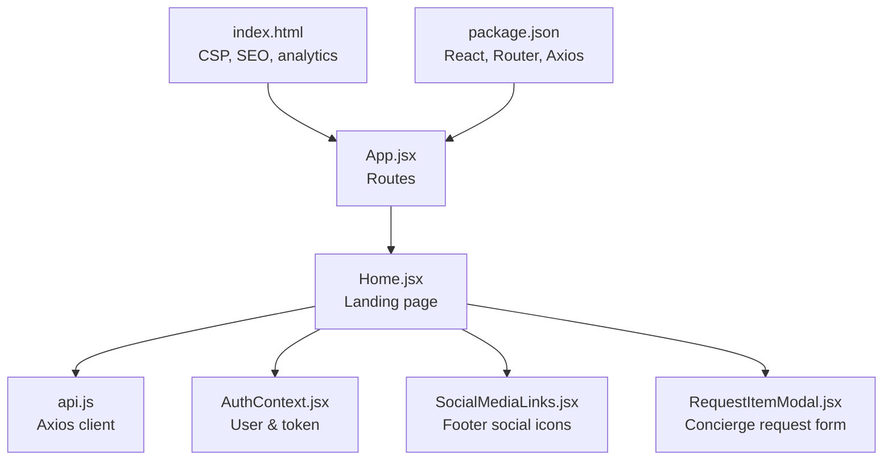
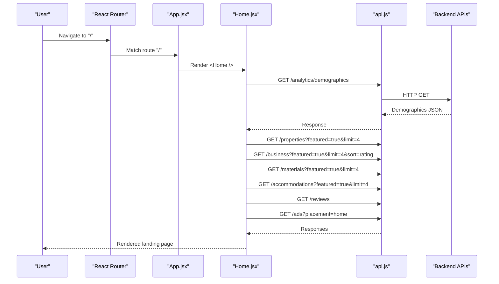
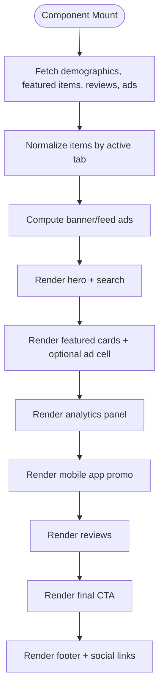
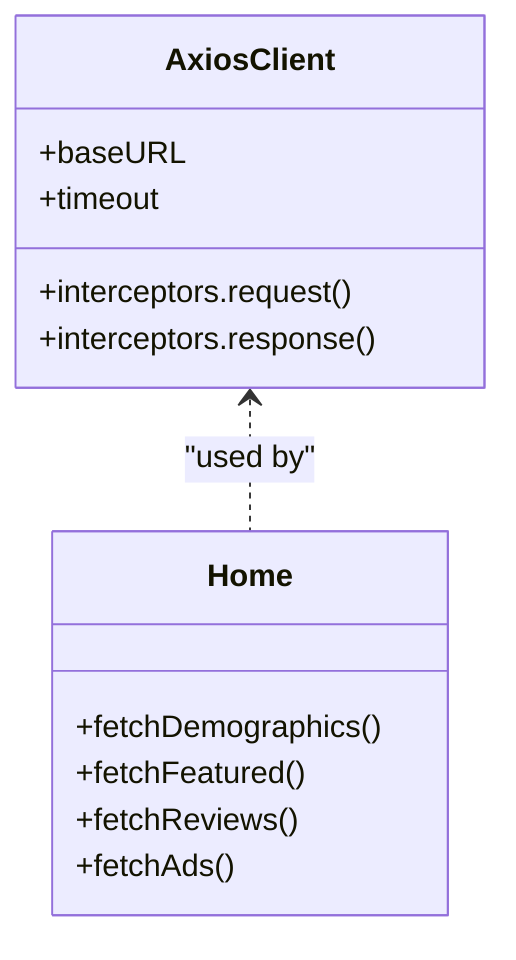
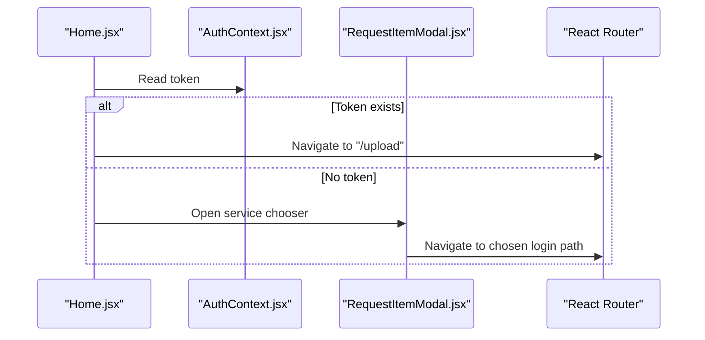
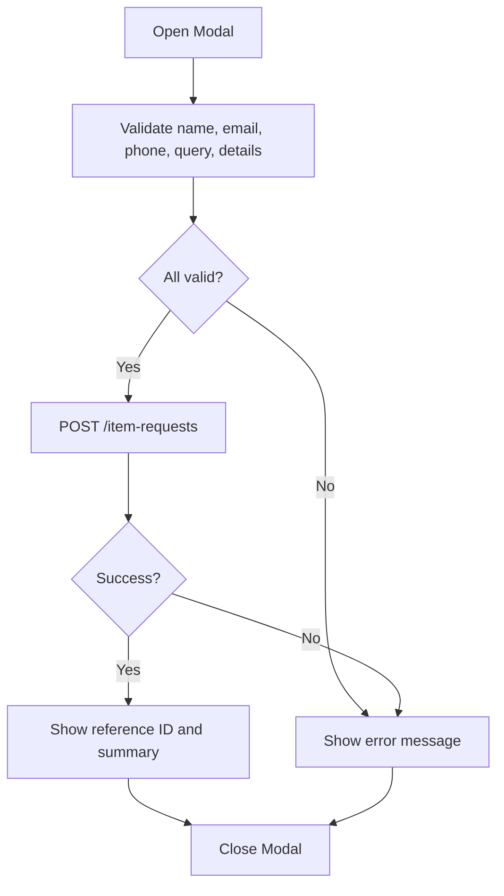
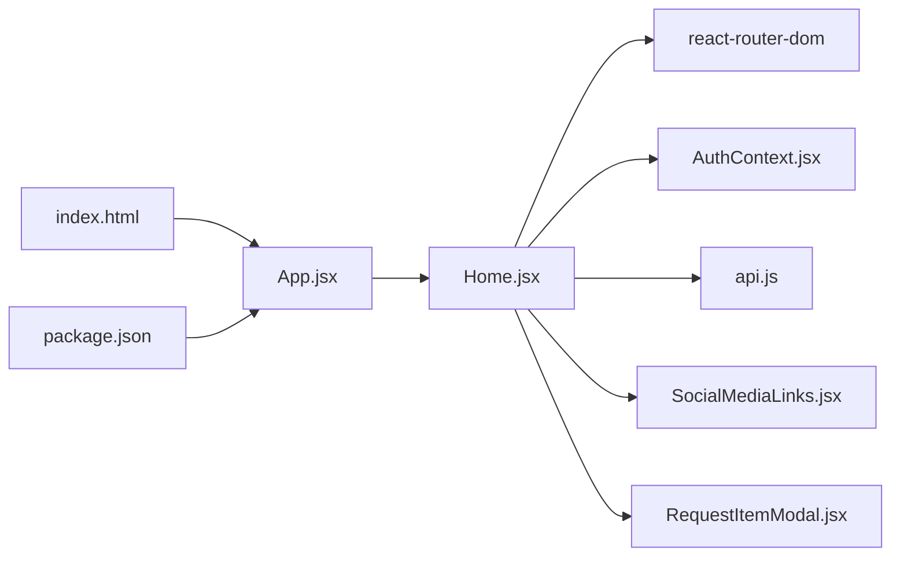

# Home Page

<cite>
**Referenced Files in This Document**
- [Home.jsx](file://src/pages/Home.jsx)
- [App.jsx](file://src/App.jsx)
- [api.js](file://src/api/api.js)
- [AuthContext.jsx](file://src/context/AuthContext.jsx)
- [SocialMediaLinks.jsx](file://src/components/SocialMediaLinks.jsx)
- [RequestItemModal.jsx](file://src/components/RequestItemModal.jsx)
- [index.html](file://index.html)
- [package.json](file://package.json)
</cite>

## Table of Contents
1. [Introduction](#introduction)
2. [Project Structure](#project-structure)
3. [Core Components](#core-components)
4. [Architecture Overview](#architecture-overview)
5. [Detailed Component Analysis](#detailed-component-analysis)
6. [Dependency Analysis](#dependency-analysis)
7. [Performance Considerations](#performance-considerations)
8. [Troubleshooting Guide](#troubleshooting-guide)
9. [Conclusion](#conclusion)

## Introduction
This document explains the Home Page implementation for the Axxspace frontend. The Home Page is the public landing experience that guides users to explore rentals, accommodation, business services, and quick sales. It includes a hero section with contextual search, featured listings, analytics visualizations, advertising slots, mobile app promotion, reviews, and a final call-to-action. It integrates with authentication, routing, API calls, and several reusable components.

## Project Structure
The Home Page is implemented as a single React component mounted at the root route. It uses:
- React Router for navigation
- Axios-based API client for data fetching
- Auth context for user state
- Reusable UI components for social links and request modal
- Inline scoped CSS for styling

**Diagram sources**
- [App.jsx:140-145](file://src/App.jsx#L140-L145)
- [Home.jsx:1-8](file://src/pages/Home.jsx#L1-L8)
- [api.js:1-8](file://src/api/api.js#L1-L8)
- [AuthContext.jsx:15-17](file://src/context/AuthContext.jsx#L15-L17)
- [SocialMediaLinks.jsx:1-10](file://src/components/SocialMediaLinks.jsx#L1-L10)
- [RequestItemModal.jsx:1-4](file://src/components/RequestItemModal.jsx#L1-L4)
- [index.html:1-16](file://index.html#L1-L16)
- [package.json:12-33](file://package.json#L12-L33)

**Section sources**
- [App.jsx:140-145](file://src/App.jsx#L140-L145)
- [Home.jsx:1-8](file://src/pages/Home.jsx#L1-L8)
- [index.html:1-16](file://index.html#L1-L16)
- [package.json:12-33](file://package.json#L12-L33)

## Core Components
- Home.jsx: Main landing page logic, layout, animations, data fetching, and interactions.
- api.js: Centralized Axios instance with interceptors for auth tokens and logging.
- AuthContext.jsx: Provides authenticated user and token; supports guest auto-login.
- SocialMediaLinks.jsx: Renders brand social media links with accessible labels.
- RequestItemModal.jsx: Concierge-style request form for custom sourcing.

Key responsibilities:
- Hero search with dynamic fields based on selected service (rentals, accommodation, quicksales).
- Featured listings carousel with category tabs and optional ad insertion.
- Analytics panel showing service popularity and top counties.
- Advertising banner rotation and click tracking.
- Mobile app promotion and review showcase.
- Footer with social links and site navigation.

**Section sources**
- [Home.jsx:918-1091](file://src/pages/Home.jsx#L918-L1091)
- [api.js:1-47](file://src/api/api.js#L1-L47)
- [AuthContext.jsx:17-97](file://src/context/AuthContext.jsx#L17-L97)
- [SocialMediaLinks.jsx:5-109](file://src/components/SocialMediaLinks.jsx#L5-L109)
- [RequestItemModal.jsx:124-303](file://src/components/RequestItemModal.jsx#L124-L303)

## Architecture Overview
The Home Page composes multiple sections and orchestrates data flows from backend endpoints. It renders within the application’s public layout and routes through React Router.

**Diagram sources**
- [App.jsx:140-145](file://src/App.jsx#L140-L145)
- [Home.jsx:943-994](file://src/pages/Home.jsx#L943-L994)
- [api.js:1-8](file://src/api/api.js#L1-L8)

## Detailed Component Analysis

### Home.jsx: Landing Page Orchestration
Responsibilities:
- State management for featured items, reviews, demographics, ads, and UI toggles.
- Data fetching for analytics, featured content, reviews, and ads.
- Search handling across different services with query normalization and navigation.
- Rendering structured sections: trust bar, hero, featured listings, advertising, services, how it works, analytics, mobile app, reviews, CTA, footer.
- Accessibility and motion preferences support.

Key behaviors:
- Hero search builds URL parameters per tab and navigates to appropriate listing pages.
- Featured listings normalize heterogeneous item shapes into a consistent card model.
- Ad injection into the feed grid when available.
- Donut chart computed from service demographics using SVG stroke-dasharray.
- Scroll reveal via IntersectionObserver for performance-friendly animations.

**Diagram sources**
- [Home.jsx:943-1091](file://src/pages/Home.jsx#L943-L1091)
- [Home.jsx:1092-1586](file://src/pages/Home.jsx#L1092-L1586)

**Section sources**
- [Home.jsx:530-675](file://src/pages/Home.jsx#L530-L675)
- [Home.jsx:839-915](file://src/pages/Home.jsx#L839-L915)
- [Home.jsx:918-1091](file://src/pages/Home.jsx#L918-L1091)
- [Home.jsx:1092-1586](file://src/pages/Home.jsx#L1092-L1586)

### API Integration
- Base URL configured via environment variable or fallback.
- Interceptors attach Authorization headers from localStorage and log requests/responses.
- Home.jsx uses typed endpoints for analytics, featured content, reviews, and ads.

**Diagram sources**
- [api.js:1-47](file://src/api/api.js#L1-L47)
- [Home.jsx:943-994](file://src/pages/Home.jsx#L943-L994)

**Section sources**
- [api.js:1-47](file://src/api/api.js#L1-L47)
- [Home.jsx:943-994](file://src/pages/Home.jsx#L943-L994)

### Authentication Context Usage
- Home.jsx reads token from AuthContext to gate “List your property” actions.
- If not authenticated, a modal prompts selection of service type and redirects to relevant login.

**Diagram sources**
- [Home.jsx:1011-1014](file://src/pages/Home.jsx#L1011-L1014)
- [Home.jsx:1588-1600](file://src/pages/Home.jsx#L1588-L1600)
- [AuthContext.jsx:135-144](file://src/context/AuthContext.jsx#L135-L144)
- [RequestItemModal.jsx:124-189](file://src/components/RequestItemModal.jsx#L124-L189)

**Section sources**
- [Home.jsx:1011-1014](file://src/pages/Home.jsx#L1011-L1014)
- [Home.jsx:1588-1600](file://src/pages/Home.jsx#L1588-L1600)
- [AuthContext.jsx:17-97](file://src/context/AuthContext.jsx#L17-L97)

### Social Media Links
- Renders branded social links with hover effects and accessibility attributes.
- Used in the footer of the Home Page.

**Section sources**
- [SocialMediaLinks.jsx:5-109](file://src/components/SocialMediaLinks.jsx#L5-L109)
- [Home.jsx:1546-1586](file://src/pages/Home.jsx#L1546-L1586)

### Request Item Modal
- Provides a multi-step concierge request form with validation, budgeting, urgency, and contact preferences.
- Submits to a backend endpoint and shows success confirmation with reference ID.

**Diagram sources**
- [RequestItemModal.jsx:227-303](file://src/components/RequestItemModal.jsx#L227-L303)
- [RequestItemModal.jsx:305-720](file://src/components/RequestItemModal.jsx#L305-L720)

**Section sources**
- [RequestItemModal.jsx:124-303](file://src/components/RequestItemModal.jsx#L124-L303)
- [RequestItemModal.jsx:305-720](file://src/components/RequestItemModal.jsx#L305-L720)

## Dependency Analysis
- Home.jsx depends on:
  - React Router for navigation
  - AuthContext for user state
  - API client for data fetching
  - SocialMediaLinks for footer branding
  - RequestItemModal for concierge requests
- App.jsx mounts Home under the root route with public layout wrappers.
- index.html defines CSP, SEO metadata, and analytics integrations.
- package.json declares runtime dependencies including React, React Router, and Axios.

**Diagram sources**
- [Home.jsx:1-8](file://src/pages/Home.jsx#L1-L8)
- [App.jsx:140-145](file://src/App.jsx#L140-L145)
- [index.html:1-16](file://index.html#L1-L16)
- [package.json:12-33](file://package.json#L12-L33)

**Section sources**
- [Home.jsx:1-8](file://src/pages/Home.jsx#L1-L8)
- [App.jsx:140-145](file://src/App.jsx#L140-L145)
- [index.html:1-16](file://index.html#L1-L16)
- [package.json:12-33](file://package.json#L12-L33)

## Performance Considerations
- Animations respect reduced motion preferences; scroll reveals use IntersectionObserver to avoid heavy computations.
- Images are lazy-loaded where possible; video background gracefully degrades if loading fails.
- Data fetching uses timeouts and parallel Promise.all to reduce load time.
- Ad rotation intervals are skipped when reduced motion is preferred.
- Counters animate only when visible and disabled under reduced motion.

Recommendations:
- Keep image assets optimized and consider responsive images.
- Debounce or throttle frequent state updates in analytics panels if expanded.
- Consider caching frequently accessed data (e.g., demographics) to reduce network calls.

[No sources needed since this section provides general guidance]

## Troubleshooting Guide
Common issues and resolutions:
- API connectivity errors: Check baseURL configuration and CORS/CSP settings. Inspect console logs from axios interceptors.
- Missing featured content: Verify backend endpoints return expected arrays or objects; ensure timeout does not prematurely fail.
- Authentication gating: Confirm token presence in localStorage and AuthContext; verify guest auto-login flow if needed.
- Ads not displaying: Ensure ads endpoint returns an array or object with ads field; check placement filter.
- Modal submission failures: Validate input fields and confirm backend accepts payload structure.

**Section sources**
- [api.js:10-44](file://src/api/api.js#L10-L44)
- [Home.jsx:943-994](file://src/pages/Home.jsx#L943-L994)
- [AuthContext.jsx:52-97](file://src/context/AuthContext.jsx#L52-L97)
- [RequestItemModal.jsx:227-303](file://src/components/RequestItemModal.jsx#L227-L303)

## Conclusion
The Home Page is a comprehensive landing interface that unifies discovery, search, and conversion across multiple platform verticals. It leverages React Router for navigation, Axios for API communication, and AuthContext for user state. Its modular design allows easy extension of sections like analytics, advertising, and reviews while maintaining accessibility and performance best practices.

[No sources needed since this section summarizes without analyzing specific files]