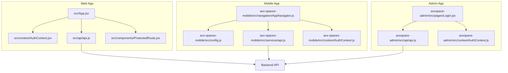
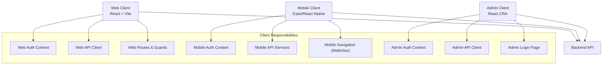
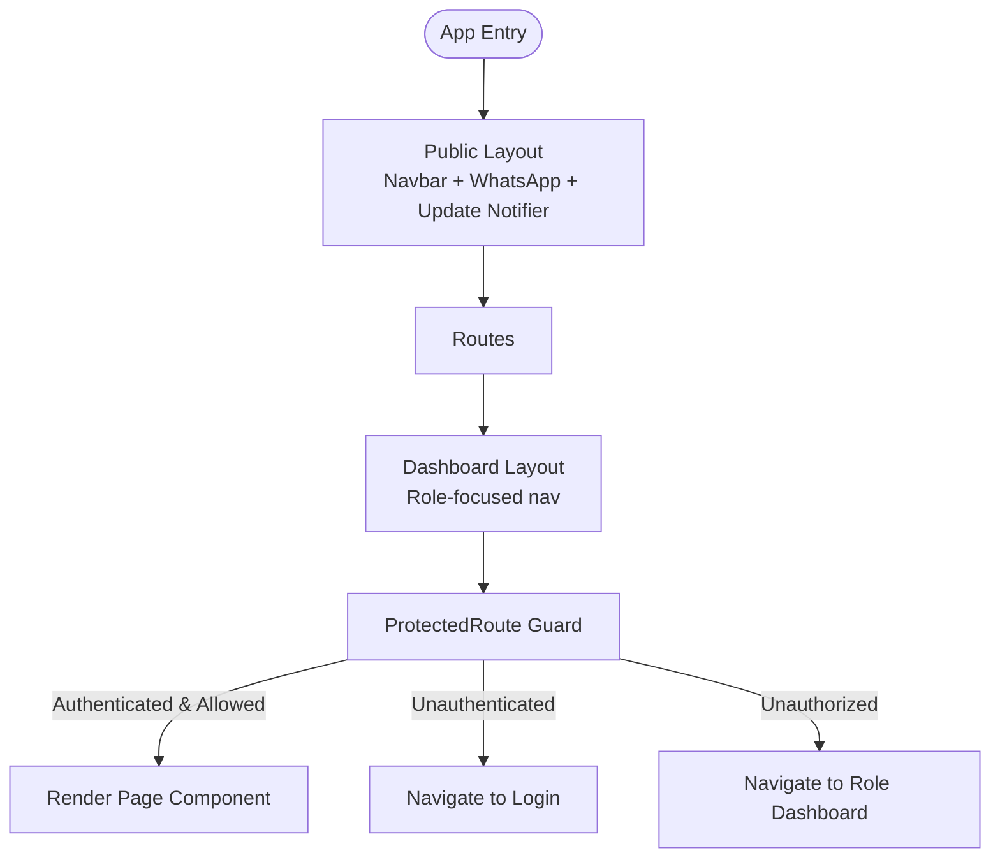
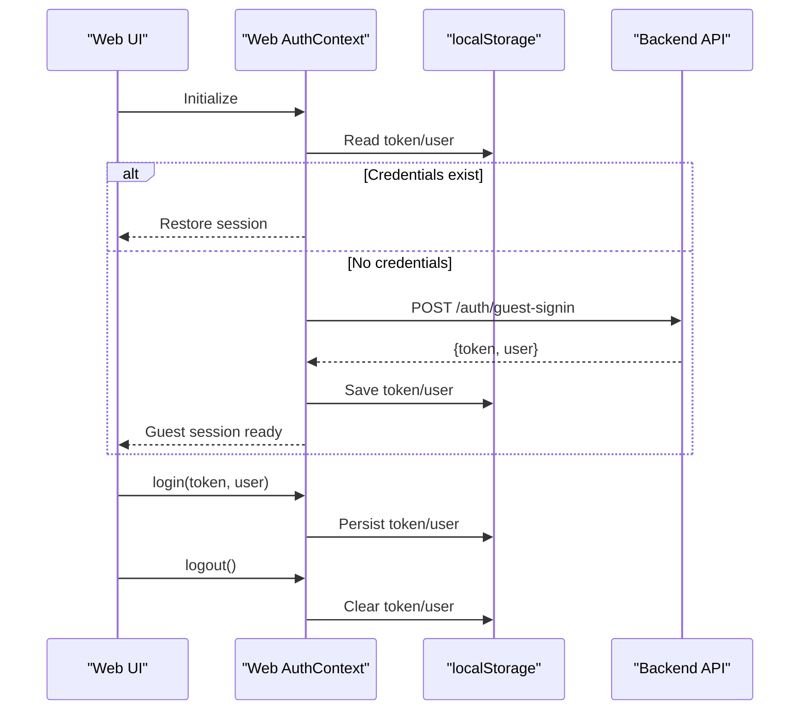
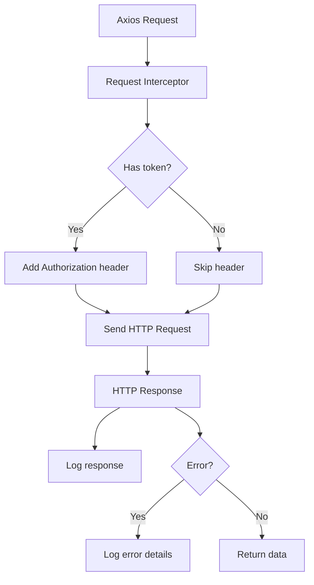
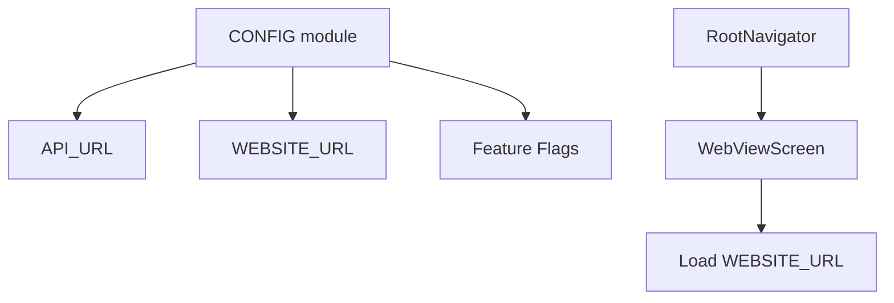
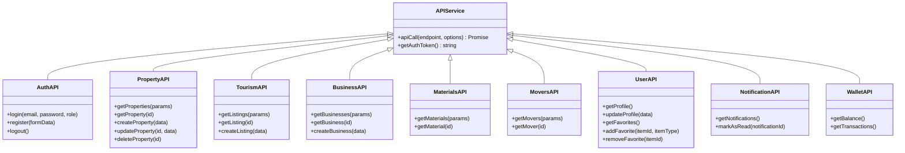
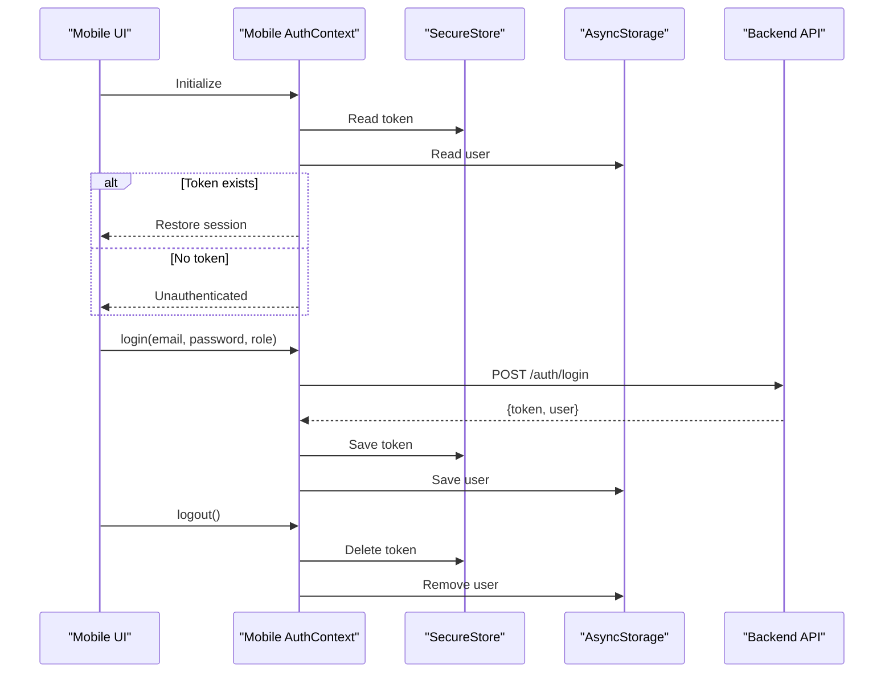
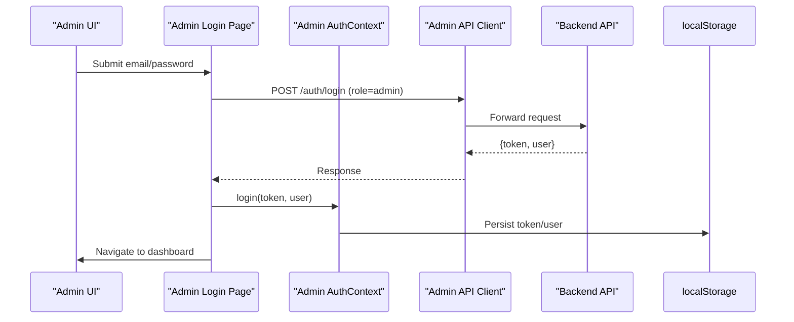
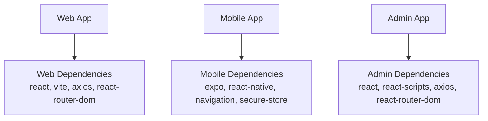

# System Architecture

<cite>
**Referenced Files in This Document**
- [package.json](file://package.json)
- [README.md](file://README.md)
- [src/App.jsx](file://src/App.jsx)
- [src/context/AuthContext.jsx](file://src/context/AuthContext.jsx)
- [src/api/api.js](file://src/api/api.js)
- [src/components/ProtectedRoute.jsx](file://src/components/ProtectedRoute.jsx)
- [axx-spaces-mobile/package.json](file://axx-spaces-mobile/package.json)
- [axx-spaces-mobile/src/config.js](file://axx-spaces-mobile/src/config.js)
- [axx-spaces-mobile/src/services/api.js](file://axx-spaces-mobile/src/services/api.js)
- [axx-spaces-mobile/src/context/AuthContext.js](file://axx-spaces-mobile/src/context/AuthContext.js)
- [axx-spaces-mobile/src/navigation/AppNavigator.js](file://axx-spaces-mobile/src/navigation/AppNavigator.js)
- [axxspace-admin/package.json](file://axxspace-admin/package.json)
- [axxspace-admin/src/api/api.js](file://axxspace-admin/src/api/api.js)
- [axxspace-admin/src/context/AuthContext.js](file://axxspace-admin/src/context/AuthContext.js)
- [axxspace-admin/src/pages/Login.jsx](file://axxspace-admin/src/pages/Login.jsx)
</cite>

## Table of Contents
1. [Introduction](#introduction)
2. [Project Structure](#project-structure)
3. [Core Components](#core-components)
4. [Architecture Overview](#architecture-overview)
5. [Detailed Component Analysis](#detailed-component-analysis)
6. [Dependency Analysis](#dependency-analysis)
7. [Performance Considerations](#performance-considerations)
8. [Troubleshooting Guide](#troubleshooting-guide)
9. [Conclusion](#conclusion)

## Introduction
This document describes the system architecture for the AxxSpaces frontend monorepo, which unifies three applications:
- Web application (React + Vite)
- Mobile application (Expo/React Native)
- Admin application (React + Create React App)

The platform follows a client-server model where each client communicates with a shared backend API. Authentication is handled via tokens stored per-platform, and routing/guards enforce role-based access. The mobile app currently wraps the web application through a WebView, while the admin app provides a dedicated administrative interface.

## Project Structure
The repository organizes code by application and shared concerns:
- Root package defines the web app build tooling and dependencies.
- axx-spaces-mobile contains the Expo/React Native app configuration, navigation, services, and auth context.
- axxspace-admin contains the admin panel’s React app, API client, auth context, and login page.
- src holds the main web application entry, routes, contexts, components, and pages.

**Diagram sources**
- [src/App.jsx:1-495](file://src/App.jsx#L1-L495)
- [src/context/AuthContext.jsx:1-157](file://src/context/AuthContext.jsx#L1-L157)
- [src/api/api.js:1-47](file://src/api/api.js#L1-L47)
- [src/components/ProtectedRoute.jsx:1-57](file://src/components/ProtectedRoute.jsx#L1-L57)
- [axx-spaces-mobile/src/config.js:1-44](file://axx-spaces-mobile/src/config.js#L1-L44)
- [axx-spaces-mobile/src/services/api.js:1-194](file://axx-spaces-mobile/src/services/api.js#L1-L194)
- [axx-spaces-mobile/src/context/AuthContext.js:1-136](file://axx-spaces-mobile/src/context/AuthContext.js#L1-L136)
- [axx-spaces-mobile/src/navigation/AppNavigator.js:1-30](file://axx-spaces-mobile/src/navigation/AppNavigator.js#L1-L30)
- [axxspace-admin/src/api/api.js:1-22](file://axxspace-admin/src/api/api.js#L1-L22)
- [axxspace-admin/src/context/AuthContext.js:1-84](file://axxspace-admin/src/context/AuthContext.js#L1-L84)
- [axxspace-admin/src/pages/Login.jsx:1-146](file://axxspace-admin/src/pages/Login.jsx#L1-L146)

**Section sources**
- [package.json:1-50](file://package.json#L1-L50)
- [README.md:1-17](file://README.md#L1-L17)

## Core Components
- Web Application
  - Routing and layout orchestration are centralized in the main app component.
  - Authentication state is managed via a context provider that persists token and user data.
  - An Axios instance centralizes base URL, timeouts, and request/response interceptors for logging and authorization headers.
  - Route guards enforce authentication and role-based access control.

- Mobile Application
  - Configuration module defines API endpoints and feature flags.
  - API service layer abstracts fetch calls, adds Authorization headers, and exposes typed modules for domains (auth, properties, tourism, business, materials, movers, user, notifications, wallet).
  - Auth context manages secure storage of tokens and user profile, and exposes login/register/logout/updateUser operations.
  - Navigation wraps the web application in a WebView as the primary screen.

- Admin Application
  - Dedicated API client configured with environment variables and interceptors for logging and authorization.
  - Auth context persists admin session and provides login/logout/updateUser.
  - Login page enforces admin-only access and supports password reset flows.

**Section sources**
- [src/App.jsx:1-495](file://src/App.jsx#L1-L495)
- [src/context/AuthContext.jsx:1-157](file://src/context/AuthContext.jsx#L1-L157)
- [src/api/api.js:1-47](file://src/api/api.js#L1-L47)
- [src/components/ProtectedRoute.jsx:1-57](file://src/components/ProtectedRoute.jsx#L1-L57)
- [axx-spaces-mobile/src/config.js:1-44](file://axx-spaces-mobile/src/config.js#L1-L44)
- [axx-spaces-mobile/src/services/api.js:1-194](file://axx-spaces-mobile/src/services/api.js#L1-L194)
- [axx-spaces-mobile/src/context/AuthContext.js:1-136](file://axx-spaces-mobile/src/context/AuthContext.js#L1-L136)
- [axx-spaces-mobile/src/navigation/AppNavigator.js:1-30](file://axx-spaces-mobile/src/navigation/AppNavigator.js#L1-L30)
- [axxspace-admin/src/api/api.js:1-22](file://axxspace-admin/src/api/api.js#L1-L22)
- [axxspace-admin/src/context/AuthContext.js:1-84](file://axxspace-admin/src/context/AuthContext.js#L1-L84)
- [axxspace-admin/src/pages/Login.jsx:1-146](file://axxspace-admin/src/pages/Login.jsx#L1-L146)

## Architecture Overview
The system uses a multi-client architecture with a single backend API surface. Each client implements its own authentication persistence strategy and API client, but shares common domain endpoints. Role-based routing ensures users are directed to appropriate dashboards.

**Diagram sources**
- [src/App.jsx:1-495](file://src/App.jsx#L1-L495)
- [src/context/AuthContext.jsx:1-157](file://src/context/AuthContext.jsx#L1-L157)
- [src/api/api.js:1-47](file://src/api/api.js#L1-L47)
- [src/components/ProtectedRoute.jsx:1-57](file://src/components/ProtectedRoute.jsx#L1-L57)
- [axx-spaces-mobile/src/config.js:1-44](file://axx-spaces-mobile/src/config.js#L1-L44)
- [axx-spaces-mobile/src/services/api.js:1-194](file://axx-spaces-mobile/src/services/api.js#L1-L194)
- [axx-spaces-mobile/src/context/AuthContext.js:1-136](file://axx-spaces-mobile/src/context/AuthContext.js#L1-L136)
- [axx-spaces-mobile/src/navigation/AppNavigator.js:1-30](file://axx-spaces-mobile/src/navigation/AppNavigator.js#L1-L30)
- [axxspace-admin/src/api/api.js:1-22](file://axxspace-admin/src/api/api.js#L1-L22)
- [axxspace-admin/src/context/AuthContext.js:1-84](file://axxspace-admin/src/context/AuthContext.js#L1-L84)
- [axxspace-admin/src/pages/Login.jsx:1-146](file://axxspace-admin/src/pages/Login.jsx#L1-L146)

## Detailed Component Analysis

### Web Application Routing and Layouts
The web application defines public, dashboard, and bare layouts, and maps numerous routes for listings, accommodation booking, agents, agencies, business directory, quick sales, user accounts, and admin features. Protected routes enforce roles and redirect appropriately.

**Diagram sources**
- [src/App.jsx:88-122](file://src/App.jsx#L88-L122)
- [src/App.jsx:140-491](file://src/App.jsx#L140-L491)
- [src/components/ProtectedRoute.jsx:15-56](file://src/components/ProtectedRoute.jsx#L15-L56)

**Section sources**
- [src/App.jsx:1-495](file://src/App.jsx#L1-L495)
- [src/components/ProtectedRoute.jsx:1-57](file://src/components/ProtectedRoute.jsx#L1-L57)

### Web Authentication Flow
The web app initializes authentication on load, restores persisted credentials, performs guest auto-login if needed, and exposes login/updateUser/logout helpers. Tokens and user data are stored in localStorage.

**Diagram sources**
- [src/context/AuthContext.jsx:41-97](file://src/context/AuthContext.jsx#L41-L97)
- [src/context/AuthContext.jsx:99-133](file://src/context/AuthContext.jsx#L99-L133)

**Section sources**
- [src/context/AuthContext.jsx:1-157](file://src/context/AuthContext.jsx#L1-L157)

### Web API Communication
The web app uses an Axios instance with base URL from environment variables, timeout configuration, and interceptors to attach Authorization headers and log requests/responses.

**Diagram sources**
- [src/api/api.js:1-47](file://src/api/api.js#L1-L47)

**Section sources**
- [src/api/api.js:1-47](file://src/api/api.js#L1-L47)

### Mobile Application Configuration and Navigation
The mobile app configures API URLs for development and production, sets feature flags, and navigates using a stack navigator that renders the web application inside a WebView.

**Diagram sources**
- [axx-spaces-mobile/src/config.js:1-44](file://axx-spaces-mobile/src/config.js#L1-L44)
- [axx-spaces-mobile/src/navigation/AppNavigator.js:1-30](file://axx-spaces-mobile/src/navigation/AppNavigator.js#L1-L30)

**Section sources**
- [axx-spaces-mobile/src/config.js:1-44](file://axx-spaces-mobile/src/config.js#L1-L44)
- [axx-spaces-mobile/src/navigation/AppNavigator.js:1-30](file://axx-spaces-mobile/src/navigation/AppNavigator.js#L1-L30)

### Mobile API Service Layer
The mobile API service provides a unified fetch wrapper that attaches Authorization headers when authenticated, and exposes domain-specific modules for auth, properties, tourism, business, materials, movers, user, notifications, and wallet.

**Diagram sources**
- [axx-spaces-mobile/src/services/api.js:1-194](file://axx-spaces-mobile/src/services/api.js#L1-L194)

**Section sources**
- [axx-spaces-mobile/src/services/api.js:1-194](file://axx-spaces-mobile/src/services/api.js#L1-L194)

### Mobile Authentication Flow
The mobile app loads persisted credentials from secure storage and AsyncStorage, exposes login/register/logout/updateUser, and stores tokens securely.

**Diagram sources**
- [axx-spaces-mobile/src/context/AuthContext.js:13-29](file://axx-spaces-mobile/src/context/AuthContext.js#L13-L29)
- [axx-spaces-mobile/src/context/AuthContext.js:31-59](file://axx-spaces-mobile/src/context/AuthContext.js#L31-L59)
- [axx-spaces-mobile/src/context/AuthContext.js:105-119](file://axx-spaces-mobile/src/context/AuthContext.js#L105-L119)

**Section sources**
- [axx-spaces-mobile/src/context/AuthContext.js:1-136](file://axx-spaces-mobile/src/context/AuthContext.js#L1-L136)

### Admin Application Authentication and Access Control
The admin app has a dedicated login page that enforces admin-only access, supports password reset, and persists session via localStorage. The API client attaches Authorization headers and logs requests/responses.

**Diagram sources**
- [axxspace-admin/src/pages/Login.jsx:21-38](file://axxspace-admin/src/pages/Login.jsx#L21-L38)
- [axxspace-admin/src/context/AuthContext.js:26-31](file://axxspace-admin/src/context/AuthContext.js#L26-L31)
- [axxspace-admin/src/api/api.js:7-12](file://axxspace-admin/src/api/api.js#L7-L12)

**Section sources**
- [axxspace-admin/src/pages/Login.jsx:1-146](file://axxspace-admin/src/pages/Login.jsx#L1-L146)
- [axxspace-admin/src/context/AuthContext.js:1-84](file://axxspace-admin/src/context/AuthContext.js#L1-L84)
- [axxspace-admin/src/api/api.js:1-22](file://axxspace-admin/src/api/api.js#L1-L22)

## Dependency Analysis
Each application maintains independent dependency sets aligned with its runtime:
- Web app uses React, Vite, axios, react-router-dom, and analytics/security utilities.
- Mobile app uses Expo, React Native, navigation libraries, secure storage, and fetch-based API services.
- Admin app uses React, react-scripts, axios, and react-router-dom.

**Diagram sources**
- [package.json:12-48](file://package.json#L12-L48)
- [axx-spaces-mobile/package.json:14-40](file://axx-spaces-mobile/package.json#L14-L40)
- [axxspace-admin/package.json:5-43](file://axxspace-admin/package.json#L5-L43)

**Section sources**
- [package.json:1-50](file://package.json#L1-L50)
- [axx-spaces-mobile/package.json:1-41](file://axx-spaces-mobile/package.json#L1-L41)
- [axxspace-admin/package.json:1-44](file://axxspace-admin/package.json#L1-L44)

## Performance Considerations
- Network efficiency
  - Use centralized API clients with timeouts and interceptors to reduce duplicated logic and improve observability.
  - Prefer pagination parameters and query strings to limit payload sizes.
- Caching strategies
  - Web app can leverage browser cache and local storage; consider adding structured caching layers for frequently accessed resources.
  - Mobile app should implement offline-first patterns where feasible, leveraging AsyncStorage and image caches defined in configuration.
- Rendering performance
  - Minimize re-renders by updating only changed fields in auth context.
  - Use route-level code splitting and lazy loading for heavy pages.
- Security and reliability
  - Validate responses and handle errors gracefully at the API client level.
  - Ensure sensitive tokens are stored securely (secure storage on mobile, httpOnly cookies or short-lived tokens on web).

[No sources needed since this section provides general guidance]

## Troubleshooting Guide
- Authentication issues
  - Verify token presence in storage and correct Authorization header attachment.
  - Check guest auto-login behavior and ensure backend endpoint availability.
- API communication errors
  - Inspect interceptor logs for request/response details.
  - Confirm base URL configuration across environments.
- Navigation and routing problems
  - Ensure protected routes correctly resolve allowed roles and redirect paths.
  - Validate environment-specific URLs for mobile WebView navigation.

**Section sources**
- [src/api/api.js:10-44](file://src/api/api.js#L10-L44)
- [src/context/AuthContext.jsx:52-97](file://src/context/AuthContext.jsx#L52-L97)
- [src/components/ProtectedRoute.jsx:21-56](file://src/components/ProtectedRoute.jsx#L21-L56)
- [axx-spaces-mobile/src/services/api.js:7-45](file://axx-spaces-mobile/src/services/api.js#L7-L45)
- [axx-spaces-mobile/src/config.js:1-44](file://axx-spaces-mobile/src/config.js#L1-L44)
- [axxspace-admin/src/api/api.js:7-20](file://axxspace-admin/src/api/api.js#L7-L20)

## Conclusion
AxxSpaces integrates three distinct frontends into a cohesive platform by standardizing authentication, API communication, and role-based access control. The web app provides rich routing and dashboards, the mobile app offers native capabilities and a WebView-based experience, and the admin app delivers specialized administrative functions. Shared backend APIs enable consistent data flow across platforms, while per-app configurations and security measures support scalability and maintainability.

[No sources needed since this section summarizes without analyzing specific files]