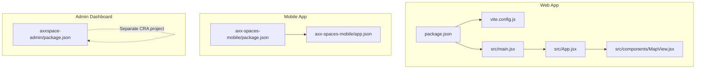
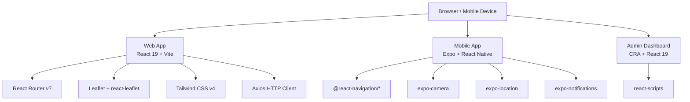
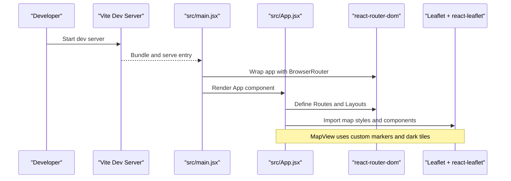
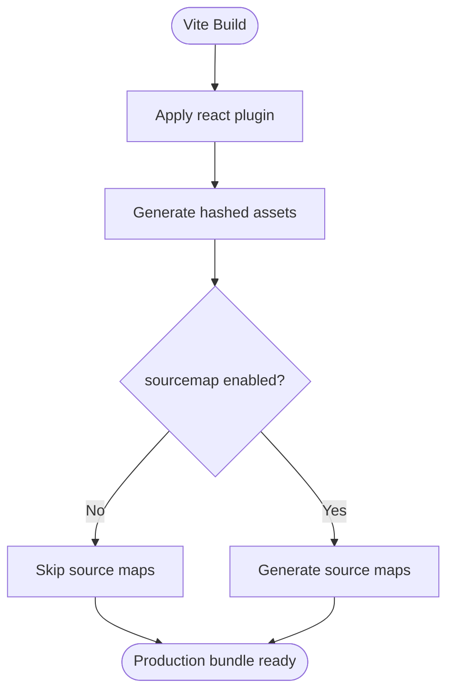
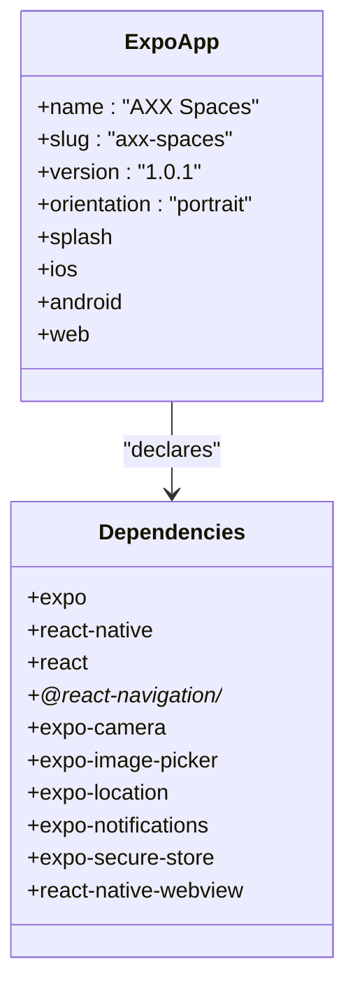
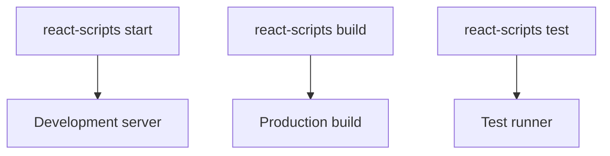
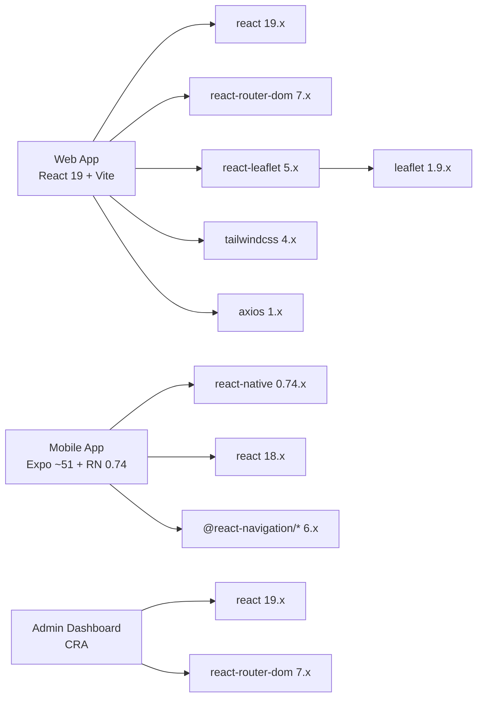

# Technology Stack

<cite>
**Referenced Files in This Document**
- [package.json](file://package.json)
- [vite.config.js](file://vite.config.js)
- [main.jsx](file://src/main.jsx)
- [App.jsx](file://src/App.jsx)
- [MapView.jsx](file://src/components/MapView.jsx)
- [axx-spaces-mobile/package.json](file://axx-spaces-mobile/package.json)
- [axx-spaces-mobile/app.json](file://axx-spaces-mobile/app.json)
- [axxspace-admin/package.json](file://axxspace-admin/package.json)
</cite>

## Table of Contents
1. [Introduction](#introduction)
2. [Project Structure](#project-structure)
3. [Core Components](#core-components)
4. [Architecture Overview](#architecture-overview)
5. [Detailed Component Analysis](#detailed-component-analysis)
6. [Dependency Analysis](#dependency-analysis)
7. [Performance Considerations](#performance-considerations)
8. [Troubleshooting Guide](#troubleshooting-guide)
9. [Conclusion](#conclusion)

## Introduction
This document describes the technology stack and build strategy for the AxxSpaces frontend monorepo. It covers:
- Web application built with React 19.x, Vite, Tailwind CSS, and Leaflet mapping
- Mobile application using React Native with Expo
- Administrative dashboard built with Create React App (React Scripts)
- Version compatibility matrix, dependency management approach, and deployment targets

The goal is to help developers understand how the projects are structured, why certain technologies were chosen, and how to set up and extend the codebase safely.

## Project Structure
The repository contains three primary applications:
- Web app at the root: React + Vite + Tailwind + Leaflet
- Mobile app under axx-spaces-mobile: React Native + Expo
- Admin dashboard under axxspace-admin: React + Create React App

**Diagram sources**
- [package.json:1-50](file://package.json#L1-L50)
- [vite.config.js:1-36](file://vite.config.js#L1-L36)
- [main.jsx:1-27](file://src/main.jsx#L1-L27)
- [App.jsx:1-495](file://src/App.jsx#L1-L495)
- [MapView.jsx:1-378](file://src/components/MapView.jsx#L1-L378)
- [axx-spaces-mobile/package.json:1-41](file://axx-spaces-mobile/package.json#L1-L41)
- [axx-spaces-mobile/app.json:1-49](file://axx-spaces-mobile/app.json#L1-L49)
- [axxspace-admin/package.json:1-44](file://axxspace-admin/package.json#L1-L44)

**Section sources**
- [package.json:1-50](file://package.json#L1-L50)
- [axx-spaces-mobile/package.json:1-41](file://axx-spaces-mobile/package.json#L1-L41)
- [axxspace-admin/package.json:1-44](file://axxspace-admin/package.json#L1-L44)

## Core Components
This section summarizes the core technologies and their roles.

- Web application
  - React 19.x as the UI framework
  - Vite as the build tool and development server
  - Tailwind CSS v4 for utility-first styling
  - Leaflet + react-leaflet for interactive maps
  - React Router v7 for client-side routing
  - Axios for HTTP requests
  - Google Analytics via react-ga4 and performance insights via @vercel/speed-insights

- Mobile application
  - Expo SDK ~51 with React Native 0.74.x
  - React Navigation for navigation
  - Camera, image picker, location, notifications, secure storage, and webview capabilities
  - EAS Build scripts for Android APKs and submissions

- Administrative dashboard
  - React 19.x with Create React App (react-scripts 5.0.1)
  - React Router v7
  - Standard CRA tooling and testing libraries

Rationale highlights:
- React 19.x provides the latest features and ecosystem support across web apps.
- Vite offers fast HMR and modern bundling for the web app.
- Expo simplifies cross-platform mobile development while keeping native access through well-maintained modules.
- Leaflet is lightweight and integrates cleanly with React via react-leaflet.
- Tailwind CSS v4 enables rapid UI development with a consistent design system.

**Section sources**
- [package.json:12-47](file://package.json#L12-L47)
- [axx-spaces-mobile/package.json:14-39](file://axx-spaces-mobile/package.json#L14-L39)
- [axxspace-admin/package.json:5-23](file://axxspace-admin/package.json#L5-L23)

## Architecture Overview
The frontend architecture separates concerns by platform and feature:
- Web app handles public pages, dashboards, accommodation booking flows, agent/agency portals, business directory, and user accounts
- Mobile app provides on-the-go access with camera, location, and push notifications
- Admin dashboard supports administrative tasks such as approvals and content management

**Diagram sources**
- [package.json:12-47](file://package.json#L12-L47)
- [axx-spaces-mobile/package.json:14-39](file://axx-spaces-mobile/package.json#L14-L39)
- [axxspace-admin/package.json:5-23](file://axxspace-admin/package.json#L5-L23)

## Detailed Component Analysis

### Web Application: React 19 + Vite + Tailwind + Leaflet
Key implementation points:
- Entry point initializes React, routing, authentication context, notification system, analytics, and error boundary
- Routing is centralized in App.jsx with role-based protected routes and layout wrappers
- Mapping uses Leaflet with custom marker icons and dark tile layer; icon resolution is fixed for Vite bundling
- Development server sets security headers and defines global constants

**Diagram sources**
- [main.jsx:1-27](file://src/main.jsx#L1-L27)
- [App.jsx:1-495](file://src/App.jsx#L1-L495)
- [MapView.jsx:1-378](file://src/components/MapView.jsx#L1-L378)

Build and bundling configuration:
- Vite plugin-react is used for JSX transformation
- Production build outputs hashed assets and disables source maps
- Security headers are added in development
- Global environment variables are defined via define

**Diagram sources**
- [vite.config.js:1-36](file://vite.config.js#L1-L36)

**Section sources**
- [main.jsx:1-27](file://src/main.jsx#L1-L27)
- [App.jsx:1-495](file://src/App.jsx#L1-L495)
- [vite.config.js:1-36](file://vite.config.js#L1-L36)
- [MapView.jsx:1-378](file://src/components/MapView.jsx#L1-L378)

### Mobile Application: React Native with Expo
Key implementation points:
- Expo SDK ~51 with React Native 0.74.x
- Navigation via @react-navigation/native, stack, and bottom-tabs
- Camera, image picker, location, notifications, secure storage, and webview modules
- EAS Build scripts for Android builds and submissions
- App metadata and permissions configured in app.json

**Diagram sources**
- [axx-spaces-mobile/app.json:1-49](file://axx-spaces-mobile/app.json#L1-L49)
- [axx-spaces-mobile/package.json:14-39](file://axx-spaces-mobile/package.json#L14-L39)

**Section sources**
- [axx-spaces-mobile/package.json:1-41](file://axx-spaces-mobile/package.json#L1-L41)
- [axx-spaces-mobile/app.json:1-49](file://axx-spaces-mobile/app.json#L1-L49)

### Administrative Dashboard: Create React App
Key implementation points:
- Uses react-scripts 5.0.1 for development, building, and testing
- React 19.x and React Router v7
- Testing utilities from @testing-library
- Browserslist targets production and development environments

**Diagram sources**
- [axxspace-admin/package.json:5-23](file://axxspace-admin/package.json#L5-L23)

**Section sources**
- [axxspace-admin/package.json:1-44](file://axxspace-admin/package.json#L1-L44)

## Dependency Analysis
This section outlines version compatibility and interdependencies across the three applications.

- Web app
  - React 19.x paired with react-dom 19.x
  - Vite 8.x with @vitejs/plugin-react 6.x
  - Tailwind CSS v4 with PostCSS and Autoprefixer
  - react-leaflet 5.x with leaflet 1.9.x
  - react-router-dom 7.x
  - axios 1.x for HTTP requests
  - Additional utilities: qrcode, jwt-decode, sharp, analytics integrations

- Mobile app
  - expo ~51.x with react-native 0.74.x and react 18.x
  - @react-navigation/* 6.x suite
  - Camera, image picker, location, notifications, secure store, webview modules
  - AsyncStorage and NetInfo for data persistence and connectivity checks

- Admin dashboard
  - react-scripts 5.x with React 19.x
  - react-router-dom 7.x
  - Testing libraries aligned with React 19

Compatibility notes:
- The web app and admin dashboard both use React 19.x but different build systems (Vite vs CRA).
- The mobile app uses React 18.x due to Expo SDK constraints; this is expected and isolated from the web apps.
- react-leaflet 5.x requires leaflet 1.9.x; the map component explicitly fixes marker asset URLs for Vite bundling.

**Diagram sources**
- [package.json:12-47](file://package.json#L12-L47)
- [axx-spaces-mobile/package.json:14-39](file://axx-spaces-mobile/package.json#L14-L39)
- [axxspace-admin/package.json:5-23](file://axxspace-admin/package.json#L5-L23)

**Section sources**
- [package.json:12-47](file://package.json#L12-L47)
- [axx-spaces-mobile/package.json:14-39](file://axx-spaces-mobile/package.json#L14-L39)
- [axxspace-admin/package.json:5-23](file://axxspace-admin/package.json#L5-L23)

## Performance Considerations
- Vite build optimization
  - Hashed asset filenames improve cache busting
  - Source maps disabled in production to reduce bundle size and avoid leaking source code
  - Development server includes security headers for safer local debugging

- Web app runtime
  - Google Analytics initialization for usage insights
  - Speed Insights integration for performance monitoring
  - ErrorBoundary wraps the app to prevent crashes from component errors

- Mobile app
  - Use of efficient navigation patterns via React Navigation
  - Leveraging native modules for camera, location, and notifications to minimize JS overhead

- Admin dashboard
  - CRA’s default optimizations apply; consider code splitting and lazy loading for large dashboards

[No sources needed since this section provides general guidance]

## Troubleshooting Guide
Common issues and resolutions:
- Leaflet marker icons not loading in Vite
  - The map component overrides default icon URLs to resolve assets correctly when bundled by Vite
  - Ensure Leaflet CSS is imported at the app entry point

- Development server security headers
  - Headers like X-Content-Type-Options, X-Frame-Options, X-XSS-Protection, and Referrer-Policy are set in development; verify if they affect local CORS or iframe behavior

- Mobile permissions
  - Android permissions include internet, network state, camera, storage, and location; ensure these are declared and granted at runtime where required

- Admin dashboard browserslist
  - Production targets broad coverage excluding dead browsers; development targets recent versions of Chrome, Firefox, and Safari

**Section sources**
- [MapView.jsx:21-27](file://src/components/MapView.jsx#L21-L27)
- [vite.config.js:7-17](file://vite.config.js#L7-L17)
- [axx-spaces-mobile/app.json:21-36](file://axx-spaces-mobile/app.json#L21-L36)
- [axxspace-admin/package.json:31-42](file://axxspace-admin/package.json#L31-L42)

## Conclusion
The AxxSpaces frontend monorepo combines a modern web application built with React 19 and Vite, a mobile application powered by Expo and React Native, and an administrative dashboard using Create React App. The stack balances developer experience, performance, and maintainability:
- Vite accelerates development and produces optimized production bundles
- Tailwind CSS v4 streamlines UI development
- Leaflet provides flexible mapping with react-leaflet integration
- Expo simplifies mobile development while enabling native capabilities
- CRA remains stable for the admin dashboard

Version compatibility is carefully managed per application, with clear boundaries between React 19 web apps and React 18 mobile app. Developers should follow the documented setup steps and be mindful of platform-specific dependencies when extending functionality.

[No sources needed since this section summarizes without analyzing specific files]