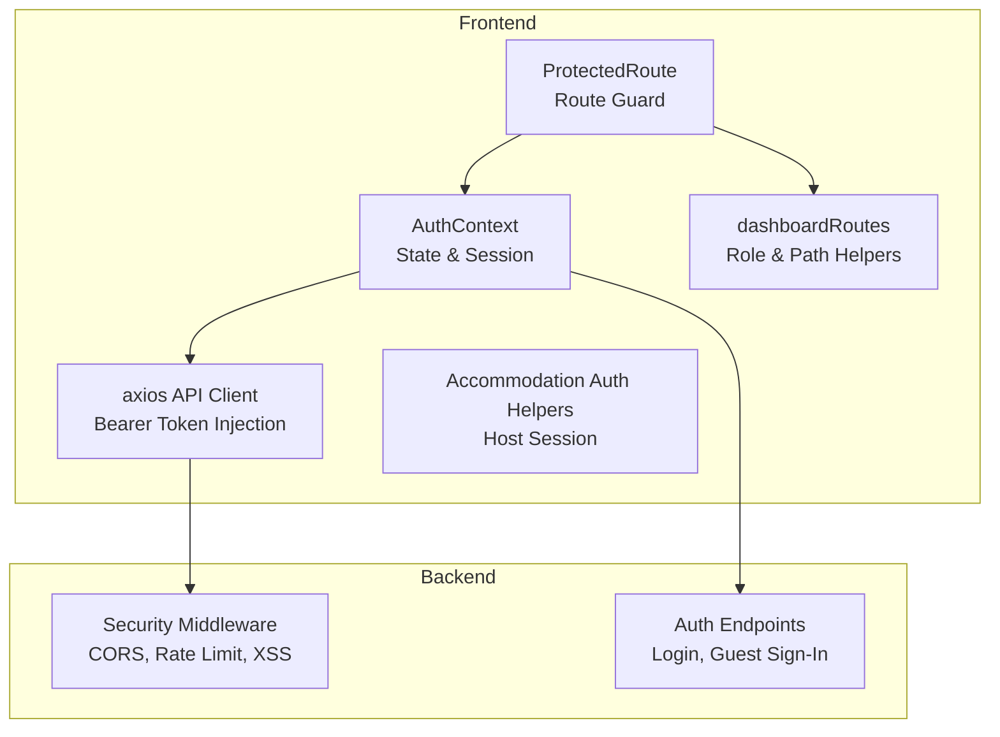
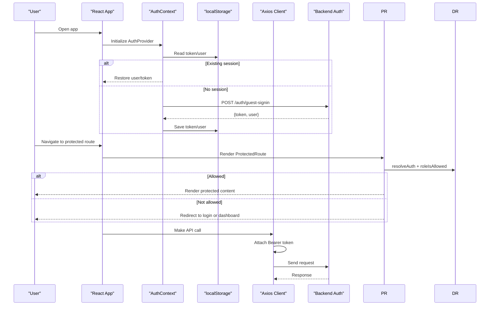
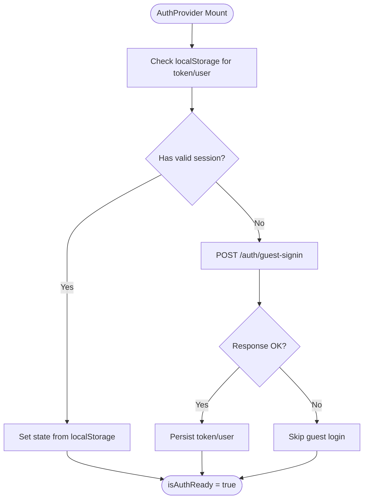
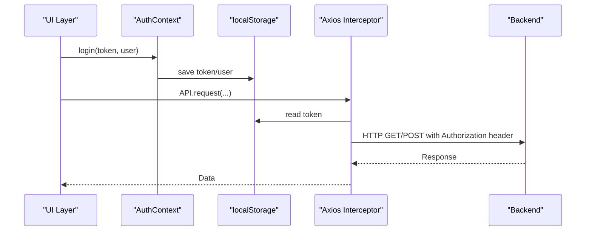
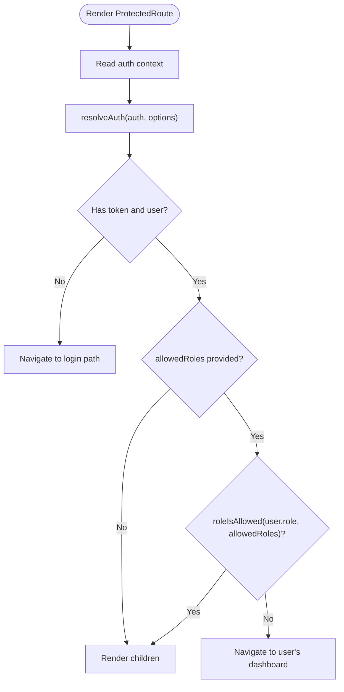
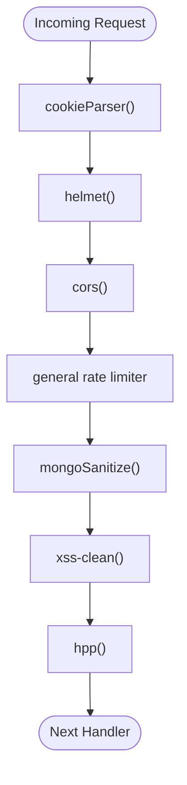
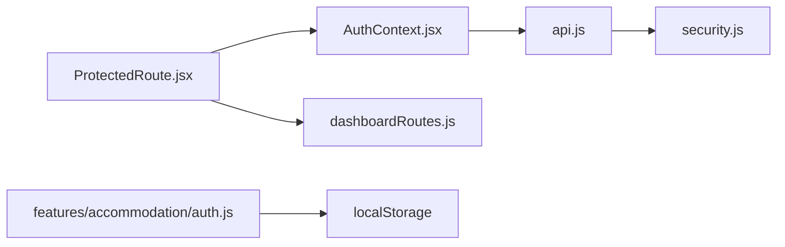

# Authentication & Authorization

<cite>
**Referenced Files in This Document**
- [AuthContext.jsx](file://src/context/AuthContext.jsx)
- [ProtectedRoute.jsx](file://src/components/ProtectedRoute.jsx)
- [dashboardRoutes.js](file://src/utils/dashboardRoutes.js)
- [api.js](file://src/api/api.js)
- [auth.js](file://src/features/accommodation/auth.js)
- [security.js](file://middleware/security.js)
</cite>

## Table of Contents
1. [Introduction](#introduction)
2. [Project Structure](#project-structure)
3. [Core Components](#core-components)
4. [Architecture Overview](#architecture-overview)
5. [Detailed Component Analysis](#detailed-component-analysis)
6. [Dependency Analysis](#dependency-analysis)
7. [Performance Considerations](#performance-considerations)
8. [Troubleshooting Guide](#troubleshooting-guide)
9. [Conclusion](#conclusion)
10. [Appendices](#appendices)

## Introduction
This document explains the authentication and authorization system implemented in the frontend application. It covers:
- JWT-based authentication flow using a Bearer token stored in localStorage
- Role-based access control (RBAC) for route protection
- Guest auto-login to provide an authenticated session for unauthenticated users
- The AuthContext provider pattern for centralized state management
- Token management, session handling, and API integration
- Security middleware on the server side that protects against common web vulnerabilities
- Guidance for implementing custom authentication guards and extending permissions

## Project Structure
The authentication and authorization logic is primarily located in:
- Context layer: global auth state and lifecycle
- Route guards: protecting routes based on roles
- Utilities: role mapping, dashboard routing, and permission checks
- API layer: automatic injection of JWT headers
- Feature-specific auth helpers: accommodation host/session utilities
- Server-side security middleware: CORS, rate limiting, sanitization, XSS protection

**Diagram sources**
- [AuthContext.jsx:17-153](file://src/context/AuthContext.jsx#L17-L153)
- [ProtectedRoute.jsx:15-56](file://src/components/ProtectedRoute.jsx#L15-L56)
- [dashboardRoutes.js:31-99](file://src/utils/dashboardRoutes.js#L31-L99)
- [api.js:10-24](file://src/api/api.js#L10-L24)
- [security.js:44-54](file://middleware/security.js#L44-L54)

**Section sources**
- [AuthContext.jsx:17-153](file://src/context/AuthContext.jsx#L17-L153)
- [ProtectedRoute.jsx:15-56](file://src/components/ProtectedRoute.jsx#L15-L56)
- [dashboardRoutes.js:1-183](file://src/utils/dashboardRoutes.js#L1-L183)
- [api.js:1-47](file://src/api/api.js#L1-L47)
- [security.js:1-61](file://middleware/security.js#L1-L61)

## Core Components
- AuthContext provider: manages user, token, loading state, login/logout/updateUser, and guest auto-login.
- ProtectedRoute component: enforces authentication and role-based access for protected routes.
- Dashboard routes utility: maps roles to dashboards/logins, resolves active sessions, and validates allowed roles.
- API client interceptor: attaches Bearer tokens from localStorage to outgoing requests.
- Accommodation auth helpers: manage host-specific session storage and identity checks.
- Security middleware: applies server-side protections such as CORS, rate limiting, input sanitization, and XSS filtering.

**Section sources**
- [AuthContext.jsx:17-153](file://src/context/AuthContext.jsx#L17-L153)
- [ProtectedRoute.jsx:15-56](file://src/components/ProtectedRoute.jsx#L15-L56)
- [dashboardRoutes.js:31-99](file://src/utils/dashboardRoutes.js#L31-L99)
- [api.js:10-24](file://src/api/api.js#L10-L24)
- [auth.js:1-53](file://src/features/accommodation/auth.js#L1-L53)
- [security.js:44-54](file://middleware/security.js#L44-L54)

## Architecture Overview
The authentication architecture follows a React context-driven model with a clear separation between UI state, route protection, and API communication.

**Diagram sources**
- [AuthContext.jsx:52-97](file://src/context/AuthContext.jsx#L52-L97)
- [ProtectedRoute.jsx:41-53](file://src/components/ProtectedRoute.jsx#L41-L53)
- [dashboardRoutes.js:71-99](file://src/utils/dashboardRoutes.js#L71-L99)
- [api.js:10-24](file://src/api/api.js#L10-L24)

## Detailed Component Analysis

### AuthContext Provider Pattern and Session Handling
Responsibilities:
- Maintain user, token, and loading state
- Persist and restore sessions via localStorage
- Provide login, logout, and updateUser functions
- Implement invisible guest auto-login when no existing session exists
- Manage splash screen visibility during initialization

Key behaviors:
- On mount, reads saved token/user; if missing, calls guest sign-in endpoint and persists result
- Login clears seller session, sets token/user, and persists them
- Logout removes persisted data and redirects
- Updates user object with shallow equality check to avoid unnecessary re-renders

**Diagram sources**
- [AuthContext.jsx:52-97](file://src/context/AuthContext.jsx#L52-L97)

**Section sources**
- [AuthContext.jsx:17-153](file://src/context/AuthContext.jsx#L17-L153)

### JWT-Based Authentication Flow and Token Management
Token lifecycle:
- Tokens are obtained from backend endpoints (e.g., login or guest sign-in)
- Tokens are stored in localStorage under a dedicated key
- Axios request interceptor automatically attaches Authorization: Bearer <token> to all requests
- If no token is present, requests proceed without Authorization header

**Diagram sources**
- [AuthContext.jsx:99-109](file://src/context/AuthContext.jsx#L99-L109)
- [api.js:10-24](file://src/api/api.js#L10-L24)

**Section sources**
- [AuthContext.jsx:99-109](file://src/context/AuthContext.jsx#L99-L109)
- [api.js:10-24](file://src/api/api.js#L10-L24)

### Role-Based Access Control (RBAC) and Protected Routes
RBAC implementation:
- Roles are normalized and mapped to dashboard and login paths
- ProtectedRoute uses resolveAuth to determine the active session and roleIsAllowed to enforce allowed roles
- Unauthorized users are redirected to appropriate login or dashboard pages

**Diagram sources**
- [ProtectedRoute.jsx:41-53](file://src/components/ProtectedRoute.jsx#L41-L53)
- [dashboardRoutes.js:71-99](file://src/utils/dashboardRoutes.js#L71-L99)

**Section sources**
- [ProtectedRoute.jsx:15-56](file://src/components/ProtectedRoute.jsx#L15-L56)
- [dashboardRoutes.js:31-99](file://src/utils/dashboardRoutes.js#L31-L99)

### Guest Auto-Login Functionality
Purpose:
- Provide an authenticated session for visitors who have not logged in
- Automatically calls a guest sign-in endpoint and stores the returned token and user

Behavior:
- Triggered only when no existing token/user is found in localStorage
- Persists guest token/user to localStorage for subsequent requests
- Ensures UI remains responsive by marking auth ready after initialization

**Section sources**
- [AuthContext.jsx:52-97](file://src/context/AuthContext.jsx#L52-L97)

### Security Middleware Implementation
Server-side protections applied:
- Helmet for setting secure headers
- CORS configuration allowing specific origins and credentials
- General and auth-specific rate limiters
- Input sanitization (MongoDB-style query sanitization)
- XSS protection via xss-clean
- Parameter pollution prevention via hpp
- Cookie parsing for cookie-based features

**Diagram sources**
- [security.js:44-54](file://middleware/security.js#L44-L54)

**Section sources**
- [security.js:1-61](file://middleware/security.js#L1-L61)

### Accommodation Host Session and Permissions
Accommodation-specific helpers:
- Manage separate token and user keys for host sessions
- Provide login status checks restricted to host/admin roles
- Normalize and persist host user data

Use cases:
- Protecting host-only routes and actions
- Displaying host-specific navigation and branding

**Section sources**
- [auth.js:1-53](file://src/features/accommodation/auth.js#L1-L53)

## Dependency Analysis
The following diagram shows how core components depend on each other:

**Diagram sources**
- [AuthContext.jsx:17-153](file://src/context/AuthContext.jsx#L17-L153)
- [ProtectedRoute.jsx:15-56](file://src/components/ProtectedRoute.jsx#L15-L56)
- [dashboardRoutes.js:31-99](file://src/utils/dashboardRoutes.js#L31-L99)
- [api.js:10-24](file://src/api/api.js#L10-L24)
- [security.js:44-54](file://middleware/security.js#L44-L54)
- [auth.js:1-53](file://src/features/accommodation/auth.js#L1-L53)

**Section sources**
- [AuthContext.jsx:17-153](file://src/context/AuthContext.jsx#L17-L153)
- [ProtectedRoute.jsx:15-56](file://src/components/ProtectedRoute.jsx#L15-L56)
- [dashboardRoutes.js:31-99](file://src/utils/dashboardRoutes.js#L31-L99)
- [api.js:10-24](file://src/api/api.js#L10-L24)
- [security.js:44-54](file://middleware/security.js#L44-L54)
- [auth.js:1-53](file://src/features/accommodation/auth.js#L1-L53)

## Performance Considerations
- Minimize re-renders: AuthContext updateUser performs shallow equality checks before updating state.
- Avoid redundant network calls: Guest auto-login runs once per session initialization.
- Prefer role checks at route level: ProtectedRoute centralizes authorization logic to prevent repeated checks in components.
- Use axios interceptors: Centralized token injection avoids repetitive header setup across API calls.

[No sources needed since this section provides general guidance]

## Troubleshooting Guide
Common issues and resolutions:
- Missing Authorization header on API calls:
  - Ensure token is present in localStorage and Axios interceptor is configured.
  - Verify that login or guest sign-in successfully persisted the token.
- Unexpected redirects on protected routes:
  - Confirm user role is included in allowedRoles for the route.
  - Check resolveAuth returns a valid session and roleIsAllowed evaluates correctly.
- Guest auto-login not triggering:
  - Validate that no existing token/user is present in localStorage.
  - Confirm guest sign-in endpoint responds with a valid token and user.
- CORS or rate-limit errors:
  - Check backend security middleware configuration and allowed origins.
  - Review rate limiter thresholds for auth endpoints.

**Section sources**
- [api.js:10-24](file://src/api/api.js#L10-L24)
- [ProtectedRoute.jsx:41-53](file://src/components/ProtectedRoute.jsx#L41-L53)
- [dashboardRoutes.js:71-99](file://src/utils/dashboardRoutes.js#L71-L99)
- [security.js:18-42](file://middleware/security.js#L18-L42)

## Conclusion
The authentication and authorization system combines a React context-driven session manager, route-level role guards, and an axios-based API client that injects JWT tokens. Guest auto-login ensures visitors can interact with the application while maintaining a consistent authenticated state. Server-side security middleware adds robust protections against common threats. Extending the system involves adding new roles, updating route mappings, and optionally introducing feature-specific session helpers similar to the accommodation module.

[No sources needed since this section summarizes without analyzing specific files]

## Appendices

### Implementing Custom Authentication Guards
Steps:
- Create a new guard component similar to ProtectedRoute
- Use resolveAuth to obtain the active session
- Define allowed roles and redirect accordingly
- Integrate the guard into your routing configuration

Reference patterns:
- [ProtectedRoute.jsx:15-56](file://src/components/ProtectedRoute.jsx#L15-L56)
- [dashboardRoutes.js:71-99](file://src/utils/dashboardRoutes.js#L71-L99)

### Extending the Permission System
Options:
- Add new roles to DASHBOARD_BY_ROLE and LOGIN_BY_ROLE mappings
- Extend roleIsAllowed to support hierarchical or composite permissions
- Introduce feature flags or capability checks alongside roles
- Implement feature-specific session helpers like accommodation auth

Reference patterns:
- [dashboardRoutes.js:1-49](file://src/utils/dashboardRoutes.js#L1-L49)
- [auth.js:1-53](file://src/features/accommodation/auth.js#L1-L53)