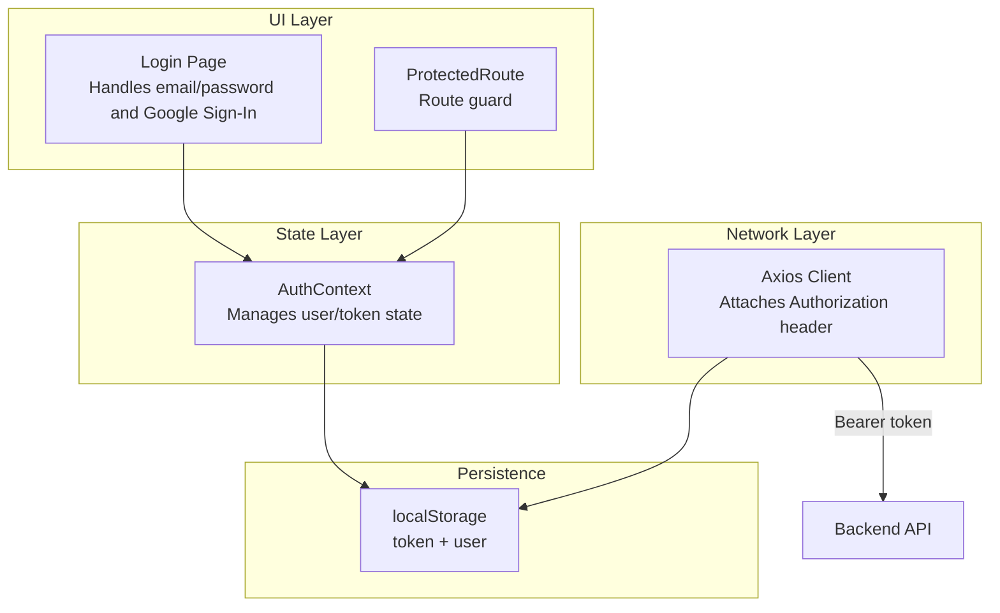
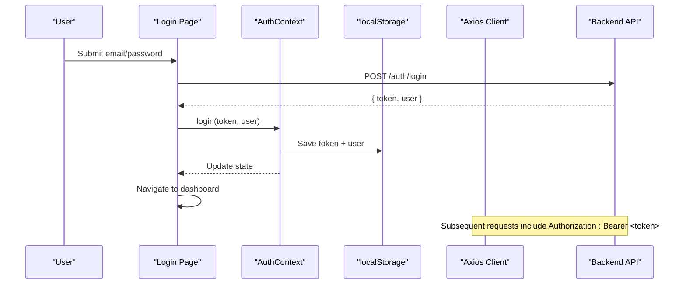
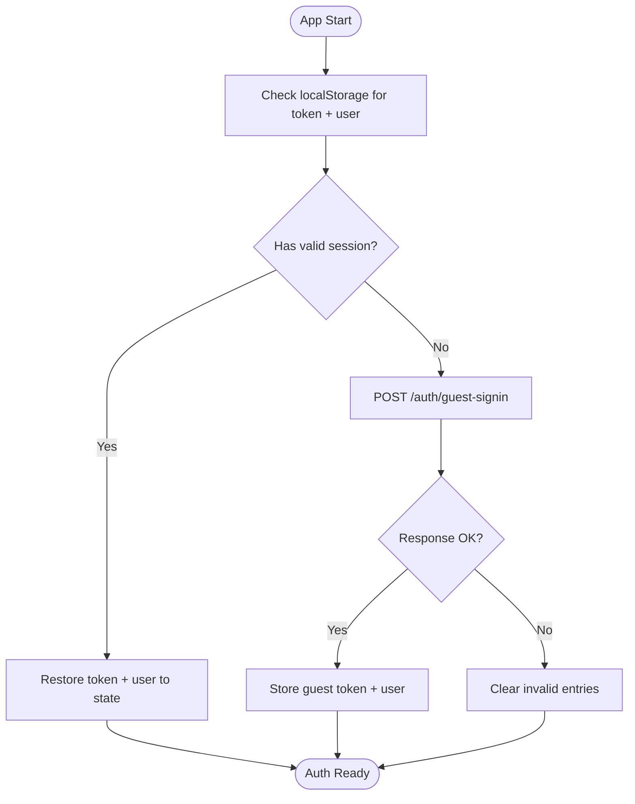
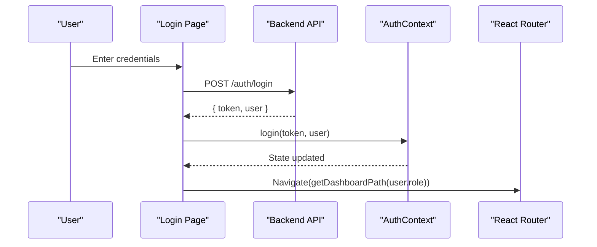
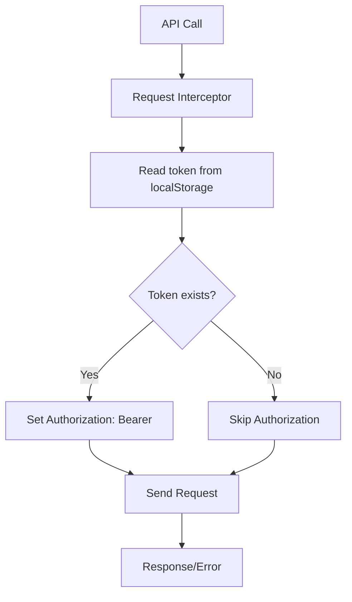
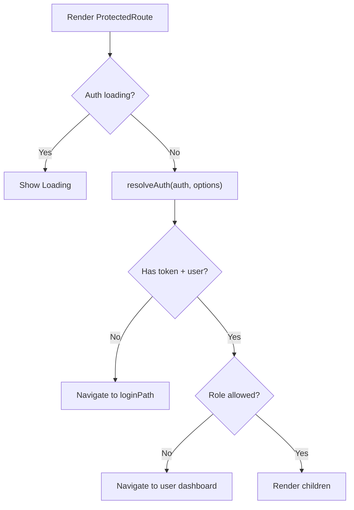
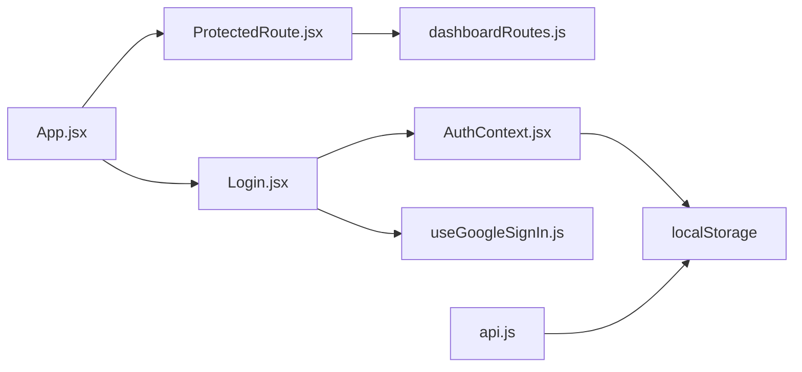

# Authentication Flow

<cite>
**Referenced Files in This Document**
- [AuthContext.jsx](file://src/context/AuthContext.jsx)
- [api.js](file://src/api/api.js)
- [Login.jsx](file://src/pages/Login.jsx)
- [ProtectedRoute.jsx](file://src/components/ProtectedRoute.jsx)
- [dashboardRoutes.js](file://src/utils/dashboardRoutes.js)
- [useGoogleSignIn.js](file://src/hooks/useGoogleSignIn.js)
- [App.jsx](file://src/App.jsx)
- [auth.js](file://src/features/accommodation/auth.js)
</cite>

## Table of Contents
1. [Introduction](#introduction)
2. [Project Structure](#project-structure)
3. [Core Components](#core-components)
4. [Architecture Overview](#architecture-overview)
5. [Detailed Component Analysis](#detailed-component-analysis)
6. [Dependency Analysis](#dependency-analysis)
7. [Performance Considerations](#performance-considerations)
8. [Troubleshooting Guide](#troubleshooting-guide)
9. [Conclusion](#conclusion)

## Introduction
This document explains the authentication flow implemented in the frontend application. It covers:
- The complete user login process from form submission to token storage and navigation
- How authentication state is managed across the app
- How API calls are secured with tokens
- Guest auto-login for unauthenticated users
- Token lifecycle, including current behavior around refresh and expiration
- Troubleshooting guidance for common issues such as token expiry, network failures, and session corruption

## Project Structure
The authentication logic is primarily implemented in a React context that manages user state and token persistence, a login page that handles credentials and third-party sign-in, an Axios client that attaches tokens to requests, and route guards that protect pages based on roles.

**Diagram sources**
- [Login.jsx:102-150](file://src/pages/Login.jsx#L102-L150)
- [AuthContext.jsx:17-157](file://src/context/AuthContext.jsx#L17-L157)
- [api.js:1-47](file://src/api/api.js#L1-L47)
- [ProtectedRoute.jsx:15-56](file://src/components/ProtectedRoute.jsx#L15-L56)

**Section sources**
- [AuthContext.jsx:17-157](file://src/context/AuthContext.jsx#L17-L157)
- [api.js:1-47](file://src/api/api.js#L1-L47)
- [Login.jsx:102-150](file://src/pages/Login.jsx#L102-L150)
- [ProtectedRoute.jsx:15-56](file://src/components/ProtectedRoute.jsx#L15-L56)

## Core Components
- AuthContext: Centralizes authentication state (user, token), persistence (localStorage), initialization (including guest auto-login), and actions (login, logout, updateUser).
- Login Page: Handles email/password login, Google Sign-In, verification resend, and password reset flows; navigates to role-based dashboards after successful login.
- Axios API Client: Adds Authorization headers automatically using the stored token and provides request/response logging.
- ProtectedRoute: Guards routes by checking authentication and role permissions, redirecting appropriately.
- Dashboard Routes Utilities: Provides role-to-path mappings, session resolution, and helper functions used by guards and navigation.

Key responsibilities:
- State management and persistence: AuthContext
- User input and auth flows: Login.jsx
- Network security: api.js
- Route protection: ProtectedRoute.jsx
- Role routing helpers: dashboardRoutes.js

**Section sources**
- [AuthContext.jsx:17-157](file://src/context/AuthContext.jsx#L17-L157)
- [Login.jsx:102-150](file://src/pages/Login.jsx#L102-L150)
- [api.js:1-47](file://src/api/api.js#L1-L47)
- [ProtectedRoute.jsx:15-56](file://src/components/ProtectedRoute.jsx#L15-L56)
- [dashboardRoutes.js:1-107](file://src/utils/dashboardRoutes.js#L1-L107)

## Architecture Overview
The authentication architecture follows a layered approach:
- UI layer components trigger authentication actions
- Context layer persists and exposes authentication state
- HTTP layer injects tokens into requests
- Router layer enforces access control

**Diagram sources**
- [Login.jsx:102-150](file://src/pages/Login.jsx#L102-L150)
- [AuthContext.jsx:99-109](file://src/context/AuthContext.jsx#L99-L109)
- [api.js:11-24](file://src/api/api.js#L11-L24)

## Detailed Component Analysis

### Authentication Context (AuthContext)
Responsibilities:
- Initialize authentication on app start by restoring token/user from localStorage
- Perform invisible guest auto-login if no existing session exists
- Provide login/logout/updateUser methods
- Maintain loading state and splash screen behavior

Guest Auto-Login:
- If no saved token/user, the context calls a guest-signin endpoint to obtain a temporary session
- Stores the returned token and user in localStorage and updates React state

Token Lifecycle:
- Tokens are stored in localStorage under key "token"
- No automatic refresh or background revalidation is implemented in this codebase
- Logout clears token and user from localStorage and redirects

**Diagram sources**
- [AuthContext.jsx:52-97](file://src/context/AuthContext.jsx#L52-L97)

**Section sources**
- [AuthContext.jsx:17-157](file://src/context/AuthContext.jsx#L17-L157)

### Login Page
Responsibilities:
- Handle email/password login via POST /auth/login
- Handle Google Sign-In via backend endpoint /auth/google
- Show verification resend and forgot password flows
- On success, call AuthContext.login and navigate to role-based dashboard

Flow highlights:
- Validates inputs and sets error/success states
- Calls backend endpoints directly using fetch
- Uses getDashboardPath to determine where to navigate based on user.role

**Diagram sources**
- [Login.jsx:102-150](file://src/pages/Login.jsx#L102-L150)
- [dashboardRoutes.js:35-44](file://src/utils/dashboardRoutes.js#L35-L44)

**Section sources**
- [Login.jsx:102-150](file://src/pages/Login.jsx#L102-L150)
- [dashboardRoutes.js:35-44](file://src/utils/dashboardRoutes.js#L35-L44)

### Axios API Client
Responsibilities:
- Create a centralized axios instance
- Attach Authorization header with Bearer token from localStorage on every request
- Log request/response details for debugging
- Reject errors consistently

Security note:
- All authenticated requests automatically include the token when present
- There is no automatic retry or refresh on 401 responses in this implementation

**Diagram sources**
- [api.js:11-24](file://src/api/api.js#L11-L24)

**Section sources**
- [api.js:1-47](file://src/api/api.js#L1-L47)

### ProtectedRoute
Responsibilities:
- Guard protected routes by checking authentication and allowed roles
- Redirect to appropriate login or dashboard paths when unauthorized
- Support preferSeller mode for marketplace sessions

Behavior:
- While auth is initializing, show a loading indicator
- Resolve active session using dashboardRoutes.resolveAuth
- If no token/user, navigate to login path
- If role not allowed, navigate to user’s dashboard

**Diagram sources**
- [ProtectedRoute.jsx:15-56](file://src/components/ProtectedRoute.jsx#L15-L56)
- [dashboardRoutes.js:70-99](file://src/utils/dashboardRoutes.js#L70-L99)

**Section sources**
- [ProtectedRoute.jsx:15-56](file://src/components/ProtectedRoute.jsx#L15-L56)
- [dashboardRoutes.js:70-99](file://src/utils/dashboardRoutes.js#L70-L99)

### Google Sign-In Hook
Responsibilities:
- Dynamically load Google Identity Services script
- Initialize Google Sign-In with configured client ID
- Decode the credential payload and pass it to the parent component
- Handle errors gracefully

Integration:
- Login.jsx uses useGoogleSignIn to render the Google button and handle the credential callback
- The callback sends the Google user info to /auth/google and then calls AuthContext.login

**Section sources**
- [useGoogleSignIn.js:17-88](file://src/hooks/useGoogleSignIn.js#L17-L88)
- [Login.jsx:40-73](file://src/pages/Login.jsx#L40-L73)

### Accommodation Feature Auth Helpers
Responsibilities:
- Manage a separate accommodation-specific session in localStorage
- Provide helpers to check if a host/admin is logged in for accommodation features
- Sync with main user session when needed

Note:
- These helpers are specific to the accommodation feature and do not replace the global AuthContext

**Section sources**
- [auth.js:1-53](file://src/features/accommodation/auth.js#L1-L53)

## Dependency Analysis
The following diagram shows how authentication-related modules depend on each other:

**Diagram sources**
- [App.jsx:140-154](file://src/App.jsx#L140-L154)
- [ProtectedRoute.jsx:1-10](file://src/components/ProtectedRoute.jsx#L1-L10)
- [Login.jsx:1-10](file://src/pages/Login.jsx#L1-L10)
- [AuthContext.jsx:1-15](file://src/context/AuthContext.jsx#L1-L15)
- [api.js:1-8](file://src/api/api.js#L1-L8)

**Section sources**
- [App.jsx:140-154](file://src/App.jsx#L140-L154)
- [ProtectedRoute.jsx:1-10](file://src/components/ProtectedRoute.jsx#L1-L10)
- [Login.jsx:1-10](file://src/pages/Login.jsx#L1-L10)
- [AuthContext.jsx:1-15](file://src/context/AuthContext.jsx#L1-L15)
- [api.js:1-8](file://src/api/api.js#L1-L8)

## Performance Considerations
- Minimal state updates: AuthContext.updateUser performs shallow checks to avoid unnecessary re-renders
- Splash screen controlled by sessionStorage to prevent repeated animations within a session
- Axios timeout prevents hanging requests
- Logging interceptors help diagnose performance issues during development

[No sources needed since this section provides general guidance]

## Troubleshooting Guide

Common issues and resolutions:

- Token expired or missing
  - Symptom: API calls fail with 401 or data does not load
  - Cause: No automatic token refresh is implemented; tokens may expire server-side
  - Resolution: Re-authenticate by logging in again; ensure localStorage contains a valid token before making requests

- Network failures
  - Symptom: Requests time out or fail due to connectivity issues
  - Cause: Axios timeout set to 30 seconds; network instability
  - Resolution: Retry logic should be added at the caller level; verify VITE_API_URL configuration

- Session corruption
  - Symptom: Inconsistent user state or unexpected logouts
  - Cause: Corrupted localStorage entries or mismatched token/user pairs
  - Resolution: Clear localStorage token and user keys; re-login; consider adding validation on restore

- Guest auto-login not working
  - Symptom: Users remain unauthenticated despite being able to browse public content
  - Cause: Guest-signin endpoint unavailable or returning non-OK status
  - Resolution: Verify backend availability and response format; check console logs for initAuth errors

- Google Sign-In not rendering
  - Symptom: Google button not visible or fails to initialize
  - Cause: Missing GOOGLE_CLIENT_ID or Google script failed to load
  - Resolution: Ensure environment variable is set and script loads successfully; fallback to email/password

- Wrong role redirection
  - Symptom: After login, user is redirected unexpectedly
  - Cause: Role not allowed for target route
  - Resolution: Confirm user.role matches allowedRoles; verify getDashboardPath mapping

**Section sources**
- [AuthContext.jsx:52-97](file://src/context/AuthContext.jsx#L52-L97)
- [api.js:11-44](file://src/api/api.js#L11-L44)
- [ProtectedRoute.jsx:21-56](file://src/components/ProtectedRoute.jsx#L21-L56)
- [useGoogleSignIn.js:17-88](file://src/hooks/useGoogleSignIn.js#L17-L88)

## Conclusion
The frontend implements a straightforward authentication flow centered around React Context for state management, localStorage for persistence, and Axios interceptors for securing API calls. Guest auto-login ensures unauthenticated users can access certain features without explicit sign-in. Currently, there is no automatic token refresh or background revalidation; token expiration requires re-authentication. Route guards enforce role-based access, and comprehensive logging aids in troubleshooting. For production resilience, consider adding token refresh strategies, retry mechanisms, and robust error handling for network and session edge cases.

[No sources needed since this section summarizes without analyzing specific files]