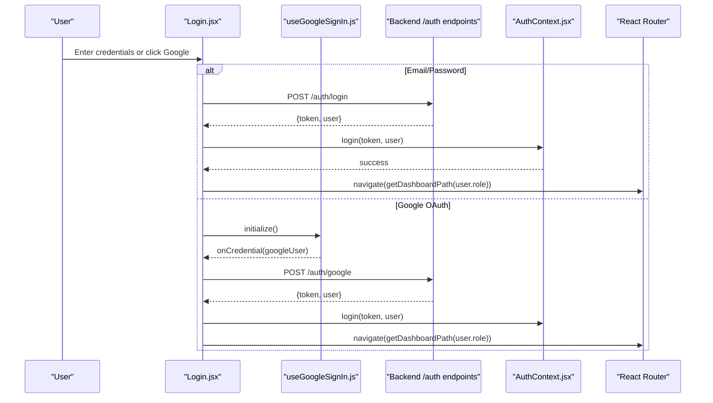
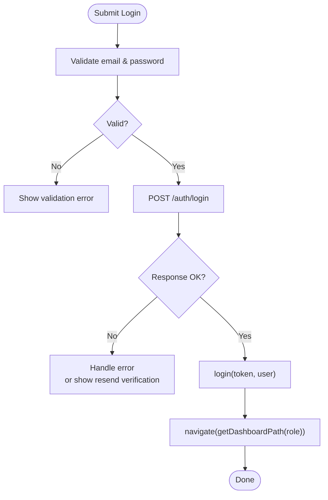
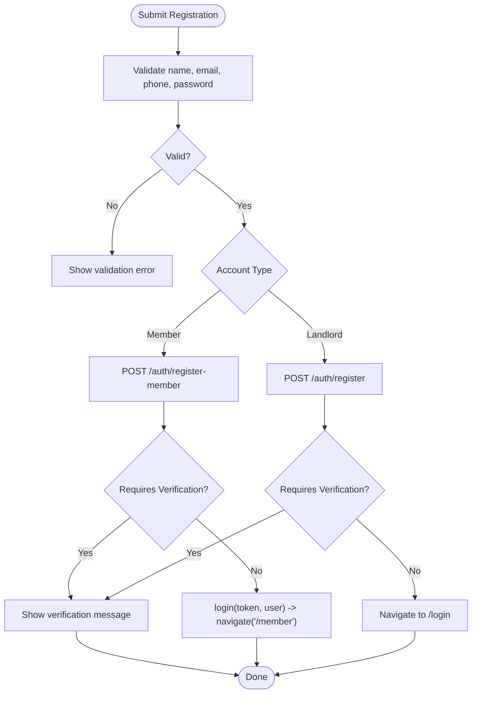
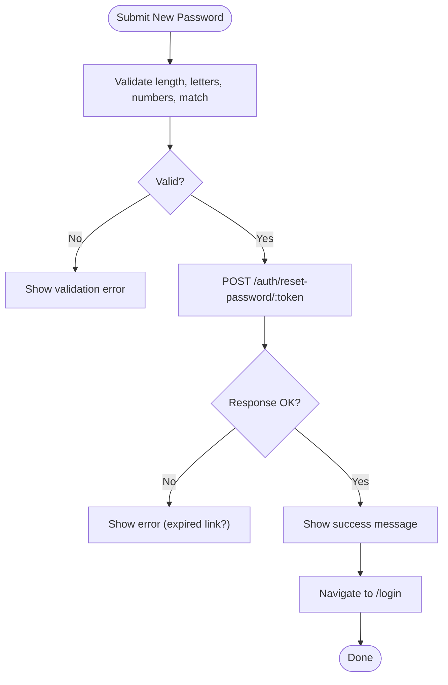
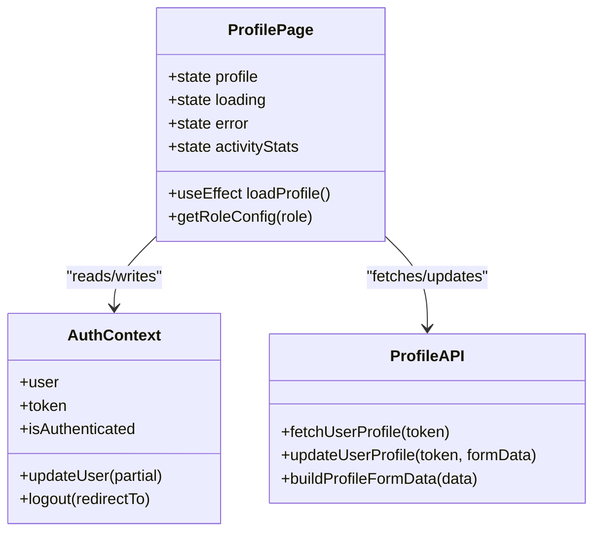
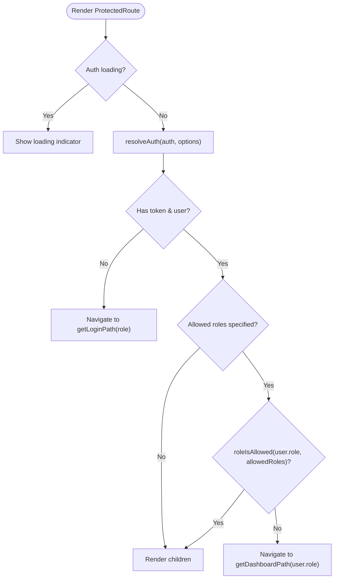
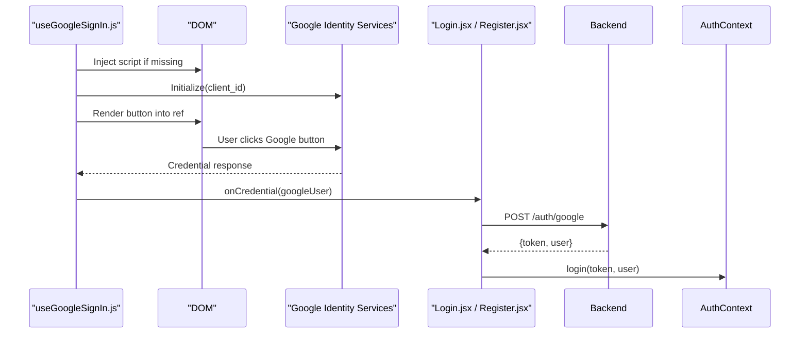
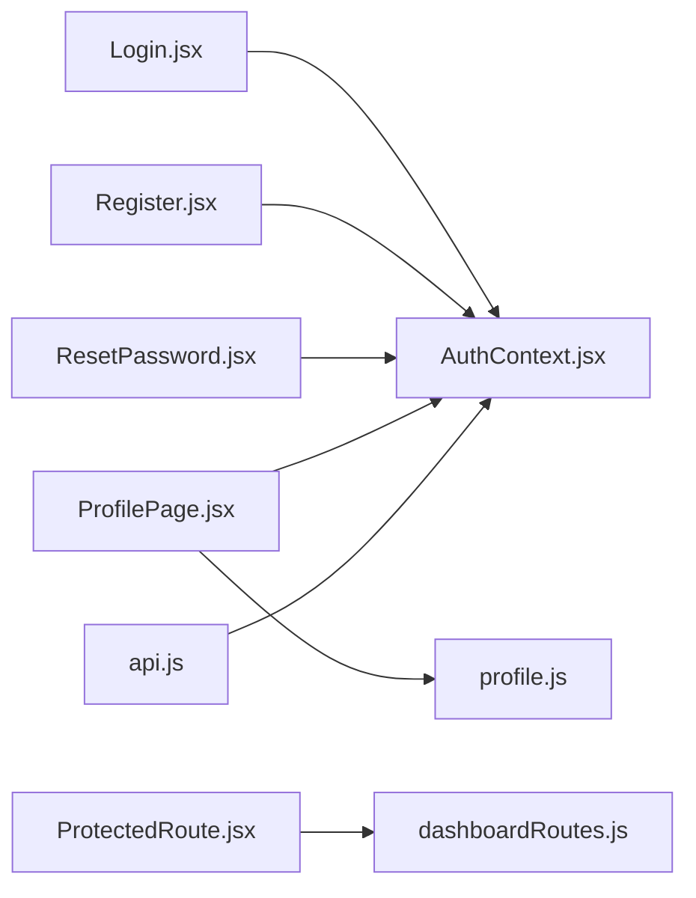

# Implementation Examples

<cite>
**Referenced Files in This Document**   
- [AuthContext.jsx](file://src/context/AuthContext.jsx)
- [ProtectedRoute.jsx](file://src/components/ProtectedRoute.jsx)
- [useGoogleSignIn.js](file://src/hooks/useGoogleSignIn.js)
- [Login.jsx](file://src/pages/Login.jsx)
- [Register.jsx](file://src/pages/Register.jsx)
- [ResetPassword.jsx](file://src/pages/ResetPassword.jsx)
- [ProfilePage.jsx](file://src/pages/ProfilePage.jsx)
- [dashboardRoutes.js](file://src/utils/dashboardRoutes.js)
- [api.js](file://src/api/api.js)
- [profile.js](file://src/api/profile.js)
</cite>

## Table of Contents
1. [Introduction](#introduction)
2. [Project Structure](#project-structure)
3. [Core Components](#core-components)
4. [Architecture Overview](#architecture-overview)
5. [Detailed Component Analysis](#detailed-component-analysis)
6. [Dependency Analysis](#dependency-analysis)
7. [Performance Considerations](#performance-considerations)
8. [Troubleshooting Guide](#troubleshooting-guide)
9. [Conclusion](#conclusion)

## Introduction
This document provides practical implementation examples for common authentication and authorization scenarios using the frontend codebase. It covers:
- Custom login forms with email/password and Google OAuth
- Registration flows for different account types
- Password reset functionality
- Profile management and conditional rendering by role
- Protected routes and role-based access control
- Authentication state management in React components
- Error handling, loading states, and user feedback patterns

The goal is to help you implement secure, user-friendly authentication experiences while following the existing architecture and patterns.

## Project Structure
The authentication features are implemented across context providers, hooks, pages, route guards, and API utilities:
- Context provider manages global auth state and persistence
- Hooks encapsulate third-party sign-in logic
- Pages implement UI flows for login, registration, password reset, and profile
- Route guard enforces authentication and role-based access
- API utilities centralize request/response behavior and token injection

```mermaid
graph TB
subgraph "Authentication Core"
AC["AuthContext.jsx"]
PR["ProtectedRoute.jsx"]
DR["dashboardRoutes.js"]
end
subgraph "UI Flows"
LG["Login.jsx"]
RG["Register.jsx]
RP["ResetPassword.jsx]
PP["ProfilePage.jsx]
end
subgraph "Third-Party Auth"
GSI["useGoogleSignIn.js]
end
subgraph "API Layer"
AX["api.js]
PF["profile.js]
end
LG --> AC
RG --> AC
RP --> AC
PP --> AC
LG --> GSI
RG --> GSI
PR --> AC
PR --> DR
PP --> PF
AX --> AC
```

**Diagram sources**
- [AuthContext.jsx:1-157](file://src/context/AuthContext.jsx#L1-L157)
- [ProtectedRoute.jsx:1-57](file://src/components/ProtectedRoute.jsx#L1-L57)
- [dashboardRoutes.js:1-183](file://src/utils/dashboardRoutes.js#L1-L183)
- [Login.jsx:1-553](file://src/pages/Login.jsx#L1-L553)
- [Register.jsx:1-538](file://src/pages/Register.jsx#L1-L538)
- [ResetPassword.jsx:1-171](file://src/pages/ResetPassword.jsx#L1-L171)
- [ProfilePage.jsx:1-997](file://src/pages/ProfilePage.jsx#L1-L997)
- [useGoogleSignIn.js:1-91](file://src/hooks/useGoogleSignIn.js#L1-L91)
- [api.js:1-47](file://src/api/api.js#L1-L47)
- [profile.js:1-60](file://src/api/profile.js#L1-L60)

**Section sources**
- [AuthContext.jsx:1-157](file://src/context/AuthContext.jsx#L1-L157)
- [ProtectedRoute.jsx:1-57](file://src/components/ProtectedRoute.jsx#L1-L57)
- [dashboardRoutes.js:1-183](file://src/utils/dashboardRoutes.js#L1-L183)
- [Login.jsx:1-553](file://src/pages/Login.jsx#L1-L553)
- [Register.jsx:1-538](file://src/pages/Register.jsx#L1-L538)
- [ResetPassword.jsx:1-171](file://src/pages/ResetPassword.jsx#L1-L171)
- [ProfilePage.jsx:1-997](file://src/pages/ProfilePage.jsx#L1-L997)
- [useGoogleSignIn.js:1-91](file://src/hooks/useGoogleSignIn.js#L1-L91)
- [api.js:1-47](file://src/api/api.js#L1-L47)
- [profile.js:1-60](file://src/api/profile.js#L1-L60)

## Core Components
- Global authentication state and persistence:
  - Loads saved token/user from localStorage on app start
  - Supports guest auto-login when no session exists
  - Provides login, logout, updateUser helpers
  - Exposes isAuthenticated flag and loading state
- Role-aware routing and navigation:
  - Maps roles to dashboards and login paths
  - Resolves active session (main vs seller)
  - Guards routes based on allowed roles
- Third-party Google Sign-In hook:
  - Dynamically loads Google Identity Services script
  - Renders a Google button and decodes credentials
  - Emits credential or error callbacks
- API client:
  - Centralized axios instance with base URL and timeout
  - Interceptors attach Authorization headers and log requests/responses

**Section sources**
- [AuthContext.jsx:1-157](file://src/context/AuthContext.jsx#L1-L157)
- [dashboardRoutes.js:1-183](file://src/utils/dashboardRoutes.js#L1-L183)
- [useGoogleSignIn.js:1-91](file://src/hooks/useGoogleSignIn.js#L1-L91)
- [api.js:1-47](file://src/api/api.js#L1-L47)

## Architecture Overview
The authentication flow integrates UI pages, context, hooks, and API utilities:



**Diagram sources**
- [Login.jsx:40-150](file://src/pages/Login.jsx#L40-L150)
- [useGoogleSignIn.js:17-87](file://src/hooks/useGoogleSignIn.js#L17-L87)
- [AuthContext.jsx:99-109](file://src/context/AuthContext.jsx#L99-L109)
- [dashboardRoutes.js:35-49](file://src/utils/dashboardRoutes.js#L35-L49)

## Detailed Component Analysis

### Custom Login Form (Email/Password and Google OAuth)
Implementation highlights:
- Validates required fields before submission
- Sends credentials to backend with role selection
- Handles verification-required responses by showing resend verification option
- Integrates Google Sign-In via useGoogleSignIn hook
- Updates global auth state and navigates to role-appropriate dashboard
- Displays success/error messages and loading indicators



**Diagram sources**
- [Login.jsx:101-150](file://src/pages/Login.jsx#L101-L150)

**Section sources**
- [Login.jsx:10-150](file://src/pages/Login.jsx#L10-L150)

### Registration Flow (Landlord and Member Accounts)
Implementation highlights:
- Supports two account types: landlord and member
- For landlords, includes property specialty selection
- Validates password strength and format
- Submits to appropriate endpoint (/auth/register or /auth/register-member)
- Handles verification-required responses and redirects accordingly
- Integrates Google OAuth for quick registration
- Shows success/error messages and loading states



**Diagram sources**
- [Register.jsx:69-169](file://src/pages/Register.jsx#L69-L169)

**Section sources**
- [Register.jsx:11-169](file://src/pages/Register.jsx#L11-L169)

### Password Reset Functionality
Implementation highlights:
- Validates new password strength and confirmation match
- Calls reset endpoint with token from URL params
- Displays success message and redirects to login after completion
- Shows error if link expired or invalid



**Diagram sources**
- [ResetPassword.jsx:18-61](file://src/pages/ResetPassword.jsx#L18-L61)

**Section sources**
- [ResetPassword.jsx:8-61](file://src/pages/ResetPassword.jsx#L8-L61)

### Profile Management and Conditional Rendering
Implementation highlights:
- Fetches latest profile data and activity stats on mount
- Normalizes role and determines provider vs community account
- Conditionally renders actions and links based on role
- Supports logout for non-community accounts
- Uses centralized API for profile updates and fetch



**Diagram sources**
- [ProfilePage.jsx:10-76](file://src/pages/ProfilePage.jsx#L10-L76)
- [profile.js:16-32](file://src/api/profile.js#L16-L32)
- [AuthContext.jsx:17-157](file://src/context/AuthContext.jsx#L17-L157)

**Section sources**
- [ProfilePage.jsx:10-76](file://src/pages/ProfilePage.jsx#L10-L76)
- [profile.js:1-60](file://src/api/profile.js#L1-L60)

### Protected Routes and Role-Based Access Control
Implementation highlights:
- Wraps protected routes with role checks
- Redirects unauthenticated users to appropriate login page
- Redirects misrouted users to their own dashboard
- Supports optional preferred session type (e.g., seller)



**Diagram sources**
- [ProtectedRoute.jsx:15-56](file://src/components/ProtectedRoute.jsx#L15-L56)
- [dashboardRoutes.js:35-49](file://src/utils/dashboardRoutes.js#L35-L49)
- [dashboardRoutes.js:71-99](file://src/utils/dashboardRoutes.js#L71-L99)

**Section sources**
- [ProtectedRoute.jsx:15-56](file://src/components/ProtectedRoute.jsx#L15-L56)
- [dashboardRoutes.js:35-49](file://src/utils/dashboardRoutes.js#L35-L49)
- [dashboardRoutes.js:71-99](file://src/utils/dashboardRoutes.js#L71-L99)

### Google OAuth Integration
Implementation highlights:
- Dynamically loads Google Identity Services script if not present
- Initializes Google Sign-In with client ID from environment
- Renders Google button into a ref container
- Decodes JWT payload to extract user info
- Emits credential callback for backend exchange and error callback for failures



**Diagram sources**
- [useGoogleSignIn.js:17-87](file://src/hooks/useGoogleSignIn.js#L17-L87)
- [Login.jsx:40-73](file://src/pages/Login.jsx#L40-L73)
- [Register.jsx:34-67](file://src/pages/Register.jsx#L34-L67)

**Section sources**
- [useGoogleSignIn.js:1-91](file://src/hooks/useGoogleSignIn.js#L1-L91)
- [Login.jsx:40-73](file://src/pages/Login.jsx#L40-L73)
- [Register.jsx:34-67](file://src/pages/Register.jsx#L34-L67)

## Dependency Analysis
Key dependencies and relationships:
- Pages depend on AuthContext for state and navigation
- ProtectedRoute depends on dashboardRoutes for path resolution and role checks
- API layer uses axios interceptors to inject tokens and log requests/responses
- ProfilePage uses profile.js for fetching/updating user data



**Diagram sources**
- [Login.jsx:1-553](file://src/pages/Login.jsx#L1-L553)
- [Register.jsx:1-538](file://src/pages/Register.jsx#L1-L538)
- [ResetPassword.jsx:1-171](file://src/pages/ResetPassword.jsx#L1-L171)
- [ProfilePage.jsx:1-997](file://src/pages/ProfilePage.jsx#L1-L997)
- [ProtectedRoute.jsx:1-57](file://src/components/ProtectedRoute.jsx#L1-L57)
- [dashboardRoutes.js:1-183](file://src/utils/dashboardRoutes.js#L1-L183)
- [api.js:1-47](file://src/api/api.js#L1-L47)
- [profile.js:1-60](file://src/api/profile.js#L1-L60)

**Section sources**
- [Login.jsx:1-553](file://src/pages/Login.jsx#L1-L553)
- [Register.jsx:1-538](file://src/pages/Register.jsx#L1-L538)
- [ResetPassword.jsx:1-171](file://src/pages/ResetPassword.jsx#L1-L171)
- [ProfilePage.jsx:1-997](file://src/pages/ProfilePage.jsx#L1-L997)
- [ProtectedRoute.jsx:1-57](file://src/components/ProtectedRoute.jsx#L1-L57)
- [dashboardRoutes.js:1-183](file://src/utils/dashboardRoutes.js#L1-L183)
- [api.js:1-47](file://src/api/api.js#L1-L47)
- [profile.js:1-60](file://src/api/profile.js#L1-L60)

## Performance Considerations
- Avoid unnecessary re-renders:
  - Use memoization for expensive computations in profile and dashboard routes
  - Debounce input handlers where applicable
- Optimize network calls:
  - Batch profile and activity fetches using Promise.allSettled
  - Cache frequently accessed data locally when safe
- Minimize script overhead:
  - Load Google Identity Services only when needed
  - Ensure cleanup of intervals and event listeners

[No sources needed since this section provides general guidance]

## Troubleshooting Guide
Common issues and resolutions:
- Google Sign-In not rendering:
  - Verify environment variable for client ID is set
  - Ensure script loads successfully; check onError callback
- Unauthorized or redirect loops:
  - Confirm token is stored in localStorage and attached via axios interceptor
  - Validate role mapping in dashboardRoutes and ensure correct login path
- Profile data not updating:
  - Check that updateUser is called with partial object and persisted to localStorage
  - Ensure Authorization header is included in profile API calls
- Error messages not displayed:
  - Inspect error states in login/register/reset pages
  - Review API response interceptors for detailed logs

**Section sources**
- [useGoogleSignIn.js:17-87](file://src/hooks/useGoogleSignIn.js#L17-L87)
- [api.js:11-44](file://src/api/api.js#L11-L44)
- [AuthContext.jsx:99-133](file://src/context/AuthContext.jsx#L99-L133)
- [Login.jsx:101-150](file://src/pages/Login.jsx#L101-L150)
- [Register.jsx:69-169](file://src/pages/Register.jsx#L69-L169)
- [ResetPassword.jsx:18-61](file://src/pages/ResetPassword.jsx#L18-L61)

## Conclusion
This guide demonstrated how to implement robust authentication and authorization flows using the existing codebase. By leveraging the global AuthContext, role-aware routing, and third-party integration hooks, you can build secure, user-friendly experiences. The provided diagrams and step-by-step analyses should help you extend these patterns to additional scenarios such as multi-role dashboards, advanced error handling, and enhanced user feedback.

[No sources needed since this section summarizes without analyzing specific files]