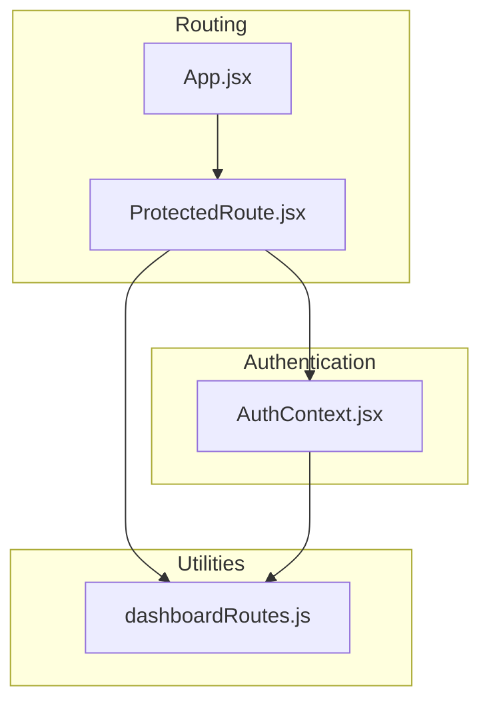
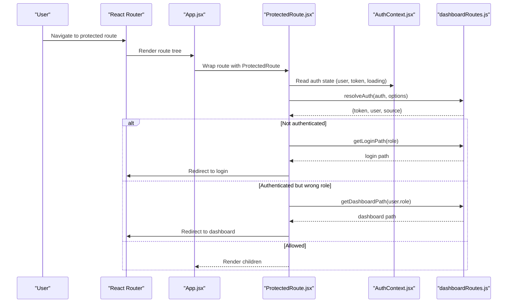
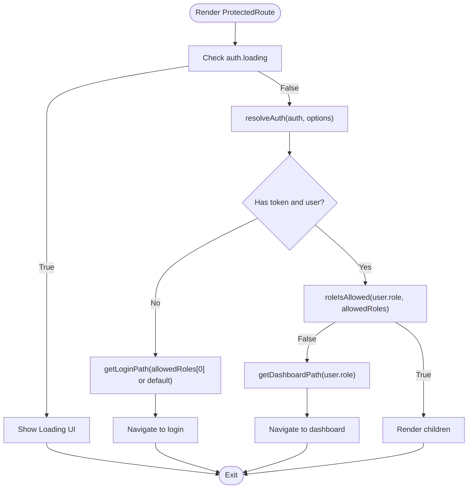
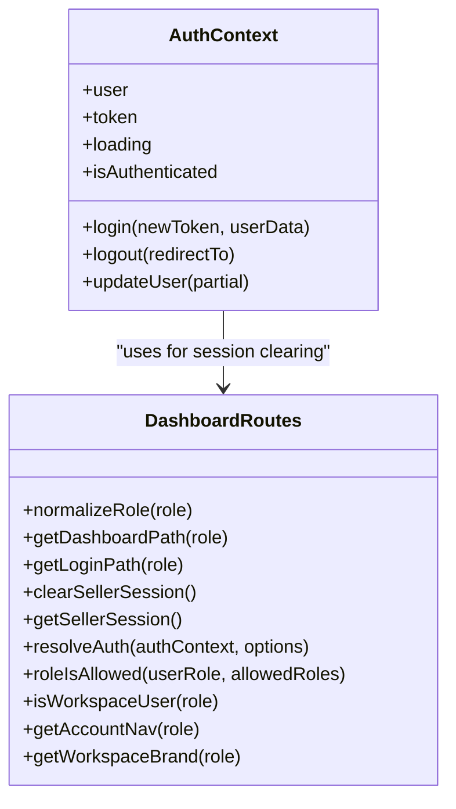
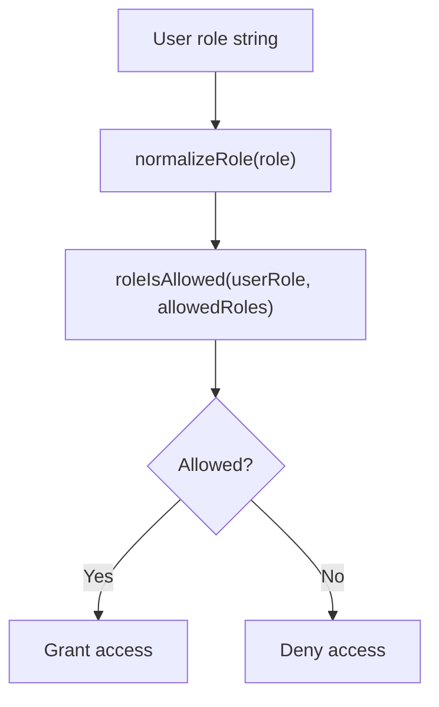
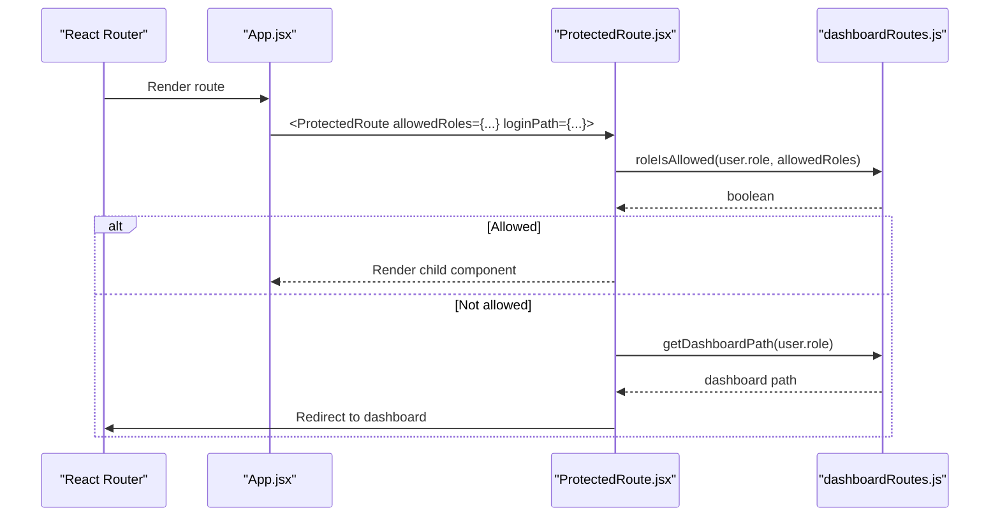
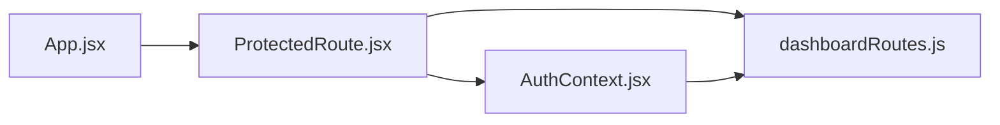

# Role-Based Access Control

<cite>
**Referenced Files in This Document**
- [ProtectedRoute.jsx](file://src/components/ProtectedRoute.jsx)
- [AuthContext.jsx](file://src/context/AuthContext.jsx)
- [dashboardRoutes.js](file://src/utils/dashboardRoutes.js)
- [App.jsx](file://src/App.jsx)
</cite>

## Table of Contents
1. [Introduction](#introduction)
2. [Project Structure](#project-structure)
3. [Core Components](#core-components)
4. [Architecture Overview](#architecture-overview)
5. [Detailed Component Analysis](#detailed-component-analysis)
6. [Dependency Analysis](#dependency-analysis)
7. [Performance Considerations](#performance-considerations)
8. [Troubleshooting Guide](#troubleshooting-guide)
9. [Conclusion](#conclusion)

## Introduction
This document explains the role-based access control (RBAC) system implemented in the frontend application. It covers how user roles are defined and managed, how route protection is enforced through a dedicated component, and how permissions are evaluated to grant or deny access. The documentation also provides guidance for implementing custom route guards, extending the permission system for new roles, and handling unauthorized access with appropriate user feedback.

The supported roles include:
- Admin
- Landlord
- Tenant (member/user)
- Agent
- Business owner (business)
- Additional workspace roles such as host, seller, mover, team, provider, and guest are also present in the routing utilities.

## Project Structure
The RBAC implementation spans three primary areas:
- Authentication context that manages session state and persistence
- Route guard component that enforces access rules
- Utility module that defines role-to-route mappings and permission helpers

**Diagram sources**
- [ProtectedRoute.jsx:1-57](file://src/components/ProtectedRoute.jsx#L1-L57)
- [AuthContext.jsx:1-157](file://src/context/AuthContext.jsx#L1-L157)
- [dashboardRoutes.js:1-183](file://src/utils/dashboardRoutes.js#L1-L183)
- [App.jsx:80-330](file://src/App.jsx#L80-L330)

**Section sources**
- [ProtectedRoute.jsx:1-57](file://src/components/ProtectedRoute.jsx#L1-L57)
- [AuthContext.jsx:1-157](file://src/context/AuthContext.jsx#L1-L157)
- [dashboardRoutes.js:1-183](file://src/utils/dashboardRoutes.js#L1-L183)
- [App.jsx:80-330](file://src/App.jsx#L80-L330)

## Core Components
- ProtectedRoute: A React component that guards routes based on authentication and role permissions.
- AuthContext: Provides global authentication state, including user, token, loading status, login/logout, and update operations.
- dashboardRoutes: Centralized utility for role-to-path mapping, session resolution, and permission checks.

Key responsibilities:
- Protecting routes from unauthenticated users by redirecting to the correct login page.
- Enforcing role-based access by comparing the current user’s role against allowed roles.
- Resolving the active session, including support for a separate seller marketplace session.
- Providing helper functions for normalizing roles, resolving paths, and checking permissions.

**Section sources**
- [ProtectedRoute.jsx:1-57](file://src/components/ProtectedRoute.jsx#L1-L57)
- [AuthContext.jsx:1-157](file://src/context/AuthContext.jsx#L1-L157)
- [dashboardRoutes.js:1-183](file://src/utils/dashboardRoutes.js#L1-L183)

## Architecture Overview
The RBAC architecture follows a clear separation of concerns:
- Authentication state is centralized in AuthContext.
- Route-level protection is handled by ProtectedRoute.
- Role definitions and path mappings are centralized in dashboardRoutes.

**Diagram sources**
- [ProtectedRoute.jsx:1-57](file://src/components/ProtectedRoute.jsx#L1-L57)
- [AuthContext.jsx:1-157](file://src/context/AuthContext.jsx#L1-L157)
- [dashboardRoutes.js:1-183](file://src/utils/dashboardRoutes.js#L1-L183)
- [App.jsx:80-330](file://src/App.jsx#L80-L330)

## Detailed Component Analysis

### ProtectedRoute Component
ProtectedRoute is the central gatekeeper for route access. It performs the following steps:
- Reads authentication state from AuthContext.
- Shows a loading indicator while authentication initializes.
- Resolves the active session using resolveAuth, which supports both main and seller sessions.
- If no valid session exists, redirects to the appropriate login path.
- If the user’s role is not in the allowedRoles list, redirects to the user’s dashboard.
- Otherwise, renders the protected content.

**Diagram sources**
- [ProtectedRoute.jsx:1-57](file://src/components/ProtectedRoute.jsx#L1-L57)
- [dashboardRoutes.js:31-99](file://src/utils/dashboardRoutes.js#L31-L99)

**Section sources**
- [ProtectedRoute.jsx:1-57](file://src/components/ProtectedRoute.jsx#L1-L57)

### AuthContext
AuthContext manages:
- Initial session restoration from localStorage.
- Guest auto-login when no saved credentials exist.
- Login, logout, and updateUser operations.
- Global loading state during initialization.
- Integration with a splash screen during app startup.

Important behaviors for RBAC:
- The context exposes user and token, which ProtectedRoute uses to enforce access.
- Logout clears persisted tokens and navigates away.
- The context integrates with dashboardRoutes to clear seller sessions when needed.

**Diagram sources**
- [AuthContext.jsx:1-157](file://src/context/AuthContext.jsx#L1-L157)
- [dashboardRoutes.js:1-183](file://src/utils/dashboardRoutes.js#L1-L183)

**Section sources**
- [AuthContext.jsx:1-157](file://src/context/AuthContext.jsx#L1-L157)

### Permission Utilities (dashboardRoutes.js)
The utility module centralizes role definitions and permission logic:
- DASHBOARD_BY_ROLE maps each role to its default dashboard path.
- LOGIN_BY_ROLE maps each role to its corresponding login page.
- normalizeRole ensures case-insensitive role comparisons.
- getDashboardPath returns the correct dashboard URL for a given role.
- getLoginPath returns the correct login URL for a given role.
- clearSellerSession removes seller-specific tokens and user data.
- getSellerSession retrieves the seller marketplace session if available.
- resolveAuth determines the active session, prioritizing seller sessions when requested.
- roleIsAllowed checks whether a user’s role is included in an allowed list.
- isWorkspaceUser identifies roles that use a dedicated workspace rather than the public marketing site.
- ACCOUNT_NAV_BY_ROLE defines navigation items per role.
- getAccountNav and getWorkspaceBrand provide UI branding and navigation helpers.

**Diagram sources**
- [dashboardRoutes.js:31-99](file://src/utils/dashboardRoutes.js#L31-L99)

**Section sources**
- [dashboardRoutes.js:1-183](file://src/utils/dashboardRoutes.js#L1-L183)

### Usage in Application Routes (App.jsx)
ProtectedRoute is used throughout the application to protect specific routes:
- Some routes require host or admin roles.
- Agent routes require agent role.
- Agency admin routes require agency_admin role.
- Business routes require business or admin roles.
- Seller routes use preferSeller to prioritize the seller session.
- Member/user routes require member or user roles.
- Landlord/provider routes require landlord or provider roles.

**Diagram sources**
- [App.jsx:80-330](file://src/App.jsx#L80-L330)
- [ProtectedRoute.jsx:1-57](file://src/components/ProtectedRoute.jsx#L1-L57)
- [dashboardRoutes.js:31-99](file://src/utils/dashboardRoutes.js#L31-L99)

**Section sources**
- [App.jsx:80-330](file://src/App.jsx#L80-L330)

## Dependency Analysis
The RBAC system has the following dependencies:
- ProtectedRoute depends on AuthContext for session state and on dashboardRoutes for permission helpers.
- AuthContext depends on dashboardRoutes for clearing seller sessions.
- App.jsx composes ProtectedRoute around feature routes, passing allowedRoles and loginPath.

**Diagram sources**
- [ProtectedRoute.jsx:1-57](file://src/components/ProtectedRoute.jsx#L1-L57)
- [AuthContext.jsx:1-157](file://src/context/AuthContext.jsx#L1-L157)
- [dashboardRoutes.js:1-183](file://src/utils/dashboardRoutes.js#L1-L183)
- [App.jsx:80-330](file://src/App.jsx#L80-L330)

**Section sources**
- [ProtectedRoute.jsx:1-57](file://src/components/ProtectedRoute.jsx#L1-L57)
- [AuthContext.jsx:1-157](file://src/context/AuthContext.jsx#L1-L157)
- [dashboardRoutes.js:1-183](file://src/utils/dashboardRoutes.js#L1-L183)
- [App.jsx:80-330](file://src/App.jsx#L80-L330)

## Performance Considerations
- Avoid unnecessary re-renders by keeping allowedRoles stable across renders.
- Use memoization for computed values derived from user roles where appropriate.
- Minimize heavy computations inside route guards; rely on lightweight helpers like normalizeRole and roleIsAllowed.
- Ensure authentication initialization completes before rendering protected routes to prevent flicker.

## Troubleshooting Guide
Common issues and resolutions:
- Unauthorized redirect loops:
  - Verify that allowedRoles includes the user’s actual role.
  - Confirm that getLoginPath resolves to the correct login page for the role.
- Wrong dashboard redirection:
  - Ensure getDashboardPath is mapped correctly for the user’s role.
- Seller session conflicts:
  - When using preferSeller, confirm that getSellerSession returns a valid seller token and user.
- Missing user or token:
  - Check that AuthContext successfully restores or creates a session during initialization.
- Role normalization mismatches:
  - Ensure roles are normalized consistently using normalizeRole.

Recommended error handling patterns:
- Display a friendly message when access is denied, explaining that the user does not have permission.
- Provide links to relevant dashboards or help pages.
- Log diagnostic information (without exposing sensitive data) to aid debugging.

**Section sources**
- [ProtectedRoute.jsx:1-57](file://src/components/ProtectedRoute.jsx#L1-L57)
- [dashboardRoutes.js:31-99](file://src/utils/dashboardRoutes.js#L31-L99)
- [AuthContext.jsx:52-97](file://src/context/AuthContext.jsx#L52-L97)

## Conclusion
The RBAC system in this application is built around a clear separation of concerns:
- AuthContext centralizes authentication state and lifecycle.
- ProtectedRoute enforces route-level access control based on roles.
- dashboardRoutes provides centralized role definitions, path mappings, and permission helpers.

To extend the system:
- Add new roles to DASHBOARD_BY_ROLE and LOGIN_BY_ROLE.
- Update ACCOUNT_NAV_BY_ROLE to define navigation for new roles.
- Wrap routes with ProtectedRoute and specify allowedRoles and loginPath.
- Implement custom route guards by composing ProtectedRoute or creating higher-order components that leverage roleIsAllowed.

For handling unauthorized access:
- Redirect users to their appropriate dashboard or login page.
- Provide clear messaging and actionable next steps.
- Maintain consistent behavior across all protected routes.