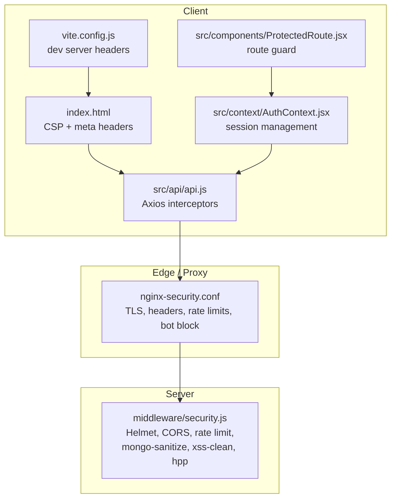
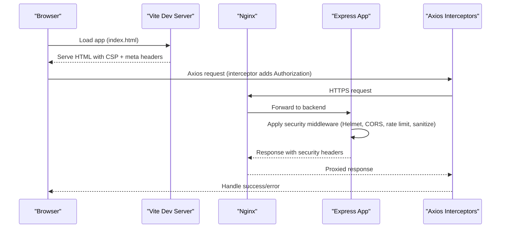
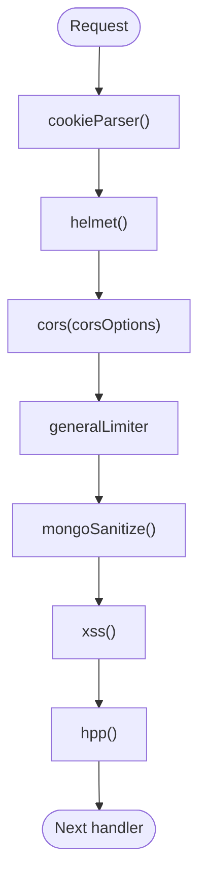
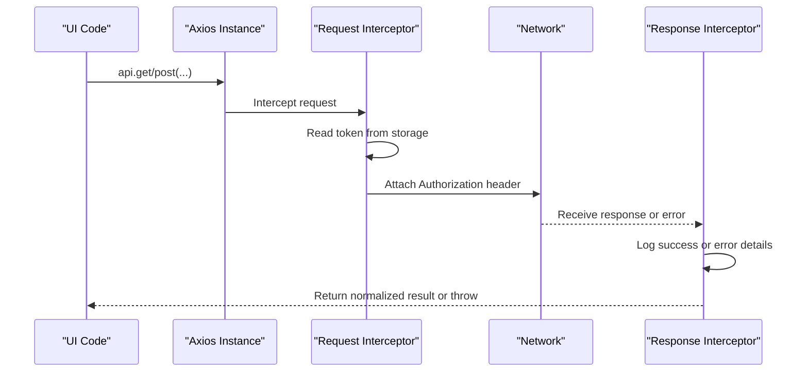
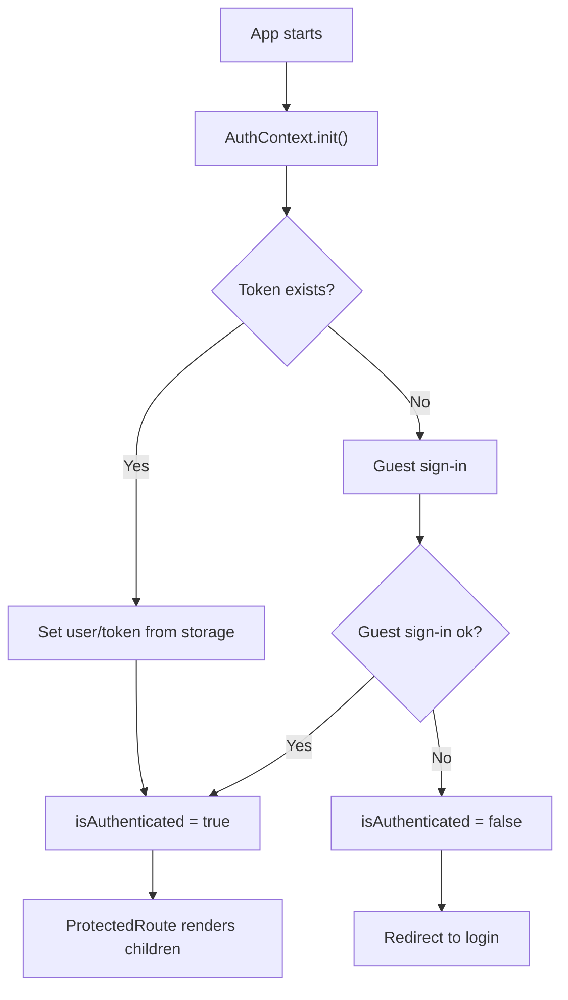
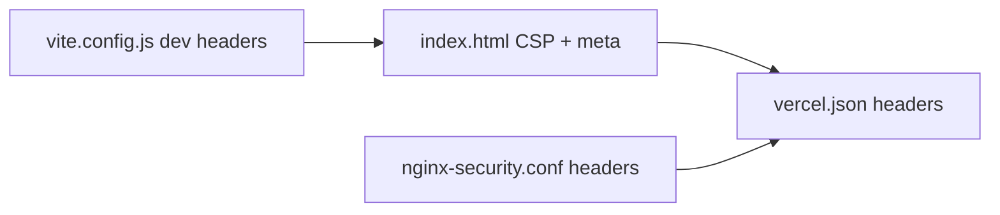
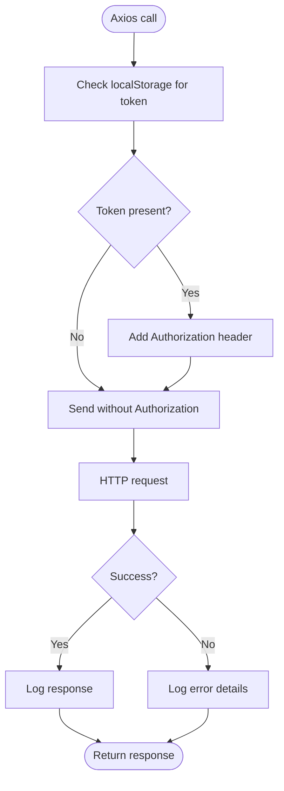
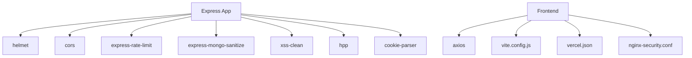

# Security Middleware

<cite>
**Referenced Files in This Document**
- [security.js](file://middleware/security.js)
- [vite.config.js](file://vite.config.js)
- [api.js](file://src/api/api.js)
- [nginx-security.conf](file://nginx-security.conf)
- [index.html](file://index.html)
- [vercel.json](file://vercel.json)
- [AuthContext.jsx](file://src/context/AuthContext.jsx)
- [ProtectedRoute.jsx](file://src/components/ProtectedRoute.jsx)
</cite>

## Table of Contents
1. [Introduction](#introduction)
2. [Project Structure](#project-structure)
3. [Core Components](#core-components)
4. [Architecture Overview](#architecture-overview)
5. [Detailed Component Analysis](#detailed-component-analysis)
6. [Dependency Analysis](#dependency-analysis)
7. [Performance Considerations](#performance-considerations)
8. [Troubleshooting Guide](#troubleshooting-guide)
9. [Conclusion](#conclusion)
10. [Appendices](#appendices)

## Introduction
This document explains the security middleware and related protections implemented across the frontend application, including XSS protection, input validation patterns, request sanitization, security headers configuration in Vite and deployment layers, and the API interceptor that handles authentication and error flows. It also provides guidance for adding custom security middleware and best practices for protecting sensitive data on the client side.

## Project Structure
Security is enforced at multiple layers:
- Backend middleware (Express) for request sanitization, rate limiting, CORS, and HTTP security headers via Helmet.
- Frontend build-time and runtime configurations for security headers and CSP.
- Nginx as a reverse proxy enforcing TLS, additional headers, bot blocking, and rate limiting.
- Frontend API client with interceptors for token injection and error handling.
- Client-side route guards to protect authenticated routes.

**Diagram sources**
- [index.html:18-56](file://index.html#L18-L56)
- [vite.config.js:7-17](file://vite.config.js#L7-L17)
- [api.js:1-46](file://src/api/api.js#L1-L46)
- [AuthContext.jsx:52-97](file://src/context/AuthContext.jsx#L52-L97)
- [ProtectedRoute.jsx:15-55](file://src/components/ProtectedRoute.jsx#L15-L55)
- [nginx-security.conf:17-64](file://nginx-security.conf#L17-L64)
- [security.js:13-54](file://middleware/security.js#L13-L54)

**Section sources**
- [index.html:18-56](file://index.html#L18-L56)
- [vite.config.js:7-17](file://vite.config.js#L7-L17)
- [api.js:1-46](file://src/api/api.js#L1-L46)
- [AuthContext.jsx:52-97](file://src/context/AuthContext.jsx#L52-L97)
- [ProtectedRoute.jsx:15-55](file://src/components/ProtectedRoute.jsx#L15-L55)
- [nginx-security.conf:17-64](file://nginx-security.conf#L17-L64)
- [security.js:13-54](file://middleware/security.js#L13-L54)

## Core Components
- Backend security middleware: applies Helmet, CORS, general and auth-specific rate limiters, mongo-sanitize, xss-clean, and HPP.
- Frontend API client: Axios instance with request/response interceptors for token injection and centralized error logging.
- CSP and security headers: defined in index.html, Vite dev server, Vercel deployment config, and Nginx.
- Authentication context and route guard: manage session persistence and enforce role-based access.

**Section sources**
- [security.js:13-54](file://middleware/security.js#L13-L54)
- [api.js:1-46](file://src/api/api.js#L1-L46)
- [index.html:18-56](file://index.html#L18-L56)
- [vite.config.js:7-17](file://vite.config.js#L7-L17)
- [vercel.json:12-46](file://vercel.json#L12-L46)
- [nginx-security.conf:29-44](file://nginx-security.conf#L29-L44)
- [AuthContext.jsx:52-97](file://src/context/AuthContext.jsx#L52-L97)
- [ProtectedRoute.jsx:15-55](file://src/components/ProtectedRoute.jsx#L15-L55)

## Architecture Overview
The security architecture spans client, edge, and server layers:
- Client sets strict CSP and security-related meta headers; Axios interceptors attach tokens and log errors.
- Edge (Nginx) enforces TLS, adds security headers, blocks bad bots, and applies rate limits per zone.
- Server (Express) uses Helmet to set response headers, CORS to restrict origins, and sanitizers to clean inputs.

**Diagram sources**
- [index.html:18-56](file://index.html#L18-L56)
- [vite.config.js:7-17](file://vite.config.js#L7-L17)
- [api.js:10-44](file://src/api/api.js#L10-L44)
- [nginx-security.conf:17-64](file://nginx-security.conf#L17-L64)
- [security.js:44-54](file://middleware/security.js#L44-L54)

## Detailed Component Analysis

### Backend Security Middleware (Express)
- Helmet: Configured with cross-origin resource policy enabled; CSP disabled at this layer because it is managed in the client and deployment configs.
- CORS: Whitelists development and production origins, allows credentials, specific methods and headers, and sets maxAge.
- Rate Limiting: Two limiters are provided:
  - General limiter: 100 requests per 15 minutes.
  - Auth limiter: 10 requests per 15 minutes (for stricter endpoints).
- Input Sanitization:
  - Mongo-sanitize removes or escapes MongoDB operator characters from incoming objects.
  - xss-clean strips dangerous content from request bodies and query strings.
  - HPP prevents HTTP parameter pollution by disallowing duplicate keys.
- Cookie Parsing: cookie-parser is applied before other middleware.

**Diagram sources**
- [security.js:44-54](file://middleware/security.js#L44-L54)

**Section sources**
- [security.js:13-54](file://middleware/security.js#L13-L54)

### Frontend API Interceptor (Axios)
- Request Interceptor:
  - Reads token from localStorage and attaches Authorization header if present.
  - Logs method, URL, and payload for debugging.
- Response Interceptor:
  - Logs successful responses.
  - Centralizes error logging for network issues, server errors, and generic errors.

**Diagram sources**
- [api.js:10-44](file://src/api/api.js#L10-L44)

**Section sources**
- [api.js:1-46](file://src/api/api.js#L1-L46)

### Authentication Context and Route Guard
- AuthContext:
  - Restores session from localStorage on init.
  - Supports guest auto-sign-in when no token exists.
  - Provides login/update/logout helpers and exposes isAuthenticated flag.
- ProtectedRoute:
  - Renders loading state while auth initializes.
  - Redirects unauthenticated users to login.
  - Enforces role-based access control using allowedRoles.

**Diagram sources**
- [AuthContext.jsx:52-97](file://src/context/AuthContext.jsx#L52-L97)
- [ProtectedRoute.jsx:15-55](file://src/components/ProtectedRoute.jsx#L15-L55)

**Section sources**
- [AuthContext.jsx:52-97](file://src/context/AuthContext.jsx#L52-L97)
- [ProtectedRoute.jsx:15-55](file://src/components/ProtectedRoute.jsx#L15-L55)

### Security Headers and CSP Configuration
- index.html:
  - Defines a comprehensive Content-Security-Policy covering script, style, image, font, connect, frame, object, base-uri, and form-action directives.
  - Sets X-Content-Type-Options and Referrer-Policy via meta tags.
- vite.config.js:
  - Adds basic security headers in development server: X-Content-Type-Options, X-Frame-Options, X-XSS-Protection, Referrer-Policy.
- vercel.json:
  - Applies CSP and security headers at the platform level for all routes.
- nginx-security.conf:
  - Adds Strict-Transport-Security, X-Frame-Options, X-Content-Type-Options, X-XSS-Protection, Referrer-Policy, Permissions-Policy.
  - Blocks known malicious user agents and dangerous paths.
  - Enforces TLS protocols and ciphers.

**Diagram sources**
- [index.html:18-56](file://index.html#L18-L56)
- [vite.config.js:7-17](file://vite.config.js#L7-L17)
- [vercel.json:12-46](file://vercel.json#L12-L46)
- [nginx-security.conf:29-44](file://nginx-security.conf#L29-L44)

**Section sources**
- [index.html:18-56](file://index.html#L18-L56)
- [vite.config.js:7-17](file://vite.config.js#L7-L17)
- [vercel.json:12-46](file://vercel.json#L12-L46)
- [nginx-security.conf:29-44](file://nginx-security.conf#L29-L44)

### XSS Protection Measures and Input Validation Patterns
- Backend sanitization:
  - xss-clean cleans incoming request payloads and query parameters to remove potentially malicious scripts.
  - mongo-sanitize prevents NoSQL injection by stripping operators like $gt, $ne, etc., from request bodies.
  - HPP prevents HTTP Parameter Pollution by rejecting duplicate keys.
- Frontend:
  - CSP in index.html and vercel.json restricts execution of inline scripts and eval where possible, though some 'unsafe-inline' and 'unsafe-eval' are present for third-party integrations.
  - Axios interceptors do not perform input sanitization; they focus on token injection and error logging.

Best practices reflected:
- Prefer server-side sanitization for all user inputs.
- Keep CSP tight and minimize unsafe directives.
- Use explicit allowlists for external domains in CSP connect-src and script-src.

**Section sources**
- [security.js:49-51](file://middleware/security.js#L49-L51)
- [index.html:18-56](file://index.html#L18-L56)
- [vercel.json:26-46](file://vercel.json#L26-L46)

### Request Sanitization Techniques
- Body/query cleaning via xss-clean.
- MongoDB operator removal via express-mongo-sanitize.
- Duplicate key prevention via hpp.
- These are applied globally through the middleware pipeline.

**Section sources**
- [security.js:49-51](file://middleware/security.js#L49-L51)

### API Interceptor Implementation Details
- Token handling:
  - Reads token from localStorage and attaches Authorization header.
- Error handling:
  - Centralized logging for response errors, network failures, and generic errors.
- Extensibility:
  - Can be extended to handle 401/403 responses by redirecting to login or refreshing tokens.

**Diagram sources**
- [api.js:10-44](file://src/api/api.js#L10-L44)

**Section sources**
- [api.js:10-44](file://src/api/api.js#L10-L44)

### Adding Custom Security Middleware
To add custom security middleware:
- Create a new middleware function that validates or transforms requests.
- Register it in the security middleware pipeline after existing sanitizers if it depends on cleaned data, or before if it needs raw input.
- Example pattern:
  - Validate required fields.
  - Normalize and validate formats (e.g., phone numbers, emails).
  - Enforce business rules (e.g., maximum payload size).
- Integrate with rate limiting by applying route-specific limiters where appropriate.

Guidelines:
- Keep middleware pure and idempotent.
- Avoid heavy computation in global middleware; use route-level middleware for expensive checks.
- Ensure error responses include minimal information to avoid leaking internals.

[No sources needed since this section provides general guidance]

### Best Practices for Protecting Sensitive Data in Client-Side Applications
- Do not store secrets in localStorage; prefer httpOnly cookies for tokens when possible.
- Minimize sensitive data in logs; avoid printing tokens or PII.
- Use HTTPS everywhere; ensure HSTS is enabled at the edge.
- Restrict CSP to only necessary domains and avoid 'unsafe-inline'/'unsafe-eval'.
- Implement proper logout flows that clear local storage and invalidate sessions server-side.
- Validate and sanitize all user inputs both client-side and server-side.

[No sources needed since this section provides general guidance]

## Dependency Analysis
The security stack composes several dependencies:
- Backend: helmet, cors, express-rate-limit, express-mongo-sanitize, xss-clean, hpp, cookie-parser.
- Frontend: axios for HTTP, React context for auth state, Vite for dev server headers, Vercel/Nginx for deployment headers.

**Diagram sources**
- [security.js:5-11](file://middleware/security.js#L5-L11)
- [api.js:1-8](file://src/api/api.js#L1-L8)
- [vite.config.js:1-6](file://vite.config.js#L1-L6)
- [vercel.json:12-46](file://vercel.json#L12-L46)
- [nginx-security.conf:1-8](file://nginx-security.conf#L1-L8)

**Section sources**
- [security.js:5-11](file://middleware/security.js#L5-L11)
- [api.js:1-8](file://src/api/api.js#L1-L8)
- [vite.config.js:1-6](file://vite.config.js#L1-L6)
- [vercel.json:12-46](file://vercel.json#L12-L46)
- [nginx-security.conf:1-8](file://nginx-security.conf#L1-L8)

## Performance Considerations
- Rate limiting:
  - Global limiter protects against brute-force and scraping; auth limiter further restricts login attempts.
  - Tune windowMs and max based on traffic patterns and user experience.
- Sanitization overhead:
  - xss-clean and mongo-sanitize add processing time; consider caching validated schemas where applicable.
- CSP evaluation:
  - Complex CSP can impact browser parsing; keep directives concise and accurate.
- Logging:
  - Excessive console logging in interceptors can degrade performance; disable in production builds.

[No sources needed since this section provides general guidance]

## Troubleshooting Guide
Common issues and resolutions:
- CSP violations:
  - Verify all external domains are whitelisted in CSP directives.
  - Ensure scripts and styles are loaded from allowed sources.
- CORS errors:
  - Confirm origin allowlist includes the frontend’s domain and port.
  - Ensure credentials are enabled when using cookies or auth headers.
- Rate limiting:
  - If clients receive “Too many requests,” adjust limiter thresholds or implement exponential backoff.
- Token not attached:
  - Check localStorage for token presence and ensure interceptor runs before requests.
- Nginx 403/404:
  - Review bot blocking rules and path restrictions; update user-agent allowlist if needed.

**Section sources**
- [security.js:30-42](file://middleware/security.js#L30-L42)
- [api.js:10-44](file://src/api/api.js#L10-L44)
- [nginx-security.conf:10-15](file://nginx-security.conf#L10-L15)
- [nginx-security.conf:41-49](file://nginx-security.conf#L41-L49)

## Conclusion
The application implements a layered security strategy:
- Backend middleware sanitizes inputs, controls CORS, and sets secure defaults via Helmet.
- Frontend enforces CSP and security headers at build and deployment levels.
- Nginx hardens the edge with TLS, headers, bot blocking, and rate limits.
- The Axios interceptors centralize authentication and error handling.
Adhering to the best practices outlined here will help maintain a robust security posture and reduce exposure to common web vulnerabilities.

[No sources needed since this section summarizes without analyzing specific files]

## Appendices

### Security Headers Summary
- index.html:
  - CSP, X-Content-Type-Options, Referrer-Policy.
- vite.config.js:
  - X-Content-Type-Options, X-Frame-Options, X-XSS-Protection, Referrer-Policy.
- vercel.json:
  - CSP, X-Frame-Options, X-Content-Type-Options, Referrer-Policy.
- nginx-security.conf:
  - Strict-Transport-Security, X-Frame-Options, X-Content-Type-Options, X-XSS-Protection, Referrer-Policy, Permissions-Policy.

**Section sources**
- [index.html:18-56](file://index.html#L18-L56)
- [vite.config.js:7-17](file://vite.config.js#L7-L17)
- [vercel.json:26-46](file://vercel.json#L26-L46)
- [nginx-security.conf:29-44](file://nginx-security.conf#L29-L44)