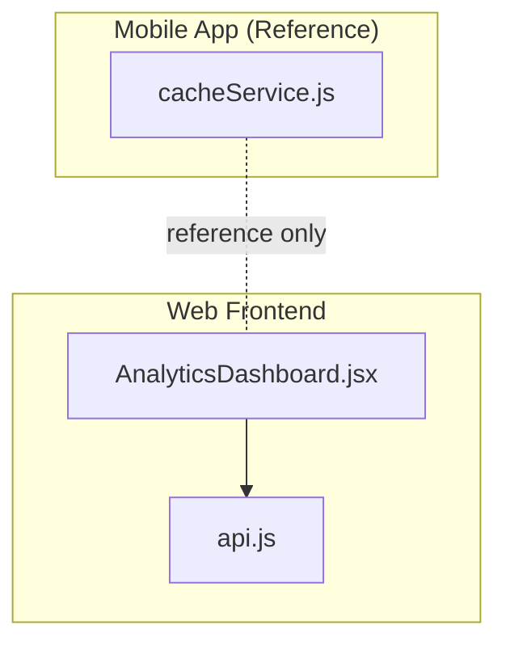
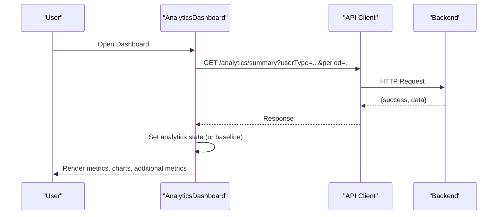
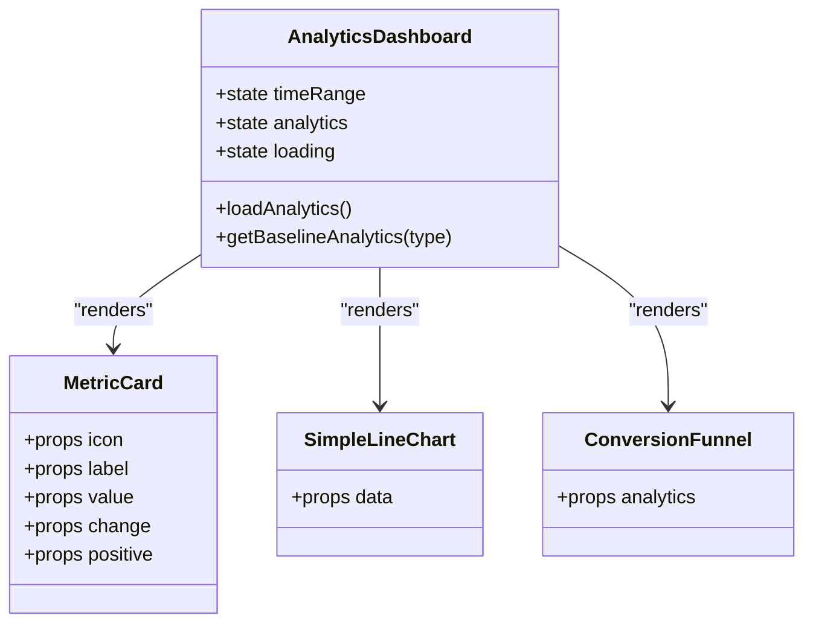
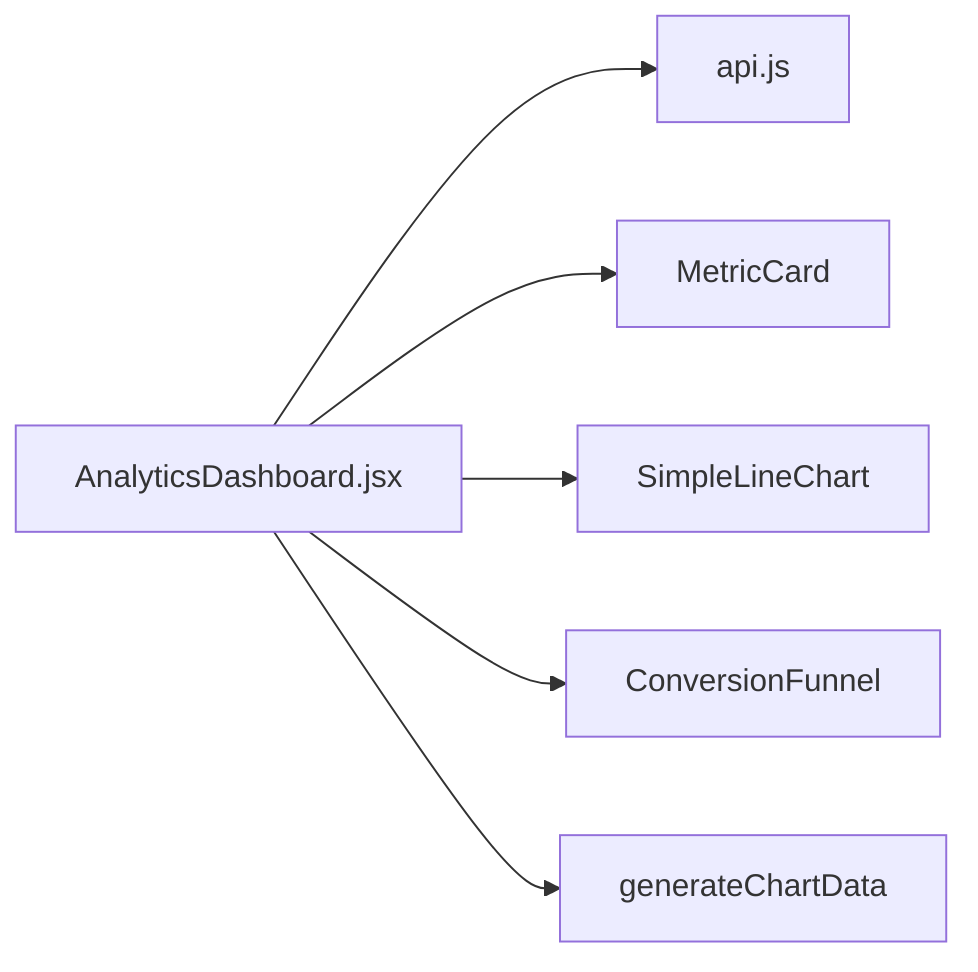

# Business Analytics Dashboard

<cite>
**Referenced Files in This Document**
- [AnalyticsDashboard.jsx](file://src/components/AnalyticsDashboard.jsx)
- [api.js](file://src/api/api.js)
- [cacheService.js](file://axx-spaces-mobile/src/services/cacheService.js)
</cite>

## Table of Contents
1. [Introduction](#introduction)
2. [Project Structure](#project-structure)
3. [Core Components](#core-components)
4. [Architecture Overview](#architecture-overview)
5. [Detailed Component Analysis](#detailed-component-analysis)
6. [Dependency Analysis](#dependency-analysis)
7. [Performance Considerations](#performance-considerations)
8. [Troubleshooting Guide](#troubleshooting-guide)
9. [Conclusion](#conclusion)
10. [Appendices](#appendices)

## Introduction
This document explains the business analytics dashboard implemented in the frontend repository. It covers performance metrics tracking, visitor statistics, engagement analytics, and the visualization components that render them. It also documents how data is fetched, how baseline fallbacks work, and how to extend or customize the dashboard for different user types (landlord, mover, seller). Where applicable, it includes guidance on adding new metrics, exporting performance data, and optimizing for large datasets.

## Project Structure
The analytics feature is primarily implemented as a single React component with an internal charting implementation and a shared API client for fetching summary analytics. A mobile cache service exists in the repository but is not used by the web analytics dashboard; it is included here to inform caching strategies and performance considerations.

**Diagram sources**
- [AnalyticsDashboard.jsx:1-28](file://src/components/AnalyticsDashboard.jsx#L1-L28)
- [api.js:1-47](file://src/api/api.js#L1-L47)
- [cacheService.js:1-198](file://axx-spaces-mobile/src/services/cacheService.js#L1-L198)

**Section sources**
- [AnalyticsDashboard.jsx:1-28](file://src/components/AnalyticsDashboard.jsx#L1-L28)
- [api.js:1-47](file://src/api/api.js#L1-L47)
- [cacheService.js:1-198](file://axx-spaces-mobile/src/services/cacheService.js#L1-L198)

## Core Components
- AnalyticsDashboard: Main dashboard component that loads analytics, renders key metrics, charts, and additional metrics tailored to user type.
- MetricCard: Reusable card for displaying a metric value and change indicator.
- SimpleLineChart: Custom bar chart visualizing performance over time.
- ConversionFunnel: Visualizes views → inquiries → bookings conversion.
- generateChartData: Deterministic data generator for the line chart based on time range and total views.
- API client: Axios-based HTTP client with interceptors for auth and debugging.

Key responsibilities:
- Fetch analytics summary from backend via GET /analytics/summary with query parameters userType and period.
- Provide baseline fallback data when the API response is missing or invalid.
- Render user-type-specific metrics (landlord, mover, seller).
- Visualize trends and conversion funnel.

**Section sources**
- [AnalyticsDashboard.jsx:4-218](file://src/components/AnalyticsDashboard.jsx#L4-L218)
- [AnalyticsDashboard.jsx:220-231](file://src/components/AnalyticsDashboard.jsx#L220-L231)
- [AnalyticsDashboard.jsx:233-277](file://src/components/AnalyticsDashboard.jsx#L233-L277)
- [AnalyticsDashboard.jsx:279-316](file://src/components/AnalyticsDashboard.jsx#L279-L316)
- [AnalyticsDashboard.jsx:318-369](file://src/components/AnalyticsDashboard.jsx#L318-L369)
- [api.js:1-47](file://src/api/api.js#L1-L47)

## Architecture Overview
The dashboard follows a simple client-side architecture:
- The component requests analytics summary from the backend using the API client.
- On success, it sets state with the returned data; otherwise, it falls back to baseline data.
- UI renders KPI cards, a time-series chart, and a conversion funnel.
- Time range selection triggers re-fetching analytics.

**Diagram sources**
- [AnalyticsDashboard.jsx:9-28](file://src/components/AnalyticsDashboard.jsx#L9-L28)
- [api.js:1-47](file://src/api/api.js#L1-L47)

## Detailed Component Analysis

### AnalyticsDashboard
Responsibilities:
- State management for timeRange, analytics, and loading.
- Data fetching with error handling and baseline fallback.
- Rendering sections: header with time range selector, key metrics grid, charts section, and additional metrics per user type.

Data model expectations (from usage):
- views, inquiries, bookings or jobsCompleted, revenue, conversionRate
- Landlord: propertiesListed, averageResponseTime, qrScans, qrInquiries
- Mover: averageRating, repeatCustomers
- Seller: itemsSold, averageOrderValue

Real-time updates:
- No automatic real-time polling is implemented; updates occur when timeRange changes or props change.

Customization points:
- Add new metrics by extending getBaselineAnalytics and rendering them conditionally by userType.
- Extend time ranges by modifying the time range selector array and labels.

Error handling:
- Catches fetch errors and logs them; sets baseline analytics to ensure UI remains usable.

**Section sources**
- [AnalyticsDashboard.jsx:4-218](file://src/components/AnalyticsDashboard.jsx#L4-L218)
- [AnalyticsDashboard.jsx:30-65](file://src/components/AnalyticsDashboard.jsx#L30-L65)

#### Class Diagram

**Diagram sources**
- [AnalyticsDashboard.jsx:4-218](file://src/components/AnalyticsDashboard.jsx#L4-L218)
- [AnalyticsDashboard.jsx:220-231](file://src/components/AnalyticsDashboard.jsx#L220-L231)
- [AnalyticsDashboard.jsx:233-277](file://src/components/AnalyticsDashboard.jsx#L233-L277)
- [AnalyticsDashboard.jsx:279-316](file://src/components/AnalyticsDashboard.jsx#L279-L316)

### SimpleLineChart
Purpose:
- Renders a bar chart representing performance over time.
- Supports hover tooltips showing values.

Data input:
- Array of objects with label and value.

Complexity:
- O(n) rendering where n is number of data points.

Optimization opportunities:
- Memoize computed maxValue and styles.
- Virtualize bars for very large datasets.

**Section sources**
- [AnalyticsDashboard.jsx:233-277](file://src/components/AnalyticsDashboard.jsx#L233-L277)

### ConversionFunnel
Purpose:
- Visualizes conversion steps: Views → Inquiries → Bookings.
- Shows drop-off percentages between steps.

Data input:
- analytics object containing views, inquiries, bookings.

Complexity:
- O(k) where k is number of funnel steps (constant small set).

**Section sources**
- [AnalyticsDashboard.jsx:279-316](file://src/components/AnalyticsDashboard.jsx#L279-L316)

### generateChartData
Purpose:
- Generates deterministic time-series data for the line chart based on time range and total views.
- Uses a seeded random approach to distribute total views across days while preserving weekly cycles.

Algorithm overview:
- Seed generation from userId.
- Compute weights per day with a sinusoidal cycle.
- Distribute totalViews proportionally across days.
- Adjust last day to match total exactly.

Complexity:
- O(d) where d is number of days (7, 30, or 90).

**Section sources**
- [AnalyticsDashboard.jsx:318-369](file://src/components/AnalyticsDashboard.jsx#L318-L369)

### API Client
Purpose:
- Centralized Axios instance with base URL configuration.
- Interceptors add Authorization headers and log request/response details.

Usage:
- AnalyticsDashboard calls API.get("/analytics/summary", { params }).

Security and reliability:
- Reads token from localStorage.
- Logs detailed errors for debugging.

**Section sources**
- [api.js:1-47](file://src/api/api.js#L1-L47)

## Dependency Analysis
- AnalyticsDashboard depends on:
  - API client for data retrieval.
  - Internal components MetricCard, SimpleLineChart, ConversionFunnel.
  - Internal function generateChartData for chart data.

- API client depends on:
  - axios library.
  - environment variable VITE_API_URL.

- Mobile cache service is independent and not imported by the web dashboard; it serves as a reference for caching patterns.

**Diagram sources**
- [AnalyticsDashboard.jsx:1-28](file://src/components/AnalyticsDashboard.jsx#L1-L28)
- [api.js:1-47](file://src/api/api.js#L1-L47)

**Section sources**
- [AnalyticsDashboard.jsx:1-28](file://src/components/AnalyticsDashboard.jsx#L1-L28)
- [api.js:1-47](file://src/api/api.js#L1-L47)

## Performance Considerations
- Data fetching:
  - Single GET request per load; consider debouncing time range changes if needed.
  - Use skeleton loaders during loading state to improve perceived performance.

- Chart rendering:
  - For large datasets, virtualize chart elements or downsample data points.
  - Memoize expensive computations (e.g., maxValue, distribution logic).

- Baseline fallback:
  - Ensures UI remains responsive even when backend is unavailable.

- Caching strategy (web):
  - Not currently implemented in the web dashboard; consider adding in-memory or IndexedDB caching for repeated queries.

- Caching strategy (mobile reference):
  - The mobile app includes a robust cache service with TTL, pattern invalidation, prefetching, and stats. While not used by the web dashboard, these patterns can be adapted for web storage (localStorage/IndexedDB) to reduce network calls.

- Real-time updates:
  - Implement periodic polling or WebSocket integration if near-real-time analytics are required.

[No sources needed since this section provides general guidance]

## Troubleshooting Guide
Common issues and resolutions:
- No analytics data displayed:
  - Check network tab for GET /analytics/summary responses.
  - Verify userType and period query parameters are correct.
  - Confirm backend returns {success: true, data: {...}}.

- Authentication errors:
  - Ensure token exists in localStorage and is valid.
  - Inspect interceptor logs for Authorization header presence.

- Chart shows zero or unexpected values:
  - Validate analytics.views is a positive number.
  - Review generateChartData distribution logic and seed inputs.

- Loading state persists:
  - Check for unhandled exceptions in loadAnalytics.
  - Verify finally block resets loading state.

- Exporting data:
  - The dashboard does not include built-in export functionality. To add CSV export:
    - Create a utility that serializes analytics.metrics and chart data arrays into CSV format.
    - Trigger download via Blob and anchor element on user action.

**Section sources**
- [AnalyticsDashboard.jsx:9-28](file://src/components/AnalyticsDashboard.jsx#L9-L28)
- [api.js:10-44](file://src/api/api.js#L10-L44)

## Conclusion
The analytics dashboard provides a clear view of performance metrics, visitor statistics, and engagement through KPI cards, a time-series chart, and a conversion funnel. It supports multiple user types with tailored metrics and offers a solid foundation for customization. To enhance production readiness, consider implementing caching, real-time updates, and export capabilities following the patterns outlined in this document.

[No sources needed since this section summarizes without analyzing specific files]

## Appendices

### Adding New Metrics
Steps:
- Extend getBaselineAnalytics to include the new field for each relevant userType.
- Update the rendering logic to display the new metric in the appropriate section.
- If the metric requires aggregation, implement server-side computation and expose it via the analytics summary endpoint.

**Section sources**
- [AnalyticsDashboard.jsx:30-65](file://src/components/AnalyticsDashboard.jsx#L30-L65)
- [AnalyticsDashboard.jsx:147-215](file://src/components/AnalyticsDashboard.jsx#L147-L215)

### Customizing Analytics Reports
Options:
- Add new time ranges by updating the selector array and labels.
- Introduce filters (e.g., property, region) by extending query parameters and backend endpoints.
- Add export features (CSV/JSON) by creating a dedicated utility and UI controls.

**Section sources**
- [AnalyticsDashboard.jsx:83-100](file://src/components/AnalyticsDashboard.jsx#L83-L100)

### Data Aggregation Processes
- Backend should aggregate views, inquiries, bookings, revenue, and derived metrics (conversion rate) over the requested period.
- Frontend expects a flat analytics object; keep schema consistent across user types.

[No sources needed since this section provides general guidance]

### Caching Strategies
- Web:
  - Consider in-memory cache for short-lived data and IndexedDB for persistent caching.
  - Implement cache invalidation on prop changes (timeRange, userType).

- Mobile reference:
  - TTL-based expiration, pattern invalidation, prefetching, and cache stats are available in the mobile cache service.

**Section sources**
- [cacheService.js:1-198](file://axx-spaces-mobile/src/services/cacheService.js#L1-L198)

### Performance Optimization Techniques for Large Datasets
- Downsample time-series data before rendering.
- Virtualize chart bars for long lists.
- Debounce user interactions that trigger re-renders.
- Memoize heavy computations and avoid unnecessary re-renders.

[No sources needed since this section provides general guidance]