# Business Directory (AxxBiashara)

<cite>
**Referenced Files in This Document**
- [AxxBiashara.jsx](file://src/pages/AxxBiashara.jsx)
- [BusinessRegister.jsx](file://src/pages/BusinessRegister.jsx)
- [BusinessForm.jsx](file://src/pages/BusinessForm.jsx)
- [BusinessDetail.jsx](file://src/pages/BusinessDetail.jsx)
- [QRGeneratorModal.jsx](file://src/components/QRGeneratorModal.jsx)
- [AnalyticsDashboard.jsx](file://src/components/AnalyticsDashboard.jsx)
- [VerificationStatus.jsx](file://src/components/VerificationStatus.jsx)
- [profile.js](file://src/api/profile.js)
</cite>

## Table of Contents
1. [Introduction](#introduction)
2. [Project Structure](#project-structure)
3. [Core Components](#core-components)
4. [Architecture Overview](#architecture-overview)
5. [Detailed Component Analysis](#detailed-component-analysis)
6. [Dependency Analysis](#dependency-analysis)
7. [Performance Considerations](#performance-considerations)
8. [Troubleshooting Guide](#troubleshooting-guide)
9. [Conclusion](#conclusion)
10. [Appendices](#appendices)

## Introduction
This document explains the AxxBiashara business directory feature set: business registration, profile management, service marketplace integration, QR code generation for promotion, analytics dashboard, and verification system. It also covers business categorization, search functionality, promotional tools, and how to integrate additional services or customize the business profile layout.

## Project Structure
The business directory is implemented as a React frontend with several pages and reusable components:
- Directory listing and search: AxxBiashara page
- Registration flow: BusinessRegister page
- Profile creation/editing: BusinessForm page
- Business detail view: BusinessDetail page
- Promotional assets: QRGeneratorModal component
- Performance tracking: AnalyticsDashboard component
- Trust and verification: VerificationStatus component
- Shared profile API helpers: profile.js

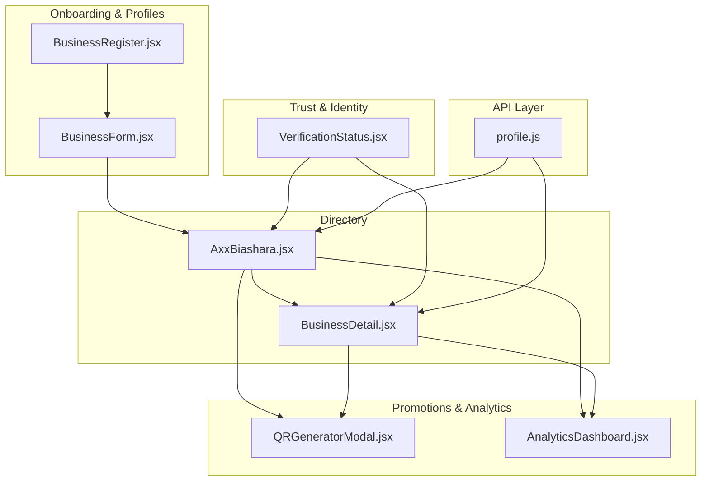

**Diagram sources**
- [AxxBiashara.jsx:256-336](file://src/pages/AxxBiashara.jsx#L256-L336)
- [BusinessRegister.jsx:11-123](file://src/pages/BusinessRegister.jsx#L11-L123)
- [BusinessForm.jsx:618-701](file://src/pages/BusinessForm.jsx#L618-L701)
- [BusinessDetail.jsx:1-120](file://src/pages/BusinessDetail.jsx#L1-L120)
- [QRGeneratorModal.jsx:357-410](file://src/components/QRGeneratorModal.jsx#L357-L410)
- [AnalyticsDashboard.jsx:4-28](file://src/components/AnalyticsDashboard.jsx#L4-L28)
- [VerificationStatus.jsx:5-35](file://src/components/VerificationStatus.jsx#L5-L35)
- [profile.js:16-32](file://src/api/profile.js#L16-L32)

**Section sources**
- [AxxBiashara.jsx:256-336](file://src/pages/AxxBiashara.jsx#L256-L336)
- [BusinessRegister.jsx:11-123](file://src/pages/BusinessRegister.jsx#L11-L123)
- [BusinessForm.jsx:618-701](file://src/pages/BusinessForm.jsx#L618-L701)
- [BusinessDetail.jsx:1-120](file://src/pages/BusinessDetail.jsx#L1-L120)
- [QRGeneratorModal.jsx:357-410](file://src/components/QRGeneratorModal.jsx#L357-L410)
- [AnalyticsDashboard.jsx:4-28](file://src/components/AnalyticsDashboard.jsx#L4-L28)
- [VerificationStatus.jsx:5-35](file://src/components/VerificationStatus.jsx#L5-L35)
- [profile.js:16-32](file://src/api/profile.js#L16-L32)

## Core Components
- AxxBiashara: Directory listing, search, filters, favorites, comparison, announcements, and navigation to business details and dashboards.
- BusinessRegister: Account creation for businesses with email/password and Google sign-in.
- BusinessForm: Multi-step business profile editor with categories, location, contact info, logo/photos, category items, and review step.
- BusinessDetail: Rich business profile display with hero, badges, gallery, promotions, products/pricelist, reviews, and owner/contact info.
- QRGeneratorModal: Generates scannable QR codes and printable posters for promotion.
- AnalyticsDashboard: Aggregates views, inquiries, bookings/revenue, conversion rate, and role-specific metrics; includes charts.
- VerificationStatus: Shows verification levels, status, requirements, benefits, and pricing plans for trust badges.
- profile.js: Shared helpers for fetching/updating user profiles across roles.

Key responsibilities and interactions are detailed below.

**Section sources**
- [AxxBiashara.jsx:256-336](file://src/pages/AxxBiashara.jsx#L256-L336)
- [BusinessRegister.jsx:11-123](file://src/pages/BusinessRegister.jsx#L11-L123)
- [BusinessForm.jsx:618-701](file://src/pages/BusinessForm.jsx#L618-L701)
- [BusinessDetail.jsx:1-120](file://src/pages/BusinessDetail.jsx#L1-L120)
- [QRGeneratorModal.jsx:357-410](file://src/components/QRGeneratorModal.jsx#L357-L410)
- [AnalyticsDashboard.jsx:4-28](file://src/components/AnalyticsDashboard.jsx#L4-L28)
- [VerificationStatus.jsx:5-35](file://src/components/VerificationStatus.jsx#L5-L35)
- [profile.js:16-32](file://src/api/profile.js#L16-L32)

## Architecture Overview
The directory integrates discovery, onboarding, profile management, promotions, analytics, and verification into a cohesive flow. Users can discover businesses, register accounts, create/edit profiles, generate promotional QR/posters, track performance, and manage verification.

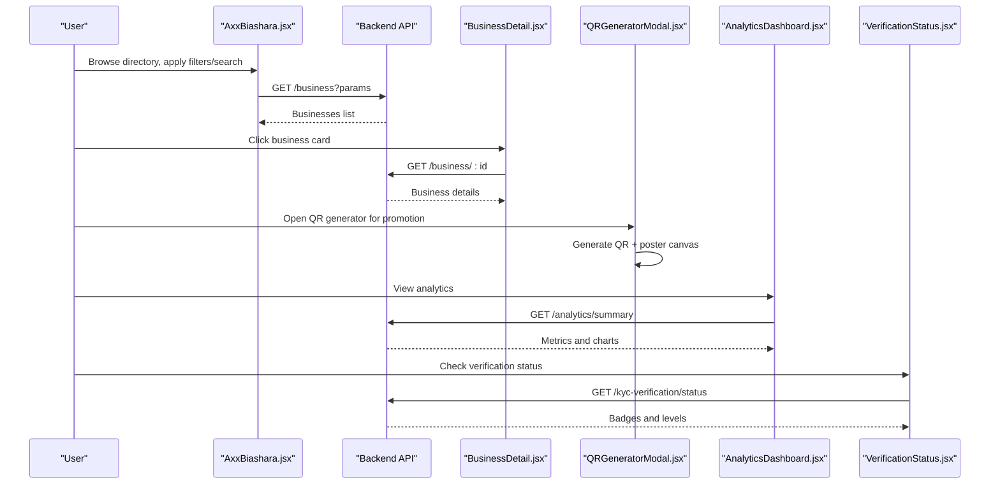

**Diagram sources**
- [AxxBiashara.jsx:289-336](file://src/pages/AxxBiashara.jsx#L289-L336)
- [BusinessDetail.jsx:1-120](file://src/pages/BusinessDetail.jsx#L1-L120)
- [QRGeneratorModal.jsx:357-410](file://src/components/QRGeneratorModal.jsx#L357-L410)
- [AnalyticsDashboard.jsx:13-28](file://src/components/AnalyticsDashboard.jsx#L13-L28)
- [VerificationStatus.jsx:11-35](file://src/components/VerificationStatus.jsx#L11-L35)

## Detailed Component Analysis

### Business Registration Flow
- Purpose: Create a business account and redirect to the dashboard.
- Inputs: Name, email, phone, password, confirm password; optional Google sign-in.
- Validation: Password strength rules and match check.
- Outcomes: Success message and redirection; error handling for invalid inputs or backend errors.

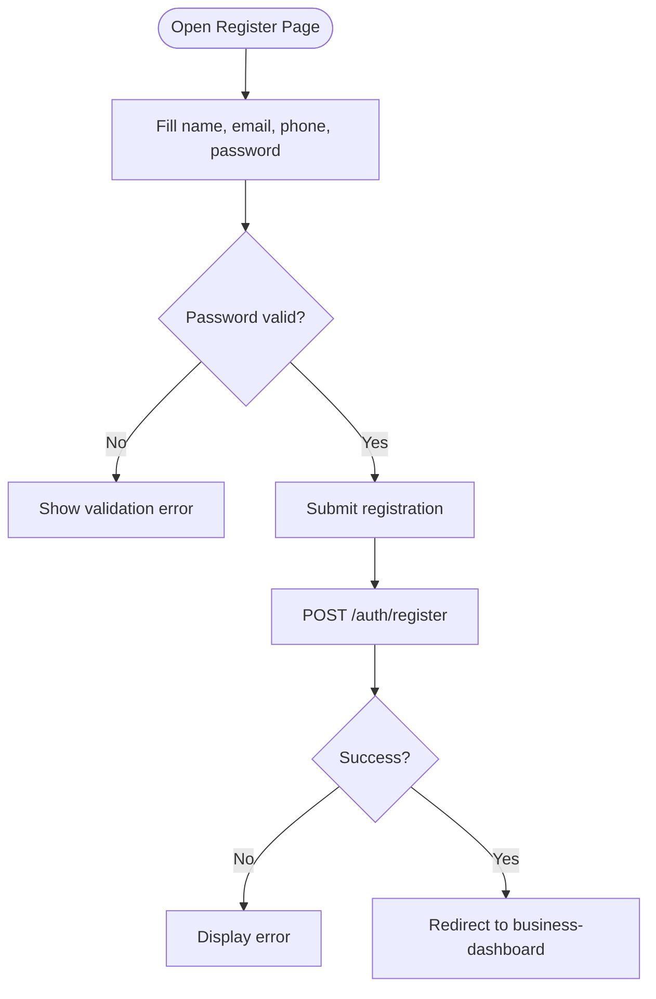

**Diagram sources**
- [BusinessRegister.jsx:74-123](file://src/pages/BusinessRegister.jsx#L74-L123)

**Section sources**
- [BusinessRegister.jsx:11-123](file://src/pages/BusinessRegister.jsx#L11-L123)

### Business Profile Management (Create/Edit)
- Purpose: Build and update a business profile with rich metadata.
- Steps: Basic info, location, contact, logo & photos, review.
- Features:
  - Multi-select categories and county selection.
  - Image compression and upload progress.
  - Category items with prices and optional images.
  - Auto-populate contact fields from authenticated user.
  - Edit existing business by ID.

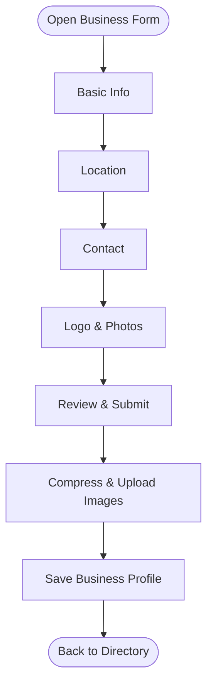

**Diagram sources**
- [BusinessForm.jsx:618-701](file://src/pages/BusinessForm.jsx#L618-L701)
- [BusinessForm.jsx:714-800](file://src/pages/BusinessForm.jsx#L714-L800)

**Section sources**
- [BusinessForm.jsx:618-701](file://src/pages/BusinessForm.jsx#L618-L701)
- [BusinessForm.jsx:714-800](file://src/pages/BusinessForm.jsx#L714-L800)

### Business Detail and Marketplace Integration
- Purpose: Display comprehensive business information and marketplace elements.
- Sections: Hero with cover/logo, badges, description, social links, stats, gallery, promotions, products/pricelist, reviews, owner/contact info.
- Integrations:
  - Pricelist download via fileLinks utility.
  - Reviews and ratings.
  - Social media links and WhatsApp contact.

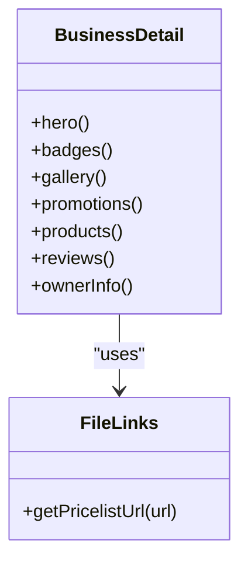

**Diagram sources**
- [BusinessDetail.jsx:1-120](file://src/pages/BusinessDetail.jsx#L1-L120)

**Section sources**
- [BusinessDetail.jsx:1-120](file://src/pages/BusinessDetail.jsx#L1-L120)

### QR Code Generation for Promotion
- Purpose: Generate QR codes and printable posters to drive traffic to listings/businesses.
- Behavior:
  - Select placement source (e.g., gate poster, noticeboard).
  - Generate QR URL with ref/source parameters.
  - Render QR on canvas and export PNG.
  - Draw high-resolution poster canvas with branding and contact info.

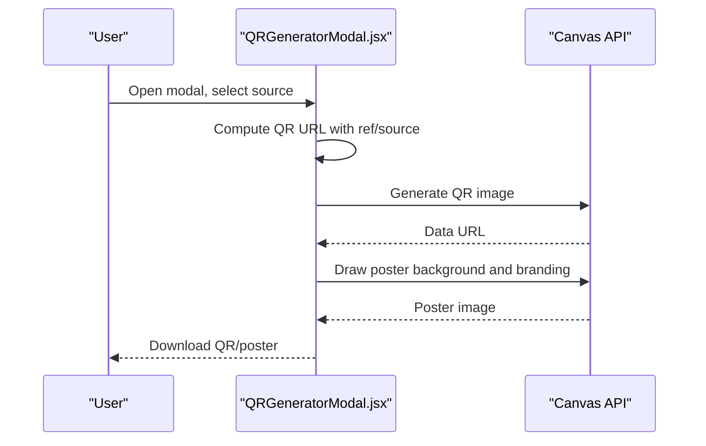

**Diagram sources**
- [QRGeneratorModal.jsx:357-410](file://src/components/QRGeneratorModal.jsx#L357-L410)
- [QRGeneratorModal.jsx:412-776](file://src/components/QRGeneratorModal.jsx#L412-L776)

**Section sources**
- [QRGeneratorModal.jsx:357-410](file://src/components/QRGeneratorModal.jsx#L357-L410)
- [QRGeneratorModal.jsx:412-776](file://src/components/QRGeneratorModal.jsx#L412-L776)

### Analytics Dashboard for Performance Tracking
- Purpose: Provide insights into views, inquiries, bookings/revenue, conversion rate, and role-specific metrics.
- Features:
  - Time range selector (7d, 30d, 90d).
  - Key metric cards with change indicators.
  - Simple line chart for performance over time.
  - Conversion funnel visualization.
  - Role-based additional metrics (landlord QR scans/inquiries, mover rating/repeat customers, seller items sold/order value).

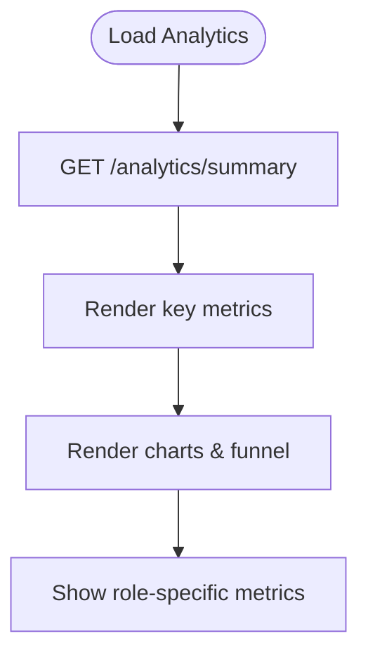

**Diagram sources**
- [AnalyticsDashboard.jsx:4-28](file://src/components/AnalyticsDashboard.jsx#L4-L28)
- [AnalyticsDashboard.jsx:102-215](file://src/components/AnalyticsDashboard.jsx#L102-L215)

**Section sources**
- [AnalyticsDashboard.jsx:4-28](file://src/components/AnalyticsDashboard.jsx#L4-L28)
- [AnalyticsDashboard.jsx:102-215](file://src/components/AnalyticsDashboard.jsx#L102-L215)

### Business Verification System
- Purpose: Manage trust and verification levels, display active badges, and guide users through requirements and benefits.
- Capabilities:
  - Fetch verification status and badge list.
  - Show level statuses (not submitted, pending, under review, approved, rejected).
  - Present requirements and benefits per level.
  - Offer subscription plans for trust badges with monthly/semiannual billing.

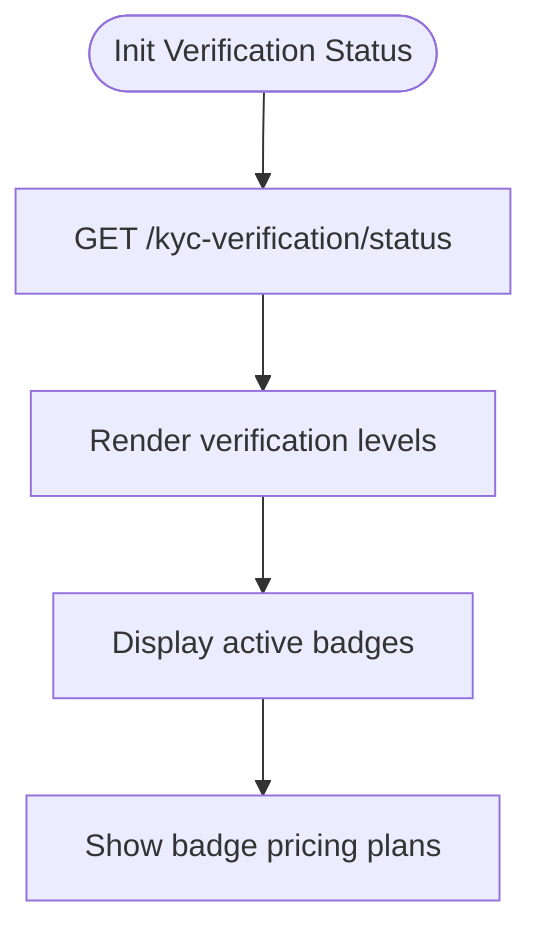

**Diagram sources**
- [VerificationStatus.jsx:11-35](file://src/components/VerificationStatus.jsx#L11-L35)
- [VerificationStatus.jsx:131-234](file://src/components/VerificationStatus.jsx#L131-L234)
- [VerificationStatus.jsx:237-413](file://src/components/VerificationStatus.jsx#L237-L413)

**Section sources**
- [VerificationStatus.jsx:11-35](file://src/components/VerificationStatus.jsx#L11-L35)
- [VerificationStatus.jsx:131-234](file://src/components/VerificationStatus.jsx#L131-L234)
- [VerificationStatus.jsx:237-413](file://src/components/VerificationStatus.jsx#L237-L413)

### Business Categorization and Search Functionality
- Categories: Predefined list including Restaurants, Retail, Services, Technology, Healthcare, Education, Entertainment, Professional Services, Manufacturing, Agriculture, Construction, Transportation, Other.
- Counties: Kenya counties list for geographic filtering.
- Filters: Category, county, search query, sort options (verified, rating, newest, reviews, name), minimum rating, open now, verification status.
- Favorites and Comparison: Toggle favorites and compare up to three businesses side-by-side.

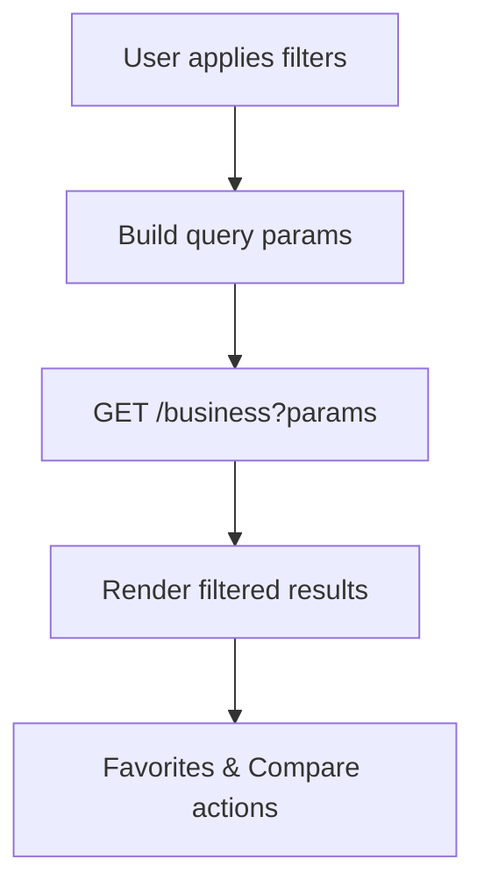

**Diagram sources**
- [AxxBiashara.jsx:6-36](file://src/pages/AxxBiashara.jsx#L6-L36)
- [AxxBiashara.jsx:289-336](file://src/pages/AxxBiashara.jsx#L289-L336)
- [AxxBiashara.jsx:350-392](file://src/pages/AxxBiashara.jsx#L350-L392)

**Section sources**
- [AxxBiashara.jsx:6-36](file://src/pages/AxxBiashara.jsx#L6-L36)
- [AxxBiashara.jsx:289-336](file://src/pages/AxxBiashara.jsx#L289-L336)
- [AxxBiashara.jsx:350-392](file://src/pages/AxxBiashara.jsx#L350-L392)

### Promotional Tools
- QR code generation with customizable placement sources.
- Printable posters with branding, contact info, and website link.
- Integration with analytics to track QR scans and inquiries.

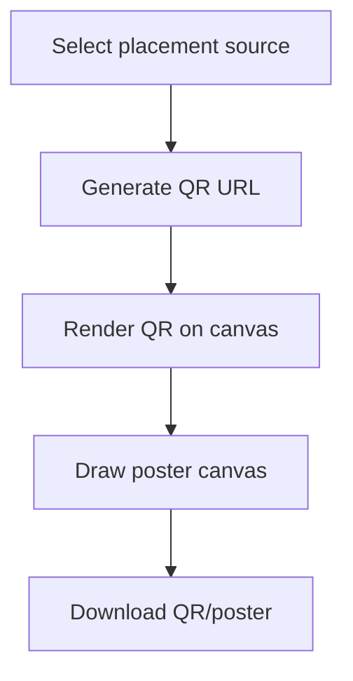

**Diagram sources**
- [QRGeneratorModal.jsx:357-410](file://src/components/QRGeneratorModal.jsx#L357-L410)
- [QRGeneratorModal.jsx:412-776](file://src/components/QRGeneratorModal.jsx#L412-L776)

**Section sources**
- [QRGeneratorModal.jsx:357-410](file://src/components/QRGeneratorModal.jsx#L357-L410)
- [QRGeneratorModal.jsx:412-776](file://src/components/QRGeneratorModal.jsx#L412-L776)

### Example: Integrating Additional Business Services
- Add new service endpoints by extending the API layer and UI flows:
  - Define new routes in the backend and call them from the frontend using the existing API client.
  - Integrate service data into BusinessForm or BusinessDetail sections.
  - Update AnalyticsDashboard to include new metrics if applicable.

Steps:
1. Extend BusinessForm to collect service-specific fields.
2. Call backend service endpoints from BusinessForm or BusinessDetail.
3. Display service data in BusinessDetail sections.
4. Optionally add analytics metrics for the new service.

**Section sources**
- [BusinessForm.jsx:618-701](file://src/pages/BusinessForm.jsx#L618-L701)
- [BusinessDetail.jsx:1-120](file://src/pages/BusinessDetail.jsx#L1-L120)
- [AnalyticsDashboard.jsx:4-28](file://src/components/AnalyticsDashboard.jsx#L4-L28)

### Example: Customizing the Business Profile Layout
- Modify BusinessDetail styles and sections to tailor presentation:
  - Adjust hero layout, badge styling, gallery grid, and product/pricelist sections.
  - Add custom sections for services, testimonials, or certifications.
  - Use CSS variables defined in BusinessDetail for consistent theming.

Guidelines:
- Keep responsive design principles intact.
- Reuse existing icon components and style patterns.
- Ensure accessibility (labels, focus states).

**Section sources**
- [BusinessDetail.jsx:1-120](file://src/pages/BusinessDetail.jsx#L1-L120)

## Dependency Analysis
- Pages depend on shared API client and context for authentication.
- Components like QRGeneratorModal and AnalyticsDashboard are reused across pages.
- VerificationStatus provides trust signals used throughout the directory.

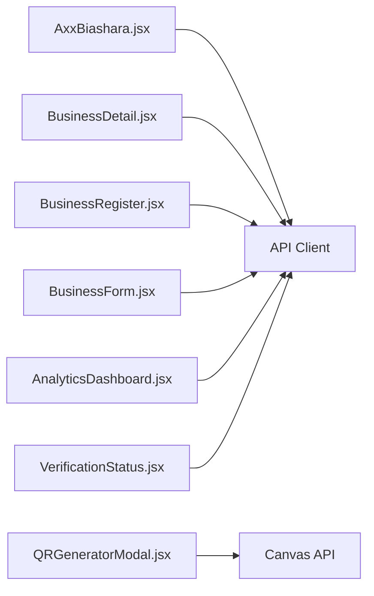

**Diagram sources**
- [AxxBiashara.jsx:289-336](file://src/pages/AxxBiashara.jsx#L289-L336)
- [BusinessDetail.jsx:1-120](file://src/pages/BusinessDetail.jsx#L1-L120)
- [BusinessRegister.jsx:11-123](file://src/pages/BusinessRegister.jsx#L11-L123)
- [BusinessForm.jsx:618-701](file://src/pages/BusinessForm.jsx#L618-L701)
- [QRGeneratorModal.jsx:357-410](file://src/components/QRGeneratorModal.jsx#L357-L410)
- [AnalyticsDashboard.jsx:4-28](file://src/components/AnalyticsDashboard.jsx#L4-L28)
- [VerificationStatus.jsx:11-35](file://src/components/VerificationStatus.jsx#L11-L35)

**Section sources**
- [AxxBiashara.jsx:289-336](file://src/pages/AxxBiashara.jsx#L289-L336)
- [BusinessDetail.jsx:1-120](file://src/pages/BusinessDetail.jsx#L1-L120)
- [BusinessRegister.jsx:11-123](file://src/pages/BusinessRegister.jsx#L11-L123)
- [BusinessForm.jsx:618-701](file://src/pages/BusinessForm.jsx#L618-L701)
- [QRGeneratorModal.jsx:357-410](file://src/components/QRGeneratorModal.jsx#L357-L410)
- [AnalyticsDashboard.jsx:4-28](file://src/components/AnalyticsDashboard.jsx#L4-L28)
- [VerificationStatus.jsx:11-35](file://src/components/VerificationStatus.jsx#L11-L35)

## Performance Considerations
- Image compression before upload reduces payload size and improves load times.
- Lazy loading of non-critical images and carousel pagination helps render performance.
- Analytics charts use lightweight bar/funnel visualizations without heavy libraries.
- Debounce or throttle search input if needed to reduce frequent API calls.

[No sources needed since this section provides general guidance]

## Troubleshooting Guide
- Registration failures:
  - Validate password rules and ensure both letters and numbers are present.
  - Check network connectivity and backend availability.
- Profile upload issues:
  - Verify image size limits and compression success.
  - Confirm multipart/form-data headers when uploading files.
- QR generation errors:
  - Ensure canvas elements are available and browser supports QRCode library.
  - Validate URL construction with correct ref/source parameters.
- Analytics not loading:
  - Confirm analytics endpoint returns expected structure.
  - Fallback to baseline analytics when backend fails.
- Verification status not updating:
  - Ensure token is present and Authorization header is set.
  - Check backend KYC verification endpoint responses.

**Section sources**
- [BusinessRegister.jsx:74-123](file://src/pages/BusinessRegister.jsx#L74-L123)
- [BusinessForm.jsx:714-800](file://src/pages/BusinessForm.jsx#L714-L800)
- [QRGeneratorModal.jsx:357-410](file://src/components/QRGeneratorModal.jsx#L357-L410)
- [AnalyticsDashboard.jsx:13-28](file://src/components/AnalyticsDashboard.jsx#L13-L28)
- [VerificationStatus.jsx:11-35](file://src/components/VerificationStatus.jsx#L11-L35)

## Conclusion
AxxBiashara provides a robust business directory with streamlined registration, rich profile management, integrated marketplace features, promotional QR/poster generation, analytics tracking, and a comprehensive verification system. The modular architecture enables easy extension for additional services and customization of the business profile layout.

[No sources needed since this section summarizes without analyzing specific files]

## Appendices

### API Reference Highlights
- Business listing and search: GET /business with filters (category, county, search, sort, minRating, openNow, verification).
- Business detail: GET /business/:id.
- Favorites: POST /favorites, DELETE /favorites/:id, GET /favorites.
- Announcements: GET /business/announcements, POST /business/announcements.
- Analytics: GET /analytics/summary?userType&period.
- KYC verification: GET /kyc-verification/status.
- Profile helpers: fetchUserProfile, updateUserProfile, buildProfileFormData.

**Section sources**
- [AxxBiashara.jsx:289-336](file://src/pages/AxxBiashara.jsx#L289-L336)
- [AxxBiashara.jsx:350-392](file://src/pages/AxxBiashara.jsx#L350-L392)
- [AnalyticsDashboard.jsx:13-28](file://src/components/AnalyticsDashboard.jsx#L13-L28)
- [VerificationStatus.jsx:11-35](file://src/components/VerificationStatus.jsx#L11-L35)
- [profile.js:16-32](file://src/api/profile.js#L16-L32)