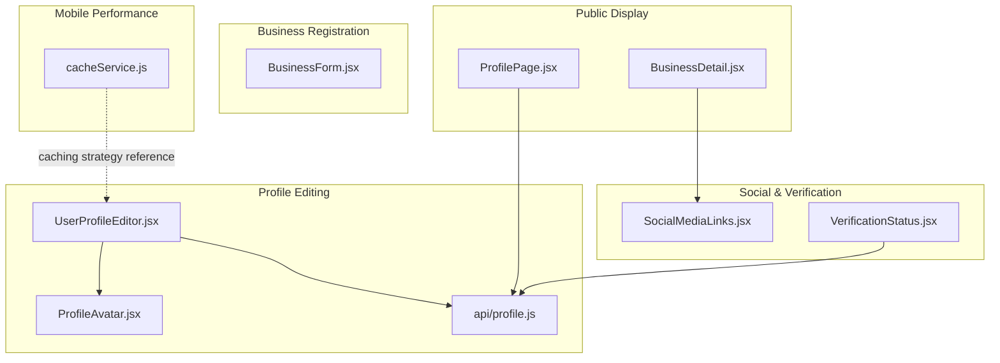
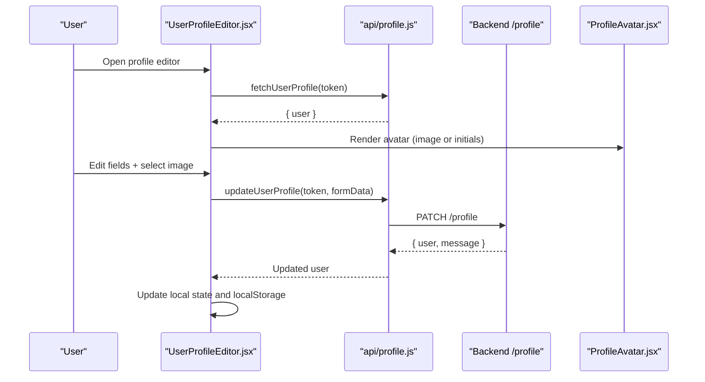
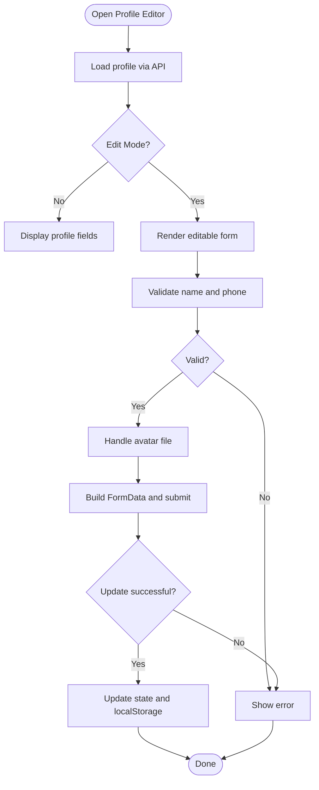
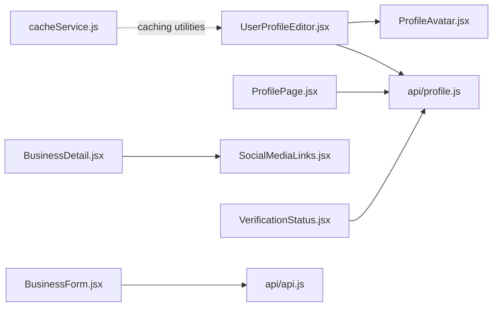

# Business Profile Management

<cite>
**Referenced Files in This Document**
- [UserProfileEditor.jsx](file://src/features/profile/UserProfileEditor.jsx)
- [ProfileAvatar.jsx](file://src/features/profile/ProfileAvatar.jsx)
- [profile.js](file://src/api/profile.js)
- [ProfilePage.jsx](file://src/pages/ProfilePage.jsx)
- [BusinessDetail.jsx](file://src/pages/BusinessDetail.jsx)
- [BusinessForm.jsx](file://src/pages/BusinessForm.jsx)
- [SocialMediaLinks.jsx](file://src/components/SocialMediaLinks.jsx)
- [VerificationStatus.jsx](file://src/components/VerificationStatus.jsx)
- [cacheService.js](file://axx-spaces-mobile/src/services/cacheService.js)
</cite>

## Table of Contents
1. [Introduction](#introduction)
2. [Project Structure](#project-structure)
3. [Core Components](#core-components)
4. [Architecture Overview](#architecture-overview)
5. [Detailed Component Analysis](#detailed-component-analysis)
6. [Dependency Analysis](#dependency-analysis)
7. [Performance Considerations](#performance-considerations)
8. [Troubleshooting Guide](#troubleshooting-guide)
9. [Conclusion](#conclusion)
10. [Appendices](#appendices)

## Introduction
This document explains the business profile management functionality across the frontend application. It covers profile editing, social media integration, contact information management, profile display components, image upload handling, rich text and description fields, verification workflows, caching strategies, performance optimization, and responsive design patterns. The goal is to help developers understand how profiles are created, edited, displayed, verified, and optimized for performance and user experience.

## Project Structure
The business profile system spans several feature areas:
- Profile editing and avatar handling
- API layer for profile data
- Public-facing business detail page
- Business registration/editing form
- Social media links component
- Verification status and workflow UI
- Mobile cache service for performance

**Diagram sources**
- [UserProfileEditor.jsx:1-342](file://src/features/profile/UserProfileEditor.jsx#L1-L342)
- [ProfileAvatar.jsx:1-35](file://src/features/profile/ProfileAvatar.jsx#L1-L35)
- [profile.js:1-60](file://src/api/profile.js#L1-L60)
- [ProfilePage.jsx:1-800](file://src/pages/ProfilePage.jsx#L1-L800)
- [BusinessDetail.jsx:1-800](file://src/pages/BusinessDetail.jsx#L1-L800)
- [BusinessForm.jsx:1-800](file://src/pages/BusinessForm.jsx#L1-L800)
- [SocialMediaLinks.jsx:1-109](file://src/components/SocialMediaLinks.jsx#L1-L109)
- [VerificationStatus.jsx:1-791](file://src/components/VerificationStatus.jsx#L1-L791)
- [cacheService.js:1-198](file://axx-spaces-mobile/src/services/cacheService.js#L1-L198)

**Section sources**
- [UserProfileEditor.jsx:1-342](file://src/features/profile/UserProfileEditor.jsx#L1-L342)
- [profile.js:1-60](file://src/api/profile.js#L1-L60)
- [ProfilePage.jsx:1-800](file://src/pages/ProfilePage.jsx#L1-L800)
- [BusinessDetail.jsx:1-800](file://src/pages/BusinessDetail.jsx#L1-L800)
- [BusinessForm.jsx:1-800](file://src/pages/BusinessForm.jsx#L1-L800)
- [SocialMediaLinks.jsx:1-109](file://src/components/SocialMediaLinks.jsx#L1-L109)
- [VerificationStatus.jsx:1-791](file://src/components/VerificationStatus.jsx#L1-L791)
- [cacheService.js:1-198](file://axx-spaces-mobile/src/services/cacheService.js#L1-L198)

## Core Components
- UserProfileEditor: Reusable profile card with photo upload, editable fields, validation, and save flow. Supports mover-specific fields and role-based visibility.
- ProfileAvatar: Circular avatar with image or initials fallback.
- api/profile.js: Fetches and updates profile via REST endpoints; builds FormData for uploads.
- ProfilePage: Account overview with role badges, activity stats, quick actions, and navigation.
- BusinessDetail: Public business profile page with hero, gallery, reviews, contact info, and social links.
- BusinessForm: Multi-step business registration/editing with categories, location, contact, images, and product items.
- SocialMediaLinks: Predefined social platform links with icons and hover effects.
- VerificationStatus: KYC verification levels, badge pricing, and status display.
- cacheService.js: Mobile-side caching utility with TTL, invalidation, prefetch, and statistics.

**Section sources**
- [UserProfileEditor.jsx:1-342](file://src/features/profile/UserProfileEditor.jsx#L1-L342)
- [ProfileAvatar.jsx:1-35](file://src/features/profile/ProfileAvatar.jsx#L1-L35)
- [profile.js:1-60](file://src/api/profile.js#L1-L60)
- [ProfilePage.jsx:1-800](file://src/pages/ProfilePage.jsx#L1-L800)
- [BusinessDetail.jsx:1-800](file://src/pages/BusinessDetail.jsx#L1-L800)
- [BusinessForm.jsx:1-800](file://src/pages/BusinessForm.jsx#L1-L800)
- [SocialMediaLinks.jsx:1-109](file://src/components/SocialMediaLinks.jsx#L1-L109)
- [VerificationStatus.jsx:1-791](file://src/components/VerificationStatus.jsx#L1-L791)
- [cacheService.js:1-198](file://axx-spaces-mobile/src/services/cacheService.js#L1-L198)

## Architecture Overview
The profile system follows a layered architecture:
- Presentation Layer: React components render profile editing, display, and verification UIs.
- Service Layer: API functions encapsulate HTTP requests and response parsing.
- Data Layer: Backend endpoints provide profile, KYC verification, and business data.
- Caching Layer: Mobile cache service provides offline-friendly caching with TTL.

**Diagram sources**
- [UserProfileEditor.jsx:45-153](file://src/features/profile/UserProfileEditor.jsx#L45-L153)
- [profile.js:16-32](file://src/api/profile.js#L16-L32)
- [ProfileAvatar.jsx:1-35](file://src/features/profile/ProfileAvatar.jsx#L1-L35)

**Section sources**
- [UserProfileEditor.jsx:45-153](file://src/features/profile/UserProfileEditor.jsx#L45-L153)
- [profile.js:16-32](file://src/api/profile.js#L16-L32)

## Detailed Component Analysis

### Profile Editing: UserProfileEditor
Responsibilities:
- Load current profile using token
- Toggle edit mode and sync form fields
- Validate required fields (name, phone)
- Handle avatar selection, preview, and removal
- Build FormData and submit update
- Persist updated user to context and localStorage
- Show success/error feedback

Key behaviors:
- Role-aware fields: mover services, vehicle type, experience years
- Compact mode for smaller cards
- Accessible inputs and labels
- Responsive grid layout

**Diagram sources**
- [UserProfileEditor.jsx:45-153](file://src/features/profile/UserProfileEditor.jsx#L45-L153)

**Section sources**
- [UserProfileEditor.jsx:1-342](file://src/features/profile/UserProfileEditor.jsx#L1-L342)

### Profile Display: ProfilePage
Responsibilities:
- Show account overview with role badge and email verification status
- Display activity metrics (favorites, bookings, enquiries)
- Provide quick action links based on role
- Navigate to settings and dashboards

Responsive features:
- Hero card with avatar and metadata chips
- Grid-based stats and actions
- Dark theme styling with accessible contrast

**Section sources**
- [ProfilePage.jsx:1-800](file://src/pages/ProfilePage.jsx#L1-L800)

### Public Business Profile: BusinessDetail
Responsibilities:
- Present business hero with logo, name, rating, chips, and description
- Show contact details, owner info, coordinates
- Display gallery, promotions, products, pricelist
- Render reviews with ratings and comments
- Include social links and share actions

Responsive features:
- Sticky aside on desktop
- Adaptive grid layouts for gallery and products
- Lightbox for image viewing

**Section sources**
- [BusinessDetail.jsx:1-800](file://src/pages/BusinessDetail.jsx#L1-L800)

### Business Registration/Edit: BusinessForm
Responsibilities:
- Multi-step wizard: Basic Info, Location, Contact, Logo & Photos, Review
- Controlled inputs and ref-backed latest state to avoid stale closures
- Image compression and parallel uploads with progress indicators
- Category multi-select dropdown
- Product category items with optional images and prices

Performance considerations:
- Compress images before upload
- Parallel Promise.all for multiple files
- Local URL previews for immediate feedback

**Section sources**
- [BusinessForm.jsx:1-800](file://src/pages/BusinessForm.jsx#L1-L800)

### Social Media Integration: SocialMediaLinks
Responsibilities:
- Provide branded social links (TikTok, Instagram, Facebook, Twitter/X, LinkedIn, YouTube)
- Inline SVG icons with hover animations
- Configurable icon size and container style

Usage:
- Embed within business profiles or footers
- Extendable by adding new platforms

**Section sources**
- [SocialMediaLinks.jsx:1-109](file://src/components/SocialMediaLinks.jsx#L1-L109)

### Verification Workflow: VerificationStatus
Responsibilities:
- Fetch KYC verification status from backend
- Display verification levels (student, standard, premium) with requirements and benefits
- Show active badges and status tags (pending, under review, approved, rejected)
- Present subscription plans for trust badges with monthly/semiannual billing

Integration:
- Links to verification submission and checkout flows
- Contextual rejection reasons and resubmit prompts

**Section sources**
- [VerificationStatus.jsx:1-791](file://src/components/VerificationStatus.jsx#L1-L791)

### Avatar Component: ProfileAvatar
Responsibilities:
- Render circular avatar with image or initials fallback
- Accept user object and size/style props
- Maintain accessibility attributes

**Section sources**
- [ProfileAvatar.jsx:1-35](file://src/features/profile/ProfileAvatar.jsx#L1-L35)

### API Layer: profile.js
Responsibilities:
- Define base API URL and auth headers
- Parse responses and throw errors
- Fetch profile and update profile endpoints
- Build FormData for profile updates including avatar and remove flags

**Section sources**
- [profile.js:1-60](file://src/api/profile.js#L1-L60)

## Dependency Analysis
Component relationships:
- UserProfileEditor depends on api/profile.js for data operations and ProfileAvatar for rendering.
- ProfilePage uses api/profile.js and displays role-based content.
- BusinessDetail composes public profile presentation and integrates SocialMediaLinks.
- BusinessForm manages complex forms and image uploads independently of profile editing.
- VerificationStatus interacts with KYC endpoints and presents plan options.
- cacheService.js provides mobile caching utilities that can be referenced by other modules for performance.

**Diagram sources**
- [UserProfileEditor.jsx:1-342](file://src/features/profile/UserProfileEditor.jsx#L1-L342)
- [profile.js:1-60](file://src/api/profile.js#L1-L60)
- [ProfilePage.jsx:1-800](file://src/pages/ProfilePage.jsx#L1-L800)
- [BusinessDetail.jsx:1-800](file://src/pages/BusinessDetail.jsx#L1-L800)
- [BusinessForm.jsx:1-800](file://src/pages/BusinessForm.jsx#L1-L800)
- [SocialMediaLinks.jsx:1-109](file://src/components/SocialMediaLinks.jsx#L1-L109)
- [VerificationStatus.jsx:1-791](file://src/components/VerificationStatus.jsx#L1-L791)
- [cacheService.js:1-198](file://axx-spaces-mobile/src/services/cacheService.js#L1-L198)

**Section sources**
- [UserProfileEditor.jsx:1-342](file://src/features/profile/UserProfileEditor.jsx#L1-L342)
- [profile.js:1-60](file://src/api/profile.js#L1-L60)
- [ProfilePage.jsx:1-800](file://src/pages/ProfilePage.jsx#L1-L800)
- [BusinessDetail.jsx:1-800](file://src/pages/BusinessDetail.jsx#L1-L800)
- [BusinessForm.jsx:1-800](file://src/pages/BusinessForm.jsx#L1-L800)
- [SocialMediaLinks.jsx:1-109](file://src/components/SocialMediaLinks.jsx#L1-L109)
- [VerificationStatus.jsx:1-791](file://src/components/VerificationStatus.jsx#L1-L791)
- [cacheService.js:1-198](file://axx-spaces-mobile/src/services/cacheService.js#L1-L198)

## Performance Considerations
- Image compression: BusinessForm compresses images before upload to reduce payload size and improve upload speed.
- Parallel uploads: Multiple images are compressed and uploaded concurrently using Promise.all to minimize latency.
- Local previews: Immediate local URLs provide instant visual feedback while uploads proceed.
- Caching strategy: Mobile cacheService supports TTL-based caching, pattern invalidation, prefetching, and statistics to optimize network usage and offline resilience.
- Responsive layouts: CSS grids and adaptive breakpoints ensure efficient rendering across devices.

Recommendations:
- Integrate cacheService into web profile fetching where appropriate to reduce redundant API calls.
- Debounce heavy operations like image compression if processing many files.
- Use lazy loading for large galleries and reviews in BusinessDetail.
- Monitor cache size and clear expired entries periodically.

**Section sources**
- [BusinessForm.jsx:714-800](file://src/pages/BusinessForm.jsx#L714-L800)
- [cacheService.js:1-198](file://axx-spaces-mobile/src/services/cacheService.js#L1-L198)

## Troubleshooting Guide
Common issues and resolutions:
- Profile load failures: Check token validity and network connectivity; verify API_BASE configuration.
- Avatar upload errors: Ensure file type is image/* and size limits are respected; handle revokeObjectURL cleanup.
- Validation errors: Confirm name and phone are provided; check field constraints.
- Verification status not updating: Verify KYC endpoint availability and token authorization; inspect backend responses.
- Cache inconsistencies: Clear expired cache entries and invalidate patterns when profile data changes.

Debugging tips:
- Inspect network requests for /profile and KYC endpoints.
- Log state transitions in UserProfileEditor during save flow.
- Use browser dev tools to monitor memory leaks from object URLs.
- Validate JSON payloads built by buildProfileFormData.

**Section sources**
- [UserProfileEditor.jsx:94-153](file://src/features/profile/UserProfileEditor.jsx#L94-L153)
- [VerificationStatus.jsx:11-35](file://src/components/VerificationStatus.jsx#L11-L35)
- [profile.js:10-14](file://src/api/profile.js#L10-L14)
- [cacheService.js:87-110](file://axx-spaces-mobile/src/services/cacheService.js#L87-L110)

## Conclusion
The business profile management system provides robust editing, display, and verification capabilities with strong attention to performance and responsiveness. Key strengths include:
- Flexible profile editing with role-aware fields and avatar handling
- Comprehensive public business profiles with rich content sections
- Integrated social media links and verification workflows
- Mobile caching utilities for improved performance and offline support

Future enhancements could include:
- Web-side caching integration mirroring mobile cacheService
- Rich text editor for descriptions and bios
- Advanced analytics for profile views and engagement
- Enhanced accessibility and internationalization support

[No sources needed since this section summarizes without analyzing specific files]

## Appendices

### Customizing Profile Layouts
- Adjust UserProfileEditor compact mode and accent colors to match brand guidelines.
- Extend ProfilePage sections to highlight role-specific actions and metrics.
- Customize BusinessDetail styles and sections to emphasize products, promotions, and reviews.

**Section sources**
- [UserProfileEditor.jsx:16-23](file://src/features/profile/UserProfileEditor.jsx#L16-L23)
- [ProfilePage.jsx:78-92](file://src/pages/ProfilePage.jsx#L78-L92)
- [BusinessDetail.jsx:62-76](file://src/pages/BusinessDetail.jsx#L62-L76)

### Adding Custom Fields
- Extend buildProfileFormData to include new fields and ensure backend accepts them.
- Add corresponding inputs in UserProfileEditor and validate them in handleSave.
- Update ProfilePage and BusinessDetail to display new fields conditionally.

**Section sources**
- [profile.js:34-59](file://src/api/profile.js#L34-L59)
- [UserProfileEditor.jsx:107-153](file://src/features/profile/UserProfileEditor.jsx#L107-L153)

### Implementing Profile Verification Workflows
- Integrate VerificationStatus to show KYC levels and badge subscriptions.
- Link verification submission and checkout flows from profile pages.
- Handle pending, approved, and rejected states with contextual messaging.

**Section sources**
- [VerificationStatus.jsx:11-35](file://src/components/VerificationStatus.jsx#L11-L35)
- [VerificationStatus.jsx:131-234](file://src/components/VerificationStatus.jsx#L131-L234)

### Profile Caching Strategies
- Adopt cacheService patterns for web: store profile data with TTL, invalidate on updates, and prefetch critical data.
- Monitor cache size and clear expired entries to prevent storage bloat.
- Use prefetchData to preload frequently accessed profile sections.

**Section sources**
- [cacheService.js:1-198](file://axx-spaces-mobile/src/services/cacheService.js#L1-L198)