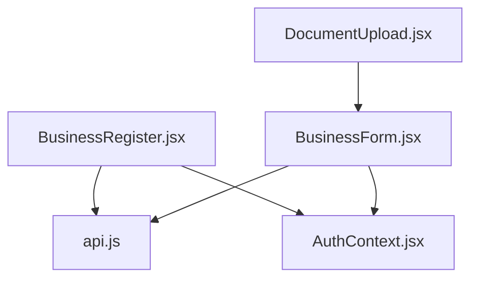
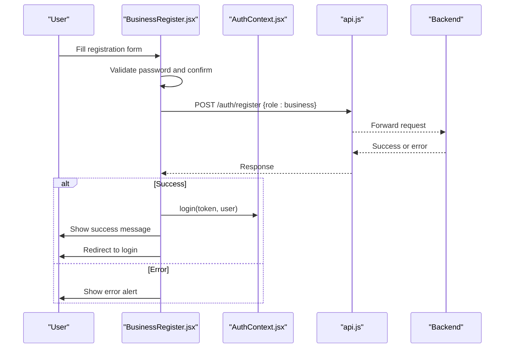
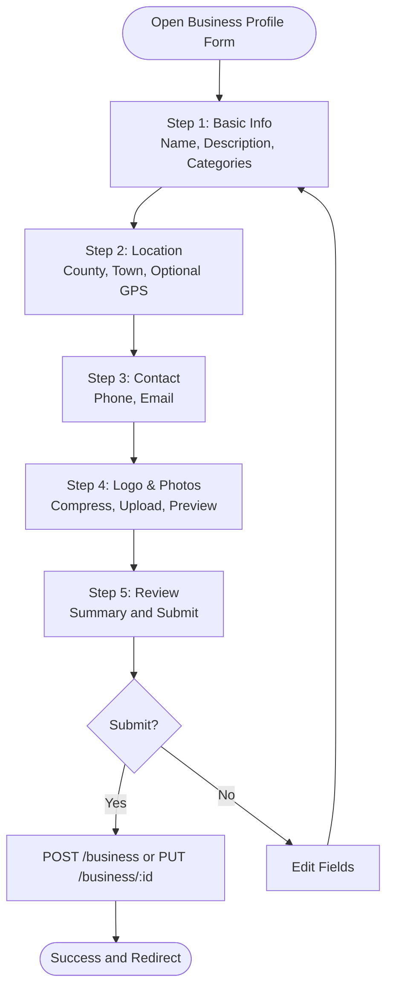
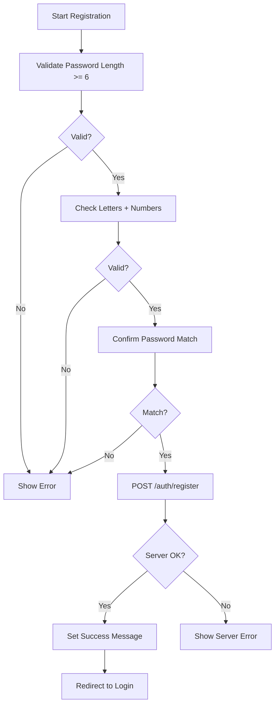
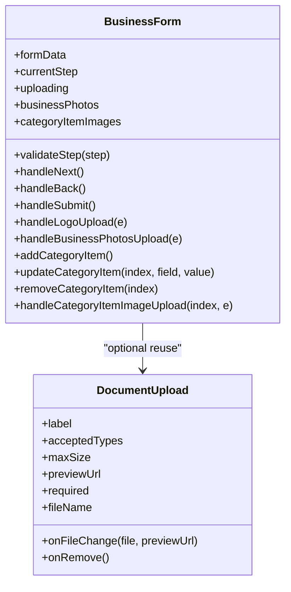
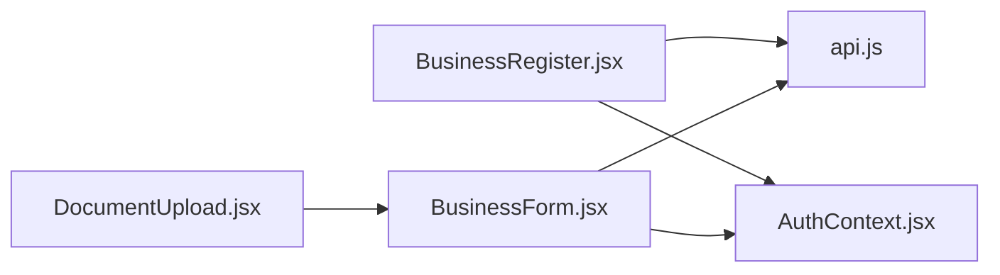

# Business Registration Process

<cite>
**Referenced Files in This Document**
- [BusinessRegister.jsx](file://src/pages/BusinessRegister.jsx)
- [BusinessForm.jsx](file://src/pages/BusinessForm.jsx)
- [DocumentUpload.jsx](file://src/components/DocumentUpload.jsx)
- [AuthContext.jsx](file://src/context/AuthContext.jsx)
- [api.js](file://src/api/api.js)
</cite>

## Table of Contents
1. [Introduction](#introduction)
2. [Project Structure](#project-structure)
3. [Core Components](#core-components)
4. [Architecture Overview](#architecture-overview)
5. [Detailed Component Analysis](#detailed-component-analysis)
6. [Dependency Analysis](#dependency-analysis)
7. [Performance Considerations](#performance-considerations)
8. [Troubleshooting Guide](#troubleshooting-guide)
9. [Conclusion](#conclusion)
10. [Appendices](#appendices)

## Introduction
This document explains the business registration process, including:
- Multi-step registration workflow for account creation and business profile creation
- Form validation rules and user feedback patterns
- Data submission handling to backend endpoints
- Error handling mechanisms
- Customization guidance for forms, categories, and external verification integrations
- State management and progress tracking across steps

The implementation is split into two main flows:
- Account registration for a business role
- Business profile creation with multi-step form, media uploads, and review

## Project Structure
The business registration feature spans several files:
- Account registration UI and submission logic
- Business profile creation with step-by-step wizard
- Reusable file upload component
- Authentication context for user state
- API client abstraction

**Diagram sources**
- [BusinessRegister.jsx:1-10](file://src/pages/BusinessRegister.jsx#L1-L10)
- [BusinessForm.jsx:1-6](file://src/pages/BusinessForm.jsx#L1-L6)
- [DocumentUpload.jsx:1-12](file://src/components/DocumentUpload.jsx#L1-L12)
- [AuthContext.jsx](file://src/context/AuthContext.jsx)
- [api.js](file://src/api/api.js)

**Section sources**
- [BusinessRegister.jsx:1-10](file://src/pages/BusinessRegister.jsx#L1-L10)
- [BusinessForm.jsx:1-6](file://src/pages/BusinessForm.jsx#L1-L6)
- [DocumentUpload.jsx:1-12](file://src/components/DocumentUpload.jsx#L1-L12)

## Core Components
- BusinessRegister: Handles business account registration (name, email, phone, password), Google sign-in registration, and redirects to login after success.
- BusinessForm: Multi-step business profile creation covering basic info, location, contact, logo/photos, and review. Supports editing existing profiles.
- DocumentUpload: Reusable file upload component with drag-and-drop, type/size validation, preview, and removal.
- AuthContext: Provides authentication state and login method used by registration flow.
- api.js: Centralized HTTP client used to call backend endpoints.

Key responsibilities:
- Validation: Client-side checks for passwords, required fields, and upload constraints.
- Submission: POST/PUT calls to backend endpoints for account and business data.
- UX: Progress indicators, step navigation, error/success alerts, and loading states.

**Section sources**
- [BusinessRegister.jsx:11-123](file://src/pages/BusinessRegister.jsx#L11-L123)
- [BusinessForm.jsx:618-1047](file://src/pages/BusinessForm.jsx#L618-L1047)
- [DocumentUpload.jsx:1-164](file://src/components/DocumentUpload.jsx#L1-L164)

## Architecture Overview
The registration architecture separates account creation from business profile setup:

**Diagram sources**
- [BusinessRegister.jsx:79-123](file://src/pages/BusinessRegister.jsx#L79-L123)
- [api.js](file://src/api/api.js)

For business profile creation:

**Diagram sources**
- [BusinessForm.jsx:659-665](file://src/pages/BusinessForm.jsx#L659-L665)
- [BusinessForm.jsx:944-986](file://src/pages/BusinessForm.jsx#L944-L986)
- [BusinessForm.jsx:990-1047](file://src/pages/BusinessForm.jsx#L990-L1047)

## Detailed Component Analysis

### BusinessAccountRegistration (BusinessRegister)
Responsibilities:
- Collects name, email, phone, password, confirmPassword
- Validates password strength and match
- Submits to backend via API client
- Integrates Google Sign-In registration
- Displays error/success messages and navigates to login

Validation rules:
- Password must be at least 6 characters
- Must contain both letters and numbers
- Confirm password must match

Submission:
- POST to /auth/register with role set to business
- On success, show confirmation and redirect to login

Google integration:
- Uses useGoogleSignIn hook to obtain credentials
- Sends payload with role business to /auth/google
- On success, logs in via AuthContext and redirects to dashboard

Error handling:
- Shows inline errors for validation failures
- Displays server error messages when available

**Diagram sources**
- [BusinessRegister.jsx:79-123](file://src/pages/BusinessRegister.jsx#L79-L123)

**Section sources**
- [BusinessRegister.jsx:11-123](file://src/pages/BusinessRegister.jsx#L11-L123)

### BusinessProfileCreation (BusinessForm)
Responsibilities:
- Multi-step wizard: Basic Info, Location, Contact, Logo & Photos, Review
- Auto-populates contact and submitter name from AuthContext on new profiles
- Loads existing business data when editing
- Compresses images before upload
- Batch uploads photos with progress tracking
- Validates required fields per step
- Submits to create or update business profile

State management:
- formData holds all profile fields
- currentStep tracks wizard progress
- uploading flags control UI during uploads
- businessPhotos maintains preview list
- categoryItems supports optional product/service items

Validation:
- Step 1 requires name, description, at least one category, and submitter name
- Step 2 requires county and town
- Step 3 requires phone
- Steps 4 and 5 are optional/review

Submission:
- Creates new business via POST /business
- Updates existing business via PUT /business/:id
- Handles 401 by redirecting to login
- Shows success and auto-redirects to dashboard

Image handling:
- Logo upload compresses to 400x400 and posts to /uploads/logo
- Batch photo upload compresses to 1200x900 and posts to /uploads/business-photos
- Category item image upload compresses to 600x600 and posts to /uploads/business-photo
- Replaces blob URLs with remote URLs after successful upload

Progress tracking:
- Visual progress bar shows completion percentage
- Step indicator highlights active/completed steps
- Navigation buttons prevent moving forward until validations pass

**Diagram sources**
- [BusinessForm.jsx:618-1047](file://src/pages/BusinessForm.jsx#L618-L1047)
- [DocumentUpload.jsx:1-164](file://src/components/DocumentUpload.jsx#L1-L164)

**Section sources**
- [BusinessForm.jsx:618-1047](file://src/pages/BusinessForm.jsx#L618-L1047)

### File Upload Component (DocumentUpload)
Responsibilities:
- Accepts files via click or drag-and-drop
- Validates file size (default max 15MB) and type (images/PDF)
- Generates preview URL for images
- Emits validated file and preview URL to parent
- Allows removing selected file

Usage:
- Can be reused in business profile forms for additional documents
- Configurable accepted types and maximum size

**Section sources**
- [DocumentUpload.jsx:1-164](file://src/components/DocumentUpload.jsx#L1-L164)

## Dependency Analysis
- BusinessRegister depends on:
  - AuthContext for login
  - API client for registration endpoint
  - useGoogleSignIn hook for Google credential flow
- BusinessForm depends on:
  - API client for business endpoints and uploads
  - AuthContext for pre-filling user data
  - PhoneInput for formatted phone entry
- DocumentUpload is independent but can be integrated into forms

**Diagram sources**
- [BusinessRegister.jsx:1-10](file://src/pages/BusinessRegister.jsx#L1-L10)
- [BusinessForm.jsx:1-6](file://src/pages/BusinessForm.jsx#L1-L6)
- [DocumentUpload.jsx:1-12](file://src/components/DocumentUpload.jsx#L1-L12)

**Section sources**
- [BusinessRegister.jsx:1-10](file://src/pages/BusinessRegister.jsx#L1-L10)
- [BusinessForm.jsx:1-6](file://src/pages/BusinessForm.jsx#L1-L6)
- [DocumentUpload.jsx:1-12](file://src/components/DocumentUpload.jsx#L1-L12)

## Performance Considerations
- Image compression reduces payload sizes and speeds up uploads:
  - Logo: 400x400, quality 0.7
  - Business photos: 1200x900, quality 0.7
  - Category item images: 600x600, quality 0.7
- Batch photo upload minimizes network round trips
- Parallel compression uses Promise.all for faster processing
- Blob URLs are revoked after upload to free memory
- Uploading flags disable controls to prevent duplicate submissions

[No sources needed since this section provides general guidance]

## Troubleshooting Guide
Common issues and resolutions:
- Password mismatch or weak password:
  - Ensure password meets length and complexity requirements
  - Confirm password matches exactly
- Registration fails:
  - Check server response error message
  - Verify network connectivity and API base URL
- Business profile submission blocked:
  - Complete all required fields per step
  - Wait for uploads to finish before proceeding
- Image upload errors:
  - Ensure file size does not exceed limits
  - Use supported image formats
  - Retry upload if server returns an error
- Unauthorized access:
  - If receiving 401, log in again and retry submission

**Section sources**
- [BusinessRegister.jsx:79-123](file://src/pages/BusinessRegister.jsx#L79-L123)
- [BusinessForm.jsx:944-1047](file://src/pages/BusinessForm.jsx#L944-L1047)

## Conclusion
The business registration process combines a straightforward account registration flow with a comprehensive multi-step business profile creation wizard. It enforces robust validation, provides clear user feedback, and handles media uploads efficiently. The modular design allows customization of forms, categories, and integration points for external verification services.

[No sources needed since this section summarizes without analyzing specific files]

## Appendices

### Customizing Registration Forms
- Add or remove fields in BusinessRegister by updating the formData state and corresponding input elements
- Extend password validation rules within the handleSubmit function
- Integrate additional third-party identity providers by adding handlers similar to the Google flow

**Section sources**
- [BusinessRegister.jsx:15-26](file://src/pages/BusinessRegister.jsx#L15-L26)
- [BusinessRegister.jsx:79-123](file://src/pages/BusinessRegister.jsx#L79-L123)

### Adding Additional Business Categories
- Update BUSINESS_CATEGORIES array in BusinessForm to include new categories
- Adjust validation if certain categories require extra fields

**Section sources**
- [BusinessForm.jsx:598-606](file://src/pages/BusinessForm.jsx#L598-L606)

### Integrating External Verification Services
- After successful registration or profile submission, call external verification APIs using the API client
- Handle verification status updates and display appropriate feedback to users
- Store verification tokens or results in local storage or context as needed

[No sources needed since this section provides general guidance]

### Registration State Management and Progress Tracking
- Use useState for form data, loading, error, success, and upload states
- Track current step with currentStep and render step-specific sections
- Provide visual progress indicators and step navigation
- Prevent navigation while uploads are active

**Section sources**
- [BusinessForm.jsx:647-655](file://src/pages/BusinessForm.jsx#L647-L655)
- [BusinessForm.jsx:659-665](file://src/pages/BusinessForm.jsx#L659-L665)
- [BusinessForm.jsx:944-986](file://src/pages/BusinessForm.jsx#L944-L986)