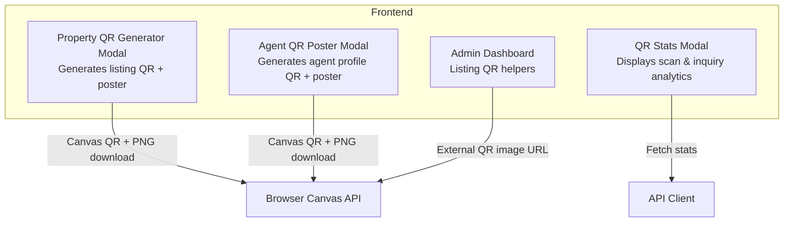
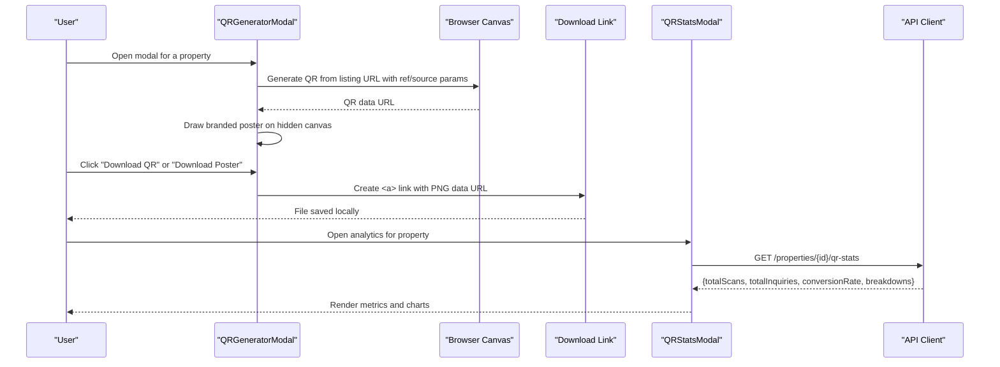
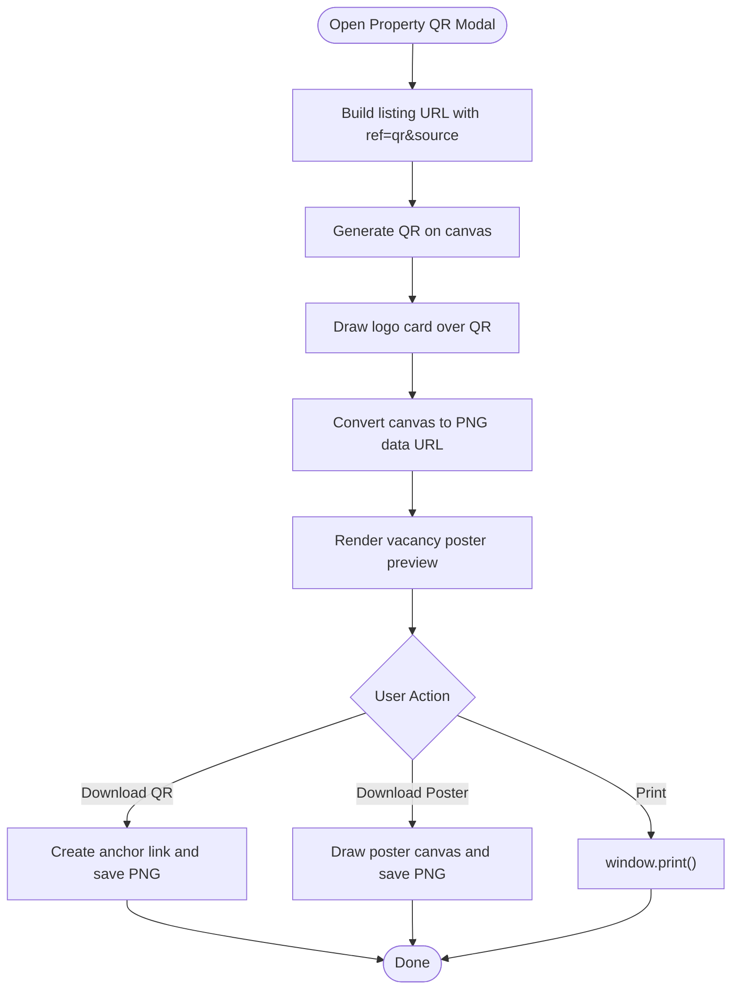
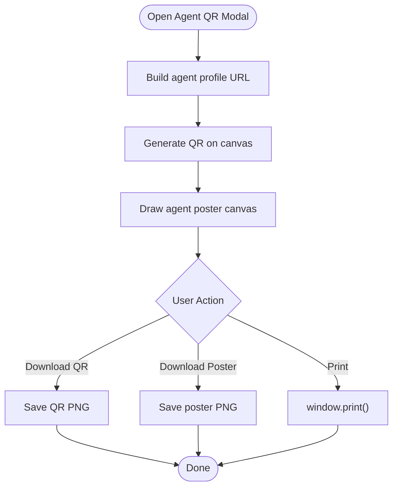
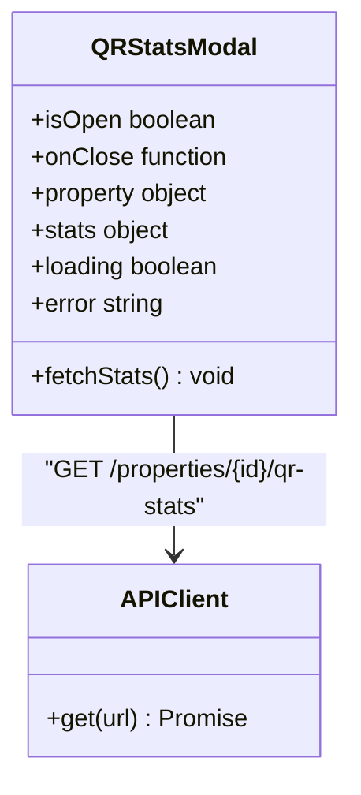
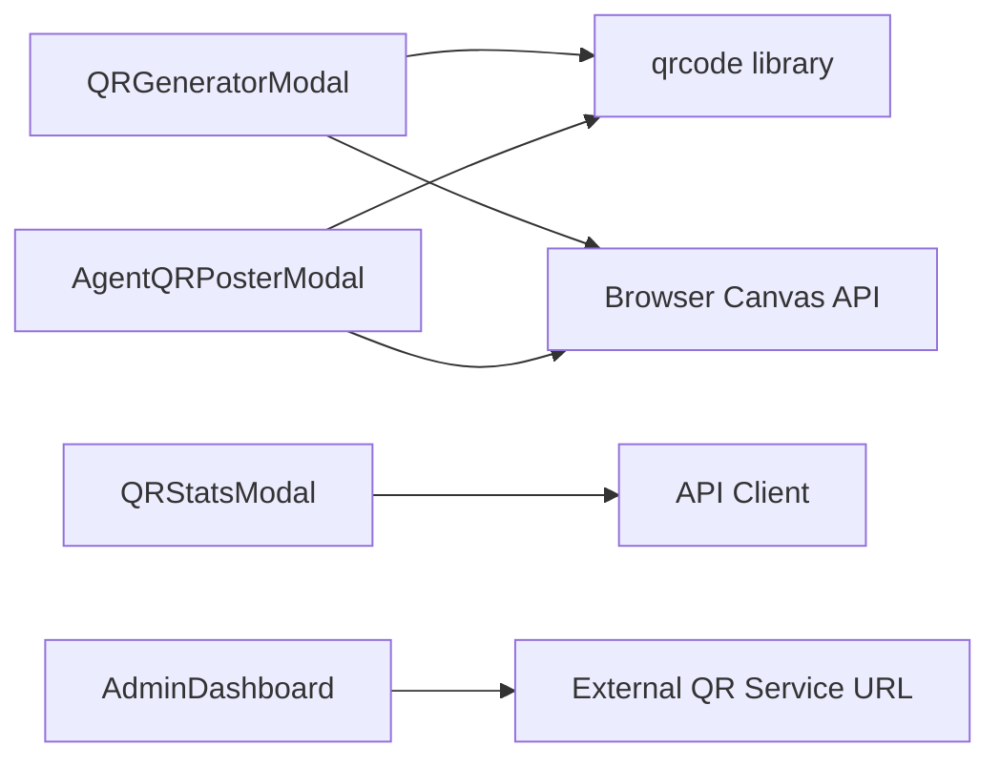

# QR Code Generation System

<cite>
**Referenced Files in This Document**
- [QRGeneratorModal.jsx](file://src/components/QRGeneratorModal.jsx)
- [AgentQRPosterModal.jsx](file://src/components/AgentQRPosterModal.jsx)
- [QRStatsModal.jsx](file://src/components/QRStatsModal.jsx)
- [api.js](file://src/api/api.js)
- [AdminDashboard.jsx](file://axxspace-admin/src/pages/AdminDashboard.jsx)
</cite>

## Table of Contents
1. [Introduction](#introduction)
2. [Project Structure](#project-structure)
3. [Core Components](#core-components)
4. [Architecture Overview](#architecture-overview)
5. [Detailed Component Analysis](#detailed-component-analysis)
6. [Dependency Analysis](#dependency-analysis)
7. [Performance Considerations](#performance-considerations)
8. [Troubleshooting Guide](#troubleshooting-guide)
9. [Conclusion](#conclusion)
10. [Appendices](#appendices)

## Introduction
This document explains the QR code generation system used for business promotion, property and agent marketing materials, and analytics tracking. It covers:
- How QR codes are generated for listings and agents
- Customization options such as source tagging, colors, and branding
- Downloadable formats including standalone QR images and print-ready posters
- The modal interfaces for generating and printing QR assets
- Analytics for scan counts, inquiry types, and conversion rates
- File generation processes, format handling, and guidance for batch workflows

The system is implemented in React components that generate QR codes client-side using a canvas-based library, then render branded posters and provide download/print actions.

## Project Structure
The QR system spans three primary UI components and one analytics component:
- Property QR generator with poster preview and downloads
- Agent QR poster generator mirroring the property design
- QR analytics dashboard showing scans and inquiries
- Admin dashboard integration for listing-level QR utilities

**Diagram sources**
- [QRGeneratorModal.jsx:357-450](file://src/components/QRGeneratorModal.jsx#L357-L450)
- [AgentQRPosterModal.jsx:357-449](file://src/components/AgentQRPosterModal.jsx#L357-L449)
- [QRStatsModal.jsx:20-47](file://src/components/QRStatsModal.jsx#L20-L47)
- [AdminDashboard.jsx:2051-2075](file://axxspace-admin/src/pages/AdminDashboard.jsx#L2051-L2075)

**Section sources**
- [QRGeneratorModal.jsx:357-450](file://src/components/QRGeneratorModal.jsx#L357-L450)
- [AgentQRPosterModal.jsx:357-449](file://src/components/AgentQRPosterModal.jsx#L357-L449)
- [QRStatsModal.jsx:20-47](file://src/components/QRStatsModal.jsx#L20-L47)
- [AdminDashboard.jsx:2051-2075](file://axxspace-admin/src/pages/AdminDashboard.jsx#L2051-L2075)

## Core Components
- Property QR Generator Modal
  - Generates a QR code linking to a listing page with tracking parameters
  - Renders a high-fidelity vacancy poster preview
  - Exports standalone QR PNG and print-ready poster PNG
  - Supports print via browser print dialog
- Agent QR Poster Modal
  - Mirrors the vacancy poster layout for verified agent profiles
  - Generates QR pointing to the agent’s public profile
  - Exports standalone QR PNG and print-ready poster PNG
- QR Stats Modal
  - Fetches and displays total scans, inquiries, and conversion rate
  - Breaks down scans by poster placement source
  - Shows inquiry method distribution (WhatsApp, call, booking)

Key capabilities:
- QR customization: error correction level, colors, margin, size
- Branding: logo overlay on QR, brand text, tagline, contact footer
- Tracking: source parameter appended to listing URLs for analytics
- Downloads: PNG files for QR and poster; print-ready A4 poster
- Analytics: per-property scan and inquiry metrics

**Section sources**
- [QRGeneratorModal.jsx:357-450](file://src/components/QRGeneratorModal.jsx#L357-L450)
- [AgentQRPosterModal.jsx:357-449](file://src/components/AgentQRPosterModal.jsx#L357-L449)
- [QRStatsModal.jsx:20-47](file://src/components/QRStatsModal.jsx#L20-L47)

## Architecture Overview
The QR system follows a client-side generation flow with optional server-backed analytics:

**Diagram sources**
- [QRGeneratorModal.jsx:381-450](file://src/components/QRGeneratorModal.jsx#L381-L450)
- [QRGeneratorModal.jsx:756-776](file://src/components/QRGeneratorModal.jsx#L756-L776)
- [QRStatsModal.jsx:31-47](file://src/components/QRStatsModal.jsx#L31-L47)

## Detailed Component Analysis

### Property QR Generator Modal
Responsibilities:
- Build listing URL with tracking parameters
- Generate QR code with high error correction and brand colors
- Overlay logo inside QR card
- Render live vacancy poster preview
- Export standalone QR PNG and print-ready poster PNG
- Provide print action

Customization options:
- Source selection controls where the poster will be placed (e.g., gate, noticeboard), which appends a source query parameter to the listing URL
- QR color scheme uses brand navy and white
- Error correction set to high for robust scanning
- Margin and size configured for clarity

File generation process:
- Uses canvas to create QR image
- Converts canvas to PNG data URL
- Creates temporary anchor element to trigger download
- Draws a high-resolution poster canvas (800x1130) with branding, contact info, and QR box

Print readiness:
- Poster canvas dimensions and layout are optimized for A4 printing
- Print button invokes browser print dialog

**Diagram sources**
- [QRGeneratorModal.jsx:381-450](file://src/components/QRGeneratorModal.jsx#L381-L450)
- [QRGeneratorModal.jsx:756-776](file://src/components/QRGeneratorModal.jsx#L756-L776)

**Section sources**
- [QRGeneratorModal.jsx:357-450](file://src/components/QRGeneratorModal.jsx#L357-L450)
- [QRGeneratorModal.jsx:756-776](file://src/components/QRGeneratorModal.jsx#L756-L776)

### Agent QR Poster Modal
Responsibilities:
- Generate QR code linking to the agent’s public profile
- Mirror the vacancy poster design for consistent branding
- Export standalone QR PNG and print-ready poster PNG
- Provide print action

Customization options:
- Same brand colors and high error correction as property QR
- Agent-specific title and badge iconography
- Agent name strip included in poster

File generation process:
- Similar to property QR: canvas-based QR generation, logo overlay not used here, but poster includes agent branding and contact details

**Diagram sources**
- [AgentQRPosterModal.jsx:373-449](file://src/components/AgentQRPosterModal.jsx#L373-L449)
- [AgentQRPosterModal.jsx:648-664](file://src/components/AgentQRPosterModal.jsx#L648-L664)

**Section sources**
- [AgentQRPosterModal.jsx:357-449](file://src/components/AgentQRPosterModal.jsx#L357-L449)
- [AgentQRPosterModal.jsx:648-664](file://src/components/AgentQRPosterModal.jsx#L648-L664)

### QR Stats Modal
Responsibilities:
- Fetch analytics for a specific property
- Display total scans, total inquiries, and conversion rate
- Show breakdown by poster location source
- Show inquiry method distribution

Data model:
- Metrics: totalScans, totalInquiries, conversionRate
- Source breakdown: array of {source, count}
- Inquiry type breakdown: array of {type, count}

Error handling:
- Loading state while fetching
- Error state with retry option
- Empty state when no scans recorded

**Diagram sources**
- [QRStatsModal.jsx:20-47](file://src/components/QRStatsModal.jsx#L20-L47)
- [api.js](file://src/api/api.js)

**Section sources**
- [QRStatsModal.jsx:20-47](file://src/components/QRStatsModal.jsx#L20-L47)
- [QRStatsModal.jsx:51-167](file://src/components/QRStatsModal.jsx#L51-L167)

### Admin Dashboard Integration
The admin dashboard includes helper functions to generate and download QR images for listings using an external QR service URL. While this differs from the main client-side canvas approach, it provides a quick way to obtain QR images for listings.

Key behaviors:
- Builds a listing URL and constructs an external QR image URL
- Displays the QR image inline
- Provides a download action for the QR image

**Section sources**
- [AdminDashboard.jsx:2051-2075](file://axxspace-admin/src/pages/AdminDashboard.jsx#L2051-L2075)
- [AdminDashboard.jsx:2145-2175](file://axxspace-admin/src/pages/AdminDashboard.jsx#L2145-L2175)

## Dependency Analysis
Components and their dependencies:
- QRGeneratorModal depends on:
  - qrcode library for canvas-based QR generation
  - Local asset for logo overlay
  - Browser Canvas API for drawing and export
- AgentQRPosterModal depends on:
  - qrcode library
  - Browser Canvas API
- QRStatsModal depends on:
  - API client for fetching analytics
- AdminDashboard uses:
  - External QR service URL for listing QR images

**Diagram sources**
- [QRGeneratorModal.jsx:1-3](file://src/components/QRGeneratorModal.jsx#L1-L3)
- [AgentQRPosterModal.jsx:1-3](file://src/components/AgentQRPosterModal.jsx#L1-L3)
- [QRStatsModal.jsx:1-2](file://src/components/QRStatsModal.jsx#L1-L2)
- [AdminDashboard.jsx:2051-2059](file://axxspace-admin/src/pages/AdminDashboard.jsx#L2051-L2059)

**Section sources**
- [QRGeneratorModal.jsx:1-3](file://src/components/QRGeneratorModal.jsx#L1-L3)
- [AgentQRPosterModal.jsx:1-3](file://src/components/AgentQRPosterModal.jsx#L1-L3)
- [QRStatsModal.jsx:1-2](file://src/components/QRStatsModal.jsx#L1-L2)
- [AdminDashboard.jsx:2051-2059](file://axxspace-admin/src/pages/AdminDashboard.jsx#L2051-L2059)

## Performance Considerations
- QR generation is synchronous on the main thread via canvas; large canvases can cause brief UI stalls during draw operations.
- High-resolution poster rendering (800x1130) involves multiple drawing operations; consider debouncing or deferring heavy draws if generating many posters at once.
- Using high error correction improves scan reliability but increases QR complexity; balance readability vs. performance.
- Avoid unnecessary re-renders by memoizing poster previews and only regenerating QR when inputs change.
- For batch processing, queue poster generations and stagger canvas operations to prevent jank.

[No sources needed since this section provides general guidance]

## Troubleshooting Guide
Common issues and resolutions:
- QR code fails to generate
  - Check console for errors from QR generation callback
  - Ensure canvas refs are available before calling QR generation
  - Verify URL encoding and length constraints
- Poster download does not start
  - Confirm hidden canvases exist and have content
  - Validate that QR data URL is ready before drawing poster
- Analytics modal shows error
  - Retry fetch; check network connectivity
  - Verify API endpoint returns expected structure
- Print output misaligned
  - Use provided print button to leverage browser print dialog
  - Ensure poster canvas dimensions match print expectations

**Section sources**
- [QRGeneratorModal.jsx:399-410](file://src/components/QRGeneratorModal.jsx#L399-L410)
- [QRStatsModal.jsx:31-47](file://src/components/QRStatsModal.jsx#L31-L47)

## Conclusion
The QR code generation system provides a complete workflow for creating branded, trackable QR assets for properties and agents. It supports:
- Customizable QR generation with brand colors and high error correction
- Live poster previews and downloadable PNG exports
- Print-ready poster layouts optimized for A4
- Analytics dashboards for scans, inquiries, and conversion metrics
- Admin utilities for quick listing QR image retrieval

For marketing campaigns, use source tagging to measure effectiveness across different placements, and leverage analytics to optimize future promotions.

[No sources needed since this section summarizes without analyzing specific files]

## Appendices

### QR Code Types and Examples
- Listing QR: Links to a property detail page with ref and source parameters
- Agent QR: Links to an agent profile page
- Admin listing QR: Uses external service URL for quick image retrieval

Integration tips:
- Place printed posters at gates, noticeboards, building exteriors, local shops, offices, and signboards
- Include clear instructions to scan and visit the website
- Track performance via analytics modal

Batch processing guidance:
- Queue poster generation tasks
- Stagger canvas operations to avoid blocking the UI
- Cache generated QR data URLs to avoid regeneration
- Export multiple assets asynchronously and notify users upon completion

[No sources needed since this section provides general guidance]