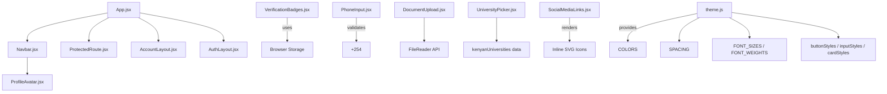
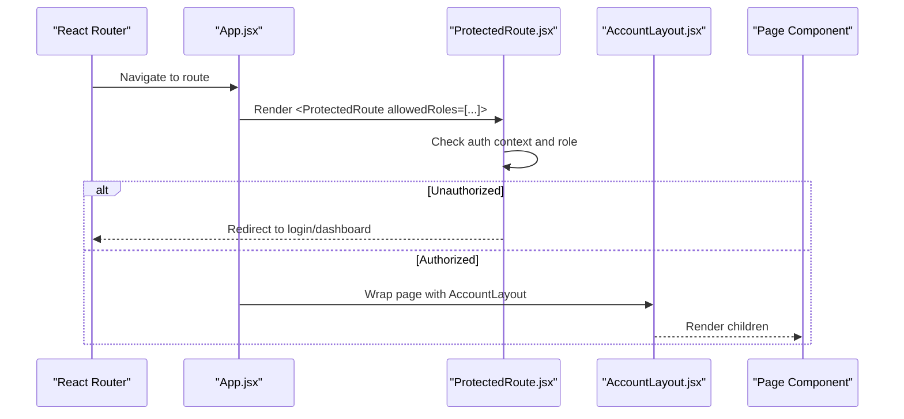
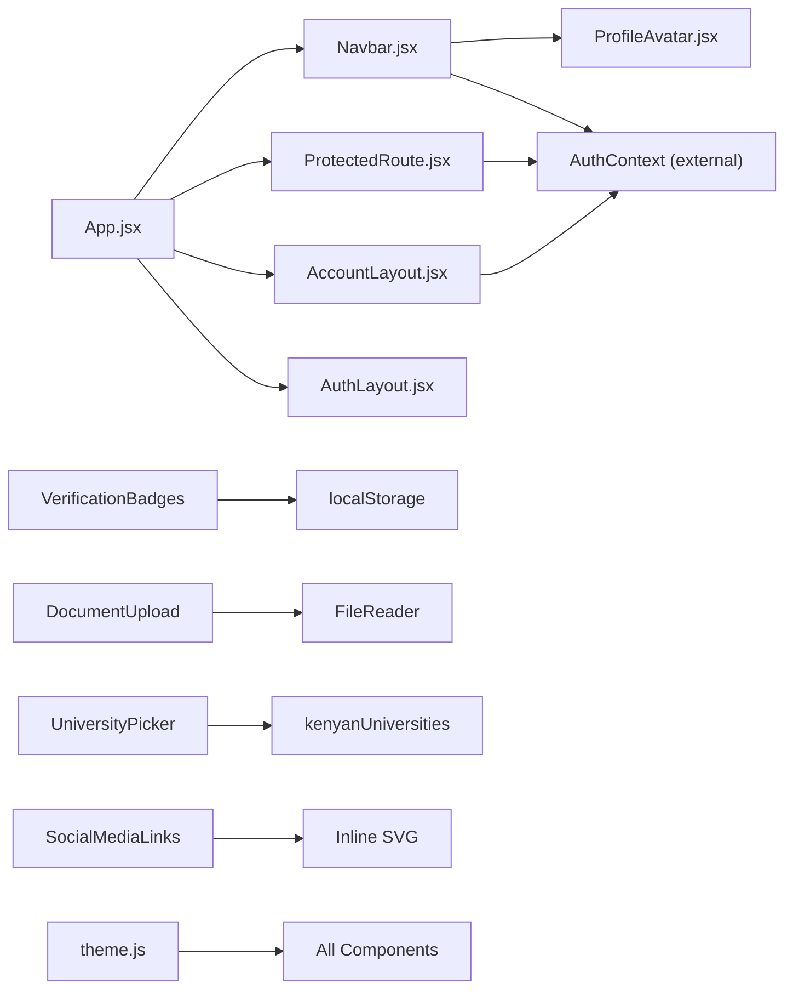

# Component Library

<cite>
**Referenced Files in This Document**
- [App.jsx](file://src/App.jsx)
- [Navbar.jsx](file://src/components/Navbar.jsx)
- [AccountLayout.jsx](file://src/components/AccountLayout.jsx)
- [AuthLayout.jsx](file://src/components/AuthLayout.jsx)
- [ProtectedRoute.jsx](file://src/components/ProtectedRoute.jsx)
- [ErrorBoundary.jsx](file://src/components/ErrorBoundary.jsx)
- [ProfileAvatar.jsx](file://src/features/profile/ProfileAvatar.jsx)
- [VerificationBadges.jsx](file://src/components/VerificationBadges.jsx)
- [PhoneInput.jsx](file://src/components/PhoneInput.jsx)
- [DocumentUpload.jsx](file://src/components/DocumentUpload.jsx)
- [SocialMediaLinks.jsx](file://src/components/SocialMediaLinks.jsx)
- [UniversityPicker.jsx](file://src/components/UniversityPicker.jsx)
- [theme.js](file://src/styles/theme.js)
</cite>

## Table of Contents
1. [Introduction](#introduction)
2. [Project Structure](#project-structure)
3. [Core Components](#core-components)
4. [Architecture Overview](#architecture-overview)
5. [Detailed Component Analysis](#detailed-component-analysis)
6. [Dependency Analysis](#dependency-analysis)
7. [Performance Considerations](#performance-considerations)
8. [Troubleshooting Guide](#troubleshooting-guide)
9. [Conclusion](#conclusion)
10. [Appendices](#appendices)

## Introduction
This document describes the reusable component library for the AxxSpaces frontend. It explains the component architecture, prop interfaces, customization options, shared UI components, layout components, form components, and utility components. It also documents styling approaches, theming support, responsive design patterns, and guidelines for creating custom components while maintaining consistency across the application.

The library is built with React and uses a combination of inline styles, CSS-in-JS style objects, and scoped CSS strings. The theme system centralizes colors, spacing, typography, and common UI primitives to ensure visual consistency.

## Project Structure
The component library lives primarily under src/components and src/features/profile. Layouts are provided as reusable wrappers around page content. Routing and layout composition are orchestrated by the top-level App component.

**Diagram sources**
- [App.jsx:1-120](file://src/App.jsx#L1-L120)
- [Navbar.jsx:1-120](file://src/components/Navbar.jsx#L1-L120)
- [ProtectedRoute.jsx:1-57](file://src/components/ProtectedRoute.jsx#L1-L57)
- [AccountLayout.jsx:1-100](file://src/components/AccountLayout.jsx#L1-L100)
- [AuthLayout.jsx:1-110](file://src/components/AuthLayout.jsx#L1-L110)
- [ProfileAvatar.jsx:1-35](file://src/features/profile/ProfileAvatar.jsx#L1-L35)
- [VerificationBadges.jsx:1-160](file://src/components/VerificationBadges.jsx#L1-L160)
- [PhoneInput.jsx:1-66](file://src/components/PhoneInput.jsx#L1-L66)
- [DocumentUpload.jsx:1-165](file://src/components/DocumentUpload.jsx#L1-L165)
- [UniversityPicker.jsx:1-120](file://src/components/UniversityPicker.jsx#L1-L120)
- [SocialMediaLinks.jsx:1-110](file://src/components/SocialMediaLinks.jsx#L1-L110)
- [theme.js:1-202](file://src/styles/theme.js#L1-L202)

**Section sources**
- [App.jsx:1-120](file://src/App.jsx#L1-L120)

## Core Components
This section summarizes the core building blocks of the library and their responsibilities.

- Layout and navigation
  - Navbar: Global navigation shell with role-aware menus, account dropdowns, and mobile-friendly panel.
  - AccountLayout: Role-focused dashboard header with dynamic navigation and logout.
  - AuthLayout: Split-screen portal wrapper for authentication flows with branding, features, stats, and trust signals.
  - ProtectedRoute: Route guard enforcing authentication and role-based access control.

- Shared UI components
  - ProfileAvatar: Circular avatar with image or initials fallback.
  - VerificationBadges: Badge set and progress indicator for user verification states.
  - SocialMediaLinks: Accessible social link buttons with brand-colored icons.

- Form components
  - PhoneInput: Kenyan phone number input with automatic +254 normalization.
  - DocumentUpload: Drag-and-drop file upload with validation, preview, and removal.
  - UniversityPicker: Searchable university selector with chips and metadata.

- Theming and styling
  - theme.js: Centralized design tokens (colors, spacing, typography), plus reusable button, input, card, page, hero, and section style presets.

**Section sources**
- [Navbar.jsx:1-120](file://src/components/Navbar.jsx#L1-L120)
- [AccountLayout.jsx:1-100](file://src/components/AccountLayout.jsx#L1-L100)
- [AuthLayout.jsx:1-110](file://src/components/AuthLayout.jsx#L1-L110)
- [ProtectedRoute.jsx:1-57](file://src/components/ProtectedRoute.jsx#L1-L57)
- [ProfileAvatar.jsx:1-35](file://src/features/profile/ProfileAvatar.jsx#L1-L35)
- [VerificationBadges.jsx:1-160](file://src/components/VerificationBadges.jsx#L1-L160)
- [SocialMediaLinks.jsx:1-110](file://src/components/SocialMediaLinks.jsx#L1-L110)
- [PhoneInput.jsx:1-66](file://src/components/PhoneInput.jsx#L1-L66)
- [DocumentUpload.jsx:1-165](file://src/components/DocumentUpload.jsx#L1-L165)
- [UniversityPicker.jsx:1-120](file://src/components/UniversityPicker.jsx#L1-L120)
- [theme.js:1-202](file://src/styles/theme.js#L1-L202)

## Architecture Overview
The application composes pages through layouts and guards. Public routes wrap content with Navbar and global utilities; protected routes enforce authentication and roles. Dashboards use AccountLayout for workspace-specific navigation.

**Diagram sources**
- [App.jsx:140-180](file://src/App.jsx#L140-L180)
- [ProtectedRoute.jsx:11-57](file://src/components/ProtectedRoute.jsx#L11-L57)
- [AccountLayout.jsx:15-99](file://src/components/AccountLayout.jsx#L15-L99)

## Detailed Component Analysis

### Layout and Navigation Components

#### Navbar
A comprehensive navigation component that adapts to user roles and provides:
- Brand logo and links
- User account menu with profile actions
- Mobile hamburger menu with portal cards and quick actions
- Workspace mode for logged-in users with role-based tabs

Key behaviors:
- Active tab detection based on current route
- Dropdowns close on outside click and route change
- Body scroll lock when panels are open
- Integration with AuthContext for token/user state

Prop interface highlights:
- No explicit props; behavior driven by AuthContext and routing.

Customization points:
- Menu items and portals are defined via constants inside the component.
- Styles are embedded via a CSS string; consider extracting to a theme module for consistency.

Accessibility:
- Uses aria-expanded and aria-label attributes for interactive elements.

Responsive design:
- Hamburger menu and full-screen panel for mobile.

**Section sources**
- [Navbar.jsx:1-120](file://src/components/Navbar.jsx#L1-L120)
- [Navbar.jsx:528-695](file://src/components/Navbar.jsx#L528-L695)

#### AccountLayout
Role-focused dashboard header with:
- Dynamic navigation derived from user role
- Greeting text based on time of day
- Logout action integrated with AuthContext
- Responsive mobile menu toggle

Prop interface:
- children: ReactNode
- preferSeller: boolean (optional)

Styling approach:
- Inline style object for layout and a CSS string for media queries.

**Section sources**
- [AccountLayout.jsx:15-99](file://src/components/AccountLayout.jsx#L15-L99)
- [AccountLayout.jsx:101-235](file://src/components/AccountLayout.jsx#L101-L235)

#### AuthLayout
Split-screen portal wrapper for authentication flows:
- Left side: Brand showcase, feature list, live stats, trust footer
- Right side: Form container for child content

Prop interface:
- portalBadge: string
- portalTitle: string
- portalSubtitle: string
- accentColor: string
- accentGlow: string
- features: array of { icon, title, desc }
- stats: array of { value, label }
- backLink: string
- backText: string
- children: ReactNode

Customization:
- Accent color and glow can be themed per portal.
- Features and stats are fully configurable arrays.

Responsive design:
- On smaller screens, left showcase hides and form takes full width.

**Section sources**
- [AuthLayout.jsx:3-108](file://src/components/AuthLayout.jsx#L3-L108)
- [AuthLayout.jsx:110-385](file://src/components/AuthLayout.jsx#L110-L385)

#### ProtectedRoute
Route guard ensuring only authenticated users with allowed roles can access routes.

Prop interface:
- children: ReactNode
- allowedRoles: string[] (optional)
- loginPath: string (optional)
- preferSeller: boolean (optional)

Behavior:
- Shows a loading placeholder while auth resolves
- Redirects unauthenticated users to login path
- Redirects unauthorized roles to their dashboard

**Section sources**
- [ProtectedRoute.jsx:11-57](file://src/components/ProtectedRoute.jsx#L11-L57)

### Shared UI Components

#### ProfileAvatar
Renders a circular avatar using an image if available; otherwise shows initials.

Prop interface:
- user: object (optional)
- size: number (default 48)
- style: object (optional)

Behavior:
- Computes initial from user.name
- Applies consistent sizing and border radius
- Supports custom overrides via style

**Section sources**
- [ProfileAvatar.jsx:1-35](file://src/features/profile/ProfileAvatar.jsx#L1-L35)

#### VerificationBadges
Displays verification status badges and a completion progress bar.

Props:
- userId: string
- userType: string (default "landlord")

Features:
- Loads verification state from localStorage keyed by userId
- Renders compact badge row and detailed grid
- Shows progress percentage and tips

Notes:
- Badges currently have empty icon fields; replace with icons as needed.

**Section sources**
- [VerificationBadges.jsx:1-160](file://src/components/VerificationBadges.jsx#L1-L160)

#### SocialMediaLinks
Accessible social link buttons with brand-colored hover effects.

Props:
- style: object (optional)
- iconSize: number (default 24)

Behavior:
- Renders predefined social links with inline SVG icons
- Hover transitions scale and highlight icons
- Uses rel="noopener noreferrer" for security

**Section sources**
- [SocialMediaLinks.jsx:1-110](file://src/components/SocialMediaLinks.jsx#L1-L110)

### Form Components

#### PhoneInput
Kenya-focused phone input that normalizes numbers to +254 format.

Props:
- value: string
- onChange: function
- placeholder: string (default "+254 7XX XXX XXX")
- style: object (optional)
- ...props: passed to underlying input

Validation logic:
- Ensures leading +254
- Converts local formats starting with 0 or 7 to international format
- Limits length to standard Kenyan format

**Section sources**
- [PhoneInput.jsx:1-66](file://src/components/PhoneInput.jsx#L1-L66)

#### DocumentUpload
Drag-and-drop file upload with validation, preview, and removal.

Props:
- label: string
- onFileChange: function(file, previewUrl)
- acceptedTypes: string (default "image/*,.pdf")
- maxSize: number (default 15MB)
- previewUrl: string (optional)
- onRemove: function()
- required: boolean (default false)
- fileName: string (optional)

Behavior:
- Validates file type and size
- Generates image previews via FileReader
- Displays PDF placeholders
- Provides remove button and error messages

**Section sources**
- [DocumentUpload.jsx:1-165](file://src/components/DocumentUpload.jsx#L1-L165)

#### UniversityPicker
Searchable university selector with chip display and metadata.

Props:
- value: object (optional)
- onChange: function(uni)
- required: boolean (default false)
- label: string (default "Nearby University")
- hint: string (optional)

Behavior:
- Searches against local dataset
- Shows selected chip with location and county
- Closes dropdown on outside click

**Section sources**
- [UniversityPicker.jsx:1-120](file://src/components/UniversityPicker.jsx#L1-L120)

### Utility Components

#### ErrorBoundary
Class component that catches rendering errors and displays a friendly fallback UI.

Behavior:
- Captures errors via static lifecycle methods
- Logs error details to console
- Offers refresh and go-home actions

Usage:
- Wrap critical route trees or app sections to prevent crash cascades.

**Section sources**
- [ErrorBoundary.jsx:1-78](file://src/components/ErrorBoundary.jsx#L1-L78)

## Dependency Analysis
The following diagram maps key dependencies between components and external APIs.

**Diagram sources**
- [App.jsx:1-120](file://src/App.jsx#L1-L120)
- [Navbar.jsx:1-120](file://src/components/Navbar.jsx#L1-L120)
- [ProtectedRoute.jsx:1-57](file://src/components/ProtectedRoute.jsx#L1-L57)
- [AccountLayout.jsx:1-100](file://src/components/AccountLayout.jsx#L1-L100)
- [AuthLayout.jsx:1-110](file://src/components/AuthLayout.jsx#L1-L110)
- [ProfileAvatar.jsx:1-35](file://src/features/profile/ProfileAvatar.jsx#L1-L35)
- [VerificationBadges.jsx:1-160](file://src/components/VerificationBadges.jsx#L1-L160)
- [DocumentUpload.jsx:1-165](file://src/components/DocumentUpload.jsx#L1-L165)
- [UniversityPicker.jsx:1-120](file://src/components/UniversityPicker.jsx#L1-L120)
- [SocialMediaLinks.jsx:1-110](file://src/components/SocialMediaLinks.jsx#L1-L110)
- [theme.js:1-202](file://src/styles/theme.js#L1-L202)

**Section sources**
- [App.jsx:1-120](file://src/App.jsx#L1-L120)

## Performance Considerations
- Avoid heavy computations inside render paths; memoize expensive operations where possible.
- Use lazy loading for large routes and modals to reduce initial bundle size.
- Prefer stable references for callbacks passed to child components to minimize re-renders.
- For file uploads, limit preview generation to images and avoid unnecessary re-renders.
- Keep CSS strings minimal and reuse common styles via theme.js to reduce duplication.

[No sources needed since this section provides general guidance]

## Troubleshooting Guide
Common issues and resolutions:

- Authentication redirects loop
  - Ensure ProtectedRoute receives correct allowedRoles and loginPath.
  - Verify AuthContext provides token and user correctly.

- File upload validation errors
  - Confirm acceptedTypes matches expected MIME types.
  - Check maxSize aligns with server constraints.

- Phone number formatting problems
  - Validate that inputs start with +254 or local prefixes handled by PhoneInput.

- University picker not showing results
  - Ensure kenyanUniversities data is loaded and searchUniversities function works.

- Error boundary not catching errors
  - Wrap the problematic subtree with ErrorBoundary.
  - Check console logs for stack traces.

**Section sources**
- [ProtectedRoute.jsx:11-57](file://src/components/ProtectedRoute.jsx#L11-L57)
- [DocumentUpload.jsx:17-45](file://src/components/DocumentUpload.jsx#L17-L45)
- [PhoneInput.jsx:19-47](file://src/components/PhoneInput.jsx#L19-L47)
- [UniversityPicker.jsx:36-44](file://src/components/UniversityPicker.jsx#L36-L44)
- [ErrorBoundary.jsx:9-15](file://src/components/ErrorBoundary.jsx#L9-L15)

## Conclusion
The component library provides a cohesive set of layouts, shared UI elements, and form components designed for consistency and accessibility. Theming via theme.js centralizes design tokens, while inline styles and CSS strings offer flexibility. By adhering to the documented prop interfaces and customization points, teams can extend and maintain components consistently across the application.

[No sources needed since this section summarizes without analyzing specific files]

## Appendices

### Styling Approaches and Theming
- Design tokens: COLORS, SPACING, BORDER_RADIUS, FONT_SIZES, FONT_WEIGHTS
- Reusable primitives: buttonStyles, inputStyles, cardStyles, pageStyles, heroStyles, sectionHeaderStyles
- Usage pattern: Import tokens and apply via inline styles or style objects for consistency.

**Section sources**
- [theme.js:4-202](file://src/styles/theme.js#L4-L202)

### Creating Custom Components
Guidelines:
- Define clear props with defaults and TypeScript-like JSDoc comments.
- Compose existing components (e.g., ProfileAvatar, VerificationBadges) rather than duplicating logic.
- Use theme.js tokens for colors, spacing, and typography.
- Keep styles localized; extract repeated CSS into theme.js or dedicated modules.
- Ensure accessibility: add aria attributes and keyboard support where applicable.

Example patterns:
- Wrapper components: Provide layout shells like AuthLayout and AccountLayout.
- Controlled form inputs: Follow controlled component patterns with value and onChange.
- Data-driven lists: Render arrays with stable keys and handle empty states gracefully.

[No sources needed since this section provides general guidance]

### Extending Existing Components
- Add optional props for variants (e.g., sizes, colors).
- Preserve backward compatibility by keeping default values.
- Encapsulate complex logic in hooks or helper functions to keep components lean.
- Test edge cases such as missing data, invalid inputs, and network failures.

[No sources needed since this section provides general guidance]

### Maintaining Consistency Across the Application
- Centralize design decisions in theme.js.
- Reuse layout components (Navbar, AccountLayout, AuthLayout) to unify UX.
- Standardize error handling with ErrorBoundary and consistent messaging.
- Document prop interfaces and usage examples for each component.

**Section sources**
- [theme.js:1-202](file://src/styles/theme.js#L1-L202)
- [ErrorBoundary.jsx:1-78](file://src/components/ErrorBoundary.jsx#L1-L78)