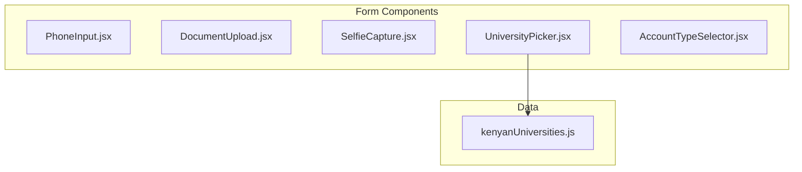
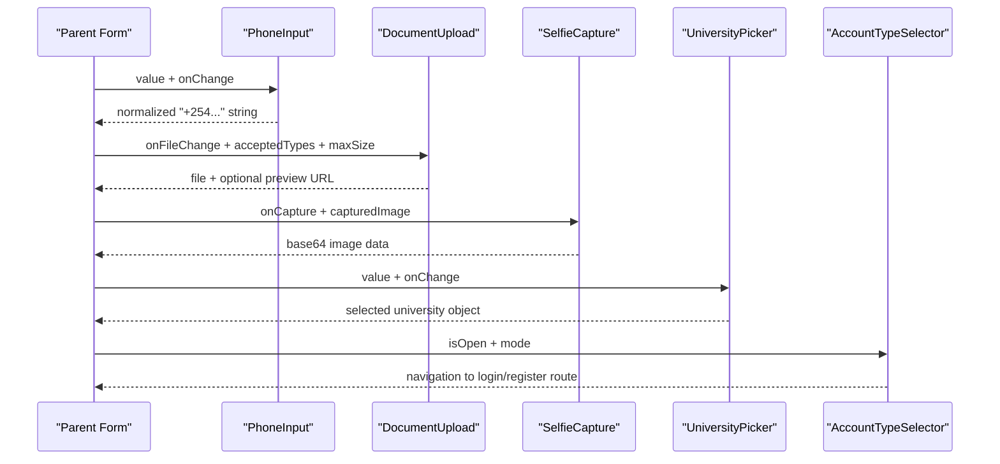
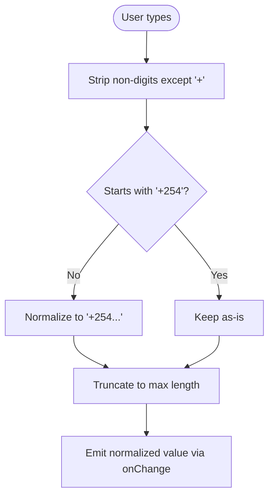
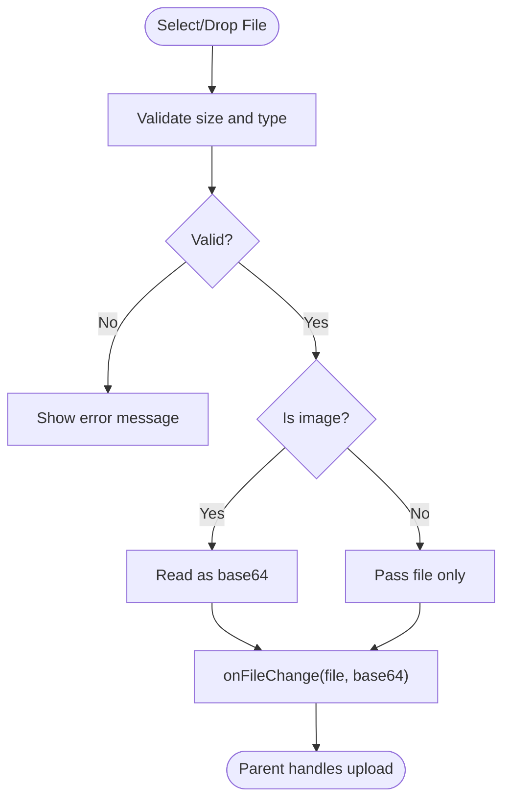
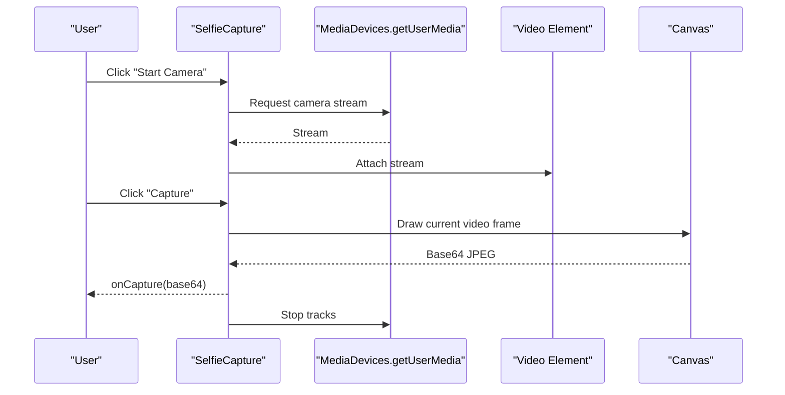
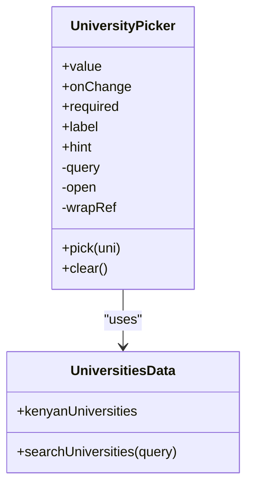
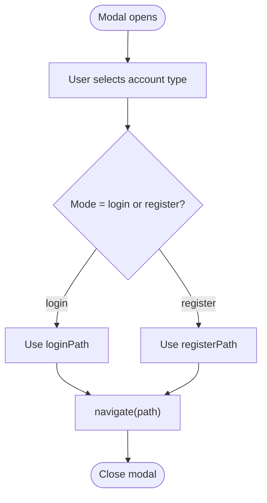
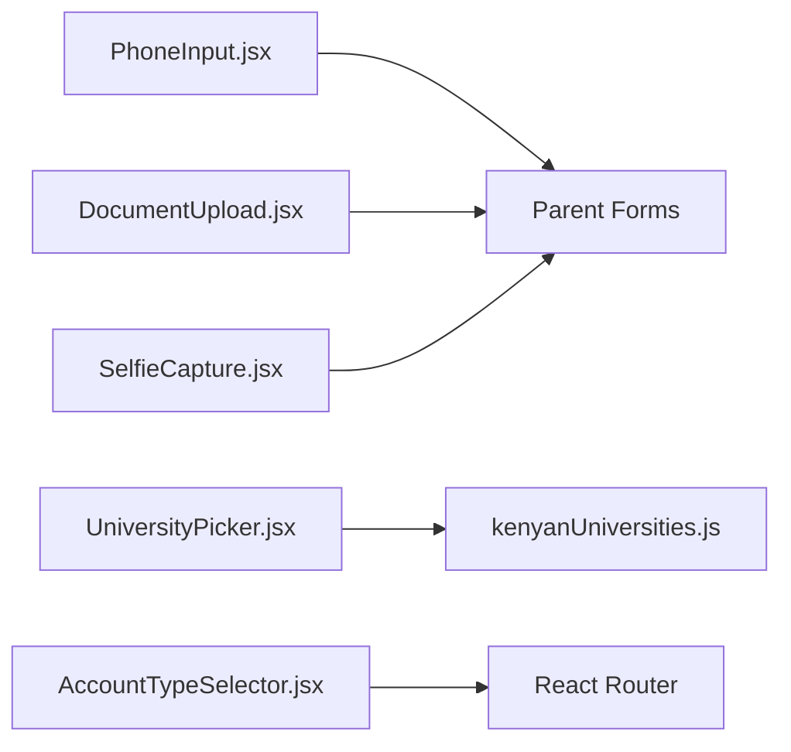

# Form Components

<cite>
**Referenced Files in This Document**
- [PhoneInput.jsx](file://src/components/PhoneInput.jsx)
- [DocumentUpload.jsx](file://src/components/DocumentUpload.jsx)
- [SelfieCapture.jsx](file://src/components/SelfieCapture.jsx)
- [UniversityPicker.jsx](file://src/components/UniversityPicker.jsx)
- [AccountTypeSelector.jsx](file://src/components/AccountTypeSelector.jsx)
- [kenyanUniversities.js](file://src/data/kenyanUniversities.js)
</cite>

## Table of Contents
1. [Introduction](#introduction)
2. [Project Structure](#project-structure)
3. [Core Components](#core-components)
4. [Architecture Overview](#architecture-overview)
5. [Detailed Component Analysis](#detailed-component-analysis)
6. [Dependency Analysis](#dependency-analysis)
7. [Performance Considerations](#performance-considerations)
8. [Troubleshooting Guide](#troubleshooting-guide)
9. [Conclusion](#conclusion)
10. [Appendices](#appendices)

## Introduction
This document provides detailed documentation for form-related components that handle user input and data collection:
- PhoneInput: International phone number formatting with Kenyan country code normalization.
- DocumentUpload: File handling, validation, preview, and removal.
- SelfieCapture: Camera integration and image capture workflow.
- UniversityPicker: Searchable university selection interface backed by a curated dataset.
- AccountTypeSelector: Role-based account creation and login routing.

The goal is to explain how each component works, how they validate and process data, and how to integrate them into forms using React Hook Form or similar libraries.

## Project Structure
These components live under the frontend’s shared components directory and are used across pages such as registration, profile editing, and verification flows. The UniversityPicker depends on a local dataset file for search and filtering.

**Diagram sources**
- [PhoneInput.jsx:1-66](file://src/components/PhoneInput.jsx#L1-L66)
- [DocumentUpload.jsx:1-280](file://src/components/DocumentUpload.jsx#L1-L280)
- [SelfieCapture.jsx:1-339](file://src/components/SelfieCapture.jsx#L1-L339)
- [UniversityPicker.jsx:1-221](file://src/components/UniversityPicker.jsx#L1-L221)
- [AccountTypeSelector.jsx:1-248](file://src/components/AccountTypeSelector.jsx#L1-L248)
- [kenyanUniversities.js:1-254](file://src/data/kenyanUniversities.js#L1-L254)

**Section sources**
- [PhoneInput.jsx:1-66](file://src/components/PhoneInput.jsx#L1-L66)
- [DocumentUpload.jsx:1-280](file://src/components/DocumentUpload.jsx#L1-L280)
- [SelfieCapture.jsx:1-339](file://src/components/SelfieCapture.jsx#L1-L339)
- [UniversityPicker.jsx:1-221](file://src/components/UniversityPicker.jsx#L1-L221)
- [AccountTypeSelector.jsx:1-248](file://src/components/AccountTypeSelector.jsx#L1-L248)
- [kenyanUniversities.js:1-254](file://src/data/kenyanUniversities.js#L1-L254)

## Core Components
- PhoneInput: Normalizes phone numbers to the +254 format, restricts input length, and ensures consistent output for downstream integrations like WhatsApp.
- DocumentUpload: Validates file type and size, supports drag-and-drop, previews images, shows PDF placeholders, and exposes remove functionality.
- SelfieCapture: Uses the browser camera API to stream video, captures frames to a canvas, converts to JPEG base64, and manages lifecycle cleanup.
- UniversityPicker: Provides a searchable dropdown over a static list of Kenyan universities with location and county metadata.
- AccountTypeSelector: Renders a modal with role cards and navigates to appropriate login/register routes based on selected account type.

**Section sources**
- [PhoneInput.jsx:1-66](file://src/components/PhoneInput.jsx#L1-L66)
- [DocumentUpload.jsx:1-280](file://src/components/DocumentUpload.jsx#L1-L280)
- [SelfieCapture.jsx:1-339](file://src/components/SelfieCapture.jsx#L1-L339)
- [UniversityPicker.jsx:1-221](file://src/components/UniversityPicker.jsx#L1-L221)
- [AccountTypeSelector.jsx:1-248](file://src/components/AccountTypeSelector.jsx#L1-L248)

## Architecture Overview
The components follow a controlled-input pattern where parent forms manage state and pass callbacks (onChange, onSubmit). Some components expose additional capabilities:
- Preview generation (DocumentUpload, SelfieCapture)
- Localized formatting and normalization (PhoneInput)
- Data-driven UI (UniversityPicker)
- Navigation orchestration (AccountTypeSelector)

**Diagram sources**
- [PhoneInput.jsx:19-47](file://src/components/PhoneInput.jsx#L19-L47)
- [DocumentUpload.jsx:47-83](file://src/components/DocumentUpload.jsx#L47-L83)
- [SelfieCapture.jsx:48-65](file://src/components/SelfieCapture.jsx#L48-L65)
- [UniversityPicker.jsx:36-50](file://src/components/UniversityPicker.jsx#L36-L50)
- [AccountTypeSelector.jsx:191-201](file://src/components/AccountTypeSelector.jsx#L191-L201)

## Detailed Component Analysis

### PhoneInput
Purpose:
- Normalize phone inputs to the Kenyan international format (+254...).
- Enforce maximum length and strip invalid characters.
- Provide a friendly placeholder and focus behavior.

Key behaviors:
- Input cleaning removes non-digit characters except “+”.
- Ensures leading “+254” by converting common local formats (e.g., “07...”, “7...”).
- Limits total length to 13 characters (“+254” plus 9 digits).
- Emits normalized value via onChange.

Integration tips:
- Use with React Hook Form by passing `value` and `onChange` from register.
- Validate required presence at the form level; this component does not emit empty errors.

**Diagram sources**
- [PhoneInput.jsx:19-47](file://src/components/PhoneInput.jsx#L19-L47)

**Section sources**
- [PhoneInput.jsx:1-66](file://src/components/PhoneInput.jsx#L1-L66)

### DocumentUpload
Purpose:
- Accept files via click or drag-and-drop.
- Validate file type and size.
- Generate image previews when possible.
- Allow removing the selected file.

Validation rules:
- Size limit defaults to 15MB.
- Allowed types default to images and PDFs.
- Error messages are shown inline.

Preview behavior:
- For images, reads file as base64 and passes it back to the parent.
- For PDFs, returns the file without a preview URL.

Progress tracking:
- No built-in upload progress; use a parent uploader service to track server-side uploads.

**Diagram sources**
- [DocumentUpload.jsx:17-63](file://src/components/DocumentUpload.jsx#L17-L63)

**Section sources**
- [DocumentUpload.jsx:1-280](file://src/components/DocumentUpload.jsx#L1-L280)

### SelfieCapture
Purpose:
- Access the device camera and display a live video feed.
- Capture a frame and convert it to a JPEG base64 string.
- Manage camera lifecycle and cleanup.

Camera integration:
- Requests front-facing camera with ideal resolution.
- Streams media to a video element.
- Captures to an offscreen canvas and exports as base64.

Error handling:
- Displays a user-friendly error if camera access is denied.
- Cleans up tracks on unmount or when stopping the camera.

**Diagram sources**
- [SelfieCapture.jsx:24-39](file://src/components/SelfieCapture.jsx#L24-L39)
- [SelfieCapture.jsx:48-65](file://src/components/SelfieCapture.jsx#L48-L65)

**Section sources**
- [SelfieCapture.jsx:1-339](file://src/components/SelfieCapture.jsx#L1-L339)

### UniversityPicker
Purpose:
- Provide a searchable dropdown for selecting a Kenyan university.
- Display selected university details including location and county.
- Support clearing selection.

Search logic:
- Filters by name, location, county, and code.
- Shows top results when no query is present.

State management:
- Syncs internal query with external value prop.
- Closes dropdown on outside clicks.

**Diagram sources**
- [UniversityPicker.jsx:13-50](file://src/components/UniversityPicker.jsx#L13-L50)
- [kenyanUniversities.js:234-250](file://src/data/kenyanUniversities.js#L234-L250)

**Section sources**
- [UniversityPicker.jsx:1-221](file://src/components/UniversityPicker.jsx#L1-L221)
- [kenyanUniversities.js:1-254](file://src/data/kenyanUniversities.js#L1-L254)

### AccountTypeSelector
Purpose:
- Present a modal with different account roles.
- Navigate users to the correct login or registration page based on the selected role.

Routing behavior:
- Chooses between loginPath and registerPath depending on mode.
- Adds tab parameters for specific flows when needed.

UI interactions:
- Overlay closes on backdrop click.
- Cards highlight on hover.

**Diagram sources**
- [AccountTypeSelector.jsx:191-201](file://src/components/AccountTypeSelector.jsx#L191-L201)

**Section sources**
- [AccountTypeSelector.jsx:1-248](file://src/components/AccountTypeSelector.jsx#L1-L248)

## Dependency Analysis
- UniversityPicker depends on the static dataset for search and filtering.
- Other components are self-contained and communicate with parents via props and callbacks.
- No circular dependencies exist among these components.

**Diagram sources**
- [UniversityPicker.jsx:1-221](file://src/components/UniversityPicker.jsx#L1-L221)
- [kenyanUniversities.js:1-254](file://src/data/kenyanUniversities.js#L1-L254)
- [AccountTypeSelector.jsx:1-248](file://src/components/AccountTypeSelector.jsx#L1-L248)

**Section sources**
- [UniversityPicker.jsx:1-221](file://src/components/UniversityPicker.jsx#L1-L221)
- [kenyanUniversities.js:1-254](file://src/data/kenyanUniversities.js#L1-L254)
- [AccountTypeSelector.jsx:1-248](file://src/components/AccountTypeSelector.jsx#L1-L248)

## Performance Considerations
- PhoneInput performs lightweight string manipulations; negligible overhead.
- DocumentUpload uses FileReader for image previews; consider debouncing large file handling and limiting concurrent previews.
- SelfieCapture creates base64 strings; prefer uploading blobs directly to reduce memory usage.
- UniversityPicker filters a static array; performance is fine for the dataset size.

[No sources needed since this section provides general guidance]

## Troubleshooting Guide
Common issues and resolutions:
- PhoneInput always starts with +254:
  - Expected behavior; ensure your backend accepts international format.
- DocumentUpload rejects files:
  - Verify file size and MIME type against acceptedTypes and maxSize.
- SelfieCapture cannot start:
  - Check browser permissions for camera access; ensure HTTPS context.
- UniversityPicker shows no results:
  - Confirm query matches fields searched (name, location, county, code).
- AccountTypeSelector does not navigate:
  - Ensure react-router-dom is configured and routes exist for login/register paths.

**Section sources**
- [PhoneInput.jsx:19-47](file://src/components/PhoneInput.jsx#L19-L47)
- [DocumentUpload.jsx:17-63](file://src/components/DocumentUpload.jsx#L17-L63)
- [SelfieCapture.jsx:24-39](file://src/components/SelfieCapture.jsx#L24-L39)
- [UniversityPicker.jsx:36-50](file://src/components/UniversityPicker.jsx#L36-L50)
- [AccountTypeSelector.jsx:191-201](file://src/components/AccountTypeSelector.jsx#L191-L201)

## Conclusion
These components provide robust building blocks for user input and data collection:
- PhoneInput standardizes phone numbers for Kenyan contexts.
- DocumentUpload offers flexible file handling with validation and previews.
- SelfieCapture integrates camera access and image capture.
- UniversityPicker delivers a searchable, data-backed selection experience.
- AccountTypeSelector streamlines role-based navigation.

Integrate them with React Hook Form by binding values and change handlers, and implement custom validation where necessary.

[No sources needed since this section summarizes without analyzing specific files]

## Appendices

### Integration Examples with React Hook Form
- PhoneInput:
  - Bind `value={watch("phone")}` and `onChange={(v) => setValue("phone", v)}`.
  - Add a required rule at the form schema level.
- DocumentUpload:
  - On `onFileChange`, update form state with the file and optional preview URL.
  - Validate file presence and size in the form schema.
- SelfieCapture:
  - On `onCapture`, store the base64 image in form state.
  - Validate that a selfie has been captured before submission.
- UniversityPicker:
  - Bind `value={watch("university")}` and `onChange={(u) => setValue("university", u)}`.
  - Require a selected university in the schema.
- AccountTypeSelector:
  - Not bound to form state; triggers navigation based on mode.

[No sources needed since this section provides general guidance]