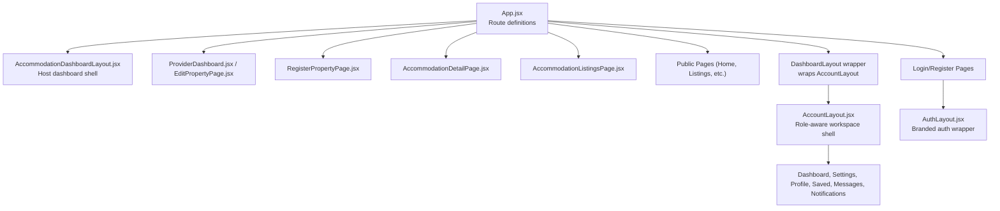
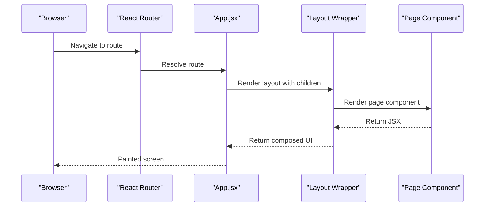
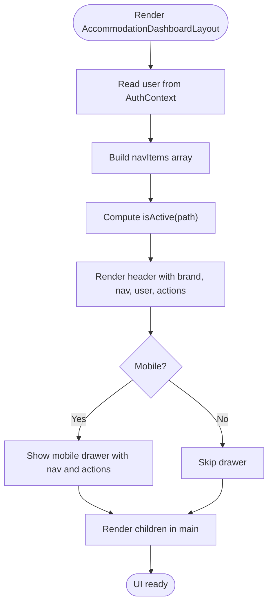
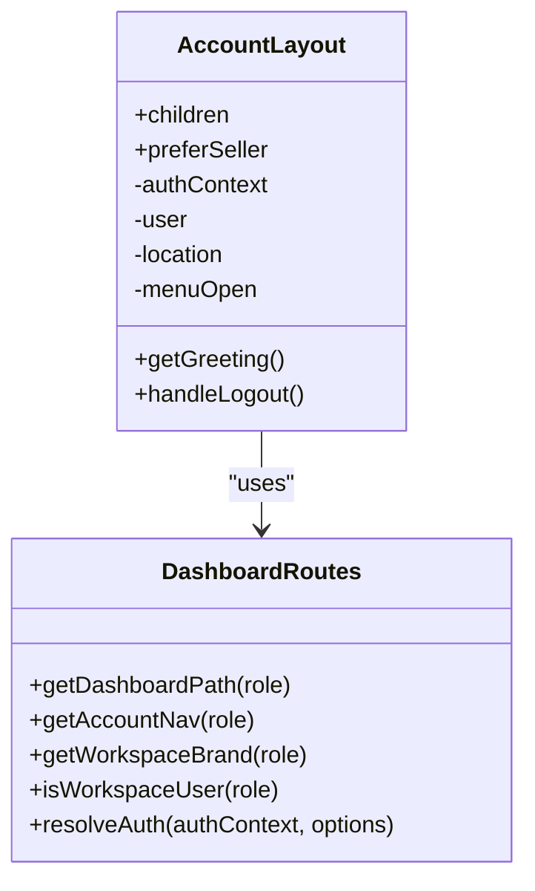
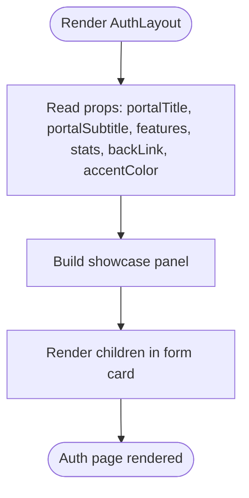
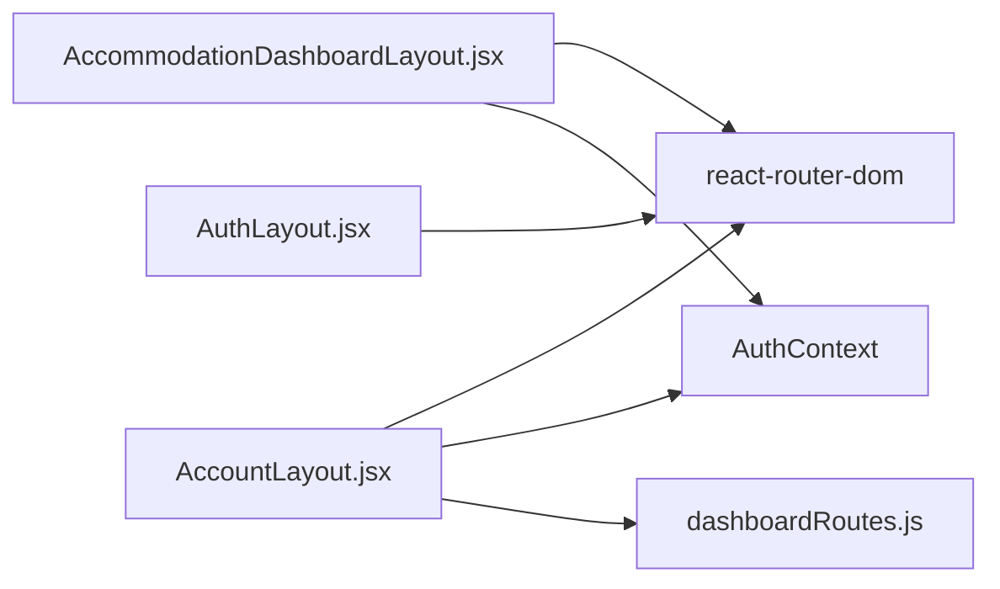
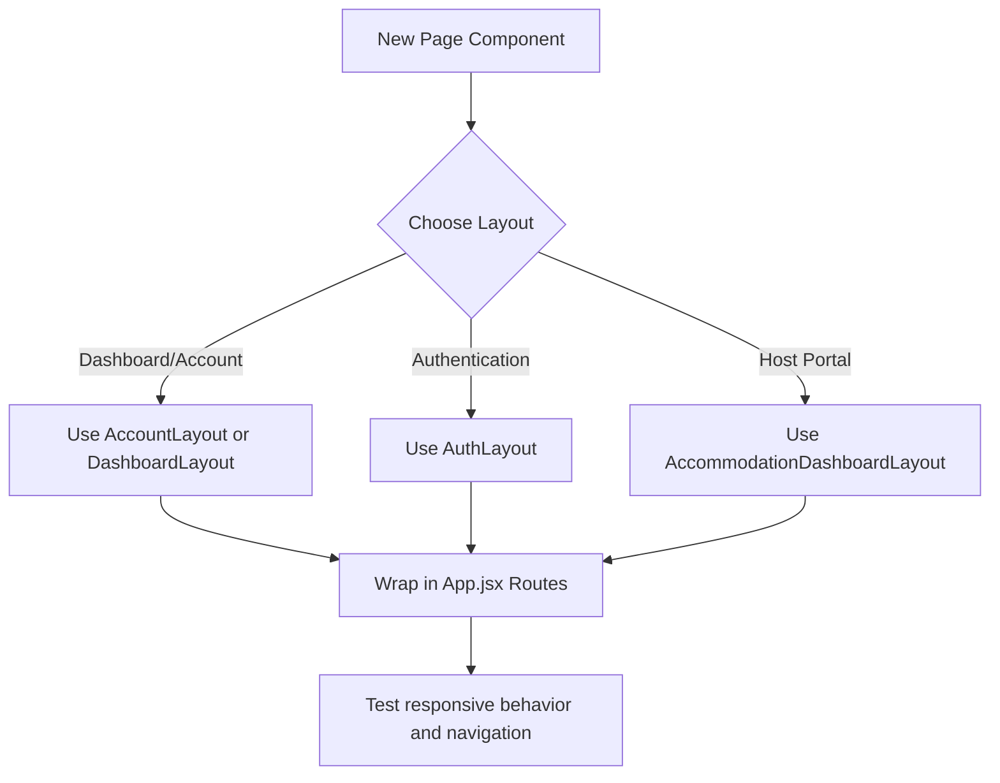

# Layout Components

<cite>
**Referenced Files in This Document**
- [AccommodationDashboardLayout.jsx](file://src/components/AccommodationDashboardLayout.jsx)
- [AccountLayout.jsx](file://src/components/AccountLayout.jsx)
- [AuthLayout.jsx](file://src/components/AuthLayout.jsx)
- [App.jsx](file://src/App.jsx)
- [dashboardRoutes.js](file://src/utils/dashboardRoutes.js)
</cite>

## Table of Contents
1. [Introduction](#introduction)
2. [Project Structure](#project-structure)
3. [Core Components](#core-components)
4. [Architecture Overview](#architecture-overview)
5. [Detailed Component Analysis](#detailed-component-analysis)
6. [Dependency Analysis](#dependency-analysis)
7. [Performance Considerations](#performance-considerations)
8. [Troubleshooting Guide](#troubleshooting-guide)
9. [Conclusion](#conclusion)
10. [Appendices](#appendices)

## Introduction
This document explains the layout components that provide structural frameworks for different application sections:
- AccommodationDashboardLayout: host portal dashboard shell for property management.
- AccountLayout: role-aware workspace shell for user account and dashboard pages.
- AuthLayout: branded authentication wrapper for login and registration flows.

It covers composition patterns, child rendering, responsive behavior, routing integration, and how these layouts work with authentication utilities. It also includes guidance on extending layouts and creating custom wrappers.

## Project Structure
The three layout components live under src/components and are used by routes defined in src/App.jsx. Role-based navigation and routing helpers live in src/utils/dashboardRoutes.js.

**Diagram sources**
- [App.jsx:140-491](file://src/App.jsx#L140-L491)
- [AccommodationDashboardLayout.jsx:6-249](file://src/components/AccommodationDashboardLayout.jsx#L6-L249)
- [AccountLayout.jsx:16-104](file://src/components/AccountLayout.jsx#L16-L104)
- [AuthLayout.jsx:3-108](file://src/components/AuthLayout.jsx#L3-L108)

**Section sources**
- [App.jsx:140-491](file://src/App.jsx#L140-L491)

## Core Components
- AccommodationDashboardLayout
  - Purpose: Host portal dashboard shell with brand header, navigation, user info, logout, and mobile drawer.
  - Composition: Renders children inside a main content area; provides its own header and navigation.
  - Routing: Uses react-router-dom Link and useLocation to highlight active links and navigate within the accommodation section.
  - Authentication: Reads user from AuthContext and supports logout via context or fallback redirect.
  - Responsive: Desktop shows horizontal nav; mobile shows a toggle button and a slide-in drawer.

- AccountLayout
  - Purpose: Role-aware workspace shell for dashboards and account pages.
  - Composition: Renders children inside a sticky header with logo, role-specific navigation, greeting, avatar, and optional logout.
  - Routing: Uses getDashboardPath and getAccountNav from dashboardRoutes.js to compute default dashboard and menu items based on user role.
  - Authentication: Uses resolveAuth to support both main session and seller session; hides logout for community roles.
  - Responsive: Shows a hamburger menu on smaller screens and stacks user controls below the nav.

- AuthLayout
  - Purpose: Branded two-column layout for authentication forms.
  - Composition: Left side showcases branding, features, stats, and trust messaging; right side renders form children.
  - Routing: Provides a back link to a configurable route.
  - Styling: Dark theme with accent color and glow effects; collapses to single column on smaller screens.

**Section sources**
- [AccommodationDashboardLayout.jsx:6-249](file://src/components/AccommodationDashboardLayout.jsx#L6-L249)
- [AccountLayout.jsx:16-104](file://src/components/AccountLayout.jsx#L16-L104)
- [AuthLayout.jsx:3-108](file://src/components/AuthLayout.jsx#L3-L108)

## Architecture Overview
The application uses React Router to wrap page components with appropriate layout shells:
- Public pages use a public layout with Navbar and global notifications.
- Dashboard and account pages use DashboardLayout, which wraps AccountLayout to provide role-focused navigation.
- Accommodation host pages use AccommodationDashboardLayout for a dedicated host portal experience.
- Authentication pages use AuthLayout for consistent branding and UX.

**Diagram sources**
- [App.jsx:140-491](file://src/App.jsx#L140-L491)

## Detailed Component Analysis

### AccommodationDashboardLayout
AccommodationDashboardLayout is a specialized dashboard shell for accommodation hosts. It provides:
- A sticky header with brand, desktop navigation, user info, add-property action, and logout.
- A mobile drawer with profile summary, navigation, and actions.
- Active link detection using useLocation.
- Greeting text based on time of day.
- Integration with AuthContext for user data and logout.

Key behaviors:
- Navigation items include Dashboard, Add Property, Browse Stays, and Member Hub.
- The “Add Property” CTA is prominent in both desktop and mobile views.
- Logout calls the context logout function when available; otherwise falls back to a hard redirect.

Responsive design:
- Desktop: Horizontal nav and user info visible.
- Mobile (<900px): Desktop nav hidden, menu toggle shown, drawer appears.
- Small screens (<520px): Hide some text labels and reduce padding.

**Diagram sources**
- [AccommodationDashboardLayout.jsx:6-249](file://src/components/AccommodationDashboardLayout.jsx#L6-L249)

Usage in routing:
- ProviderDashboard and EditPropertyPage are wrapped by AccommodationDashboardLayout and protected for host/admin roles.
- RegisterPropertyPage is protected but not wrapped by this layout; it is accessed via the header’s CTA.

**Section sources**
- [AccommodationDashboardLayout.jsx:6-249](file://src/components/AccommodationDashboardLayout.jsx#L6-L249)
- [App.jsx:196-225](file://src/App.jsx#L196-L225)

### AccountLayout
AccountLayout is a role-aware workspace shell used by most dashboard and account pages. It:
- Resolves the active user via resolveAuth, supporting both main and seller sessions.
- Computes dashboard path, navigation items, and workspace brand based on user role.
- Hides logout for community roles (member/user/guest).
- Renders a sticky header with logo, role-specific navigation, greeting, avatar, and optional logout.
- Falls back to rendering children without the full header if no user is present.

Routing and navigation:
- getDashboardPath returns the default dashboard URL for the current role.
- getAccountNav returns the role-specific menu items.
- isActive highlights the current section using location.pathname.startsWith.

Responsive design:
- On small screens, a hamburger button toggles the navigation and moves user controls below the nav.

**Diagram sources**
- [AccountLayout.jsx:16-104](file://src/components/AccountLayout.jsx#L16-L104)
- [dashboardRoutes.js:31-93](file://src/utils/dashboardRoutes.js#L31-L93)
- [dashboardRoutes.js:109-182](file://src/utils/dashboardRoutes.js#L109-L182)

Usage in routing:
- DashboardLayout in App.jsx wraps AccountLayout and adds AppUpdateNotifier.
- Many dashboard and account routes are wrapped by DashboardLayout, including settings, profile, saved listings, messages, notifications, payment history, business dashboard, quick sales dashboard, landlord dashboard, and admin panels.

**Section sources**
- [AccountLayout.jsx:16-104](file://src/components/AccountLayout.jsx#L16-L104)
- [dashboardRoutes.js:1-183](file://src/utils/dashboardRoutes.js#L1-L183)
- [App.jsx:101-109](file://src/App.jsx#L101-L109)
- [App.jsx:295-451](file://src/App.jsx#L295-L451)

### AuthLayout
AuthLayout provides a branded authentication wrapper with:
- A top bar with brand and back link.
- A left showcase panel with badge, headline, subtitle, feature cards, stats pills, and trust messaging.
- A right form card that renders children (login/register forms).
- Configurable props for portal title, subtitle, accent colors, features, stats, and back link.

Responsive design:
- On smaller screens, the grid collapses to a single column and the showcase panel is hidden.

**Diagram sources**
- [AuthLayout.jsx:3-108](file://src/components/AuthLayout.jsx#L3-L108)

Usage in routing:
- Used by multiple login and register pages such as Login, Register, UserRegister, AgentLogin, BusinessLogin, and QuickSalesLogin.

**Section sources**
- [AuthLayout.jsx:3-108](file://src/components/AuthLayout.jsx#L3-L108)
- [App.jsx:148-164](file://src/App.jsx#L148-L164)

## Dependency Analysis
The layout components depend on:
- React Router: Link and useLocation for navigation and active state.
- AuthContext: For user data and logout functions.
- dashboardRoutes.js: For role-based paths, navigation, and session resolution.

**Diagram sources**
- [AccommodationDashboardLayout.jsx:1-9](file://src/components/AccommodationDashboardLayout.jsx#L1-L9)
- [AccountLayout.jsx:1-13](file://src/components/AccountLayout.jsx#L1-L13)
- [AuthLayout.jsx:1-1](file://src/components/AuthLayout.jsx#L1-L1)
- [dashboardRoutes.js:1-183](file://src/utils/dashboardRoutes.js#L1-L183)

**Section sources**
- [AccommodationDashboardLayout.jsx:1-9](file://src/components/AccommodationDashboardLayout.jsx#L1-L9)
- [AccountLayout.jsx:1-13](file://src/components/AccountLayout.jsx#L1-L13)
- [AuthLayout.jsx:1-1](file://src/components/AuthLayout.jsx#L1-L1)
- [dashboardRoutes.js:1-183](file://src/utils/dashboardRoutes.js#L1-L183)

## Performance Considerations
- Avoid heavy inline styles in hot paths; consider extracting shared styles into CSS modules or styled libraries for better caching and readability.
- Use memoization for computed values like navItems and isActive where appropriate to prevent unnecessary re-renders.
- Prefer lazy loading for large page components wrapped by layouts to reduce initial bundle size.
- Keep conditional rendering minimal in headers to avoid layout thrashing during resize events.

[No sources needed since this section provides general guidance]

## Troubleshooting Guide
Common issues and resolutions:
- Missing user in AccountLayout
  - Symptom: Header shows incomplete user info or no logout button.
  - Cause: resolveAuth returns null user due to missing session or wrong role mapping.
  - Resolution: Ensure the correct session token exists and the role matches ACCOUNT_NAV_BY_ROLE entries.

- Incorrect active link highlighting
  - Symptom: Nav does not highlight the current page.
  - Cause: isActive logic mismatch between route structure and expected path prefix.
  - Resolution: Adjust isActive checks to match actual route prefixes.

- Logout not working
  - Symptom: Logout button does nothing or redirects incorrectly.
  - Cause: Missing logout function in AuthContext or incorrect fallback redirect.
  - Resolution: Verify AuthContext provides logout and update fallback URLs accordingly.

- Mobile menu not appearing
  - Symptom: Hamburger button not visible or drawer not opening.
  - Cause: CSS media queries or class toggling not applied.
  - Resolution: Inspect media query breakpoints and ensure toggle classes are applied correctly.

**Section sources**
- [AccountLayout.jsx:16-104](file://src/components/AccountLayout.jsx#L16-L104)
- [AccommodationDashboardLayout.jsx:6-249](file://src/components/AccommodationDashboardLayout.jsx#L6-L249)

## Conclusion
These layout components provide consistent, role-aware shells across the application:
- AccommodationDashboardLayout offers a polished host portal experience with robust navigation and responsive behavior.
- AccountLayout centralizes role-based navigation and session handling, enabling scalable workspace pages.
- AuthLayout standardizes authentication flows with strong branding and clear CTAs.

By composing these layouts around page components and leveraging routing and authentication utilities, the application maintains a cohesive user experience while supporting diverse roles and workflows.

[No sources needed since this section summarizes without analyzing specific files]

## Appendices

### Extending Layouts and Creating Custom Wrappers
Guidelines:
- Create a new layout component that accepts children and any configuration props.
- Compose existing layouts when possible (e.g., wrap AccountLayout for role-aware behavior).
- Integrate with AuthContext for user data and logout.
- Use react-router-dom Link and useLocation for navigation and active states.
- Define responsive breakpoints in CSS or inline styles consistently.

Example pattern:
- Wrap your page component with a layout in App.jsx routes.
- If you need role-based navigation, prefer AccountLayout and configure via dashboardRoutes.js.
- For authentication pages, wrap forms with AuthLayout and pass branding props.

[No sources needed since this diagram shows conceptual workflow, not actual code structure]