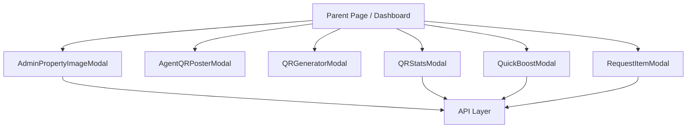
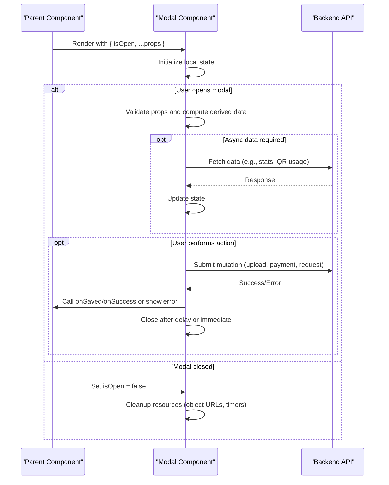
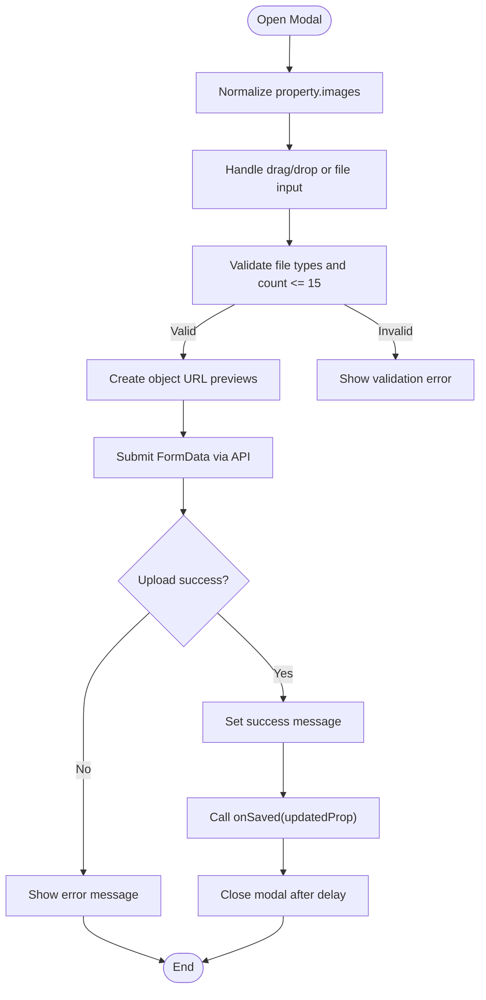
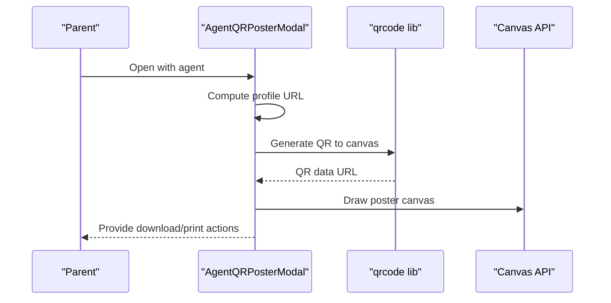
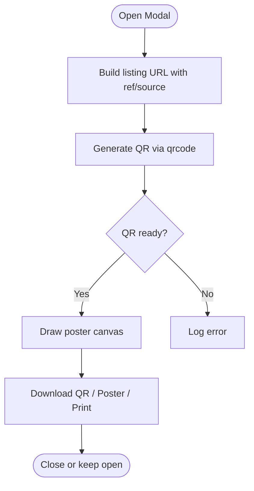
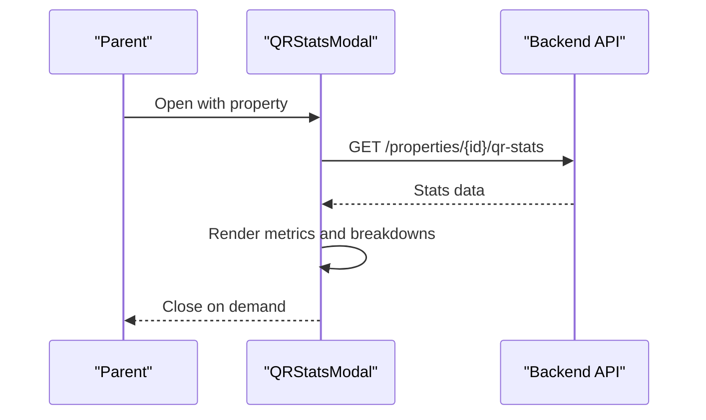
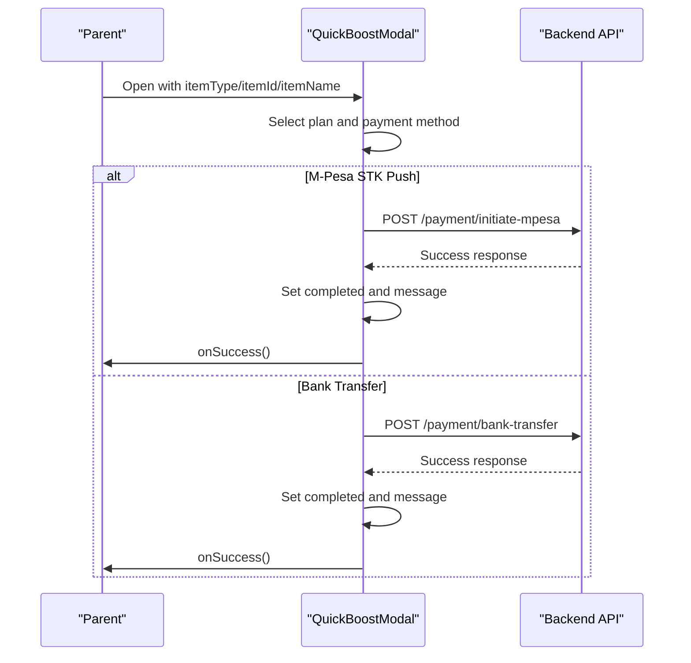
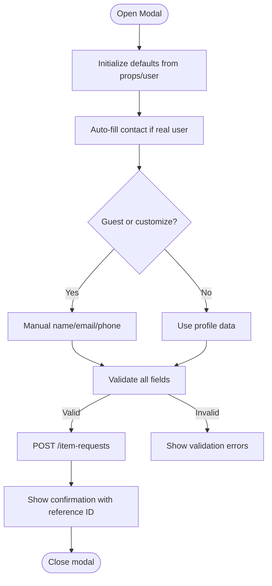
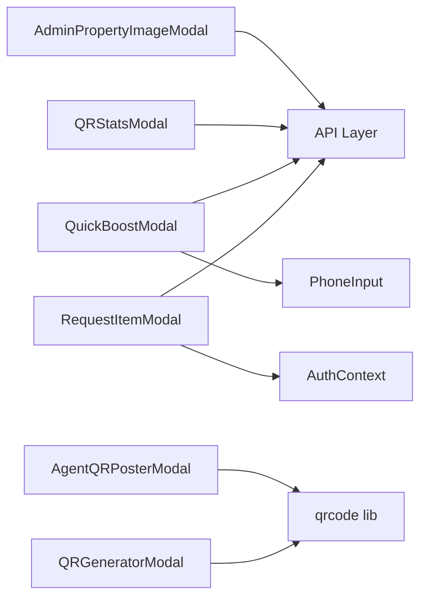

# Modal Components

<cite>
**Referenced Files in This Document**   
- [AdminPropertyImageModal.jsx](file://src/components/AdminPropertyImageModal.jsx)
- [AgentQRPosterModal.jsx](file://src/components/AgentQRPosterModal.jsx)
- [QRGeneratorModal.jsx](file://src/components/QRGeneratorModal.jsx)
- [QRStatsModal.jsx](file://src/components/QRStatsModal.jsx)
- [QuickBoostModal.jsx](file://src/components/QuickBoostModal.jsx)
- [RequestItemModal.jsx](file://src/components/RequestItemModal.jsx)
- [api.js](file://src/api/api.js)
</cite>

## Table of Contents
1. [Introduction](#introduction)
2. [Project Structure](#project-structure)
3. [Core Components](#core-components)
4. [Architecture Overview](#architecture-overview)
5. [Detailed Component Analysis](#detailed-component-analysis)
6. [Dependency Analysis](#dependency-analysis)
7. [Performance Considerations](#performance-considerations)
8. [Troubleshooting Guide](#troubleshooting-guide)
9. [Conclusion](#conclusion)

## Introduction
This document provides comprehensive documentation for the modal dialog components that power focused user interactions across the application. It covers:
- AdminPropertyImageModal: property image management and upload workflow
- AgentQRPosterModal: agent profile QR poster generation and export
- QRGeneratorModal: general property listing QR code and poster generation
- QRStatsModal: analytics display for QR scans and inquiries
- QuickBoostModal: promotional boost selection and payment flow
- RequestItemModal: multi-step item request submission with validation

It also explains modal lifecycle management, backdrop handling, keyboard navigation, accessibility compliance, state management patterns, and examples of opening/closing modals programmatically while passing data between parent and child components.

## Project Structure
The modal components live under src/components and are typically rendered conditionally by their parent pages or dashboards based on a boolean isOpen prop. Each modal encapsulates its own local state, handles API calls where needed, and exposes callbacks such as onClose and onSaved/onSuccess to communicate back to the parent.

**Diagram sources**
- [AdminPropertyImageModal.jsx:5-31](file://src/components/AdminPropertyImageModal.jsx#L5-L31)
- [AgentQRPosterModal.jsx:357-371](file://src/components/AgentQRPosterModal.jsx#L357-L371)
- [QRGeneratorModal.jsx:357-374](file://src/components/QRGeneratorModal.jsx#L357-L374)
- [QRStatsModal.jsx:20-47](file://src/components/QRStatsModal.jsx#L20-L47)
- [QuickBoostModal.jsx:6-29](file://src/components/QuickBoostModal.jsx#L6-L29)
- [RequestItemModal.jsx:124-213](file://src/components/RequestItemModal.jsx#L124-L213)
- [api.js](file://src/api/api.js)

**Section sources**
- [AdminPropertyImageModal.jsx:1-31](file://src/components/AdminPropertyImageModal.jsx#L1-L31)
- [AgentQRPosterModal.jsx:1-10](file://src/components/AgentQRPosterModal.jsx#L1-L10)
- [QRGeneratorModal.jsx:1-13](file://src/components/QRGeneratorModal.jsx#L1-L13)
- [QRStatsModal.jsx:1-18](file://src/components/QRStatsModal.jsx#L1-L18)
- [QuickBoostModal.jsx:1-18](file://src/components/QuickBoostModal.jsx#L1-L18)
- [RequestItemModal.jsx:1-12](file://src/components/RequestItemModal.jsx#L1-L12)

## Core Components
- AdminPropertyImageModal
  - Purpose: Manage existing and new property images; set cover image; validate counts and types; persist via multipart upload.
  - Key props: isOpen, onClose, property, onSaved
  - State: images, newFiles, newPreviews, isDragging, saving, error, success
  - Data flow: Normalizes incoming images, validates file inputs, uploads via API, then updates parent through onSaved and closes after success.

- AgentQRPosterModal
  - Purpose: Generate a QR code linking to an agent’s public profile and render a branded poster with download/print options.
  - Key props: isOpen, onClose, agent
  - State: qrLoaded, qrCodeDataUrl, refs for canvases
  - Data flow: Generates QR using qrcode library, draws high-resolution poster canvas, supports PNG download and print.

- QRGeneratorModal
  - Purpose: Generate QR codes and posters for property listings with configurable source tracking.
  - Key props: isOpen, onClose, property
  - State: source, qrLoaded, qrCodeDataUrl, refs
  - Data flow: Builds listing URL with ref/source parameters, generates QR, renders downloadable assets.

- QRStatsModal
  - Purpose: Display QR scan and inquiry analytics per property.
  - Key props: isOpen, onClose, property
  - State: stats, loading, error
  - Data flow: Fetches analytics from backend, renders metrics, breakdowns, and empty states.

- QuickBoostModal
  - Purpose: Select promotional boost packages and process payments via M-Pesa STK push or bank transfer verification.
  - Key props: isOpen, onClose, itemType, itemId, itemName, onSuccess
  - State: selectedPlan, paymentMethod, phone, bankMessage, loading, message, completed
  - Data flow: Validates input, initiates payment endpoints, shows completion state, and triggers onSuccess.

- RequestItemModal
  - Purpose: Multi-step form to submit custom item/service requests with rich validation and optional pre-filled user info.
  - Key props: isOpen, onClose, initialQuery, defaultService
  - State: serviceType, searchQuery, details, targetLocation, budget fields, urgency, preferredContact, contact fields, loading, errorMsg, submittedData
  - Data flow: Validates and posts to /item-requests, displays confirmation with reference ID.

**Section sources**
- [AdminPropertyImageModal.jsx:5-143](file://src/components/AdminPropertyImageModal.jsx#L5-L143)
- [AgentQRPosterModal.jsx:357-450](file://src/components/AgentQRPosterModal.jsx#L357-L450)
- [QRGeneratorModal.jsx:357-410](file://src/components/QRGeneratorModal.jsx#L357-L410)
- [QRStatsModal.jsx:20-47](file://src/components/QRStatsModal.jsx#L20-L47)
- [QuickBoostModal.jsx:6-130](file://src/components/QuickBoostModal.jsx#L6-L130)
- [RequestItemModal.jsx:124-303](file://src/components/RequestItemModal.jsx#L124-L303)

## Architecture Overview
All modals follow a consistent pattern:
- Controlled visibility via isOpen prop
- Backdrop click-to-close (where implemented)
- Local state for UI and async operations
- Callbacks to parent for actions (onClose, onSaved, onSuccess)
- Optional keyboard handling (Escape key)
- Conditional rendering when not open

**Diagram sources**
- [AdminPropertyImageModal.jsx:105-143](file://src/components/AdminPropertyImageModal.jsx#L105-L143)
- [QRStatsModal.jsx:25-47](file://src/components/QRStatsModal.jsx#L25-L47)
- [QuickBoostModal.jsx:31-130](file://src/components/QuickBoostModal.jsx#L31-L130)
- [RequestItemModal.jsx:227-303](file://src/components/RequestItemModal.jsx#L227-L303)

## Detailed Component Analysis

### AdminPropertyImageModal
- Lifecycle
  - Renders only when isOpen and property are truthy
  - Normalizes property.images into a stable array
  - Cleans up object URLs for previews on unmount or change
- Backdrop handling
  - Fullscreen overlay with backdrop blur; clicking backdrop calls onClose
  - Modal content prevents event propagation to avoid accidental close
- Keyboard navigation
  - No explicit Escape handler; relies on backdrop click and close button
- Accessibility
  - Uses descriptive alt text for images
  - Buttons have titles for screen readers
- State management
  - images: existing normalized image URLs
  - newFiles/newPreviews: newly selected files and preview URLs
  - isDragging: drag-and-drop visual feedback
  - saving/error/success: async operation status
- Data flow
  - handleSave constructs FormData, sends PATCH to properties/{id}/images
  - Updates parent via onSaved(updatedProp), then closes after success
- Performance considerations
  - Limits total photos to 15
  - Revokes object URLs to prevent memory leaks

**Diagram sources**
- [AdminPropertyImageModal.jsx:52-143](file://src/components/AdminPropertyImageModal.jsx#L52-L143)

**Section sources**
- [AdminPropertyImageModal.jsx:5-31](file://src/components/AdminPropertyImageModal.jsx#L5-L31)
- [AdminPropertyImageModal.jsx:52-143](file://src/components/AdminPropertyImageModal.jsx#L52-L143)
- [AdminPropertyImageModal.jsx:147-619](file://src/components/AdminPropertyImageModal.jsx#L147-L619)

### AgentQRPosterModal
- Lifecycle
  - Generates QR code when opened with agent data
  - Draws high-resolution poster canvas for export
- Backdrop handling
  - Fixed overlay with backdrop blur; close button present
- Keyboard navigation
  - No explicit Escape handler
- Accessibility
  - Descriptive alt text for generated QR image
- State management
  - qrLoaded: indicates QR ready for export
  - qrCodeDataUrl: base64 image for preview
  - Canvas refs for QR, standalone download, and poster
- Data flow
  - getProfileUrl builds agent profile link
  - QRCode.toCanvas generates QR; drawCanvases prepares downloadable assets
  - downloadQR/downloadPoster create anchor links to trigger downloads
  - window.print() enables A4 printing

**Diagram sources**
- [AgentQRPosterModal.jsx:364-393](file://src/components/AgentQRPosterModal.jsx#L364-L393)
- [AgentQRPosterModal.jsx:425-449](file://src/components/AgentQRPosterModal.jsx#L425-L449)
- [AgentQRPosterModal.jsx:648-664](file://src/components/AgentQRPosterModal.jsx#L648-L664)

**Section sources**
- [AgentQRPosterModal.jsx:357-450](file://src/components/AgentQRPosterModal.jsx#L357-L450)
- [AgentQRPosterModal.jsx:648-714](file://src/components/AgentQRPosterModal.jsx#L648-L714)

### QRGeneratorModal
- Lifecycle
  - Generates QR and poster when opened with property and optionally changes in source
- Backdrop handling
  - Fixed overlay with backdrop blur; close button present
- Keyboard navigation
  - No explicit Escape handler
- Accessibility
  - Descriptive alt text for generated QR image
- State management
  - source: poster placement context
  - qrLoaded/qrCodeDataUrl: QR readiness and preview
  - Canvas refs for QR, downloadable QR, and poster
- Data flow
  - getQrUrl appends ref=qr&source={source}
  - Generates QR, draws poster canvas, supports download/print

**Diagram sources**
- [QRGeneratorModal.jsx:381-410](file://src/components/QRGeneratorModal.jsx#L381-L410)
- [QRGeneratorModal.jsx:412-754](file://src/components/QRGeneratorModal.jsx#L412-L754)

**Section sources**
- [QRGeneratorModal.jsx:357-410](file://src/components/QRGeneratorModal.jsx#L357-L410)
- [QRGeneratorModal.jsx:412-776](file://src/components/QRGeneratorModal.jsx#L412-L776)

### QRStatsModal
- Lifecycle
  - Fetches analytics when opened with property
- Backdrop handling
  - Fixed overlay with backdrop blur; close button present
- Keyboard navigation
  - No explicit Escape handler
- Accessibility
  - Clear headings and labels for metrics and sections
- State management
  - stats: fetched analytics object
  - loading/error: UI states
- Data flow
  - fetchStats calls GET /properties/{id}/qr-stats
  - Renders metrics grid, source breakdown, inquiry type breakdown
  - Shows empty state guidance when no scans recorded

**Diagram sources**
- [QRStatsModal.jsx:25-47](file://src/components/QRStatsModal.jsx#L25-L47)
- [QRStatsModal.jsx:51-167](file://src/components/QRStatsModal.jsx#L51-L167)

**Section sources**
- [QRStatsModal.jsx:20-47](file://src/components/QRStatsModal.jsx#L20-L47)
- [QRStatsModal.jsx:51-167](file://src/components/QRStatsModal.jsx#L51-L167)

### QuickBoostModal
- Lifecycle
  - Resets internal messages and states when opened
- Backdrop handling
  - Fixed overlay with backdrop blur; close button present
- Keyboard navigation
  - No explicit Escape handler
- Accessibility
  - Clear section labels and button descriptions
- State management
  - selectedPlan, paymentMethod, phone, bankMessage, loading, message, completed
- Data flow
  - handleMpesaPayment: POST /payment/initiate-mpesa with plan and item identifiers
  - handleBankTransfer: POST /payment/bank-transfer with transaction reference
  - On success, sets completed and calls onSuccess

**Diagram sources**
- [QuickBoostModal.jsx:31-77](file://src/components/QuickBoostModal.jsx#L31-L77)
- [QuickBoostModal.jsx:79-130](file://src/components/QuickBoostModal.jsx#L79-L130)

**Section sources**
- [QuickBoostModal.jsx:6-29](file://src/components/QuickBoostModal.jsx#L6-L29)
- [QuickBoostModal.jsx:31-130](file://src/components/QuickBoostModal.jsx#L31-L130)
- [QuickBoostModal.jsx:132-265](file://src/components/QuickBoostModal.jsx#L132-L265)

### RequestItemModal
- Lifecycle
  - Initializes defaults based on props and user context
  - Closes on Escape key press
- Backdrop handling
  - Overlay click calls onClose
- Keyboard navigation
  - Escape key listener closes modal
- Accessibility
  - aria-label on close button
  - Form labels and required attributes
- State management
  - Service category, query, location, budget, urgency, contact preferences
  - Contact fields auto-populated for real users; editable for guests
- Data flow
  - Validates name/email/phone/query/details
  - Submits POST /item-requests with payload
  - Displays success view with reference ID

**Diagram sources**
- [RequestItemModal.jsx:156-213](file://src/components/RequestItemModal.jsx#L156-L213)
- [RequestItemModal.jsx:227-303](file://src/components/RequestItemModal.jsx#L227-L303)

**Section sources**
- [RequestItemModal.jsx:124-213](file://src/components/RequestItemModal.jsx#L124-L213)
- [RequestItemModal.jsx:227-303](file://src/components/RequestItemModal.jsx#L227-L303)
- [RequestItemModal.jsx:305-720](file://src/components/RequestItemModal.jsx#L305-L720)

## Dependency Analysis
- External libraries
  - qrcode: Used by AgentQRPosterModal and QRGeneratorModal for QR generation
  - React hooks: useState, useEffect, useRef, useContext for state and side effects
- Internal dependencies
  - API layer: Centralized HTTP client used by AdminPropertyImageModal, QRStatsModal, QuickBoostModal, RequestItemModal
  - AuthContext: Consumed by RequestItemModal to access user and token
  - PhoneInput: Reused by QuickBoostModal for phone number entry
- Coupling and cohesion
  - Modals are cohesive units with clear responsibilities
  - Low coupling to parent except for controlled isOpen and callback props
- Potential circular dependencies
  - None observed among modal components themselves
- Integration points
  - Backend endpoints:
    - PATCH /properties/{id}/images (AdminPropertyImageModal)
    - GET /properties/{id}/qr-stats (QRStatsModal)
    - POST /payment/initiate-mpesa (QuickBoostModal)
    - POST /payment/bank-transfer (QuickBoostModal)
    - POST /item-requests (RequestItemModal)

**Diagram sources**
- [AdminPropertyImageModal.jsx:1-3](file://src/components/AdminPropertyImageModal.jsx#L1-L3)
- [AgentQRPosterModal.jsx:1-3](file://src/components/AgentQRPosterModal.jsx#L1-L3)
- [QRGeneratorModal.jsx:1-3](file://src/components/QRGeneratorModal.jsx#L1-L3)
- [QRStatsModal.jsx:1-2](file://src/components/QRStatsModal.jsx#L1-L2)
- [QuickBoostModal.jsx:1-2](file://src/components/QuickBoostModal.jsx#L1-L2)
- [RequestItemModal.jsx:1-3](file://src/components/RequestItemModal.jsx#L1-L3)

**Section sources**
- [AdminPropertyImageModal.jsx:1-3](file://src/components/AdminPropertyImageModal.jsx#L1-L3)
- [AgentQRPosterModal.jsx:1-3](file://src/components/AgentQRPosterModal.jsx#L1-L3)
- [QRGeneratorModal.jsx:1-3](file://src/components/QRGeneratorModal.jsx#L1-L3)
- [QRStatsModal.jsx:1-2](file://src/components/QRStatsModal.jsx#L1-L2)
- [QuickBoostModal.jsx:1-2](file://src/components/QuickBoostModal.jsx#L1-L2)
- [RequestItemModal.jsx:1-3](file://src/components/RequestItemModal.jsx#L1-L3)

## Performance Considerations
- Image handling
  - Revoke object URLs for previews to prevent memory leaks (AdminPropertyImageModal)
  - Limit total images to 15 to control payload size
- QR generation
  - Defer QR generation until modal opens to avoid unnecessary computation
  - Use high-error-correction level for robustness
- Canvas drawing
  - Draw poster canvases only after QR is ready to minimize redundant work
- Network requests
  - Debounce or guard repeated fetches (QRStatsModal already guards by isOpen and property)
- UI responsiveness
  - Disable buttons during async operations to prevent duplicate submissions

[No sources needed since this section provides general guidance]

## Troubleshooting Guide
- AdminPropertyImageModal
  - Symptom: Upload fails or error message appears
  - Checks:
    - Ensure at least one image exists before saving
    - Verify file types are images and count does not exceed 15
    - Inspect network response for server-side validation errors
- AgentQRPosterModal / QRGeneratorModal
  - Symptom: QR not generating or poster blank
  - Checks:
    - Confirm qrcode library is available
    - Verify canvas refs exist before drawing
    - Check console for QR generation errors
- QRStatsModal
  - Symptom: Analytics fail to load
  - Checks:
    - Verify endpoint returns success flag and data structure
    - Retry on error; check network connectivity and permissions
- QuickBoostModal
  - Symptom: Payment initiation fails
  - Checks:
    - Validate phone number length and format
    - Ensure Authorization header includes valid token
    - Review backend response for specific error messages
- RequestItemModal
  - Symptom: Submission rejected
  - Checks:
    - Validate name, email, phone, query, and details
    - Confirm token presence for authenticated requests
    - Inspect server error responses

**Section sources**
- [AdminPropertyImageModal.jsx:105-143](file://src/components/AdminPropertyImageModal.jsx#L105-L143)
- [AgentQRPosterModal.jsx:376-393](file://src/components/AgentQRPosterModal.jsx#L376-L393)
- [QRGeneratorModal.jsx:385-410](file://src/components/QRGeneratorModal.jsx#L385-L410)
- [QRStatsModal.jsx:31-47](file://src/components/QRStatsModal.jsx#L31-L47)
- [QuickBoostModal.jsx:31-77](file://src/components/QuickBoostModal.jsx#L31-L77)
- [RequestItemModal.jsx:227-303](file://src/components/RequestItemModal.jsx#L227-L303)

## Conclusion
These modal components provide robust, focused interactions for property image management, QR code generation and analytics, promotional boosts, and item requests. They share common patterns: controlled visibility, backdrop handling, local state management, and clear parent-child communication via props and callbacks. While most modals lack explicit Escape key handling, RequestItemModal demonstrates best practices for keyboard navigation and accessibility. Future improvements can include standardized Escape key behavior, enhanced ARIA roles for dialogs, and centralized modal management utilities for consistent UX across the application.

[No sources needed since this section summarizes without analyzing specific files]