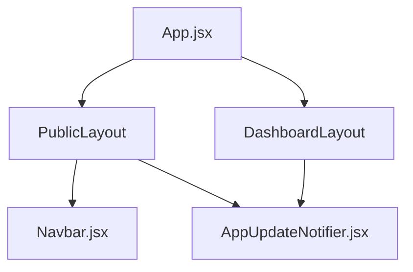
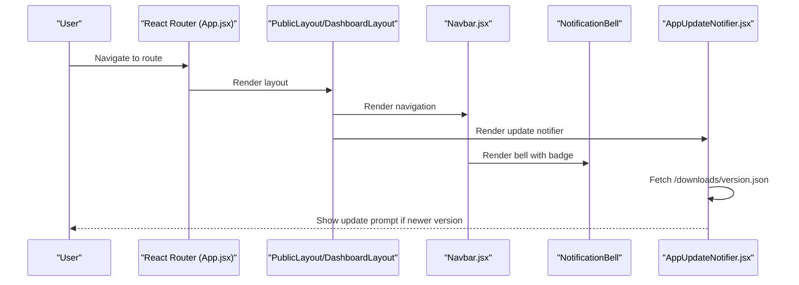
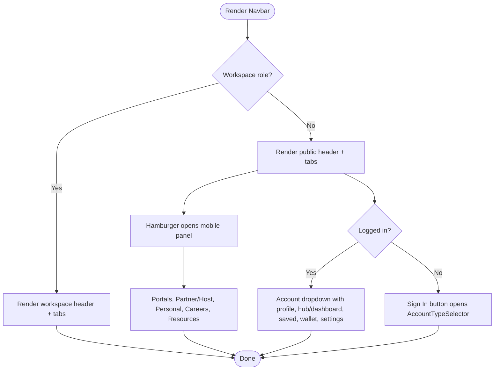
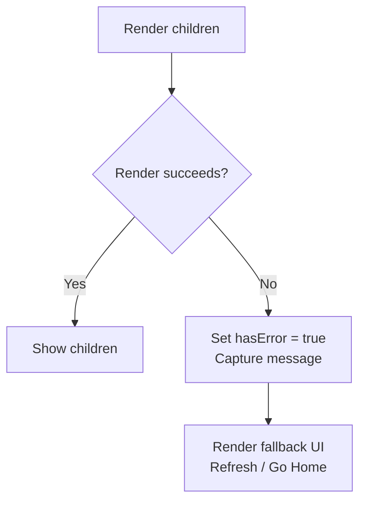
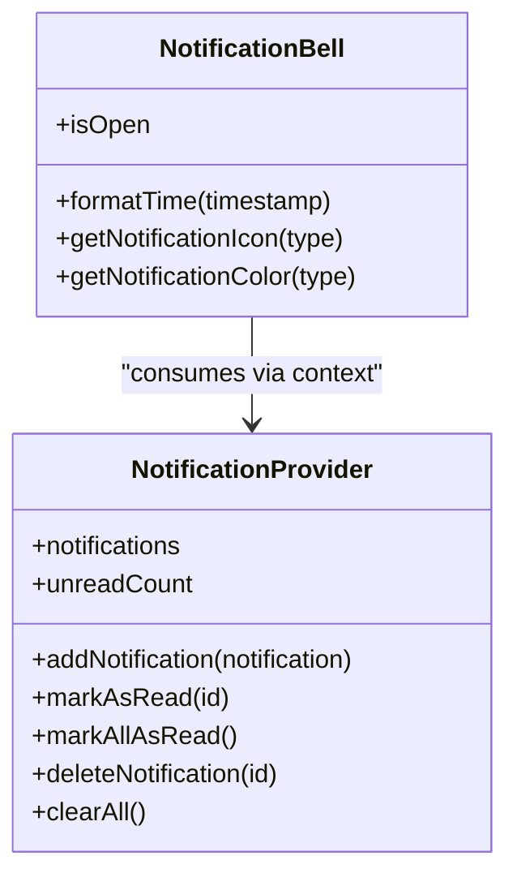
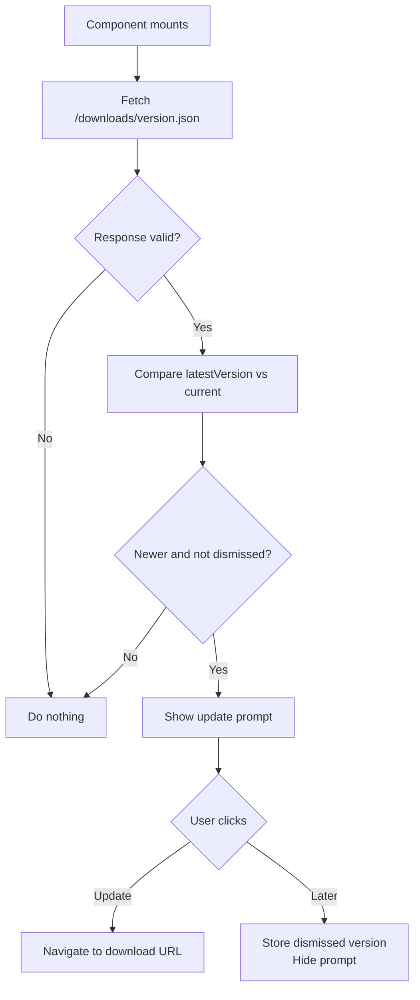
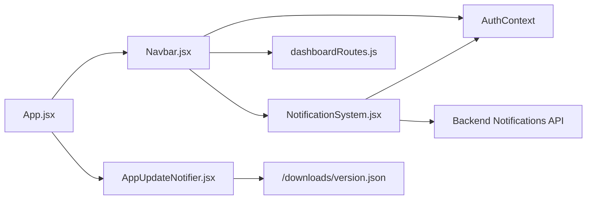

# UI Components

<cite>
**Referenced Files in This Document**
- [Navbar.jsx](file://src/components/Navbar.jsx)
- [ErrorBoundary.jsx](file://src/components/ErrorBoundary.jsx)
- [NotificationSystem.jsx](file://src/components/NotificationSystem.jsx)
- [AppUpdateNotifier.jsx](file://src/components/AppUpdateNotifier.jsx)
- [AppUpdateNotifier.css](file://src/components/AppUpdateNotifier.css)
- [App.jsx](file://src/App.jsx)
</cite>

## Table of Contents
1. [Introduction](#introduction)
2. [Project Structure](#project-structure)
3. [Core Components](#core-components)
4. [Architecture Overview](#architecture-overview)
5. [Detailed Component Analysis](#detailed-component-analysis)
6. [Dependency Analysis](#dependency-analysis)
7. [Performance Considerations](#performance-considerations)
8. [Troubleshooting Guide](#troubleshooting-guide)
9. [Conclusion](#conclusion)

## Introduction
This document provides detailed documentation for the core UI components that power navigation, error handling, notifications, and application update prompts:
- Navbar: Navigation structure, menu items, responsive behavior, and role-aware layouts.
- ErrorBoundary: Error handling patterns and fallback UI.
- NotificationSystem: Notification types, positioning, persistence, and user interactions.
- AppUpdateNotifier: Update detection logic, user prompts, dismissal, and styling.

The goal is to help developers understand how these components work individually and together within the application’s routing and layout system.

## Project Structure
These components live under src/components and are integrated into the app via src/App.jsx. Public routes render the Navbar and AppUpdateNotifier; dashboard routes render a simplified workspace navbar and also include AppUpdateNotifier.

**Diagram sources**
- [App.jsx:88-109](file://src/App.jsx#L88-L109)
- [Navbar.jsx:530-567](file://src/components/Navbar.jsx#L530-L567)
- [AppUpdateNotifier.jsx:1-76](file://src/components/AppUpdateNotifier.jsx#L1-L76)

**Section sources**
- [App.jsx:88-109](file://src/App.jsx#L88-L109)

## Core Components
- Navbar: Provides top-level navigation with primary tabs, account menus, mobile hamburger panel, and role-specific workspace navigation.
- ErrorBoundary: Catches rendering errors and shows a styled fallback page with refresh and home actions.
- NotificationSystem: Provides a context-driven notification bell, dropdown, and API/local storage-backed state management.
- AppUpdateNotifier: Checks a version manifest and prompts users to update the mobile app when a newer version is available.

**Section sources**
- [Navbar.jsx:11-36](file://src/components/Navbar.jsx#L11-L36)
- [ErrorBoundary.jsx:1-78](file://src/components/ErrorBoundary.jsx#L1-L78)
- [NotificationSystem.jsx:1-159](file://src/components/NotificationSystem.jsx#L1-L159)
- [AppUpdateNotifier.jsx:1-76](file://src/components/AppUpdateNotifier.jsx#L1-L76)

## Architecture Overview
The application uses React Router to compose layouts around pages. Public pages wrap content with Navbar and AppUpdateNotifier. Workspace/dashboard pages use a simplified workspace navbar and still include AppUpdateNotifier. Notifications are provided through a context provider and consumed by the bell component used inside the Navbar.

**Diagram sources**
- [App.jsx:88-109](file://src/App.jsx#L88-L109)
- [Navbar.jsx:530-567](file://src/components/Navbar.jsx#L530-L567)
- [NotificationSystem.jsx:161-291](file://src/components/NotificationSystem.jsx#L161-L291)
- [AppUpdateNotifier.jsx:10-26](file://src/components/AppUpdateNotifier.jsx#L10-L26)

## Detailed Component Analysis

### Navbar
Responsibilities:
- Renders primary tab links and a “Requests” action button.
- Provides an account dropdown for logged-in users or sign-in/register entry points for guests.
- Opens a full-screen mobile navigation panel with portal cards, partner/host portals, personal activity links, careers accordion, and resources.
- Switches to a workspace navbar for specific roles using utility helpers.

Navigation structure:
- Primary tabs: Home, AxxBiashara, QuickSales, Rentals, Accommodation, Download App.
- Menu sections: Explore Portals, Partner & Host Portals, My Activity & Account (when logged in), Careers & Tech Services, App & Resources.
- Role-aware workspace navbar: Shows workspace brand, profile avatar, username, logout, and workspace tabs derived from role.

Responsive behavior:
- Desktop: Top bar with brand, account controls, and primary tabs.
- Mobile: Hamburger button opens a slide-out panel with backdrop and scrollable content. Body scroll is disabled while panels are open. Dropdowns close on route change and outside clicks.

Key props and integration:
- No explicit props; reads authentication state from AuthContext and uses routing utilities for dynamic paths.
- Integrates with RequestItemModal and AccountTypeSelector for user flows.

Styling customization:
- Uses CSS variables scoped to .ax-nav for colors and fonts.
- Includes extensive inline styles for accessibility and focus states.
- The mobile panel includes structured classes for cards, rows, badges, and icons.

Usage example:
- Included automatically in PublicLayout and DashboardLayout via App.jsx.

**Diagram sources**
- [Navbar.jsx:530-567](file://src/components/Navbar.jsx#L530-L567)
- [Navbar.jsx:569-698](file://src/components/Navbar.jsx#L569-L698)
- [Navbar.jsx:140-521](file://src/components/Navbar.jsx#L140-L521)

**Section sources**
- [Navbar.jsx:11-36](file://src/components/Navbar.jsx#L11-L36)
- [Navbar.jsx:59-132](file://src/components/Navbar.jsx#L59-L132)
- [Navbar.jsx:530-698](file://src/components/Navbar.jsx#L530-L698)

### ErrorBoundary
Responsibilities:
- Catches synchronous rendering errors in its child tree.
- Displays a styled fallback UI with message, Refresh, and Go Home buttons.
- Logs errors to the console for debugging.

Error handling pattern:
- Uses React class lifecycle methods: getDerivedStateFromError to set error state and componentDidCatch to log details.
- Fallback UI is centered, themed, and accessible with clear actions.

Props interface:
- children: Any React node(s) to protect with error boundary.

Styling customization:
- Inline styles define background, typography, spacing, and button styles.
- Can be extended by wrapping in a theme provider or replacing with custom JSX.

Usage example:
- Wrap critical route trees or feature modules to prevent crashes from propagating.

**Diagram sources**
- [ErrorBoundary.jsx:3-15](file://src/components/ErrorBoundary.jsx#L3-L15)
- [ErrorBoundary.jsx:17-77](file://src/components/ErrorBoundary.jsx#L17-L77)

**Section sources**
- [ErrorBoundary.jsx:1-78](file://src/components/ErrorBoundary.jsx#L1-L78)

### NotificationSystem
Responsibilities:
- Provides a global notification state via context (provider and hook).
- Persists notifications to local storage and optionally syncs with a backend API when authenticated.
- Renders a bell icon with unread badge and a dropdown list of notifications.

Data model:
- Each notification includes id, read flag, timestamp, title, message, and type.
- Unread count is computed from the current list.

API and persistence:
- When token exists, loads notifications from server and marks read/clear operations against API endpoints.
- Falls back to localStorage for offline or unauthenticated scenarios.

User interaction patterns:
- Clicking a notification marks it as read.
- Header actions allow marking all as read or clearing all.
- Individual delete removes a notification.

Positioning:
- Bell button is positioned absolutely relative to its container.
- Dropdown appears below and aligned to the right edge of the bell.

Types and visuals:
- Supports types: message, booking, payment, review, property.
- Colors vary per type; icons can be customized via helper functions.

Integration:
- Used inside Navbar as NotificationBell.
- Provider should wrap the app or relevant subtree to enable useNotifications elsewhere.

**Diagram sources**
- [NotificationSystem.jsx:19-157](file://src/components/NotificationSystem.jsx#L19-L157)
- [NotificationSystem.jsx:161-291](file://src/components/NotificationSystem.jsx#L161-L291)

**Section sources**
- [NotificationSystem.jsx:1-159](file://src/components/NotificationSystem.jsx#L1-L159)
- [NotificationSystem.jsx:161-472](file://src/components/NotificationSystem.jsx#L161-L472)

### AppUpdateNotifier
Responsibilities:
- Fetches a version manifest from /downloads/version.json.
- Compares latestVersion with CURRENT_APP_VERSION.
- Shows a compact, fixed-positioned prompt with Update and Later actions.
- Dismisses and remembers the dismissed version in localStorage.

Update detection flow:
- On mount, fetches the manifest with cache-busting.
- If latestVersion is newer than current and not dismissed, sets visibility and update info.
- Update button navigates to downloadUrl or a default APK path.
- Later button stores the dismissed version and hides the prompt.

Positioning and styling:
- Fixed at bottom-left with high z-index to avoid overlay conflicts.
- Compact card with gradient accent, subtle animation, and responsive width constraints.

Usage example:
- Placed in PublicLayout and DashboardLayout so it appears across the app.

**Diagram sources**
- [AppUpdateNotifier.jsx:10-53](file://src/components/AppUpdateNotifier.jsx#L10-L53)
- [AppUpdateNotifier.css:1-112](file://src/components/AppUpdateNotifier.css#L1-L112)

**Section sources**
- [AppUpdateNotifier.jsx:1-76](file://src/components/AppUpdateNotifier.jsx#L1-L76)
- [AppUpdateNotifier.css:1-112](file://src/components/AppUpdateNotifier.css#L1-L112)

## Dependency Analysis
- Navbar depends on:
  - AuthContext for authentication state.
  - Routing utilities for dynamic dashboard paths and workspace branding.
  - ProfileAvatar for displaying user avatars.
  - NotificationBell for the notification bell.
  - AccountTypeSelector and RequestItemModal for user flows.
- NotificationSystem depends on:
  - AuthContext for token presence.
  - Backend API for loading and mutating notifications.
  - LocalStorage for persistence when offline or unauthenticated.
- AppUpdateNotifier depends on:
  - Static file /downloads/version.json served by the build/deployment pipeline.
  - LocalStorage for dismissing updates.
- App.jsx composes layouts and includes Navbar and AppUpdateNotifier consistently.

**Diagram sources**
- [App.jsx:88-109](file://src/App.jsx#L88-L109)
- [Navbar.jsx:1-10](file://src/components/Navbar.jsx#L1-L10)
- [NotificationSystem.jsx:1-5](file://src/components/NotificationSystem.jsx#L1-L5)
- [AppUpdateNotifier.jsx:1-11](file://src/components/AppUpdateNotifier.jsx#L1-L11)

**Section sources**
- [App.jsx:88-109](file://src/App.jsx#L88-L109)
- [Navbar.jsx:1-10](file://src/components/Navbar.jsx#L1-L10)
- [NotificationSystem.jsx:1-5](file://src/components/NotificationSystem.jsx#L1-L5)
- [AppUpdateNotifier.jsx:1-11](file://src/components/AppUpdateNotifier.jsx#L1-L11)

## Performance Considerations
- Navbar:
  - Avoid re-rendering large mobile panels by keeping state minimal and closing panels on route changes.
  - Use memoization for expensive computations like active path checks if the menu grows significantly.
- NotificationSystem:
  - Debounce mark-as-read and delete operations if many notifications exist.
  - Consider pagination for server-side notifications beyond the current limit.
- AppUpdateNotifier:
  - Cache the version manifest response to avoid repeated network calls.
  - Throttle dismiss actions to prevent unnecessary writes to localStorage.

[No sources needed since this section provides general guidance]

## Troubleshooting Guide
- Navbar:
  - If the mobile panel does not close, verify event listeners for outside clicks and route change cleanup.
  - Ensure body scroll lock is reset when panels close.
- ErrorBoundary:
  - If the fallback UI does not appear, confirm the component wraps the failing subtree and that errors are thrown during render.
  - Check console logs for error details captured by componentDidCatch.
- NotificationSystem:
  - If notifications do not load, verify API_BASE and Authorization headers.
  - For local storage issues, check browser storage permissions and JSON parsing errors.
- AppUpdateNotifier:
  - If the prompt never appears, ensure /downloads/version.json is reachable and contains latestVersion.
  - If the prompt persists after dismissal, verify localStorage key and value.

**Section sources**
- [Navbar.jsx:110-132](file://src/components/Navbar.jsx#L110-L132)
- [ErrorBoundary.jsx:9-15](file://src/components/ErrorBoundary.jsx#L9-L15)
- [NotificationSystem.jsx:25-55](file://src/components/NotificationSystem.jsx#L25-L55)
- [AppUpdateNotifier.jsx:10-26](file://src/components/AppUpdateNotifier.jsx#L10-L26)

## Conclusion
These four components form essential building blocks for navigation, resilience, user feedback, and update management:
- Navbar adapts to roles and devices, offering rich navigation and quick access to key features.
- ErrorBoundary ensures graceful degradation when rendering fails.
- NotificationSystem centralizes notification state, persistence, and user interactions.
- AppUpdateNotifier keeps users informed about new app versions with a non-intrusive prompt.

Together, they provide a robust foundation for a modern, responsive, and maintainable frontend experience.