# Utility Components

<cite>
**Referenced Files in This Document**   
- [MapView.jsx](file://src/components/MapView.jsx)
- [MessagingSystem.jsx](file://src/components/MessagingSystem.jsx)
- [FloatingWhatsApp.jsx](file://src/components/FloatingWhatsApp.jsx)
- [ShareProperty.jsx](file://src/components/ShareProperty.jsx)
- [SocialMediaLinks.jsx](file://src/components/SocialMediaLinks.jsx)
- [VerificationBadges.jsx](file://src/components/VerificationBadges.jsx)
- [VerificationStatus.jsx](file://src/components/VerificationStatus.jsx)
- [AnalyticsDashboard.jsx](file://src/components/AnalyticsDashboard.jsx)
- [whatsapp.js](file://src/utils/whatsapp.js)
- [api.js](file://src/api/api.js)
</cite>

## Table of Contents
1. [Introduction](#introduction)
2. [Project Structure](#project-structure)
3. [Core Components](#core-components)
4. [Architecture Overview](#architecture-overview)
5. [Detailed Component Analysis](#detailed-component-analysis)
6. [Dependency Analysis](#dependency-analysis)
7. [Performance Considerations](#performance-considerations)
8. [Troubleshooting Guide](#troubleshooting-guide)
9. [Conclusion](#conclusion)

## Introduction
This document provides detailed technical and practical documentation for the utility components that power specialized features across the application:
- MapView: location services and map integration with Leaflet
- MessagingSystem: local, real-time-like messaging UI
- FloatingWhatsApp: customer support floating button
- ShareProperty: social sharing capabilities
- SocialMediaLinks: profile integration links
- VerificationBadges: trust indicators
- VerificationStatus: verification workflows and plans
- AnalyticsDashboard: data visualization dashboard

The goal is to explain integration patterns, third-party service connections, performance optimization techniques, and customization options for each component.

## Project Structure
These utilities live under src/components and are used by various pages and dashboards. Supporting utilities and API configuration are located under src/utils and src/api respectively.

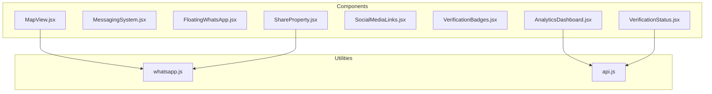

**Diagram sources**
- [MapView.jsx:17-27](file://src/components/MapView.jsx#L17-L27)
- [MessagingSystem.jsx:1-18](file://src/components/MessagingSystem.jsx#L1-L18)
- [FloatingWhatsApp.jsx:1-103](file://src/components/FloatingWhatsApp.jsx#L1-L103)
- [ShareProperty.jsx:1-139](file://src/components/ShareProperty.jsx#L1-L139)
- [SocialMediaLinks.jsx:1-109](file://src/components/SocialMediaLinks.jsx#L1-L109)
- [VerificationBadges.jsx:1-351](file://src/components/VerificationBadges.jsx#L1-L351)
- [VerificationStatus.jsx:1-791](file://src/components/VerificationStatus.jsx#L1-L791)
- [AnalyticsDashboard.jsx:1-606](file://src/components/AnalyticsDashboard.jsx#L1-L606)
- [whatsapp.js:1-15](file://src/utils/whatsapp.js#L1-L15)
- [api.js:1-47](file://src/api/api.js#L1-L47)

**Section sources**
- [MapView.jsx:1-378](file://src/components/MapView.jsx#L1-L378)
- [MessagingSystem.jsx:1-337](file://src/components/MessagingSystem.jsx#L1-L337)
- [FloatingWhatsApp.jsx:1-103](file://src/components/FloatingWhatsApp.jsx#L1-L103)
- [ShareProperty.jsx:1-139](file://src/components/ShareProperty.jsx#L1-L139)
- [SocialMediaLinks.jsx:1-109](file://src/components/SocialMediaLinks.jsx#L1-L109)
- [VerificationBadges.jsx:1-351](file://src/components/VerificationBadges.jsx#L1-L351)
- [VerificationStatus.jsx:1-791](file://src/components/VerificationStatus.jsx#L1-L791)
- [AnalyticsDashboard.jsx:1-606](file://src/components/AnalyticsDashboard.jsx#L1-L606)
- [whatsapp.js:1-15](file://src/utils/whatsapp.js#L1-L15)
- [api.js:1-47](file://src/api/api.js#L1-L47)

## Core Components
- MapView: Renders a Leaflet-based map with custom price markers, property list, and WhatsApp/call actions. It expects pre-filtered properties with coordinates.
- MessagingSystem: Provides a chat-like UI storing messages in localStorage per conversation; no server-side WebSocket integration currently.
- FloatingWhatsApp: Injects a fixed-position WhatsApp support button into the DOM.
- ShareProperty: Generates shareable content and supports WhatsApp, native share, and clipboard copy.
- SocialMediaLinks: Displays brand social media links with inline SVG icons and hover effects.
- VerificationBadges: Shows compact and detailed badge states for email, phone, ID, and business verifications.
- VerificationStatus: Fetches and displays KYC verification levels, statuses, and subscription pricing plans.
- AnalyticsDashboard: Visualizes analytics metrics, time range selection, and charts (line chart and conversion funnel).

**Section sources**
- [MapView.jsx:17-378](file://src/components/MapView.jsx#L17-L378)
- [MessagingSystem.jsx:1-337](file://src/components/MessagingSystem.jsx#L1-L337)
- [FloatingWhatsApp.jsx:1-103](file://src/components/FloatingWhatsApp.jsx#L1-L103)
- [ShareProperty.jsx:1-139](file://src/components/ShareProperty.jsx#L1-L139)
- [SocialMediaLinks.jsx:1-109](file://src/components/SocialMediaLinks.jsx#L1-L109)
- [VerificationBadges.jsx:1-351](file://src/components/VerificationBadges.jsx#L1-L351)
- [VerificationStatus.jsx:1-791](file://src/components/VerificationStatus.jsx#L1-L791)
- [AnalyticsDashboard.jsx:1-606](file://src/components/AnalyticsDashboard.jsx#L1-L606)

## Architecture Overview
The utility components follow consistent patterns:
- Props-driven configuration where applicable (e.g., MapView receives properties; SocialMediaLinks accepts style and iconSize).
- Local state management using React hooks for UI interactions.
- External integrations via environment variables or direct URL schemes (WhatsApp, Leaflet tiles).
- Centralized API client usage for authenticated requests (AnalyticsDashboard, VerificationStatus).

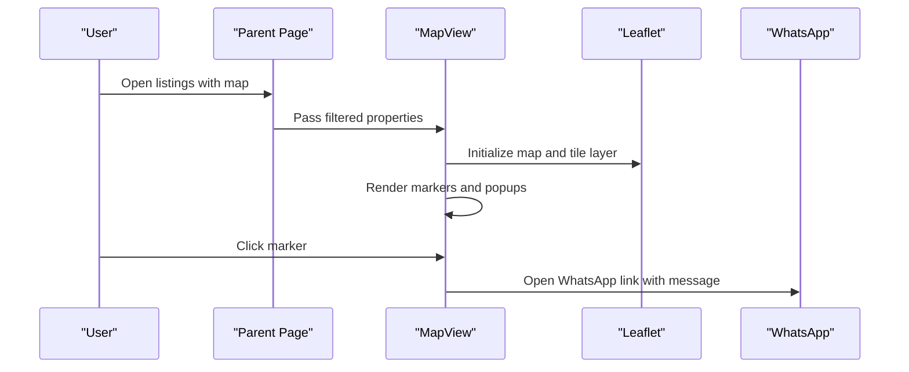

**Diagram sources**
- [MapView.jsx:84-107](file://src/components/MapView.jsx#L84-L107)
- [MapView.jsx:177-280](file://src/components/MapView.jsx#L177-L280)
- [whatsapp.js:1-15](file://src/utils/whatsapp.js#L1-L15)

## Detailed Component Analysis

### MapView
Purpose:
- Display properties on a Leaflet map with custom markers showing prices and availability.
- Provide quick contact actions (WhatsApp, call) from popup.

Key behaviors:
- Uses react-leaflet and leaflet; fixes Vite bundler issues for marker icons.
- Filters properties with lat/lng and shows unmapped count.
- Custom divIcon markers with dynamic colors based on featured/selected state.
- Pan-to behavior when selecting a pin.
- Popup includes property details, availability, rating, and action buttons.

Integration points:
- Expects properties with fields like _id, title, price, images, county, bedrooms, bathrooms, availableUnits, reviews, owner.phone, phone, lat, lng, leaseType, deposit.
- WhatsApp integration uses open URL scheme with formatted Kenyan phone numbers.

Customization options:
- Tile layer URL can be changed to another provider.
- Marker styling and popup layout can be adjusted within styles object.
- Default center and zoom level can be configured.

Performance considerations:
- Avoid re-rendering large lists by ensuring parent passes stable arrays.
- Use memoization for expensive computations if needed (e.g., averageRating).

Error handling:
- Gracefully handles missing coordinates and empty datasets.
- Fallback text guides landlords to add GPS coordinates.

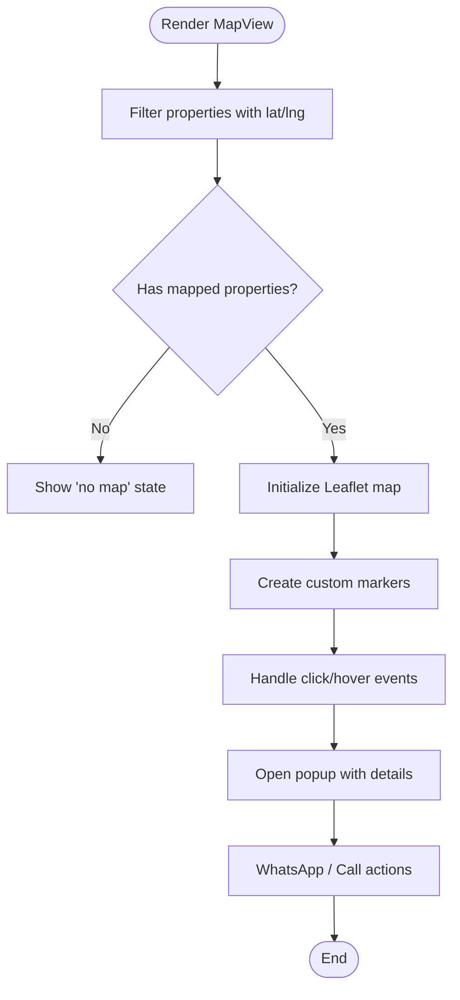

**Diagram sources**
- [MapView.jsx:84-107](file://src/components/MapView.jsx#L84-L107)
- [MapView.jsx:177-280](file://src/components/MapView.jsx#L177-L280)

**Section sources**
- [MapView.jsx:17-378](file://src/components/MapView.jsx#L17-L378)
- [whatsapp.js:1-15](file://src/utils/whatsapp.js#L1-L15)

### MessagingSystem
Purpose:
- Provide a chat-like interface for user-to-user communication with a recipient.

Key behaviors:
- Loads current user from localStorage.
- Stores messages per conversation key in localStorage.
- Formats timestamps relative to now.
- Supports optional property context display.

Integration points:
- No backend WebSocket integration currently; purely local storage.
- Can be extended to integrate with a real-time backend.

Customization options:
- Styling via internal styles object.
- Add rich text, attachments, or reactions by extending message structure.

Performance considerations:
- Keep message history size manageable; consider pagination or truncation.
- Debounce input handling if integrating with network calls later.

Error handling:
- Validates presence of newMessage and currentUser before sending.

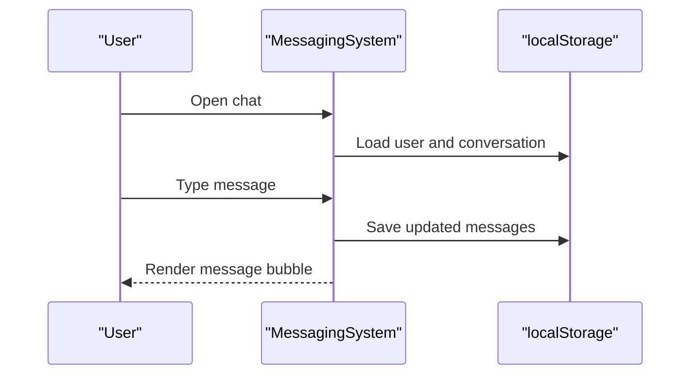

**Diagram sources**
- [MessagingSystem.jsx:11-32](file://src/components/MessagingSystem.jsx#L11-L32)
- [MessagingSystem.jsx:34-53](file://src/components/MessagingSystem.jsx#L34-L53)

**Section sources**
- [MessagingSystem.jsx:1-337](file://src/components/MessagingSystem.jsx#L1-L337)

### FloatingWhatsApp
Purpose:
- Inject a floating WhatsApp support button into the page.

Key behaviors:
- Dynamically creates DOM elements and injects CSS styles.
- Opens WhatsApp with a predefined phone number and message.
- Cleans up injected elements on unmount.

Integration points:
- Direct URL scheme to WhatsApp.

Customization options:
- Phone number and message can be made configurable via props or environment variables.
- Styles can be adjusted for positioning and appearance.

Performance considerations:
- Minimal DOM manipulation; ensure cleanup to avoid memory leaks.

Error handling:
- Removes existing root/style nodes to prevent duplicates.

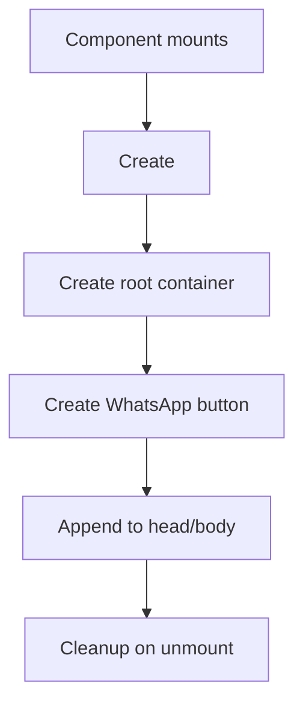

**Diagram sources**
- [FloatingWhatsApp.jsx:6-100](file://src/components/FloatingWhatsApp.jsx#L6-L100)

**Section sources**
- [FloatingWhatsApp.jsx:1-103](file://src/components/FloatingWhatsApp.jsx#L1-L103)

### ShareProperty
Purpose:
- Enable users to share a property via WhatsApp, native share, or copy link.

Key behaviors:
- Builds share URL with highlight parameter.
- Formats share text with property details.
- Uses navigator.clipboard with fallback for older browsers.
- Detects native share support.

Integration points:
- WhatsApp URL scheme.
- Native Web Share API.

Customization options:
- Customize share text template and URL parameters.
- Extend supported platforms.

Performance considerations:
- Clipboard operations are lightweight; handle errors gracefully.

Error handling:
- Fallback to execCommand("copy") when clipboard API is unavailable.

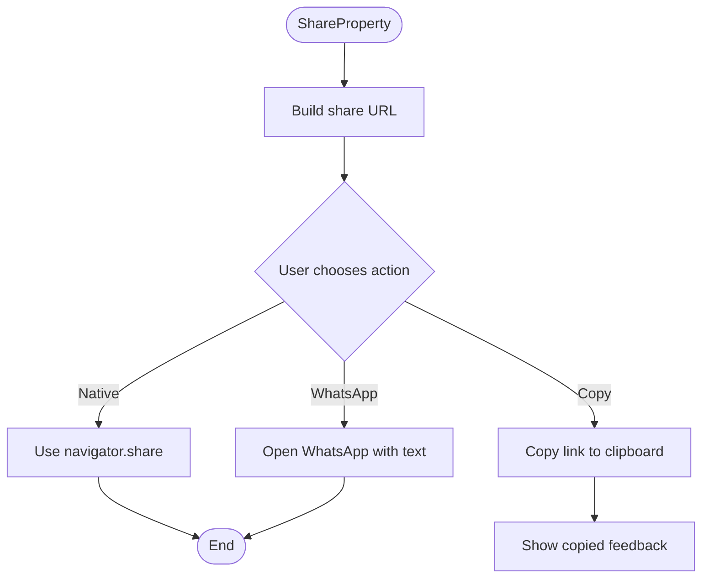

**Diagram sources**
- [ShareProperty.jsx:11-58](file://src/components/ShareProperty.jsx#L11-L58)

**Section sources**
- [ShareProperty.jsx:1-139](file://src/components/ShareProperty.jsx#L1-L139)

### SocialMediaLinks
Purpose:
- Display social media links with branded icons and hover effects.

Key behaviors:
- Defines platform URLs and inline SVG icons.
- Applies color-coded backgrounds and borders.
- Adds accessibility attributes and hover animations.

Integration points:
- External social media sites via href links.

Customization options:
- Adjust icon size and container style via props.
- Add/remove platforms by editing the socialLinks array.

Performance considerations:
- Lightweight rendering; minimal overhead.

Error handling:
- Relies on external site availability; no error handling required.

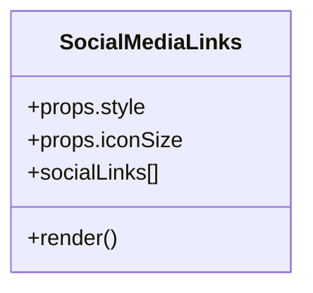

**Diagram sources**
- [SocialMediaLinks.jsx:5-109](file://src/components/SocialMediaLinks.jsx#L5-L109)

**Section sources**
- [SocialMediaLinks.jsx:1-109](file://src/components/SocialMediaLinks.jsx#L1-L109)

### VerificationBadges
Purpose:
- Show trust indicators for email, phone, ID, and business verification.

Key behaviors:
- Loads verification state from localStorage keyed by userId.
- Renders compact badges and detailed grid view.
- Shows progress bar and tips section.
- Exposes a reusable VerificationBadge component.

Integration points:
- LocalStorage for persistence.

Customization options:
- Badge labels, colors, and descriptions can be customized.
- Size variants for single badge component.

Performance considerations:
- Minimal DOM updates; state changes only on load.

Error handling:
- Parses stored JSON safely; resets to defaults on parse errors.

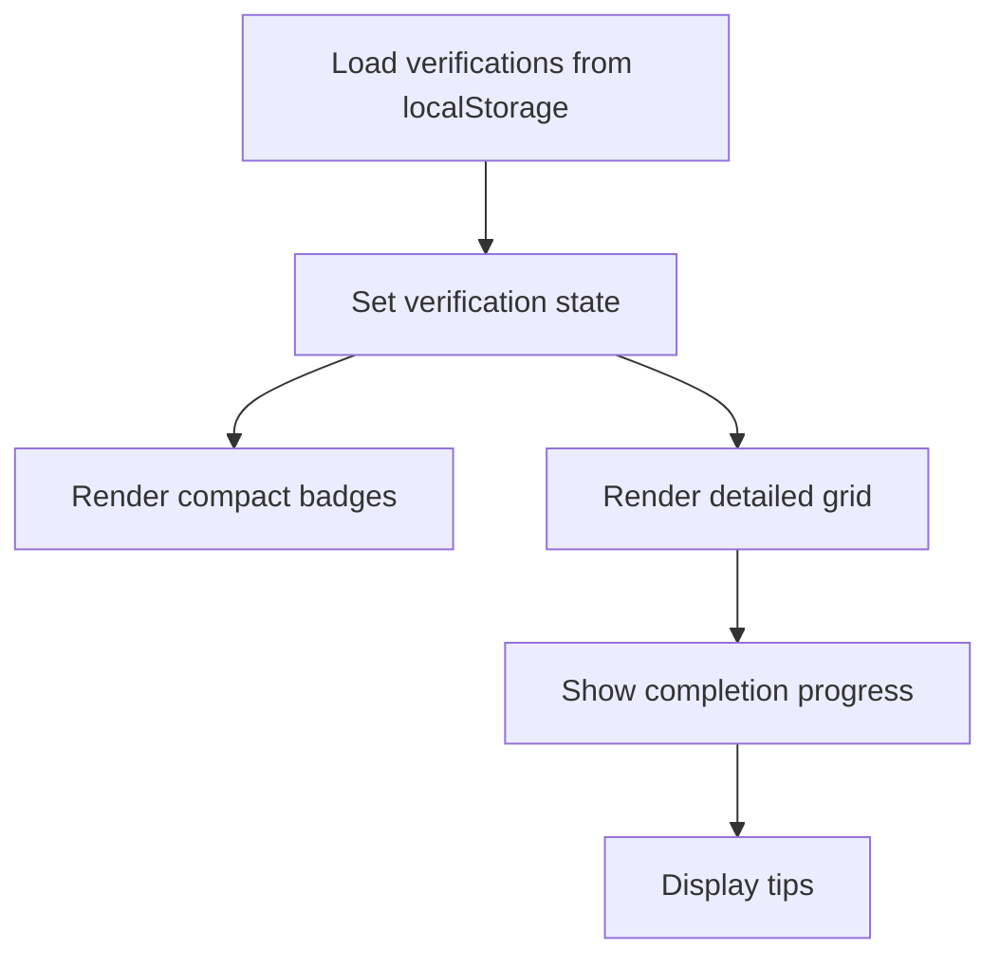

**Diagram sources**
- [VerificationBadges.jsx:11-27](file://src/components/VerificationBadges.jsx#L11-L27)
- [VerificationBadges.jsx:66-153](file://src/components/VerificationBadges.jsx#L66-L153)

**Section sources**
- [VerificationBadges.jsx:1-351](file://src/components/VerificationBadges.jsx#L1-L351)

### VerificationStatus
Purpose:
- Display KYC verification workflow, statuses, and subscription plans.

Key behaviors:
- Fetches verification status from backend using token from AuthContext.
- Renders levels with requirements, benefits, and status tags.
- Shows rejection reasons and resubmit links.
- Presents pricing plans with monthly/semiannual toggles.

Integration points:
- Backend API endpoint for verification status.
- Routing to checkout for plan subscriptions.

Customization options:
- Levels, requirements, benefits, and pricing can be extended.
- Billing cycle toggle supports additional periods.

Performance considerations:
- Single fetch on mount; avoid unnecessary re-renders.

Error handling:
- Handles loading state and logs errors.

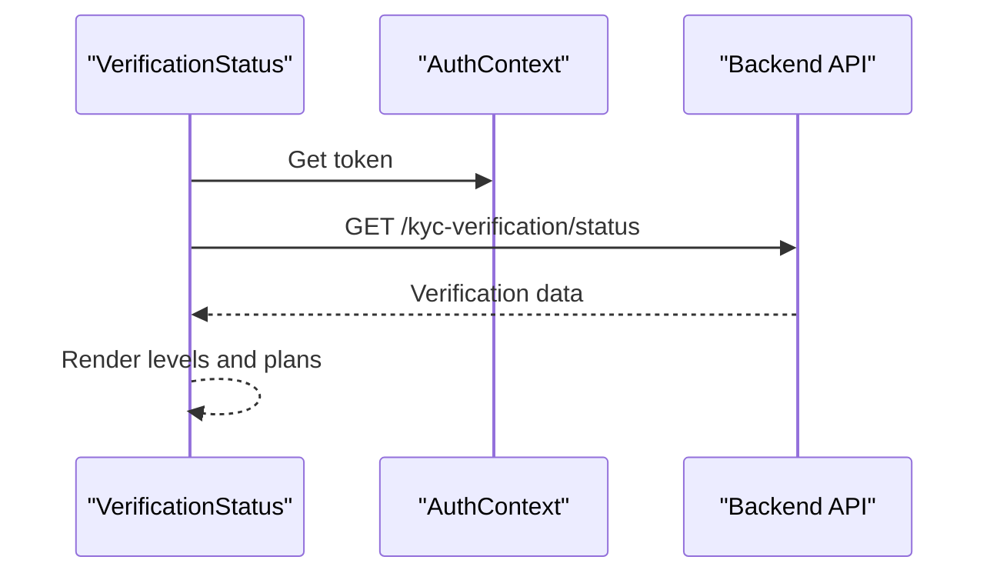

**Diagram sources**
- [VerificationStatus.jsx:11-35](file://src/components/VerificationStatus.jsx#L11-L35)
- [VerificationStatus.jsx:131-415](file://src/components/VerificationStatus.jsx#L131-L415)

**Section sources**
- [VerificationStatus.jsx:1-791](file://src/components/VerificationStatus.jsx#L1-L791)

### AnalyticsDashboard
Purpose:
- Visualize analytics metrics, time ranges, and charts.

Key behaviors:
- Fetches analytics summary via centralized API client.
- Falls back to baseline data on error.
- Renders metric cards, line chart, and conversion funnel.
- Supports time range selection (7d, 30d, 90d).

Integration points:
- Centralized API client for authenticated requests.

Customization options:
- Time range buttons and chart data generation can be extended.
- Metric cards can be tailored per user type.

Performance considerations:
- Memoize chart data generation if needed.
- Debounce time range changes to reduce API calls.

Error handling:
- Catches errors and sets baseline analytics.

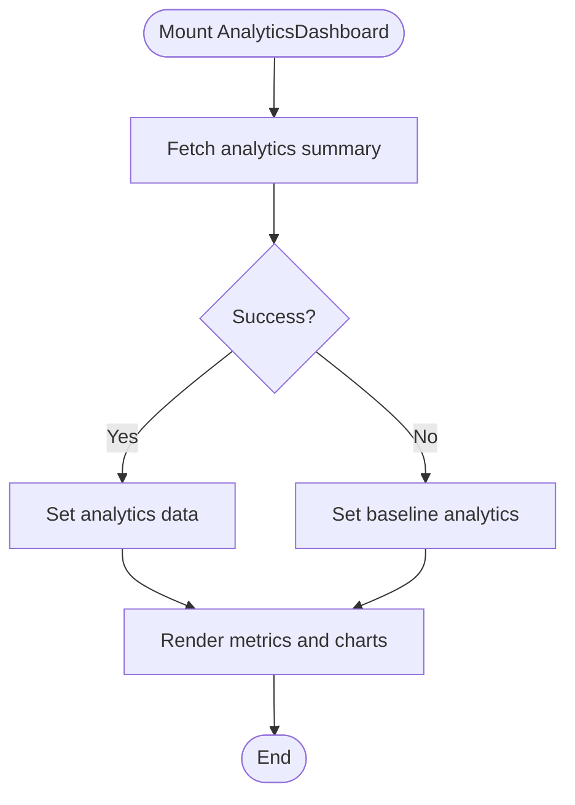

**Diagram sources**
- [AnalyticsDashboard.jsx:9-28](file://src/components/AnalyticsDashboard.jsx#L9-L28)
- [AnalyticsDashboard.jsx:30-65](file://src/components/AnalyticsDashboard.jsx#L30-L65)

**Section sources**
- [AnalyticsDashboard.jsx:1-606](file://src/components/AnalyticsDashboard.jsx#L1-L606)

## Dependency Analysis
- MapView depends on Leaflet and react-leaflet; requires CSS import for Leaflet assets.
- MessagingSystem relies on localStorage for persistence.
- FloatingWhatsApp manipulates DOM directly; no React state after mount.
- ShareProperty uses Web APIs (clipboard, navigator.share).
- SocialMediaLinks is self-contained with inline SVGs.
- VerificationBadges uses localStorage for state.
- VerificationStatus integrates with backend API and routing.
- AnalyticsDashboard uses centralized API client.

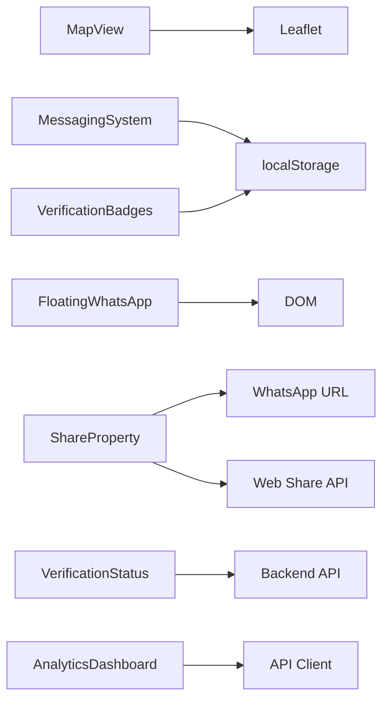

**Diagram sources**
- [MapView.jsx:17-27](file://src/components/MapView.jsx#L17-L27)
- [MessagingSystem.jsx:11-32](file://src/components/MessagingSystem.jsx#L11-L32)
- [FloatingWhatsApp.jsx:6-100](file://src/components/FloatingWhatsApp.jsx#L6-L100)
- [ShareProperty.jsx:30-58](file://src/components/ShareProperty.jsx#L30-L58)
- [VerificationBadges.jsx:11-27](file://src/components/VerificationBadges.jsx#L11-L27)
- [VerificationStatus.jsx:11-35](file://src/components/VerificationStatus.jsx#L11-L35)
- [AnalyticsDashboard.jsx:9-28](file://src/components/AnalyticsDashboard.jsx#L9-L28)
- [api.js:1-47](file://src/api/api.js#L1-L47)

**Section sources**
- [MapView.jsx:17-378](file://src/components/MapView.jsx#L17-L378)
- [MessagingSystem.jsx:1-337](file://src/components/MessagingSystem.jsx#L1-L337)
- [FloatingWhatsApp.jsx:1-103](file://src/components/FloatingWhatsApp.jsx#L1-L103)
- [ShareProperty.jsx:1-139](file://src/components/ShareProperty.jsx#L1-L139)
- [SocialMediaLinks.jsx:1-109](file://src/components/SocialMediaLinks.jsx#L1-L109)
- [VerificationBadges.jsx:1-351](file://src/components/VerificationBadges.jsx#L1-L351)
- [VerificationStatus.jsx:1-791](file://src/components/VerificationStatus.jsx#L1-L791)
- [AnalyticsDashboard.jsx:1-606](file://src/components/AnalyticsDashboard.jsx#L1-L606)
- [api.js:1-47](file://src/api/api.js#L1-L47)

## Performance Considerations
- MapView:
  - Ensure properties array is stable and memoized at the parent level.
  - Consider virtualizing the property list if it grows large.
  - Lazy-load Leaflet assets if not already bundled.
- MessagingSystem:
  - Limit stored message history size; implement pagination or trimming.
  - Debounce input handlers if adding network calls later.
- FloatingWhatsApp:
  - Minimize DOM mutations; reuse created elements if possible.
- ShareProperty:
  - Use modern APIs with graceful fallbacks; avoid heavy string operations.
- SocialMediaLinks:
  - Inline SVGs are efficient; keep icon set minimal.
- VerificationBadges:
  - Store only necessary fields in localStorage; avoid large payloads.
- VerificationStatus:
  - Cache verification data to reduce repeated API calls.
  - Debounce billing cycle toggles if they trigger network requests.
- AnalyticsDashboard:
  - Memoize chart data generation functions.
  - Debounce time range changes to limit API calls.

[No sources needed since this section provides general guidance]

## Troubleshooting Guide
- MapView:
  - If markers do not appear, verify Leaflet CSS import and asset URLs.
  - Check that properties include lat/lng; otherwise, the map shows an empty state.
- MessagingSystem:
  - Messages persist per conversation key; clear localStorage if testing different recipients.
  - Ensure currentUser exists in localStorage for message sender info.
- FloatingWhatsApp:
  - Verify phone number format and message encoding.
  - Check for duplicate DOM nodes; cleanup should remove previous instances.
- ShareProperty:
  - Clipboard API may fail in insecure contexts; fallback is implemented but test thoroughly.
  - Native share may not be supported on all browsers; fallback to copy link.
- SocialMediaLinks:
  - Links open externally; ensure target="_blank" and rel="noopener noreferrer" are present.
- VerificationBadges:
  - localStorage parsing errors reset to default state; inspect stored JSON.
- VerificationStatus:
  - Authentication token must be valid; check Authorization header in API client.
  - Handle backend errors gracefully; review console logs for response errors.
- AnalyticsDashboard:
  - API client adds Authorization header automatically; ensure token is present.
  - On API failure, baseline data is used; verify backend endpoints.

**Section sources**
- [MapView.jsx:17-378](file://src/components/MapView.jsx#L17-L378)
- [MessagingSystem.jsx:1-337](file://src/components/MessagingSystem.jsx#L1-L337)
- [FloatingWhatsApp.jsx:1-103](file://src/components/FloatingWhatsApp.jsx#L1-L103)
- [ShareProperty.jsx:1-139](file://src/components/ShareProperty.jsx#L1-L139)
- [SocialMediaLinks.jsx:1-109](file://src/components/SocialMediaLinks.jsx#L1-L109)
- [VerificationBadges.jsx:1-351](file://src/components/VerificationBadges.jsx#L1-L351)
- [VerificationStatus.jsx:1-791](file://src/components/VerificationStatus.jsx#L1-L791)
- [AnalyticsDashboard.jsx:1-606](file://src/components/AnalyticsDashboard.jsx#L1-L606)
- [api.js:1-47](file://src/api/api.js#L1-L47)

## Conclusion
These utility components provide essential functionality across the application with clear integration patterns:
- MapView offers robust map integration and contact actions.
- MessagingSystem delivers a simple, persistent chat UI.
- FloatingWhatsApp streamlines customer support access.
- ShareProperty enables multi-platform sharing.
- SocialMediaLinks centralizes brand presence.
- VerificationBadges and VerificationStatus build trust through verification workflows and plans.
- AnalyticsDashboard visualizes key metrics and trends.

Adopt the recommended performance optimizations and customization options to tailor these components to your needs while maintaining reliability and usability.

[No sources needed since this section summarizes without analyzing specific files]