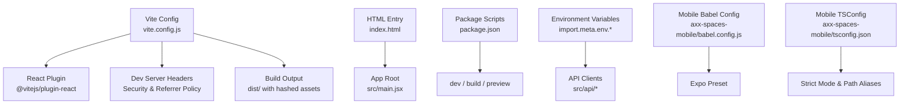
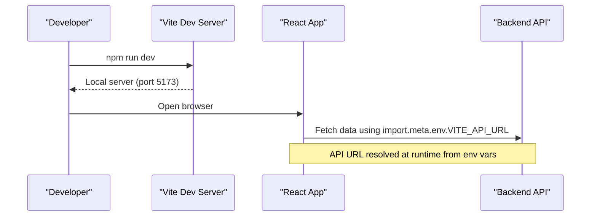
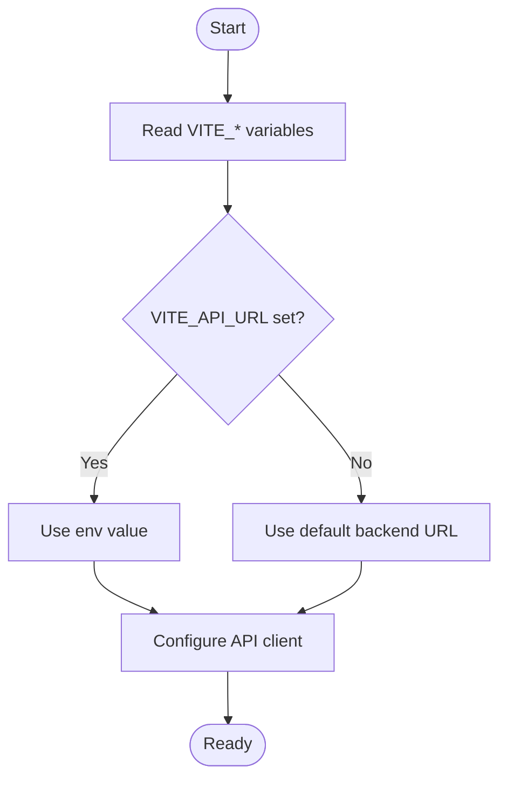
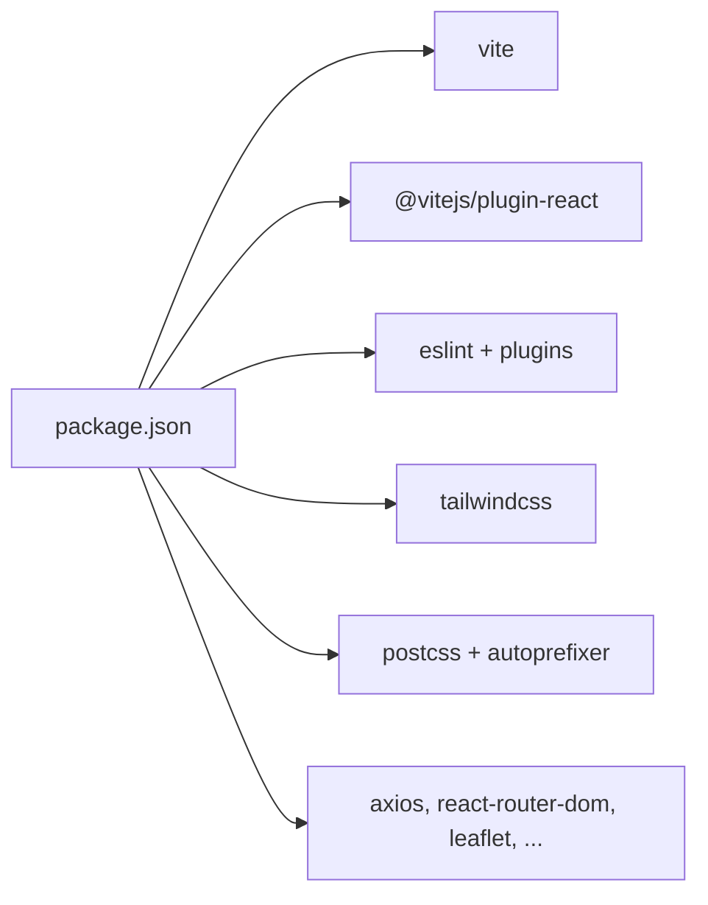

# Build Configuration

<cite>
**Referenced Files in This Document**
- [vite.config.js](file://vite.config.js)
- [package.json](file://package.json)
- [index.html](file://index.html)
- [api.js](file://src/api/api.js)
- [useDevToolsProtection.js](file://src/hooks/useDevToolsProtection.js)
- [useGoogleSignIn.js](file://src/hooks/useGoogleSignIn.js)
- [babel.config.js](file://axx-spaces-mobile/babel.config.js)
- [tsconfig.json](file://axx-spaces-mobile/tsconfig.json)
</cite>

## Table of Contents
1. [Introduction](#introduction)
2. [Project Structure](#project-structure)
3. [Core Components](#core-components)
4. [Architecture Overview](#architecture-overview)
5. [Detailed Component Analysis](#detailed-component-analysis)
6. [Dependency Analysis](#dependency-analysis)
7. [Performance Considerations](#performance-considerations)
8. [Troubleshooting Guide](#troubleshooting-guide)
9. [Conclusion](#conclusion)

## Introduction
This document explains the build configuration for the AxxSpaces frontend, focusing on Vite setup, security headers, plugin configuration, optimization settings, environment variables, and how to extend or customize the build. It also documents Babel usage for the mobile subproject and TypeScript configuration used by the mobile app. The goal is to help you confidently develop, build, and optimize the application across environments.

## Project Structure
The frontend is a Vite + React project with:
- Vite configuration defining plugins, dev server headers, build output, and global constants.
- Package scripts for development, building, linting, and previewing.
- An HTML entrypoint that includes security meta tags and analytics scripts.
- Environment variables accessed via Vite’s import.meta.env.
- Mobile subproject using Babel (Expo preset) and TypeScript.

**Diagram sources**
- [vite.config.js:1-36](file://vite.config.js#L1-L36)
- [package.json:6-10](file://package.json#L6-L10)
- [index.html:1-147](file://index.html#L1-L147)
- [api.js:1-10](file://src/api/api.js#L1-L10)
- [babel.config.js:1-10](file://axx-spaces-mobile/babel.config.js#L1-L10)
- [tsconfig.json:1-21](file://axx-spaces-mobile/tsconfig.json#L1-L21)

**Section sources**
- [vite.config.js:1-36](file://vite.config.js#L1-L36)
- [package.json:1-50](file://package.json#L1-L50)
- [index.html:1-147](file://index.html#L1-L147)

## Core Components
- Vite configuration:
  - Plugins: React support via @vitejs/plugin-react.
  - Dev server: port, auto-open, and security headers.
  - Build: output directory, sourcemaps disabled in production, hashed asset filenames.
  - Global constants: define import.meta.env.VITE_APP_NAME at build time.
- Package scripts:
  - dev: start Vite dev server.
  - build: production build to dist/.
  - preview: serve the built output locally.
  - lint: run ESLint.
- HTML entrypoint:
  - Security meta tags (CSP, X-Content-Type-Options, Referrer-Policy).
  - Analytics and third-party scripts.
- Environment variables:
  - Vite exposes variables prefixed with VITE_ through import.meta.env.
  - Used for API base URLs, Google client ID, and feature toggles.

**Section sources**
- [vite.config.js:1-36](file://vite.config.js#L1-L36)
- [package.json:6-10](file://package.json#L6-L10)
- [index.html:18-56](file://index.html#L18-L56)
- [api.js:1-10](file://src/api/api.js#L1-L10)
- [useGoogleSignIn.js:1-10](file://src/hooks/useGoogleSignIn.js#L1-L10)

## Architecture Overview
The build pipeline transforms source code into optimized static assets served from dist/. During development, Vite provides a fast dev server with hot module replacement and security headers. Production builds generate deterministic, cache-friendly filenames and exclude source maps.

**Diagram sources**
- [vite.config.js:7-17](file://vite.config.js#L7-L17)
- [api.js:1-10](file://src/api/api.js#L1-L10)

## Detailed Component Analysis

### Vite Configuration
Key aspects:
- Plugins: React plugin enables JSX/TSX transformation and Fast Refresh.
- Dev server:
  - Port set to 5173 and opens the browser automatically.
  - Security headers include X-Content-Type-Options, X-Frame-Options, X-XSS-Protection, and Referrer-Policy.
- Build:
  - Output directory is dist/.
  - Sourcemaps are disabled in production to avoid leaking source code.
  - Rollup output uses hashed filenames for better caching.
- Define:
  - Defines import.meta.env.VITE_APP_NAME globally at build time.

Customization examples:
- Add new plugins: Extend the plugins array with additional Vite plugins (e.g., vite-plugin-pwa, vite-plugin-sitemap).
- Optimize bundle size:
  - Enable manual chunks via rollupOptions.output.manualChunks to split vendor libraries.
  - Use dynamic imports for heavy routes/components.
  - Analyze bundle with rollup-plugin-visualizer.
- Environment-specific configs:
  - Create vite.config.dev.js and vite.config.prod.js and merge them based on mode.
  - Use .env files (.env.development, .env.production) for VITE_* variables.

Security headers:
- The dev server sets several security-related headers. For production, configure your web server (Nginx/Apache/CDN) to mirror these headers.

**Section sources**
- [vite.config.js:1-36](file://vite.config.js#L1-L36)

### Babel Configuration (Mobile Subproject)
The mobile subproject uses Babel with the Expo preset and an additional plugin for Reanimated. This is separate from the web frontend’s Vite build.

- Presets: babel-preset-expo handles React Native transformations.
- Plugins: react-native-reanimated/plugin required for animations.

Use cases:
- If adding custom Babel plugins, ensure they are compatible with Expo and React Native.
- Keep Babel config minimal; prefer platform-specific tooling where possible.

**Section sources**
- [babel.config.js:1-10](file://axx-spaces-mobile/babel.config.js#L1-L10)

### TypeScript Configuration (Mobile Subproject)
The mobile app uses strict TypeScript settings and path aliases.

- Strict mode enabled for type safety.
- Path aliases configured for @/* and @/assets/*.
- Includes all .ts and .tsx files and generated types.

Use cases:
- Add new paths by extending the paths mapping.
- Integrate with IDEs for accurate autocompletion and navigation.

**Section sources**
- [tsconfig.json:1-21](file://axx-spaces-mobile/tsconfig.json#L1-L21)

### Environment Variables and Build-Time Constants
- Vite exposes variables prefixed with VITE_ via import.meta.env.
- Examples in the codebase:
  - API base URLs: import.meta.env.VITE_API_URL and VITE_API_BASE.
  - Google client ID: import.meta.env.VITE_GOOGLE_CLIENT_ID.
  - Development-only logic guarded by import.meta.env.DEV.
- Build-time constant:
  - import.meta.env.VITE_APP_NAME is defined in Vite config.

Best practices:
- Store secrets only in CI/CD or secure secret managers; do not commit sensitive values.
- Provide fallback defaults in code for non-sensitive variables.
- Validate required variables at startup in development.

**Diagram sources**
- [api.js:1-10](file://src/api/api.js#L1-L10)
- [useGoogleSignIn.js:1-10](file://src/hooks/useGoogleSignIn.js#L1-L10)
- [useDevToolsProtection.js:1-40](file://src/hooks/useDevToolsProtection.js#L1-L40)
- [vite.config.js:32-35](file://vite.config.js#L32-L35)

**Section sources**
- [api.js:1-10](file://src/api/api.js#L1-L10)
- [useGoogleSignIn.js:1-10](file://src/hooks/useGoogleSignIn.js#L1-L10)
- [useDevToolsProtection.js:1-40](file://src/hooks/useDevToolsProtection.js#L1-L40)
- [vite.config.js:32-35](file://vite.config.js#L32-L35)

### HTML Entrypoint and Security
- Content-Security-Policy defines allowed sources for scripts, styles, images, fonts, and connections.
- Additional security headers via meta tags: X-Content-Type-Options and Referrer-Policy.
- Third-party integrations: Google Analytics, Microsoft Clarity, Google Identity Services.

Recommendations:
- Tighten CSP by removing unsafe-inline and unsafe-eval where possible.
- Pin external script versions and use SRI when feasible.
- Ensure connect-src allows only necessary endpoints per environment.

**Section sources**
- [index.html:18-56](file://index.html#L18-L56)
- [index.html:111-112](file://index.html#L111-L112)
- [index.html:114-139](file://index.html#L114-L139)

## Dependency Analysis
The build depends on:
- Vite core and React plugin for development and production builds.
- ESLint and related plugins for linting.
- Tailwind CSS and PostCSS for styling.
- Runtime dependencies like axios, react-router-dom, leaflet, etc.

**Diagram sources**
- [package.json:12-48](file://package.json#L12-L48)

**Section sources**
- [package.json:1-50](file://package.json#L1-L50)

## Performance Considerations
- Disable sourcemaps in production to reduce bundle size and prevent source leakage.
- Use hashed filenames for long-term caching.
- Split large libraries into separate chunks to improve initial load time.
- Prefer dynamic imports for route-level code splitting.
- Analyze bundle composition to identify oversized dependencies.
- Minify and tree-shake unused code (enabled by default in Vite production builds).

[No sources needed since this section provides general guidance]

## Troubleshooting Guide
Common issues and resolutions:
- Missing environment variables:
  - Ensure .env files exist and contain VITE_* variables.
  - Verify variable names match those used in code (case-sensitive).
- API connectivity errors:
  - Confirm VITE_API_URL points to the correct backend endpoint per environment.
  - Check CORS policies on the backend and CSP connect-src in index.html.
- Third-party scripts blocked:
  - Review CSP directives in index.html to allow required domains.
  - Ensure analytics and identity services are whitelisted.
- Dev server headers not applied in production:
  - Configure your web server or CDN to set equivalent security headers.

**Section sources**
- [index.html:18-56](file://index.html#L18-L56)
- [api.js:1-10](file://src/api/api.js#L1-L10)
- [useGoogleSignIn.js:1-10](file://src/hooks/useGoogleSignIn.js#L1-L10)

## Conclusion
The AxxSpaces frontend leverages Vite for a fast development experience and efficient production builds. Security headers are enforced in development, and the HTML entrypoint enforces a robust CSP. Environment variables provide flexible configuration across environments. The mobile subproject uses Babel and TypeScript for native app compilation and type safety. By following the customization and optimization guidelines above, you can tailor the build process to meet performance and security requirements while maintaining clarity and maintainability.

[No sources needed since this section summarizes without analyzing specific files]