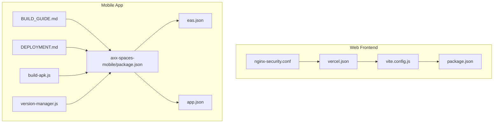
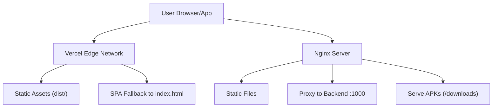
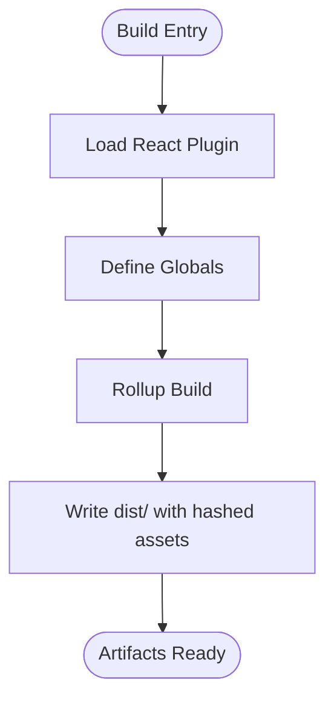
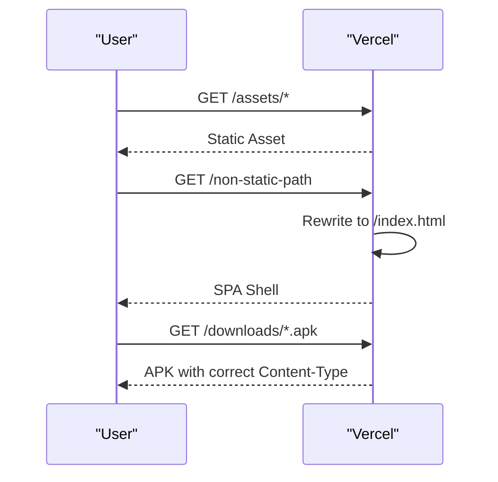
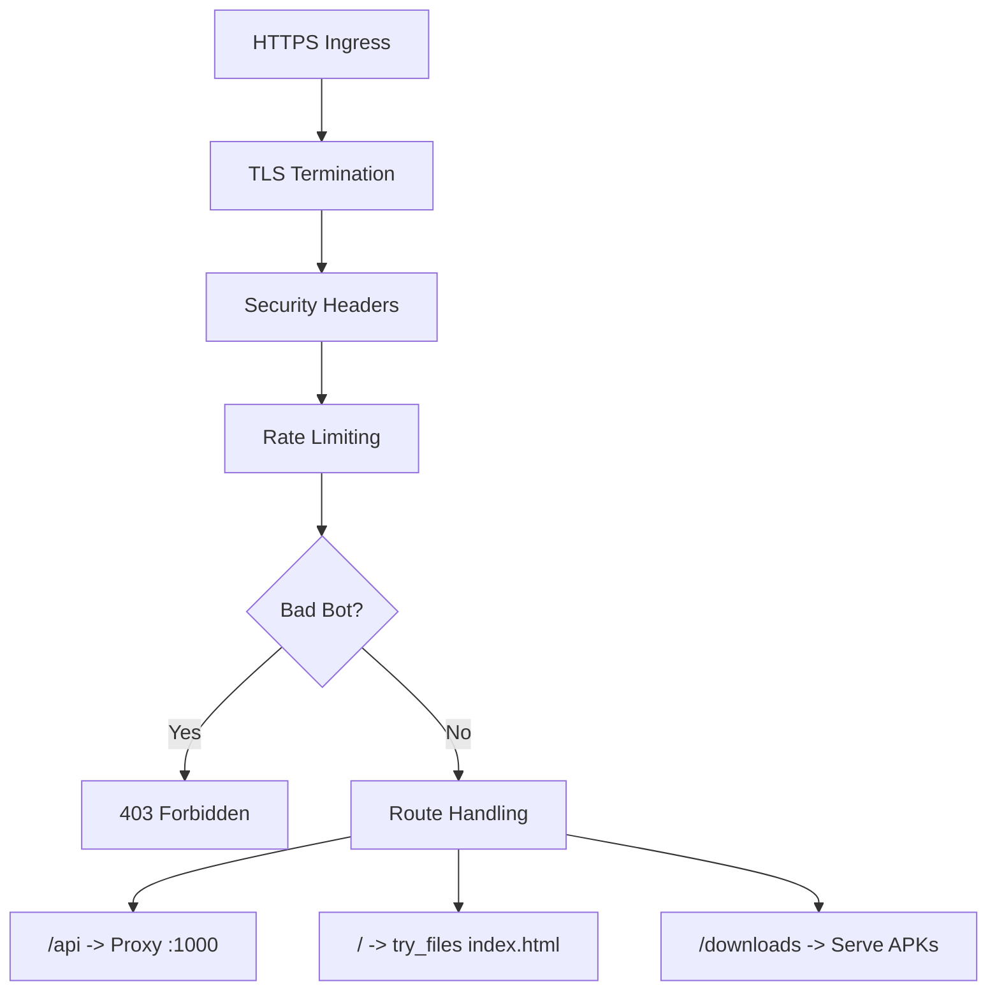
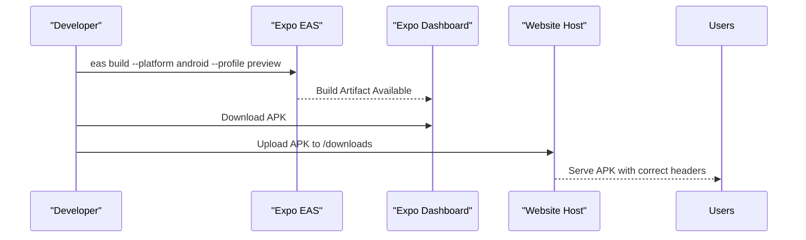
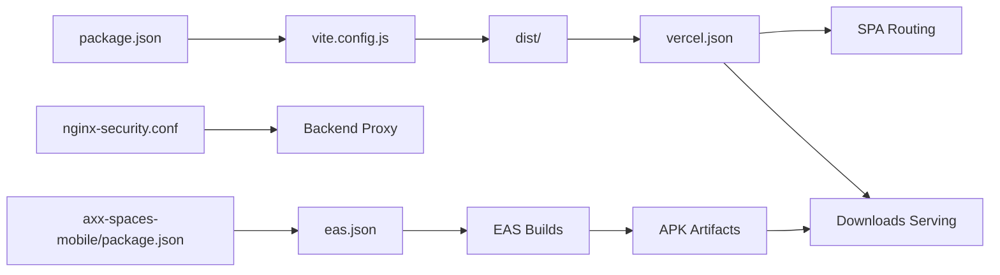

# Deployment & DevOps

<cite>
**Referenced Files in This Document**
- [package.json](file://package.json)
- [vite.config.js](file://vite.config.js)
- [vercel.json](file://vercel.json)
- [nginx-security.conf](file://nginx-security.conf)
- [setup-frontend.sh](file://setup-frontend.sh)
- [axx-spaces-mobile/package.json](file://axx-spaces-mobile/package.json)
- [axx-spaces-mobile/eas.json](file://axx-spaces-mobile/eas.json)
- [axx-spaces-mobile/app.json](file://axx-spaces-mobile/app.json)
- [axx-spaces-mobile/BUILD_GUIDE.md](file://axx-spaces-mobile/BUILD_GUIDE.md)
- [axx-spaces-mobile/DEPLOYMENT.md](file://axx-spaces-mobile/DEPLOYMENT.md)
- [axx-spaces-mobile/build-apk.js](file://axx-spaces-mobile/build-apk.js)
- [axx-spaces-mobile/version-manager.js](file://axx-spaces-mobile/version-manager.js)
</cite>

## Table of Contents
1. [Introduction](#introduction)
2. [Project Structure](#project-structure)
3. [Core Components](#core-components)
4. [Architecture Overview](#architecture-overview)
5. [Detailed Component Analysis](#detailed-component-analysis)
6. [Dependency Analysis](#dependency-analysis)
7. [Performance Considerations](#performance-considerations)
8. [Troubleshooting Guide](#troubleshooting-guide)
9. [Conclusion](#conclusion)
10. [Appendices](#appendices)

## Introduction
This document provides comprehensive deployment and DevOps guidance for the AXX Spaces project, covering:
- Web build configuration with Vite
- Deployment to Vercel and production server (Nginx)
- Mobile app distribution via Expo/EAS
- Environment management and security configurations
- CI/CD examples, monitoring setup, performance optimization, and troubleshooting

The goal is to enable reliable builds, secure deployments, and maintainable operations across web and mobile platforms.

## Project Structure
The repository contains:
- A Vite-based React frontend at the root
- An Expo-based mobile app under axx-spaces-mobile
- Configuration files for Vercel and Nginx
- Scripts and documentation for building and distributing the mobile APK

**Diagram sources**
- [vite.config.js:1-36](file://vite.config.js#L1-L36)
- [package.json:1-50](file://package.json#L1-L50)
- [vercel.json:1-48](file://vercel.json#L1-L48)
- [nginx-security.conf:1-74](file://nginx-security.conf#L1-L74)
- [axx-spaces-mobile/package.json:1-41](file://axx-spaces-mobile/package.json#L1-L41)
- [axx-spaces-mobile/eas.json:1-28](file://axx-spaces-mobile/eas.json#L1-L28)
- [axx-spaces-mobile/app.json:1-49](file://axx-spaces-mobile/app.json#L1-L49)
- [axx-spaces-mobile/BUILD_GUIDE.md:1-279](file://axx-spaces-mobile/BUILD_GUIDE.md#L1-L279)
- [axx-spaces-mobile/DEPLOYMENT.md:1-283](file://axx-spaces-mobile/DEPLOYMENT.md#L1-L283)
- [axx-spaces-mobile/build-apk.js:1-51](file://axx-spaces-mobile/build-apk.js#L1-L51)
- [axx-spaces-mobile/version-manager.js:1-116](file://axx-spaces-mobile/version-manager.js#L1-L116)

**Section sources**
- [package.json:1-50](file://package.json#L1-L50)
- [vite.config.js:1-36](file://vite.config.js#L1-L36)
- [vercel.json:1-48](file://vercel.json#L1-L48)
- [nginx-security.conf:1-74](file://nginx-security.conf#L1-L74)
- [axx-spaces-mobile/package.json:1-41](file://axx-spaces-mobile/package.json#L1-L41)
- [axx-spaces-mobile/eas.json:1-28](file://axx-spaces-mobile/eas.json#L1-L28)
- [axx-spaces-mobile/app.json:1-49](file://axx-spaces-mobile/app.json#L1-L49)

## Core Components
- Web Build System: Vite with React plugin, output directory, source maps disabled, hashed assets, dev headers, and global constants.
- Web Hosting: Vercel configuration for SPA routing and security headers; Nginx configuration for TLS, rate limiting, bot blocking, and proxying.
- Mobile Distribution: Expo/EAS profiles for development, preview, and production; app metadata and permissions; scripts for versioning and APK builds.

Key responsibilities:
- package.json defines scripts for dev, build, lint, and preview.
- vite.config.js configures build outputs and dev server behavior.
- vercel.json configures rewrites and security headers for SPA and downloads.
- nginx-security.conf enforces TLS, HSTS, CSP-like headers, rate limits, and proxy rules.
- eas.json defines build profiles for Android/iOS.
- app.json defines app identity, permissions, and platform-specific settings.
- build-apk.js automates EAS builds for preview APKs.
- version-manager.js synchronizes versions between package.json and app.json.

**Section sources**
- [package.json:6-11](file://package.json#L6-L11)
- [vite.config.js:4-35](file://vite.config.js#L4-L35)
- [vercel.json:1-48](file://vercel.json#L1-L48)
- [nginx-security.conf:1-74](file://nginx-security.conf#L1-L74)
- [axx-spaces-mobile/eas.json:1-28](file://axx-spaces-mobile/eas.json#L1-L28)
- [axx-spaces-mobile/app.json:1-49](file://axx-spaces-mobile/app.json#L1-L49)
- [axx-spaces-mobile/build-apk.js:1-51](file://axx-spaces-mobile/build-apk.js#L1-L51)
- [axx-spaces-mobile/version-manager.js:1-116](file://axx-spaces-mobile/version-manager.js#L1-L116)

## Architecture Overview
The deployment architecture includes:
- Vite builds a static site into dist/.
- Vercel serves the static assets and routes all non-static paths to index.html.
- Nginx can be used on a production server to serve the frontend and proxy API requests with strict security controls.
- The mobile app uses Expo/EAS to build and distribute APKs, which are served from /downloads on the web host.

**Diagram sources**
- [vercel.json:1-48](file://vercel.json#L1-L48)
- [nginx-security.conf:17-64](file://nginx-security.conf#L17-L64)

## Detailed Component Analysis

### Web Build Configuration (Vite)
- Output directory: dist
- Source maps disabled in production
- Hashed asset filenames for cache busting
- Development server headers for security
- Global constant injection for app name

Customization points:
- Add plugins (e.g., analytics, compression)
- Configure environment variables via import.meta.env.*
- Adjust chunking strategy or add code splitting
- Enable sourcemaps only for specific environments

**Diagram sources**
- [vite.config.js:4-35](file://vite.config.js#L4-L35)

**Section sources**
- [vite.config.js:4-35](file://vite.config.js#L4-L35)
- [package.json:6-11](file://package.json#L6-L11)

### Web Deployment to Vercel
- Rewrites route all non-static paths to index.html for SPA routing
- Downloads path preserved for APK distribution
- Security headers include CSP, X-Frame-Options, X-Content-Type-Options, Referrer-Policy
- Content-Type for APK downloads set to application/vnd.android.package-archive

Operational notes:
- Ensure /downloads contains the latest APK
- Verify CSP allows required third-party services
- Use Vercel environment variables for runtime configuration if needed

**Diagram sources**
- [vercel.json:1-48](file://vercel.json#L1-L48)

**Section sources**
- [vercel.json:1-48](file://vercel.json#L1-L48)

### Production Server Configuration (Nginx)
- TLS termination with modern protocols and ciphers
- Strict security headers: HSTS, X-Frame-Options, X-Content-Type-Options, XSS Protection, Referrer-Policy, Permissions-Policy
- Rate limiting zones for API, auth, upload endpoints
- Bad bot blocking via user-agent map
- Proxy pass to backend on port 1000
- SPA fallback via try_files

Security considerations:
- Keep server_tokens off
- Restrict client_max_body_size
- Block sensitive file extensions
- Enforce HTTPS redirect

**Diagram sources**
- [nginx-security.conf:1-74](file://nginx-security.conf#L1-L74)

**Section sources**
- [nginx-security.conf:1-74](file://nginx-security.conf#L1-L74)

### Mobile App Distribution via Expo/EAS
- Profiles:
  - development: internal distribution with development client
  - preview: internal distribution, Android APK, iOS simulator
  - production: Android APK, iOS auto-increment
- App metadata:
  - Name, slug, version, icon, splash
  - Platform identifiers and permissions
  - Extra EAS project ID

Distribution workflow:
- Use npm scripts to trigger EAS builds
- Download artifacts from Expo dashboard
- Place APK in public/downloads for website distribution
- Update version using version-manager.js

**Diagram sources**
- [axx-spaces-mobile/eas.json:1-28](file://axx-spaces-mobile/eas.json#L1-L28)
- [axx-spaces-mobile/app.json:1-49](file://axx-spaces-mobile/app.json#L1-L49)
- [axx-spaces-mobile/package.json:5-13](file://axx-spaces-mobile/package.json#L5-L13)
- [vercel.json:12-25](file://vercel.json#L12-L25)

**Section sources**
- [axx-spaces-mobile/eas.json:1-28](file://axx-spaces-mobile/eas.json#L1-L28)
- [axx-spaces-mobile/app.json:1-49](file://axx-spaces-mobile/app.json#L1-L49)
- [axx-spaces-mobile/package.json:5-13](file://axx-spaces-mobile/package.json#L5-L13)
- [axx-spaces-mobile/BUILD_GUIDE.md:42-68](file://axx-spaces-mobile/BUILD_GUIDE.md#L42-L68)
- [axx-spaces-mobile/DEPLOYMENT.md:46-167](file://axx-spaces-mobile/DEPLOYMENT.md#L46-L167)

### Environment Management
- Web:
  - Vite define injects a global constant for app name
  - Runtime env variables can be managed via Vercel environment variables
  - For local dev, ensure API URLs point to appropriate backends
- Mobile:
  - Configure API URL in src/config.js per environment (development vs production)
  - Use EAS secrets for sensitive values when building

Best practices:
- Never commit secrets
- Use environment-specific configs
- Validate required variables at startup

**Section sources**
- [vite.config.js:32-35](file://vite.config.js#L32-L35)
- [axx-spaces-mobile/BUILD_GUIDE.md:32-40](file://axx-spaces-mobile/BUILD_GUIDE.md#L32-L40)

### CI/CD Processes
- Web:
  - Trigger builds on push/PR
  - Install dependencies, run linter, build with Vite
  - Deploy to Vercel automatically
- Mobile:
  - Trigger EAS builds on tags or releases
  - Generate changelog and bump versions
  - Publish artifacts to website downloads

Example workflows:
- GitHub Actions for web build and deploy
- GitHub Actions for mobile EAS build triggered by tags

[No sources needed since this section provides general guidance]

### Security Configurations
- Vercel:
  - CSP restricts script/style/connect sources
  - X-Frame-Options DENY
  - X-Content-Type-Options nosniff
  - Referrer-Policy strict-origin-when-cross-origin
- Nginx:
  - HSTS with preload
  - Permissions-Policy disabling camera/microphone/geolocation/payment
  - Rate limiting and bad bot blocking
  - TLS hardening

Recommendations:
- Tighten CSP to remove unsafe-inline/unsafe-eval where possible
- Monitor CSP violations
- Regularly rotate certificates and keys

**Section sources**
- [vercel.json:12-46](file://vercel.json#L12-L46)
- [nginx-security.conf:29-44](file://nginx-security.conf#L29-L44)

### Monitoring Setup
- Web:
  - Integrate analytics (e.g., Google Analytics, Clarity) via CSP allow-list
  - Use Vercel Insights for performance metrics
- Mobile:
  - Use Expo Analytics for crash reporting
  - Track API response times and user engagement

Implementation tips:
- Add analytics SDKs and configure tracking events
- Set up error boundaries and logging
- Create dashboards for key metrics

**Section sources**
- [vercel.json:31-31](file://vercel.json#L31-L31)
- [axx-spaces-mobile/DEPLOYMENT.md:200-206](file://axx-spaces-mobile/DEPLOYMENT.md#L200-L206)

### Performance Optimization
- Web:
  - Disable source maps in production
  - Use hashed assets for caching
  - Leverage CDN (Vercel edge network)
  - Minimize bundle size and lazy-load routes
- Mobile:
  - Keep APK size under recommended limits
  - Optimize images and assets
  - Use EAS optimizations and ProGuard/R8

**Section sources**
- [vite.config.js:19-29](file://vite.config.js#L19-L29)
- [axx-spaces-mobile/BUILD_GUIDE.md:222-227](file://axx-spaces-mobile/BUILD_GUIDE.md#L222-L227)

## Dependency Analysis
The following diagram shows how core configuration files interact during build and deployment.

**Diagram sources**
- [package.json:6-11](file://package.json#L6-L11)
- [vite.config.js:19-29](file://vite.config.js#L19-L29)
- [vercel.json:1-48](file://vercel.json#L1-L48)
- [nginx-security.conf:51-64](file://nginx-security.conf#L51-L64)
- [axx-spaces-mobile/package.json:5-13](file://axx-spaces-mobile/package.json#L5-L13)
- [axx-spaces-mobile/eas.json:5-27](file://axx-spaces-mobile/eas.json#L5-L27)

**Section sources**
- [package.json:6-11](file://package.json#L6-L11)
- [vite.config.js:19-29](file://vite.config.js#L19-L29)
- [vercel.json:1-48](file://vercel.json#L1-L48)
- [nginx-security.conf:51-64](file://nginx-security.conf#L51-L64)
- [axx-spaces-mobile/package.json:5-13](file://axx-spaces-mobile/package.json#L5-L13)
- [axx-spaces-mobile/eas.json:5-27](file://axx-spaces-mobile/eas.json#L5-L27)

## Performance Considerations
- Prefer Vercel’s edge network for low-latency delivery
- Enable HTTP/2 and keep-alive in Nginx
- Compress assets and use modern image formats
- Implement caching strategies with proper Cache-Control headers
- Monitor bundle sizes and split code dynamically
- Profile mobile app startup time and memory usage

[No sources needed since this section provides general guidance]

## Troubleshooting Guide
Common issues and resolutions:
- Vite build fails due to missing dependencies:
  - Run install and rebuild
- Vercel SPA routing not working:
  - Verify rewrites in vercel.json
- Nginx returns 403 for bots:
  - Check user-agent patterns and adjust if necessary
- Mobile EAS build fails:
  - Review profile settings and credentials
  - Consult build logs in Expo dashboard
- APK installation blocked:
  - Enable unknown sources on device
- API calls failing from mobile:
  - Confirm API URL configuration and network connectivity

References:
- Mobile build and deployment guides provide detailed troubleshooting steps.

**Section sources**
- [axx-spaces-mobile/BUILD_GUIDE.md:155-183](file://axx-spaces-mobile/BUILD_GUIDE.md#L155-L183)
- [axx-spaces-mobile/DEPLOYMENT.md:219-243](file://axx-spaces-mobile/DEPLOYMENT.md#L219-L243)

## Conclusion
This guide consolidates the deployment and DevOps practices for the AXX Spaces project:
- Vite builds produce optimized static assets
- Vercel serves the SPA with robust security headers
- Nginx secures production traffic and proxies API requests
- Expo/EAS streamlines mobile builds and distribution
- Version management and automation improve release reliability

Adopt these practices to ensure secure, performant, and maintainable deployments across web and mobile platforms.

[No sources needed since this section summarizes without analyzing specific files]

## Appendices

### Customizing Build Processes
- Add Vite plugins for analytics, compression, or custom transforms
- Configure environment variables for different stages (dev, staging, prod)
- Extend EAS profiles for additional build flags or signing configurations

**Section sources**
- [vite.config.js:4-35](file://vite.config.js#L4-L35)
- [axx-spaces-mobile/eas.json:5-27](file://axx-spaces-mobile/eas.json#L5-L27)

### Setting Up Monitoring
- Integrate analytics SDKs and configure event tracking
- Set up error boundaries and centralized logging
- Create dashboards for performance and error rates

**Section sources**
- [vercel.json:31-31](file://vercel.json#L31-L31)
- [axx-spaces-mobile/DEPLOYMENT.md:200-206](file://axx-spaces-mobile/DEPLOYMENT.md#L200-L206)

### Automating Versioning and Releases
- Use version-manager.js to synchronize versions across package.json and app.json
- Generate changelogs and tag releases
- Trigger CI/CD pipelines on tags

**Section sources**
- [axx-spaces-mobile/version-manager.js:1-116](file://axx-spaces-mobile/version-manager.js#L1-L116)
- [axx-spaces-mobile/BUILD_GUIDE.md:70-95](file://axx-spaces-mobile/BUILD_GUIDE.md#L70-L95)

### Example CI/CD Workflows
- Web:
  - Checkout code
  - Install dependencies
  - Lint and build
  - Deploy to Vercel
- Mobile:
  - Checkout code
  - Install dependencies
  - Run EAS build on tags
  - Publish artifacts to website downloads

[No sources needed since this section provides general guidance]