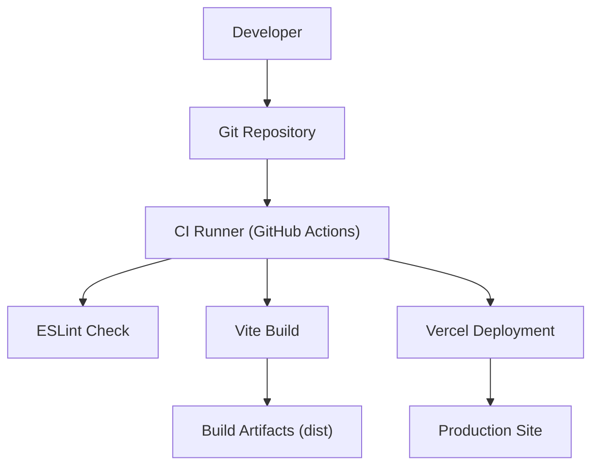
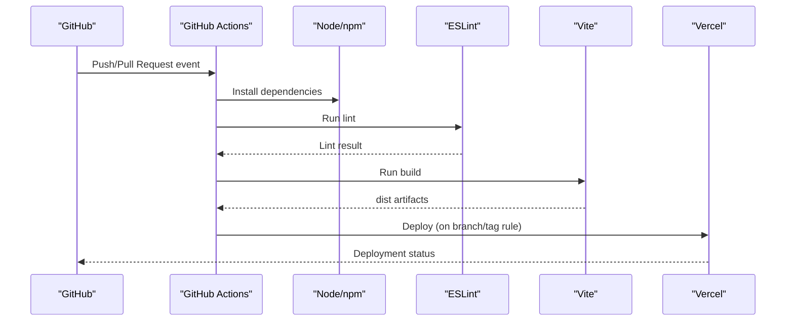
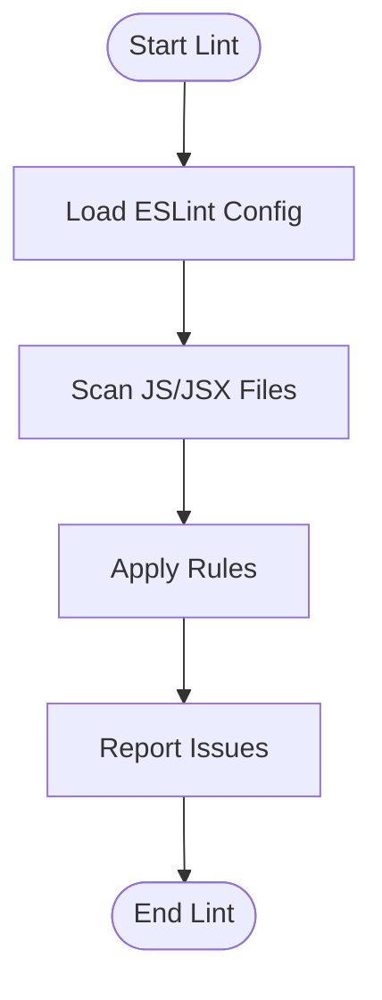
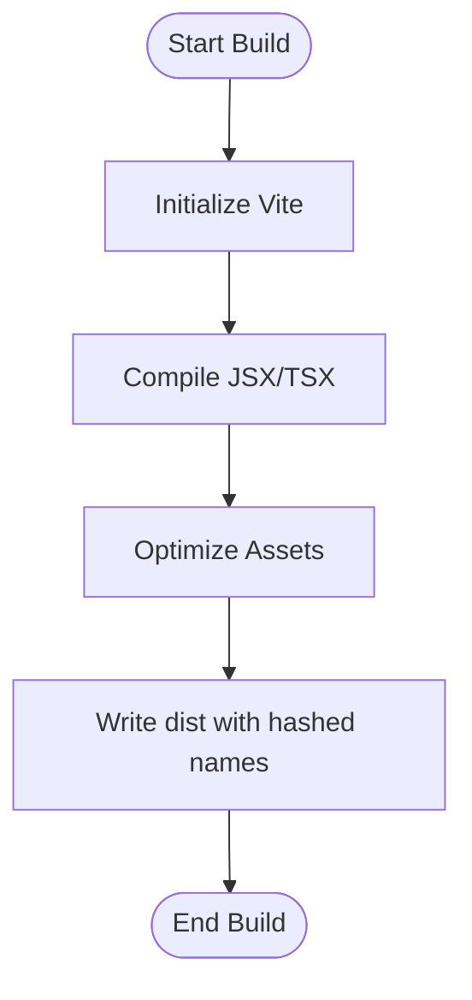
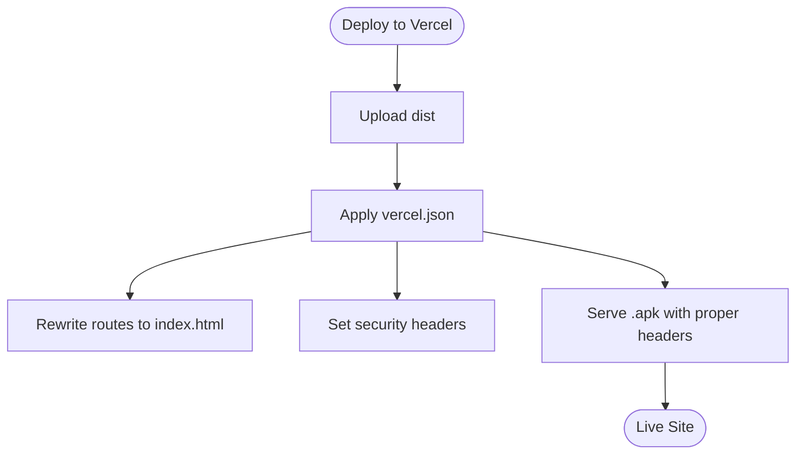
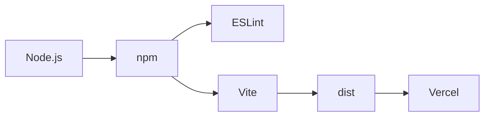

# CI/CD Pipeline Configuration

<cite>
**Referenced Files in This Document**
- [package.json](file://package.json)
- [eslint.config.js](file://eslint.config.js)
- [vite.config.js](file://vite.config.js)
- [vercel.json](file://vercel.json)
- [setup-frontend.sh](file://setup-frontend.sh)
</cite>

## Table of Contents
1. [Introduction](#introduction)
2. [Project Structure](#project-structure)
3. [Core Components](#core-components)
4. [Architecture Overview](#architecture-overview)
5. [Detailed Component Analysis](#detailed-component-analysis)
6. [Dependency Analysis](#dependency-analysis)
7. [Performance Considerations](#performance-considerations)
8. [Troubleshooting Guide](#troubleshooting-guide)
9. [Conclusion](#conclusion)
10. [Appendices](#appendices)

## Introduction
This document defines the CI/CD pipeline for the frontend application, covering automated testing, linting, building, and deployment to Vercel. It also provides guidance for pre-commit hooks, code quality checks, environment-specific configurations, deployment triggers, rollback strategies, and monitoring/logging/alerting for pipelines. The project uses Vite for building, ESLint for linting, and Vercel as the hosting platform.

## Project Structure
The repository is a React + Vite frontend with:
- Build tooling configured via Vite
- Linting via ESLint
- Deployment configuration via Vercel
- A setup script for scaffolding initial files

[No sources needed since this diagram shows conceptual workflow, not actual code structure]

**Section sources**
- [package.json:6-11](file://package.json#L6-L11)
- [eslint.config.js:1-29](file://eslint.config.js#L1-L29)
- [vite.config.js:1-36](file://vite.config.js#L1-L36)
- [vercel.json:1-48](file://vercel.json#L1-L48)

## Core Components
- Package scripts: dev, build, lint, preview
- Linting rules: ESLint flat config with recommended rules and React-specific plugins
- Build configuration: Vite output directory, source maps disabled, hashed asset names
- Deployment configuration: Vercel rewrites and security headers

Key responsibilities:
- Code validation via ESLint
- Asset optimization and bundling via Vite
- Static site serving and routing via Vercel

**Section sources**
- [package.json:6-11](file://package.json#L6-L11)
- [eslint.config.js:7-29](file://eslint.config.js#L7-L29)
- [vite.config.js:19-30](file://vite.config.js#L19-L30)
- [vercel.json:1-48](file://vercel.json#L1-L48)

## Architecture Overview
The CI/CD architecture integrates GitHub Actions with Vercel:
- On push or pull request, GitHub Actions runs lint and build steps
- On merge to main (or tag), GitHub Actions triggers a Vercel deployment
- Vercel serves the built assets with configured rewrites and security headers

**Diagram sources**
- [package.json:6-11](file://package.json#L6-L11)
- [eslint.config.js:7-29](file://eslint.config.js#L7-L29)
- [vite.config.js:19-30](file://vite.config.js#L19-L30)
- [vercel.json:1-48](file://vercel.json#L1-L48)

## Detailed Component Analysis

### Linting Stage (ESLint)
- Purpose: Enforce code quality and consistency
- Configuration: Flat config extending recommended rules, React hooks, and refresh plugin
- Execution: npm run lint

**Diagram sources**
- [eslint.config.js:7-29](file://eslint.config.js#L7-L29)

**Section sources**
- [eslint.config.js:1-29](file://eslint.config.js#L1-L29)

### Build Stage (Vite)
- Purpose: Bundle and optimize assets for production
- Output: dist directory with hashed filenames
- Security: Source maps disabled in production

**Diagram sources**
- [vite.config.js:19-30](file://vite.config.js#L19-L30)

**Section sources**
- [vite.config.js:1-36](file://vite.config.js#L1-L36)

### Deployment Stage (Vercel)
- Purpose: Serve the built frontend with secure headers and SPA routing
- Routing: Single-page app fallback to index.html
- Downloads: Serve Android APKs with correct content type and disposition

**Diagram sources**
- [vercel.json:1-48](file://vercel.json#L1-L48)

**Section sources**
- [vercel.json:1-48](file://vercel.json#L1-L48)

### Pre-commit Hooks Setup
Recommended local hooks using Husky + lint-staged:
- Hook: pre-commit
- Commands:
  - Run ESLint on staged files
  - Optionally run tests if added later
- Benefits: Catches issues before pushing to remote

Example commands (conceptual):
- husky install
- husky add .husky/pre-commit "npx lint-staged"
- lint-staged config to run eslint on *.js,*.jsx

[No sources needed since this section provides general guidance]

### Automated Testing Integration
- Current state: No test runner defined in package scripts
- Recommendation: Add Jest/Vitest and unit/integration tests
- CI integration: Add test step after lint and before build

[No sources needed since this section provides general guidance]

### Environment-Specific Configurations
- Development server: Port and open behavior configured in Vite
- Production headers: CSP, X-Frame-Options, X-Content-Type-Options, Referrer-Policy set via Vercel
- App name constant: Defined at build time via Vite define

**Section sources**
- [vite.config.js:7-17](file://vite.config.js#L7-L17)
- [vite.config.js:32-35](file://vite.config.js#L32-L35)
- [vercel.json:12-46](file://vercel.json#L12-L46)

### Rollback Strategies
- Vercel rollbacks: Use Vercel dashboard to revert to previous deployments
- Git-based rollbacks: Revert commit and redeploy
- Versioned artifacts: Keep dist outputs tagged by commit SHA for traceability

[No sources needed since this section provides general guidance]

### Monitoring, Logging, and Alerting
- Vercel analytics and logs: Access via Vercel dashboard
- Frontend analytics: Google Analytics and Clarity are allowed via CSP
- CI logs: GitHub Actions provides detailed logs per job and step

**Section sources**
- [vercel.json:31-31](file://vercel.json#L31-L31)

## Dependency Analysis
The CI/CD pipeline depends on:
- Node.js runtime and npm
- ESLint and its plugins
- Vite and React plugin
- Vercel CLI or API for deployment

**Diagram sources**
- [package.json:34-48](file://package.json#L34-L48)
- [vite.config.js:1-5](file://vite.config.js#L1-L5)
- [eslint.config.js:1-5](file://eslint.config.js#L1-L5)

**Section sources**
- [package.json:34-48](file://package.json#L34-L48)

## Performance Considerations
- Disable source maps in production builds to reduce bundle size
- Use hashed filenames for cache busting
- Leverage Vercel’s edge network for fast global delivery
- Minimize external dependencies and tree-shake unused code

**Section sources**
- [vite.config.js:19-30](file://vite.config.js#L19-L30)

## Troubleshooting Guide
Common issues and resolutions:
- Lint failures: Review ESLint errors and fix reported issues; ensure React hooks rules are satisfied
- Build failures: Verify Vite configuration and dependencies; confirm no syntax errors
- Deployment failures: Check Vercel environment variables and build settings; validate vercel.json headers and rewrites
- CSP errors: Ensure third-party domains are whitelisted in Content-Security-Policy

**Section sources**
- [eslint.config.js:7-29](file://eslint.config.js#L7-L29)
- [vite.config.js:19-30](file://vite.config.js#L19-L30)
- [vercel.json:12-46](file://vercel.json#L12-L46)

## Conclusion
This CI/CD pipeline automates linting, building, and deploying the frontend to Vercel. With the current configuration, you can enforce code quality, produce optimized static assets, and serve them securely. To further mature the pipeline, integrate automated tests, pre-commit hooks, and enhanced monitoring/alerting.

[No sources needed since this section summarizes without analyzing specific files]

## Appendices

### Example GitHub Actions Workflow (Conceptual)
- Triggers: push to main, pull_request to any branch
- Jobs:
  - lint: install deps, run ESLint
  - build: install deps, run Vite build
  - deploy: trigger Vercel deployment on main or tags

[No sources needed since this section provides general guidance]

### Local Setup Script
A helper script scaffolds initial project files and directories.

**Section sources**
- [setup-frontend.sh:1-98](file://setup-frontend.sh#L1-L98)