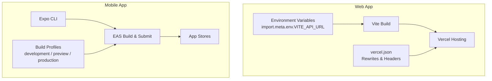
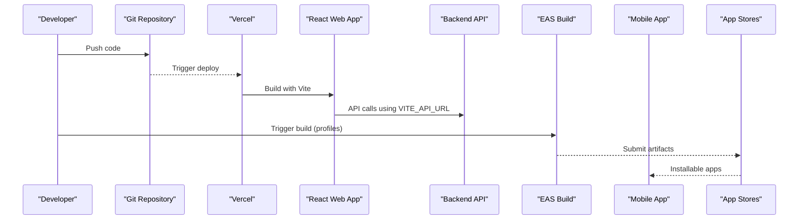
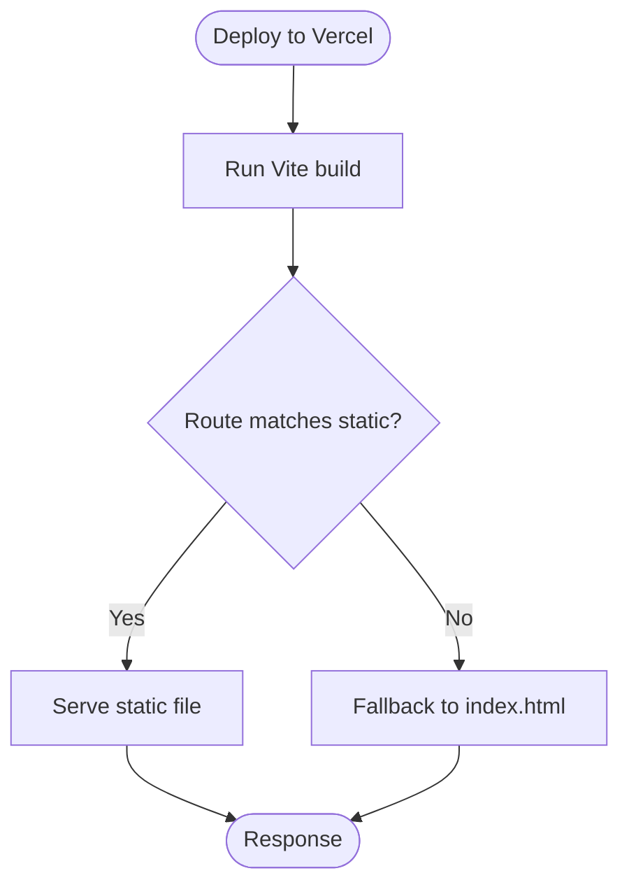
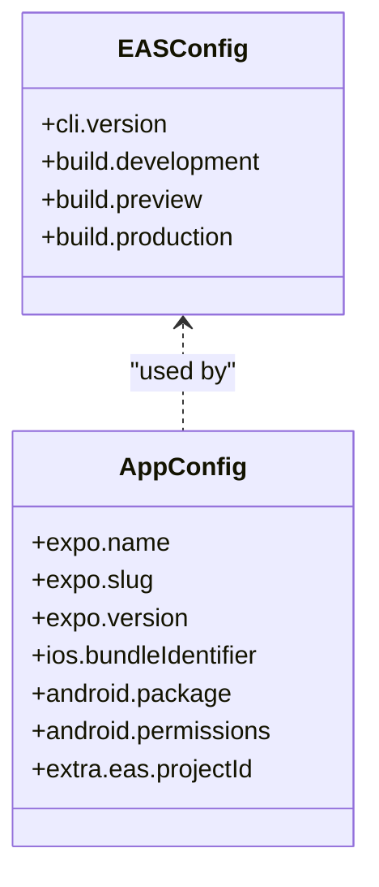
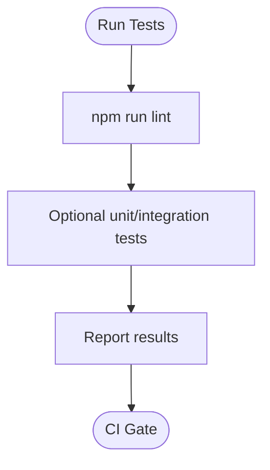
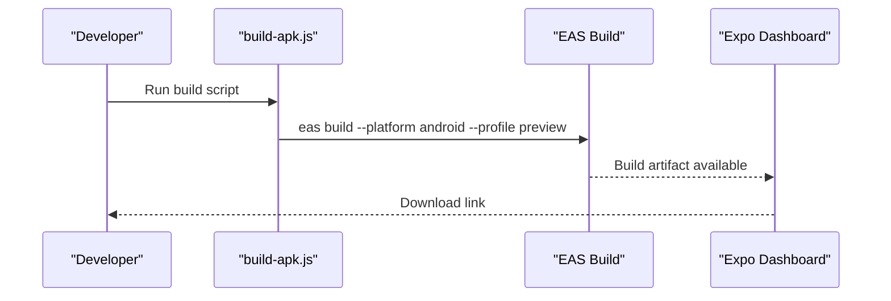
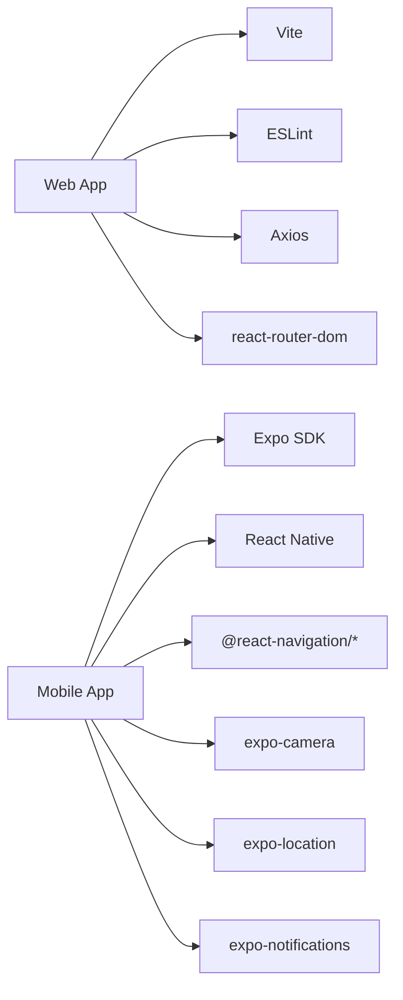
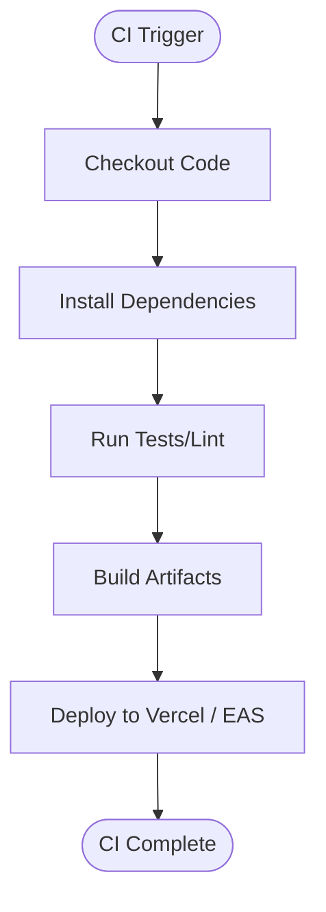

# Deployment Pipelines

<cite>
**Referenced Files in This Document**
- [vercel.json](file://vercel.json)
- [package.json](file://package.json)
- [vite.config.js](file://vite.config.js)
- [src/api/accommodation.js](file://src/api/accommodation.js)
- [src/api/api.js](file://src/api/api.js)
- [axx-spaces-mobile/eas.json](file://axx-spaces-mobile/eas.json)
- [axx-spaces-mobile/app.json](file://axx-spaces-mobile/app.json)
- [axx-spaces-mobile/package.json](file://axx-spaces-mobile/package.json)
- [axx-spaces-mobile/DEPLOYMENT.md](file://axx-spaces-mobile/DEPLOYMENT.md)
- [axx-spaces-mobile/BUILD_GUIDE.md](file://axx-spaces-mobile/BUILD_GUIDE.md)
- [axx-spaces-mobile/build-apk.js](file://axx-spaces-mobile/build-apk.js)
- [axx-spaces-mobile/version-manager.js](file://axx-spaces-mobile/version-manager.js)
</cite>

## Table of Contents
1. [Introduction](#introduction)
2. [Project Structure](#project-structure)
3. [Core Components](#core-components)
4. [Architecture Overview](#architecture-overview)
5. [Detailed Component Analysis](#detailed-component-analysis)
6. [Dependency Analysis](#dependency-analysis)
7. [Performance Considerations](#performance-considerations)
8. [Troubleshooting Guide](#troubleshooting-guide)
9. [Conclusion](#conclusion)
10. [Appendices](#appendices)

## Introduction
This document provides comprehensive deployment pipeline documentation for the React web application and the Expo-based mobile app. It covers:
- Vercel deployment configuration for the web app, including rewrites, headers, environment variables, and build hooks.
- Expo Application Services (EAS) setup for mobile distribution, including build profiles, signing considerations, and store submission.
- CI/CD pipeline examples, automated testing integration, and deployment automation scripts.
- Troubleshooting guides for common deployment issues across platforms.

## Project Structure
The repository contains:
- A React web application built with Vite at the root, configured for Vercel hosting.
- An Expo-based mobile application under axx-spaces-mobile, configured for EAS builds and distribution.

**Diagram sources**
- [vercel.json:1-48](file://vercel.json#L1-L48)
- [package.json:6-11](file://package.json#L6-L11)
- [axx-spaces-mobile/eas.json:1-28](file://axx-spaces-mobile/eas.json#L1-L28)
- [axx-spaces-mobile/package.json:5-13](file://axx-spaces-mobile/package.json#L5-L13)

**Section sources**
- [package.json:6-11](file://package.json#L6-L11)
- [vercel.json:1-48](file://vercel.json#L1-L48)
- [axx-spaces-mobile/package.json:5-13](file://axx-spaces-mobile/package.json#L5-L13)
- [axx-spaces-mobile/eas.json:1-28](file://axx-spaces-mobile/eas.json#L1-L28)

## Core Components
- Web App Build and Deploy:
  - Build tool: Vite (scripts defined in package.json).
  - Hosting: Vercel (configuration via vercel.json).
  - Environment variables: Vite uses import.meta.env; API base URL is set via VITE_API_URL.
- Mobile App Build and Distribute:
  - Framework: Expo + React Native.
  - Distribution: EAS Build and EAS Submit.
  - Profiles: development, preview, production defined in eas.json.
  - App metadata: app.json defines bundle identifiers, permissions, and extras.

**Section sources**
- [package.json:6-11](file://package.json#L6-L11)
- [vercel.json:1-48](file://vercel.json#L1-L48)
- [src/api/api.js:1-10](file://src/api/api.js#L1-L10)
- [axx-spaces-mobile/eas.json:1-28](file://axx-spaces-mobile/eas.json#L1-L28)
- [axx-spaces-mobile/app.json:1-49](file://axx-spaces-mobile/app.json#L1-L49)

## Architecture Overview
The deployment architecture integrates a Vercel-hosted web frontend and an EAS-managed mobile app that both communicate with a backend API.

**Diagram sources**
- [package.json:6-11](file://package.json#L6-L11)
- [vercel.json:1-48](file://vercel.json#L1-L48)
- [axx-spaces-mobile/eas.json:1-28](file://axx-spaces-mobile/eas.json#L1-L28)
- [axx-spaces-mobile/package.json:5-13](file://axx-spaces-mobile/package.json#L5-L13)

## Detailed Component Analysis

### Vercel Deployment Configuration (Web App)
- Rewrites:
  - SPA routing fallback to index.html for non-static assets.
  - Static downloads path preserved for APK distribution.
- Headers:
  - Security headers (CSP, X-Frame-Options, X-Content-Type-Options, Referrer-Policy).
  - Correct Content-Type and Content-Disposition for APK downloads.
- Build Hooks:
  - Use npm scripts from package.json to build and deploy.
- Environment Variables:
  - Vite reads import.meta.env.VITE_API_URL for backend connectivity.

**Diagram sources**
- [vercel.json:1-48](file://vercel.json#L1-L48)
- [package.json:6-11](file://package.json#L6-L11)

**Section sources**
- [vercel.json:1-48](file://vercel.json#L1-L48)
- [package.json:6-11](file://package.json#L6-L11)
- [src/api/api.js:1-10](file://src/api/api.js#L1-L10)
- [src/api/accommodation.js:1-10](file://src/api/accommodation.js#L1-L10)

### EAS Setup and Build Profiles (Mobile App)
- Profiles:
  - development: Development client, internal distribution.
  - preview: Internal distribution; Android APK, iOS simulator.
  - production: Android APK, iOS auto-increment versioning.
- App Metadata:
  - Bundle identifiers and package names are defined in app.json.
  - Permissions and cleartext traffic settings are declared for Android.
- Scripts:
  - Convenience scripts for building APKs and submitting to stores.

**Diagram sources**
- [axx-spaces-mobile/eas.json:1-28](file://axx-spaces-mobile/eas.json#L1-L28)
- [axx-spaces-mobile/app.json:1-49](file://axx-spaces-mobile/app.json#L1-L49)

**Section sources**
- [axx-spaces-mobile/eas.json:1-28](file://axx-spaces-mobile/eas.json#L1-L28)
- [axx-spaces-mobile/app.json:1-49](file://axx-spaces-mobile/app.json#L1-L49)
- [axx-spaces-mobile/package.json:5-13](file://axx-spaces-mobile/package.json#L5-L13)

### Automated Testing Integration
- Web App:
  - Linting via ESLint script.
  - Optional unit/integration tests can be added to package.json scripts and run during CI.
- Mobile App:
  - The build guide references running tests via npm test if configured.

**Diagram sources**
- [package.json:6-11](file://package.json#L6-L11)
- [axx-spaces-mobile/BUILD_GUIDE.md:137-142](file://axx-spaces-mobile/BUILD_GUIDE.md#L137-L142)

**Section sources**
- [package.json:6-11](file://package.json#L6-L11)
- [axx-spaces-mobile/BUILD_GUIDE.md:137-142](file://axx-spaces-mobile/BUILD_GUIDE.md#L137-L142)

### Deployment Automation Scripts
- Web App:
  - Standard Vite build and preview scripts.
- Mobile App:
  - build-apk.js orchestrates EAS builds for Android APK distribution.
  - version-manager.js manages semantic versioning and changelog updates.

**Diagram sources**
- [axx-spaces-mobile/build-apk.js:1-51](file://axx-spaces-mobile/build-apk.js#L1-L51)
- [axx-spaces-mobile/package.json:5-13](file://axx-spaces-mobile/package.json#L5-L13)

**Section sources**
- [axx-spaces-mobile/build-apk.js:1-51](file://axx-spaces-mobile/build-apk.js#L1-L51)
- [axx-spaces-mobile/version-manager.js:1-116](file://axx-spaces-mobile/version-manager.js#L1-L116)
- [axx-spaces-mobile/package.json:5-13](file://axx-spaces-mobile/package.json#L5-L13)

## Dependency Analysis
- Web App Dependencies:
  - Vite for building and previewing.
  - ESLint for linting.
  - Runtime dependencies include axios, react-router-dom, and analytics integrations.
- Mobile App Dependencies:
  - Expo SDK and React Native ecosystem packages.
  - Navigation, camera, location, notifications, secure storage, and webview.

**Diagram sources**
- [package.json:12-48](file://package.json#L12-L48)
- [axx-spaces-mobile/package.json:14-35](file://axx-spaces-mobile/package.json#L14-L35)

**Section sources**
- [package.json:12-48](file://package.json#L12-L48)
- [axx-spaces-mobile/package.json:14-35](file://axx-spaces-mobile/package.json#L14-L35)

## Performance Considerations
- Web App:
  - Ensure minimal bundle size by tree-shaking and lazy loading routes/components.
  - Leverage Vercel’s edge caching and CDN for static assets.
  - Configure CSP carefully to avoid blocking legitimate resources.
- Mobile App:
  - Use preview builds for faster iteration; production builds for release.
  - Keep app size reasonable; enable ProGuard/R8 for Android.
  - Monitor network requests and optimize API calls.

[No sources needed since this section provides general guidance]

## Troubleshooting Guide

### Web App (Vercel)
- Routing Issues:
  - Verify rewrites in vercel.json ensure SPA fallback to index.html.
- Static Assets:
  - Confirm downloads path rewrite preserves original paths.
- Security Headers:
  - Validate CSP allows required third-party domains for analytics and auth providers.
- Environment Variables:
  - Ensure VITE_API_URL is set in Vercel project settings or .env files.

**Section sources**
- [vercel.json:1-48](file://vercel.json#L1-L48)
- [src/api/api.js:1-10](file://src/api/api.js#L1-L10)

### Mobile App (EAS)
- Build Profile Misconfiguration:
  - Check eas.json for correct platform-specific settings per profile.
- Signing and Credentials:
  - Follow DEPLOYMENT.md for iOS provisioning and Android keystore management.
- Store Submission:
  - Use eas submit commands and configure service accounts for Google Play.

**Section sources**
- [axx-spaces-mobile/eas.json:1-28](file://axx-spaces-mobile/eas.json#L1-L28)
- [axx-spaces-mobile/DEPLOYMENT.md:46-117](file://axx-spaces-mobile/DEPLOYMENT.md#L46-L117)
- [axx-spaces-mobile/DEPLOYMENT.md:119-197](file://axx-spaces-mobile/DEPLOYMENT.md#L119-L197)

### CI/CD Pipeline Examples
- GitHub Actions for Web:
  - Install dependencies, run lint/tests, build with Vite, deploy to Vercel.
- GitHub Actions for Mobile:
  - Trigger on tags, install dependencies, run EAS build for Android/iOS, upload artifacts.

[No sources needed since this diagram shows conceptual workflow, not actual code structure]

## Conclusion
This deployment pipeline leverages Vercel for fast, secure web deployments and EAS for streamlined mobile app builds and distribution. By configuring rewrites, headers, environment variables, and build profiles appropriately, teams can automate reliable releases across platforms. Incorporating CI/CD pipelines and automated testing ensures consistent quality and rapid feedback loops.

[No sources needed since this section summarizes without analyzing specific files]

## Appendices

### Environment Variables Reference
- Web App:
  - VITE_API_URL: Base URL for backend API calls.
- Mobile App:
  - API_URL: Conditional dev/prod URL configuration in src/config.js.

**Section sources**
- [src/api/api.js:1-10](file://src/api/api.js#L1-L10)
- [axx-spaces-mobile/src/config.js:1-10](file://axx-spaces-mobile/src/config.js#L1-L10)

### Build Commands Summary
- Web App:
  - npm run build
  - npm run lint
- Mobile App:
  - npm run build:apk
  - npm run build:android
  - npm run submit:android

**Section sources**
- [package.json:6-11](file://package.json#L6-L11)
- [axx-spaces-mobile/package.json:5-13](file://axx-spaces-mobile/package.json#L5-L13)